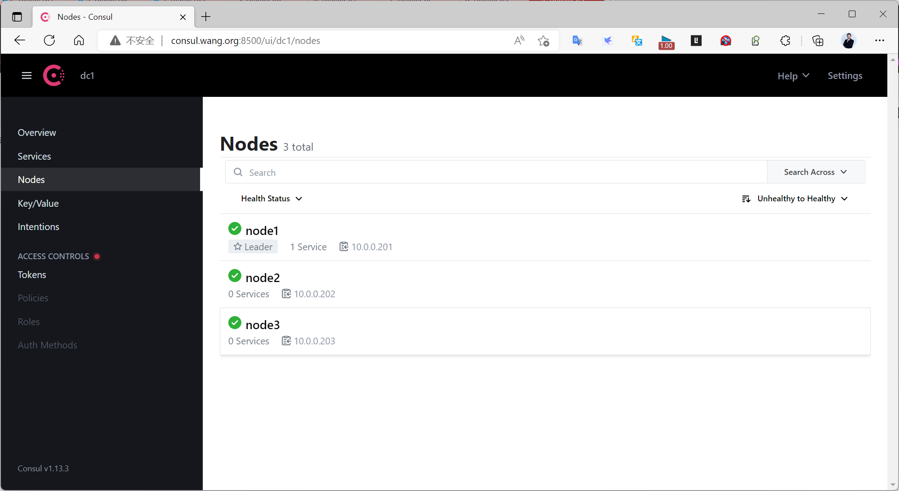
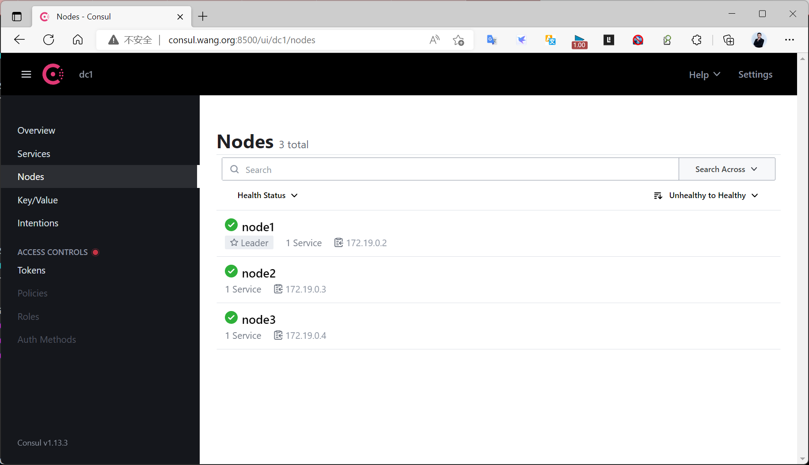

[← 返回 Prometheus 目录]({{ '/subjects/Prometheus/' | relative_url }})



# 19 Consul 集群部署

上一章的单节点 server 能演示服务注册，但该主机故障后就失去查询和写入能力。本章建立三个 server 的实验集群，重点检查**成员是否加入**与**Raft 是否有三个投票节点**。这两项不能混为一谈：原资料的日志里 node2、node3 显示为 `client`，虽然 `consul members` 列出了三台机器，实际并不是三 server 高可用集群。

## 6.4.2.2 三节点集群的角色与前提

Consul agent 的 **server** 持有集群状态并参与 Raft；**client** 负责本地服务注册、查询转发和健康检查，不参与投票。三台 server 通常可以容忍其中一台故障，前提是仍有两台保持通信，即满足多数派。两台 server 不能比三台 server 多容忍一台故障，因此不要把“`bootstrap_expect=2`”理解成高可用的推荐值。

本例使用三台独立主机：

| 节点 | 地址 | 角色 |
| --- | --- | --- |
| node1 | `10.0.0.201` | server |
| node2 | `10.0.0.202` | server |
| node3 | `10.0.0.203` | server |

三台应位于同一数据中心标识 `dc1`，彼此的 `8300/TCP`（server RPC）、`8301/TCP/UDP`（LAN gossip）可达。HTTP API 默认在 `8500/TCP`，DNS 默认在 `8600/TCP/UDP`；开放范围应按访问需求限制。生产环境还需 ACL、TLS 与 gossip 加密，并将每台数据目录放在可靠存储上。详细选项见 [官方 Agent 配置文档](https://developer.hashicorp.com/consul/docs/agent/config/config-files)。

### 6.4.2.2.1 在三台主机配置 server

先在每台机器安装相同兼容版本的 Consul，并创建各自独立的数据目录；不要将第 18 章**已运行的单机集群数据目录**直接复制到另外两台，否则节点 ID 和 Raft 状态会冲突。以下是 node1 的 `/etc/consul.d/consul.hcl`，node2、node3 分别替换 `node_name` 和 `bind_addr`，其余字段保持一致：

```hcl
datacenter = "dc1"
node_name = "node1"
data_dir = "/data/consul"
server = true
bootstrap_expect = 3
bind_addr = "10.0.0.201"
client_addr = "127.0.0.1"
retry_join = ["10.0.0.201", "10.0.0.202", "10.0.0.203"]
ui_config {
  enabled = true
}
```

`bootstrap_expect = 3` 表示首次引导等待三台 server；不能只给 node1 使用旧的 `-bootstrap`，再给另外两台设置 `bootstrap_expect`。原资料正是把两种引导方式混用，日志显示 node2 与 node3 为 client。三个 `retry_join` 地址用于节点启动时互相发现；`bind_addr` 则必须是该节点真实可达的地址。

在每台主机运行：

```bash
sudo install -d -o consul -g consul /data/consul
sudo consul validate /etc/consul.d
sudo systemctl enable --now consul
sudo systemctl status consul
```

沿用第 18 章的 systemd 服务文件即可，其 `ExecStart` 应为 `consul agent -config-dir=/etc/consul.d`。新节点开始时可能出现“尚无 leader”的日志，待三个 server 都加入后再判断是否异常。不同主机的 systemd 日志可用 `journalctl -u consul -e` 查看。

### 6.4.2.2.2 核对成员和 Raft 投票节点

在任一节点运行：

```bash
consul members
consul operator raft list-peers
curl -fsS http://127.0.0.1:8500/v1/status/leader
```

`consul members` 应列出 node1、node2、node3，且 `Type` 都是 `server`、`Status` 都是 `alive`。`raft list-peers` 应列出三个 server 的投票信息，且有且仅有一个 leader。最后的 HTTP 接口应返回非空的 leader 地址。成员状态正常却只有一个 Raft peer 时，优先检查 `server = true`、`bootstrap_expect`、旧数据目录、节点间端口与日志。



可以在维护窗口短暂停止其中一台 server，确认剩余两台仍能选出 leader、HTTP 查询正常，再重新启动。**不要同时停两台**；失去多数派会导致写入不可用。恢复后再次检查三个成员与 Raft peer。

### 6.4.2.2.3 容器实验与宿主机故障域

在单台宿主机上用 Compose 起三个 server，能演示 Raft 和路由流程，但**不能**抵御宿主机故障。下面每个 server 使用独立卷，三个容器在同一私有网络相互发现。不要和前面的主机版服务同时占用 `8500`。

```yaml
services:
  consul1:
    image: hashicorp/consul:1.21
    command: agent -server -bootstrap-expect=3 -node=consul1 -bind=0.0.0.0 -client=0.0.0.0 -data-dir=/consul/data -retry-join=consul2 -retry-join=consul3
    volumes:
      - consul1_data:/consul/data
    ports:
      - "8500:8500"
  consul2:
    image: hashicorp/consul:1.21
    command: agent -server -bootstrap-expect=3 -node=consul2 -bind=0.0.0.0 -client=0.0.0.0 -data-dir=/consul/data -retry-join=consul1 -retry-join=consul3
    volumes:
      - consul2_data:/consul/data
  consul3:
    image: hashicorp/consul:1.21
    command: agent -server -bootstrap-expect=3 -node=consul3 -bind=0.0.0.0 -client=0.0.0.0 -data-dir=/consul/data -retry-join=consul1 -retry-join=consul2
    volumes:
      - consul3_data:/consul/data

volumes:
  consul1_data:
  consul2_data:
  consul3_data:
```

```bash
docker compose up -d
docker compose exec consul1 consul members
docker compose exec consul1 consul operator raft list-peers
```

若容器镜像版本与本文示例不同，先核对对应版本的官方镜像名称与参数。部署在多台宿主机时还要处理容器网络、对外通告地址和跨主机端口，不能直接把这个单机 Compose 文件当作生产集群。



### 6.4.2.2.4 日常操作的边界

`consul join <地址>` 用于让已启动的 agent 加入现有集群；`consul leave` 让当前 agent 有序离开。HTTP API `/v1/catalog/nodes` 可列出目录节点，但它不能取代 Raft peer 检查。新增或迁移 server、调整投票成员之前，先确认集群健康与数据备份；下一章再将服务实例注册进这个集群，并让 Prometheus 从 Consul 获取抓取目标。


<nav class="article-end" aria-label="章节导航">
  <a href="{{ '/subjects/Prometheus/18-consul-introduction-single.html' | relative_url }}">← 上一章：Consul 简介与单机部署</a>
  <a href="{{ '/subjects/Prometheus/' | relative_url }}">返回 Prometheus 目录</a>
  <a href="{{ '/subjects/Prometheus/20-consul-registration-prometheus.html' | relative_url }}">下一章：Consul 自动注册与监控采集 →</a>
</nav>
