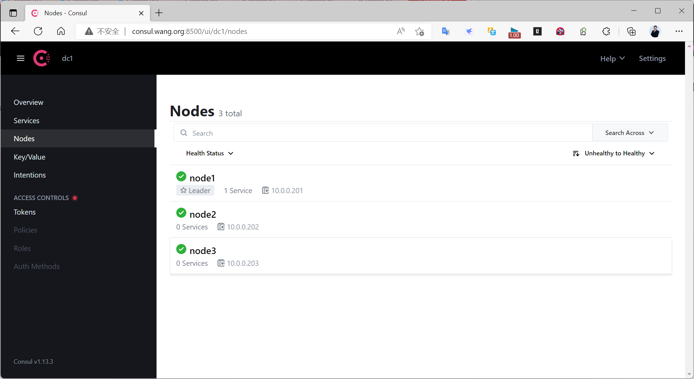
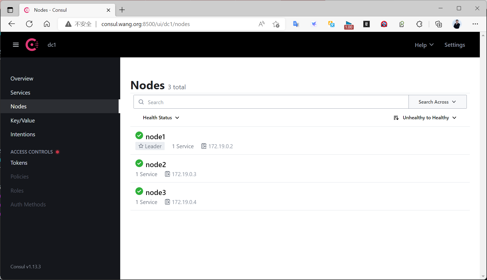

[← 返回 Prometheus 目录]({{ '/subjects/Prometheus/' | relative_url }})



# 19 Consul 集群部署

## 6.4.2.2 部署 Consul 集群

6.4.2.2.1 Consul 集群说明

帮助
https://developer.hashicorp.com/consul/docs/agent/config/config-files
https://developer.hashicorp.com/consul/docs/agent/config/cli-flags

集群架构说明
https://developer.hashicorp.com/consul/docs/install/glossary

Consul 集群架构

Server是consul服务端高可用集群，Client是consul客户端。

consul客户端不保存数据，客户端将接收到的请求转发给响应的Server端。

Server之间通过局域网或广域网通信实现数据一致性。

每个Server或Client都是一个consul agent 程序实现的。

Consul集群节点之间使用了GOSSIP协议通信和raft一致性算法。

Consul 集群中的每个 Agent 生命周期
https://developer.hashicorp.com/consul/docs/agent

Agent 可以手动启动，也可以通过自动化或程序化过程启动。新启动的 Agent 不知道集群中的其他节
点。  
Agent 加入集群，使 Agent 能够发现 Agent 对等点。当发出加入命令或根据自动加入配置时， Agent  
会在启动时加入集群。  
有关 Agent 的信息被传递到整个集群。结果，所有节点最终都会相互了解。  
如果 Agent 是 Server，现有服务器将开始复制到新节点。  

6.4.2.2.2 Consul 部署

6.4.2.2.2.1 二进制部署 Consul 集群

官方说明
https://developer.hashicorp.com/consul/docs/agent/config/cli-flags

consul agent  选项说明
```text
-server  #使用server 模式运行consul 服务,consul支持以server或client的模式运行, server是服
务发现模块的核心, client主要用于转发请求
-bootstrap #首次部署使用初始化模式
-bostrap-expect 2 #集群至少两台服务器，才能选举集群leader,默认值为3
-bind #该地址用来在集群内部的通讯，集群内的所有节点到地址都必须是可达的，默认是0.0.0.0,有多个IP需要
手动指定,否则可能会出错
-client #设置客户端访问的监听地址,此地址提供HTTP、DNS、RPC等服务，默认是127.0.0.1
-data-dir #指定数据保存路径
-ui #运行 web 控制台,监听8500/tcp端口
-node #此节点的名称,群集中必须唯一
-datacenter=dc1 #数据中心名称，默认是dc1
-retry-join #指定要加入的集群中已有consul节点的地址，失败会重试, 可多次指定不同的地址,代替旧版本中
的-join选项
```

范例:
```text
#node1:
consul agent -server -bind=10.0.0.201 -client=0.0.0.0 -data-dir=/data/consul -
node=node1 -ui -bootstrap
#node2:
consul agent -server -bind=10.0.0.202 -client=0.0.0.0 -data-dir=/data/consul -
node=node2  -retry-join=10.0.0.201 -ui -bootstrap-expect 2
#node3:
consul agent -server -bind=10.0.0.203 -client=0.0.0.0 -data-dir=/data/consul -
node=node3  -retry-join=10.0.0.201 -ui -bootstrap-expect 2
```

范例:
```bash
#启动第1个节点
[root@ubuntu2204 ~]#consul agent -bind=10.0.0.201 -client=0.0.0.0 -data-
dir=/data/consul -node=node1 -ui -server -bootstrap
==> Starting Consul agent...
              Version: '1.13.3'
           Build Date: '2022-10-19 19:49:59 +0000 UTC'
              Node ID: 'aa153028-5541-0678-bfc7-e0b531d1344f'
            Node name: 'node1'
           Datacenter: 'dc1' (Segment: '<all>')
               Server: true (Bootstrap: true)
          Client Addr: [0.0.0.0] (HTTP: 8500, HTTPS: -1, gRPC: -1, DNS: 8600)
         Cluster Addr: 10.0.0.201 (LAN: 8301, WAN: 8302)
    Gossip Encryption: false
     Auto-Encrypt-TLS: false
            HTTPS TLS: Verify Incoming: false, Verify Outgoing: false, Min Version:
TLSv1_2
             gRPC TLS: Verify Incoming: false, Min Version: TLSv1_2
     Internal RPC TLS: Verify Incoming: false, Verify Outgoing: false (Verify
Hostname: false), Min Version: TLSv1_2
==> Log data will now stream in as it occurs:
2022-10-29T16:57:05.284+0800 [WARN]  agent: bootstrap = true: do not enable unless
necessary
2022-10-29T16:57:05.288+0800 [WARN]  agent.auto_config: bootstrap = true: do not
enable unless necessary
2022-10-29T16:57:05.289+0800 [INFO]  agent.server.raft: initial configuration:
index=1 servers="[{Suffrage:Voter ID:aa153028-5541-0678-bfc7-e0b531d1344f
Address:10.0.0.201:8300}]"
2022-10-29T16:57:05.290+0800 [INFO]  agent.server.raft: entering follower state:
follower="Node at 10.0.0.201:8300 [Follower]" leader-address= leader-id=
2022-10-29T16:57:05.290+0800 [INFO]  agent.server.serf.wan: serf: EventMemberJoin:
node1.dc1 10.0.0.201
2022-10-29T16:57:05.290+0800 [INFO]  agent.server.serf.wan: serf: Attempting re-join
to previously known node: consul.dc1: 10.0.0.201:8302
2022-10-29T16:57:05.290+0800 [INFO]  agent.server.serf.lan: serf: EventMemberJoin:
node1 10.0.0.201
2022-10-29T16:57:05.290+0800 [INFO]  agent.router: Initializing LAN area manager
2022-10-29T16:57:05.291+0800 [INFO]  agent.server.autopilot: reconciliation now
disabled
2022-10-29T16:57:05.291+0800 [INFO]  agent.server.serf.lan: serf: Attempting re-join
to previously known node: consul: 10.0.0.201:8301
2022-10-29T16:57:05.291+0800 [INFO]  agent.server: Adding LAN server: server="node1
(Addr: tcp/10.0.0.201:8300) (DC: dc1)"
2022-10-29T16:57:05.291+0800 [INFO]  agent.server: Handled event for server in area:
event=member-join server=node1.dc1 area=wan
2022-10-29T16:57:05.292+0800 [WARN]  agent: [core]grpc: addrConn.createTransport
failed to connect to {dc1-10.0.0.201:8300 node1 <nil> 0 <nil>}. Err: connection
error: desc = "transport: Error while dialing dial tcp 10.0.0.201:0->10.0.0.201:8300:
operation was canceled". Reconnecting...
2022-10-29T16:57:05.292+0800 [INFO]  agent.server.serf.wan: serf: Re-joined to
previously known node: consul.dc1: 10.0.0.201:8302
2022-10-29T16:57:05.293+0800 [INFO]  agent.server.serf.lan: serf: Re-joined to
previously known node: consul: 10.0.0.201:8301
2022-10-29T16:57:05.294+0800 [INFO]  agent: Started DNS server: address=0.0.0.0:8600
network=udp
2022-10-29T16:57:05.294+0800 [INFO]  agent: Started DNS server: address=0.0.0.0:8600
network=tcp
2022-10-29T16:57:05.294+0800 [INFO]  agent: Starting server: address=[::]:8500
network=tcp protocol=http
2022-10-29T16:57:05.296+0800 [INFO]  agent: started state syncer
2022-10-29T16:57:05.296+0800 [INFO]  agent: Consul agent running!
2022-10-29T16:57:10.836+0800 [WARN]  agent.server.raft: heartbeat timeout reached,
starting election: last-leader-addr= last-leader-id=
2022-10-29T16:57:10.836+0800 [INFO]  agent.server.raft: entering candidate state:
node="Node at 10.0.0.201:8300 [Candidate]" term=3
2022-10-29T16:57:10.837+0800 [INFO]  agent.server.raft: election won: tally=1
2022-10-29T16:57:10.837+0800 [INFO]  agent.server.raft: entering leader state:
leader="Node at 10.0.0.201:8300 [Leader]"
2022-10-29T16:57:10.837+0800 [INFO]  agent.server: cluster leadership acquired
2022-10-29T16:57:10.837+0800 [INFO]  agent.server: New leader elected: payload=node1
2022-10-29T16:57:10.839+0800 [INFO]  agent.server.autopilot: reconciliation now
enabled
2022-10-29T16:57:10.839+0800 [INFO]  agent.leader: started routine:
routine="federation state anti-entropy"
2022-10-29T16:57:10.839+0800 [INFO]  agent.leader: started routine:
routine="federation state pruning"
2022-10-29T16:57:10.839+0800 [INFO]  agent.server: member joined, marking health
alive: member=node1 partition=default
2022-10-29T16:57:10.884+0800 [INFO]  agent: Synced node info
2022-10-29T16:57:25.188+0800 [INFO]  agent.server.serf.lan: serf: EventMemberJoin:
node2 10.0.0.202
2022-10-29T16:57:25.188+0800 [INFO]  agent.server: member joined, marking health
alive: member=node2 partition=default
2022-10-29T16:58:12.847+0800 [INFO]  agent.server.serf.lan: serf: EventMemberJoin:
node3 10.0.0.203
2022-10-29T16:58:12.847+0800 [INFO]  agent.server: member joined, marking health
alive: member=node3 partition=default
2022-10-29T16:58:31.184+0800 [ERROR] agent.http: Request error: method=GET
url=/v1/discovery-chain/consul?dc=dc1 from=10.0.0.1:7515 error="Connect must be
enabled in order to use this endpoint"
#启动第2个节点
[root@ubuntu2204 ~]#consul agent -bind=10.0.0.202 -client=0.0.0.0 -data-
dir=/data/consul -node=node2 -retry-join=10.0.0.201 -ui  -server -bootstrap-expect 2
==> Starting Consul agent...
              Version: '1.13.3'
           Build Date: '2022-10-19 19:49:59 +0000 UTC'
              Node ID: '96af8fd9-c023-ad17-7407-736c6ba7bc50'
            Node name: 'node2'
           Datacenter: 'dc1' (Segment: '')
               Server: false (Bootstrap: false)
          Client Addr: [0.0.0.0] (HTTP: 8500, HTTPS: -1, gRPC: -1, DNS: 8600)
         Cluster Addr: 10.0.0.202 (LAN: 8301, WAN: 8302)
    Gossip Encryption: false
     Auto-Encrypt-TLS: false
            HTTPS TLS: Verify Incoming: false, Verify Outgoing: false, Min Version:
TLSv1_2
             gRPC TLS: Verify Incoming: false, Min Version: TLSv1_2
     Internal RPC TLS: Verify Incoming: false, Verify Outgoing: false (Verify
Hostname: false), Min Version: TLSv1_2
==> Log data will now stream in as it occurs:
2022-10-29T16:57:25.153+0800 [INFO]  agent.client.serf.lan: serf: EventMemberJoin:
node2 10.0.0.202
2022-10-29T16:57:25.153+0800 [INFO]  agent.router: Initializing LAN area manager
2022-10-29T16:57:25.153+0800 [INFO]  agent: Started DNS server: address=0.0.0.0:8600
network=udp
2022-10-29T16:57:25.154+0800 [INFO]  agent.client.serf.lan: serf: Attempting re-join
to previously known node: consul: 10.0.0.202:8301
2022-10-29T16:57:25.154+0800 [INFO]  agent: Started DNS server: address=0.0.0.0:8600
network=tcp
2022-10-29T16:57:25.154+0800 [INFO]  agent: Starting server: address=[::]:8500
network=tcp protocol=http
2022-10-29T16:57:25.155+0800 [INFO]  agent.client.serf.lan: serf: Re-joined to
previously known node: consul: 10.0.0.202:8301
2022-10-29T16:57:25.155+0800 [INFO]  agent: Joining cluster
2022-10-29T16:57:25.155+0800 [INFO]  agent: (LAN) joining: lan_addresses=[10.0.0.201]
2022-10-29T16:57:25.157+0800 [INFO]  agent.client.serf.lan: serf: EventMemberJoin:
node1 10.0.0.201
2022-10-29T16:57:25.157+0800 [INFO]  agent: (LAN) joined: number_of_nodes=1
2022-10-29T16:57:25.157+0800 [INFO]  agent: Join completed. Initial agents synced
with: agent_count=1
2022-10-29T16:57:25.157+0800 [INFO]  agent: started state syncer
2022-10-29T16:57:25.157+0800 [INFO]  agent: Consul agent running!
2022-10-29T16:57:25.157+0800 [INFO]  agent.client: adding server: server="node1
(Addr: tcp/10.0.0.201:8300) (DC: dc1)"
2022-10-29T16:57:25.157+0800 [WARN]  agent.router.manager: No servers available
2022-10-29T16:57:25.158+0800 [ERROR] agent.anti_entropy: failed to sync remote state:
error="No known Consul servers"
2022-10-29T16:57:25.616+0800 [INFO]  agent: Synced node info
2022-10-29T16:58:12.861+0800 [INFO]  agent.client.serf.lan: serf: EventMemberJoin:
node3 10.0.0.203
#启动第3个节点
[root@ubuntu2204 ~]#consul agent -bind=10.0.0.203 -client=0.0.0.0 -data-
dir=/data/consul -node=node3 -retry-join=10.0.0.201 -ui  -server -bootstrap-expect 2
==> Starting Consul agent...
              Version: '1.13.3'
           Build Date: '2022-10-19 19:49:59 +0000 UTC'
              Node ID: '5483a4ba-507d-51b7-4b07-5c8c823b4c30'
            Node name: 'node3'
           Datacenter: 'dc1' (Segment: '')
               Server: false (Bootstrap: false)
          Client Addr: [0.0.0.0] (HTTP: 8500, HTTPS: -1, gRPC: -1, DNS: 8600)
         Cluster Addr: 10.0.0.203 (LAN: 8301, WAN: 8302)
    Gossip Encryption: false
     Auto-Encrypt-TLS: false
            HTTPS TLS: Verify Incoming: false, Verify Outgoing: false, Min Version:
TLSv1_2
             gRPC TLS: Verify Incoming: false, Min Version: TLSv1_2
     Internal RPC TLS: Verify Incoming: false, Verify Outgoing: false (Verify
Hostname: false), Min Version: TLSv1_2
==> Log data will now stream in as it occurs:
2022-10-29T16:58:12.815+0800 [INFO]  agent.client.serf.lan: serf: EventMemberJoin:
node3 10.0.0.203
2022-10-29T16:58:12.815+0800 [INFO]  agent.router: Initializing LAN area manager
2022-10-29T16:58:12.815+0800 [INFO]  agent.client.serf.lan: serf: Attempting re-join
to previously known node: consul: 10.0.0.203:8301
2022-10-29T16:58:12.815+0800 [INFO]  agent: Started DNS server: address=0.0.0.0:8600
network=udp
2022-10-29T16:58:12.816+0800 [INFO]  agent: Started DNS server: address=0.0.0.0:8600
network=tcp
2022-10-29T16:58:12.816+0800 [INFO]  agent: Starting server: address=[::]:8500
network=tcp protocol=http
2022-10-29T16:58:12.816+0800 [INFO]  agent: Joining cluster
2022-10-29T16:58:12.817+0800 [INFO]  agent: (LAN) joining: lan_addresses=[10.0.0.201]
2022-10-29T16:58:12.818+0800 [INFO]  agent.client.serf.lan: serf: Re-joined to
previously known node: consul: 10.0.0.203:8301
2022-10-29T16:58:12.819+0800 [INFO]  agent.client.serf.lan: serf: EventMemberJoin:
node2 10.0.0.202
2022-10-29T16:58:12.819+0800 [INFO]  agent.client.serf.lan: serf: EventMemberJoin:
node1 10.0.0.201
2022-10-29T16:58:12.819+0800 [INFO]  agent: (LAN) joined: number_of_nodes=1
2022-10-29T16:58:12.819+0800 [INFO]  agent: Join completed. Initial agents synced
with: agent_count=1
2022-10-29T16:58:12.819+0800 [INFO]  agent: started state syncer
2022-10-29T16:58:12.819+0800 [INFO]  agent: Consul agent running!
2022-10-29T16:58:12.819+0800 [INFO]  agent.client: adding server: server="node1
(Addr: tcp/10.0.0.201:8300) (DC: dc1)"
2022-10-29T16:58:12.824+0800 [INFO]  agent: Synced node info
```

启动成功后，可以访问下面链接
```text
http://consul.bowen.org:8500
#访问第一个有-ui功能的节点
```



6.4.2.2.2.2 基于 Docker-compose 部署 Consul 集群
```bash
[root@ubuntu2204 ~]#apt -y install docker-compose
[root@ubuntu2204 ~]#docker-compose -v
docker-compose version 1.29.2, build unknown
[root@ubuntu2204 ~]#mkdir -p /data/consul/
[root@ubuntu2204 ~]#cat > /data/consul/docker-compose.yaml << EOF
version: '2'
networks:
  consul:
services:
  consul1:
    image: consul:1.13.3
    container_name: node1
    volumes:
      - /data/consul/conf_with_acl:/consul/config
    command: agent -server -ui -bootstrap-expect=2 -node=node1 -bind=0.0.0.0 -
client=0.0.0.0 -config-dir=/consul/config
    ports:
      - 8500:8500
    networks:
      - consul
  consul2:
    image: consul:1.13.3
    container_name: node2
    volumes:
      - /data/consul/conf_with_acl:/consul/config
    command: agent -server -retry-join=node1 -node=node2 -bind=0.0.0.0 -
client=0.0.0.0 -config-dir=/consul/config
    depends_on:
         - consul1
    networks:
      - consul
  consul3:
    image: consul:1.13.3
    volumes:
      - /data/consul/conf_with_acl:/consul/config
    container_name: node3
    command: agent -server -retry-join=node1 -node=node3 -bind=0.0.0.0 -
client=0.0.0.0 -config-dir=/consul/config
    depends_on:
         - consul1
    networks:
      - consul
EOF
[root@ubuntu2204 ~]#cd /data/consul/
[root@ubuntu2204 ~]#docker-compose up -d
```



6.4.2.2.3 Consul 集群管理

查看集群成员

使用consul members命令
```bash
consul members Node
[root@ubuntu2204 ~]#consul members Node
Node   Address          Status  Type    Build   Protocol  DC   Partition  Segment
node1  10.0.0.201:8301  alive   server  1.15.0  2         dc1  default    <all>
node2  10.0.0.202:8301  alive   client  1.15.0  2         dc1  default    <default>
node3  10.0.0.203:8301  alive   client  1.15.0  2         dc1  default    <default>
```

通过HTTP API进行
```bash
curl localhost:8500/v1/catalog/nodes
```

在Server上添加其它agent
```text
consul join [options] address ...
```

在agent主机上，设置该agent离开集群并关闭agent
```text
consul leave
```



<nav class="article-end" aria-label="章节导航">
  <a href="{{ '/subjects/Prometheus/18-consul-introduction-single.html' | relative_url }}">← 上一章：Consul 简介与单机部署</a>
  <a href="{{ '/subjects/Prometheus/' | relative_url }}">返回 Prometheus 目录</a>
  <a href="{{ '/subjects/Prometheus/20-consul-registration-prometheus.html' | relative_url }}">下一章：Consul 自动注册与监控采集 →</a>
</nav>
