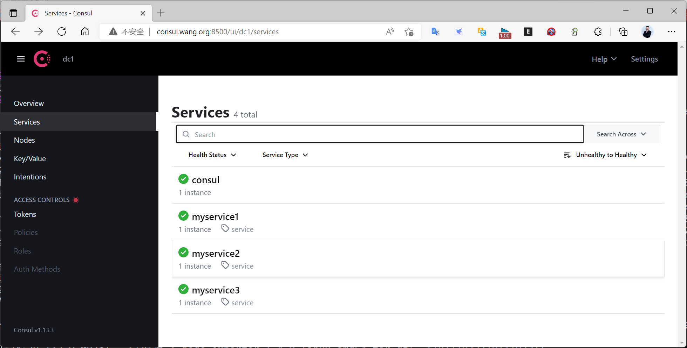
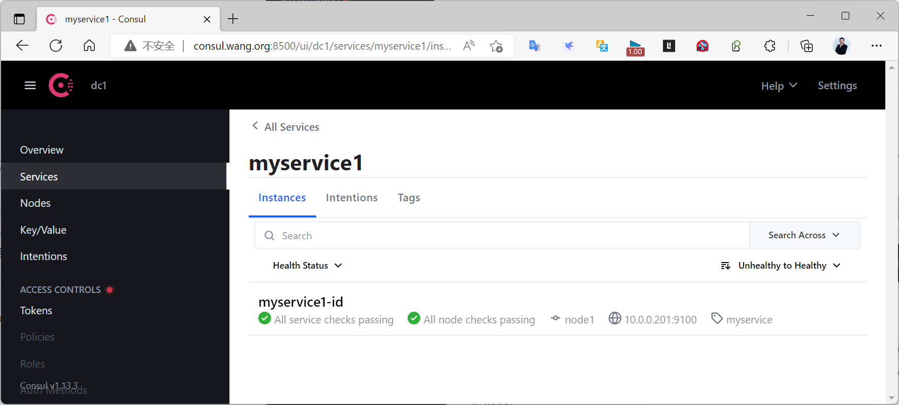
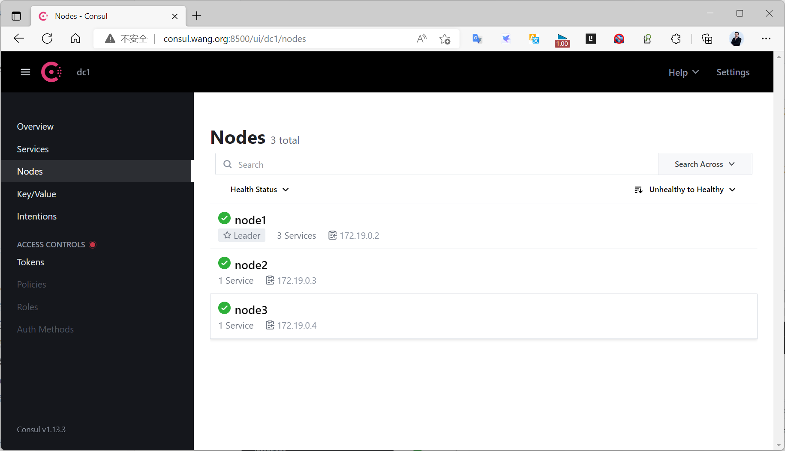
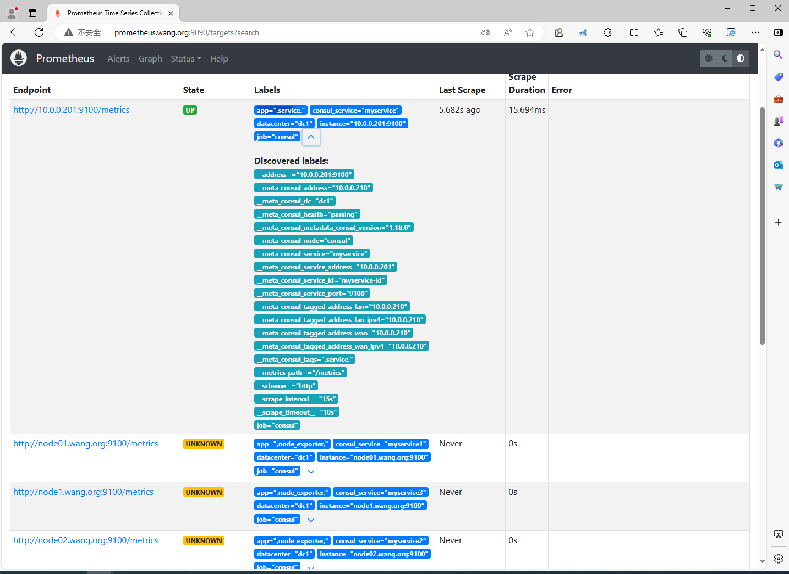
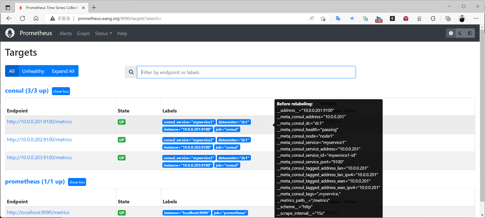
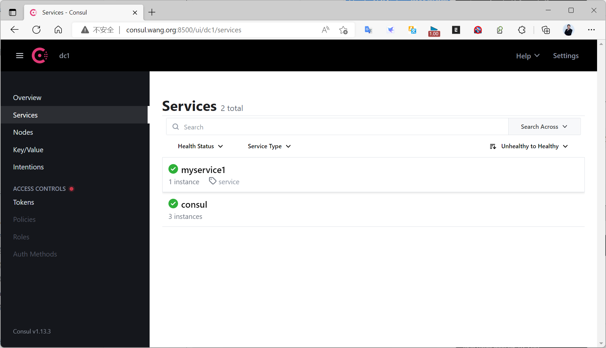
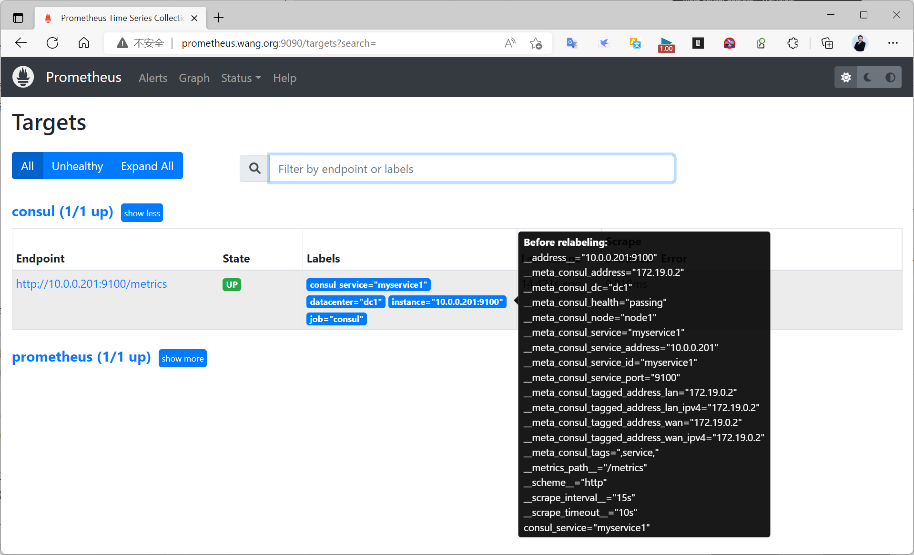

[← 返回 Prometheus 目录]({{ '/subjects/Prometheus/' | relative_url }})



# 20 Consul 自动注册与监控采集

## 6.4.3 Consul 自动注册和删除服务

#### 6.4.3.1 Consul常用API接口

官方文档 API
https://developer.hashicorp.com/consul/api-docs

用法说明
```bash
#列出数据中心
curl http://consul.bowen.org:8500/v1/catalog/datacenters
#列出节点
curl http://consul.bowen.org:8500/v1/catalog/nodes
#列出服务
curl http://consul.bowen.org:8500/v1/catalog/services
#指定节点状态
curl http://consul.bowen.org:8500/v1/health/node/node2
#列出服务节点
curl http://consul.bowen.org:8500/v1/catalog/service/<service_id>
#提交Json格式的数据进行注册服务
curl -X PUT -d '{"id": "myservice-id","name": "myservice","address":
"10.0.0.201","port": 9100,"tags": ["service"],"checks": [{"http":
"http://10.0.0.201:9100/","interval": "5s"}]}'
http://consul.bowen.org:8500/v1/agent/service/register
#也可以将注册信息保存在json格式的文件中，再执行下面命令注册
cat nodes.json
{
  "id": "myservice-id",
  "name": "myservice",
  "address": "10.0.0.201",
  "port": 9100,
  "tags": [
    "service"
  ],
  "checks": [
    {
      "http": "http://10.0.0.201:9100/",
      "interval": "5s"
    }
  ]
}
curl -X PUT --data @nodes.json  http://consul.bowen.org:8500/v1/agent/service/register
#查询指定节点以及指定的服务信息
curl http://consul.bowen.org:8500/v1/catalog/service/<service_name>
#删除服务，注意：集群模式下需要在service_id所有在主机节点上执行才能删除该service
curl -X PUT http://consul.bowen.org:8500/v1/agent/service/deregister/<service_id>
```

范例: 查看节点状态
```bash
[root@ubuntu2204 ~]#curl -s   http://127.0.0.1:8500/v1/health/node/node2|jq
[
  {
    "Node": "node2",
    "CheckID": "serfHealth",
    "Name": "Serf Health Status",
    "Status": "passing",
    "Notes": "",
    "Output": "Agent alive and reachable",
    "ServiceID": "",
    "ServiceName": "",
    "ServiceTags": [],
    "Type": "",
    "Interval": "",
    "Timeout": "",
    "ExposedPort": 0,
    "Definition": {},
    "CreateIndex": 6,
    "ModifyIndex": 6
  }
]
```

范例: 注册服务
```bash
[root@ubuntu2204 ~]#curl -X PUT -d '{"id": "myservice1-id","name":
"myservice1","address": "10.0.0.201","port": 9100,"tags": ["myservice"],"checks":
[{"http": "http://10.0.0.201:9100/","interval": "5s"}]}'
http://consul.bowen.org:8500/v1/agent/service/register
[root@ubuntu2204 ~]#curl -X PUT -d '{"id": "myservice2-id","name":
"myservice2","address": "10.0.0.202","port": 9100,"tags": ["myservice"],"checks":
[{"http": "http://10.0.0.202:9100/","interval": "5s"}]}'
http://consul.bowen.org:8500/v1/agent/service/register
[root@ubuntu2204 ~]#curl -X PUT -d '{"id": "myservice3-id","name":
"myservice3","address": "10.0.0.203","port": 9100,"tags": ["myservice"],"checks":
[{"http": "http://10.0.0.203:9100/","interval": "5s"}]}'
http://consul.bowen.org:8500/v1/agent/service/register
[root@ubuntu2204 ~]#curl -s  http://consul.bowen.org:8500/v1/catalog/services|jq
{
  "consul": [],
  "myservice": [
    "service"
  ],
  "myservice3": [
    "node_exporter"
  ],
  "myservice4": [
    "node_exporter"
  ],
  "myservice5": [
    "node_exporter"
  ]
}
#查看指定service
[root@ubuntu2204 ~]#curl -s
http://consul.bowen.org:8500/v1/catalog/service/myservice1|jq
[
  {
    "ID": "4af4791b-b337-7f21-ae9b-6fa49db3d561",
    "Node": "consul",
    "Address": "10.0.0.210",
    "Datacenter": "dc1",
    "TaggedAddresses": {
      "lan": "10.0.0.210",
      "lan_ipv4": "10.0.0.210",
      "wan": "10.0.0.210",
      "wan_ipv4": "10.0.0.210"
    },
    "NodeMeta": {
      "consul-network-segment": "",
      "consul-version": "1.18.0"
    },
    "ServiceKind": "",
    "ServiceID": "myservice1-id",
    "ServiceName": "myservice1",
    "ServiceTags": [
      "service"
    ],
    "ServiceAddress": "10.0.0.201",
    "ServiceTaggedAddresses": {
      "lan_ipv4": {
         "Address": "10.0.0.201",
         "Port": 9100
      },
      "wan_ipv4": {
         "Address": "10.0.0.201",
         "Port": 9100
      }
    },
    "ServiceWeights": {
      "Passing": 1,
      "Warning": 1
    },
    "ServiceMeta": {},
    "ServicePort": 9100,
    "ServiceSocketPath": "",
    "ServiceEnableTagOverride": false,
    "ServiceProxy": {
      "Mode": "",
      "MeshGateway": {},
      "Expose": {}
    },
    "ServiceConnect": {},
    "ServiceLocality": null,
    "CreateIndex": 208,
    "ModifyIndex": 271
  }
]
```

#### 6.4.3.2 使用consul services命令注册和注销服务

consul services register命令也可用于进行服务注册，只是其使用的配置格式与直接请求HTTP API有所不同。

注册服务
```text
consul services register /path/file.json
```

注册单个服务时，file.json文件使用service进行定义，注册多个服务时，使用services以列表格式进行定义。

示例: 定义了单个要注册的服务。
```bash
[root@ubuntu2404 ~]#cat node1.json
{
  "service": {
      "id": "myservice-id",
      "name": "myservice",
      "address": "node1.bowen.org",
      "port": 9100,
      "tags": ["node_exporter"],
      "checks": [{
         "http": "http://node1.bowen.org:9100/metrics",
         "interval": "5s"
      }]
  }
}
[root@ubuntu2404 ~]#consul services register node1.json
```

示例: 以多个的服务的格式给出了定义
```bash
[root@ubuntu2204 ~]#cat services.json
{
  "services": [
     {"id": "myservice1-id",
      "name": "myservice1",
      "address": "node1.bowen.org",
      "port": 9100,
      "tags": ["node_exporter"],
      "checks": [{
         "http": "http://node1.bowen.org:9100/metrics",
         "interval": "5s"
      }]
    },
     {"id": "myservice2-id",
      "name": "myservice2",
      "address": "node2.bowen.org",
      "port": 9100,
      "tags": ["node_exporter"],
      "checks": [{
         "http": "http://node2.bowen.org:9100/metrics",
         "interval": "5s"
       }]
     },
     {.......}
   ]
}
[root@ubuntu2204 ~]#consul services register services.json
Node name "consul.bowen.org" will not be discoverable via DNS due to invalid
characters. Valid characters include all alpha-numerics and dashes.
Registered service: myservice4
Registered service: myservice5
#主机名不能有域名后缀，consul无效
[root@ubuntu2204 ~]#hostname consul
[root@ubuntu2204 ~]#consul services register services.json
Registered service: myservice4
Registered service: myservice5
```

注销服务

可以使用consul services deregister命令实现

注意:需要在serivce注册的主机上执行
```text
consul services deregister -id <SERVICE_ID>
```

### 6.4.4 配置 Prometheus 使用 Consul 服务发现

官方文档
https://prometheus.io/docs/prometheus/latest/configuration/configuration/#consul_sd_config

默认情况下，当Prometheus加载Target实例完成后，这些Target时候都会包含一些默认的标签：
```text
__address__ #当前Target实例的访问地址<host>:<port>
__scheme__ #采集目标服务访问地址的HTTP Scheme，HTTP或者HTTPS
__metrics_path__ #采集目标服务访问地址的访问路径
__param_<name> #采集任务目标服务的中包含的请求参数
```

通过Consul动态发现的服务实例还会包含以下Metadata标签信息：
__meta_consul_address         #consul地址
__meta_consul_dc              #consul中服务所在的数据中心
__meta_consulmetadata         #服务的metadata
__meta_consul_node            #服务所在consul节点的信息
__meta_consul_service_address #服务访问地址
__meta_consul_service_id      #服务ID
__meta_consul_service_port    #服务端口
__meta_consul_service         #服务名称
__meta_consul_tags            #服务包含的标签信息

利用 Relabeling 实现基于Target实例中包含的metadata标签，动态的添加或者覆盖标签。

范例:
```yaml
[root@ubuntu2204 ~]#vim /usr/local/prometheus/conf/prometheus.yml
......
  - job_name: 'consul'
    honor_labels: true #如果标签冲突，覆盖Prometheus添加的标签，保留原标签
    consul_sd_configs:
      - server: 'consul-node1.bowen.org:8500'
        services: []  #指定需要发现的service名称,默认为所有service，或者如下面两行指定只从
consul中加载特定的service
         #tags:        #可以过滤具有指定的tag的service
         #- "service"
         #refresh_interval: 2m #刷新时间间隔，默认30s
      - server: 'consul-node2.bowen.org:8500' #添加其它两个节点实现冗余
      - server: 'consul-node3.bowen.org:8500' #添加其它两个节点实现冗余
    relabel_configs:
    - source_labels: ['__meta_consul_service']  #生成新的标签名
      target_label: 'consul_service'
    - source_labels: ['__meta_consul_dc']       #生成新的标签名
      target_label: 'datacenter'
    - source_labels: ['__meta_consul_tags']     #生成新的标签名
      target_label: 'app'
    - source_labels: ['__meta_consul_service']  #删除consul的service,此service是consul
内置,但并不提供metrics数据
      regex: "consul"
      action: drop
#语法检查
[root@ubuntu2204 ~]#promtool check config /usr/local/prometheus/conf/prometheus.yml
Checking /usr/local/prometheus/conf/prometheus.yml
 SUCCESS: /usr/local/prometheus/conf/prometheus.yml is valid prometheus config file
syntax
[root@ubuntu2204 ~]#systemctl resload prometheus.service
```

### 6.4.5 验证采集结果
http://consul.bowen.org:8500/ui/dc1/services







查看prometheus页面如下
http://prometheus.bowen.org:9090/targets





删除服务
```bash
#方法1
[root@ubuntu2204 ~]#consul services deregister -id myservice2-id
[root@ubuntu2204 ~]#consul services deregister -id myservice3-id
#方法2
[root@ubuntu2204 ~]#curl -X PUT
http://consul.bowen.org:8500/v1/agent/service/deregister/myservice2-id
[root@ubuntu2204 ~]#curl -X PUT
http://consul.bowen.org:8500/v1/agent/service/deregister/myservice3-id
```

查看 Consul  和 Prometheus页面如下







<nav class="article-end" aria-label="章节导航">
  <a href="{{ '/subjects/Prometheus/19-consul-cluster.html' | relative_url }}">← 上一章：Consul 集群部署</a>
  <a href="{{ '/subjects/Prometheus/' | relative_url }}">返回 Prometheus 目录</a>
  <a href="{{ '/subjects/Prometheus/21-kubernetes-service-discovery.html' | relative_url }}">下一章：Kubernetes 服务发现 →</a>
</nav>
