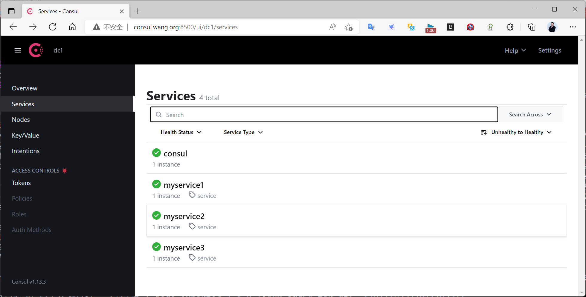
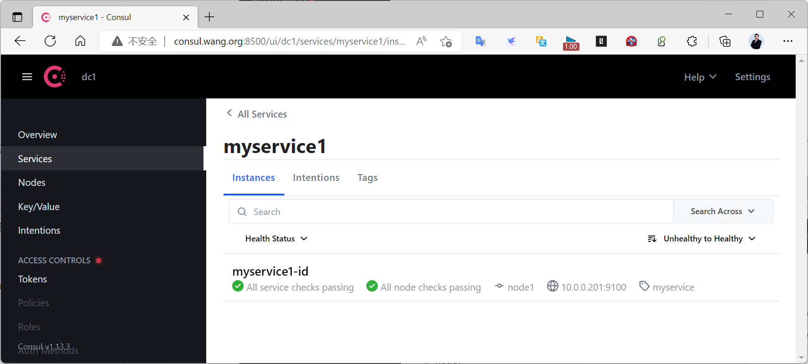
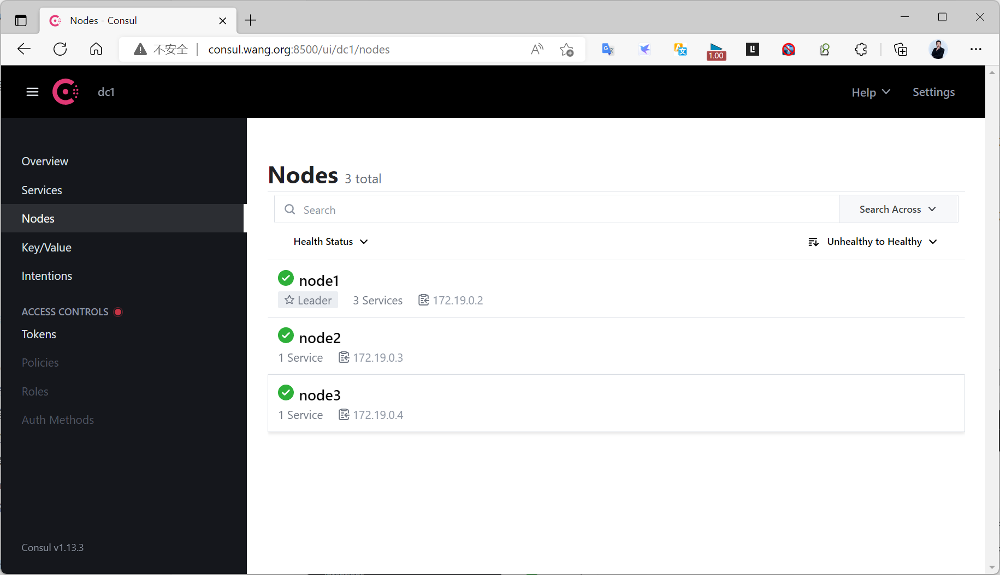
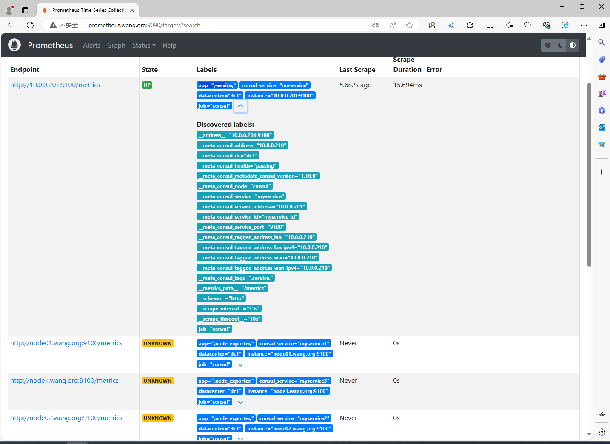
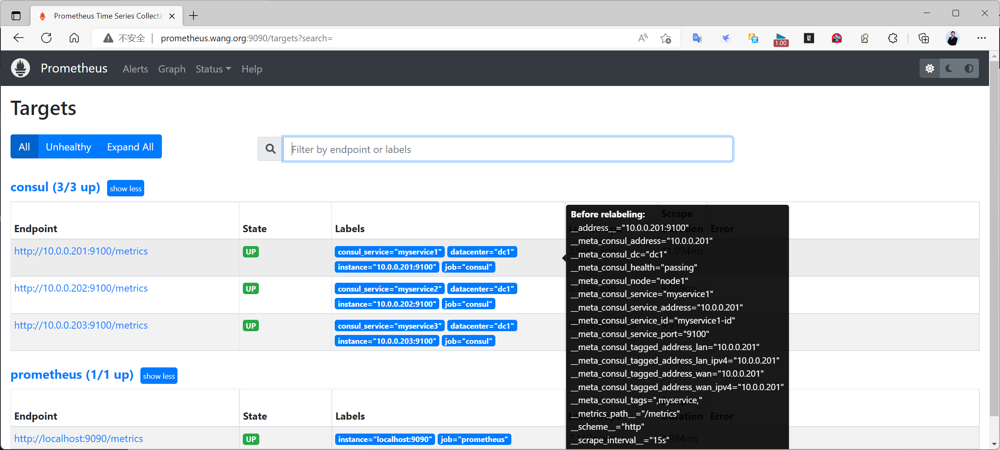
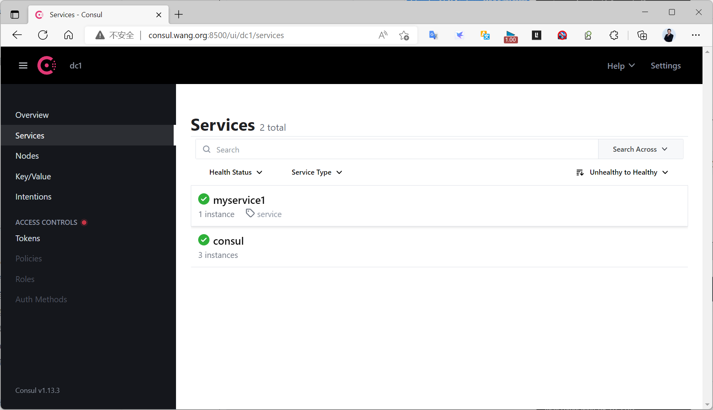
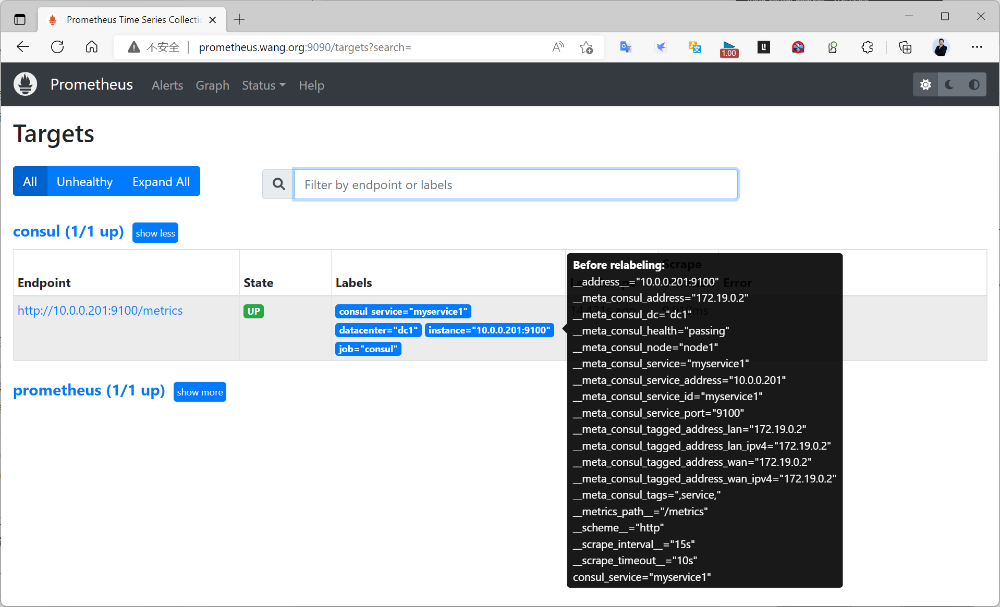

[← 返回 Prometheus 目录]({{ '/subjects/Prometheus/' | relative_url }})



# 20 Consul 服务注册与动态抓取

静态配置要求每增删一台 Exporter 就修改 Prometheus 文件。Consul 服务发现把这件事拆成两步：**Exporter 所在节点向 Consul 注册自身地址与端口；Prometheus 从 Consul 查询服务实例并抓取其 `/metrics`**。本篇以 Node Exporter 为例，观察服务注册、目标出现、注销和目标消失的闭环。

## 注册前明确“谁拥有服务”

Consul 的 `/v1/agent/service/register` 是 **Agent API**：服务注册归接收请求的那个 Consul agent 管理。原资料从远程机器调用某个固定的 Consul server，把多台 Exporter 都登记在这个 agent 下，又在别处注销，容易混淆服务地址与注册归属。更稳妥的方式是让每个 Node Exporter 节点运行 Consul agent，并在该节点向**本机 agent** 注册自己的服务；注销也由同一 agent 执行。若采用集中登记，必须明确该 agent 是注册归属点，并处理其故障和服务健康维护。

先确认 `node-a.example.local:9100/metrics` 可从 Consul agent 访问，再准备 `node-exporter.json`：

```json
{
  "ID": "node-exporter-node-a",
  "Name": "node-exporter",
  "Address": "node-a.example.local",
  "Port": 9100,
  "Tags": ["metrics"],
  "Check": {
    "HTTP": "http://node-a.example.local:9100/metrics",
    "Interval": "15s",
    "Timeout": "5s"
  }
}
```

`ID` 在所属 agent 内唯一，`Name` 让同类实例归入同一服务，`Address` 与 `Port` 必须是 Prometheus 可达的抓取端点。健康检查访问 `/metrics`，而非只检查端口存在；检查间隔也应考虑 Exporter 响应时间与 Consul 负载。

```bash
# 在 node-a 的 Consul agent 所在主机上
curl --fail --show-error -X PUT \
  -H 'Content-Type: application/json' \
  --data-binary @node-exporter.json \
  http://127.0.0.1:8500/v1/agent/service/register

curl -s http://127.0.0.1:8500/v1/agent/services
curl -s http://127.0.0.1:8500/v1/health/service/node-exporter
```

也可使用 Consul CLI 的 `consul services register <配置文件>`，但 CLI 接受的文件包装格式与 HTTP API 的 JSON 载荷要按当前版本文档核对，不能把两者无差别互换。Consul API 的网络访问、ACL 令牌和 TLS 设置也应按所在环境配置，示例中的本机 HTTP 仅说明请求结构。

## 配置 Prometheus 的 Consul 服务发现

将以下 job 加入现有 `prometheus.yml` 的 `scrape_configs`。Consul 地址是服务发现入口；发现出的目标地址来自注册服务的 `Address:Port`，不是 Consul 的 8500 端口。

```yaml
scrape_configs:
  - job_name: node-consul
    consul_sd_configs:
      - server: consul.example.local:8500
        services: ['node-exporter']
    relabel_configs:
      - source_labels: [__meta_consul_service]
        target_label: consul_service
      - source_labels: [__meta_consul_dc]
        target_label: datacenter
```

Consul 发现产生的 `__meta_consul_...` 是临时元标签，只在抓取前的 `relabel_configs` 阶段可用；复制到普通标签后才会随指标保存。原资料用 `services: []` 发现所有服务再删除 Consul 自身也能工作，但若只需 Node Exporter，直接指定服务名更清楚。这里也无需无理由开启 `honor_labels: true`，以免导出指标意外覆盖预期的目标标签。

```bash
promtool check config /path/to/prometheus.yml
sudo systemctl reload prometheus
```

若 Prometheus 运行在容器或集群内，应改用其实际重载方式。检查 **Status → Service Discovery** 中原始元标签与重标记结果，再看 **Status → Targets** 是否出现 `node-consul` 的 `node-a.example.local:9100`。目标为 UP 后，再查询 `up{job="node-consul"}` 与 `node_cpu_seconds_total{job="node-consul"}`。











## 注销与故障的区别

服务退役时，在**原注册 agent** 上按 ID 注销，再等待 Prometheus 下一次服务发现刷新；目标应从发现列表中消失。Exporter 暂时故障则不一定要注销：保留目标能让 Prometheus 抓取失败并产生 `up=0`，便于告警。若通过健康状态过滤掉所有不健康实例，目标可能直接消失，反而丢失了“该实例出故障”的信号。

```bash
curl --fail --show-error -X PUT \
  http://127.0.0.1:8500/v1/agent/service/deregister/node-exporter-node-a
```

验证时分开看 Consul 的服务列表与健康检查、Prometheus 的发现列表与 Targets 页面；前者正确不代表后者网络可达。需要给多台节点注册服务时，为每个 agent 准备**唯一 ID、实际地址与健康检查 URL**，不要把一份示例 JSON 机械复制到所有节点。







<nav class="article-end" aria-label="章节导航">
  <a href="{{ '/subjects/Prometheus/19-consul-cluster.html' | relative_url }}">← 上一章：Consul 集群部署</a>
  <a href="{{ '/subjects/Prometheus/' | relative_url }}">返回 Prometheus 目录</a>
  <a href="{{ '/subjects/Prometheus/21-kubernetes-service-discovery.html' | relative_url }}">下一章：Kubernetes 服务发现 →</a>
</nav>
