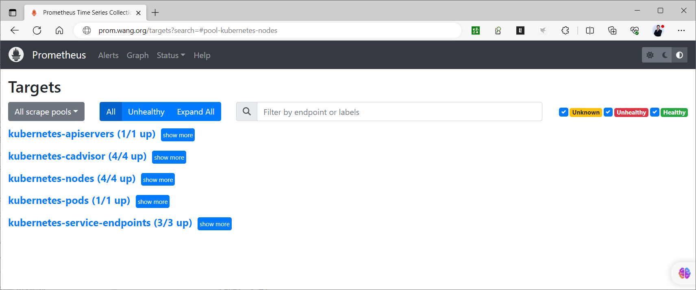

[← 返回 Prometheus 目录]({{ '/subjects/Prometheus/' | relative_url }})



# 21 Kubernetes 服务发现

## 6.5 Kubernetes 发现
https://prometheus.io/docs/prometheus/latest/configuration/configuration/#kubernetes_sd_config
https://github.com/prometheus/prometheus/blob/release-2.44/documentation/examples/prometheus-kubernetes.yml
https://github.com/prometheus/prometheus/blob/release-2.46/documentation/examples/prometheus-kubernetes.yml

### 6.5.1 基于Kubernetes API的服务发现介绍

基于Kubernetes API的服务发现机制，支持将API Server中Node、Service、Endpoint、Pod和Ingress等资源类型下相应的各资源对象视作target，并持续监视相关资源的变动

Node、Service、Endpoint、Pod和Ingress资源分别由各自的发现机制进行定义
负责发现每种类型资源对象的组件，在Prometheus中称为一个"role"  

同时支持在集群上基于DaemonSet控制器部署node-exporter后发现各节点

Node资源发现

Prometheus的node role将Kubernetes集群中的每个节点视作一个target，这些节点都监听着kubelet使用的端口

node role依次检索节点规范上的NodeInternallP、NodeInternallP、NodeExternallP、NodeLegacyHostP和NodeHostName字段，并将发现的第一个地址作为目标地址（__address__) ;

可用的meta标签有如下几个:
```text
__meta_kubernetes_node_name: The name of the node object.
__meta_kubernetes_node_provider_id: The cloud provider's name for the node object.
__meta_kubernetes_node_label_<labelname>: Each label from the node object.
__meta_kubernetes_node_labelpresent_<labelname>: true for each label from the node
object.
__meta_kubernetes_node_annotation_<annotationname>: Each annotation from the node
object.
__meta_kubernetes_node_annotationpresent_<annotationname>: true for each annotation
from the node object.
__meta_kubernetes_node_address_<address_type>: The first address for each node
address type, if it exists.
```

节点上instance标签的值取自从API Server中发现的节点的名称;

Pod资源发现

Prometheus的pod role负责发现Kubernetes集群上的每个Pod资源并暴露其容器为target

把Pod上声明的每个端口视作一个target
会为未指定端口的容器创建“无端口”类型的target，以便于用户通过relabel机制手动添加端口  

可用的部分metadata标签如下
```text
     __meta_kubernetes_namespace: The namespace of the pod object.
     __meta_kubernetes_pod_name: The name of the pod object.
     __meta_kubernetes_pod_ip: The pod IP of the pod object.
     __meta_kubernetes_pod_label_<labelname>: Each label from the pod object.
     __meta_kubernetes_pod_labelpresent_<labelname>: true for each label from the pod
     object.
     __meta_kubernetes_pod_annotation_<annotationname>: Each annotation from the pod
     object.
     __meta_kubernetes_pod_annotationpresent_<annotationname>: true for each
     annotation from the pod object.
     __meta_kubernetes_pod_container_init: true if the container is an InitContainer
     __meta_kubernetes_pod_container_name: Name of the container the target address
     points to.
     __meta_kubernetes_pod_container_id: ID of the container the target address
     points to. The ID is in the form <type>://<container_id>.
     __meta_kubernetes_pod_container_image: The image the container is using.
     __meta_kubernetes_pod_container_port_name: Name of the container port.
     __meta_kubernetes_pod_container_port_number: Number of the container port.
     __meta_kubernetes_pod_container_port_protocol: Protocol of the container port.
     __meta_kubernetes_pod_ready: Set to true or false for the pod's ready state.
     __meta_kubernetes_pod_phase: Set to Pending, Running, Succeeded, Failed or
     Unknown in the lifecycle.
     __meta_kubernetes_pod_node_name: The name of the node the pod is scheduled onto.
     __meta_kubernetes_pod_host_ip: The current host IP of the pod object.
     __meta_kubernetes_pod_uid: The UID of the pod object.
     __meta_kubernetes_pod_controller_kind: Object kind of the pod controller.
     __meta_kubernetes_pod_controller_name: Name of the pod controller.
```

Service资源发现

Prometheus的service role负责发现Kubernetes集群上的每个Service资源

把Service上声明的每个端口视作一个target
特别适用于对Service进行黑盒监控的场景；  

target地址为Service的DNS名称及相应的端口
可用的部分meta标签如下  
```text
     __meta_kubernetes_namespace: The namespace of the service object.
     __meta_kubernetes_service_annotation_<annotationname>: Each annotation from the
     service object.
     __meta_kubernetes_service_annotationpresent_<annotationname>: "true" for each
     annotation of the service object.
     __meta_kubernetes_service_cluster_ip: The cluster IP address of the service.
     (Does not apply to services of type ExternalName)
     __meta_kubernetes_service_loadbalancer_ip: The IP address of the loadbalancer.
     (Applies to services of type LoadBalancer)
     __meta_kubernetes_service_external_name: The DNS name of the service. (Applies
     to services of type ExternalName)
     __meta_kubernetes_service_label_<labelname>: Each label from the service object.
     __meta_kubernetes_service_labelpresent_<labelname>: true for each label of the
     service object.
     __meta_kubernetes_service_name: The name of the service object.
     __meta_kubernetes_service_port_name: Name of the service port for the target.
     __meta_kubernetes_service_port_number: Number of the service port for the
     target.
     __meta_kubernetes_service_port_protocol: Protocol of the service port for the
     target.
     __meta_kubernetes_service_type: The type of the service.
```

Endpoint资源发现

Prometheus的endpoint role从各Endpoint资源中发现目标；

它把endpoint上的每个端口都视作一个单独的target
若endpoint的后端工作负载是Pod，则会把该Pod上其它未绑定到endpoint的端口同样视作一个单独的  
目标  
可用的部分meta标签如下  
```text
     __meta_kubernetes_namespace: The namespace of the endpoints object.
     __meta_kubernetes_endpoints_name: The names of the endpoints object.
     __meta_kubernetes_endpoints_label_<labelname>: Each label from the endpoints
     object.
     __meta_kubernetes_endpoints_labelpresent_<labelname>: true for each label from
     the endpoints object.
     __meta_kubernetes_endpoints_annotation_<annotationname>: Each annotation from
     the endpoints object.
     __meta_kubernetes_endpoints_annotationpresent_<annotationname>: true for each
     annotation from the endpoints object.
     #对于通过附加在Endpoint资源上的端口发现的各target，还以如下meta标签
     __meta_kubernetes_endpoint_hostname: Hostname of the endpoint.
     __meta_kubernetes_endpoint_node_name: Name of the node hosting the endpoint.
     __meta_kubernetes_endpoint_ready: Set to true or false for the endpoint's ready
     state.
     __meta_kubernetes_endpoint_port_name: Name of the endpoint port.
     __meta_kubernetes_endpoint_port_protocol: Protocol of the endpoint port.
     __meta_kubernetes_endpoint_address_target_kind: Kind of the endpoint address
     target.
     __meta_kubernetes_endpoint_address_target_name: Name of the endpoint address
     target.
     #若发现的Endpoint资源属于某个Service，则相关Service的元标签也会添加在该Endpoint上
     #若发现的Endpoint资源的后端端点是Pod，则相关Pod的元标签也会添加在该Endpoint上
```

Ingress资源发现

Prometheus的ingress role负责从API Server中发现Ingress资源

它把Ingress资源上的每个path视作一个target
特别适用于对Ingress进行黑盒监控的场景；  
相关的地址被设定为Ingress资源上相关host字段的值；  
可用的部署meta标签如下  
```text
     __meta_kubernetes_namespace: The namespace of the ingress object.
     __meta_kubernetes_ingress_name: The name of the ingress object.
     __meta_kubernetes_ingress_label_<labelname>: Each label from the ingress object.
     __meta_kubernetes_ingress_labelpresent_<labelname>: true for each label from the
     ingress object.
     __meta_kubernetes_ingress_annotation_<annotationname>: Each annotation from the
     ingress object.
     __meta_kubernetes_ingress_annotationpresent_<annotationname>: true for each
     annotation from the ingress object.
     __meta_kubernetes_ingress_class_name: Class name from ingress spec, if present.
     __meta_kubernetes_ingress_scheme: Protocol scheme of ingress, https if TLS
     config is set. Defaults to http.
     __meta_kubernetes_ingress_path: Path from ingress spec. Defaults to /.
```

基于Kubernetes发现机制的部分配置参数
```text
# The information to access the Kubernetes API.
# The API server addresses. If left empty, Prometheus is assumed to run inside
# of the cluster and will discover API servers automatically and use the pod's
# CA certificate and bearer token file at
/var/run/secrets/kubernetes.io/serviceaccount/.
[ api_server: <host> ]
# The Kubernetes role of entities that should be discovered.
# One of endpoints, endpointslice, service, pod, node, or ingress.
role: <string>
# Optional path to a kubeconfig file.
# Note that api_server and kube_config are mutually exclusive.
[ kubeconfig_file: <filename> ]
# Optional authentication information used to authenticate to the API server.
# Note that `basic_auth` and `authorization` options are mutually exclusive.
# password and password_file are mutually exclusive.
# Optional HTTP basic authentication information.
basic_auth:
  [ username: <string> ]
  [ password: <secret> ]
  [ password_file: <string> ]
# Optional `Authorization` header configuration.
authorization:
  # Sets the authentication type.
  [ type: <string> | default: Bearer ]
  # Sets the credentials. It is mutually exclusive with
  # `credentials_file`.
  [ credentials: <secret> ]
  # Sets the credentials to the credentials read from the configured file.
  # It is mutually exclusive with `credentials`.
  [ credentials_file: <filename> ]
# Optional OAuth 2.0 configuration.
# Cannot be used at the same time as basic_auth or authorization.
oauth2:
  [ <oauth2> ]
# Optional proxy URL.
[ proxy_url: <string> ]
# Comma-separated string that can contain IPs, CIDR notation, domain names
# that should be excluded from proxying. IP and domain names can
# contain port numbers.
[ no_proxy: <string> ]
# Use proxy URL indicated by environment variables (HTTP_PROXY, https_proxy,
HTTPs_PROXY, https_proxy, and no_proxy)
[ proxy_from_environment: <boolean> | default: false ]
# Specifies headers to send to proxies during CONNECT requests.
[ proxy_connect_header:
  [ <string>: [<secret>, ...] ] ]
# Configure whether HTTP requests follow HTTP 3xx redirects.
[ follow_redirects: <boolean> | default = true ]
# Whether to enable HTTP2.
[ enable_http2: <boolean> | default: true ]
# TLS configuration.
tls_config:
  [ <tls_config> ]
# Optional namespace discovery. If omitted, all namespaces are used.
namespaces:
  own_namespace: <boolean>
  names:
    [ - <string> ]
# Optional label and field selectors to limit the discovery process to a subset of
available resources.
# See https://kubernetes.io/docs/concepts/overview/working-with-objects/field-selectors/
# and https://kubernetes.io/docs/concepts/overview/working-with-objects/labels/ to
learn more about the possible
# filters that can be used. The endpoints role supports pod, service and endpoints
selectors.
# The pod role supports node selectors when configured with `attach_metadata: {node:
true}`.
# Other roles only support selectors matching the role itself (e.g. node role can
only contain node selectors).
# Note: When making decision about using field/label selector make sure that this
# is the best approach - it will prevent Prometheus from reusing single list/watch
# for all scrape configs. This might result in a bigger load on the Kubernetes API,
# because per each selector combination there will be additional LIST/WATCH. On the
other hand,
# if you just want to monitor small subset of pods in large cluster it's recommended
to use selectors.
# Decision, if selectors should be used or not depends on the particular situation.
[ selectors:
  [ - role: <string>
    [ label: <string> ]
    [ field: <string> ] ]]
# Optional metadata to attach to discovered targets. If omitted, no additional
metadata is attached.
attach_metadata:
# Attaches node metadata to discovered targets. Valid for roles: pod, endpoints,
endpointslice.
# When set to true, Prometheus must have permissions to get Nodes.
  [ node: <boolean> | default = false ]
```

### 6.5.2 案例: 基于Kubernetes API的服务发现

范例:  配置实现自动发现各种Kubernetes 资源
```bash
[root@master1 prom]#cat prometheus-cfg.yaml
```

```yaml
---
kind: ConfigMap
apiVersion: v1
metadata:
  labels:
    app: prometheus
  name: prometheus-config
  namespace: prom
data:
  prometheus.yml: |
 #https://github.com/prometheus/prometheus/blob/main/documentation/examples/prometheus-kubernetes.yml
    # A scrape configuration for running Prometheus on a Kubernetes cluster.
    # This uses separate scrape configs for cluster components (i.e. API server,
node)
    # and services to allow each to use different authentication configs.
    #
    # Kubernetes labels will be added as Prometheus labels on metrics via the
    # `labelmap` relabeling action.
    #
    # If you are using Kubernetes 1.7.2 or earlier, please take note of the comments
    # for the kubernetes-cadvisor job; you will need to edit or remove this job.
    # Scrape config for API servers.
    #
    # Kubernetes exposes API servers as endpoints to the default/kubernetes
    # service so this uses `endpoints` role and uses relabelling to only keep
    # the endpoints associated with the default/kubernetes service using the
    # default named port `https`. This works for single API server deployments as
    # well as HA API server deployments.
    global:
      scrape_interval: 15s
      scrape_timeout: 10s
      evaluation_interval: 1m
    rule_files:
      - /etc/prometheus/prometheus.rules
    alerting:
      alertmanagers:
      - scheme: http
        static_configs:
         - targets:
           - "alertmanager:9093"
    scrape_configs:
    - job_name: 'kubernetes-apiservers'
      kubernetes_sd_configs:
      - role: endpoints
      # Default to scraping over https. If required, just disable this or change to
      # `http`.
      scheme: https
      # This TLS & bearer token file config is used to connect to the actual scrape
      # endpoints for cluster components. This is separate to discovery auth
      # configuration because discovery & scraping are two separate concerns in
      # Prometheus. The discovery auth config is automatic if Prometheus runs inside
      # the cluster. Otherwise, more config options have to be provided within the
      # <kubernetes_sd_config>.
      tls_config:
        ca_file: /var/run/secrets/kubernetes.io/serviceaccount/ca.crt
         # If your node certificates are self-signed or use a different CA to the
         # master CA, then disable certificate verification below. Note that
         # certificate verification is an integral part of a secure infrastructure
         # so this should only be disabled in a controlled environment. You can
         # disable certificate verification by uncommenting the line below.
         #
         # insecure_skip_verify: true
      bearer_token_file: /var/run/secrets/kubernetes.io/serviceaccount/token
      # Keep only the default/kubernetes service endpoints for the https port. This
      # will add targets for each API server which Kubernetes adds an endpoint to
      # the default/kubernetes service.
      relabel_configs:
      - source_labels: [__meta_kubernetes_namespace, __meta_kubernetes_service_name,
__meta_kubernetes_endpoint_port_name]
        action: keep
        regex: default;kubernetes;https
    # Scrape config for nodes (kubelet).
    #
    # Rather than connecting directly to the node, the scrape is proxied though the
    # Kubernetes apiserver.  This means it will work if Prometheus is running out of
    # cluster, or can't connect to nodes for some other reason (e.g. because of
    # firewalling).
    - job_name: 'kubernetes-nodes'
      # Default to scraping over https. If required, just disable this or change to
      # `http`.
      scheme: https
      # This TLS & bearer token file config is used to connect to the actual scrape
      # endpoints for cluster components. This is separate to discovery auth
      # configuration because discovery & scraping are two separate concerns in
      # Prometheus. The discovery auth config is automatic if Prometheus runs inside
      # the cluster. Otherwise, more config options have to be provided within the
      # <kubernetes_sd_config>.
      tls_config:
        ca_file: /var/run/secrets/kubernetes.io/serviceaccount/ca.crt
      bearer_token_file: /var/run/secrets/kubernetes.io/serviceaccount/token
      kubernetes_sd_configs:
      - role: node
      relabel_configs:
      - action: labelmap
        regex: __meta_kubernetes_node_label_(.+)
      - target_label: __address__
        replacement: kubernetes.default.svc:443
      - source_labels: [__meta_kubernetes_node_name]
        regex: (.+)
        target_label: __metrics_path__
        replacement: /api/v1/nodes/${1}/proxy/metrics
    # Scrape config for Kubelet cAdvisor.
    #
    # This is required for Kubernetes 1.7.3 and later, where cAdvisor metrics
    # (those whose names begin with 'container_') have been removed from the
    # Kubelet metrics endpoint.  This job scrapes the cAdvisor endpoint to
    # retrieve those metrics.
    #
    # In Kubernetes 1.7.0-1.7.2, these metrics are only exposed on the cAdvisor
    # HTTP endpoint; use "replacement: /api/v1/nodes/${1}:4194/proxy/metrics"
    # in that case (and ensure cAdvisor's HTTP server hasn't been disabled with
    # the --cadvisor-port=0 Kubelet flag).
    #
    # This job is not necessary and should be removed in Kubernetes 1.6 and
    # earlier versions, or it will cause the metrics to be scraped twice.
    - job_name: 'kubernetes-cadvisor'
      # Default to scraping over https. If required, just disable this or change to
      # `http`.
      scheme: https
      # This TLS & bearer token file config is used to connect to the actual scrape
      # endpoints for cluster components. This is separate to discovery auth
      # configuration because discovery & scraping are two separate concerns in
      # Prometheus. The discovery auth config is automatic if Prometheus runs inside
      # the cluster. Otherwise, more config options have to be provided within the
      # <kubernetes_sd_config>.
      tls_config:
        ca_file: /var/run/secrets/kubernetes.io/serviceaccount/ca.crt
      bearer_token_file: /var/run/secrets/kubernetes.io/serviceaccount/token
      kubernetes_sd_configs:
      - role: node
      relabel_configs:
      - action: labelmap
        regex: __meta_kubernetes_node_label_(.+)
      - target_label: __address__
        replacement: kubernetes.default.svc:443
      - source_labels: [__meta_kubernetes_node_name]
        regex: (.+)
        target_label: __metrics_path__
        replacement: /api/v1/nodes/${1}/proxy/metrics/cadvisor
    # Scrape config for service endpoints.
    #
    # The relabeling allows the actual service scrape endpoint to be configured
    # via the following annotations:
    #
    # * `prometheus.io/scrape`: Only scrape services that have a value of `true`
    # * `prometheus.io/scheme`: If the metrics endpoint is secured then you will need
    # to set this to `https` & most likely set the `tls_config` of the scrape config.
    # * `prometheus.io/path`: If the metrics path is not `/metrics` override this.
    # * `prometheus.io/port`: If the metrics are exposed on a different port to the
    # service then set this appropriately.
    - job_name: 'kubernetes-service-endpoints'
      kubernetes_sd_configs:
      - role: endpoints
      relabel_configs:
      - source_labels: [__meta_kubernetes_service_annotation_prometheus_io_scrape]
        action: keep
        regex: true
      - source_labels: [__meta_kubernetes_service_annotation_prometheus_io_scheme]
        action: replace
        target_label: __scheme__
        regex: (https?)
      - source_labels: [__meta_kubernetes_service_annotation_prometheus_io_path]
        action: replace
        target_label: __metrics_path__
        regex: (.+)
      - source_labels: [__address__,
__meta_kubernetes_service_annotation_prometheus_io_port]
        action: replace
        target_label: __address__
        regex: ([^:]+)(?::\d+)?;(\d+)
        replacement: $1:$2
      - action: labelmap
        regex: __meta_kubernetes_service_label_(.+)
      - source_labels: [__meta_kubernetes_namespace]
        action: replace
        target_label: kubernetes_namespace
      - source_labels: [__meta_kubernetes_service_name]
        action: replace
        target_label: kubernetes_name
    # Example scrape config for pods
    #
    # The relabeling allows the actual pod scrape endpoint to be configured via the
    # following annotations:
    #
    # * `prometheus.io/scrape`: Only scrape pods that have a value of `true`
    # * `prometheus.io/path`: If the metrics path is not `/metrics` override this.
    # * `prometheus.io/port`: Scrape the pod on the indicated port instead of the
    # pod's declared ports (default is a port-free target if none are declared).
    - job_name: 'kubernetes-pods'
      # if you want to use metrics on jobs, set the below field to
      # true to prevent Prometheus from setting the `job` label
      # automatically.
      honor_labels: false
      kubernetes_sd_configs:
      - role: pod
      # skip verification so you can do HTTPS to pods
      tls_config:
        insecure_skip_verify: true
      # make sure your labels are in order
      relabel_configs:
      # these labels tell Prometheus to automatically attach source
      # pod and namespace information to each collected sample, so
      # that they'll be exposed in the custom metrics API automatically.
      - source_labels: [__meta_kubernetes_namespace]
        action: replace
        target_label: namespace
      - source_labels: [__meta_kubernetes_pod_name]
        action: replace
        target_label: pod
      # these labels tell Prometheus to look for
      # prometheus.io/{scrape,path,port} annotations to configure
      # how to scrape
      - source_labels: [__meta_kubernetes_pod_annotation_prometheus_io_scrape]
        action: keep
        regex: true
      - source_labels: [__meta_kubernetes_pod_annotation_prometheus_io_path]
        action: replace
        target_label: __metrics_path__
        regex: (.+)
      - source_labels: [__address__,
__meta_kubernetes_pod_annotation_prometheus_io_port]
        action: replace
        regex: ([^:]+)(?::\d+)?;(\d+)
        replacement: $1:$2
        target_label: __address__
      - source_labels: [__meta_kubernetes_pod_annotation_prometheus_io_scheme]
        action: replace
        target_label: __scheme__
        regex: (.+)
    #- job_name: 'Kubernetes'
    #  static_configs:
    #  - targets: ['kube-state-metrics:8080']
```





<nav class="article-end" aria-label="章节导航">
  <a href="{{ '/subjects/Prometheus/20-consul-registration-prometheus.html' | relative_url }}">← 上一章：Consul 自动注册与监控采集</a>
  <a href="{{ '/subjects/Prometheus/' | relative_url }}">返回 Prometheus 目录</a>
  <a href="{{ '/subjects/Prometheus/22-node-mysql-exporters.html' | relative_url }}">下一章：Node Exporter 与 MySQL 监控 →</a>
</nav>
