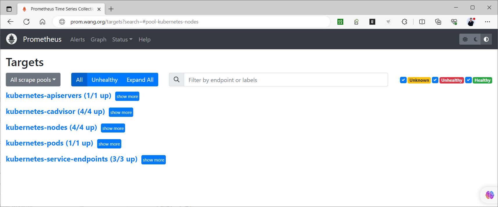

[← 返回 Prometheus 目录]({{ '/subjects/Prometheus/' | relative_url }})



# 21 Kubernetes 服务发现

## 6.5 Kubernetes 发现

Kubernetes 中 Pod 和服务端点随调度、扩缩容而变化，不适合长期写死 `IP:端口`。Prometheus 的 `kubernetes_sd_configs` 通过 Kubernetes API 的 list/watch 获取资源变化，再用重标记规则筛选真正需要抓取的端点。**发现资源不等于采集成功**：API 权限、Pod 网络、端口和指标路径仍须分别验证。

参考 [Prometheus 官方配置](https://prometheus.io/docs/prometheus/latest/configuration/configuration/#kubernetes_sd_config)。原资料所引用的旧版完整示例包含过时的 Kubernetes 版本说明、大量 PDF 折行以及 `insecure_skip_verify: true`；下面按“选资源角色 → 授权 → 筛选目标 → 验证采集”的顺序重新组织。

### 6.5.1 选择发现角色

每种 `role` 决定 Prometheus 从 API 获取什么资源、产生怎样的初始目标：

| 角色 | 主要发现对象 | 常见用途 |
| --- | --- | --- |
| `pod` | Pod 容器声明的端口 | 抓取工作负载自身的 `/metrics` |
| `service` | Service 的端口与 DNS 名称 | 对服务入口做黑盒探测 |
| `endpoints` / `endpointslice` | Service 后端的具体地址与端口 | 抓取 Service 背后的各个实例；新集群优先评估 EndpointSlice |
| `node` | Kubernetes Node | 访问 kubelet 指标或通过 API Server 代理 |
| `ingress` | Ingress 的主机与路径 | 黑盒探测入口地址 |

例如 `pod` 发现会携带 `__meta_kubernetes_namespace`、`__meta_kubernetes_pod_name`、`__meta_kubernetes_pod_phase`、容器端口名称及注解等元数据。元数据标签以 `__meta_` 开头，只在**目标重标记**阶段可用；若希望查询指标时保留 namespace、pod，应在 `relabel_configs` 中显式映射。不要无差别 `labelmap` 所有 Pod 标签，容易产生高基数时序。

`node` 角色发现的默认地址通常面向 kubelet；如需通过 API Server 代理访问 `/api/v1/nodes/<节点名>/proxy/metrics` 或 `/metrics/cadvisor`，还需对应 RBAC 权限、Bearer Token 和 CA 验证。它与在每个节点运行 node-exporter 是不同的采集方案。Service 角色本身指向服务入口，不能简单当作“每个 Pod 一个指标目标”；要逐实例采集应考虑 EndpointSlice 或 Pod 角色。

### 6.5.2 先授权 API 读取，再配置采集

假设 Prometheus 作为集群内 Pod 运行，位于 `monitoring` 命名空间，使用名为 `prometheus` 的 ServiceAccount。Pod 发现的最小演示权限可写为：

```yaml
apiVersion: v1
kind: ServiceAccount
metadata:
  name: prometheus
  namespace: monitoring
---
apiVersion: rbac.authorization.k8s.io/v1
kind: ClusterRole
metadata:
  name: prometheus-pod-discovery
rules:
  - apiGroups: [\"\"]
    resources: [pods]
    verbs: [get, list, watch]
---
apiVersion: rbac.authorization.k8s.io/v1
kind: ClusterRoleBinding
metadata:
  name: prometheus-pod-discovery
subjects:
  - kind: ServiceAccount
    name: prometheus
    namespace: monitoring
roleRef:
  kind: ClusterRole
  name: prometheus-pod-discovery
  apiGroup: rbac.authorization.k8s.io
```

Prometheus Pod 的 `serviceAccountName` 还必须设为 `prometheus`。如果改用 Service、EndpointSlice、Node 等角色，要补充相应资源的 `get/list/watch`；通过 API Server 代理抓取 kubelet 时还需独立检查代理权限。没有授权时，Prometheus 的 Service Discovery 页面可能为空，并在日志里出现 `forbidden`，不是通过重标记就能解决的。

### 6.5.3 示例：采集标注过的 Pod

本例只抓取满足两个条件的 Pod：注解 `prometheus.io/scrape: \"true\"`，且容器端口命名为 `metrics`。这样目标端口来自 Pod 真实声明，避免把注解中的端口字符串盲目拼成地址。将下面的任务加入现有 `prometheus.yml` 的 `scrape_configs` 列表：

```yaml
scrape_configs:
  - job_name: kubernetes-pods
    kubernetes_sd_configs:
      - role: pod
    relabel_configs:
      - source_labels: [__meta_kubernetes_pod_annotation_prometheus_io_scrape]
        action: keep
        regex: 'true'
      - source_labels: [__meta_kubernetes_pod_phase]
        action: keep
        regex: Running
      - source_labels: [__meta_kubernetes_pod_container_port_name]
        action: keep
        regex: metrics
      - source_labels: [__meta_kubernetes_namespace]
        target_label: namespace
      - source_labels: [__meta_kubernetes_pod_name]
        target_label: pod
```

对应工作负载需在 Pod 模板中提供注解和端口名，例如：

```yaml
metadata:
  annotations:
    prometheus.io/scrape: \"true\"
spec:
  containers:
    - name: app
      image: example/app:VERSION
      ports:
        - name: metrics
          containerPort: 8080
```

这里只展示与发现有关的 Pod 片段，不是可独立部署的完整清单。容器必须真的在 `8080` 提供 `/metrics`；若路径不同，在抓取任务中通过 `__metrics_path__` 重标记，或单独配置任务。若指标是 HTTPS，仍需正确配置 CA 与认证，不能以跳过证书校验作为默认做法。

### 6.5.4 验证顺序与扩展

先在 Prometheus 容器中执行 `promtool check config <配置文件>` 并重载配置，然后按以下顺序检查：

1. **权限**：Prometheus 日志不再有 API `forbidden`；ServiceAccount 名称与 RBAC 绑定一致。
2. **发现**：Service Discovery 页面能看到 Pod 的发现元数据，包括 namespace、pod 名和端口名。
3. **筛选**：保留下来的目标确实带有注解，处于 Running，且端口名为 `metrics`。
4. **采集**：Targets 页面显示 `UP`；若 `DOWN`，再看 Pod 网络、端口、路径和响应格式。



需要监控 API Server、kubelet、cAdvisor、Service 后端或 Ingress 时，应分别定义抓取任务。API Server 代理抓取涉及额外认证、TLS 与 RBAC；Service/EndpointSlice 后端的元数据与 Pod 元数据不同，重标记规则不能整段照搬。这样按资源角色拆开配置，也比在一份巨大 ConfigMap 中混杂所有旧版任务更容易检查和维护。


<nav class="article-end" aria-label="章节导航">
  <a href="{{ '/subjects/Prometheus/20-consul-registration-prometheus.html' | relative_url }}">← 上一章：Consul 自动注册与监控采集</a>
  <a href="{{ '/subjects/Prometheus/' | relative_url }}">返回 Prometheus 目录</a>
  <a href="{{ '/subjects/Prometheus/22-node-mysql-exporters.html' | relative_url }}">下一章：Node Exporter 与 MySQL 监控 →</a>
</nav>
