[← 返回 Prometheus 目录]({{ '/subjects/Prometheus/' | relative_url }})



# 22 Node Exporter 与 MySQL 监控

# 7 各种 Exporter

Prometheus 指供了大量的 Exporter 实现各种应用的监控功能

Exporter 分类

应用内置: 软件内就内置了Exporter,比如: Prometheus,Grafana,Gitlab,Zookeeper,MinIO等
应用外置: 应用安装后,还需要单独安装对应的 Exporter,比如: MySQL,Redis,MongoDB,PostgreSQL等  
定制开发: 如有特殊需要,用户自行开发  

Exporter 官方文档
https://prometheus.io/docs/instrumenting/exporters/

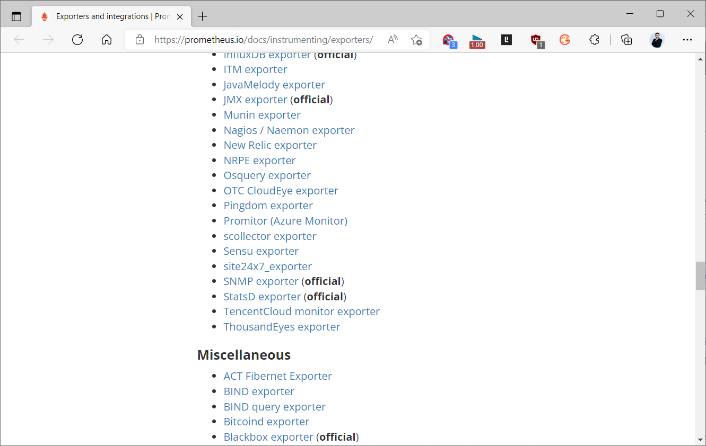

## 7.1 Node Exporter 监控服务

### 7.1.1 服务监控说明

对于一些服务应用来说，我们可以通过对于node_exporter的启动参数改造来实现更多功能的获取。

参数分析
```bash
#查看node_exporter命令的帮助信息，发现它有很多扩展的参数，通过这些参数来实现更多的功能监控
[root@prometheus ~]#/usr/local/node_exporter/bin/node_exporter --help
usage: node_exporter [<flags>]
Flags:
  -h, --help                     Show context-sensitive help (also try --help-long
and --help-man).
      --collector.bcache.priorityStats
                                 Expose expensive priority stats.
      --collector.cpu.info       Enables metric cpu_info
      --collector.cpu.info.flags-include=COLLECTOR.CPU.INFO.FLAGS-INCLUDE
                                 Filter the `flags` field in cpuInfo with a value
that must be a regular expression
      --collector.cpu.info.bugs-include=COLLECTOR.CPU.INFO.BUGS-INCLUDE
                                 Filter the `bugs` field in cpuInfo with a value that
must be a regular expression
      --collector.diskstats.ignored-devices="^(ram|loop|fd|(h|s|v|xv)d[a-
z]|nvme\\d+n\\d+p)\\d+$"
                                 Regexp of devices to ignore for diskstats.
.......
--collector.systemd               #显示当前系统中所有的服务状态信息
--collector.systemd.unit-include  #仅仅显示符合条件的systemd服务条目
--collector.systemd.unit-exclude  #显示排除列表范围之外的服务条目
#注意：
上面三条仅显示已安装的服务条目，没有安装的服务条目是不会被显示的。
而且后面两个属性是依赖于第一条属性的
这些信息会被显示在 node_systemd_unit_state对应的metrics中
```

### 7.1.2 实战案例

#### 7.1.2.1 修改 node_exporter 的配置文件
```ini
#在node1节点修改node_exporter配置文件
vim /lib/systemd/system/node_exporter.service
[Unit]
Description=node exporter project
After=network.target
[Service]
Type=simple
#只收集指定服务
ExecStart=/usr/local/node_exporter/bin/node_exporter --collector.systemd --
collector.systemd.unit-include=".*(ssh|mysql|node_exporter|nginx).*"
Restart=on-failure
[Install]
WantedBy=multi-user.target
#属性解析：
如果没有提前安装的服务，是不会被查看到的
服务名称的正则符号必须解析正确，否则无法匹配要现实的服务名称
#重启node_exporter服务
systemctl daemon-reload
systemctl restart node_exporter.service
```

#### 7.1.2.2 修改 Prometheus 配置
```yaml
#修改prometheus的配置文件，让它自动过滤文件中的节点信息
vim /usr/local/prometheus/conf/prometheus.yml
...
  - job_name: "node_exporter_service"
    static_configs:
      - targets: ["10.0.0.104:9100"]
#重启服务
systemctl reload prometheus.service
#稍等几秒钟，到浏览器中查看监控目标
#结果显示：
每个服务都有五种状态，只有成功的状态才会显示值为1，其他状态为0
只有已安装的服务才会在这里显示，否则不显示
```

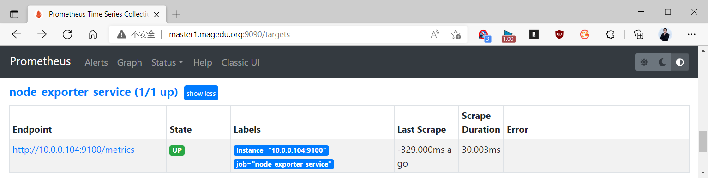

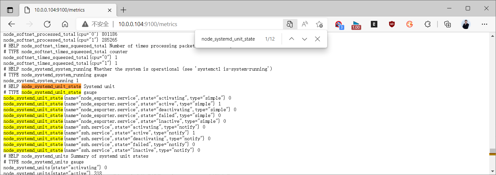
```bash
#在node1节点安装nginx服务后,再次观察可以看到下面结果
[root@node1 ~]#apt -y install nginx
```

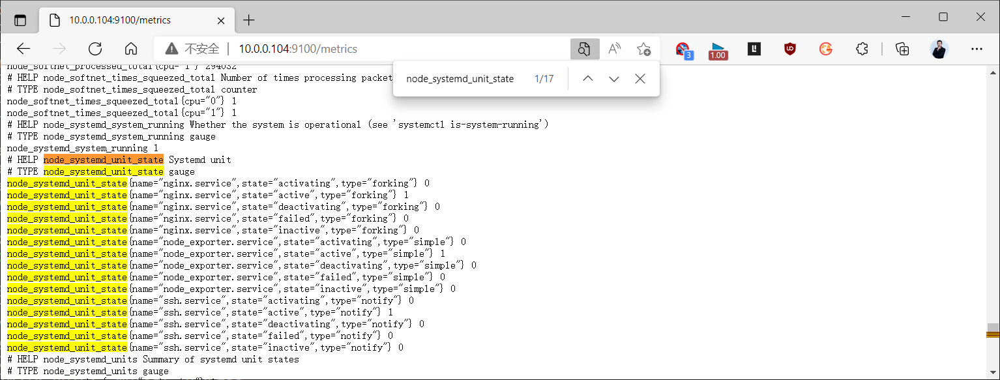

## 7.2 MySQL 监控

### 7.2.1 MySQL 监控说明

prometheus提供了专属于 MySQL 的服务监控工具 mysqld_exporter，可以借助于该模块，来实现数据库的基本监控。
```text
#下载链接
https://prometheus.io/download/
#使用说明
https://github.com/prometheus/mysqld_exporter
```

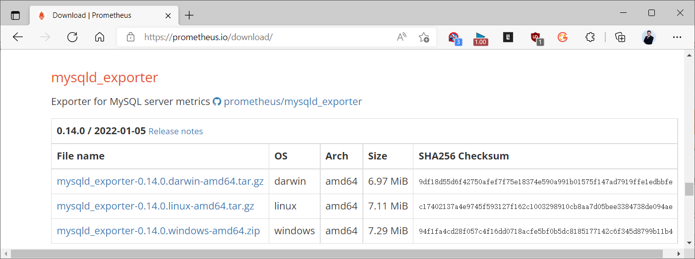

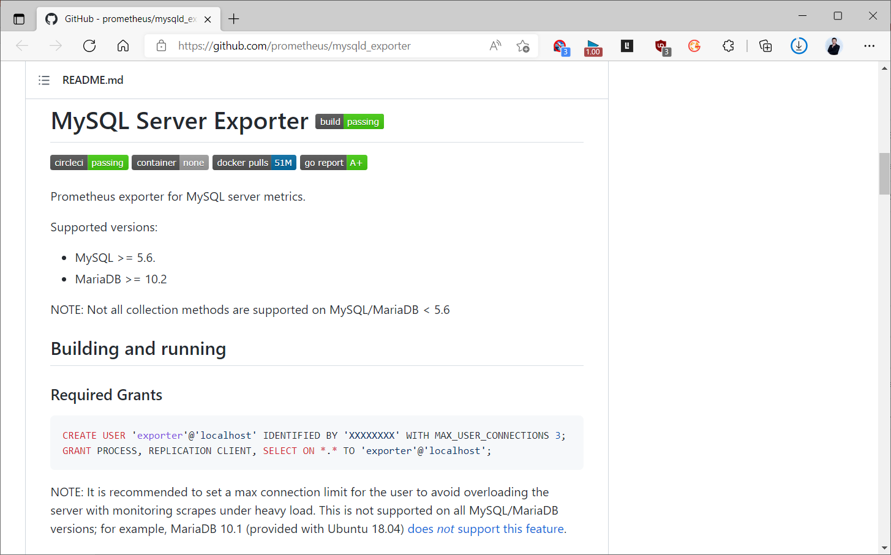

### 7.2.2 案例：二进制安装

#### 7.2.2.1 MySQL 数据库环境准备
```bash
#安装数据库软件
apt update && apt -y install mysql-server
#更新mysql配置，如果MySQL和MySQL exporter 不在同一个主机，需要修改如下配置
sed -i 's#127.0.0.1#0.0.0.0#' /etc/mysql/mysql.conf.d/mysqld.cnf
systemctl restart mysql
#为mysqld_exporter配置获取数据库信息的用户并授权
mysql
mysql> CREATE USER 'exporter'@'localhost' IDENTIFIED BY '123456' WITH
MAX_USER_CONNECTIONS 3;
mysql> GRANT PROCESS, REPLICATION CLIENT, SELECT ON *.* TO 'exporter'@'localhost';
mysql> flush privileges;
```

#### 7.2.2.2 mysqld_exporter 安装
```ini
#获取软件
wget
https://github.com/prometheus/mysqld_exporter/releases/download/v0.13.0/mysqld_exporter-0.13.0.linux-amd64.tar.gz
#解压软件
tar xf mysqld_exporter-0.13.0.linux-amd64.tar.gz -C /usr/local
ln -s /usr/local/mysqld_exporter-0.13.0.linux-amd64 /usr/local/mysqld_exporter
cd /usr/local/mysqld_exporter/
mkdir bin
mv mysqld_exporter bin/
#在mysqld_exporter的服务目录下，创建 .my.cnf 隐藏文件，为mysqld_exporter配置获取数据库信息的基
本属性
vim /usr/local/mysqld_exporter/.my.cnf
[client]
host=127.0.0.1
port=3306
user=exporter
password=PASSWORD
id prometheus  &> /dev/null || useradd -r -s /sbin/nologin prometheus
#修改node_exporter的服务启动文件
vim /lib/systemd/system/mysqld_exporter.service
[Unit]
Description=mysqld exporter project
After=network.target
[Service]
Type=simple
ExecStart=/usr/local/mysqld_exporter/bin/mysqld_exporter --config.my-
cnf="/usr/local/mysqld_exporter/.my.cnf"
Restart=on-failure
User=prometheus
Group=prometheus
[Install]
WantedBy=multi-user.target
#配置解析：在原来的配置文件基础上，添加了 --config.my-cnf属性
#重载并重启服务
systemctl daemon-reload
systemctl enable --now  mysqld_exporter.service
systemctl status mysqld_exporter.service
#检查是否打开9104/tcp端口
ss -tnulp | grep mysql
tcp        0  0 0.0.0.0:3306            0.0.0.0:*               LISTEN
 24472/mysqld
tcp6       0  0 :::9104                 :::*                    LISTEN
 24838/mysqld_export
#结果显示：该组件对外暴露的端口是 9104 端口
```

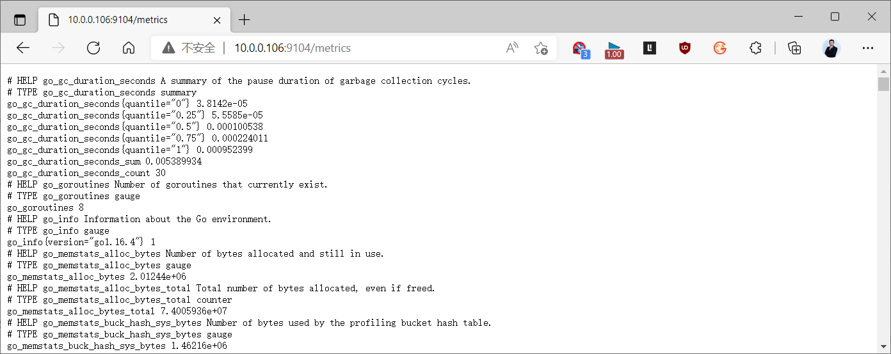

#### 7.2.2.3 修改 Prometheus 配置
```yaml
#修改prometheus的配置文件，让它自动过滤文件中的节点信息
vim  /usr/local/prometheus/conf/prometheus.yml
...
  - job_name: "mysqld_exporter"
    static_configs:
      - targets: ["10.0.0.106:9104"]
#重启服务
systemctl reload prometheus.service
#稍等几秒钟，到浏览器中查看监控目标
```

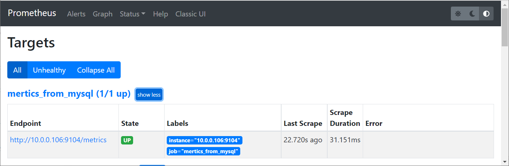

#### 7.2.2.4 Grafana 图形展示
```text
#导入grafana的镜像模板文件
https://grafana.com/grafana/dashboards/14057,7362,11323,13106,17320(中文版)
```

17320 中文版

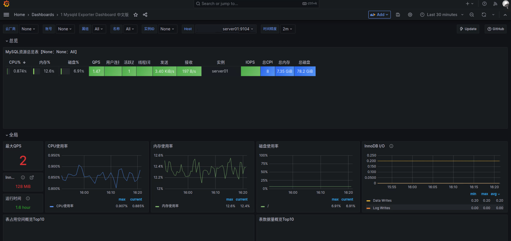

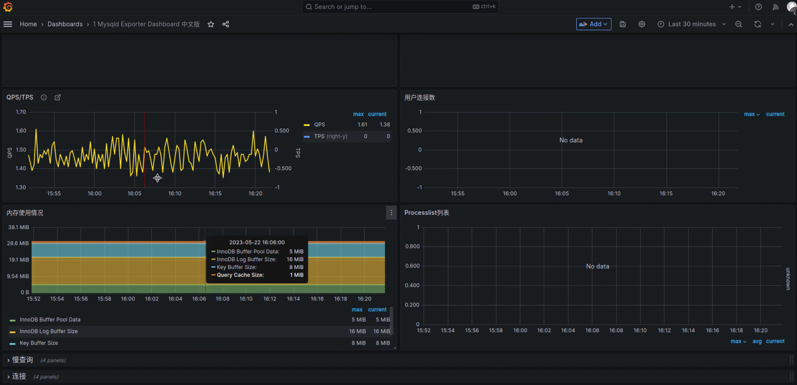

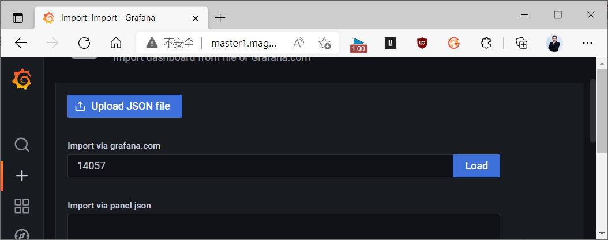

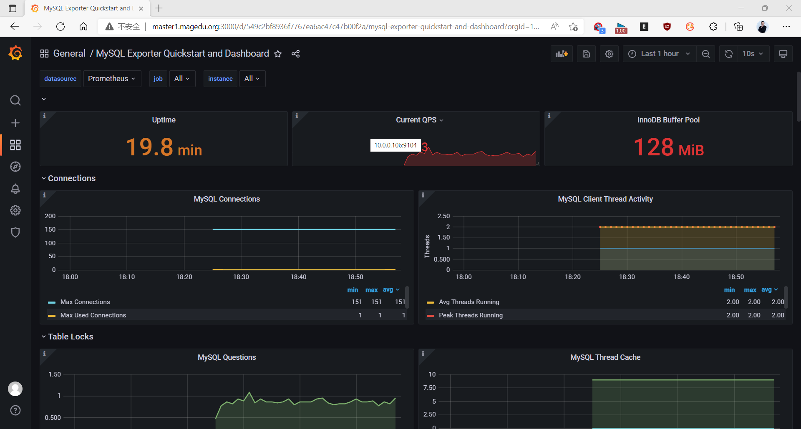

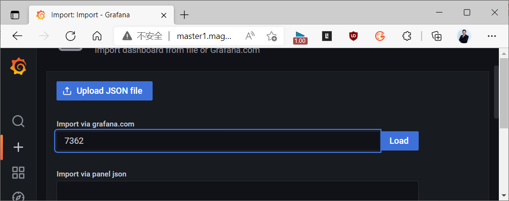

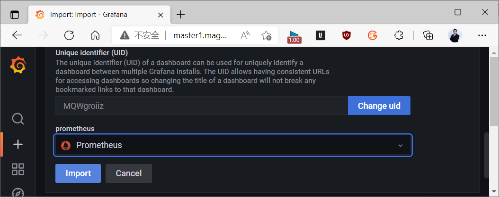

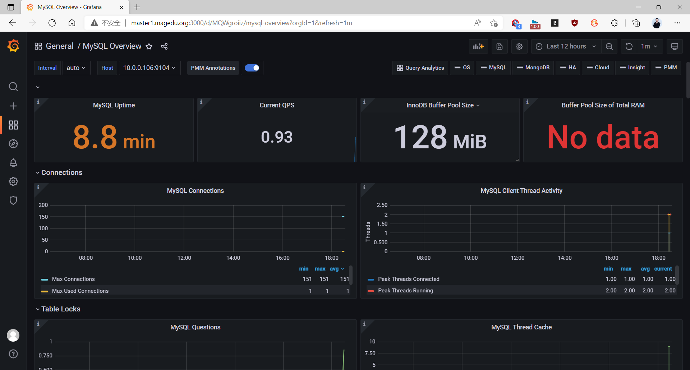

### 7.2.3 案例：docker compose 实现
```bash
[root@ubuntu2204 mysql]#tree
.
├── docker-compose.yml
└── mysql
    └── docker.cnf
1 directory, 2 files
[root@ubuntu2204 mysql]#cat mysql/docker.cnf
[mysqld]
skip-host-cache
skip-name-resolve
[root@ubuntu2204 mysql]#cat docker-compose.yml
version: '3.6'
volumes:
    mysqld_data: {}
networks:
  monitoring:
    driver: bridge
    ipam:
      config:
         - subnet: 172.31.0.0/24
services:
  mysqld:
    image: mysql:8.0
    #image: mysql:5.7
    volumes:
      - ./mysql:/etc/mysql/conf.d
      - mysqld_data:/var/lib/mysql
    environment:
      - MYSQL_ALLOW_EMPTY_PASSWORD=true
    networks:
      - monitoring
    ports:
      - 3306:3306
  # CREATE USER 'exporter'@'172.31.%.%' IDENTIFIED BY 'exporter';
  # GRANT PROCESS, REPLICATION CLIENT ON *.* TO 'exporter'@'172.31.%.%';
  # GRANT SELECT ON performance_schema.* TO 'exporter'@'172.31.%.%';
  mysqld-exporter:
    image: prom/mysqld-exporter:v0.14.0
    command:
     - --collect.info_schema.innodb_metrics
     - --collect.info_schema.innodb_tablespaces
     - --collect.perf_schema.eventsstatementssum
     - --collect.perf_schema.memory_events
     - --collect.global_status
     - --collect.engine_innodb_status
     - --collect.binlog_size
    environment:
      - DATA_SOURCE_NAME=exporter:exporter@(mysqld:3306)/
    ports:
      - 9104:9104
    networks:
      - monitoring
    depends_on:
      - mysqld
#启动
[root@ubuntu2204 mysql]#docker-compose up -d
#验证服务
[root@ubuntu2204 mysql]#docker-compose ps
[root@ubuntu2204 mysql]#docker-compose logs mysqld-exporter
#创建用户和授权
[root@ubuntu2204 mysql]#docker-compose exec mysqld /bin/sh
sh-4.2#mysql
>CREATE USER 'exporter'@'172.31.%.%' IDENTIFIED BY 'exporter';
>GRANT PROCESS, REPLICATION CLIENT ON *.* TO 'exporter'@'172.31.%.%';
>GRANT SELECT ON performance_schema.* TO 'exporter'@'172.31.%.%';
>\q
sh-4.2#exit
[root@ubuntu2204 ~]#curl http://localhost:9194/metrics
#修改 Prometheus 监控 mysql
[root@ubuntu2204 ~]#vim /usr/local/prometheus/conf/prometheus.yml
.....
  - job_name: "mysqld-exporter"
    static_configs:
      - targets: ["mysqld-exporter服务器地址:9104"]
.....
[root@ubuntu2204 ~]#systemctl reload prometheus
#查看状态
```

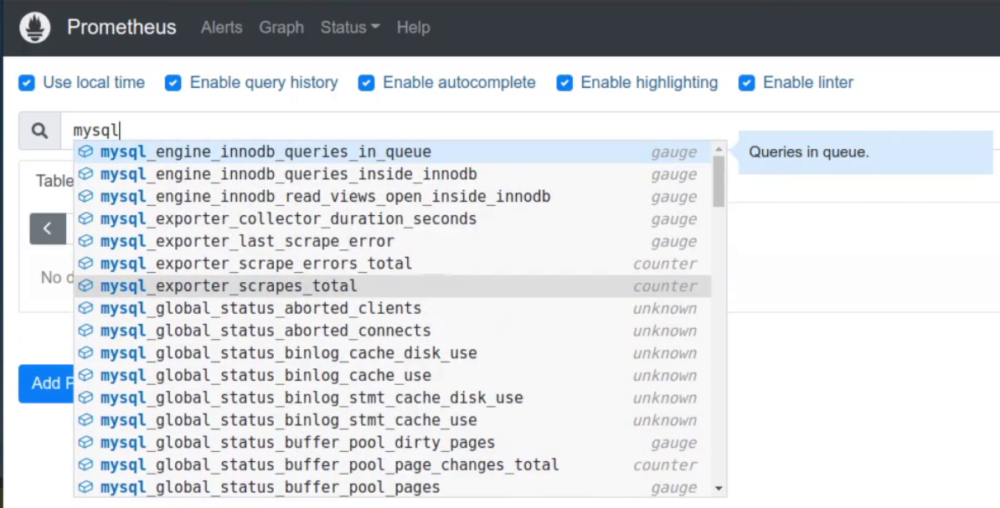



<nav class="article-end" aria-label="章节导航">
  <a href="{{ '/subjects/Prometheus/21-kubernetes-service-discovery.html' | relative_url }}">← 上一章：Kubernetes 服务发现</a>
  <a href="{{ '/subjects/Prometheus/' | relative_url }}">返回 Prometheus 目录</a>
  <a href="{{ '/subjects/Prometheus/23-haproxy-java-exporters.html' | relative_url }}">下一章：HAProxy 与 Java 监控 →</a>
</nav>
