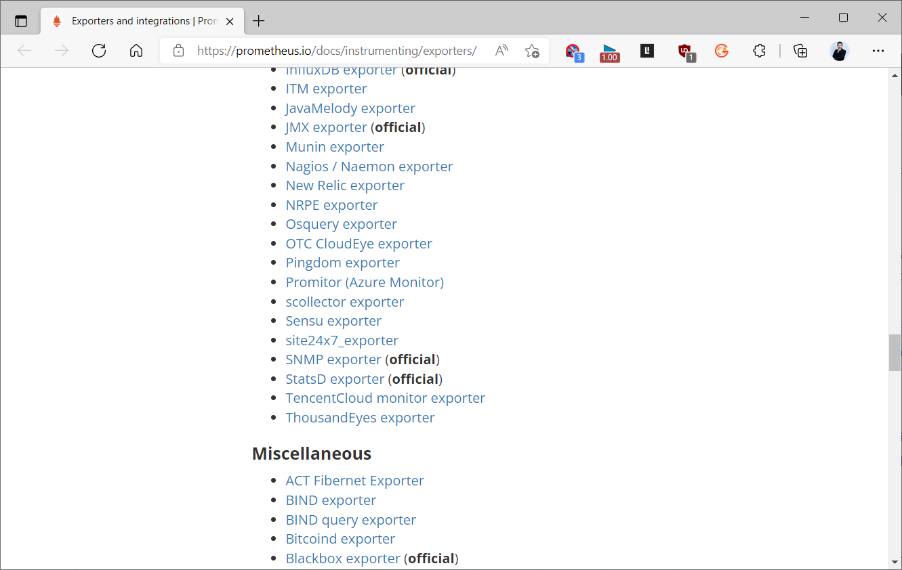
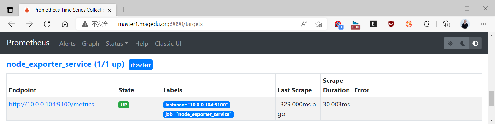
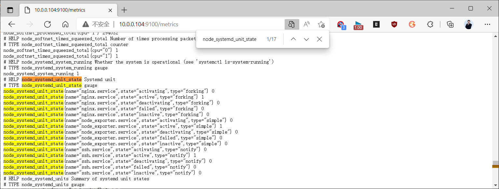
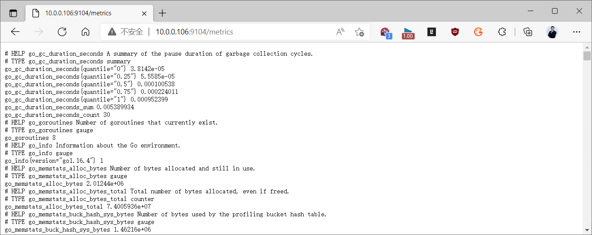
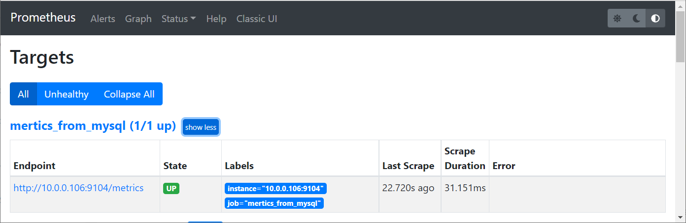
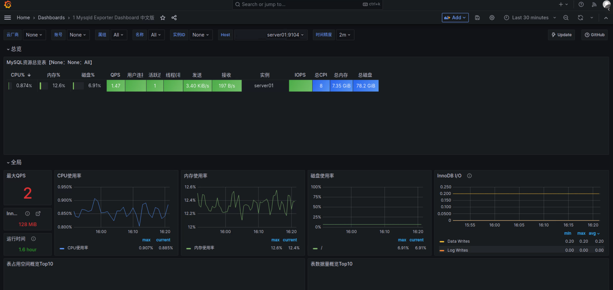
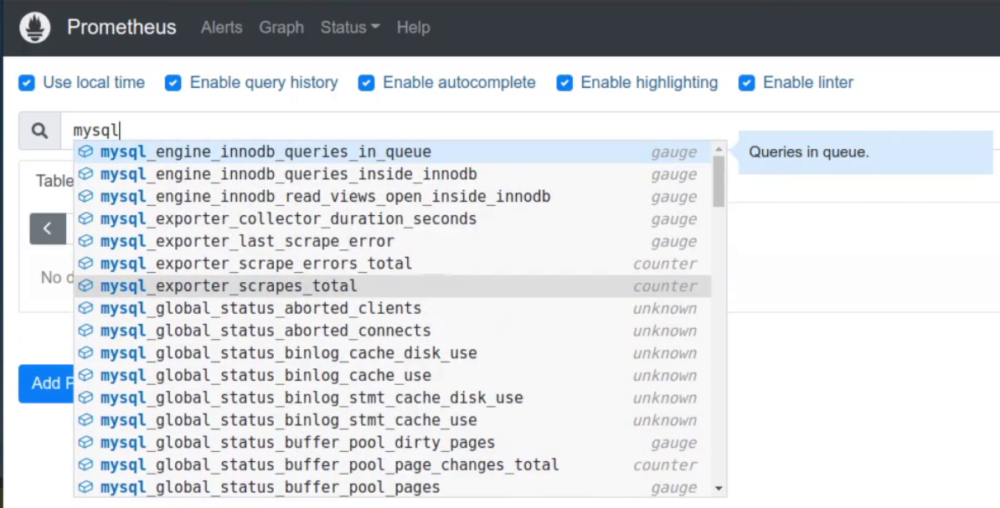

[← 返回 Prometheus 目录]({{ '/subjects/Prometheus/' | relative_url }})



# 22 Node Exporter 与 MySQL 监控

# 7 各种 Exporter

Exporter 将系统或应用状态转换成 Prometheus 可抓取的指标。Node Exporter 侧重宿主机资源；mysqld_exporter 连接 MySQL 并暴露数据库指标。两者都需要分别验证“Exporter 能访问被监控对象”和“Prometheus 能访问 Exporter”，不能只看进程是否启动。参阅 [官方 Exporter 列表](https://prometheus.io/docs/instrumenting/exporters/)。



## 7.1 Node Exporter：观察 systemd 服务

Node Exporter 默认收集 CPU、内存、磁盘、网络等主机指标。需要观察**已安装的** systemd 单元状态时，可以额外启用 `systemd` 采集器。它不会为未安装的服务生成时序；要监控“本应存在但已被删除”的服务，还需另设清单或缺失告警。

先在 Node Exporter 主机上确认版本和参数名：

```bash
/usr/local/node_exporter/bin/node_exporter --version
/usr/local/node_exporter/bin/node_exporter --help | grep collector.systemd
```

原资料的启动参数被 PDF 折成 `--` 和下一行的 `collector.systemd...`，直接复制会启动失败。下面的 systemd 服务片段将参数放在同一行；若实际版本不支持 `unit-include`，应以 `--help` 输出为准。

```ini
[Unit]
Description=Prometheus Node Exporter
After=network-online.target

[Service]
Type=simple
ExecStart=/usr/local/node_exporter/bin/node_exporter --collector.systemd --collector.systemd.unit-include=.*(ssh|mysql|node_exporter|nginx).*
Restart=on-failure

[Install]
WantedBy=multi-user.target
```

修改服务文件后执行 `systemctl daemon-reload` 和 `systemctl restart node_exporter`，再查询 `http://127.0.0.1:9100/metrics` 中的 `node_systemd_unit_state`。同一个单元会有多个状态标签，当前状态对应的序列值为 1，其他状态为 0；判断正常应筛选 `state="active"` 等标签。

Prometheus 中新增目标，而不是重写整个 `scrape_configs`：

```yaml
scrape_configs:
  - job_name: node-exporter
    static_configs:
      - targets: ['10.0.0.104:9100']
```

验证配置并重载后，在 Targets 页面检查 `UP`，再用 `node_systemd_unit_state{state="active"}` 查看已匹配的服务。安装 Nginx 后仍看不到单元时，先核对正则与真实 systemd 单元名。





## 7.2 MySQL：账户、Exporter 与采集

### 7.2.1 准备最小权限账户

mysqld_exporter 需要独立数据库账户，不应使用应用账号或 root。下面假设 Exporter 与 MySQL 在**同一主机**，所以用户来源限定为 `localhost`；若分开部署，应改为 Exporter 主机可匹配的来源，并限制网络访问，不能机械地把 MySQL `bind-address` 改为 `0.0.0.0`。

```sql
CREATE USER 'exporter'@'localhost' IDENTIFIED BY 'STRONG_EXPORTER_PASSWORD'
  WITH MAX_USER_CONNECTIONS 3;
GRANT PROCESS, REPLICATION CLIENT ON *.* TO 'exporter'@'localhost';
GRANT SELECT ON performance_schema.* TO 'exporter'@'localhost';
```

不同 MySQL 和 mysqld_exporter 版本、采集器对权限要求不同，应按 [项目文档](https://github.com/prometheus/mysqld_exporter) 和日志调整，而不是一开始授予所有库表的宽泛 `SELECT`。示例密码仅是占位符，不应提交真实凭据。

### 7.2.2 安装并验证 mysqld_exporter

原教程使用 `v0.13.0`，以下保留其目录约定以便对照；实际部署先从官方发布页选择对应平台版本。

```bash
wget https://github.com/prometheus/mysqld_exporter/releases/download/v0.13.0/mysqld_exporter-0.13.0.linux-amd64.tar.gz
tar xf mysqld_exporter-0.13.0.linux-amd64.tar.gz -C /usr/local/
ln -s /usr/local/mysqld_exporter-0.13.0.linux-amd64 /usr/local/mysqld_exporter
```

在 `/usr/local/mysqld_exporter/.my.cnf` 填写连接信息，并只让服务账户读取：

```ini
[client]
host=127.0.0.1
port=3306
user=exporter
password=STRONG_EXPORTER_PASSWORD
```

MySQL 用户来源 `localhost` 与 TCP 地址 `127.0.0.1` 的匹配结果需在实际环境核对；必要时为后者建对应账户，或使用本地 socket。下例服务文件保存为 `/etc/systemd/system/mysqld_exporter.service`：

```ini
[Unit]
Description=Prometheus MySQL Exporter
After=network-online.target mysql.service

[Service]
Type=simple
User=prometheus
Group=prometheus
ExecStart=/usr/local/mysqld_exporter/mysqld_exporter --config.my-cnf=/usr/local/mysqld_exporter/.my.cnf
Restart=on-failure

[Install]
WantedBy=multi-user.target
```

```bash
chown prometheus:prometheus /usr/local/mysqld_exporter/.my.cnf
chmod 600 /usr/local/mysqld_exporter/.my.cnf
systemctl daemon-reload
systemctl enable --now mysqld_exporter
curl -fsS http://127.0.0.1:9104/metrics | head
```

`9104` 是 Exporter 的指标端口，`3306` 是数据库端口。查询 `mysql_up`：值为 1 表示 Exporter 能连接并采集 MySQL；若 Exporter HTTP 端口打开却 `mysql_up=0`，先查凭据、来源主机、权限和 Exporter 日志。



### 7.2.3 加入 Prometheus 与 Grafana

```yaml
scrape_configs:
  - job_name: mysqld-exporter
    static_configs:
      - targets: ['10.0.0.106:9104']
```

执行 `promtool check config <主配置文件>` 并重载 Prometheus，在 Targets 页面检查该目标是否 `UP`，再查 `mysql_up`。Grafana 可以导入社区 MySQL 面板，例如原教程使用的 Dashboard 17320；导入后还需选择正确的数据源、Job 和实例。面板为空时，先看底层指标是否存在。





### 7.2.4 容器部署时的注意点

容器方式与二进制方式的链路相同：MySQL 数据目录持久化、Exporter 凭据文件只读挂载、两个容器在同一网络、Prometheus 抓取 `9104`。先创建数据库和最小权限账户，再启动 Exporter。原 Compose 示例使用 `MYSQL_ALLOW_EMPTY_PASSWORD=true`，把 Exporter 密码明写在环境变量中，且最后误测 `9194` 端口，不宜照搬。

容器内部的抓取地址可使用 `mysqld-exporter:9104`；宿主机外部的 Prometheus 应使用可达的宿主机地址，不能直接解析 Compose 内部服务名。最后仍按“Exporter 的 `mysql_up` → Prometheus 的 Target `UP` → Grafana 面板”顺序验证。




<nav class="article-end" aria-label="章节导航">
  <a href="{{ '/subjects/Prometheus/21-kubernetes-service-discovery.html' | relative_url }}">← 上一章：Kubernetes 服务发现</a>
  <a href="{{ '/subjects/Prometheus/' | relative_url }}">返回 Prometheus 目录</a>
  <a href="{{ '/subjects/Prometheus/23-haproxy-java-exporters.html' | relative_url }}">下一章：HAProxy 与 Java 监控 →</a>
</nav>
