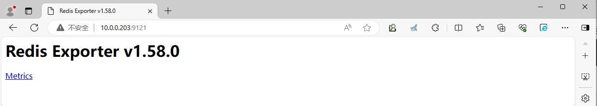
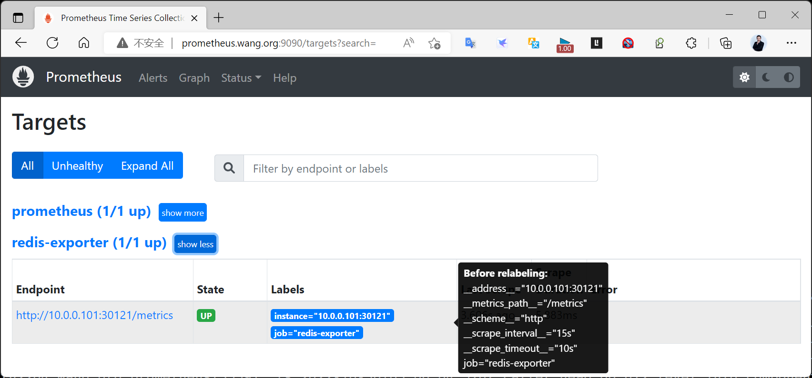
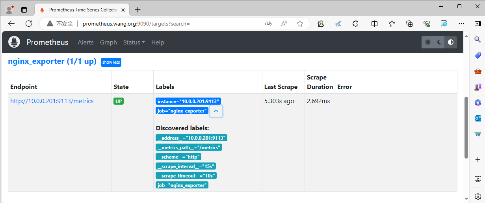
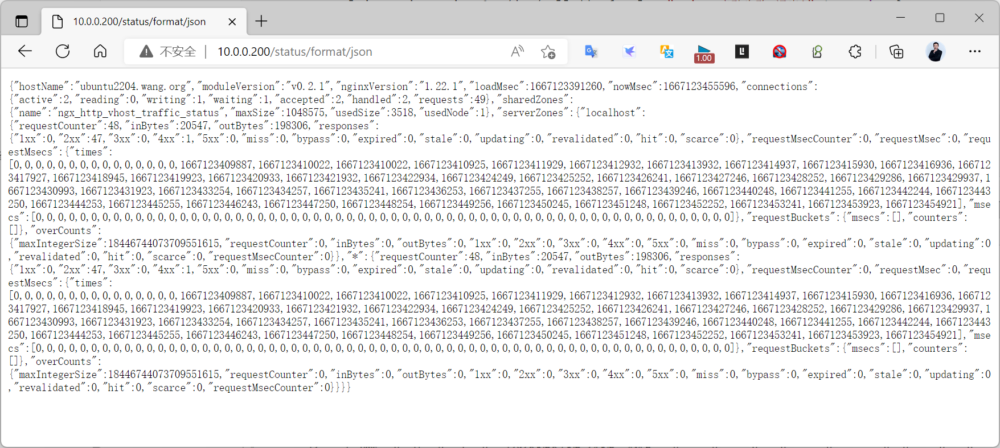
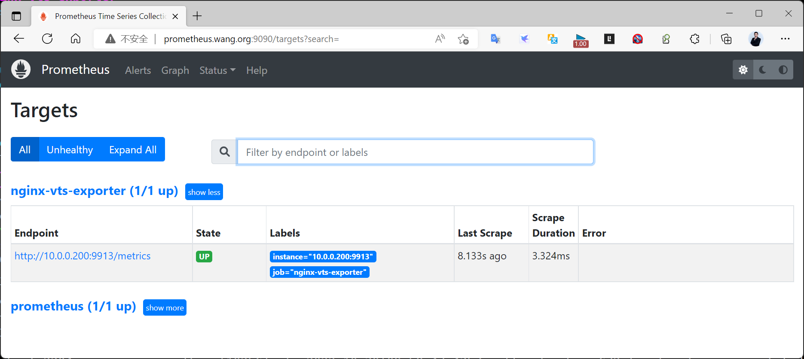

[← 返回 Prometheus 目录]({{ '/subjects/Prometheus/' | relative_url }})



# 24 Redis 与 Nginx 监控

Redis 与开源 Nginx 都可通过 Exporter 接入 Prometheus，但两者读取的数据源不同。redis_exporter 连接 Redis；nginx-prometheus-exporter 读取 Nginx 的状态页。应先验证数据源，再验证 Exporter 指标，最后看 Prometheus Targets。

## 7.5 Redis 监控

### 7.5.1 二进制 redis_exporter

[redis_exporter](https://github.com/oliver006/redis_exporter) 默认在 9121 端口暴露指标。原资料为演示把 Redis 监听改为 0.0.0.0、设置简单密码，还在 systemd 启动参数中明写密码。若 Exporter 与 Redis 同机，应优先使用本机连接并限制 6379 的外部访问。

下面固定一个版本；实际下载前核对官方发布页与压缩包内的目录名，避免原资料多次覆盖 VERSION 导致下载路径不一致：

```bash
wget https://github.com/oliver006/redis_exporter/releases/download/v1.74.0/redis_exporter-v1.74.0.linux-amd64.tar.gz
tar tf redis_exporter-v1.74.0.linux-amd64.tar.gz | head
tar xf redis_exporter-v1.74.0.linux-amd64.tar.gz -C /usr/local/
```

以压缩包内实际目录启动 Exporter。若 Redis 启用了认证，从受保护的本地配置或密钥系统提供凭据，不要把真实密码提交或写进公开服务文件。先验证 Redis 连接，再查询 Exporter 的 /metrics。redis_up 为 1 才表示 Exporter 成功连接 Redis；只有 Go 运行时指标不算成功。

```yaml
scrape_configs:
  - job_name: redis-exporter
    static_configs:
      - targets: ['10.0.0.203:9121']
```

检查并重载 Prometheus 后，依次看 Targets 为 UP、redis_up 为 1。Redis 与 Exporter 版本不匹配时，某些可选命令可能报“不支持”，应区分单个采集器失败与整体连接失败。



### 7.5.2 Kubernetes 中的 Redis sidecar

原实验把 Redis 与 Exporter 放在同一个 Pod，Exporter 通过 localhost:6379 连接 Redis。这可用于演示；生产 Redis 还要考虑持久化、认证和访问策略。集群内 Prometheus 抓取指标时，**无需**把 Redis 的 6379 暴露为 NodePort。

以下只展示指标 Service 与 ServiceMonitor。Redis Pod 需带 app: redis 标签，并将 Exporter 容器 9121 端口命名为 metrics：

```yaml
apiVersion: v1
kind: Service
metadata:
  name: redis-exporter
  namespace: monitoring
  labels:
    app: redis-exporter
spec:
  type: ClusterIP
  selector:
    app: redis
  ports:
    - name: metrics
      port: 9121
      targetPort: metrics
---
apiVersion: monitoring.coreos.com/v1
kind: ServiceMonitor
metadata:
  name: redis-exporter
  namespace: monitoring
spec:
  selector:
    matchLabels:
      app: redis-exporter
  endpoints:
    - port: metrics
      path: /metrics
```

ServiceMonitor 的自身标签还需符合 Prometheus CR 的 serviceMonitorSelector，详见第 32 章。集群外 Prometheus 则需要受限的 Exporter 可达地址，而不是默认开放 Redis。Grafana 社区面板（原资料列出 763、11835、14615）应在指标验证后导入。



## 7.6 Nginx 监控

### 7.6.1 常用方案：stub_status + nginx-prometheus-exporter

开源 Nginx 的 stub_status 提供连接与请求的基本统计，不是 Prometheus 文本格式。官方 [nginx-prometheus-exporter](https://github.com/nginx/nginx-prometheus-exporter) 读取该状态页，并在 9113 端口输出指标。状态页应仅让 Exporter 访问：

```nginx
server {
    listen 127.0.0.1:8888;
    location = /basic_status {
        stub_status;
        access_log off;
    }
}
```

运行 nginx -t 并重载后，先用 curl 检查状态页是否出现 Active connections 等字段。若 Exporter 在另一个容器，127.0.0.1 指向该容器自身，必须改用容器网络内可达的 Nginx 服务名和监听地址。

```bash
docker run -d --name nginx-prometheus-exporter \
  -p 9113:9113 nginx/nginx-prometheus-exporter:1.4 \
  --nginx.scrape-uri=http://NGINX_HOST:8888/basic_status
curl -fsS http://127.0.0.1:9113/metrics | grep -E 'nginx_up|nginx_connections_active'
```

nginx_up 为 1 才表示读取成功；为 0 时查 URL、监听地址和容器网络。Prometheus 抓取的是 Exporter 的 9113，而不是 Nginx 状态页：

```yaml
scrape_configs:
  - job_name: nginx-exporter
    static_configs:
      - targets: ['10.0.0.201:9113']
```



原资料的 Compose 方法本质相同：Nginx 与 Exporter 在同一 Compose 网络，Exporter 可访问 nginx:8080/stub_status；若 Prometheus 在宿主机外部，则抓取宿主机映射的 9113。Grafana Dashboard 11199、14900 应在指标验证后再导入。

### 7.6.2 虚拟主机细分方案：VTS

[nginx-module-vts](https://github.com/vozlt/nginx-module-vts) 是额外编译的模块，可提供按虚拟主机等维度细分的状态 JSON；[nginx-vts-exporter](https://github.com/hnlq715/nginx-vts-exporter) 再转换为 Prometheus 指标，原教程默认监听 9913。这适合需要 VTS 指标且能维护定制 Nginx 构建的场景，不能与官方 stub_status Exporter 混用。

```nginx
http {
    vhost_traffic_status_zone;
    server {
        listen 127.0.0.1:8081;
        location /status {
            vhost_traffic_status_display;
            vhost_traffic_status_display_format json;
        }
    }
}
```

编译时将 VTS 模块加入选项，并用 nginx -V 确认。先检查 /status/format/json，再让 VTS Exporter 指向该 URL。原资料的 systemd 文件误把二进制名写成 nginx-vtx-exporter，还把参数拆成两行；应以下载包内的 nginx-vts-exporter 和当前版本 --help 为准。

```yaml
scrape_configs:
  - job_name: nginx-vts-exporter
    static_configs:
      - targets: ['10.0.0.200:9913']
```

VTS 与基础 stub_status 的指标维度不同，Grafana 面板应分别选择。原教程的 VTS Dashboard 2949 需要对应指标存在；无虚拟主机细分需求时，标准 Exporter 路径更简单。






<nav class="article-end" aria-label="章节导航">
  <a href="{{ '/subjects/Prometheus/23-haproxy-java-exporters.html' | relative_url }}">← 上一章：HAProxy 与 Java 监控</a>
  <a href="{{ '/subjects/Prometheus/' | relative_url }}">返回 Prometheus 目录</a>
  <a href="{{ '/subjects/Prometheus/25-consul-blackbox-exporters.html' | relative_url }}">下一章：Consul 与 Blackbox Exporter →</a>
</nav>
