[← 返回 Prometheus 目录]({{ '/subjects/Prometheus/' | relative_url }})



# 24 Redis 与 Nginx 监控

## 7.5 Redis 监控

prometheus提供了专属于Redis 的服务监控工具 redis_exporter，我们可以借助于该模块，来实现Redis的基本监控。
https://github.com/oliver006/redis_exporter

### 7.5.1 基于二进制实现 redis_exporter
```ini
[root@node03 ~]#apt update && apt -y install redis
[root@node03 ~]#vim /etc/redis/redis.conf
bind 0.0.0.0
requirepass 123456
[root@node03 ~]#systemctl restart redis
[root@node03 ~]#VERSION=v1.74.0
[root@node03 ~]#VERSION=v1.71.0
[root@node03 ~]#VERSION=v1.67.0
[root@node03 ~]#VERSION=v1.66.0
[root@node03 ~]#wget
https://github.com/oliver006/redis_exporter/releases/download/${VERSION}/redis_export
er-${VERSION}.linux-amd64.tar.gz
[root@node03 ~]#wget
https://mirror.ghproxy.com/https://github.com/oliver006/redis_exporter/releases/download/v1.63.0/redis_exporter-v1.63.0.linux-amd64.tar.gz
[root@node03 ~]#tar xf redis_exporter-${VERSION}.linux-amd64.tar.gz  -C /usr/local/
[root@node03 ~]#cd /usr/local/
[root@node03 local]#ln -s redis_exporter-v${VERSION}.linux-amd64/ redis_exporter
#交互启动
[root@node03 redis_exporter]#./redis_exporter -redis.addr redis://localhost:6379 -
redis.password 123456
INFO[0000] Redis Metrics Exporter v1.58.0    build date: 2024-02-17-07:13:15    sha1:
99ff138684a6726b5d589401b1b28f7bccdb2f97    Go: go1.22.0    GOOS: linux    GOARCH:
amd64
INFO[0000] Providing metrics at :9121/metrics
ERRO[0018] WARNING, LOGGED ONCE ONLY: cmd LATENCY HISTOGRAM, err: ERR Unknown
subcommand or wrong number of arguments for 'HISTOGRAM'. Try LATENCY HELP.
#用service启动
id prometheus  &> /dev/null || useradd -r -s /sbin/nologin prometheus
#修改node_exporter的服务启动文件
vim /lib/systemd/system/redis_exporter.service
[Unit]
Description=redis exporter project
After=network.target
[Service]
Type=simple
ExecStart=/usr/local/redis_exporter/bin/redis_exporter -redis.addr
redis://localhost:6379 -redis.password 123456
Restart=on-failure
User=prometheus
Group=prometheus
[Install]
WantedBy=multi-user.target
[root@node03 ~]#systemctl daemon-reload;systemctl enable --now redis_exporter
#测试访问
[root@node03 ~]#curl -s  127.0.0.1:9121/metrics|head
# HELP go_gc_duration_seconds A summary of the pause duration of garbage collection
cycles.
# TYPE go_gc_duration_seconds summary
go_gc_duration_seconds{quantile="0"} 0.000103695
go_gc_duration_seconds{quantile="0.25"} 0.000103695
go_gc_duration_seconds{quantile="0.5"} 0.000103695
go_gc_duration_seconds{quantile="0.75"} 0.000103695
go_gc_duration_seconds{quantile="1"} 0.000103695
go_gc_duration_seconds_sum 0.000103695
go_gc_duration_seconds_count 1
# HELP go_goroutines Number of goroutines that currently exist.
[root@prometheus ~]#vim /usr/local/prometheus/conf/prometheus.yml
  - job_name: 'redis_exporter'
    static_configs:
    - targets: ["10.0.0.203:9121"]
[root@prometheus ~]#systemctl reload prometheus.service
```

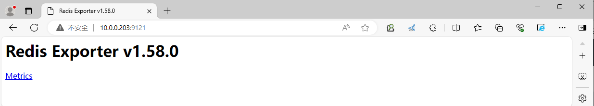

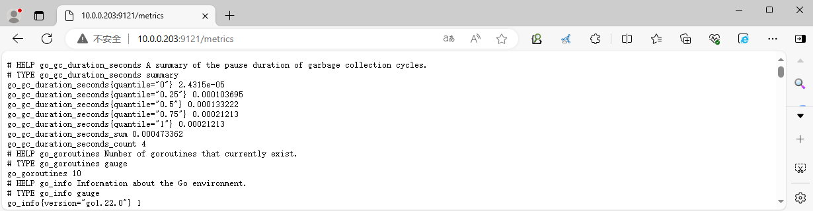

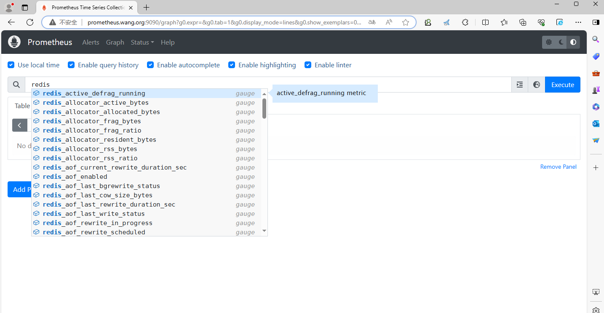

### 7.5.2 基于Kubernetes 实现 Redis exporter 部署

#### 7.5.2.1 准备配置文件
```yaml
[root@master1 ~]#cat prometheus-redis-exporter.yaml
---
apiVersion: apps/v1
kind: Deployment
metadata:
  name: redis
  namespace: monitoring
spec:
  replicas: 1
  selector:
    matchLabels:
      app: redis
  template:
    metadata:
      labels:
        app: redis
    spec:
      containers:
      - name: redis
        image: redis:6.2.7
        resources:
          requests:
            cpu: 200m
            memory: 500Mi
        ports:
         - containerPort: 6379
      - name: redis-exporter
        image: oliver006/redis_exporter:latest
        resources:
          requests:
            cpu: 500m
            memory: 100Mi
        ports:
         - containerPort: 9121
---
apiVersion: v1
kind: Service          #Redis的service
metadata:
  name: redis-service
  namespace: monitoring
spec:
  type: NodePort #暴露端口可以从K8s以外访问
  selector:
    app: redis
  ports:
  - name: redis
    port: 6379
    protocol: TCP
    targetPort: 6379
    nodePort: 30379
---
kind: Service  #redis-exporter的service
apiVersion: v1
metadata:
  annotations:
    prometheus.io/scrape: 'true'
    prometheus.io/port: "9121"
  name: redis-exporter-service
  namespace: monitoring
spec:
  type: NodePort           #暴露端口可以从K8s集群外访问
  selector:
    app: redis
  ports:
  - name: redis-exporter
    port: 9121
    protocol: TCP
    targetPort: 9121
    nodePort: 30121
[root@master1 ~]#kubectl apply  -f prometheus-redis-exporter.yaml
[root@master1 ~]#kubectl get pod -n monitoring  |grep redis
redis-5c66dfb895-69584                2/2     Running   0             7m25s
[root@master1 ~]#kubectl get svc  -n monitoring |grep redis
redis-exporter-service   NodePort   10.100.184.249   <none>        9121:30121/TCP
85s
redis-service            NodePort   10.108.61.29     <none>        6379:30379/TCP
5m15s
[root@master1 ~]#telnet 10.0.0.101 30379
Trying 10.0.0.101...
Connected to 10.0.0.101.
Escape character is '^]'.
set name bowen
+OK
get name
$12
bowen
^]
telnet> quit
Connection closed.
[root@master1 ~]#
```

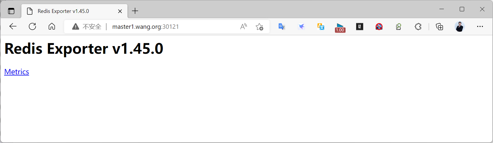

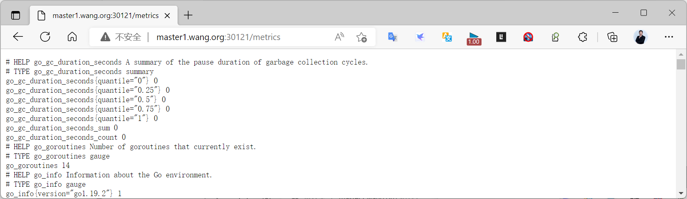

#### 7.5.2.2 配置 Prometheus 监控 Redis Exporter
```yaml
[root@ubuntu2204 ~]#vim /usr/local/prometheus/conf/prometheus.yml
.......
  - job_name: "redis-exporter"
    static_configs:
      - targets: ["10.0.0.101:30121"]
.......
[root@ubuntu2204 ~]#systemctl resload prometheus.service
```

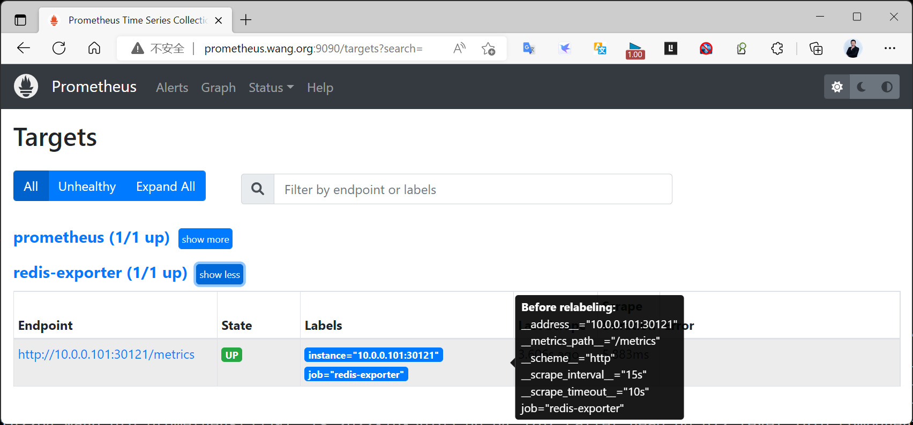

### 7.5.3 Grafana 展示

grafana 模板 763

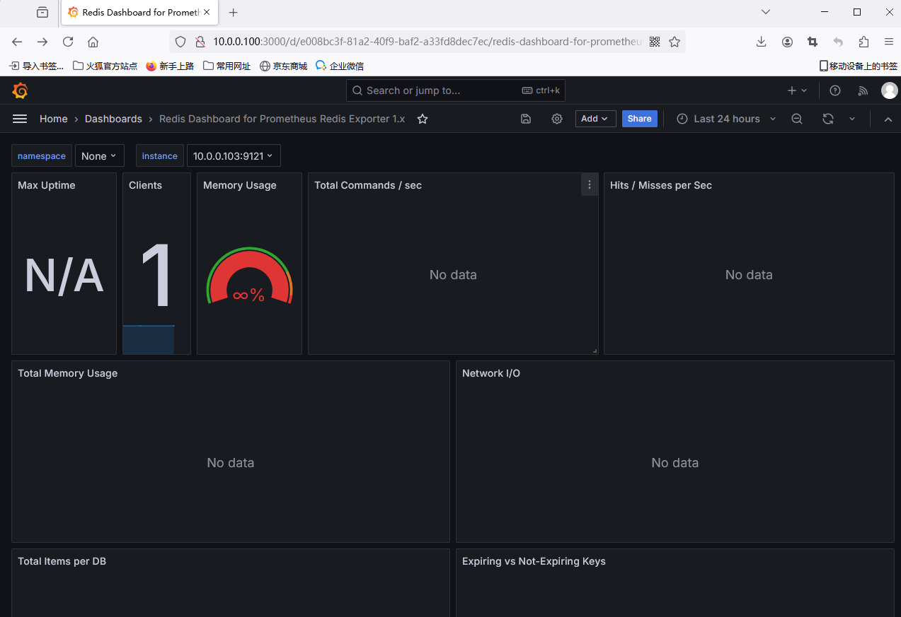

模板 11835

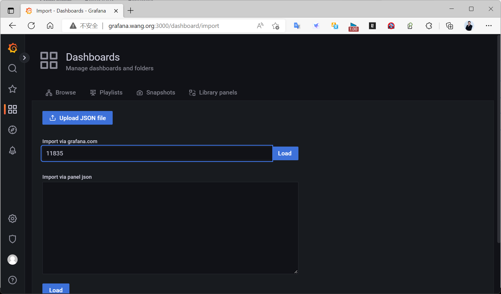

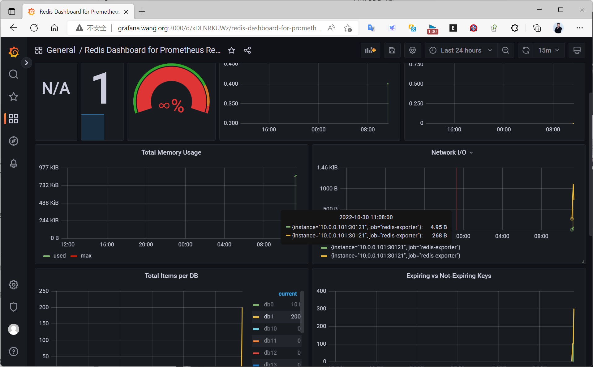

模板 14615

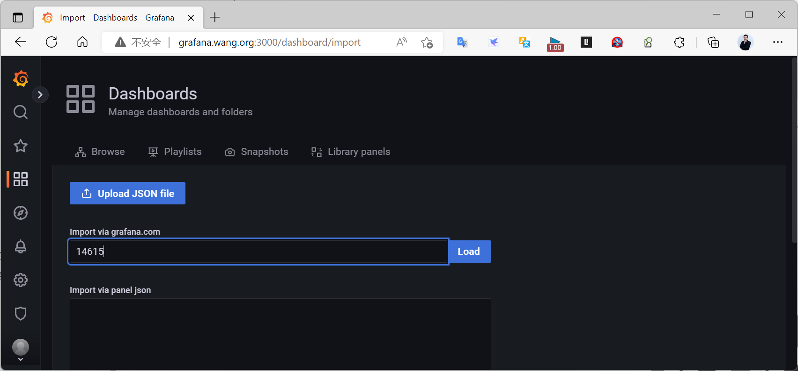

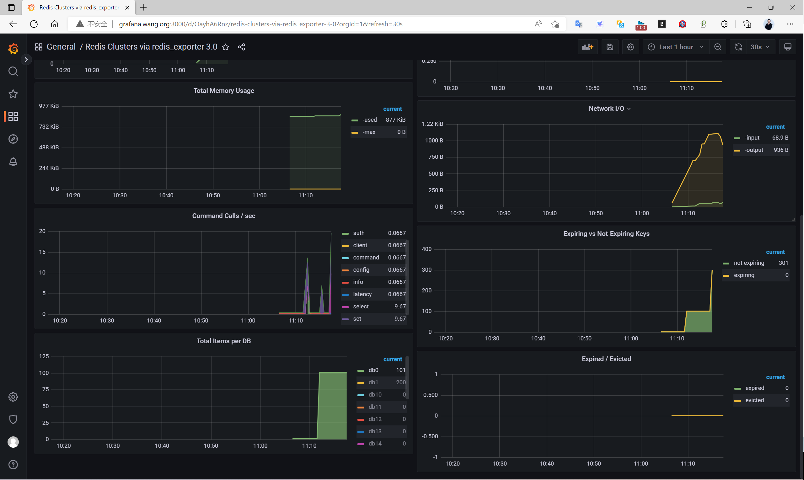

## 7.6 Nginx 监控

Nginx 默认自身没有提供 Json 格式的指标数据,可以通过下三种方式实现 Prometheus 监控

方法1：

通过容器方式 nginx/nginx-prometheus-exporter 容器配合nginx的stub状态页实现nginx的监控

方法2：Prometheus metric library for Nginx
https://prometheus.io/docs/instrumenting/exporters/
https://github.com/knyar/nginx-lua-prometheus

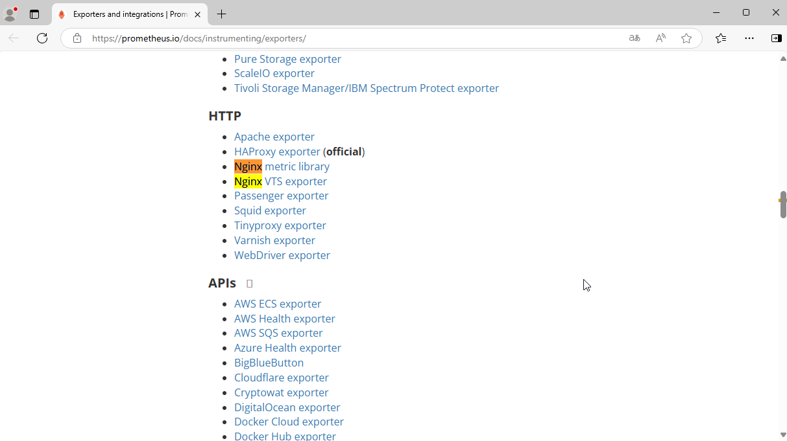

方法3

需要先编译安装一个第三方模块nginx-vts,将状态页转换为Json格式

再利用nginx-vts-exporter采集数据到Prometheus

### 7.6.1 nginx-prometheus-exporter 容器实现
https://hub.docker.com/r/nginx/nginx-prometheus-exporter

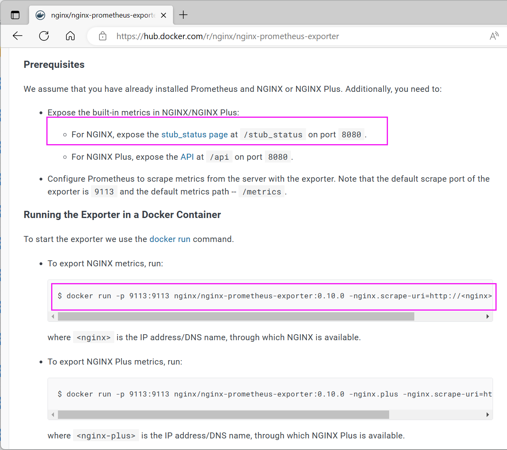

范例：基于 docker 实现
```bash
[root@node01 ~]#apt update && apt install -y docker.io nginx
[root@node01 ~]#cat /etc/docker/daemon.json
{
    "registry-mirrors": [
         "https://docker.m.daocloud.io",
         "https://docker.1panel.live"
    ]
}
[root@node01 ~]#systemctl restart docker
#方法1
[root@node01 ~]#cat /etc/nginx/conf.d/status.conf
server {
    listen 8888;
    location /basic_status {
        stub_status;
    }
}
[root@node01 ~]#nginx -s reload
[root@node01 ~]#docker pull nginx/nginx-prometheus-exporter:1.4
[root@node01 ~]#curl 127.0.0.1:8888/basic_status
Active connections: 1
server accepts handled requests
 2 2 2
Reading: 0 Writing: 1 Waiting: 0
#方法2
[root@node01 ~]#vim /etc/nginx/sites-enabled/default
    location /basic_status {
         stub_status;
    }
[root@node01 ~]#curl 127.0.0.1/basic_status
Active connections: 1
server accepts handled requests
 3 3 3
Reading: 0 Writing: 1 Waiting: 0
#后台启动
#方法1：
[root@ubuntu2204 ~]#docker run -p 9113:9113 --name nginx-prometheus-exporter --
restart always -d  nginx/nginx-prometheus-exporter:1.4  --nginx.scrape-
uri=http://10.0.0.201:8888/basic_status
[root@ubuntu2204 ~]#docker run -p 9113:9113 --name nginx-prometheus-exporter --
restart always -d  nginx/nginx-prometheus-exporter:1.1.0 --nginx.scrape-
uri=http://10.0.0.201:8888/basic_status
#方法2
[root@ubuntu2204 ~]#docker run -p 9113:9113 --name nginx-prometheus-exporter --
restart always -d  nginx/nginx-prometheus-exporter:1.1.0 --nginx.scrape-
uri=http://10.0.0.201/basic_status
#前台启动
[root@node01 ~]#docker run -p 9113:9113 nginx/nginx-prometheus-exporter:1.1.0 --
nginx.scrape-uri=http://localhost/stub_status
Unable to find image 'nginx/nginx-prometheus-exporter:1.1.0' locally
.1.1.0: Pulling from nginx/nginx-prometheus-exporter
514206a90ad6: Pull complete
ab3d49933a61: Pull complete
Digest: sha256:d710e0ff2505a7037dd21e47eae07025010c0de08a6247d1a704824823becfd0
Status: Downloaded newer image for nginx/nginx-prometheus-exporter:1.1.0
ts=2024-03-22T07:53:07.588Z caller=exporter.go:120 level=info msg="Starting nginx-
prometheus-exporter" version="(version=1.1.0, branch=HEAD,
revision=85fa58b9f8979eeed776a1df58495ef5baa4d9d7)"
ts=2024-03-22T07:53:07.588Z caller=exporter.go:121 level=info msg="Build context"
build_context="(go=go1.21.5, platform=linux/amd64, user=goreleaser, date=2024-01-
09T18:47:49Z, tags=unknown)"
ts=2024-03-22T07:53:07.589Z caller=tls_config.go:313 level=info msg="Listening on"
address=[::]:9113
ts=2024-03-22T07:53:07.590Z caller=tls_config.go:316 level=info msg="TLS is
disabled." http2=false address=[::]:9113
[root@node01 ~]#curl -s  http://10.0.0.102:9113/metrics |grep -v "^#"   |grep nginx
nginx_connections_accepted 3
nginx_connections_active 1
nginx_connections_handled 3
nginx_connections_reading 0
nginx_connections_waiting 0
nginx_connections_writing 1
nginx_exporter_build_info{branch="HEAD",goarch="amd64",goos="linux",goversion="go1.24
.2",revision="ced6fda825f88077debfacab8d82536ce502bb17",tags="unknown",version="1.4.2
"} 1
nginx_http_requests_total 9
nginx_up 1
[root@prometheus ~]#vim /usr/local/prometheus/conf/prometheus.yml
  - job_name: 'nginx_exporter'
    static_configs:
    - targets: ["10.0.0.201:9113"]
[root@prometheus ~]#systemctl reload prometheus.service
```

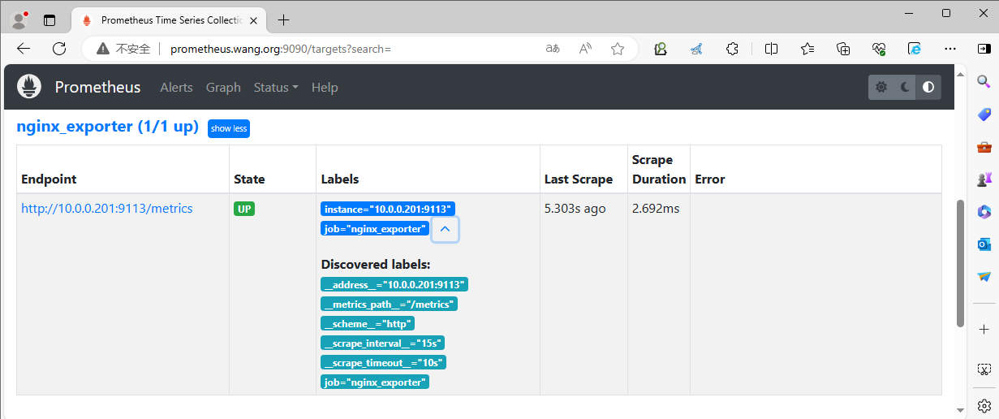

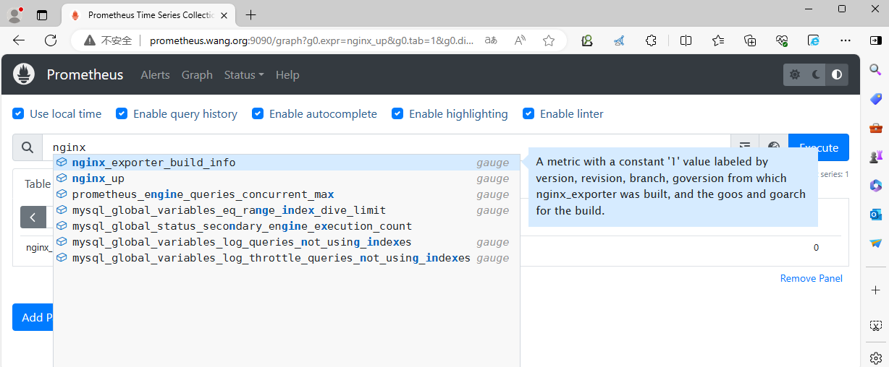

范例：docker compose 实现
```bash
[root@ubuntu2204 ~]#apt update && apt -y install docker-compose
[root@ubuntu2204 ~]#mkdir -p /etc/docker
[root@ubuntu2204 ~]#tee /etc/docker/daemon.json <<-'EOF'
{
      "registry-mirrors": ["https://si7y70hh.mirror.aliyuncs.com"],
      "insecure-registries": ["harbor.bowen.org"]
}
EOF
[root@ubuntu2204 ~]#systemctl restart docker.service
[root@ubuntu2204 nginx]#tree
.
├── nginx
│   └── stub_status-server.conf
└── docker-compose.yml
1 directory, 2 files
[root@ubuntu2204 nginx]#cat docker-compose.yml
version: '3.6'
networks:
  monitoring:
    driver: bridge
    ipam:
      config:
         - subnet: 172.31.0.0/24
services:
  nginx:
    image: nginx:1.22.1
    volumes:
      - ./nginx/stub_status-server.conf:/etc/nginx/conf.d/stub_status-server.conf:ro
    networks:
      - monitoring
    expose:
      - 8080
      - 80
    ports:
      - 80:80
  nginx-exporter:
    image: nginx/nginx-prometheus-exporter:0.11
    command:
      - '-nginx.scrape-uri=http://nginx:8080/stub_status'
    networks:
      - monitoring
    ports:
      - '9113:9113'
    depends_on:
      - nginx
[root@ubuntu2204 nginx]#cat nginx/stub_status-server.conf
server {
    listen 8080;
    server_name localhost;
    location /stub_status {
        stub_status;
        access_log off;
         #allow 172.31.0.0/16;
         #deny all;
    }
}
[root@ubuntu2204 nginx]#docker-compose up -d
#配置Prometheus监控Nginx
[root@ubuntu2204 ~]#vim /usr/local/prometheus/conf/prometheus.yml
.....
  - job_name: "nginx-exporter"
    static_configs:
      - targets: ["nginx-exporter服务器地址:9113"]
.....
[root@ubuntu2204 ~]#systemctl reload prometheus
```

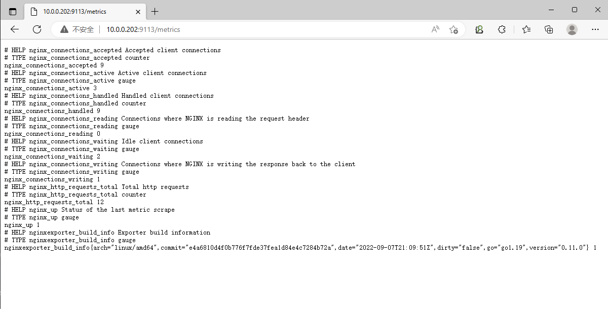

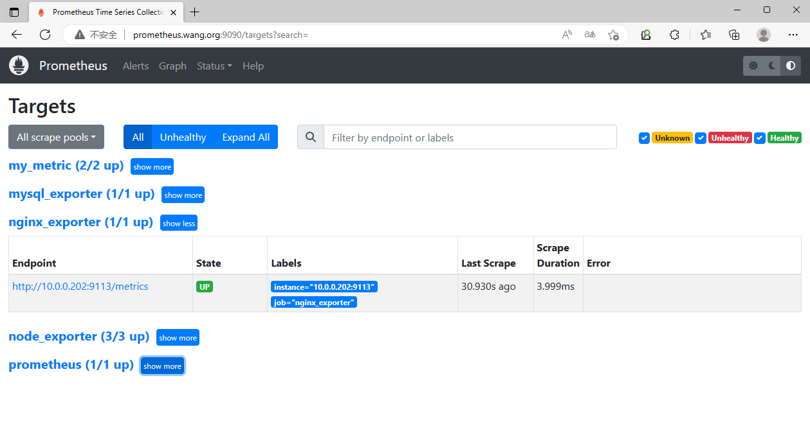

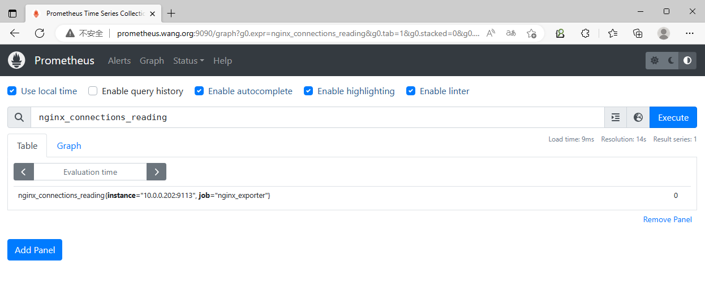

Grafana 模板

11199

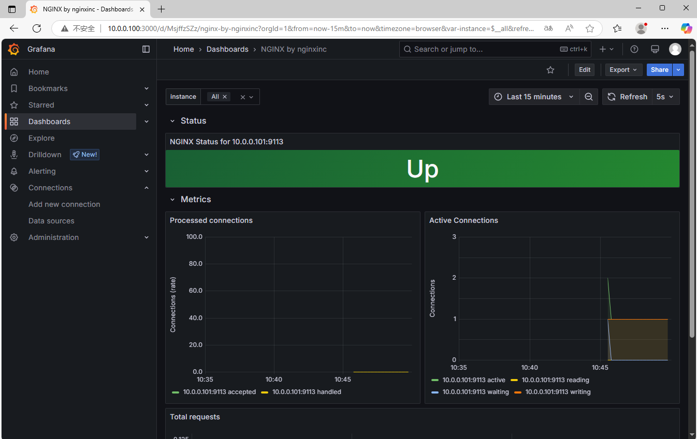

14900

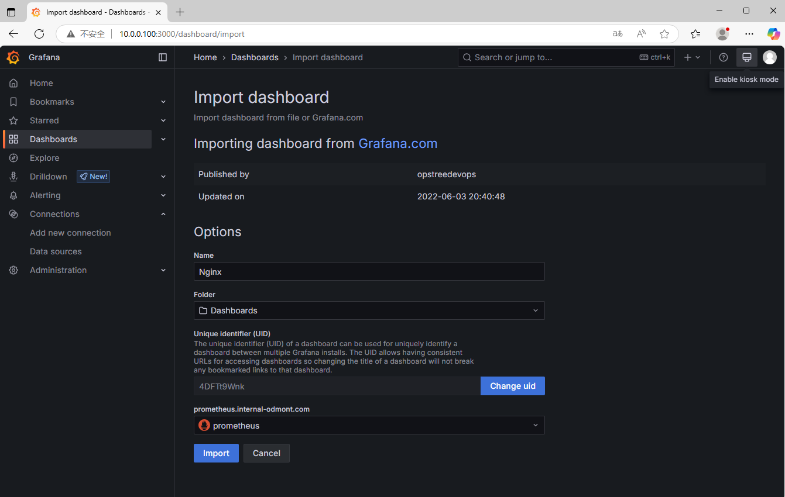

### 7.6.2 nginx-vts-exporter 实现

#### 7.6.2.1 编译安装 Nginx 添加模块
https://github.com/vozlt/nginx-module-vts

范例：编译安装Nginx
```ini
[root@ubuntu2004 ~]#apt update && apt -y install gcc make  libpcre3 libpcre3-dev
openssl libssl-dev zlib1g-dev
[root@ubuntu2004 ~]#useradd -s /sbin/nologin -r nginx
[root@ubuntu2004 ~]#cd /usr/local/src
[root@ubuntu2004 src]#git clone git://github.com/vozlt/nginx-module-vts.git
[root@ubuntu2004 src]#wget http://nginx.org/download/nginx-1.22.1.tar.gz
[root@ubuntu2004 src]#tar xf nginx-1.22.1.tar.gz
[root@ubuntu2004 src]#cd nginx-1.22.1
[root@ubuntu2004 nginx-1.22.1]#./configure --prefix=/apps/nginx --user=nginx --
group=nginx --with-http_ssl_module --with-http_v2_module --with-http_realip_module --
with-http_stub_status_module --with-http_gzip_static_module --with-pcre --with-stream
--with-stream_ssl_module --with-stream_realip_module --add-
module=/usr/local/src/nginx-module-vts
[root@ubuntu2004 nginx-1.22.1]#make && make install
[root@ubuntu2004 ~]#vim /apps/nginx/conf/nginx.conf
http {
    ......
    vhost_traffic_status_zone;
    ......
    server {
        ......
        location /status {
            vhost_traffic_status_display;
            vhost_traffic_status_display_format html;
        }
        ......
    }
}
[root@ubuntu2004 ~]#cat > /lib/systemd/system/nginx.service <<EOF
[Unit]
Description=The nginx HTTP and reverse proxy server
After=network.target remote-fs.target nss-lookup.target
[Service]
Type=forking
PIDFile=/apps/nginx/logs/nginx.pid
ExecStartPre=/bin/rm -f /apps/nginx/logs/nginx.pid
ExecStartPre=/apps/nginx/sbin/nginx -t
ExecStart=/apps/nginx/sbin/nginx
ExecReload=/bin/kill -s HUP \$MAINPID
KillSignal=SIGQUIT
TimeoutStopSec=5
KillMode=process
PrivateTmp=true
LimitNOFILE=100000
[Install]
WantedBy=multi-user.target
EOF
[root@ubuntu2004 ~]#systemctl daemon-reload
[root@ubuntu2004 ~]#systemctl enable --now nginx
#浏览器访问如下
http://10.0.0.200/status
```

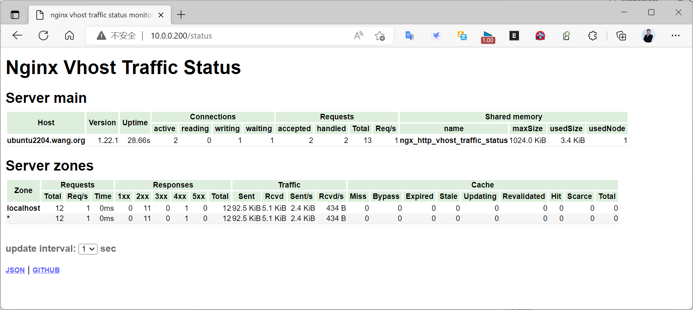

访问下面可以看到Json格式
http://10.0.0.200/status/format/json

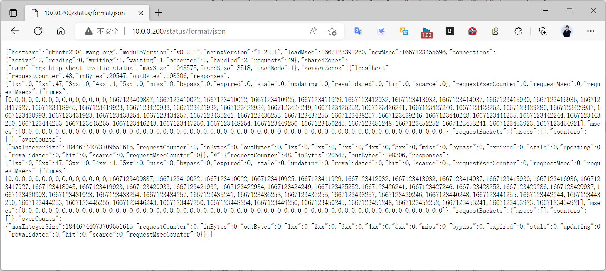

#### 7.6.2.2 安装 nginx-vts-exporter
https://github.com/hnlq715/nginx-vts-exporter

范例：二进制安装 nginx-vts-exporter
```ini
[root@ubuntu2204 ~]#cd /usr/local/src/
[root@ubuntu2204 src]#wget https://github.com/hnlq715/nginx-vts-exporter/releases/download/v0.10.3/nginx-vts-exporter-0.10.3.linux-amd64.tar.gz
[root@ubuntu2204 src]#tar xf nginx-vts-exporter-0.10.3.linux-amd64.tar.gz
[root@ubuntu2204 src]#ls
nginx-vts-exporter-0.10.3.linux-amd64  nginx-vts-exporter-0.10.3.linux-amd64.tar.gz
[root@ubuntu2204 src]#cd nginx-vts-exporter-0.10.3.linux-amd64/
[root@ubuntu2204 nginx-vts-exporter-0.10.3.linux-amd64]#ls
LICENSE  nginx-vts-exporter
[root@ubuntu2204 nginx-vts-exporter-0.10.3.linux-amd64]#mv nginx-vts-exporter
/usr/local/bin/
#启动
[root@ubuntu2204 ~]#nginx-vts-exporter -
nginx.scrape_uri=http://10.0.0.200/status/format/json
2022/10/30 17:54:57 Starting nginx_vts_exporter (version=0.10.3, branch=HEAD,
revision=8aa2881c7050d9b28f2312d7ce99d93458611d04)
2022/10/30 17:54:57 Build context (go=go1.10, user=root@56ca8763ee48, date=20180328-
05:47:47)
2022/10/30 17:54:57 Starting Server at : :9913
2022/10/30 17:54:57 Metrics endpoint: /metrics
2022/10/30 17:54:57 Metrics namespace: nginx
2022/10/30 17:54:57 Scraping information from : http://10.0.0.200/status/format/json
#用service启动
id prometheus  &> /dev/null || useradd -r -s /sbin/nologin prometheus
#修改node_exporter的服务启动文件
vim /lib/systemd/system/nginx_vts_exporter.service
[Unit]
Description=nginx_vts_exporter project
After=network.target
[Service]
Type=simple
ExecStart=/usr/local/nginx-vtx-exporter/bin/nginx-vtx-exporter  -
nginx.scrape_uri=http://localhost/status/format/json
Restart=on-failure
User=prometheus
Group=prometheus
[Install]
WantedBy=multi-user.target
[root@node03 ~]#systemctl daemon-reload;systemctl enable --now nginx_vts_exporter
#浏览器访问
http://10.0.0.200:9913/
```

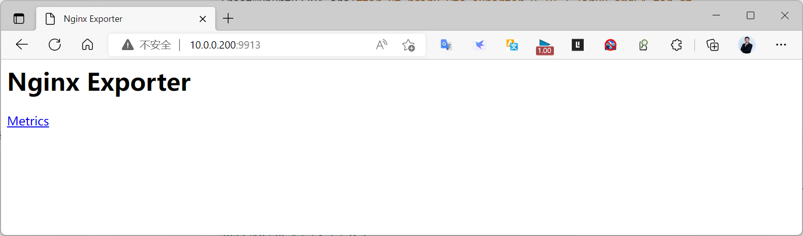

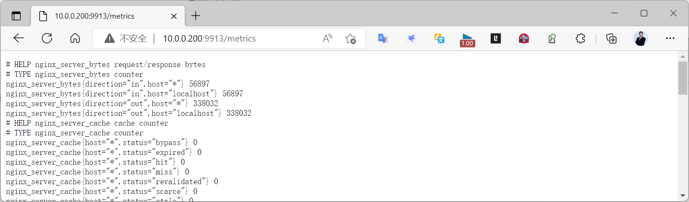

#### 7.6.2.3 配置 Prometheus

配置 Prometheus 监控 Nginx
```yaml
[root@ubuntu2204 ~]#vim /usr/local/prometheus/conf/prometheus.yml
.....
  - job_name: "nginx-vts-exporter"
    static_configs:
      - targets: ["10.0.0.200:9913"]
.....
[root@ubuntu2204 ~]#systemctl reload prometheus
```

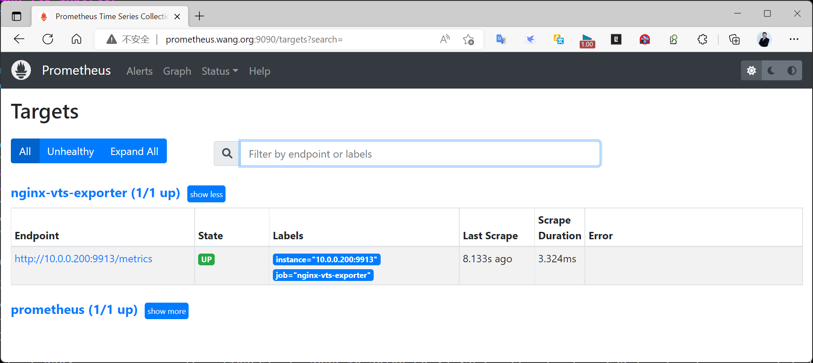

#### 7.6.2.4 Grafana 展示

模板 2949

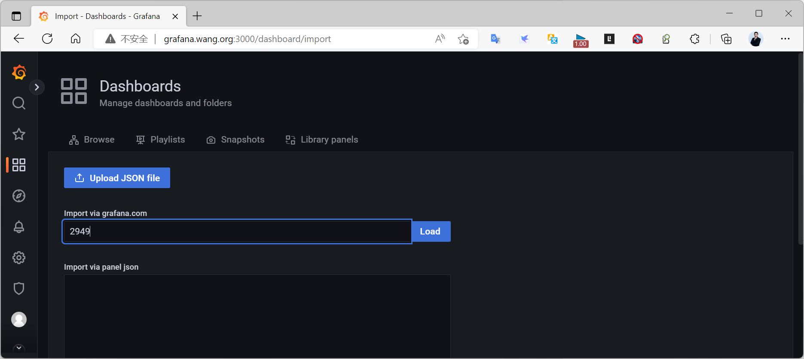

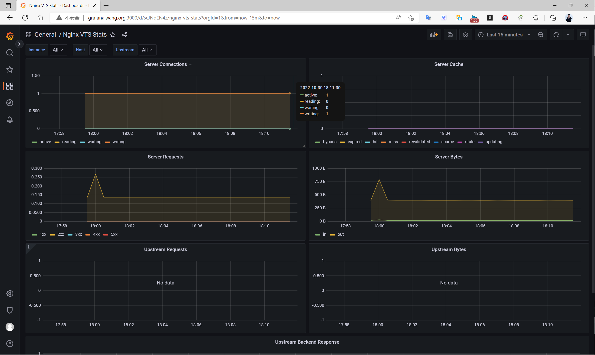



<nav class="article-end" aria-label="章节导航">
  <a href="{{ '/subjects/Prometheus/23-haproxy-java-exporters.html' | relative_url }}">← 上一章：HAProxy 与 Java 监控</a>
  <a href="{{ '/subjects/Prometheus/' | relative_url }}">返回 Prometheus 目录</a>
  <a href="{{ '/subjects/Prometheus/25-consul-blackbox-exporters.html' | relative_url }}">下一章：Consul 与 Blackbox Exporter →</a>
</nav>
