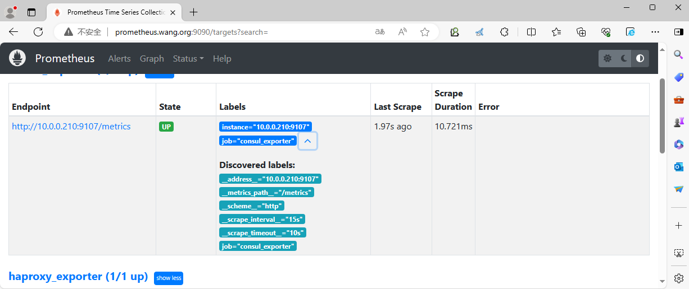
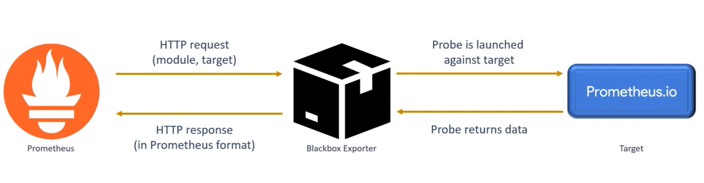
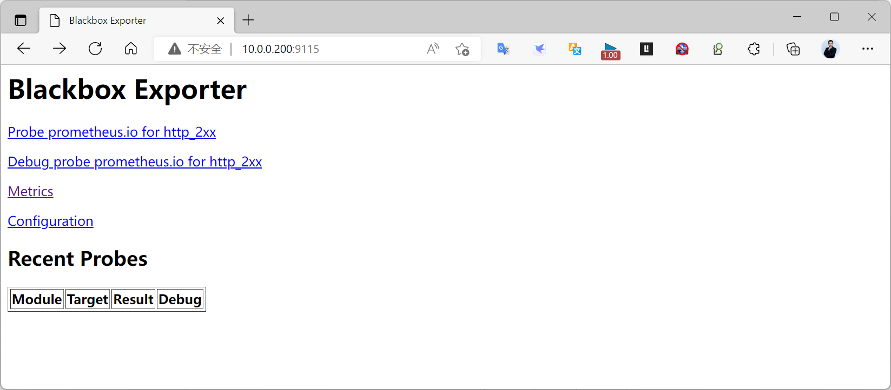
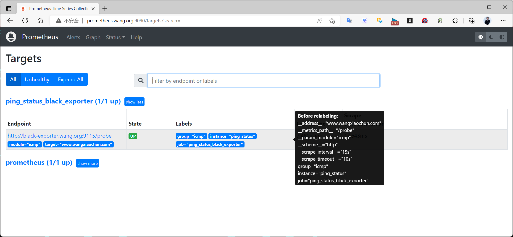
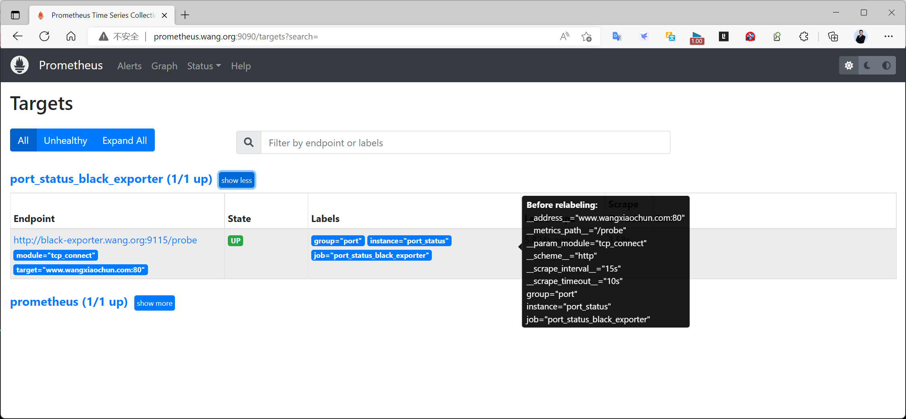
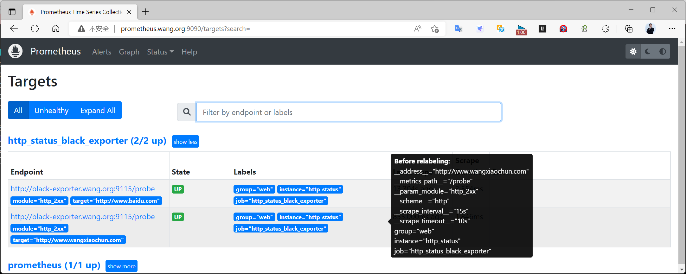
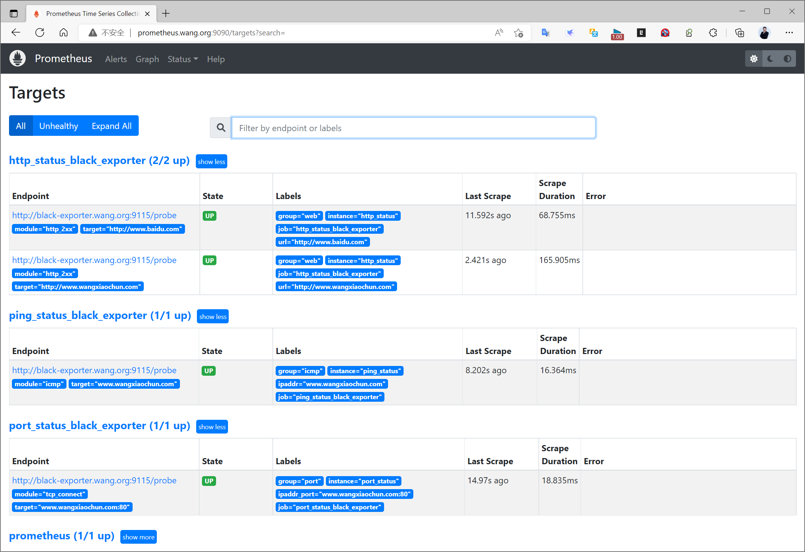

[← 返回 Prometheus 目录]({{ '/subjects/Prometheus/' | relative_url }})



# 25 Consul 与 Blackbox Exporter

前面的 Exporter 读取被监控服务内部状态；本章先用 consul_exporter 看 Consul 目录与健康状态，再用 Blackbox Exporter 从外部检查网络、端口和网站。两种指标回答的问题不同：服务注册为健康，并不保证用户路径可访问；探测成功，也不能说明服务内部资源没有压力。

## 7.7 Consul Exporter

[consul_exporter](https://github.com/prometheus/consul_exporter) 查询 Consul HTTP API，将目录服务数量、节点健康等状态转成 Prometheus 指标，默认监听 9107。它不负责 Consul 注册，也不能代替第 20 章的服务发现。通常按需要为 Consul API/数据中心部署 Exporter，并核对查询范围；并非每一个注册的业务实例都必须再运行一个 consul_exporter。

选择一个发布版本即可。原资料先下载 v0.13.0，随后解压 v0.8.0，目录与二进制路径不一致。以下保留 v0.13.0：

```bash
wget https://github.com/prometheus/consul_exporter/releases/download/v0.13.0/consul_exporter-0.13.0.linux-amd64.tar.gz
tar xf consul_exporter-0.13.0.linux-amd64.tar.gz -C /usr/local/
ln -s /usr/local/consul_exporter-0.13.0.linux-amd64 /usr/local/consul_exporter
```

先确认 Consul API 可用，例如在同机访问 127.0.0.1:8500；再启动 Exporter 并将查询地址指向该 API。若 Consul 配了 ACL/TLS，Exporter 也需要相应的令牌和证书，不能仅修改 HTTP 地址。服务文件中的 ExecStart 必须是一条完整命令，不能保留原资料中混入 shell 续行与未定义 ARGS 的示例：

```ini
[Unit]
Description=Consul Exporter
After=network-online.target

[Service]
Type=simple
User=consul
Group=consul
ExecStart=/usr/local/consul_exporter/consul_exporter --consul.server=http://127.0.0.1:8500 --web.listen-address=:9107
Restart=on-failure

[Install]
WantedBy=multi-user.target
```

启动后访问 Exporter 的 /metrics，并检查 consul_catalog_services 等指标是否存在。若 Exporter HTTP 正常但目录指标为空，先看它是否能认证并连接 Consul，而不是重装 Prometheus。

```yaml
scrape_configs:
  - job_name: consul-exporter
    static_configs:
      - targets: ['10.0.0.203:9107']
```

容器部署也是“Consul API → Exporter 9107 → Prometheus”这条链。Compose 网络中 Exporter 可将 Consul API 地址设为 consul:8500，但原资料的 `-dev`、`-bootstrap`、回环 bind 混用仅适合实验，不应当作集群清单。Grafana Dashboard 12049 导入前先核对指标和数据源。



## 7.8 Blackbox Exporter

### 7.8.1 黑盒探测与指标含义

[Blackbox Exporter](https://github.com/prometheus/blackbox_exporter) 从部署它的网络位置向目标发起 HTTP/HTTPS、TCP、ICMP、DNS 等探测，默认监听 9115。Prometheus 并不直接访问被测地址，而是请求 Exporter 的 /probe，附上 module 和 target 参数。返回的 probe_success 为 1 表示本次探测满足模块条件；Prometheus 的 up 为 1 **只表示 /probe 接口可抓取**，即使目标网站探测失败，up 也可能仍为 1。



模块配置决定检查什么。下例是三种最基本的探测；更复杂的响应正文、TLS、DNS 记录检查应在确认基础链路正常后再加：

```yaml
modules:
  http_2xx:
    prober: http
    timeout: 5s
  tcp_connect:
    prober: tcp
    timeout: 5s
  icmp:
    prober: icmp
    timeout: 5s
```

将其保存为 blackbox.yml。ICMP 在 Linux 上需要相应的原始套接字能力或系统 ping group 配置；原资料因此直接去掉服务用户、让 Exporter 以 root 运行，不是唯一方案。可按部署平台为服务授予所需能力，同时限制探测目标和 Exporter API 的访问。

### 7.8.2 部署与手工验证

下面固定原教程的 v0.25.0；二进制或容器方式选择一种，不要同时占用 9115：

```bash
wget https://github.com/prometheus/blackbox_exporter/releases/download/v0.25.0/blackbox_exporter-0.25.0.linux-amd64.tar.gz
tar xf blackbox_exporter-0.25.0.linux-amd64.tar.gz -C /usr/local/
ln -s /usr/local/blackbox_exporter-0.25.0.linux-amd64 /usr/local/blackbox_exporter
/usr/local/blackbox_exporter/blackbox_exporter --config.file=/usr/local/blackbox_exporter/blackbox.yml --web.listen-address=:9115
```

另一个终端请求探测 API，先用 HTTP 与 TCP 测试；ICMP 权限问题留到前两项确认后再排查：

```bash
curl -fsS 'http://127.0.0.1:9115/probe?module=http_2xx&target=https://example.org' | grep probe_success
curl -fsS 'http://127.0.0.1:9115/probe?module=tcp_connect&target=example.org:443' | grep probe_success
```

容器部署时应将 blackbox.yml **只读挂载**到启动参数指定的路径。原资料把本地目录写为 config，却在 Compose 里挂载 configs；两者不一致会导致配置文件找不到。可参考如下单服务结构：

```yaml
services:
  blackbox:
    image: prom/blackbox-exporter:v0.25.0
    command: ['--config.file=/etc/blackbox/blackbox.yml']
    volumes:
      - ./blackbox.yml:/etc/blackbox/blackbox.yml:ro
    ports:
      - '9115:9115'
```

若 Prometheus 与 Exporter 共享 Compose 网络，Prometheus 可使用 blackbox:9115；集群外 Prometheus 则使用它真实可达的主机地址。不要把探测接口无条件开放给任意外部请求，否则调用者可能借它向 Exporter 所在内网发探测。



### 7.8.3 在 Prometheus 中区分目标和探针

以下是三种任务的完整示意。重标记先把原目标地址写入 `__param_target`，再把 `__address__` 改成 Blackbox Exporter 地址；最后把原目标写入普通 `instance` 标签，方便按真实目标查询。原资料把同一任务中所有目标的 instance 固定成 ping_status、port_status 等，反而丢失了目标身份。

```yaml
scrape_configs:
  - job_name: blackbox-http
    metrics_path: /probe
    params:
      module: [http_2xx]
    static_configs:
      - targets: ['https://example.org']
    relabel_configs:
      - source_labels: [__address__]
        target_label: __param_target
      - source_labels: [__param_target]
        target_label: instance
      - target_label: __address__
        replacement: '10.0.0.200:9115'

  - job_name: blackbox-tcp
    metrics_path: /probe
    params:
      module: [tcp_connect]
    static_configs:
      - targets: ['example.org:443']
    relabel_configs:
      - source_labels: [__address__]
        target_label: __param_target
      - source_labels: [__param_target]
        target_label: instance
      - target_label: __address__
        replacement: '10.0.0.200:9115'

  - job_name: blackbox-icmp
    metrics_path: /probe
    params:
      module: [icmp]
    static_configs:
      - targets: ['10.0.0.101']
    relabel_configs:
      - source_labels: [__address__]
        target_label: __param_target
      - source_labels: [__param_target]
        target_label: instance
      - target_label: __address__
        replacement: '10.0.0.200:9115'
```

检查 Prometheus 配置并重载，再按 job 查询 probe_success。HTTP/HTTPS 探测可附带状态码、响应时长和证书到期等指标，但取决于模块和目标协议；TCP 成功只证明端口可连接，不保证应用响应正确。若只有某一模块失败，回到 Blackbox 的手工 /probe 结果和日志排查。







Grafana Dashboard 9965、13587 等可能假设有 url、ipaddr 等自定义标签，而本例统一保留原目标为 instance。导入面板后应调整变量或补充符合面板要求的标签；不能只因为面板不显示就改变 /probe 的核心重标记链路。




<nav class="article-end" aria-label="章节导航">
  <a href="{{ '/subjects/Prometheus/24-redis-nginx-exporters.html' | relative_url }}">← 上一章：Redis 与 Nginx 监控</a>
  <a href="{{ '/subjects/Prometheus/' | relative_url }}">返回 Prometheus 目录</a>
  <a href="{{ '/subjects/Prometheus/26-container-monitoring.html' | relative_url }}">下一章：容器监控与 cAdvisor →</a>
</nav>
