[← 返回 Prometheus 目录]({{ '/subjects/Prometheus/' | relative_url }})



# 25 Consul 与 Blackbox Exporter

## 7.7 Consul 监控

Consul Exporter 可以实现对 Consul 的监控

需要为每个Consul实例部署consul-exporter，它负责将Consul的状态信息转为Prometheus兼容的指标格式并予以暴露。

### 7.7.1 下载程序包和展开程序包consul-exporter
```bash
#先安装consul.再部署consul_exporter
wget
https://github.com/prometheus/consul_exporter/releases/download/v0.13.0/consul_exporter-0.13.0.linux-amd64.tar.gz
curl -LO
https://github.com/prometheus/consul_exporter/releases/download/v0.8.0/consul_exporter-0.8.0.linux-amd64.tar.gz
tar xf consul_exporter-0.8.0.linux-amd64.tar.gz -C /usr/local/
ln -sv /usr/local/consul_exporter-0.8.0.linux-amd64 /usr/local/consul_exporter/
mkdir /usr/local/consul_exporter/bin/
mv /usr/local/consul_exporter/consul_exporter
/usr/local/consul_exporter/consul_exporter/bin/
```

### 7.7.2 创建用户

若consul用户已经存在，可略过该步骤：
```text
useradd -r consul
```

### 7.7.3 创建service文件

保存于/lib/systemd/system/consul_exporter.service文件中
```ini
vim /lib/systemd/system/consul_exporter.service
[Unit]
Description=consul_exporter
Documentation=https://prometheus.io/docs/introduction/overview/
After=network.target
[Service]
Type=simple
User=consul
EnvironmentFile=-/etc/default/consul_exporter
# 具体使用时，若consul_exporter与consul server不在同一主机时，consul server要指向实际的地址；
ExecStart=/usr/local/consul_exporter/bin/consul_exporter \
             --consul.server="http://localhost:8500" \
             --web.listen-address=":9107" \
             --web.telemetry-path="/metrics" \
             --log.level=info \
             $ARGS
ExecReload=/bin/kill -HUP $MAINPID
TimeoutStopSec=20s
Restart=always
[Install]
WantedBy=multi-user.target
#启动服务
systemctl daemon-reload
systemctl enable --now consul_exporter.service
```

### 7.7.4 验证监听的端口，并测试访问其暴露的指标
```bash
ss -tnlp | grep '9107'
curl localhost:9107/metrics
[root@consul ~]#curl -s 127.0.0.1:9107/metrics |grep consul|head
# HELP consul_catalog_service_node_healthy Is this service healthy on this node?
# TYPE consul_catalog_service_node_healthy gauge
consul_catalog_service_node_healthy{node="consul",service_id="consul",service_name="c
onsul"} 1
consul_catalog_service_node_healthy{node="consul",service_id="myservice-
id",service_name="myservice"} 1
consul_catalog_service_node_healthy{node="consul",service_id="myservice1-
id",service_name="myservice1"} 1
consul_catalog_service_node_healthy{node="consul",service_id="myservice2-
id",service_name="myservice2"} 1
consul_catalog_service_node_healthy{node="consul",service_id="myservice3-
id",service_name="myservice3"} 1
# HELP consul_catalog_services How many services are in the cluster.
# TYPE consul_catalog_services gauge
consul_catalog_services 5
```

### 7.7.5 修改prometheus配置文件监控 consul_exporter
```yaml
vim /usr/local/prometheus/conf/prometheus.yml
.....
  - job_name: "consul_exporter"
    static_configs:
      - targets: ["10.0.0.203:9107"]
.....
systemctl reload prometheus.service
```

### 7.7.6 基于 dockcer-compose 实现部署consul和consul_exporter
```bash
[root@ubuntu2204 ~]#cat docker-compose.yml
version: '3.6'
volumes:
  consul_data: {}
networks:
  monitoring:
    driver: bridge
services:
  consul:
    image: consul:1.14
    volumes:
      - ./consul_configs:/consul/config
      - consul_data:/consul/data/
    networks:
      - monitoring
    ports:
      - 8500:8500
    command: ["consul","agent","-dev","-bootstrap","-config-dir","/consul/config","-
data-dir","/consul/data","-ui","-log-level","INFO","-bind","127.0.0.1","-
client","0.0.0.0"]
  consul-exporter:
    image: prom/consul-exporter:v0.8.0
    networks:
      - monitoring
    ports:
      - 9107:9107
    command:
      - "--consul.server=consul:8500"
    depends_on:
      - consul
#准备配置文件
[root@ubuntu2204 ~]#cat consul_configs/nodes.json
{
  "services": [
    {
      "id": "node_exporter-prometheus",
      "name": "prometheus-server",
      "address": "prometheus.bowen.org",
      "port": 9100,
      "tags": ["nodes"],
      "checks": [{
         "http": "http://prometheus.bowen.org:9100/metrics",
         "interval": "5s"
      }]
    },
    {
      "id": "node_exporter-node01",
      "name": "server01.bowen.org",
      "address": "server01.bowen.org",
      "port": 9100,
      "tags": ["nodes"],
      "checks": [{
         "http": "http://server01.bowen.org:9100/metrics",
         "interval": "5s"
      }]
    },
    {
      "id": "node_exporter-node02",
      "name": "server02.bowen.org",
      "address": "server02.bowen.org",
      "port": 9100,
      "tags": ["nodes"],
      "checks": [{
         "http": "http://server02.bowen.org:9100/metrics",
         "interval": "5s"
      }]
    },
    {
      "id": "node_exporter-node03",
      "name": "server03.bowen.org",
      "address": "server03.bowen.org",
      "port": 9100,
      "tags": ["nodes"],
      "checks": [{
         "http": "http://server03.bowen.org:9100/metrics",
         "interval": "5s"
      }]
    }
  ]
}
[root@ubuntu2204 ~]#cat consul_configs/consul-exporter.json
{
  "services": [
    {
      "id": "consul-exporter",
      "name": "consul-exporter",
      "address": "consul.bowen.org",
      "port": 9107,
      "tags": ["consul-exporter"],
      "checks": [{
         "http": "http://consul.bowen.org:9107/metrics",
         "interval": "5s"
      }]
    }
  ]
}
[root@ubuntu2204 ~]#docker-compose up -d
```

### 7.7.7 Prometheus 监控

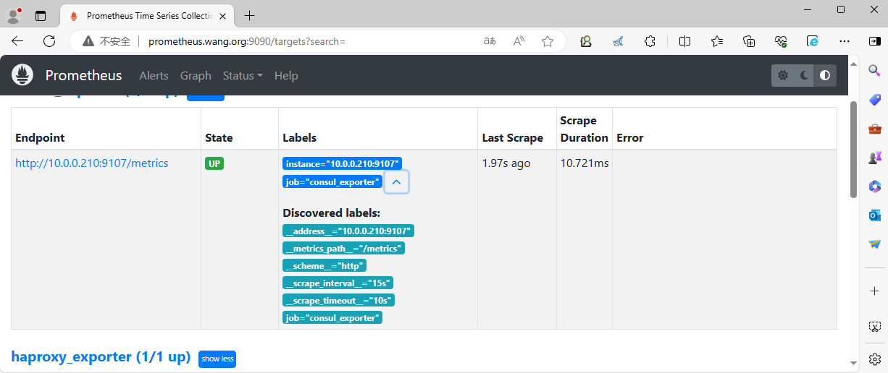

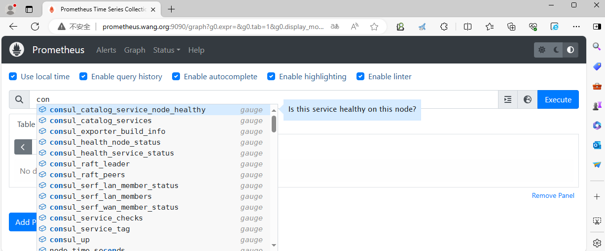

### 7.7.8 Grafana 展示

模板 12049

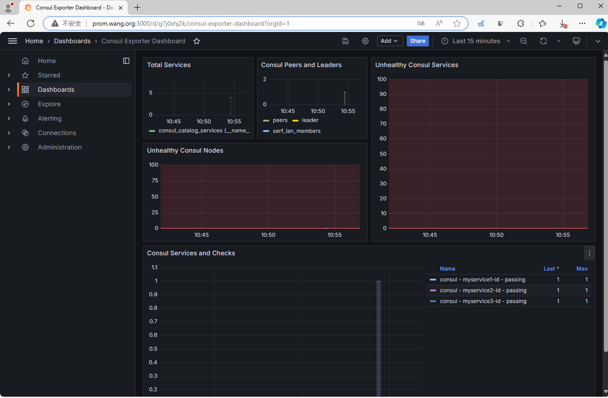

## 7.8 blackbox_exporter 黑盒监控

### 7.8.1 blackbox_exporter 说明

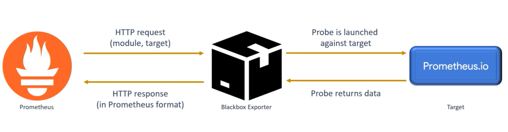

黑盒监视也称远端探测，监测应用程序的外部，可以查询应用程序的外部特征

比如：是否开放相应的端口,并返回正确的数据或响应代码，执行icmp或者echo检查并确认收到响应

prometheus探测工具是通过运行一个blackbox exporter来探测远程目标，并公开在本地端点上

blackbox_exporter允许通过HTTP、HTTPS、DNS、TCP和ICMP等协议来探测端点状态

blackbox_exporter中，定义一系列执行特定检查的模块，例:检查正在运行的web服务器，或者DNS解析记录

blackbox_exporter运行时，它会在URL上公开这些模块和API

blackbox_exporter是一个二进制Go应用程序，默认监听端口9115

Github 链接
https://github.com/prometheus/blackbox_exporter
https://github.com/prometheus/blackbox_exporter/blob/master/blackbox.yml
https://github.com/prometheus/blackbox_exporter/blob/master/example.yml

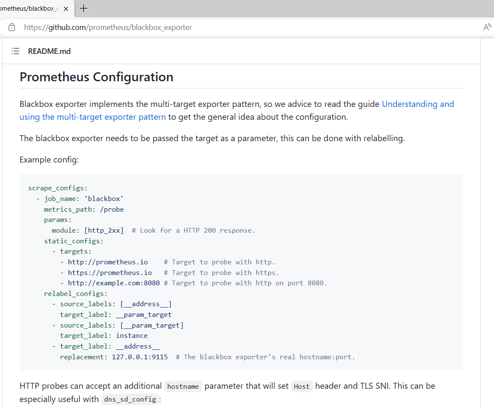

### 7.8.2 blackbox_exporter 安装
https://prometheus.io/download/#blackbox_exporter

#### 7.8.2.1 二进制安装

范例：
```bash
#在任意主机或者复用prometheus主机上安装black_exporter
[root@ubuntu2204 ~]#cd /usr/local/src
[root@ubuntu2204 src]#wget
https://github.com/prometheus/blackbox_exporter/releases/download/v0.25.0/blackbox_exporter-0.25.0.linux-amd64.tar.gz
[root@ubuntu2204 src]#wget
https://github.com/prometheus/blackbox_exporter/releases/download/v0.22.0/blackbox_exporter-0.22.0.linux-amd64.tar.gz
[root@ubuntu2204 src]#tar xf blackbox_exporter-0.22.0.linux-amd64.tar.gz -C
/usr/local/
[root@ubuntu2204 src]#ln -s /usr/local/blackbox_exporter-0.22.0.linux-amd64/
/usr/local/blackbox_exporter
[root@ubuntu2204 src]#ls /usr/local/blackbox_exporter
blackbox_exporter  blackbox.yml  LICENSE  NOTICE
[root@ubuntu2204 ~]#cd /usr/local/blackbox_exporter/
[root@ubuntu2204 blackbox_exporter]#mkdir bin conf
[root@ubuntu2204 blackbox_exporter]#mv blackbox_exporter bin/
[root@ubuntu2204 blackbox_exporter]#mv blackbox.yml conf/
#默认配置文件无需修改
[root@ubuntu2204 ~]#cat /usr/local/blackbox_exporter/conf/blackbox.yml
modules:
  http_2xx:       # 名字
    prober: http  # 协议
  http_post_2xx:
    prober: http
    http:
      method: POST # 支持GET、POST，默认GET
  tcp_connect:
    prober: tcp
  pop3s_banner:
    prober: tcp
    tcp:
      query_response:
      - expect: "^+OK"
      tls: true
      tls_config:
        insecure_skip_verify: false # 启用远程探测证书检查
  grpc:
    prober: grpc
    grpc:
      tls: true
      preferred_ip_protocol: "ip4" # 探测的ip协议版本
  grpc_plain:
    prober: grpc
    grpc:
      tls: false
      service: "service1"
  ssh_banner:
    prober: tcp
    tcp:
      query_response:
      - expect: "^SSH-2.0-"
      - send: "SSH-2.0-blackbox-ssh-check"
  irc_banner:
    prober: tcp
    tcp:
      query_response:
      - send: "NICK prober"
      - send: "USER prober prober prober :prober"
      - expect: "PING :([^ ]+)"
        send: "PONG ${1}"
      - expect: "^:[^ ]+ 001"
  icmp:
    prober: icmp
  icmp_ttl5:
    prober: icmp
    timeout: 5s
    icmp:
      ttl: 5
[root@ubuntu2204 ~]#id prometheus  &> /dev/null || useradd -r -s /sbin/nologin
prometheus
#创建service文件
[root@ubuntu2204 ~]#cat > /lib/systemd/system/blackbox_exporter.service
[Unit]
Description=Prometheus Black Exporter
After=network.target
[Service]
Type=simple
#新版blackbox_exporter-0.26.0如果以普通用户启动，会导致探测失败
#User=prometheus
#Group=prometheus
ExecStart=/usr/local/blackbox_exporter/bin/blackbox_exporter --
config.file=/usr/local/blackbox_exporter/conf/blackbox.yml --web.listen-address=:9115
Restart=on-failure
LimitNOFILE=100000
[Install]
WantedBy=multi-user.target
[root@ubuntu2204 ~]#systemctl daemon-reload ;systemctl enable --now blackbox_exporter
#默认监听9115/tcp端口
[root@ubuntu2204 ~]#ss -ntlpu|grep black
tcp   LISTEN 0  4096               *:9115             *:*    users:
(("blackbox_export",pid=10796,fd=3))
#浏览器访问下面链接,可以看到如下
http://10.0.0.200:9115/
```

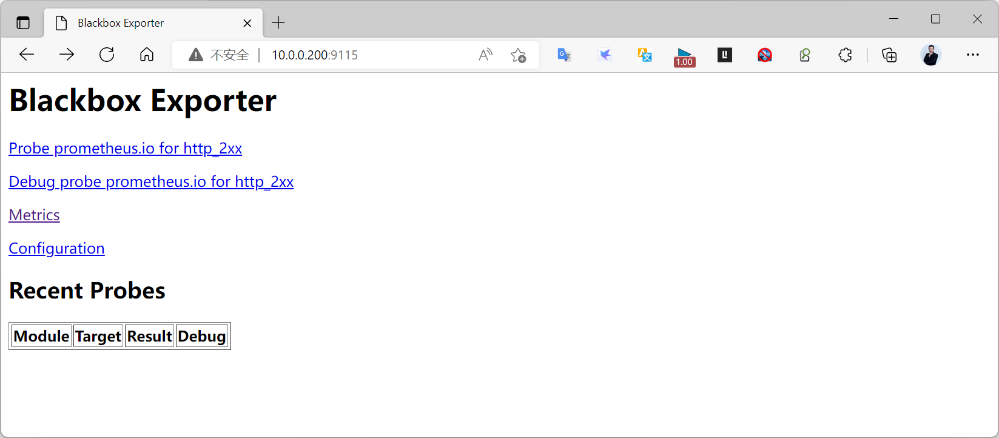

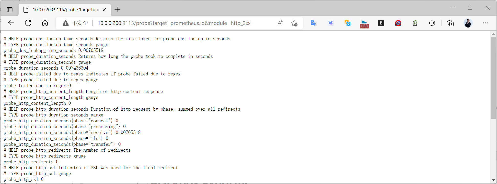

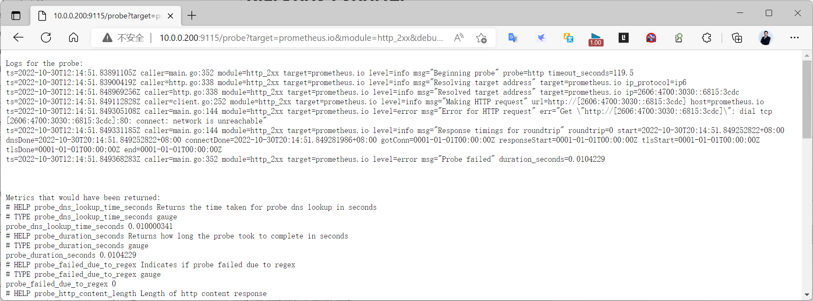

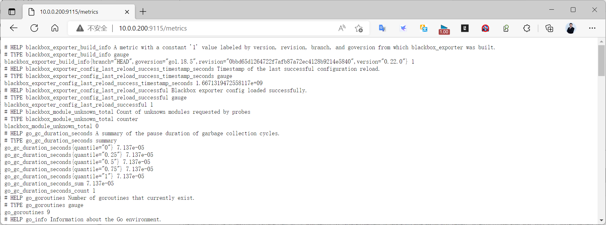

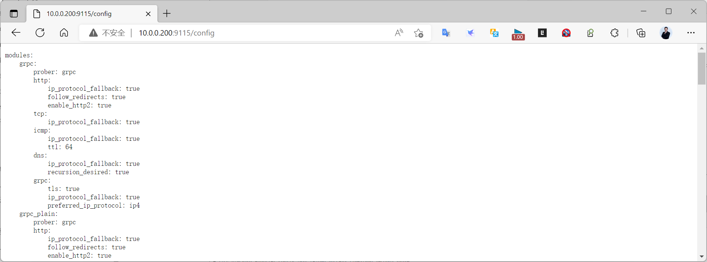

#### 7.8.2.2 Ansible 安装
https://github.com/prometheus-community/ansible/tree/main/roles/blackbox_exporter

#### 7.8.2.3 Docker 容器启动
```bash
docker run --rm -d -p 9115:9115 -v pwd:/config prom/blackbox-exporter:master --
config.file=/config/blackbox.yml
```

#### 7.8.2.4 Docker compose 部署

范例：Docker compose 启动
```bash
[root@ubuntu2204 blackbox-exporter]#tree
.
├── config
│   └── blackbox.yml
└── docker-compose.yml
1 directory, 2 files
[root@ubuntu2204 blackbox-exporter]#cat docker-compose.yml
version: '3.6'
networks:
  monitoring:
    driver: bridge
    ipam:
      config:
         - subnet: 172.31.0.0/24
services:
  blackbox_exporter:
    image: prom/blackbox-exporter:v0.22.0
    volumes:
      - ./configs/:/etc/blackboxexporter/
    command:
      - '--config.file=/etc/blackboxexporter/blackbox.yml'
    networks:
      - monitoring
    ports:
      - 9115:9115
[root@ubuntu2204 blackbox-exporter]#cat config/blackbox.yml
modules:
  # https://github.com/prometheus/blackbox_exporter/blob/master/example.yml
  http_2xx:
    prober: http
    timeout: 5s
    http:
      valid_http_versions:
      - "HTTP/1.1"
      - "HTTP/2"
      valid_status_codes: []  # Defaults to 2xx
      enable_http2: false
      method: GET
      no_follow_redirects: false
      # fail_if_ssl为true时，表示如果站点启用了SSL则探针失败，反之成功;
      # fail_if_not_ssl刚好相反;
      fail_if_ssl: false
      fail_if_not_ssl: false
      #  fail_if_body_matches_regexp, fail_if_body_not_matches_regexp,
fail_if_header_matches, fail_if_header_not_matches
      #  可以定义一组正则表达式，用于验证HTTP返回内容是否符合或者不符合正则表达式的内容
      fail_if_body_matches_regexp:
         - "Could not connect to database"
      tls_config:
        insecure_skip_verify: false
      preferred_ip_protocol: "ip4" # defaults to "ip6"
  http_with_proxy:
    prober: http
    http:
      proxy_url: "http://127.0.0.1:3128"
      skip_resolve_phase_with_proxy: true
  http_post_2xx:
    prober: http
    timeout: 5s
    http:
      method: POST
      headers:
        Content-Type: application/json
      body: '{}'
  http_basic_auth_example:
    prober: http
    timeout: 5s
    http:
      method: POST
      headers:
        Host: "login.example.com"
      basic_auth:
        username: "username"
        password: "mysecret"
  http_custom_ca_example:
    prober: http
    http:
      method: GET
      tls_config:
        ca_file: "/certs/my_cert.crt"
  http_gzip:
    prober: http
    http:
      method: GET
      compression: gzip
  http_gzip_with_accept_encoding:
    prober: http
    http:
      method: GET
      compression: gzip
      headers:
        Accept-Encoding: gzip
  tls_connect:
    prober: tcp
    timeout: 5s
    tcp:
      tls: true
  dns_udp_example:
    prober: dns
    timeout: 5s
    dns:
      query_name: "www.prometheus.io"
      query_type: "A"
      valid_rcodes:
         - NOERROR
      validate_answer_rrs:
        fail_if_matches_regexp:
           - ".*127.0.0.1"
        fail_if_all_match_regexp:
           - ".*127.0.0.1"
        fail_if_not_matches_regexp:
           - "www.bowen.org.\t300\tIN\tA\t127.0.0.1"
        fail_if_none_matches_regexp:
           - "127.0.0.1"
      validate_authority_rrs:
        fail_if_matches_regexp:
           - ".*127.0.0.1"
      validate_additional_rrs:
        fail_if_matches_regexp:
           - ".*127.0.0.1"
[root@ubuntu2204 blackbox-exporter]#docker-compose up -d
```

### 7.8.3 Prometheus 配置定义监控规则

在 Prometheus 上定义实现具体的业务的监控规则的配置

#### 7.8.3.1 网络连通性监控
```yaml
[root@ubuntu2204 ~]#vim /usr/local/prometheus/conf/prometheus.yml
......
  # ping 检测
  - job_name: 'ping_status_blackbox_exporter'
    metrics_path: /probe
    params:
      module: [icmp]                        #探测方式
    static_configs:
      - targets: ['www.bowen.com','www.google.com']   #探测的目标主机地址
        labels:
          instance: 'ping_status'
          group: 'icmp'
    relabel_configs:
      - source_labels: [__address__] #修改目标URL地址的标签[__address__]为
__param_target,用于发送给blackbox使用
        target_label: __param_target #此为必须项
      - target_label: __address__    #添加新标签.用于指定black_exporter服务器地址,此为必须
项
        replacement: black-exporter.bowen.org:9115 #指定black_exporter服务器地址,注意名称
解析，用于生成prometheus中的endpoint地址信息
      - source_labels: [__param_target]  #Grafana 使用此标签进行显示，此值是固定的
        target_label: ipaddr             #Grafana 展示的字段名，如果自定义，默认的ipaddr字
段仍然存在，只是不再有数据
.....
[root@ubuntu2204 ~]#promtool check config  /usr/local/prometheus/conf/prometheus.yml
[root@ubuntu2204 ~]#systemctl resload prometheus.service
```

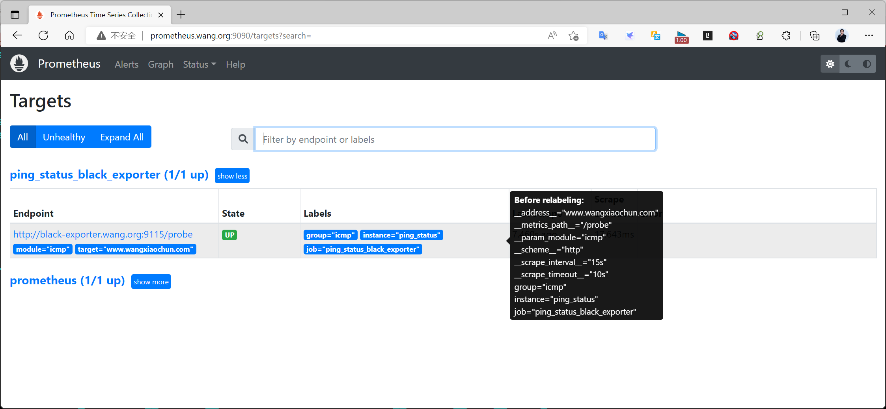


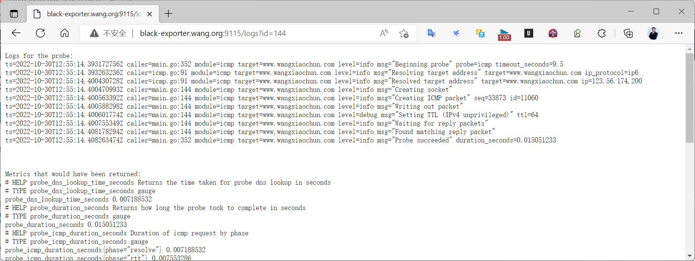

如果网络故障,可以看到下面显示

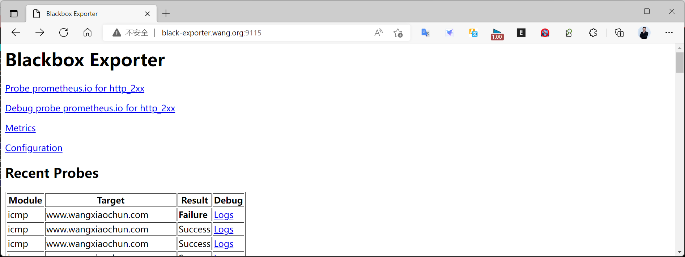

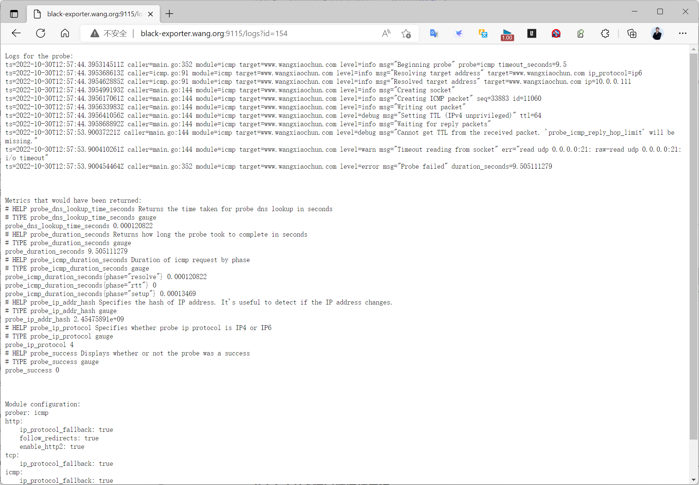

#### 7.8.3.2 TCP 端口连通性监控
```yaml
[root@ubuntu2204 ~]#vim /usr/local/prometheus/conf/prometheus.yml
......
  #端口监控
  - job_name: 'port_status_blackbox_exporter'
    metrics_path: /probe
    params:
      module: [tcp_connect]
    static_configs:
      - targets: ['www.bowen.com:80']
        labels:
          instance: 'port_status'
          group: 'port'
    relabel_configs:
      - source_labels: [__address__] #修改目标URL地址的标签[__address__]为
__param_target,用于发送给blackbox使用
        target_label: __param_target #此为必须项
      - target_label: __address__    #添加新标签.用于指定black_exporter服务器地址,此为必须
项
        replacement: black-exporter.bowen.org:9115 #指定black_exporter服务器地址,注意名称
解析
      - source_labels: [__param_target]  #Grafana 使用此标签进行显示，此值是固定的
        target_label: ipaddr_port        #Grafana 展示的字段名，如果自定义，默认的
ipaddr_port字段仍然存在，只是不再有数据
.....
[root@ubuntu2204 ~]#promtool check config  /usr/local/prometheus/conf/prometheus.yml
[root@ubuntu2204 ~]#systemctl resload prometheus.service
```

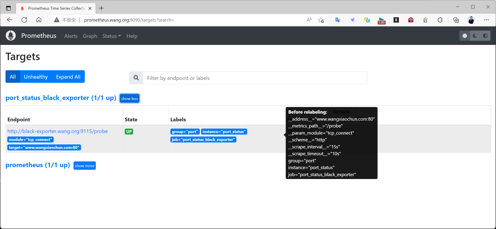

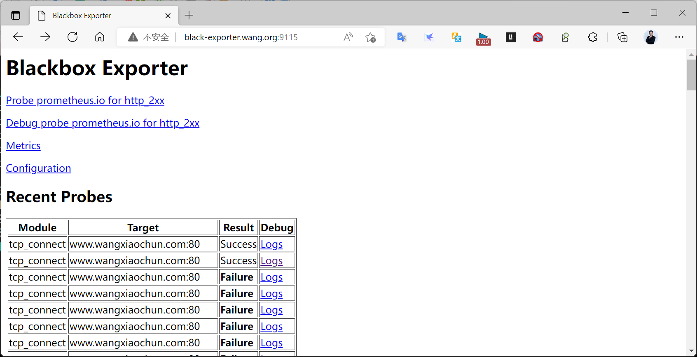

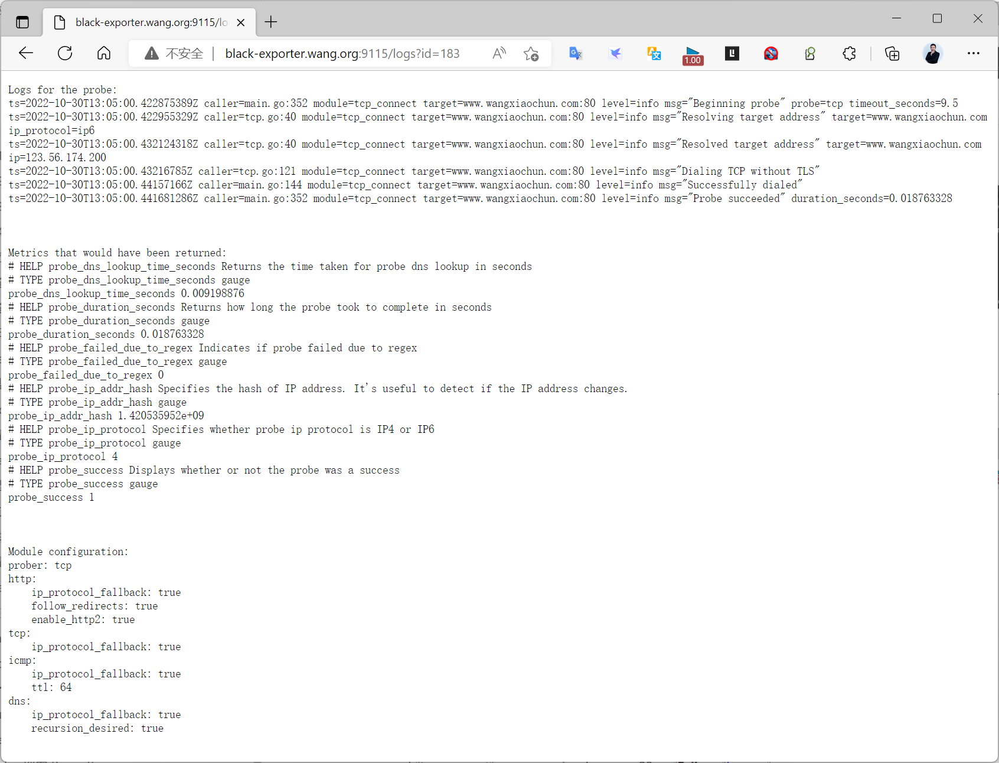

#### 7.8.3.3 Http/Https 网站监控
```yaml
[root@ubuntu2204 ~]#vim /usr/local/prometheus/conf/prometheus.yml
......
   # 网站监控
  - job_name: 'http_status_blackbox_exporter'
    metrics_path: /probe
    params:
      module: [http_2xx]
    static_configs:  #如果有https网站,还会自动额外显示TLS版本和证书的有效期,但有些网站可能不会显
示证书信息,比如taobao
      - targets: ['https://www.baidu.com','http://www.bowen.com'] #baidu必须加
https才能显示,xiaomi不需要
         #- www.jd.com
         #- www.taobao.com
        labels:                       #添加标签
          instance: http_status
          group: web
    relabel_configs:
      - source_labels: [__address__]  #修改目标URL地址的标签[__address__]为
__param_target,用于发送给blackbox使用
        target_label: __param_target  #此为必须项
      - target_label: __address__     #添加新标签,用于指定black_exporter服务器地址,此为必须
项
        replacement: black-exporter.bowen.org:9115  #指定black_exporter服务器地址,注意名
称解析
      - source_labels: [__param_target]  #Grafana 使用此url标签，此值是固定的，否则有些模板
可能无法显示
        target_label: url                #Grafana 展示的字段名，如果自定义，默认的url字段仍
然存在，只是不再有数据
      #- target_label: region        #测试添加标签,可选
      #  replacement: "remote"
......
#服务生效
[root@ubuntu2204 ~]#promtool check config  /usr/local/prometheus/conf/prometheus.yml
[root@ubuntu2204 ~]#systemctl reload prometheus
```

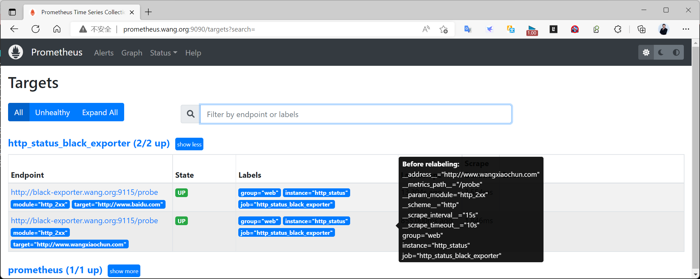

将网站利用/etc/hosts文件解析故障后,可以看到下面显示
http://black-exporter.bowen.org:9115/

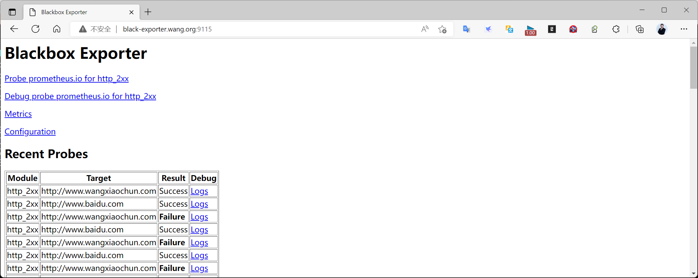

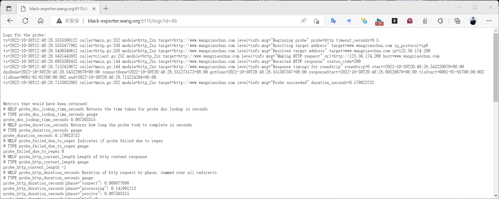

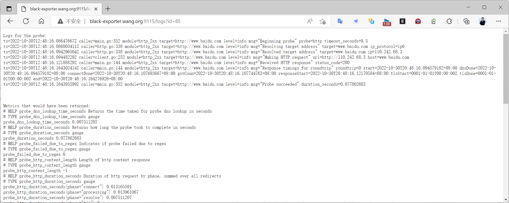

### 7.8.4 Grafana 展示

将上面三个监控都启用,可以看到如下界面

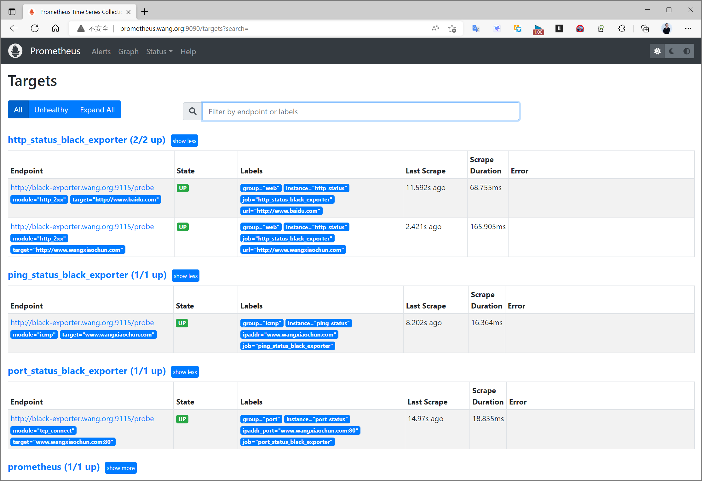

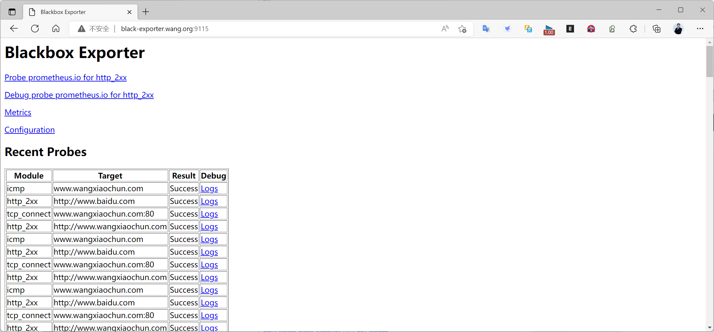

Grafana 导入模板 9965


如果不修改 [__param_target] 标签,如下显示的字段名不全

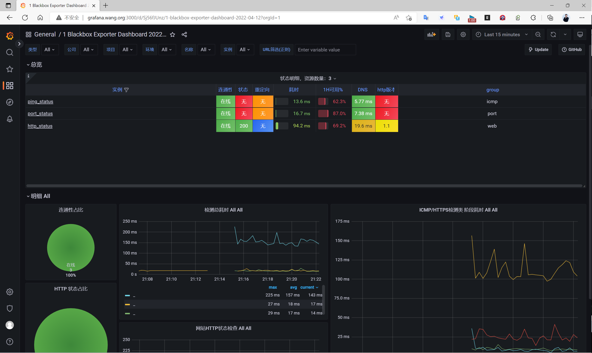

如果修改 [__param_target] 标签,如下显示字段名全了

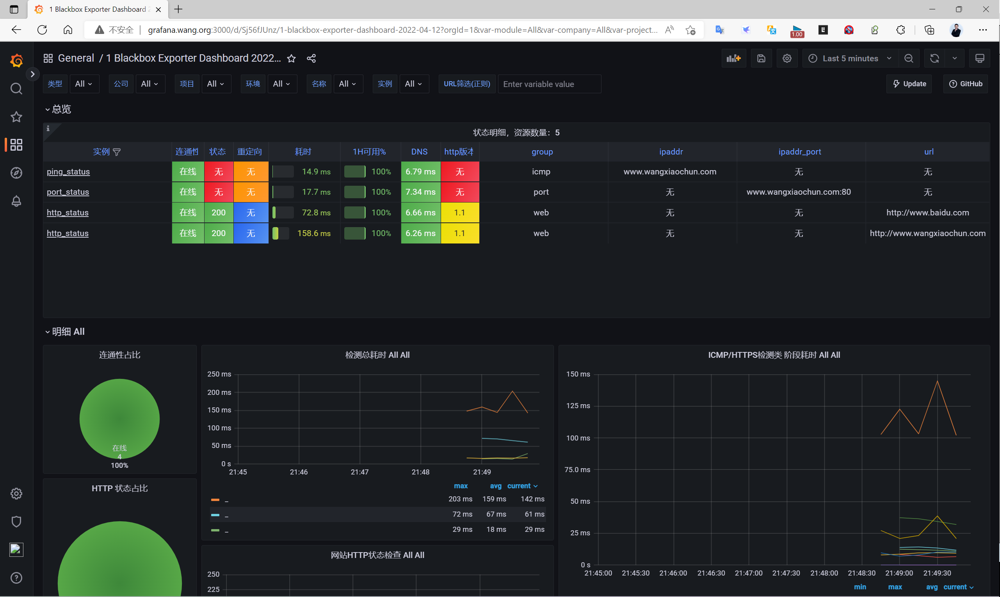

如果有 https ,会额外显示证书和TLS版本信息

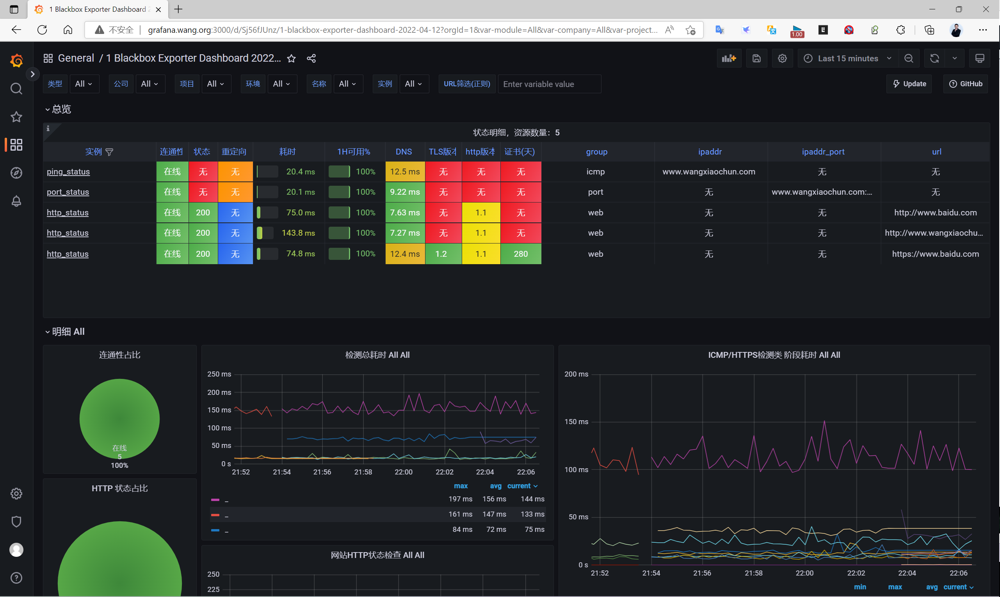

导入模板 13587

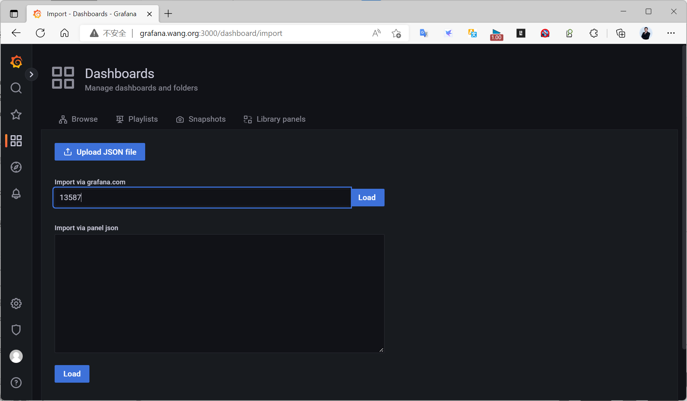

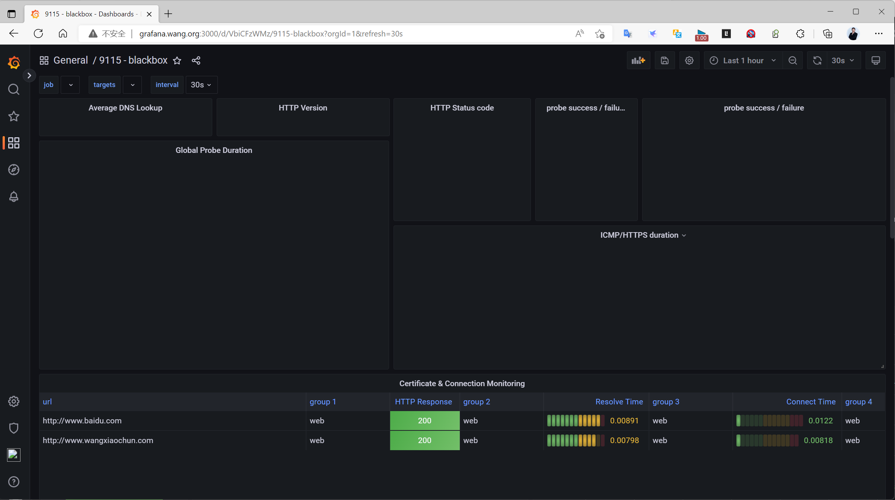



<nav class="article-end" aria-label="章节导航">
  <a href="{{ '/subjects/Prometheus/24-redis-nginx-exporters.html' | relative_url }}">← 上一章：Redis 与 Nginx 监控</a>
  <a href="{{ '/subjects/Prometheus/' | relative_url }}">返回 Prometheus 目录</a>
  <a href="{{ '/subjects/Prometheus/26-container-monitoring.html' | relative_url }}">下一章：容器监控与 cAdvisor →</a>
</nav>
