[← 返回 Prometheus 目录]({{ '/subjects/Prometheus/' | relative_url }})



# 26 容器监控与 cAdvisor

# 8 Prometheus 实现容器监控

## 8.1 cAdvisor 简介


对于物理主机可以在其上安装Node Exporter实现监控，但是对于容器的监控并不适用

对于一些容器类型的服务应用来说，可以借助于一些专用工具的方式来实现监控，比如docker类型的容器应用，可以通过 cAdvisor 的方式来进行监控。

cadvisor(Container Advisor容器顾问) 是 Google 开源的一个容器监控工具，它以守护进程方式运行，用于收集、聚合、处理和导出正在运行容器的有关信息。具体来说，该组件对每个容器都会记录其资源隔离参数、历史资源使用情况、完整历史资源使用情况的直方图和网络统计信息。它不仅可以搜集一台机器上所有运行的容器信息，还提供基础查询界面和http接口，方便其他组件如Prometheus进行数据抓取

cAdvisor使用Go语言开发，对Node机器上的资源及容器进行实时监控和性能数据采集，包括CPU使用情况、内存使用情况、网络吞吐量及文件系统使用情况，利用Linux的cgroups获取容器的资源使用信息，可用于对容器资源的使用情况和性能进行监控。

cAdvisor内置在kubelet,在Kubernetes-v1.10之前通过启动参数–cadvisor-port可以定义cAdvisor对外提供服务的端口，默认为4194。

注意：在 Kubernetesv1.12 后删除cadvisor 监听的端口
https://github.com/kubernetes/kubernetes/pull/65707

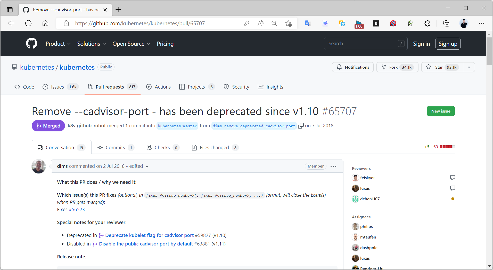

安装 cAdvisor 后,通过http://cAdvisor-server:8080/metrics暴露metrics

注意：一个cAdvisor仅对一台主机进行监控。在Kubernetes集群中可以通过DaemonSet方式自行安装在每个节点主机

项目主页：http://github.com/google/cadvisor

下载地址：
https://github.com/google/cadvisor/releases/latest
https://github.com/google/cadvisor/archive/refs/tags/v0.39.3.tar.gz

cAdvisor 工作原理

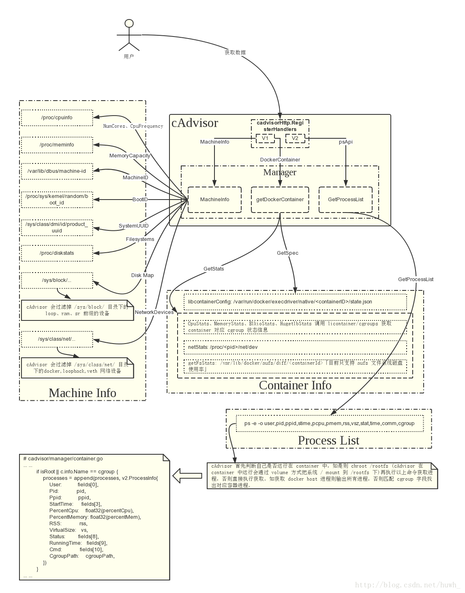

## 8.2 cAdvisor 安装

在需要被监控docker的主机准备 docker 环境
```bash
#Ubuntu22.04和20.04包安装docker
[root@ubuntu2404 ~]#apt update && apt -y install docker.io
[root@ubuntu2204 ~]#apt update && apt -y install docker.io
[root@ubuntu2004 ~]#apt update && apt -y install docker.io
[root@ubuntu2004 ~]#echo '{"registry-mirrors":
["https://si7y70hh.mirror.aliyuncs.com"], "insecure-registries":
["harbor.bowen.org:80"]}' > /etc/docker/daemon.json
[root@ubuntu2004 ~]#systemctl restart docker
[root@ubuntu2004 ~]#docker info
Client:
 Context:    default
 Debug Mode: false
Server:
 Containers: 0
  Running: 0
  Paused: 0
  Stopped: 0
 Images: 0
 Server Version: 20.10.12
 Storage Driver: overlay2
  Backing Filesystem: extfs
  Supports d_type: true
  Native Overlay Diff: true
  userxattr: false
 Logging Driver: json-file
 Cgroup Driver: cgroupfs
 Cgroup Version: 1
 Plugins:
  Volume: local
  Network: bridge host ipvlan macvlan null overlay
  Log: awslogs fluentd gcplogs gelf journald json-file local logentries splunk syslog
 Swarm: inactive
 Runtimes: io.containerd.runtime.v1.linux runc io.containerd.runc.v2
 Default Runtime: runc
 Init Binary: docker-init
 containerd version:
 runc version:
 init version:
 Security Options:
  apparmor
  seccomp
   Profile: default
 Kernel Version: 5.4.0-89-generic
 Operating System: Ubuntu 20.04.3 LTS
 OSType: linux
 Architecture: x86_64
 CPUs: 2
 Total Memory: 1.913GiB
 Name: prometheus.bowen.org
 ID: GBDK:CT2I:25AK:WVJC:WUXV:44HZ:UETD:MTW6:33LD:MP2V:Q3AX:K6RJ
 Docker Root Dir: /var/lib/docker
 Debug Mode: false
 Registry: https://index.docker.io/v1/
 Labels:
 Experimental: false
 Insecure Registries:
  harbor.bowen.org:80
  127.0.0.0/8
 Registry Mirrors:
  https://si7y70hh.mirror.aliyuncs.com/
 Live Restore Enabled: false
WARNING: No swap limit support
```

范例：脚本安装 docker
```bash
#通过以下安装脚本install_docker.sh安装
#!/bin/bash
# 安装依赖环境
env_base(){
  apt-get update
  apt-get install apt-transport-https ca-certificates curl gnupg lsb-release -y
}
# 配置软件源
docker_repo(){
  curl -fsSL https://mirrors.tuna.tsinghua.edu.cn/docker-ce/linux/ubuntu/gpg | sudo
gpg --dearmor -o /usr/share/keyrings/docker-archive-keyring.gpg
  echo \
  "deb [arch=amd64 signed-by=/usr/share/keyrings/docker-archive-keyring.gpg]
https://mirrors.tuna.tsinghua.edu.cn/docker-ce/linux/ubuntu \
  $(lsb_release -cs) stable" | sudo tee /etc/apt/sources.list.d/docker.list >
/dev/null
  apt-get update
}
# 安装软件
docker_install(){
  apt-get -y install docker-ce docker-ce-cli containerd.io
}
# 加速器配置
docker_speed(){
  echo '{"registry-mirrors": ["https://si7y70hh.mirror.aliyuncs.com"], "insecure-
registries": ["harbor.bowen.org:80"]}' > /etc/docker/daemon.json
  systemctl restart docker
  systemctl enable docker
}
# 主程序
main(){
  env_base
  docker_repo
  docker_install
  docker_speed
}
# 执行主程序
main
#在10.0.0.100 主机上安装docker环境
bash install_docker.sh
#容器的基本监控
docker stats container_name
```

### 8.2.1 二进制安装 cAdvisor
https://github.com/google/cadvisor/

范例
```ini
[root@ubuntu2204 ~]#wget
https://mirror.ghproxy.com/https://github.com/google/cadvisor/releases/download/v0.50.0/cadvisor-v0.50.0-linux-amd64
[root@ubuntu2204 ~]#install cadvisor-v0.50.0-linux-amd64 /usr/local/bin/cadvisor
#启动cadvisor
[root@ubuntu2204 ~]#cadvisor  -port=8080 &>>/var/log/cadvisor.log &
#service启动
[root@ubuntu2204 ~]#cat /lib/systemd/system/cadvisor.service
[Unit]
Description=Prometheus cAdvisor Exporter
After=network.target
[Service]
Type=simple
ExecStart=/usr/local/bin/cadvisor
ExecReload=/bin/kill -HUP $MAINPID
Restart=on-failure
#User=prometheus #不能以普通用户身份启动，权限不足
#Group=prometheus
Restart=on-failure
LimitNOFILE=100000
[Install]
WantedBy=multi-user.target
[root@ubuntu2204 ~]#systemctl daemon-reload; systemctl enable --now  cadvisor.service
```

### 8.2.2 源码编译安装 cAdvisor

官方文档
https://github.com/google/cadvisor/blob/master/docs/development/build.md

范例: 编译安装cadvisor
```bash
#安装go环境，必须在 1.14+ 版本,注意:不要使用1.18以上版
wget https://studygolang.com/dl/golang/go1.17.6.linux-amd64.tar.gz
tar -xf go1.17.6.linux-amd64.tar.gz  -C /usr/local/
echo 'export GOROOT=/usr/local/go' > /etc/profile.d/go.sh
echo 'export PATH=$PATH:$GOROOT/bin' >> /etc/profile.d/go.sh
source /etc/profile.d/go.sh
go version
#获取源代码
wget https://github.com/google/cadvisor/archive/refs/tags/v0.39.3.tar.gz
tar xf v0.39.3.tar.gz -C /usr/local/
ln -s /usr/local/cadvisor-0.39.3 /usr/local/cadvisor
cd /usr/local/cadvisor
#获取软件依赖
go env -w GOPROXY=https://goproxy.cn
go get -d github.com/google/cadvisor
#查看go环境变量
go env
#Ubuntu系统
apt -y install gcc make  libpfm4 libpfm4-dev jq
#rhel系列
yum -y install gcc make
#编译安装cadvisor
make build
#确认效果
./cadvisor --help
Usage of ./cadvisor:
  -add_dir_header
        If true, adds the file directory to the header of the log messages
  -allow_dynamic_housekeeping
        Whether to allow the housekeeping interval to be dynamic (default true)
  -alsologtostderr
        log to standard error as well as files
  -application_metrics_count_limit int
        Max number of application metrics to store (per container) (default 100)
.....
#启动cadvisor
./cadvisor  -port=8080 &>>/var/log/cadvisor.log &
#浏览器访问 10.0.0.101:8080，可以查看cadvisor的默认ui页面的浏览器效果
```

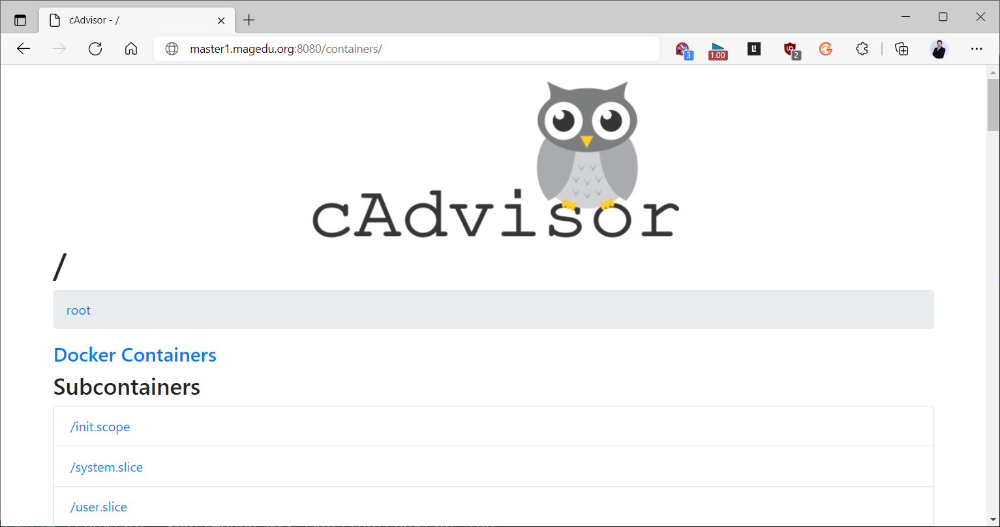
```text
#浏览器访问 10.0.0.100:8080/metrics，可以查看cadvisor的默认采集的容器指标效果
```

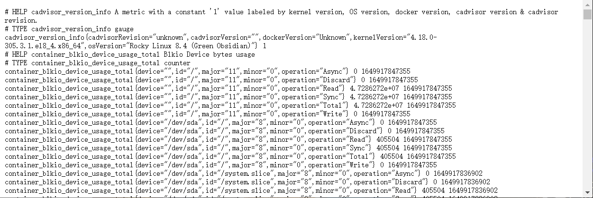

### 8.2.3 Ansible 方式安装 cAdvisor
https://github.com/prometheus-community/ansible/tree/main/roles/cadvisor

### 8.2.4 Docker 方式安装 cAdvisor

安装说明
https://github.com/google/cadvisor/

cAdvisor 版本
https://github.com/google/cadvisor/releases

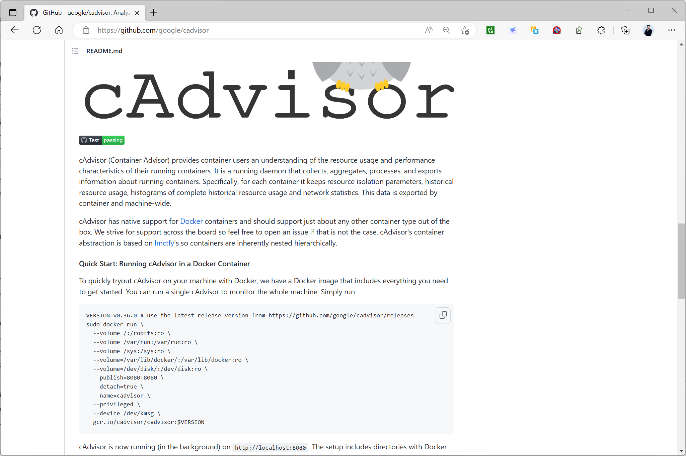

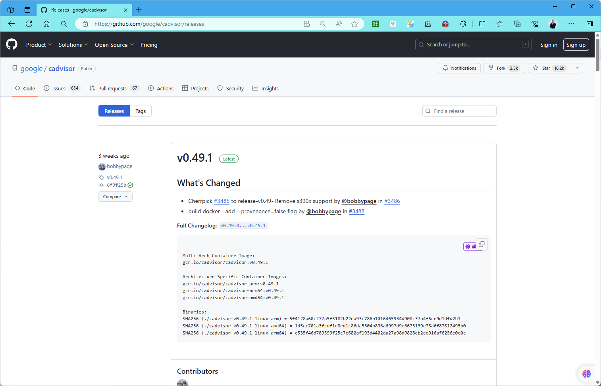
```text
#查看镜像版本,需用google登录
gcr.io/cadvisor/cadvisor
```


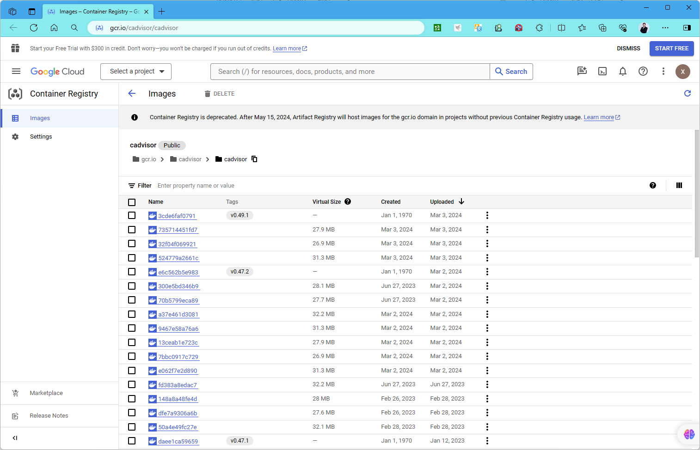

范例: 拉取镜像
```bash
#docker官方仓库的cAdvisor镜像只有旧版本,而且不再更新
docker pull google/cadvisor:v0.33.0
#从google下载最新版的docker镜像,需要科学上网
docker pull gcr.io/cadvisor/cadvisor:v0.49.1
docker pull gcr.io/cadvisor/cadvisor:v0.47.0
docker pull gcr.io/cadvisor/cadvisor:v0.37.0
#从国内镜像下载
docker pull registry.cn-beijing.aliyuncs.com/bowen/cadvisor:v0.51.0
docker pull registry.cn-beijing.aliyuncs.com/bowen/cadvisor:v0.49.1
#官方镜像下载
docker pull bowen/cadvisor:v0.49.1
docker pull bowen/cadvisor:v0.47.0
docker pull bowen/cadvisor:v0.45.0
docker pull bowen/cadvisor:v0.37.0
#代理网站下载:https://dockerproxy.com/
docker pull gcr.dockerproxy.com/cadvisor/cadvisor:v0.49.1
#第三方镜像
https://hub.docker.com/r/zcube/cadvisor/tags
```

范例：在线下载并启动
```bash
##从国内镜像在线下载镜像
VERSION=v0.51.0
docker run \
  --volume=/:/rootfs:ro \
  --volume=/var/run:/var/run:ro \
  --volume=/sys:/sys:ro \
  --volume=/var/lib/docker/:/var/lib/docker:ro \
  --volume=/dev/disk/:/dev/disk:ro \
  --publish=8080:8080 \
  --detach=true \
  --name=cadvisor \
  --privileged \
  --device=/dev/kmsg \
  registry.cn-beijing.aliyuncs.com/bowen/cadvisor:$VERSION
#从google官方下载需要科学上网
VERSION=v0.49.1
docker run \
  --volume=/:/rootfs:ro \
  --volume=/var/run:/var/run:ro \
  --volume=/sys:/sys:ro \
  --volume=/var/lib/docker/:/var/lib/docker:ro \
  --volume=/dev/disk/:/dev/disk:ro \
  --publish=8080:8080 \
  --detach=true \
  --name=cadvisor \
  --privileged \
  --device=/dev/kmsg \
  registry.cn-beijing.aliyuncs.com/bowen/cadvisor:$VERSION
  #gcr.dockerproxy.com/cadvisor/cadvisor:$VERSION
#从google官方下载需要科学上网
VERSION=v0.36.0
docker run \
  --volume=/:/rootfs:ro \
  --volume=/var/run:/var/run:ro \
  --volume=/sys:/sys:ro \
  --volume=/var/lib/docker/:/var/lib/docker:ro \
  --volume=/dev/disk/:/dev/disk:ro \
  --publish=8080:8080 \
  --detach=true \
  --name=cadvisor \
  --privileged \
  --device=/dev/kmsg \
  gcr.io/cadvisor/cadvisor:$VERSION
#从国内镜像在线下载镜像
VERSION=v0.47.0
docker run \
  --volume=/:/rootfs:ro \
  --volume=/var/run:/var/run:ro \
  --volume=/sys:/sys:ro \
  --volume=/var/lib/docker/:/var/lib/docker:ro \
  --volume=/dev/disk/:/dev/disk:ro \
  --publish=8080:8080 \
  --detach=true \
  --name=cadvisor \
  --privileged \
  --device=/dev/kmsg \
  bowen/cadvisor:$VERSION
```

范例：离线下载镜像并启动容器
```bash
#导入提前下载的镜像
docker load -i cadvisor-v0.49.1.tar.gz
docker load -i cadvisor-v0.37.0.tar.gz
#注意：如果使用containerd容器运行时，改为下面内容
-- volume=/var/lib/containerd/:/var/lib/containerd:ro
docker run \
  --volume=/:/rootfs:ro \
  --volume=/var/run:/var/run:ro \
  --volume=/sys:/sys:ro \
  --volume=/var/lib/docker/:/var/lib/docker:ro \
  #-- volume=/var/lib/containerd/:/var/lib/containerd:ro \
  --volume=/dev/disk/:/dev/disk:ro \
  --publish=8080:8080 \
  --detach=true \
  --name=cadvisor \
  --privileged \
  --device=/dev/kmsg \
  gcr.io/cadvisor/cadvisor:v0.37.0
```

启动后，可以访问下面链接
http://cadvisor.bowen.org:8080/
http://cadvisor.bowen.org:8080/metrics

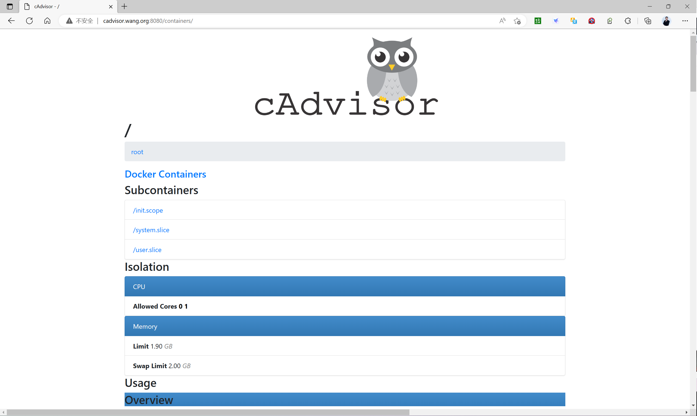

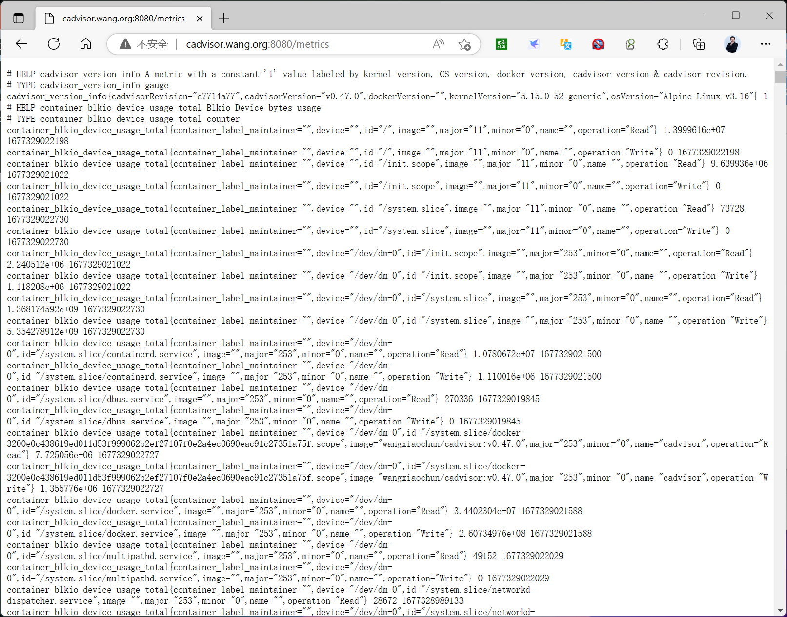

### 8.2.4 kubernetes 方式部署 cAdvisor
```yaml
[root@master1 ~]#cat /data/prometheus/yaml/cadvisor-daemonset.yaml
apiVersion: apps/v1
kind: DaemonSet
metadata:
  name: cadvisor
  namespace: monitoring
spec:
  selector:
    matchLabels:
      app: cAdvisor
  template:
    metadata:
      labels:
        app: cAdvisor
    spec:
      tolerations:
      - key: node-role.kubernetes.io/control-plane
        operator: Exists
        effect: NoSchedule
      - key: node-role.kubernetes.io/master
        operator: Exists
        effect: NoSchedule
      hostNetwork: true  #使用宿主机网络，注意：8080的端口不要冲突
      restartPolicy: Always
      volumes:
      - name: root
        hostPath:
          path: /
      - name: run
        hostPath:
          path: /var/run
      - name: sys
        hostPath:
          path: /sys
      - name: docker
        hostPath:
           #path: /var/lib/containerd
          path: /var/lib/docker
      - name: dev
        hostPath:
          path: /dev/disk
      containers:
      - name: cadvisor
        image: bowen/cadvisor:v0.37.0
         #image: gcr.io/cadvisor/cadvisor:v0.37.0
        imagePullPolicy: IfNotPresent
        ports:
         - containerPort: 8080
        volumeMounts:
           - name: root
            mountPath: /rootfs
           - name: run
            mountPath: /var/run
           - name: sys
            mountPath: /sys
           - name: docker
            mountPath: /var/lib/containerd
           - name; dev
            mountPath: /dev/disk
[root@master1 ~]#kubectl apply -f yaml/cadvisor-daemonset.yaml
```

## 8.3 Prometheus 配置

修改 Prometheus 配置
```yaml
#修改prometheus的配置文件，让它自动过滤文件中的节点信息
vim /usr/local/prometheus/conf/prometheus.yml
...
  - job_name: "cadvisor"
    static_configs:
      - targets: #添加安装cAdvisor的主机
         - "10.0.0.101:8080"
         - "10.0.0.102:8080"
         - "10.0.0.103:8080"
         - "10.0.0.104:8080"
         - "10.0.0.105:8080"
         - "10.0.0.106:8080"
#重启服务
systemctl reload prometheus.service
#稍等几秒钟，到浏览器中查看监控目标
```

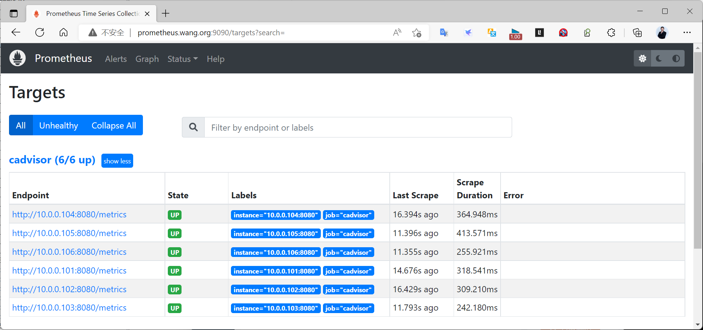

## 8.4 cAdvisor 常见指标
https://github.com/google/cadvisor/blob/master/metrics/testdata/prometheus_metrics

指标说明
container_tasks_state  #gauge类型，容器特定状态的任务数,根据不同的pod_name和state有600+的不
同label.
container_memory_failures_total  #counter类型，内存分配失败的累积计数,根据不同的pod_name和
state有600+的不同label.
container_network_receive_errors_total  #counter类型，容器网络接收时遇到的累计错误数。
container_network_transmit_bytes_total  #counter类型，容器发送传输的累计字节数。
container_network_transmit_packets_dropped_total  #counter类型，容器传输时丢弃的累计包数
container_network_transmit_packets_total  #counter类型，传输数据包的累计计数
container_network_transmit_errors_total  #counter类型，传输时遇到的累积错误数
container_network_receive_bytes_total  #counter类型，收到的累计字节数
container_network_receive_packets_dropped_total  #counter类型，接收时丢弃的累计数据包数
container_network_receive_packets_total  #counter类型，收到的累计数据包数
container_spec_cpu_period  #gauge类型，容器的CPU period。
container_spec_memory_swap_limit_bytes  #容器swap内存交换限制字节
container_memory_failcnt  #counter类型，内存使用次数达到限制
container_spec_memory_reservation_limit_bytes  #容器规格内存预留限制字节
container_spec_cpu_shares  #gauge类型，
container_spec_memory_limit_bytes  #容器规格内存限制字节
container_memory_max_usage_bytes  #gauge类型，以字节为单位记录的最大内存使用量
container_cpu_load_average_10s  #gauge类型，最近10秒钟内的容器CPU平均负载值。
container_memory_rss  #gauge类型，容器RSS的大小（以字节为单位）
container_start_time_seconds  #gauge类型，从Unix纪元开始的容器开始时间（以秒为单位）。
container_memory_mapped_file  #gauge类型，内存映射文件的大小（以字节为单位）
container_cpu_user_seconds_total  #conter类型，累计CPU user 时间（以秒为单位）
container_memory_cache  #gauge类型，内存的cache字节数。
container_memory_working_set_bytes  #gague类型，当前工作集（以字节为单位）
container_cpu_system_seconds_total  #conter类型，累计CPU system时间（以秒为单位）
container_memory_swap  #gauge类型，容器交换使用量（以字节为单位）
container_memory_usage_bytes  #gauge类型，当前内存使用情况（以字节为单位），包括所有内存，无论
何时访问
container_last_seen  #gauge类型，上一次export看到此容器的时间
container_fs_writes_total  #counter类型，累计写入次数
container_fs_reads_total   #counter类型，类型读取次数
container_cpu_usage_seconds_total  #counter类型，累计消耗CPU的总时间
container_fs_reads_bytes_total  #容器读取的总字节数
container_fs_writes_bytes_total  #容器写入的总字节数
container_fs_sector_reads_total  #counter类型，扇区已完成读取的累计计数
container_fs_inodes_free  #gauge类型，可用的Inode数量
container_fs_io_current  #gauge类型，当前正在进行的I/O数
container_fs_io_time_weighted_seconds_total  #counter类型，累积加权I/O时间（以秒为单位）
container_fs_usage_bytes  #gauge类型，此容器在文件系统上使用的字节数
container_fs_limit_bytes  #gauge类型，此容器文件系统上可以使用的字节数
container_fs_inodes_total  #gauge类型，inode数
container_fs_sector_writes_total  #counter类型，扇区写入累计计数
container_fs_io_time_seconds_total  #counter类型，I/O花费的秒数累计
container_fs_writes_merged_total  #counter类型，合并的累计写入数
container_fs_reads_merged_total  #counter类型，合并的累计读取数
container_fs_write_seconds_total  #counter类型，写花费的秒数累计
container_fs_read_seconds_total   #counter类型，读花费的秒数累计
container_cpu_cfs_periods_total  #counter类型，执行周期间隔时间数
container_cpu_cfs_throttled_periods_total  #counter类型，节流周期间隔数
container_cpu_cfs_throttled_seconds_total  #counter类型，容器被节流的总时间
container_spec_cpu_quota  #gauge类型，容器的CPU配额
machine_memory_bytes  #gauge类型，机器上安装的内存量
scrape_samples_post_metric_relabeling
cadvisor_version_info
scrape_duration_seconds
machine_cpu_cores  #gauge类型，机器上的CPU核心数
container_scrape_error  #gauge类型，如果获取容器指标时出错，则为1，否则为0
scrape_samples_scraped

常见指标
https://www.bookstack.cn/read/prometheus-book/exporter-use-prometheus-monitor-container.md

指标名称  类型  含义

container_cpu_load_average_10s  gauge  过去10秒容器CPU的平均负载

容器在每个CPU内核上的累积占用时间(单
container_cpu_usage_seconds_total  counter  
位：秒)  

container_cpu_system_seconds_total  counter  System CPU累积占用时间（单位：秒）

container_cpu_user_seconds_total  counter  User CPU累积占用时间（单位：秒）

container_fs_usage_bytes  gauge  容器中文件系统的使用量(单位：字节)

container_fs_limit_bytes  gauge  容器可以使用的文件系统总量(单位：字节)

container_fs_reads_bytes_total  counter  容器累积读取数据的总量(单位：字节)

container_fs_writes_bytes_total  counter  容器累积写入数据的总量(单位：字节)

container_memory_max_usage_bytes  gauge  容器的最大内存使用量（单位：字节）

container_memory_usage_bytes  gauge  容器当前的内存使用量（单位：字节)

container_spec_memory_limit_bytes  gauge  容器的内存使用量限制

machine_memory_bytes  gauge  当前主机的内存总量

container_network_receive_bytes_total  counter  容器网络累积接收数据总量（单位：字节）

container_network_transmit_bytes_total  counter  容器网络累积传输数据总量（单位：字节）

范例：

容器CPU使用率
```text
sum(irate(container_cpu_usage_seconds_total{image!="",name="redis"}[1m])) without
(cpu)
#使用 name="<container_name>"表达 式选择指定名称的容器
```

每个容器的cpu使用率
```text
sum(rate(container_cpu_usage_seconds_total{name=~".+"}[1m])) by (name) * 100
```

所用容器system cpu的累计使用时间（1min钟内）
```text
sum(rate(container_cpu_system_seconds_total[1m]))
```

每个容器system cpu的使用时间（1min钟内）
```text
sum(irate(container_cpu_system_seconds_total{image!=""}[1m])) without (cpu)
```

总容器的cpu使用率
```text
sum(sum(rate(container_cpu_usage_seconds_total{name=~".+"}[1m])) by (name) * 100)
```

查询容器内存使⽤量（单位：字节）:
```text
container_memory_usage_bytes{image!=""}
```

容器网络接收的字节数（1分钟内），根据名称查询name=~".+"
```text
sum(rate(container_network_receive_bytes_total{name=~".+"}[1m])) by (name)
```

查询容器网络接收量（速率）（单位：字节/秒）：
```text
sum(rate(container_network_receive_bytes_total{image!=""}[1m])) without (interface)
```

容器网络传输的字节数（1分钟内），根据名称查询 name=~".+"
```text
sum(rate(container_network_transmit_bytes_total{name=~".+"}[1m])) by (name)
```

容器网络传输量字节/秒
```text
sum(rate(container_network_transmit_bytes_total{image!=""}[1m])) without (interface)
```

容器⽂件系统读取速率字节/秒
```text
sum(rate(container_fs_reads_bytes_total{image!=""}[1m])) without (device)
```

容器文件系统写入速率字节/秒
```text
sum(rate(container_fs_writes_bytes_total{image!=""}[1m])) without (device)
```

## 8.5 Grafana 展示监控

### 8.5.1 安装 Grafana

#### 8.5.1.1 包安装

Ubuntu/Debian系统上的部署步骤
```bash
apt-get install -y adduser libfontconfig1
VERSION=9.2.5
wget ttps:/ / dl.grafana.com/oss/ release/ grafana_${VERSION}_
amd64.deb
dpkg -i grafana_${VERSION}_amd64.deb
```

范例: Ubuntu安装 Grafana
```bash
#下载
#官方下载
[root@grafana ~]#wget https://dl.grafana.com/enterprise/release/grafana-enterprise_8.2.1_amd64.deb
#从国内镜站下载
[root@grafana ~]#wget
https://mirrors.tuna.tsinghua.edu.cn/grafana/apt/pool/main/g/grafana-enterprise/grafana-enterprise_10.0.0_amd64.deb
#安装
#方法1:可以解决依赖关系
[root@ubuntu2004 ~]#apt update && apt -y install ./grafana_9.0.6_amd64.deb
#方法2:需要解决依赖关系
[root@ubuntu2004 ~]#dpkg -i grafana_9.0.6_amd64.deb
Selecting previously unselected package grafana.
(Reading database ... 76356 files and directories currently installed.)
Preparing to unpack grafana_8.5.9_amd64.deb ...
Unpacking grafana (8.5.9) ...
dpkg: dependency problems prevent configuration of grafana:
 grafana depends on libfontconfig1; however:
  Package libfontconfig1 is not installed.
dpkg: error processing package grafana (--install):
 dependency problems - leaving unconfigured
Processing triggers for systemd (245.4-4ubuntu3.11) ...
Errors were encountered while processing:
 grafana
#提示依赖失败,执行下面修复依赖
[root@ubuntu2004 ~]#apt -y --fix-broken install
#启动服务
[root@ubuntu2004 ~]#systemctl enable --now  grafana-server
[root@ubuntu2004 ~]#systemctl status grafana-server
```

RHEL/CentOS系统上的部署步骤
```bash
VERSION=9.2.5
wget https:/ / dl.grafana.com/oss/release/grafana-${ VERSION}-1.x86_64.rpm
yum install grafana-7.3.6-1.x86_64.rpm
```

#### 8.5.1.2 容器方式运行
```bash
#定义版本
VERSION=9.2.5
#基于Alpine的Grafana Image
docker run -d --name=grafana -p 3000:3000 grafana/grafana-oss
#基于Ubuntu的Grafana Image
docker run -d --name=grafana -p 3000:3000 grafana/grafana:${VERSION} -ubuntu
```

### 8.5.2 导入 Grafana 模板
```text
#导入指定模板
https://grafana.com/grafana/dashboards/193或14282
```

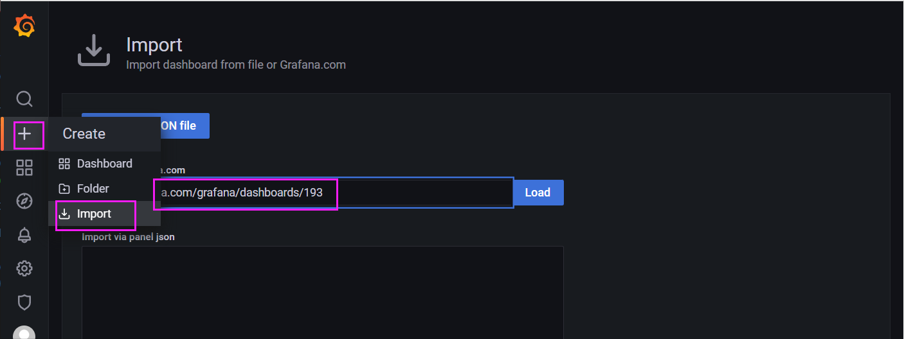

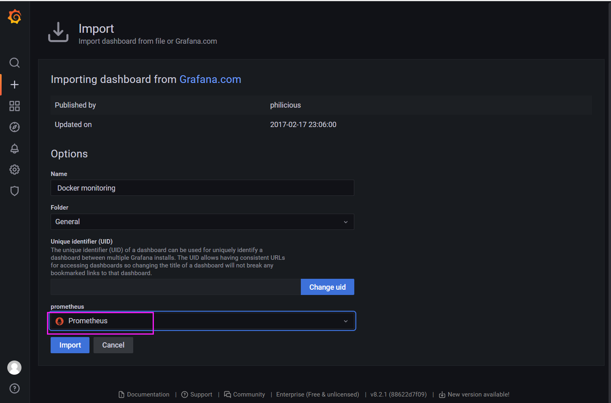

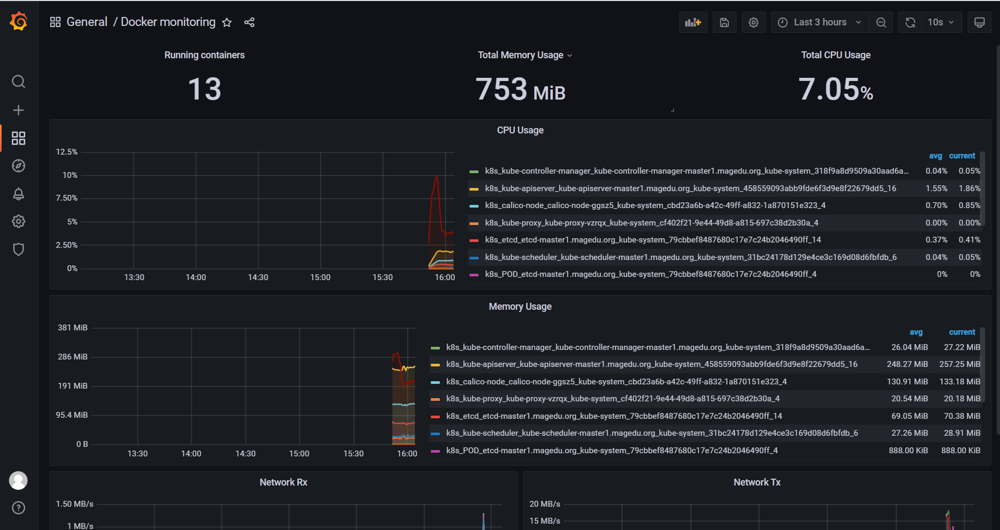
```text
#模板中没有看到标签的样式，在当前的dashboard上定制一个查询的变量名，点击当前dashboard右侧的齿轮(编
辑)，编辑内容如下：
#过滤的标签:label_values(up,instance)
#筛选的值:   .*:8080
```

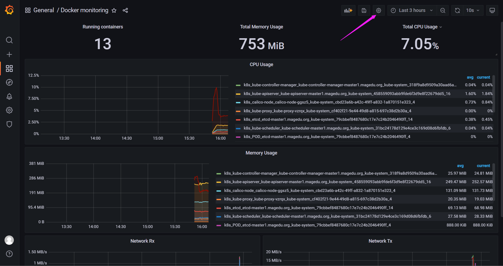

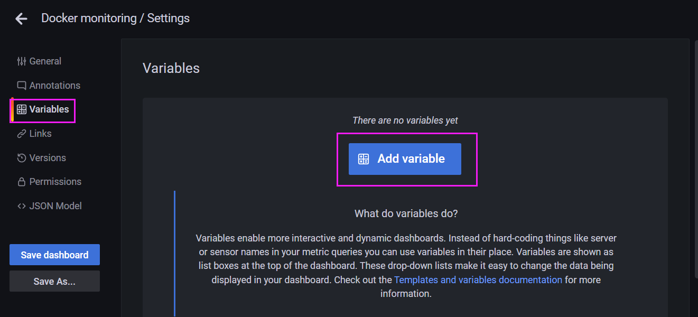

输入以下信息
```text
Query:  label_values(up,instance)
Regex:  .*:8080
```

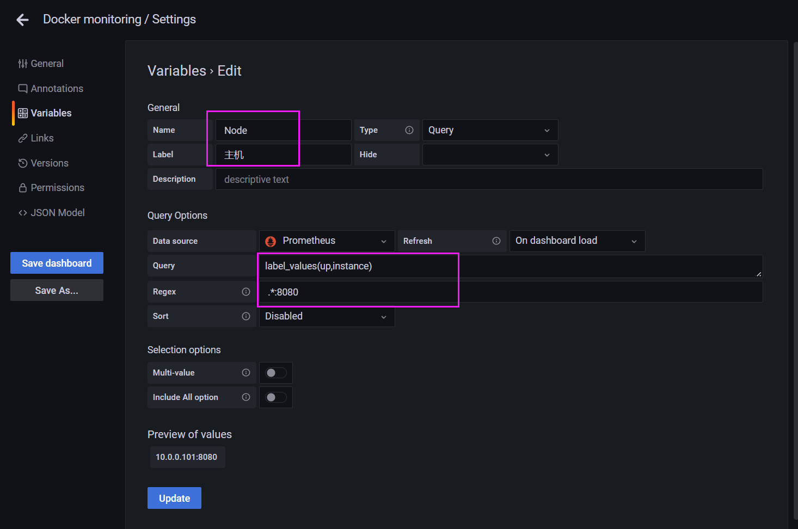

在preview of values 后面有过滤出来的信息，点击最下面的update和左侧的save，再来查看当前的dashboard，可以看到顶栏就有我们用于过滤信息的定制grafana内容了

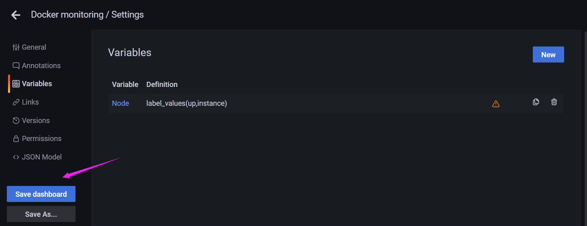

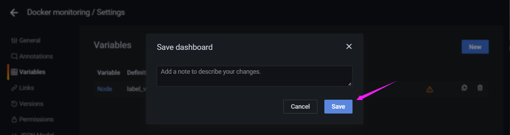

可以查看到下面的主机的样式

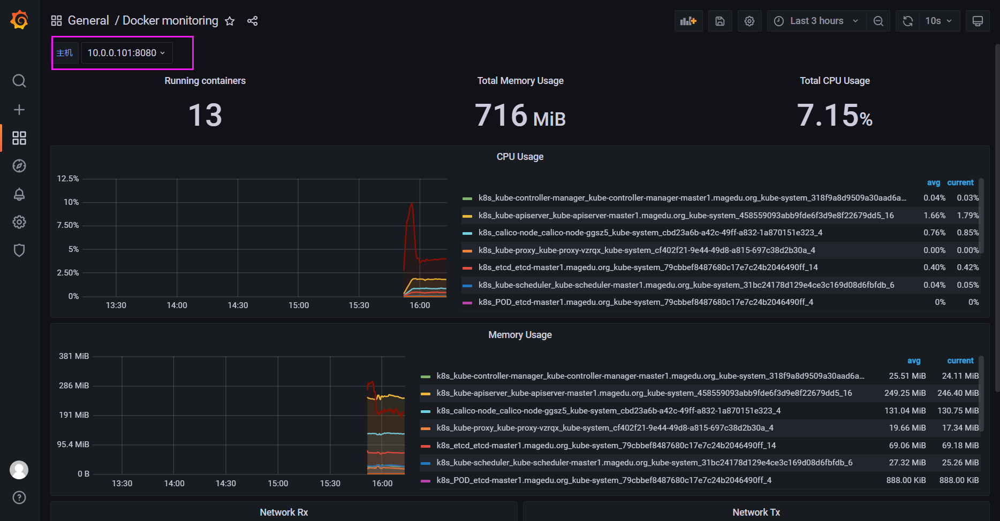



<nav class="article-end" aria-label="章节导航">
  <a href="{{ '/subjects/Prometheus/25-consul-blackbox-exporters.html' | relative_url }}">← 上一章：Consul 与 Blackbox Exporter</a>
  <a href="{{ '/subjects/Prometheus/' | relative_url }}">返回 Prometheus 目录</a>
  <a href="{{ '/subjects/Prometheus/27-federation.html' | relative_url }}">下一章：Prometheus 联邦 →</a>
</nav>
