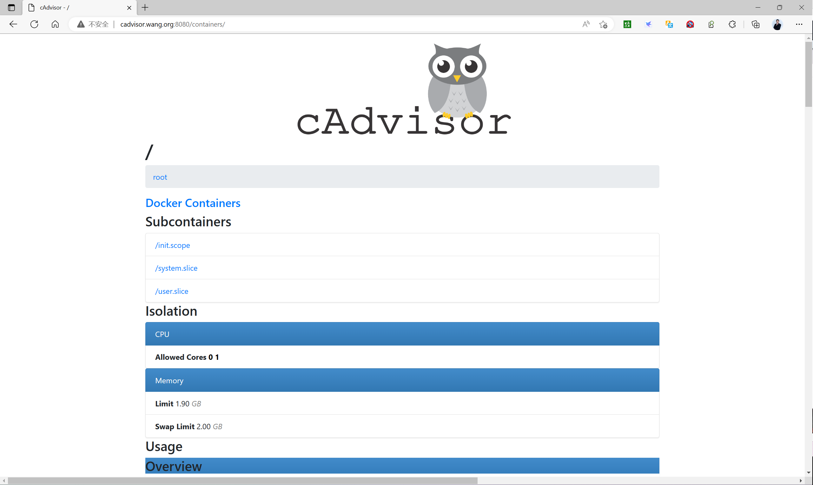
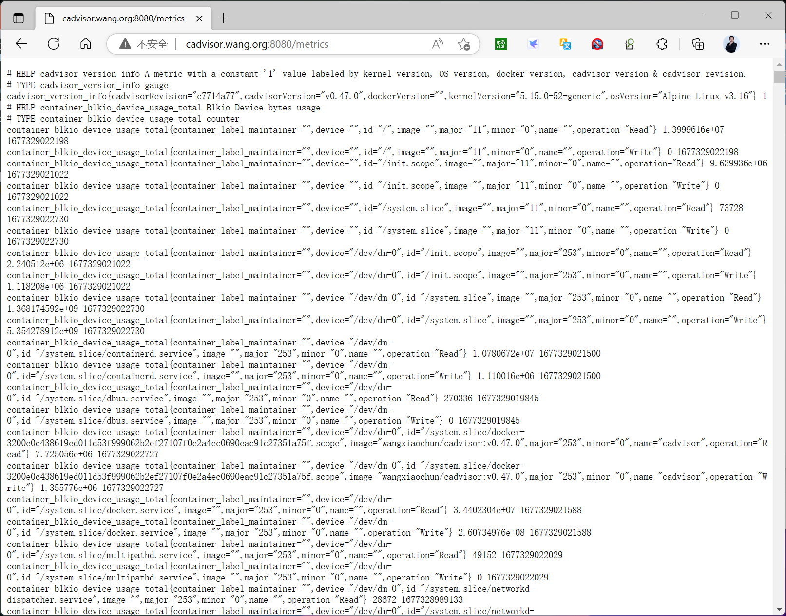
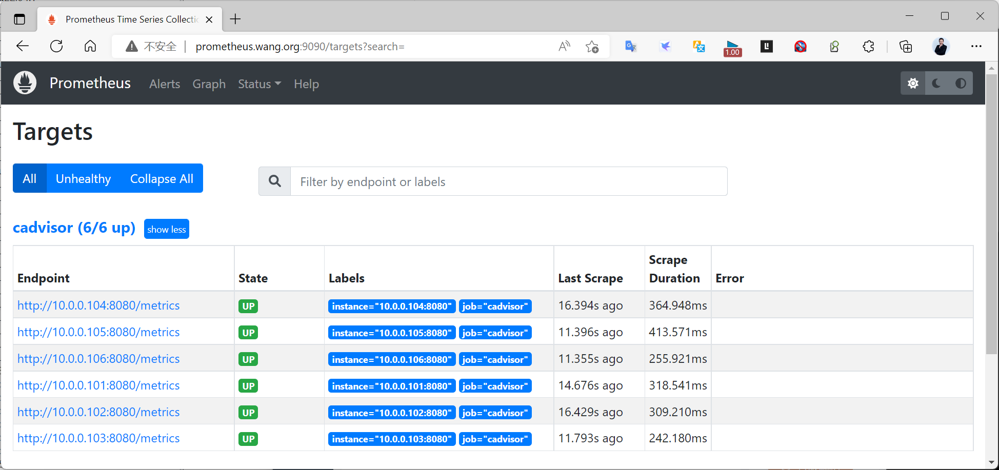
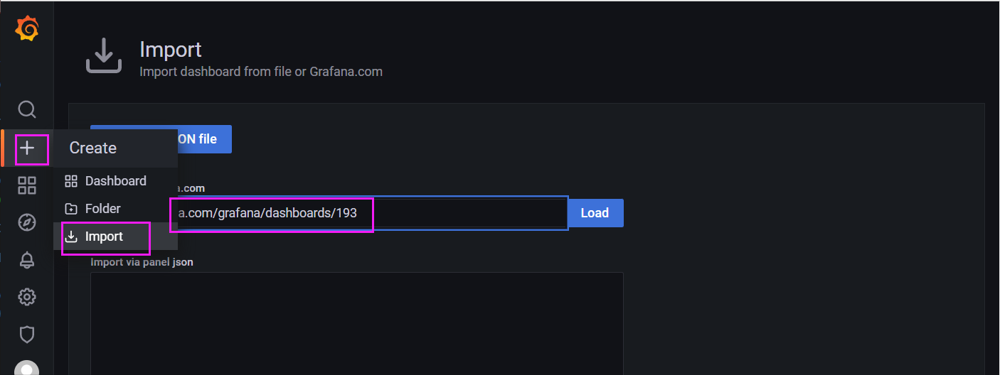
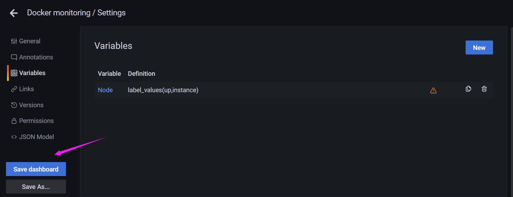

[← 返回 Prometheus 目录]({{ '/subjects/Prometheus/' | relative_url }})



# 26 容器监控与 cAdvisor

# 8 Prometheus 实现容器监控

Node Exporter 观察宿主机，cAdvisor 观察宿主机上的容器资源。两者互补：Node Exporter 回答“这台机器的 CPU、内存、磁盘怎样”，cAdvisor 回答“哪个容器占用了资源”。在 Kubernetes 中，kubelet 通常已经集成 cAdvisor 指标；先检查现有 /metrics/cadvisor 采集任务，再决定是否额外部署独立 cAdvisor，避免一台节点被重复采集。

## 8.1 cAdvisor 采集什么

[cAdvisor](https://github.com/google/cadvisor) 从容器运行时、cgroups 和宿主机文件系统读取容器 CPU、内存、网络与文件系统统计，向 Prometheus 暴露 /metrics。独立 cAdvisor 实例只覆盖它所在的主机；多个 Docker 主机要分别部署。Kubernetes 早期独立的 kubelet cAdvisor 端口已不适用于多数当前版本，不应依赖旧资料中的 4194；可优先使用 kubelet 经认证的 /metrics/cadvisor 路径。


独立部署时，cAdvisor 需要读取宿主机目录和运行时信息。Docker、containerd、cgroup v1/v2 的目录与权限可能不同；同一套旧命令不能保证所有平台都采集到完整指标。先确认容器运行时，再按对应版本的 [官方部署说明](https://github.com/google/cadvisor) 选择挂载。

## 8.2 独立部署：先选一种方式

原资料并列了包安装 Docker 的一键脚本、多个过期镜像源、二进制、源码编译和 DaemonSet，却没有说明何时选择。若已有 Docker 主机，最容易验证的是**固定版本的容器**；不希望容器读取宿主机时可评估二进制；源码编译仅在确实需要自定义构建时使用。不能在同一主机同时运行多个占用 8080 的 cAdvisor。

下面保留一个 Docker 主机实验。镜像版本、架构及实际可访问的镜像仓库应先核对；挂载路径和设备让 cAdvisor 有较广的主机可见范围，部署前需评估该主机的权限边界：

```bash
docker run -d --name cadvisor \
  --publish 8080:8080 \
  --volume /:/rootfs:ro \
  --volume /var/run:/var/run:ro \
  --volume /sys:/sys:ro \
  --volume /var/lib/docker:/var/lib/docker:ro \
  --volume /dev/disk:/dev/disk:ro \
  --device /dev/kmsg \
  gcr.io/cadvisor/cadvisor:v0.49.1
```

若版本或环境要求额外权限，应查看容器日志和官方文档后再补，而不是默认把整个容器设为 privileged。containerd 环境的挂载不能简单把 /var/lib/docker 字符串换成 /var/lib/containerd 就算完成，还需确认运行时接口与 cAdvisor 版本兼容。启动后依次检查 `docker logs cadvisor`、8080 页面和 /metrics 中的 container_ 指标：

```bash
curl -fsS http://127.0.0.1:8080/metrics | grep -m 3 '^container_'
```

若只有 cAdvisor 自身的 Go 指标，没有目标容器指标，优先检查主机挂载、权限和运行时。原资料的离线 Docker 命令把 shell 注释放在续行中、路径写成 `-- volume`，复制会失败；导入镜像后应使用与在线部署同一条经过核对的启动命令。





### 8.2.1 Kubernetes 中是否需要 DaemonSet

先在 Prometheus Targets 中查 kubelet/cAdvisor 抓取任务；若已经拿到 container_cpu_usage_seconds_total、container_memory_working_set_bytes 等指标，就无需另建 DaemonSet。确需独立 cAdvisor 时，可在每个节点运行一个 Pod，并分别处理 hostPath、运行时挂载、端口冲突、调度容忍以及节点可达性。原资料的 DaemonSet YAML 有缩进错误和 `name; dev` 拼写错误，且把 Docker 主机路径挂载到 containerd 容器路径，不能直接应用。

## 8.3 Prometheus 接入

独立 cAdvisor 的默认指标端口通常为 8080。固定主机可先用静态目标，节点经常增删时应使用服务发现；不要同时配置 kubelet 与独立 cAdvisor 对同一批容器重复抓取。

```yaml
scrape_configs:
  - job_name: cadvisor
    static_configs:
      - targets:
          - '10.0.0.101:8080'
          - '10.0.0.102:8080'
```

执行 promtool check config 并重载 Prometheus，检查 Targets 状态，再搜索 container_cpu_usage_seconds_total。Targets 为 UP 只表示能读取 /metrics，仍须确认当前运行的容器对应时序存在。



## 8.4 读懂常用容器指标

| 指标 | 类型与单位 | 如何使用 |
| --- | --- | --- |
| container_cpu_usage_seconds_total | Counter，CPU 秒 | 对时间窗口求 rate，得到使用的 CPU 核数 |
| container_memory_working_set_bytes | Gauge，字节 | 观察近期活跃内存；与 usage 不完全相同 |
| container_memory_usage_bytes | Gauge，字节 | 含部分可回收缓存，不等同于应用真实占用 |
| container_network_receive_bytes_total | Counter，字节 | rate 后得到每秒接收字节 |
| container_network_transmit_bytes_total | Counter，字节 | rate 后得到每秒发送字节 |
| container_fs_reads_bytes_total / container_fs_writes_bytes_total | Counter，字节 | rate 后观察读写吞吐 |
| container_cpu_cfs_throttled_seconds_total | Counter，秒 | 观察 CPU 配额节流趋势 |
| container_spec_memory_limit_bytes | Gauge，字节 | 与使用量比较时，先确认是否设了有效上限 |

原资料把一长串指标逐行列出，却未解释 Counter 与 Gauge 的计算差别。Counter 是累积值，通常需用 rate 或 increase；Gauge 则读取当前值。版本及运行时会影响指标是否存在，先在 Prometheus 查询真实名称与标签，再把表达式复制进告警或 Grafana。

例如按容器名汇总 CPU 核数、内存工作集与每秒网络接收字节：

```promql
sum by (name) (rate(container_cpu_usage_seconds_total{name!=""}[5m]))
```

```promql
sum by (name) (container_memory_working_set_bytes{name!=""})
```

```promql
sum by (name) (rate(container_network_receive_bytes_total{name!=""}[5m]))
```

CPU 表达式结果为核数：0.5 是半个核。乘 100 得到“单核百分比”，不是整个多核主机的利用率百分比。Kubernetes 环境通常按 namespace、pod、container 等标签汇总，具体标签以当前 cAdvisor 暴露的数据为准；不要把历史版本里的 name、image 过滤条件当作所有环境的通用规则。

## 8.5 Grafana 展示

项目已有 Grafana 时无需为了 cAdvisor 重新安装一份。先确认 Prometheus 数据源能查到以上指标，再导入合适的容器面板（原资料提到 193、14282），调整变量以匹配本环境的 job 和 instance。若要只显示独立 cAdvisor 的目标，可从对应 job 筛选实例，而不是笼统使用 `label_values(up,instance)` 并用端口正则排除其他任务。






<nav class="article-end" aria-label="章节导航">
  <a href="{{ '/subjects/Prometheus/25-consul-blackbox-exporters.html' | relative_url }}">← 上一章：Consul 与 Blackbox Exporter</a>
  <a href="{{ '/subjects/Prometheus/' | relative_url }}">返回 Prometheus 目录</a>
  <a href="{{ '/subjects/Prometheus/27-federation.html' | relative_url }}">下一章：Prometheus 联邦 →</a>
</nav>
