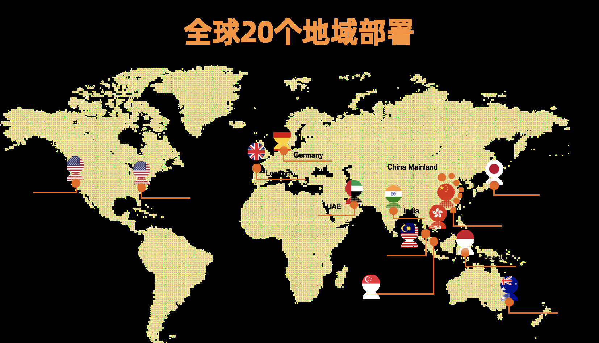
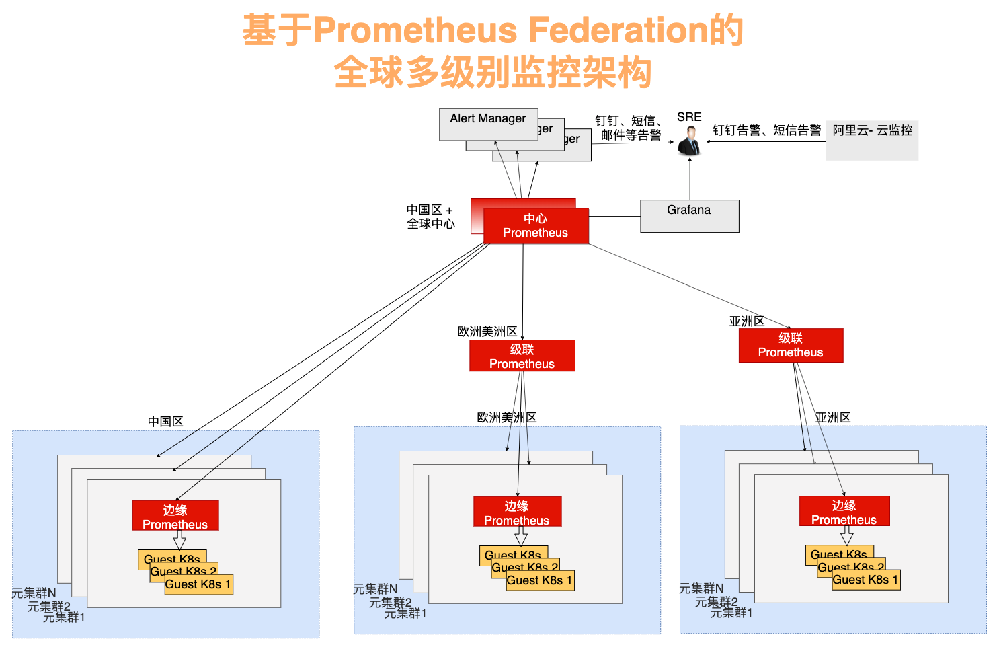
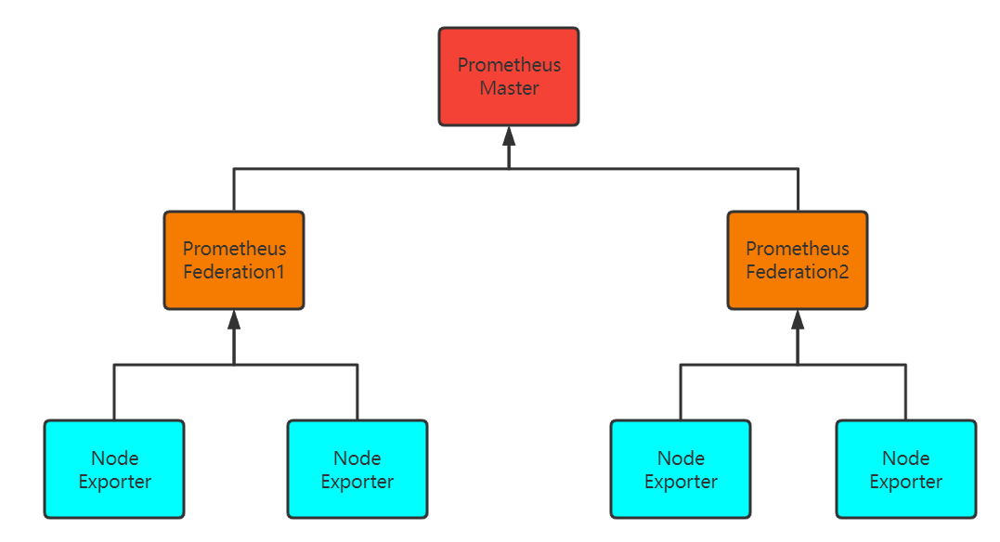
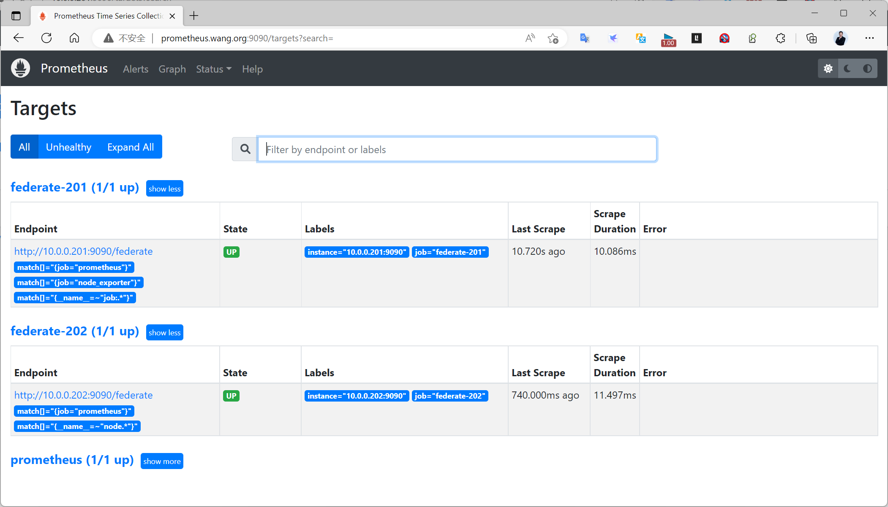
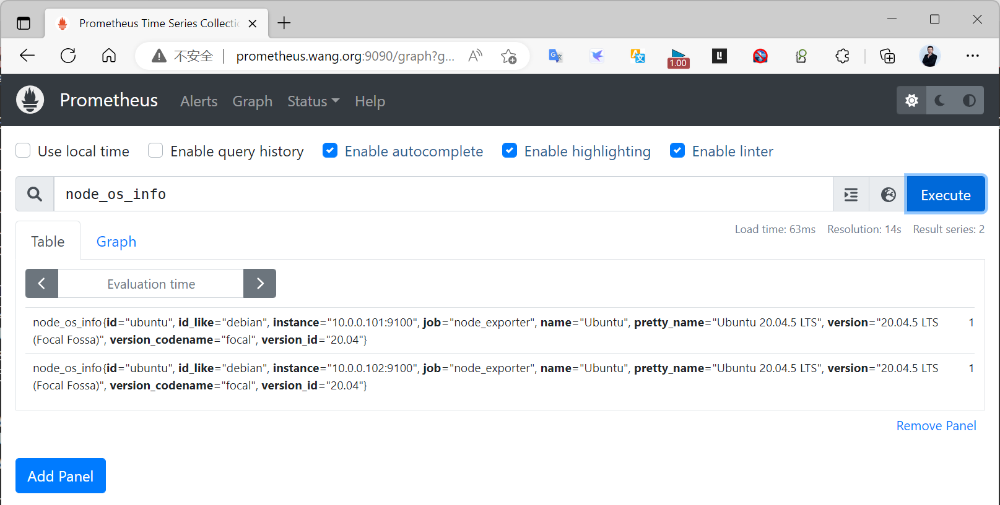
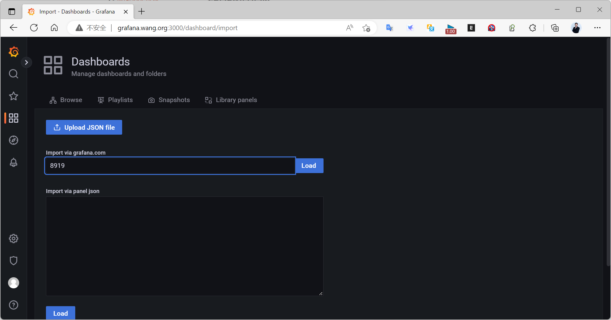
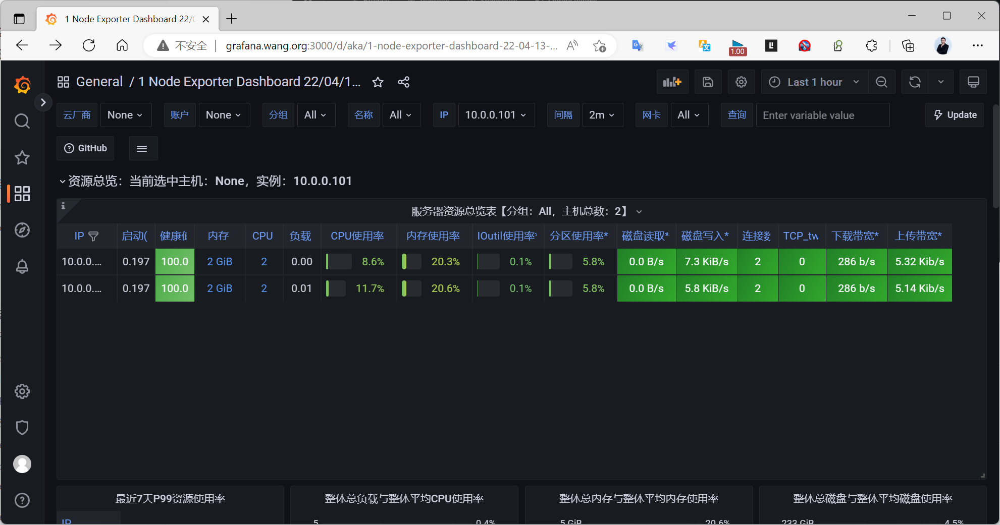
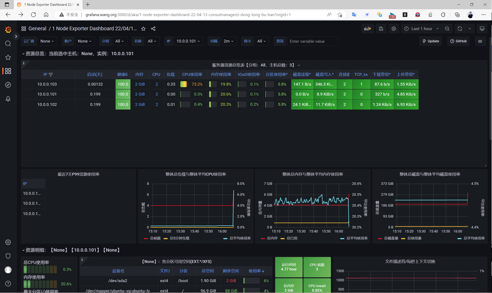

[← 返回 Prometheus 目录]({{ '/subjects/Prometheus/' | relative_url }})



# 27 Prometheus 联邦

# 9 Prometheus Federation 联邦

## 9.1 联邦的用途与边界

[Prometheus 官方联邦文档](https://prometheus.io/docs/prometheus/latest/federation/)介绍了 `/federate` 接口：上层 Prometheus 按 `match[]` 选择器，定期从下层 Prometheus 抓取**当前**时间序列。联邦适合汇总部分指标，不能把下层节点的全部历史数据搬到上层，也不等同于远程存储。

原资料把节点称为“Master/Slave”，容易误以为上层会管理或接管下层。实际上，各 Prometheus 实例独立抓取、存储和评估规则；上层只是另一个抓取方。Grafana 可以查询任何允许访问的 Prometheus，不必固定绑定“主节点”。

| 模式 | 数据流 | 典型目标 |
| --- | --- | --- |
| 分层联邦 | 各机房本地采集，上层抓取必要的聚合指标 | 在保留本地细节的同时提供跨区域概览。 |
| 跨服务联邦 | 一个服务的 Prometheus 抓取另一服务的部分指标 | 将应用指标与所需的基础设施指标放在一起查询或告警。 |

规模扩大时，应先按抓取负载、时间序列基数、查询需求和网络条件选择架构。只在上层抓取需要的序列，并给不同集群设置稳定的外部标签，避免来自多个下层实例的同名序列难以区分。

### 多区域架构示例

[阿里云关于全球监控告警架构的文章](https://developer.aliyun.com/article/738572?groupCode=cloudnative)展示了边缘、级联、中心三个层次：边缘实例贴近 Kubernetes 集群采集详细指标，级联实例按区域汇总，中心实例提供全局视图。该案例适合说明分层思想，不意味着所有部署都必须有三级。



实际采集可包括节点 CPU、内存与磁盘，Kubernetes 控制面组件，kube-state-metrics、cAdvisor 以及 etcd 等指标。区域级实例应按查询和告警需求选择指标；若把所有原始序列再次抓取到中心，会把存储压力转移而不是消除。



## 9.2 实战：两台下层实例与一台上层实例



| 地址 | 角色 | 职责 |
| --- | --- | --- |
| `10.0.0.200:9090` | 上层 Prometheus | 从两个下层实例抓取选定序列。 |
| `10.0.0.201:9090` | 下层 Prometheus A | 抓取 `10.0.0.101:9100` 的 Node Exporter。 |
| `10.0.0.202:9090` | 下层 Prometheus B | 抓取 `10.0.0.102:9100` 的 Node Exporter。 |

先按前文部署三台 Prometheus 和两台 Node Exporter，确认上层能访问两个下层的 9090 端口，并在下层的 Targets 页面确认 Exporter 状态为 `UP`。原示例中的 `install_prometheus.sh`、`install_node_exporter.sh` 未随本文提供，不能直接假定本机存在。

### 9.2.1 配置下层抓取

在下层 A 的 `scrape_configs` 中加入：

```yaml
- job_name: node_exporter
  static_configs:
    - targets: ['10.0.0.101:9100']
```

下层 B 使用相同结构，但将目标换成 `10.0.0.102:9100`。这段 YAML 是 `scrape_configs` 列表中的一项，不是完整的 `prometheus.yml`。可按需要给实例设置不同的 `external_labels`，例如 `region` 和 `cluster`。

### 9.2.2 配置上层联邦抓取

在上层的 `scrape_configs` 中加入以下两项。`match[]` 是必需的；这里仅抓取两台下层的 `node_exporter` 作业。`honor_labels: true` 保留源时间序列标签。

```yaml
- job_name: federate-a
  scrape_interval: 30s
  honor_labels: true
  metrics_path: /federate
  params:
    'match[]':
      - '{job="node_exporter"}'
  static_configs:
    - targets: ['10.0.0.201:9090']

- job_name: federate-b
  scrape_interval: 30s
  honor_labels: true
  metrics_path: /federate
  params:
    'match[]':
      - '{job="node_exporter"}'
  static_configs:
    - targets: ['10.0.0.202:9090']
```

若还需要其他作业，可另加一个 `match[]` 条目；多个选择器取并集。注意联邦抓取间隔与下层抓取间隔的关系：上层只读取抓取时刻可见的最新样本，不会补齐此前漏掉的历史样本。

修改完整配置后，先运行 `promtool check config /usr/local/prometheus/conf/prometheus.yml`，再按实际服务管理方式重新加载或重启 Prometheus；具体路径以安装方式为准。

### 9.2.3 验证与扩展

1. 在上层 Targets 页面确认 `federate-a` 和 `federate-b` 均为 `UP`。
2. 查询 `node_os_info{job="node_exporter"}`，确认来自两个 Node Exporter 的实例标签；如不同区域存在同名目标，再检查外部标签是否区分来源。
3. 在 Grafana 中把上层实例设为数据源，按需导入 Node Exporter 仪表板（原示例使用模板 8919），检查查询是否覆盖预期目标。









新增 `10.0.0.103:9100` 时，只需在负责该节点的下层 Prometheus 的 `node_exporter` 目标列表中加入地址。经配置校验并重新加载后，先确认下层目标为 `UP`，再观察上层与 Grafana；上层的联邦目标不必因此新增。





<nav class="article-end" aria-label="章节导航">
  <a href="{{ '/subjects/Prometheus/26-container-monitoring.html' | relative_url }}">← 上一章：容器监控与 cAdvisor</a>
  <a href="{{ '/subjects/Prometheus/' | relative_url }}">返回 Prometheus 目录</a>
  <a href="{{ '/subjects/Prometheus/28-local-storage.html' | relative_url }}">下一章：Prometheus 本地存储 →</a>
</nav>
