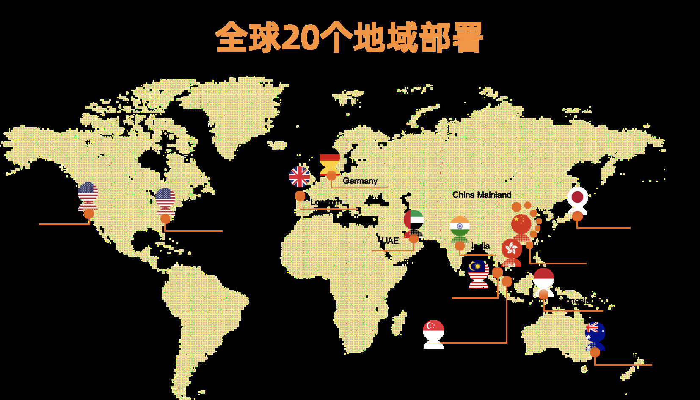
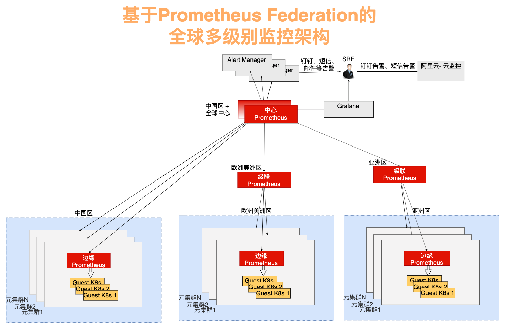
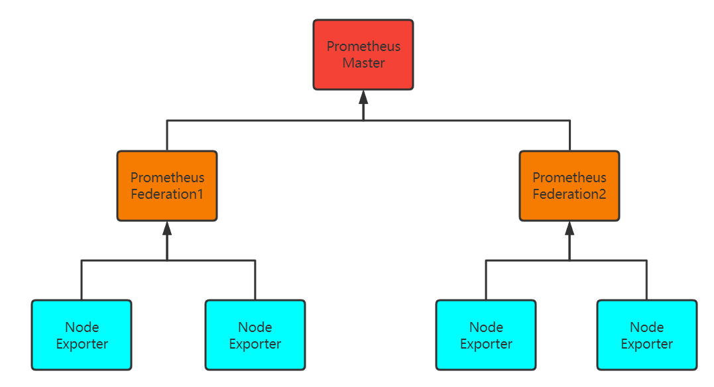
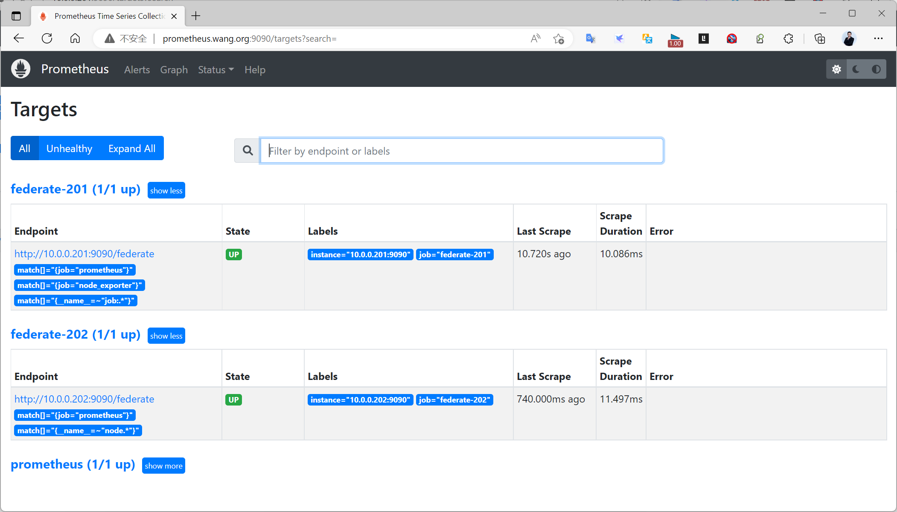
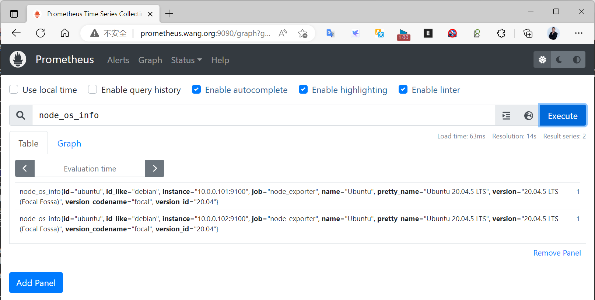
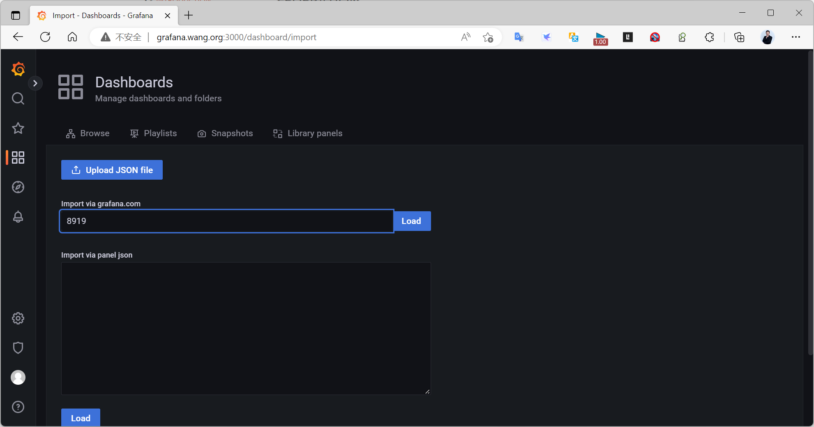
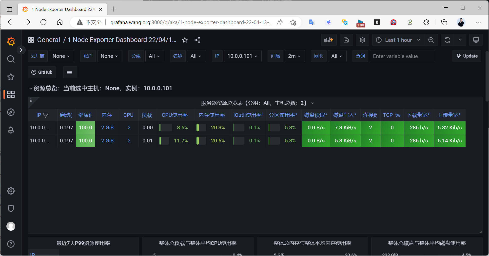
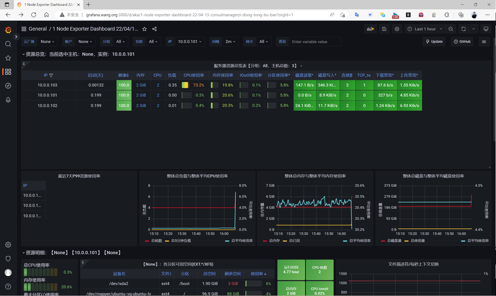

[← 返回 Prometheus 目录]({{ '/subjects/Prometheus/' | relative_url }})



# 27 Prometheus 联邦

# 9 Prometheus Federation 联邦

## 9.1 Prometheus Federation 说明
https://prometheus.io/docs/prometheus/latest/federation/

在生产环境中，一个Prometheus服务节点所能接管的主机数量有限。只使用一个prometheus节点，随着监控数据的持续增长，将会导致压力越来越大

可以采用prometheus的集群联邦模式，即在原有 Prometheus的Master 节点基础上,再部署多个prometheus的Slave 从节点，分别负责不同的监控数据采集，而Master节点只负责汇总数据与 Grafana 数据展示

联邦模式允许 Prometheus 服务器从另一个 Prometheus 服务器抓取特定数据。

联邦有不同的用例。通常，它用于实现可扩展的Prometheus监控设置或将相关指标从一个服务的Prometheus拉到另一个服务。

联邦模式有分层联邦和跨服务联邦两种模式，分层联邦较为常用，且配置简单。

分层联邦

分层联合允许Prometheus扩展到具有数十个数据中心和数百万个节点的环境。在此用例中，联合拓扑类似于树，较高级别的Prometheus服务器从较大数量的从属服务器收集聚合时间序列数据。

例如：设置可能包含许多高度详细收集数据的每个数据中心Prometheus服务器（实例级深入分析），以及一组仅收集和存储聚合数据的全局Prometheus服务器（作业级向下钻取））来自那些本地服务器。这提供了聚合全局视图和详细的本地视图。

跨服务联邦

在跨服务联合中，一个服务的 Prometheus 服务器配置为从另一个服务的Prometheus服务器中提取所选数据，以便对单个服务器中的两个数据集启用警报和查询。

例如：运行多个服务的集群调度程序可能会暴露有关在集群上运行的服务实例的资源使用情况信息（如内存和CPU使用情况）。另一方面，在该集群上运行的服务仅公开特定于应用程序的服务指标。通常，这两组指标都是由单独的Prometheus服务器抓取的。使用联合，包含服务级别度量标准的Prometheus服务器可以从群集Prometheus中提取有关其特定服务的群集资源使用情况度量标准，以便可以在该服务器中使用这两组度量标准。

阿里云全球监控告警架构
https://developer.aliyun.com/article/738572?groupCode=cloudnative



容器服务已经在全球20个地域支持，我们提供了完全自动化的部署、发布、容灾和可观测性能力。这里重点介绍下全球化跨数据中心的可观测。

全球跨数据中心的可观测性

全球化布局的大型集群的可观测性，对于k8s集群的日常保障至关重要。如何在纷繁复杂的网络环境下高效、合理、安全、可扩展的采集各个数据中心中目标集群的实时状态指标，是可观测性设计的关键与核心。我们需要兼顾区域化数据中心、单元化集群范围内可观测性数据的收集，以及全局视图的可观测性和可视化。基于这种设计理念和客观需求，全球化可观测性必须使用多级联合方式，也就是边缘层的可观测性实现下沉到需要观测的集群内部，中间层的可观测性用于在若干区域内实现监控数据的汇聚，中心层可观测性进行汇聚、形成全局化视图以及告警。样设计的好处在于可以灵活的在每一级别层内进行扩展以及调整，适合于不断增长的集群规模，相应的其他级别只需调整参数，层次结构清晰；网络结构简单，可以实现内网数据穿透到公网并汇聚。

针对该全球化布局的大型集群的监控系统设计，对于保障集群的高效运转至关重要，我们的设计理念是在全球范围内将各个数据中心的数据实时收集并聚合，实现全局视图查看和数据可视化，以及故障定位、告警通知。进入云原生时代，Prometheus作为CNCF中第二个毕业的项目，天生适用于容器场景，Prometheus 与Kubernetes 结合一起，实现服务发现和对动态调度服务的监控，在各种监控方案中具有很大的优势，实际上已经成为容器监控方案的标准，所以我们也选择了Prometheus作为方案的基础。

针对每个集群，需要采集的主要指标类别包括：

OS指标，例如节点资源（CPU, 内存，磁盘等）水位以及网络吞吐
元集群以及用户集群K8s master指标，例如kube-apiserver, kube-controller-manager, kube-  
scheduler等指标  
K8s组件（kubernetes-state-metrics，cadvisor）采集的关于K8s集群状态  
etcd指标，例如etcd写磁盘时间，DB size，Peer之间吞吐量等等。  

当全局数据聚合后，AlertManager对接中心Prometheus，驱动各种不同的告警通知行为，例如钉钉、邮件、短信等方式。

监控告警架构

为了合理的将监控压力负担分到到多个层次的Prometheus并实现全局聚合，我们使用了联邦Federation的功能。在联邦集群中，每个数据中心部署单独的Prometheus，用于采集当前数据中心监控数据，并由一个中心的Prometheus负责聚合多个数据中心的监控数据。基于Federation的功能，我们设计的全球监控架构图如下，包括监控体系、告警体系和展示体系三部分。

监控体系按照从元集群监控向中心监控汇聚的角度，呈现为树形结构，可以分为三层：

边缘 Prometheus

为了有效监控元集群K8s和用户集群K8s的指标、避免网络配置的复杂性，将Prometheus下沉到每个元集群内

级联 Prometheus

级联Prometheus的作用在于汇聚多个区域的监控数据。级联Prometheus存在于每个大区域，例如中国区，欧洲美洲区，亚洲区。每个大区域内包含若干个具体的区域，例如北京，上海，东京等。随着每个大区域内集群规模的增长，大区域可以拆分成多个新的大区域，并始终维持每个大区域内有一个级联Prometheus，通过这种策略可以实现灵活的架构扩展和演进。

中心 Prometheus

中心Prometheus用于连接所有的级联 Prometheus，实现最终的数据聚合、全局视图和告警。为提高可靠性，中心Prometheus使用双活架构，也就是在不同可用区布置两个Prometheus中心节点，都连接相同的下一级Prometheus。



## 9.2 实战案例: Prometheus 联邦



编号  地址  角色

1  10.0.0.200  Prometheus Master

2  10.0.0.201  Prometheus Federation

3  10.0.0.202  Prometheus Federation

4  10.0.0.101  Node Exporter

5  10.0.0.102  Node Exporter

### 9.2.1 部署 Prometheus 主节点和联邦节点

所有联邦节点和Prometheus的主节点安装方法是一样的
```bash
[root@ubuntu2204 ~]#bash install_prometheus.sh
```

### 9.2.2 部署 Node Exporter 节点

在所有被监控的节点上安装 Node Exporter,安装方式一样
```bash
[root@ubuntu2204 ~]#bash install_node_exporter.sh
```

### 9.2.3 配置 Prometheus 联邦节点监控 Node Exporter
```yaml
#第一个联邦节点配置监控Node Exporter
[root@ubuntu2204 ~]#tail  /usr/local/prometheus/conf/prometheus.yml
  - job_name: "node_exporter"
    static_configs:
      - targets: ["10.0.0.101:9100"]
#第二个联邦节点配置监控Node Exporter
[root@ubuntu2204 ~]#tail /usr/local/prometheus/conf/prometheus.yml
.....
  - job_name: "node_exporter"
    static_configs:
      - targets: ["10.0.0.102:9100"]
```

### 9.2.4 配置 Prometheus 主节点管理 Prometheus 联邦节点

在任何给定的Prometheus 服务器上，/federate端点允许检索该服务器中所选时间序列集的当前值。

必须至少指定一个match[] URL参数才能选择要公开的系列。每个match[]参数都需要指定一个即时向量选择器。如果提供了多个match[]参数，则选择所有匹配系列的并集。

要将指标从一个服务器采集至另一个服务器，需要将目标Prometheus服务器配置为从源服务器的/federate端点进行刮取，同时还启用honor_labels scrape选项（以不覆盖源服务器公开的任何标签）并传入所需的match[]参数。

范例: 配置 Prometheus 主节点管理 Prometheus 联邦节点
```yaml
[root@ubuntu2204 ~]#vim /usr/local/prometheus/conf/prometheus.yml
  - job_name: 'federate-201'
    scrape_interval: 15s
    honor_labels: true
    metrics_path: '/federate'  #指定采集端点的路径,默认为/federate
    static_configs:
      - targets:
         - '10.0.0.201:9090'  #指定联邦节点prometheus节点地址,如果在k8s集群内,需要指定k8s的
SVC的NodePort的地址信息
    params:
      'match[]':
         - '{job="prometheus"}'  #指定只采集指定联邦节点的Job名称对应的数据,默认不指定不会采
集任何联邦节点的采集的数据
         - '{job="node_exporter"}'  #指定采集联邦节点的job名称,和联邦节点配置的job_name必须
匹配，如果不匹配则不会采集
         - '{__name__=~"redis.*"}'  #指定采集redis开头的指标，多个匹配条件是或的关系
  - job_name: 'federate-202'
    scrape_interval: 15s
    honor_labels: true
    metrics_path: '/federate'
    static_configs:
      - targets:
         - '10.0.0.202:9090'  #指定联邦节点prometheus节点地址,如果在k8s集群,需要指定k8s的
SVC的NodePort的地址信息
    params:
      'match[]':
         - '{job="prometheus"}'
         - '{job="node_exporter"}'  #指定采集联邦节点的job名称,和联邦节点配置的job_name必须
匹配，如果不匹配则不会采集
         - '{__name__=~"node.*"}'  #指定从联邦节点中采集以node开头的指标数据
```

### 9.2.5 Prometheus 联邦验证

在 Prometheus 主节点验证联邦信息



查看指定指标node_os_info,可以看到Node节点上的数据如下



### 9.2.6 Grafana展示 Prometheus 联邦

Grafana导入8919模板



可看到如下数据



### 9.2.7 联邦节点添加新的监控主机

在联邦节点再添加新的node exporter,观察数据
```yaml
#在第一个联邦节点添加新的Node Exporter节点
[root@ubuntu2204 ~]#vim  /usr/local/prometheus/conf/prometheus.yml
  - job_name: "node_exporter"
    static_configs:
      - targets: ["10.0.0.101:9100","10.0.0.103:9100"]
[root@ubuntu2204 ~]#systemctl resload prometheus.service
#Grafana展示新数据如下
```





<nav class="article-end" aria-label="章节导航">
  <a href="{{ '/subjects/Prometheus/26-container-monitoring.html' | relative_url }}">← 上一章：容器监控与 cAdvisor</a>
  <a href="{{ '/subjects/Prometheus/' | relative_url }}">返回 Prometheus 目录</a>
  <a href="{{ '/subjects/Prometheus/28-local-storage.html' | relative_url }}">下一章：Prometheus 本地存储 →</a>
</nav>
