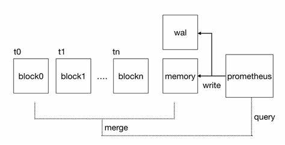
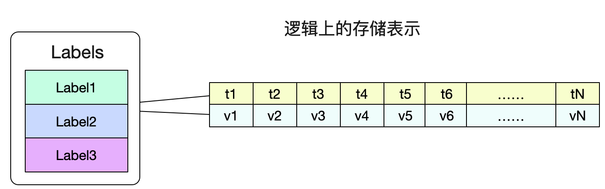
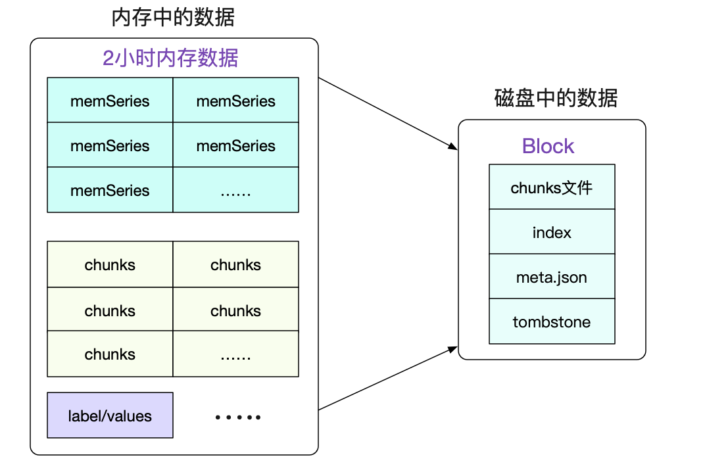
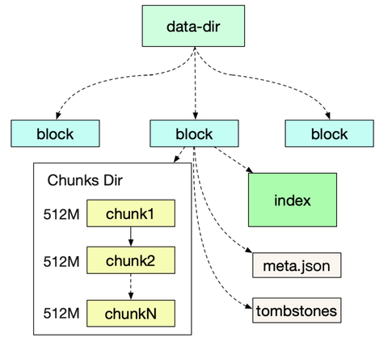
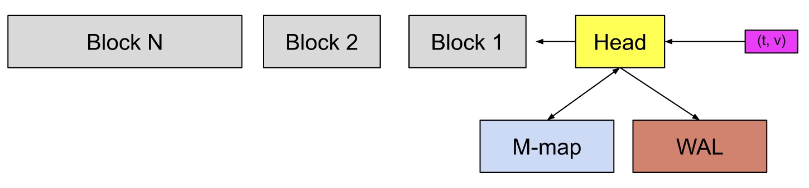
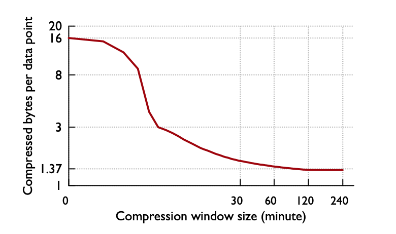

[← 返回 Prometheus 目录]({{ '/subjects/Prometheus/' | relative_url }})



# 28 Prometheus 本地存储

# 10 Prometheus 存储

## 10.1 Prometheus 本地存储

### 10.1.1 Prometheus TSDB 数据库

Prometheus 默认提供了本地存储（TSDB）时序型数据库的存储方式，早期是一个单独的TSDB项目，从2.1.x版本后不单独维护这个项目，直接将这个项目合并到了prometheus的主干上。

Prometheus内置TSDB经历了三个版本

v1.0: 基于LevelDB数据库(Google基于C实现的K/V数据库)，性能不高，每秒只能接收50000个样本
v2.0: 基于LevelDB数据库，但使用了Facebook的Gorilla压缩算法，极大地压缩了单个样本的大小，每  
个采样数据仅仅占用3.5byte左右空间，每秒可接收的样本提升到80000个  
v3.0: 基于自研的Prometheus数据库,由Prometheus 2.0时引入，是一个独立维护的TSDB开源项目，单  
机每秒可处理数百万个样本  

### 10.1.2 Prometheus TSDB数据存储机制

Prometheus的存储结构 TSDB是参考了Facebook的Gorilla之后自行实现的。

参考文章《Gorilla: A Fast, Scalable, In-Memory Time Series Database》可以对Prometheus为何采用这样的存储结构有着更为清晰的理解。



最新的数据是保存在内存中的，并同时写入至预写日志（WAL Write Ahead Log）
以每2小时为一个时间窗口，将内存中的数据存储为一个单独的 Block  
Block会被压缩及合并历史Block块，压缩合并后Block数量会减少  
Block的大小并不固定，但最小会保存2个小时的数据  
后续生成的新数据保存在内存和WAL中，重复以上过程  





### 10.1.3 Prometheus 数据目录结构



PTSDB本地存储使用自定义的文件结构。

Prometheus 默认将数据存储在安装目录下的./data/目录

在./data/目录下类似如01GH5S5W4PDFXCS40VF7NZCP0G形式的目录为2小时块Block目录

每个Block块都有独立的目录,这些目录叫做2小时块。

每个2小时块目录包含一个chunks子目录（包含那个时间窗口里的所有时间序列）、元数据文件meta.json、索引文件index、tombstones

chunks 目录

用于保存时序数据文件
chunks目录中的样例被分组到一个或多个段文件中，各Chunk文件以数字编号,比如:000001  
每个chunk文件的默认最大上限为512MB，如果达到上限则截断并创建为另一个Chunk文件  
index 文件  
索引文件，它是Prometheus TSDB实现高效查询的基础  
可以通过Metrics Name和Labels查找时间序列数据在chunk文件中的位置  

索引文件指标名称和标签索引到chunks目录中的时间序列上
tombstones 文件  
用于对数据进行软删除，不会立即删除块段（chunk segment）中的数据，即“ 标记删除”，以降低删除  
操作的开销  
删除的记录并保存于墓碑 tombstones文件中，而读取时间序列上的数据时，会基于tombstones进行过  
滤已经删除的部分  

meta.json 文件
block的元数据信息，这些元数据信息是block的合并、删除等操作的基础依赖  

范例: 查看本地存储数据
```bash
[root@ubuntu2204 ~]#tree /usr/local/prometheus/data
/usr/local/prometheus/data
├── 01GH5S5W4PDFXCS40VF7NZCP0G
│   ├── chunks
│   │   └── 000001
│   ├── index
│   ├── meta.json
│   └── tombstones
├── 01GH5VTH8SWR3DGEVYJE2SG36B
│   ├── chunks
│   │   └── 000001
│   ├── index
│   ├── meta.json
│   └── tombstones
├── 01GH62P8GSRTGBTG751EWKFS28
│   ├── chunks
│   │   └── 000001
│   ├── index
│   ├── meta.json
│   └── tombstones
├── chunks_head
│   ├── 000005
│   └── 000006
├── lock
├── queries.active
└── wal
    ├── 00000004
    ├── 00000005
    ├── 00000006
    └── checkpoint.00000003
        └── 00000000
9 directories, 20 files
[root@ubuntu2204 ~]#file /usr/local/prometheus/data/*
/usr/local/prometheus/data/01GH5S5W4PDFXCS40VF7NZCP0G: directory
/usr/local/prometheus/data/01GH5VTH8SWR3DGEVYJE2SG36B: directory
/usr/local/prometheus/data/01GH62P8GSRTGBTG751EWKFS28: directory
/usr/local/prometheus/data/chunks_head:                directory
/usr/local/prometheus/data/lock:                       empty
/usr/local/prometheus/data/queries.active:             data
/usr/local/prometheus/data/wal:                        directory
[root@ubuntu2204 ~]#file /usr/local/prometheus/data/01GH5S5W4PDFXCS40VF7NZCP0G/*
/usr/local/prometheus/data/01GH5S5W4PDFXCS40VF7NZCP0G/chunks:     directory #块存放的
目录
/usr/local/prometheus/data/01GH5S5W4PDFXCS40VF7NZCP0G/index:      data
/usr/local/prometheus/data/01GH5S5W4PDFXCS40VF7NZCP0G/meta.json:  JSON data #元数据，
包括样本数，数据时间，合并等
/usr/local/prometheus/data/01GH5S5W4PDFXCS40VF7NZCP0G/tombstones: data #标记删除的信息
[root@ubuntu2204 ~]#cat
/usr/local/prometheus/data/01GH5S5W4PDFXCS40VF7NZCP0G/meta.json
{
    "ulid": "01GH5S5W4PDFXCS40VF7NZCP0G",
    "minTime": 1667704431035,
    "maxTime": 1667707200000,
    "stats": {
         "numSamples": 98257,
         "numSeries": 1126,
         "numChunks": 1126
    },
    "compaction": {
         "level": 1,
         "sources": [
             "01GH5S5W4PDFXCS40VF7NZCP0G"
        ]
    },
    "version": 1
}[root@ubuntu2204 ~]#
```

### 10.1.4 WAL Write-Ahead Logging



Head块是数据库位于内存中的部分，Block  是磁盘上不可更改的持久块,而预写日志(WAL) 用于辅助完成持久写入

传入的样本(k/v)首先会进入Head，并在内存中停留一段时间默认2小时，然后即会被刷写到磁盘并映射回内存中(M-map)

内存存储的只是引用而已。使用内存映射，我们可以在需要的时候使用该引用将 chunk 动态加载到内存

当这些内存映射的块Chunks 或内存中的Chunks 块老化到一定程度时，它会将作为持久块刷入到磁盘

随着它们的老化进程，将合并更多的块，最在超过保留期限后被删除

WAL是数据库中发生的事件的顺序日志，在写入/修改/删除数据库中的数据之前，首先将事件记录附加)到WAL中，然后在数据库中执行必要的操作

WAL用于帮助TSDB先写日志，再写磁盘上的Block

使用WAL技术可以方便地保证原子性、重试等

WAL被分割为默认为128MB大小的文件段，它们都位于WAL目录下

WAL日志的数量及截断的位置则保存于checkpoint文件中，该文件的内容要同步写入磁盘，以确保其可靠性

### 10.1.5 Prometheus 压缩机制



Prometheus将最近的数据保存在内存中，这样查询最近的数据会变得非常快，然后通过一个compactor定时将数据打包到磁盘。

数据在内存中最少保留2个小时(storage.tsdb.min-block-duration)。

之所以设置2小时这个值，应该是Gorilla那篇论文中上图观察得出的结论

即压缩率在2小时时候达到最高，如果保留的时间更短，就无法最大化的压缩

最新的数据是保存在内存中的，并同时写入至磁盘上的预写日志（WAL），每一次动作都会记录到预写日志中。

预写日志文件被保存在wal目录中，以128MB的段形式存在

这些预写日志文件包含尚未压缩的原始数据，因此它们比常规的块文件大得多

prometheus至少保留3个预写日志文件

高流量的服务器可能会保留多于3个的预写日志文件，以至少保留2个小时的原始数据。

如果prometheus 崩溃时，就会重放这些日志，因此就能恢复数据

2小时块最终在后台会被压缩成更长久的块

### 10.1.6 Prometheus 配置本地存储相关选项
```text
--storage.tsdb.path           #数据存储位置，默认是安装和录下的data子目录。
--storage.tsdb.retention.time #保留时间，默认是15天，过了15天之后就删除。该配置会覆盖--
storage.tsdb.retention的值。
--storage.tsdb.retention.size #要保留的块Block的最大字节数(不包括WAL大小)。比如:100GB,支持单
位: B,KB, MB, GB, TB, PB, EB,如果达到指定大小,则最旧的数据会首先被删除。默认为0或禁用，注意：此
值不是指定每个段文件chunk的大小
#注意：上面两个参数值retention.time和retention.size只要有一个满足条件，就会删除旧的数据
--storage.tsdb.wal-compression #开启预写日志的压缩,默认开启
```

磁盘空间公式
```text
needed_disk_space = retention_time_seconds * ingested_samples_per_second *
bytes_per_sample
#retention_time_seconds：保留时间
#ingested_samples_per_second：样本数
#bytes_per_sample：每个样本大小
```

磁盘的最小尺寸主要取决于：wal目录（wal和checkpoint）和chunks_head目录（m-mapped head chunks）的峰值空间（每2小时会达到一次峰值）。

单节点情况下可以满足大部分用户的需求，但本地存储阻碍了prometheus集群化的实现，因此在集群中可以采用其他时序性数据库来替代，比如victoriametrics,thanos和influxdb 等



<nav class="article-end" aria-label="章节导航">
  <a href="{{ '/subjects/Prometheus/27-federation.html' | relative_url }}">← 上一章：Prometheus 联邦</a>
  <a href="{{ '/subjects/Prometheus/' | relative_url }}">返回 Prometheus 目录</a>
  <a href="{{ '/subjects/Prometheus/29-victoriametrics.html' | relative_url }}">下一章：VictoriaMetrics 远程存储 →</a>
</nav>
