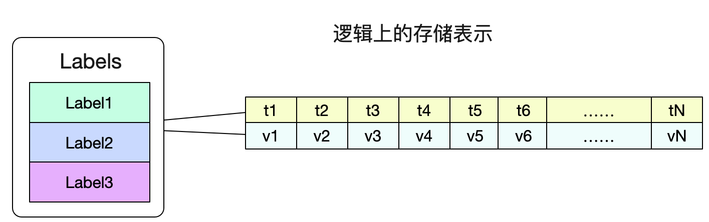
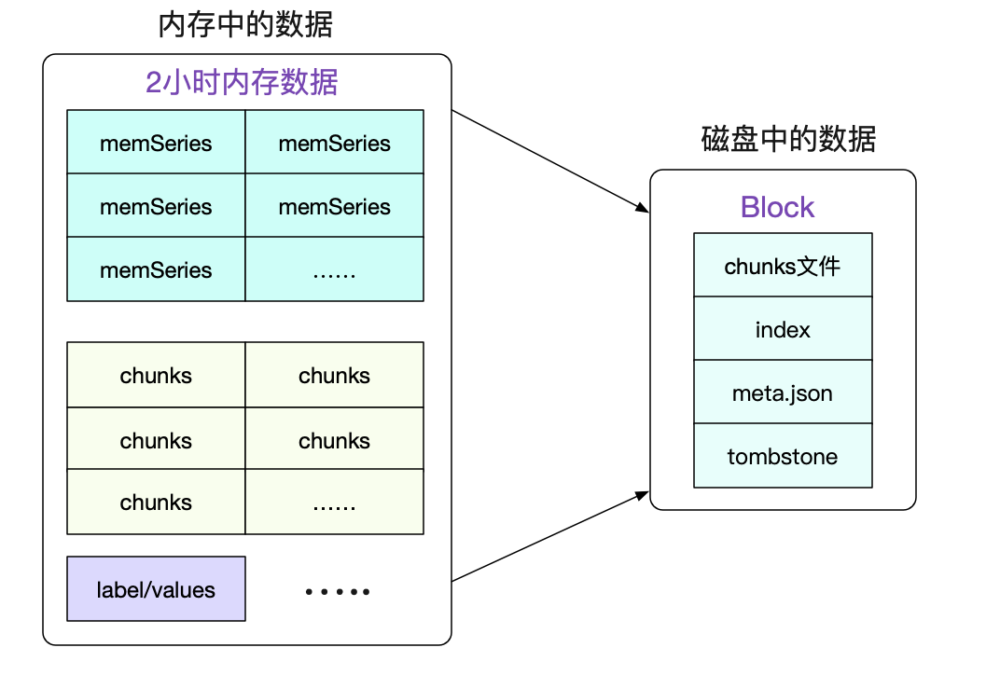
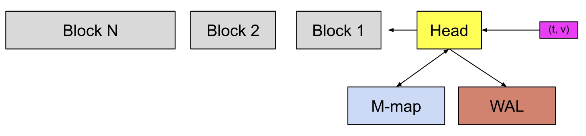

[← 返回 Prometheus 目录]({{ '/subjects/Prometheus/' | relative_url }})



# 28 Prometheus 本地存储

# 10 Prometheus 存储

## 10.1 Prometheus 本地存储

Prometheus 自带时序数据库（TSDB），单实例即可将采集样本写入本地磁盘并执行 PromQL 查询。原资料把早期实现概括成“v1、v2、v3”并给出固定吞吐与每样本字节数；这些数字依赖版本、标签基数和硬件条件，不宜作为容量规划依据。本节以当前常见的 **Head、WAL、Block** 结构解释数据流。

### 10.1.1 样本从采集到持久化


1. 新样本进入内存中的 Head，并写入预写日志（WAL）；WAL 用于在进程异常退出后恢复尚未持久化到 Block 的样本。
2. Head 中的时间序列数据也会以可内存映射的 chunk 文件形式保存在 `chunks_head` 目录。不能把 Head 简单理解成“所有数据只在内存里”。
3. 大约每两小时生成一个初始持久 Block。后台压缩任务可将较小 Block 合并为覆盖更长时间范围的 Block。
4. 达到保留时间或容量限制后，旧 Block 按策略删除。删除某些序列时产生的 `tombstones` 标记会在后续压缩过程中处理。





Block 的目录名通常是 ULID。每个 Block 有自己的 `chunks/` 数据段、`index` 索引、`meta.json` 元数据和可能存在的 `tombstones` 文件；其中索引将指标名称和标签与时间序列关联起来。

### 10.1.2 读懂数据目录


数据目录由 `--storage.tsdb.path` 指定，未显式配置时通常为当前工作目录下的 `data/`。下例只展示结构，不表示所有版本都生成完全相同的文件：

```text
data/
├── 01GH5S5W4PDFXCS40VF7NZCP0G/  # 一个持久 Block
│   ├── chunks/
│   │   └── 000001
│   ├── index
│   ├── meta.json
│   └── tombstones
├── chunks_head/                 # Head 中的可映射 chunk
├── wal/                         # 预写日志及 checkpoint
├── lock
└── queries.active
```

`meta.json` 记录 Block 的时间范围、样本数量和压缩信息。查看文件时应把命令写在同一行，例如：

```bash
find /usr/local/prometheus/data -maxdepth 2 -type f | head
cat /usr/local/prometheus/data/01GH5S5W4PDFXCS40VF7NZCP0G/meta.json
```

第二条命令中的 ULID 是示例，实际运行时应替换为本机存在的 Block 目录。不要手工修改 TSDB 文件；备份与迁移应使用一致性的快照或经过验证的方案。

### 10.1.3 WAL 与压缩



WAL 通常按段存放在 `wal/` 中，并通过 checkpoint 减少恢复时需要重放的数据量。它解决的是**异常退出后的恢复**问题，不意味着每个刚写入的样本已经进入不可变 Block。文件段大小和压缩行为可能随版本与配置变化，排障时以本机版本文档及实际目录为准。


Block 压缩会把较短时间范围的数据合并为较长范围，并清理部分删除标记。图中“约两小时”指初始 Block 的典型范围，不应推断所有后续 Block 都固定为两小时，更不能把它解释成压缩率恰好在两小时达到理论最大值。

### 10.1.4 保留策略与容量估算

常用启动参数如下，具体默认值以所用 Prometheus 版本的帮助信息为准：

| 参数 | 作用 |
| --- | --- |
| `--storage.tsdb.path` | 指定本地 TSDB 数据目录。 |
| `--storage.tsdb.retention.time` | 按时间保留数据；常见默认值为 15 天。 |
| `--storage.tsdb.retention.size` | 限制持久 Block 使用的空间，不包含 WAL 和 Head 目录的全部开销。 |
| `--storage.tsdb.wal-compression` | 控制 WAL 压缩，使用前核对当前版本默认值。 |

同时设置时间与容量上限时，先达到的条件会触发旧 Block 清理。粗略估算可从 `每秒样本数 × 保留秒数 × 每样本平均字节数` 入手，但必须额外考虑索引、WAL、Head、压缩过程中的临时空间和磁盘水位。最好先用真实负载运行一段时间，再据实际增长率规划容量。

单节点本地 TSDB 适合许多场景，但不自带跨节点共享存储或长期高可用查询。若需要更长保留期或全局查询，可进一步评估远程写入、Thanos、VictoriaMetrics 等方案；它们的接入方式和一致性模型并不相同。



<nav class="article-end" aria-label="章节导航">
  <a href="{{ '/subjects/Prometheus/27-federation.html' | relative_url }}">← 上一章：Prometheus 联邦</a>
  <a href="{{ '/subjects/Prometheus/' | relative_url }}">返回 Prometheus 目录</a>
  <a href="{{ '/subjects/Prometheus/29-victoriametrics.html' | relative_url }}">下一章：VictoriaMetrics 远程存储 →</a>
</nav>
