[← 返回 Prometheus 目录]({{ '/subjects/Prometheus/' | relative_url }})



# 29 VictoriaMetrics 远程存储

## 10.2 Prometheus 远程存储 VictoriaMetrics

### 10.2.1 VictoriaMetrics 介绍


Prometheus 默认的本地存储存在单点的可用性和性能瓶颈问题

Prometheus的远程存储可以解决以上问题，远程存储有多种方案，比如：VictoriaMetrics，Thanos（灭霸）和 influxdb，也可以通过adapter适配器间接的存储在Elasticsearch或PostgreSQL中

VictoriaMetrics(VM) 是基于Golang实现的一个支持高可用、经济高效且可扩展的监控解决方案和时间序列数据库，可用于 Prometheus 监控数据做长期远程存储。Thanos 方案也可以用来解决 Prometheus 的高可用和远程存储的问题

相对于 Thanos，VictoriaMetrics 主要是一个可水平扩容的本地全量持久化存储方案，性能比thanos性能要更好

而 Thanos不是本地全量的，它很多历史数据是存放在对象存储当中的，如果要查询历史数据都要从对象存储当中去拉取，这肯定比本地获取数据要慢，VictoriaMetrics要比Thanos性能要好

VictoriaMetrics具有以下突出特点：
https://github.com/VictoriaMetrics/VictoriaMetrics
它可以用作Prometheus的长期储存。
它可以用作Grafana中Prometheus的直接替代品，因为它支持Prometheus查询 API。
它可以用作Grafana中Graphite的直接替代品，因为它支持Graphite API。
它实现了基于PromQL的查询语言MetricsQL，它在PromQL之上提供了改进的功能。
它提供全局查询视图。多个Prometheus实例或任何其他数据源可能会将数据摄取到VictoriaMetrics中。稍后可
以通过单个查询查询此数据。
它为数据引入和数据查询提供了高性能以及良好的垂直和水平可扩展性。它的性能比InfluxDB和TimescaleDB高
出20倍。
在处理数百万个独特的时间序列（又称高基数）时，它使用的RAM比InfluxDB少10倍，比Prometheus、Thanos
或 Cortex 少7倍。
它针对具有高流失率的时间序列进行了优化。
它提供了高数据压缩，因此与TimescaleDB相比，可以将多达70倍的数据点塞入有限的存储空间，与
Prometheus，Thanos或Cortex相比，所需的存储空间最多可减少7倍。
它针对具有高延迟IO和低IOPS（AWS，Google Cloud，Microsoft Azure等中的HDD和网络存储）的存储进行
了优化。
单节点VictoriaMetrics可以替代使用Thanos，M3DB，Cortex，InfluxDB或TimescaleDB等竞争解决方案构
建的中等规模的集群。
由于存储架构，它可以在不干净关闭（即OOM，硬件重置或kill -9）时保护存储免受数据损坏。
它支持指标重新标记。
它可以通过序列限制器处理高基数问题和高流失率问题。
它非常适合处理来自APM、Kubernetes、物联网传感器、联网汽车、工业遥测、财务数据和各种企业工作负载的大
量时间序列数据。
它具有开源群集版本。
它具有易于设置和操作的特点
它可以将数据存储在基于 NFS 的存储上，例如Amazon EFS和Google Filestore。

官网
https://victoriametrics.com/
https://github.com/VictoriaMetrics/VictoriaMetrics

官方文档
https://docs.victoriametrics.com/Single-server-VictoriaMetrics.html

VictoriaMetrics 分为单节点和集群两个方案

官方建议如果采集数据点(data points)低于 100w/s时推荐单节点，但不支持告警。
集群支持数据水平拆分  

常见部署方式

基于二进制单机安装
基于集群安装  
基于 Docker 运行  
基于 Docker Compose 安装  

### 10.2.2 VictoriaMetrics 单机布署

#### 10.2.2.1 基于二进制单机部署

10.2.2.1.1 基于二进制安装

官方下载:
```text
https://github.com/VictoriaMetrics/VictoriaMetrics/releases
#注意：不要下载enterpise版本，此版本需要授权许可
https://github.com/VictoriaMetrics/VictoriaMetrics/releases/tag/v1.121.0
```

范例:
```ini
[root@ubuntu2204 ~]#cd /usr/local/src
[root@ubuntu2204 src]#wget
https://github.com/VictoriaMetrics/VictoriaMetrics/releases/download/v1.112.0/victoria-metrics-linux-amd64-v1.112.0.tar.gz
[root@ubuntu2204 src]#wget
https://github.com/VictoriaMetrics/VictoriaMetrics/releases/download/v1.107.0/victoria-metrics-linux-amd64-v1.107.0.tar.gz
[root@ubuntu2204 src]#wget
https://github.com/VictoriaMetrics/VictoriaMetrics/releases/download/v1.82.1/victoria-metrics-linux-amd64-v1.82.1.tar.gz
[root@ubuntu2204 src]#tar tvf victoria-metrics-linux-amd64-v1.82.1.tar.gz
-rwxr-xr-x valyala/valyala 18627904 2022-10-14 15:16 victoria-metrics-prod
[root@ubuntu2204 src]#tar xf victoria-metrics-linux-amd64-v1.82.1.tar.gz
[root@ubuntu2204 src]#mv victoria-metrics-prod /usr/local/bin/
#查看支持选项
[root@ubuntu2204 src]#victoria-metrics-prod --help
#准备用户和数据目录
[root@ubuntu2204 ~]#useradd -r -s /sbin/nologin victoriametrics
[root@ubuntu2204 ~]#mkdir -p  /data/victoriametrics
[root@ubuntu2204 ~]#chown victoriametrics:victoriametrics  /data/victoriametrics
#创建 service 文件
[root@ubuntu2204 ~]#cat > /lib/systemd/system/victoriametrics.service <<EOF
[Unit]
Description=VictoriaMetrics
Documentation=https://docs.victoriametrics.com/Single-server-VictoriaMetrics.html
After=network.target
[Service]
Restart=on-failure
User=victoriametrics
Group=victoriametrics
ExecStart=/usr/local/bin/victoria-metrics-prod -httpListenAddr=0.0.0.0:8428 -
storageDataPath=/data/victoriametrics -retentionPeriod=12
#ExecReload=/bin/kill -HUP \$MAINPID
LimitNOFILE=65535
[Install]
WantedBy=multi-user.target
EOF
#说明
-httpListenAddr string #监听地址和端口,默认为0.0.0.0:8428
-storageDataPath string #指定数据存储路径,默认当前目录下的victoria-metrics-data
-retentionPeriod value  #指定数据保存时长,支持h (hour), d (day), w (week), y (year). If
suffix isn't set, then the duration is counted in months (default 1)
#启动服务
[root@ubuntu2204 ~]#systemctl daemon-reload
[root@ubuntu2204 ~]#systemctl enable --now  victoriametrics
#查看状态
[root@ubuntu2204 ~]#systemctl status victoriametrics
#确认端口
[root@ubuntu2204 ~]#ss -ntlp|grep victoria
LISTEN 0  4096  0.0.0.0:8428       0.0.0.0:*    users:(("victoria-
metric",pid=2836,fd=10))
[root@ubuntu2204 ~]#ps aux|grep victoria
victori+  2836 0.1  0.7 726828 15068 ?        Ssl  20:18   0:00
/usr/local/bin/victoria-metrics-prod -httpListenAddr=0.0.0.0:8428 -
storageDataPath=/data/victoriametrics -retentionPeriod=12
root        2855 0.0  0.1   9232 2416 pts/0    S+  20:19   0:00 grep --color=auto
victoria
#数据目录自动生成相关数据
[root@ubuntu2204 ~]#ls /data/victoriametrics/
data  flock.lock  indexdb  metadata  snapshots  tmp
#浏览器访问:
http://victoriametrics.bowen.org:8428/
```

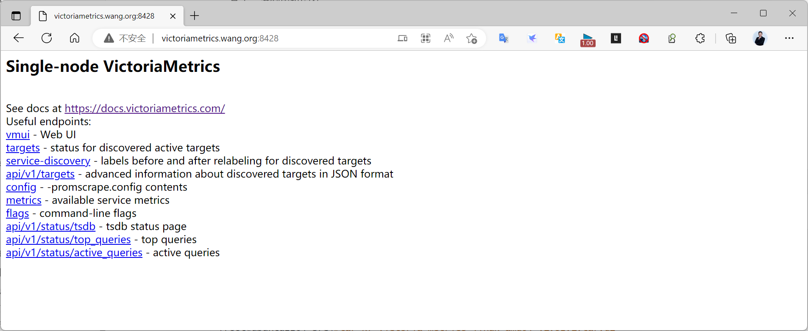

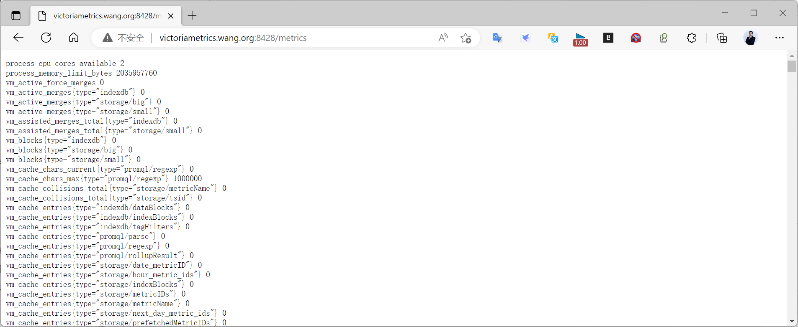

10.2.2.1.2 修改prometheus 使用victoriametrics 实现远程存储
```yaml
[root@ubuntu2204 ~]#vim /usr/local/prometheus/conf/prometheus.yml
global:
  scrape_interval: 15s # Set the scrape interval to every 15 seconds. Default is
every 1 minute.
  evaluation_interval: 15s # Evaluate rules every 15 seconds. The default is every 1
minute.
  # scrape_timeout is set to the global default (10s).
#加下面两行，和global平级
remote_write:
  - url: http://victoriametrics.bowen.org:8428/api/v1/write
#重启生效
[root@ubuntu2204 ~]#systemctl resload prometheus.service
```

12.2.2.1.3 访问 victoriametrics 的Web UI 验证数据

访问如下链接,可以看到下面信息
http://victoriametrics.bowen.org:8428/vmui

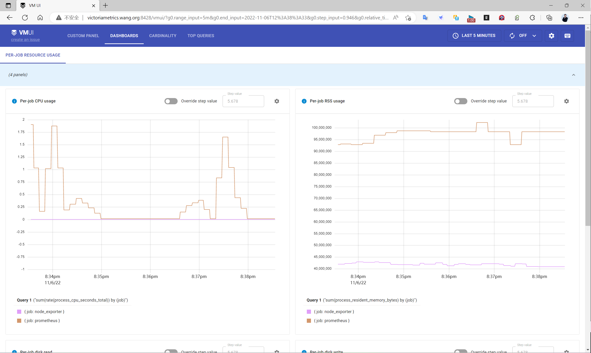

10.2.2.1.4 Grafana 展示 victoriametrics 数据

在Grafana 添加新的数据源,类型为 Prometheus,URL为 victoriametrics 的地址和端口
http://victoriametrics.bowen.org:8428

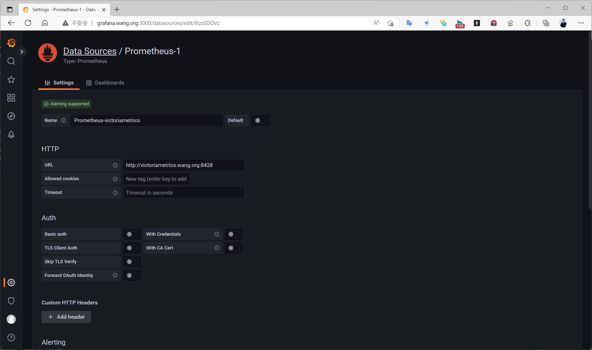

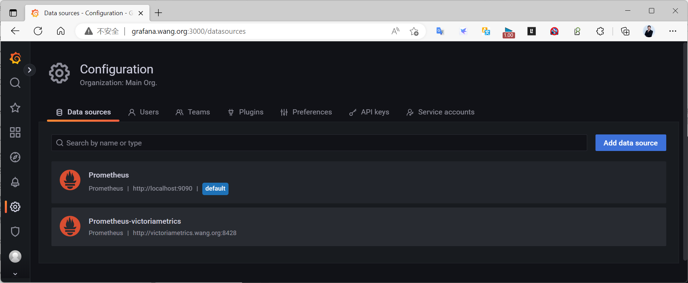

导入模板1860,8919,11074等模板,指定使用上面创建的数据源

注意: 如果以前存在,先删除模板再导入

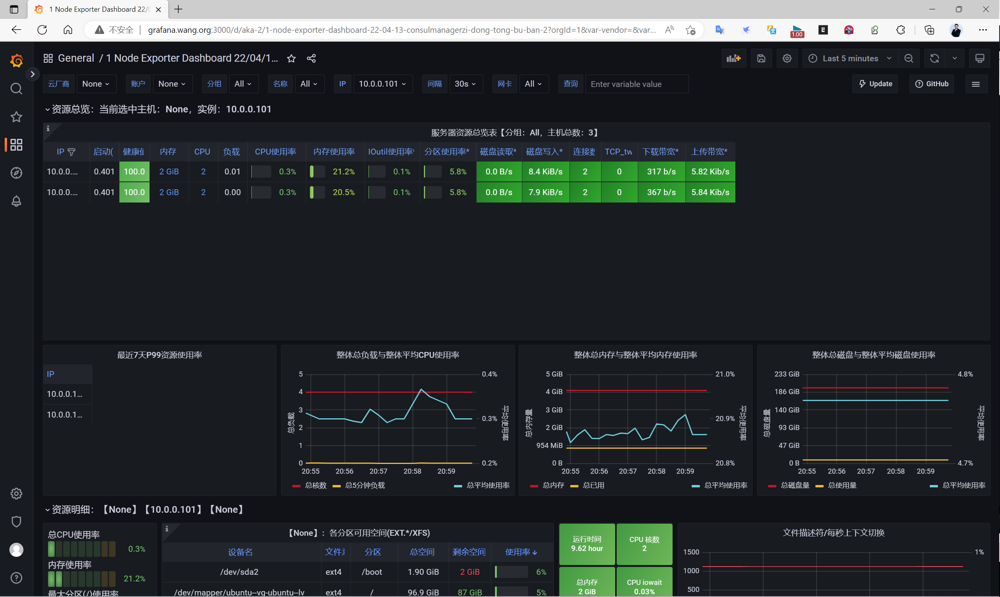

#### 10.2.2.2 基于 Docker 部署
https://hub.docker.com/r/victoriametrics/victoria-metrics

范例:
```bash
docker run -it --rm -v /path/to/victoria-metrics-data:/victoria-metrics-data -p
8428:8428 victoriametrics/victoria-metrics
#This will run the service on port 8428, all the data will be stored at
/path/to/victoria-metrics-data . To verify VictoriaMetrics is healthy and running
check the /metrics page:
curl -v http://<victoriametrics-addr>:8428/metrics
```

#### 10.2.2.3 基于 Docker Compose 部署
```bash
https://github.com/VictoriaMetrics/VictoriaMetrics/tree/cluster/deployment/docker
#单机版
https://github.com/VictoriaMetrics/VictoriaMetrics/blob/cluster/deployment/docker/docker-compose.yml
[root@ubuntu2204 ~]#mkdir VictoriaMetrics
[root@ubuntu2204 ~]#cd VictoriaMetrics
[root@ubuntu2204 VictoriaMetrics]#wget
https://raw.githubusercontent.com/VictoriaMetrics/VictoriaMetrics/cluster/deployment/docker/docker-compose.yml
[root@ubuntu2204 VictoriaMetrics]#mv ../docker-compose.yml .
[root@ubuntu2204 VictoriaMetrics]#cat docker-compose.yml
version: "3.5"
services:
  vmagent:
    container_name: vmagent
    image: victoriametrics/vmagent:v1.83.0
    depends_on:
      - "victoriametrics"
    ports:
      - 8429:8429
    volumes:
      - vmagentdata:/vmagentdata
      - ./prometheus.yml:/etc/prometheus/prometheus.yml
    command:
      - "--promscrape.config=/etc/prometheus/prometheus.yml"
      - "--remoteWrite.url=http://victoriametrics:8428/api/v1/write"
    networks:
      - vm_net
    restart: always
  victoriametrics:
    container_name: victoriametrics
    image: victoriametrics/victoria-metrics:v1.83.0
    ports:
      - 8428:8428
      - 8089:8089
      - 8089:8089/udp
      - 2003:2003
      - 2003:2003/udp
      - 4242:4242
    volumes:
      - vmdata:/storage
    command:
      - "--storageDataPath=/storage"
      - "--graphiteListenAddr=:2003"
      - "--opentsdbListenAddr=:4242"
      - "--httpListenAddr=:8428"
      - "--influxListenAddr=:8089"
      - "--vmalert.proxyURL=http://vmalert:8880"
    networks:
      - vm_net
    restart: always
  grafana:
    container_name: grafana
    image: grafana/grafana:9.1.0
    depends_on:
      - "victoriametrics"
    ports:
      - 3000:3000
    volumes:
      - grafanadata:/var/lib/grafana
      - ./provisioning/:/etc/grafana/provisioning/
      - ./../../dashboards/victoriametrics.json:/var/lib/grafana/dashboards/vm.json
      - ./../../dashboards/vmagent.json:/var/lib/grafana/dashboards/vmagent.json
      - ./../../dashboards/vmalert.json:/var/lib/grafana/dashboards/vmalert.json
    networks:
      - vm_net
    restart: always
  vmalert:
    container_name: vmalert
    image: victoriametrics/vmalert:v1.83.0
    depends_on:
      - "victoriametrics"
      - "alertmanager"
    ports:
      - 8880:8880
    volumes:
      - ./alerts.yml:/etc/alerts/alerts.yml
      - ./alerts-health.yml:/etc/alerts/alerts-health.yml
      - ./alerts-vmagent.yml:/etc/alerts/alerts-vmagent.yml
    command:
      - "--datasource.url=http://victoriametrics:8428/"
      - "--remoteRead.url=http://victoriametrics:8428/"
      - "--remoteWrite.url=http://victoriametrics:8428/"
      - "--notifier.url=http://alertmanager:9093/"
      - "--rule=/etc/alerts/*.yml"
      # display source of alerts in grafana
      - "--external.url=http://127.0.0.1:3000" #grafana outside container
      # when copypaste the line be aware of '$$' for escaping in '$expr'
      - '--external.alert.source=explore?orgId=1&left=["now-
1h","now","VictoriaMetrics",{"expr":{{$$expr|jsonEscape|queryEscape}} },
{"mode":"Metrics"},{"ui":[true,true,true,"none"]}]'
    networks:
      - vm_net
    restart: always
  alertmanager:
    container_name: alertmanager
    image: prom/alertmanager:v0.24.0
    volumes:
      - ./alertmanager.yml:/config/alertmanager.yml
    command:
      - "--config.file=/config/alertmanager.yml"
    ports:
      - 9093:9093
    networks:
      - vm_net
    restart: always
volumes:
  vmagentdata: {}
  vmdata: {}
  grafanadata: {}
networks:
  vm_net:
[root@ubuntu2204 VictoriaMetrics]#apt -y install docker-compose
[root@ubuntu2204 VictoriaMetrics]#docker-compose -version
docker-compose version 1.29.2, build unknown
[root@ubuntu2204 VictoriaMetrics]#docker-compose up -d
```

### 10.2.3 VictoriaMetrics 集群部署

#### 10.2.3.1 VictoriaMetrics 集群说明

VictoriaMetrics 集群可以解决单机的单点可用性和性能瓶颈问题
https://docs.victoriametrics.com/Cluster-VictoriaMetrics.html

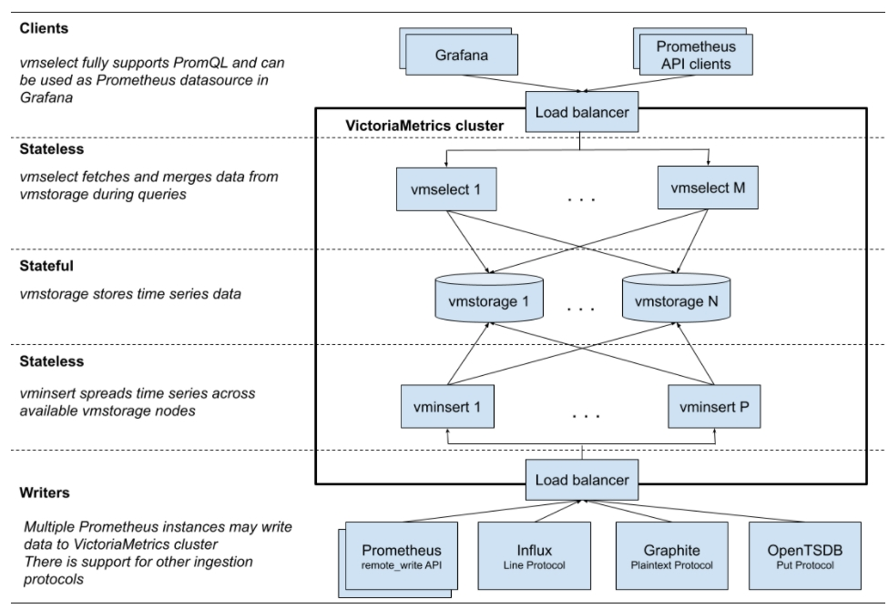

集群版的victoriametrics有下面主要服务组成：

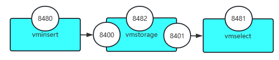

vmstorage
数据存储节点，负责存储时序数据,默认使用3个端口  
API Server的端口: 8482/tcp，由选项 -httpListenAddr 指定  
从vminsert接收并存入数据的端口:8400/ tcp，由选项-vminsertAddr指定  

从vmselect接收查询并返回数据的端口:8401 / tcp，由选项-vmselectAddr指定
vmstorage节点间不进行任何交互，都是独立的个体, 使用上层的vminsert产生副本和分片  
有状态，一个vmstorage节点故障，会丢失约1/N的历史数据(N为vmstorage节点的数量)  
数据存储于选项-storageDataPath指定的目录中，默认为./vmstorage-data/  
vmstorage的节点数量,需要真实反映到vminsert和vmselect之上  

支持单节点和集群模式:集群模式支持多租户，其API端点也有所不同
vminsert  
数据插入节点，负责接收用户插入请求，基于metric名称和label使用一致性Hash算法向不同的  
vmstorage写入时序数据  
负责接收来自客户端的数据写入请求，并转发到选定的vmstorage节点，监听一个端口  
接收数据存入请求的端口:8480/ tcp，由选项-httpListenAddr指定  
它是Prometheus remote_write协议的一个实现，可接收和解析通过该协议远程写入的数据若接入的是  
VM存储集群时  
其调用端点的URL格式为  
```text
     http: //<vminsert>:8480 /insert/<accountID>/<suffix>
     #<accountID>是租户标识
     #<suffix>中，值/prometheus和/prometheus/api/v1/write的作用相同，专用于接收prometheus写
     入请求
```

vmselect
数据查询节点，负责接收用户查询请求，向vmstorage查询时序数据  
负责接收来自客户端的数据查询请求，转发到各vmstorage节点完成查询，并将结果合并后返回给客户  
端监听一个端口  
基于metric名称和label使用一致性Hash算法向不同的vmstorage查询时序数据  
接收数据查询请求的端口:8481/tcp，可由选项-httpListenAddr指定  

它是prometheus remote_read协议的一个实现，可接收和解析通过该协议传入的远程查询请求
专用于prometheus的URL格式为  
```text
     http://<vmselect>:8481/select/<accountID>/prometheus
     #<accountID>是租户标识
```

vmagent
可以用来替换 Prometheus，实现数据指标抓取，支持多种后端存储，会占用本地磁盘缓存  
相比于 Prometheus 抓取指标来说具有更多的灵活性，支持pull和push指标  

默认端口 8429
vmalert  
报警相关组件，如果不需要告警功能可以不使用，默认端口为 8880  

以上组件中 vminsert 以及 vmselect（几乎）都是无状态的，所以扩展很简单，只有 vmstorage 是有状态的。

在部署时可以按照需求，不同的微服务部署不同的副本，以应对业务需求：

若数据量比较大，部署较多的vmstorage副本
若查询请求比较多，部署较多的vmselect副本  
若插入请求比较多，部署较多的vminsert副本  

#### 10.2.3.2 VictoriaMetrics 集群二进制部署

以下实现部署一个三节点的 VictoriaMetrics 集群，且三节点同时都提供vmstorage，vminsert和vmselect角色

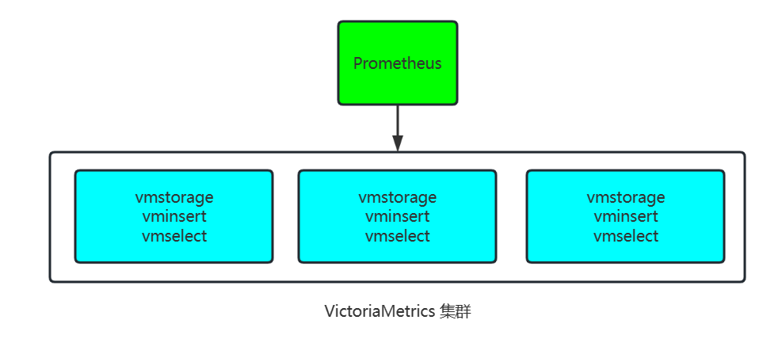

10.2.5.2.1 下载集群二进制程序文件

在所有三个节点下载集群的二进制程序文件
```bash
[root@ubuntu2204 ~]#cd /usr/local/src
[root@ubuntu2204 src]#wget
https://github.com/VictoriaMetrics/VictoriaMetrics/releases/download/v1.112.0/victoria-metrics-linux-amd64-v1.112.0-cluster.tar.gz
[root@ubuntu2204 src]#wget
https://github.com/VictoriaMetrics/VictoriaMetrics/releases/download/v1.107.0/victoria-metrics-linux-amd64-v1.107.0-cluster.tar.gz
[root@ubuntu2204 src]#wget
https://github.com/VictoriaMetrics/VictoriaMetrics/releases/download/v1.82.1/victoria-metrics-linux-amd64-v1.82.1-cluster.tar.gz
[root@ubuntu2204 src]#tar tvf victoria-metrics-linux-amd64-v1.82.1-cluster.tar.gz
-rwxr-xr-x valyala/valyala 11964760 2022-10-14 15:32 vminsert-prod
-rwxr-xr-x valyala/valyala 13493976 2022-10-14 15:32 vmselect-prod
-rwxr-xr-x valyala/valyala 12269208 2022-10-14 15:32 vmstorage-prod
[root@ubuntu2204 src]#tar xf victoria-metrics-linux-amd64-v1.82.1-cluster.tar.gz -C
/usr/local/bin/
[root@ubuntu2204 src]#ls /usr/local/bin/
vminsert-prod  vmselect-prod  vmstorage-prod
```

10.2.3.2.2 配置和启动 vmstorage

在所有三个节点都部署 vmstorage
```ini
[root@ubuntu2204 ~]#mkdir -p  /data/vmstorage
#查看选项
[root@ubuntu2204 ~]#vmstorage-prod --help
#创建 service 文件
[root@ubuntu2204 ~]#cat > /lib/systemd/system/vmstorage.service <<EOF
[Unit]
Description=VictoriaMetrics Cluster Vmstorage
Documentation=https://docs.victoriametrics.com/Cluster-VictoriaMetrics.html
After=network.target
[Service]
Restart=on-failure
ExecStart=/usr/local/bin/vmstorage-prod  -httpListenAddr :8482 -vminsertAddr :8400 -
vmselectAddr :8401 -storageDataPath /data/vmstorage -loggerTimezone Asia/Shanghai
#ExecReload=/bin/kill -HUP \$MAINPID
LimitNOFILE=65535
[Install]
WantedBy=multi-user.target
EOF
#主要参数说明：
-loggerTimezone string
#Timezone to use for timestamps in logs. Timezone must be a valid IANA Time Zone. For
example: America/New_York, Europe/Berlin, Etc/GMT+3 or Local (default "UTC")
-httpListenAddr string
#Address to listen for http connections (default ":8482")
-vminsertAddr string
#TCP address to accept connections from vminsert services (default ":8400")
-vmselectAddr string
#TCP address to accept connections from vmselect services (default ":8401")
[root@ubuntu2204 ~]#systemctl daemon-reload;systemctl enable --now
vmstorage;systemctl status vmstorage
[root@ubuntu2204 ~]#ss -nltp |grep vmstorage
LISTEN 0  4096  0.0.0.0:8400       0.0.0.0:*    users:(("vmstorage-
prod",pid=2415,fd=10))
LISTEN 0  4096  0.0.0.0:8401       0.0.0.0:*    users:(("vmstorage-
prod",pid=2415,fd=11))
LISTEN 0  4096  0.0.0.0:8482       0.0.0.0:*    users:(("vmstorage-
prod",pid=2415,fd=12))
[root@ubuntu2204 ~]#pstree -p |grep vmstorage-prod
            `-vmstorage-prod(2415)-+-{vmstorage-prod}(2416)
                                  |-{vmstorage-prod}(2417)
                                  |-{vmstorage-prod}(2418)
                                  |-{vmstorage-prod}(2419)
                                  |-{vmstorage-prod}(2420)
                        `-{vmstorage-prod}(2421)
[root@ubuntu2204 ~]#ls /data/vmstorage/
data  flock.lock  indexdb  metadata  snapshots
#测试访问
http://10.0.0.201:8482/metrics
http://10.0.0.202:8482/metrics
http://10.0.0.203:8482/metrics
```

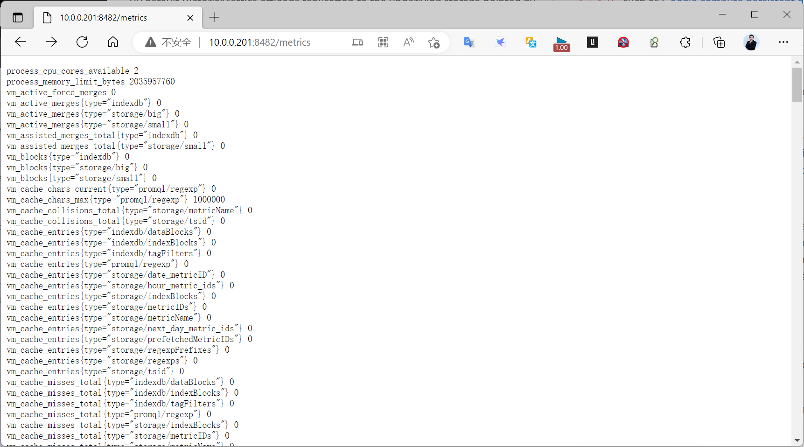

10.2.3.2.3 配置和启动 vminsert

在所有三个节点部署 vminsert
```ini
#查看选项
[root@ubuntu2204 ~]#vminsert-prod --help
[root@ubuntu2204 ~]#cat > /lib/systemd/system/vminsert.service <<EOF
[Unit]
Description=VictoriaMetrics Cluster Vminsert
Documentation=https://docs.victoriametrics.com/Cluster-VictoriaMetrics.html
After=network.target
[Service]
Restart=on-failure
ExecStart=/usr/local/bin/vminsert-prod -httpListenAddr :8480 -
storageNode=10.0.0.201:8400,10.0.0.202:8400,10.0.0.203:8400
#ExecReload=/bin/kill -HUP \$MAINPID
LimitNOFILE=65535
[Install]
WantedBy=multi-user.target
EOF
#主要参数说明：
-httpListenAddr string
#Address to listen for http connections (default ":8480")
-storageNode array
#Comma-separated addresses of vmstorage nodes; usage: -storageNode=vmstorage-
host1,...,vmstorage-hostN,Supports an array of values separated by comma or specified
via multiple flags.
-replicationFactor int
#此选项可以实现多副本,实现数据高用性
#Replication factor for the ingested data, i.e. how many copies to make among
distinct -storageNode instances. Note that vmselect must run with -
dedup.minScrapeInterval=1ms for data de-duplication when replicationFactor is greater
than 1. Higher values for -dedup.minScrapeInterval at vmselect is OK (default 1)
https://docs.victoriametrics.com/Cluster-VictoriaMetrics.html#replication-and-data-safety
[root@ubuntu2204 ~]#systemctl daemon-reload;systemctl enable --now  vminsert
[root@ubuntu2204 ~]#systemctl status vminsert
[root@ubuntu2204 ~]#ss -nltp |grep vminsert
LISTEN 0  4096  0.0.0.0:8480       0.0.0.0:*    users:
(("vminsert-prod",pid=2182,fd=3))
[root@ubuntu2204 ~]#pstree -p |grep vminsert-prod
           |-vminsert-prod(2182)-+-{vminsert-prod}(2183)
           |                     |-{vminsert-prod}(2184)
           |                     |-{vminsert-prod}(2185)
           |                     |-{vminsert-prod}(2186)
           |                     |-{vminsert-prod}(2187)
           |                     |-{vminsert-prod}(2188)
           |                     `-{vminsert-prod}(2189)
#测试访问
http://10.0.0.201:8480/metrics
http://10.0.0.202:8480/metrics
http://10.0.0.203:8480/metrics
```

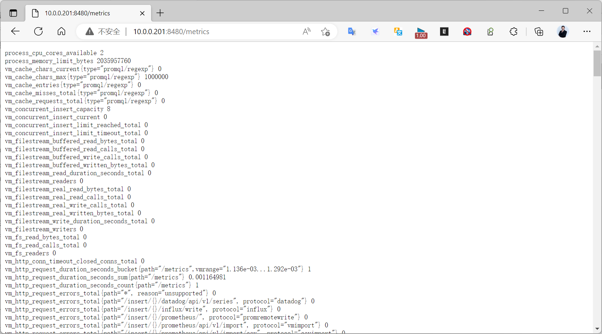

10.2.3.2.4 配置和启动 vmselect

在所有三个节点部署 vmselect
```ini
#查看选项
[root@ubuntu2204 ~]#vmselect-prod --help
[root@ubuntu2204 ~]#cat > /lib/systemd/system/vmselect.service <<EOF
[Unit]
Description=VictoriaMetrics Cluster Vmselect
Documentation=https://docs.victoriametrics.com/Cluster-VictoriaMetrics.html
After=network.target
[Service]
Restart=on-failure
ExecStart=/usr/local/bin/vmselect-prod  -httpListenAddr :8481 -
storageNode=10.0.0.201:8401,10.0.0.202:8401,10.0.0.203:8401
#ExecReload=/bin/kill -HUP \$MAINPID
LimitNOFILE=65535
[Install]
WantedBy=multi-user.target
EOF
#主要参数说明：
-httpListenAddr string
#Address to listen for http connections (default ":8481")
-storageNode array
#Comma-separated addresses of vmstorage nodes; usage: -storageNode=vmstorage-
host1,...,vmstorage-hostN,Supports an array of values separated by comma or specified
via multiple flags.
[root@ubuntu2204 ~]#systemctl daemon-reload;systemctl enable --now  vmselect
[root@ubuntu2204 ~]#systemctl status vmselect
[root@ubuntu2204 ~]#ss -nltp |grep vmselect
LISTEN 0  4096  0.0.0.0:8481       0.0.0.0:*    users:(("vmselect-
prod",pid=2592,fd=9))
[root@ubuntu2204 ~]#pstree -p |grep vmselect-prod
           |-vmselect-prod(2592)-+-{vmselect-prod}(2593)
           |                     |-{vmselect-prod}(2594)
           |                     |-{vmselect-prod}(2595)
           |                     |-{vmselect-prod}(2596)
           |                     |-{vmselect-prod}(2597)
           |                     |-{vmselect-prod}(2598)
           |                     `-{vmselect-prod}(2599)
#查看端口
[root@ubuntu2204 ~]#ss -ntl|grep 84
LISTEN 0  4096  0.0.0.0:8480       0.0.0.0:*
LISTEN 0  4096  0.0.0.0:8481       0.0.0.0:*
LISTEN 0  4096  0.0.0.0:8482       0.0.0.0:*
LISTEN 0  4096  0.0.0.0:8400       0.0.0.0:*
LISTEN 0  4096  0.0.0.0:8401       0.0.0.0:*
#测试访问
http://10.0.0.201:8481/metrics
http://10.0.0.202:8481/metrics
http://10.0.0.203:8481/metrics
```

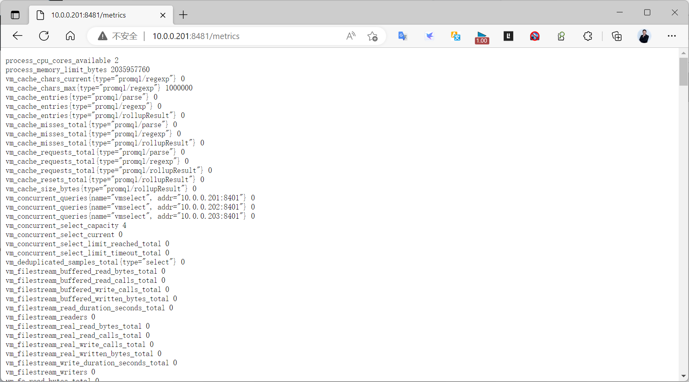

10.2.3.2.5 配置 Prometheus 使用 victoriametrics 实现集群存储
```yaml
[root@ubuntu2204 ~]#vim /usr/local/prometheus/conf/prometheus.yml
# my global config
global:
  scrape_interval: 15s # Set the scrape interval to every 15 seconds. Default is
every 1 minute.
  evaluation_interval: 15s # Evaluate rules every 15 seconds. The default is every 1
minute.
  # scrape_timeout is set to the global default (10s).
#加下面集群地址的行
remote_write:
  - url: http://10.0.0.201:8480/insert/0/prometheus
  - url: http://10.0.0.202:8480/insert/0/prometheus
  - url: http://10.0.0.203:8480/insert/0/prometheus
remote_read:
  - url: http://10.0.0.201:8481/select/0/prometheus
  - url: http://10.0.0.202:8481/select/0/prometheus
  - url: http://10.0.0.203:8481/select/0/prometheus
#说明
10.0.0.20[1-3]:8480为 三个集群节点的IP和vminsert组件端口
0表示租户ID,即逻辑名称空间,用于区分不同的prometheus集群
[root@ubuntu2204 ~]#systemctl resload prometheus.service
```

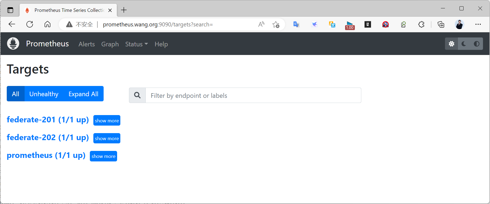

10.2.3.2.6 Grafana 展示

在Grafana 添加新的数据源,类型为 Prometheus,URL为 victoriametrics 任意集群节点的的地址和vmselect端口,如下填写
```text
http://10.0.0.201:8481/select/0/prometheus
#0表示租户ID
```

也可以使用负载均衡的VIP和端口,以Haproxy为例,如下配置
```text
vim /etc/haproxy/haproxy.cfg
......
listen victoriametrics-vmselect-8481
    bind 10.0.0.200:8481
    mode tcp
    server vmselect1 10.0.0.201:8481 check inter 1s fall 3 rise 5
    server vmselect2 10.0.0.202:8481 check inter 1s fall 3 rise 5
    server vmselect3 10.0.0.203:8481 check inter 1s fall 3 rise 5
......
#URL填写下面VIP地址和端口
http://10.0.0.200:8481/select/0/prometheus
```

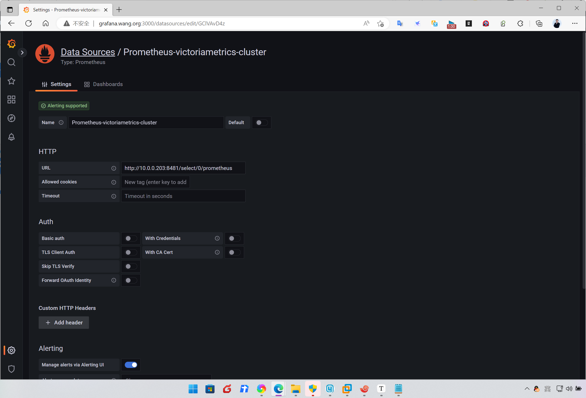

导入模板 8919或11074或13824,指定使用上面创建的数据源, 注意: 如果以前存在,先删除模板再导入

模板8919显示如下

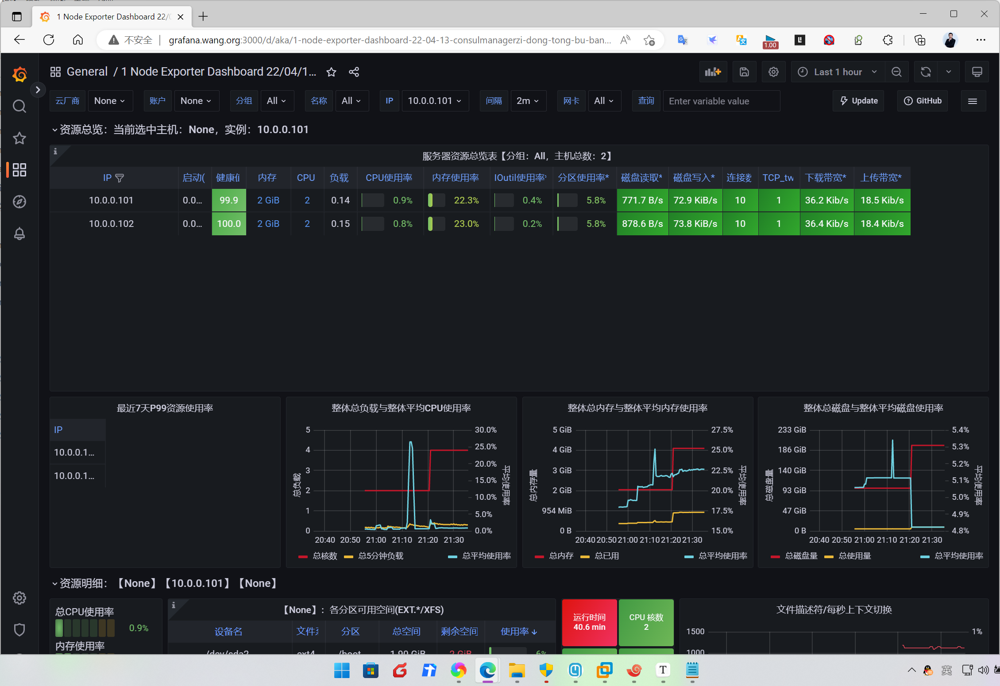

模板11074显示如下

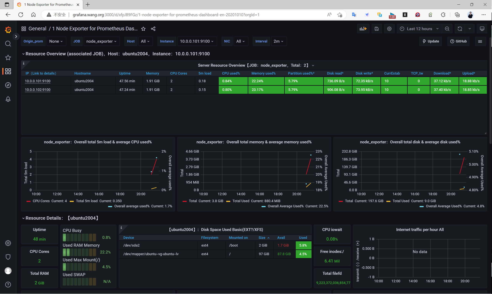

模板13824显示如下

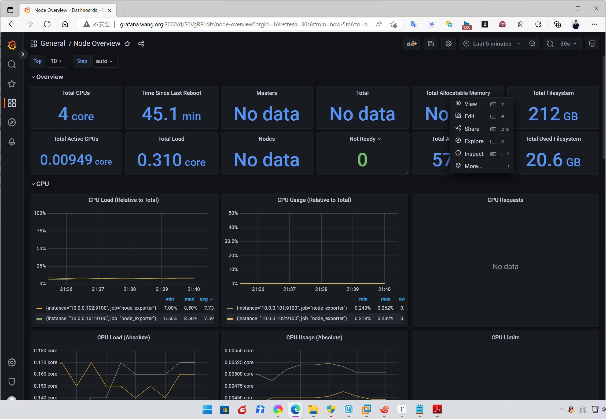

#### 10.2.3.3 VictoriaMetrics 集群基于 docker compose 部署集群
```text
#集群版
https://github.com/VictoriaMetrics/VictoriaMetrics/blob/cluster/deployment/docker/docker-compose-cluster.yml
```

10.2.3.3.1 docker-compose 文件
```bash
#docker-compose.yml文件
version: '3.6'
networks:
  vm_net:
    driver: bridge
volumes:
  strgdata-1: {}
  strgdata-2: {}
  grafanadata: {}
services:
  vmstorage-1:
    container_name: vmstorage-1
    image: victoriametrics/vmstorage:v1.83.1-cluster
    ports:
      - 8482
      - 8400
      - 8401
    volumes:
      - strgdata-1:/storage
    networks:
      - vm_net
    command:
      - '--storageDataPath=/storage'
    restart: always
  vmstorage-2:
    container_name: vmstorage-2
    image: victoriametrics/vmstorage:v1.83.1-cluster
    networks:
      - vm_net
    ports:
      - 8482
      - 8400
      - 8401
    volumes:
      - strgdata-2:/storage
    command:
      - '--storageDataPath=/storage'
    restart: always
  vminsert:
    container_name: vminsert
    image: victoriametrics/vminsert:v1.83.1-cluster
    depends_on:
      - "vmstorage-1"
      - "vmstorage-2"
    command:
      - '--storageNode=vmstorage-1:8400'
      - '--storageNode=vmstorage-2:8400'
    ports:
      - 8480:8480
    networks:
      - vm_net
    restart: always
  vmselect:
    container_name: vmselect
    image: victoriametrics/vmselect:v1.83.1-cluster
    depends_on:
      - "vmstorage-1"
      - "vmstorage-2"
    command:
      - '--storageNode=vmstorage-1:8401'
      - '--storageNode=vmstorage-2:8401'
      #- '--vmalert.proxyURL=http://vmalert:8880'
    networks:
      - vm_net
    ports:
      - 8481:8481
    restart: always
```

10.2.3.3.2 配置 Prometheus 使用 victoriametrics 远程存储
```yaml
[root@ubuntu2204 ~]#vim /usr/local/prometheus/conf/prometheus.yml
global:
  scrape_interval: 15s # Set the scrape interval to every 15 seconds. Default is
every 1 minute.
  evaluation_interval: 15s # Evaluate rules every 15 seconds. The default is every 1
minute.
  # scrape_timeout is set to the global default (10s).
#添加下面行
remote_write:    # 远程写入到远程 VM 存储
  - url: http://vminsert.bowen.org:8480/insert/0/prometheus
remote_read:
  - url: http://vmselect.bowen.org:8481/select/0/prometheus
#说明：其中的0为多租户模型下的租户ID
[root@ubuntu2204 ~]#systemctl resload prometheus.service
```

10.2.3.3.3 配置 Grafana 使用 victoriametrics 数据源

添加Prometheus类型的新数据源victoriametrics

将数据加载路径定义为：
http://vmselect.bowen.org:8481/select/0/prometheus

导入编号为1860 即Node Exporter Full 的Dashboard

指定使用上面创建的数据源

即可在Grafana中查看基于该数据源的Dashboard

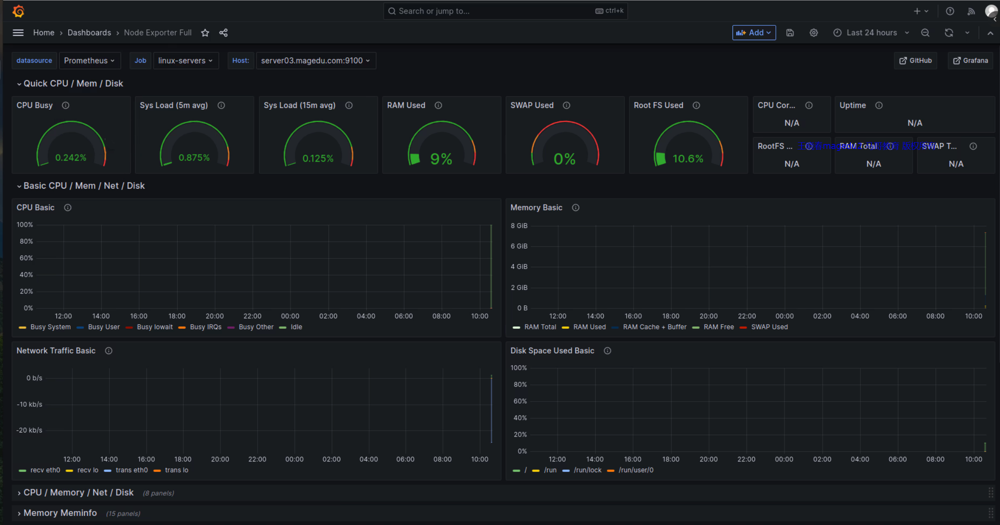



<nav class="article-end" aria-label="章节导航">
  <a href="{{ '/subjects/Prometheus/28-local-storage.html' | relative_url }}">← 上一章：Prometheus 本地存储</a>
  <a href="{{ '/subjects/Prometheus/' | relative_url }}">返回 Prometheus 目录</a>
  <a href="{{ '/subjects/Prometheus/30-kubernetes-yaml-deployment.html' | relative_url }}">下一章：Kubernetes YAML 部署 →</a>
</nav>
