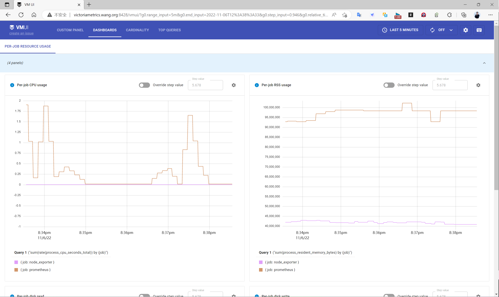
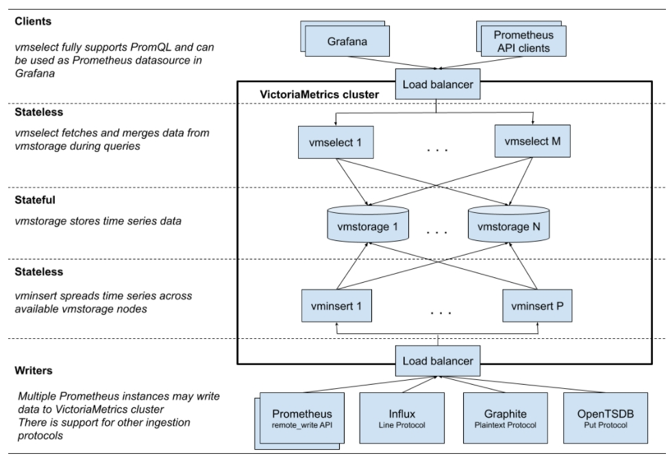

[← 返回 Prometheus 目录]({{ '/subjects/Prometheus/' | relative_url }})



# 29 VictoriaMetrics 远程存储

Prometheus 的本地 TSDB 适合单实例采集、查询与短中期留存。需要跨实例汇总、延长保留期或独立扩展存储时，可以通过 `remote_write` 将样本发送到 VictoriaMetrics（下文简称 VM）。**远程写入并不会自动让 Prometheus 自身高可用**：采集、告警和查询各有独立的可用性设计。

## 29.1 选型与组件

VM 单机版把写入、查询和持久化放在一个进程中，部署最简单；集群版将它们拆成 `vminsert`、`vmselect`、`vmstorage`，可分别扩容。选型不要只凭一个“每秒数据点”阈值，要结合活跃序列数、写入速率、查询范围、保留期和故障恢复要求压测。单机版也可以配合 Prometheus Alertmanager 或 VM 的 `vmalert` 实现告警，告警不是集群版独有功能。

VM 支持 Prometheus 查询 API，Grafana 可将它配置为 **Prometheus 类型数据源**。它还提供 MetricsQL；虽然多数 PromQL 表达式可沿用，迁移前仍要测试关键查询和告警。与 Thanos 等方案的选择取决于存储介质、对象存储依赖和运维模型，不能凭没有限定条件的性能倍数比较。


## 29.2 单机部署

### 二进制与 systemd

从 [官方 Releases](https://github.com/VictoriaMetrics/VictoriaMetrics/releases) 下载适合当前架构的**同一版本**单机归档。下面以 `v1.112.0` 的 Linux amd64 包为例；升级时要核对下载地址和版本说明。

```bash
VM_VERSION=v1.112.0
curl -fL -o victoria-metrics.tar.gz \
  "https://github.com/VictoriaMetrics/VictoriaMetrics/releases/download/${VM_VERSION}/victoria-metrics-linux-amd64-${VM_VERSION}.tar.gz"
tar -xzf victoria-metrics.tar.gz victoria-metrics-prod
sudo install -m 0755 victoria-metrics-prod /usr/local/bin/victoria-metrics-prod
sudo useradd --system --no-create-home --shell /usr/sbin/nologin victoriametrics
sudo install -d -o victoriametrics -g victoriametrics /data/victoriametrics
```

已有用户时跳过 `useradd`。创建 `/etc/systemd/system/victoriametrics.service`：

```ini
[Unit]
Description=VictoriaMetrics single-node
After=network-online.target
Wants=network-online.target

[Service]
User=victoriametrics
Group=victoriametrics
ExecStart=/usr/local/bin/victoria-metrics-prod -httpListenAddr=:8428 -storageDataPath=/data/victoriametrics -retentionPeriod=12
Restart=on-failure
LimitNOFILE=65535

[Install]
WantedBy=multi-user.target
```

这里的 `-retentionPeriod=12` 表示 12 个月，也可以按照部署版本写明确单位。不要把 `ExecStart` 中的选项从中间换行。启动并检查：

```bash
sudo systemctl daemon-reload
sudo systemctl enable --now victoriametrics
systemctl status victoriametrics
curl -fsS http://127.0.0.1:8428/health
```

生产环境还要限制 `8428` 的访问、监控磁盘容量并备份数据；不要直接把写入接口暴露到公网。

### Prometheus 写入与 Grafana 查询

在 Prometheus 的 `prometheus.yml` 顶层（与 `global` 同级）配置：

```yaml
global:
  scrape_interval: 15s
  evaluation_interval: 15s

remote_write:
  - url: http://VM_HOST:8428/api/v1/write
```

将 `VM_HOST` 换成实际地址。先运行 `promtool check config /path/to/prometheus.yml`，再执行 `systemctl restart prometheus`；原文的 `systemctl resload` 不是有效子命令。通过 Prometheus 的 `prometheus_remote_storage_samples_pending`、VM 的 `/metrics` 与 VMUI `http://VM_HOST:8428/vmui` 交叉确认写入。Prometheus 仅在自己还需直接读取远端历史时才配置 `remote_read`；Grafana 直接查询 VM 时不需要它。Grafana 数据源选 **Prometheus**，URL 填 `http://VM_HOST:8428`，先查询 `up`，再导入与现有指标匹配的仪表盘。



### Docker 与 Compose

容器必须挂载持久化卷，否则删除容器可能丢失数据：

```bash
docker run -d --name victoriametrics --restart unless-stopped \
  -p 8428:8428 -v vmdata:/storage \
  victoriametrics/victoria-metrics:v1.112.0 \
  -storageDataPath=/storage -retentionPeriod=12
curl -fsS http://127.0.0.1:8428/health
```

最小 `compose.yaml` 不必照搬官方示例中的 vmagent、vmalert、Alertmanager 和 Grafana；明确采集与告警需求后再加入：

```yaml
services:
  victoriametrics:
    image: victoriametrics/victoria-metrics:v1.112.0
    command: ["-storageDataPath=/storage", "-retentionPeriod=12"]
    ports: ["8428:8428"]
    volumes: ["vmdata:/storage"]
    restart: unless-stopped

volumes:
  vmdata:
```

运行 `docker compose config`、`docker compose up -d`、`docker compose ps`。单宿主机上的 Compose 项目仍有宿主机单点，不能等同于多主机高可用。

## 29.3 集群部署



| 组件 | 默认 HTTP 端口 | 职责 |
| --- | --- | --- |
| `vminsert` | `8480` | 接收远程写入，并把样本分发到存储节点 |
| `vmselect` | `8481` | 聚合各存储节点的查询结果，对外提供查询 API |
| `vmstorage` | `8482` | 保存数据；另用 `8400` 接收写入、`8401` 响应查询 |
| `vmagent`（可选） | `8429` | 抓取、转发与临时缓冲样本 |
| `vmalert`（可选） | `8880` | 执行规则并通知 Alertmanager |

`vminsert` 和 `vmselect` 可水平复制并放在负载均衡器后；`vmstorage` 是有状态节点，必须规划持久化、备份和容量。**分片不等于副本**：默认分片方案在一个存储节点故障时，相关历史数据会不可用。若要副本容错，应配置 `vminsert` 的 `-replicationFactor`、`vmselect` 的去重策略，并按节点数规划容量；具体参数以部署版本的 [集群文档](https://docs.victoriametrics.com/Cluster-VictoriaMetrics.html) 为准。

租户 ID 位于 URL 中。以租户 `0` 为例：

```text
写入：http://VMINSERT_LB:8480/insert/0/prometheus/api/v1/write
查询：http://VMSELECT_LB:8481/select/0/prometheus
```

Grafana 会在查询根路径后追加 `/api/v1/query` 等 API。`VMINSERT_LB`、`VMSELECT_LB` 分别代表各自的负载均衡入口，**不要**把所有节点分别写成多个 Prometheus `remote_write`/`remote_read` 项：多个 `remote_write` 目标会重复发送数据，多个 `remote_read` 目标会制造重复读取。

### 三节点二进制部署思路

在三台机器安装**同一版本**集群包中的 `vmstorage-prod`、`vminsert-prod`、`vmselect-prod`。以下是以 `10.0.0.201`、`.202`、`.203` 为示例的三个 systemd unit 的 `ExecStart` 片段，每台机器都使用相同的存储节点列表：

```ini
# vmstorage.service：每台机器运行，数据目录须持久化
ExecStart=/usr/local/bin/vmstorage-prod -httpListenAddr=:8482 -vminsertAddr=:8400 -vmselectAddr=:8401 -storageDataPath=/data/vmstorage

# vminsert.service：可在三台机器运行
ExecStart=/usr/local/bin/vminsert-prod -httpListenAddr=:8480 -storageNode=10.0.0.201:8400,10.0.0.202:8400,10.0.0.203:8400

# vmselect.service：可在三台机器运行
ExecStart=/usr/local/bin/vmselect-prod -httpListenAddr=:8481 -storageNode=10.0.0.201:8401,10.0.0.202:8401,10.0.0.203:8401
```

这些是三个**独立 unit 的片段**，还需各自编写 `[Unit]`、`[Service]`、`[Install]`，配置运行用户、重启策略和 `LimitNOFILE`，并赋予 `vmstorage` 数据目录权限。执行 `systemctl daemon-reload`、`systemctl enable --now vmstorage vminsert vmselect` 后，分别检查 `/health` 和 `/metrics`。只允许受信任的节点访问 `8400/8401`。

Prometheus 只向写入入口发送一次：

```yaml
remote_write:
  - url: http://VMINSERT_LB:8480/insert/0/prometheus/api/v1/write
```

Grafana 的 Prometheus 数据源填 `http://VMSELECT_LB:8481/select/0/prometheus`。查询 `up` 并在不同 `vmselect` 节点复核；启用副本时还应进行单节点失效及恢复演练。

### Compose 学习环境

下面的两个存储分片在**同一宿主机**，用于理解组件交互，不代表多主机容灾。真正的高可用应把有状态节点分布在不同故障域。

```yaml
services:
  vmstorage-1:
    image: victoriametrics/vmstorage:v1.112.0-cluster
    command: ["-storageDataPath=/storage"]
    volumes: ["storage1:/storage"]
    restart: unless-stopped
  vmstorage-2:
    image: victoriametrics/vmstorage:v1.112.0-cluster
    command: ["-storageDataPath=/storage"]
    volumes: ["storage2:/storage"]
    restart: unless-stopped
  vminsert:
    image: victoriametrics/vminsert:v1.112.0-cluster
    command: ["-storageNode=vmstorage-1:8400,vmstorage-2:8400"]
    ports: ["8480:8480"]
    depends_on: [vmstorage-1, vmstorage-2]
    restart: unless-stopped
  vmselect:
    image: victoriametrics/vmselect:v1.112.0-cluster
    command: ["-storageNode=vmstorage-1:8401,vmstorage-2:8401"]
    ports: ["8481:8481"]
    depends_on: [vmstorage-1, vmstorage-2]
    restart: unless-stopped

volumes:
  storage1:
  storage2:
```

先运行 `docker compose config` 检查，再 `docker compose up -d`。`depends_on` 只控制启动顺序，不保证服务就绪；应检查两个 HTTP 入口的 `/health`。`docker compose down` 不删除命名卷，而 `down -v` 会删除示例数据卷。

## 29.4 按数据路径排查

1. **没有新数据**：先看 Prometheus Targets，再查 `prometheus_remote_storage_samples_pending`、远程写入失败指标及 `vminsert`/单机 VM 日志。
2. **写入正常而 Grafana 为空**：核对数据源 URL 的租户 ID、时间范围、标签和查询表达式；再查 `vmselect` 至各 `vmstorage:8401` 的连接。
3. **磁盘增长异常**：核对保留期、活跃序列、高基数标签和副本系数；不要在未备份时清理 `storageDataPath`。
4. **节点故障后缺历史数据**：确认是否只做分片而未配置副本，恢复服务后验证数据完整性，再调整备份与副本策略。

沿“采集 → 写入 → 存储 → 查询 → 展示”排查，比在空仪表盘上反复更换模板有效。



<nav class="article-end" aria-label="章节导航">
  <a href="{{ '/subjects/Prometheus/28-local-storage.html' | relative_url }}">← 上一章：Prometheus 本地存储</a>
  <a href="{{ '/subjects/Prometheus/' | relative_url }}">返回 Prometheus 目录</a>
  <a href="{{ '/subjects/Prometheus/30-kubernetes-yaml-deployment.html' | relative_url }}">下一章：Kubernetes YAML 部署 →</a>
</nav>
