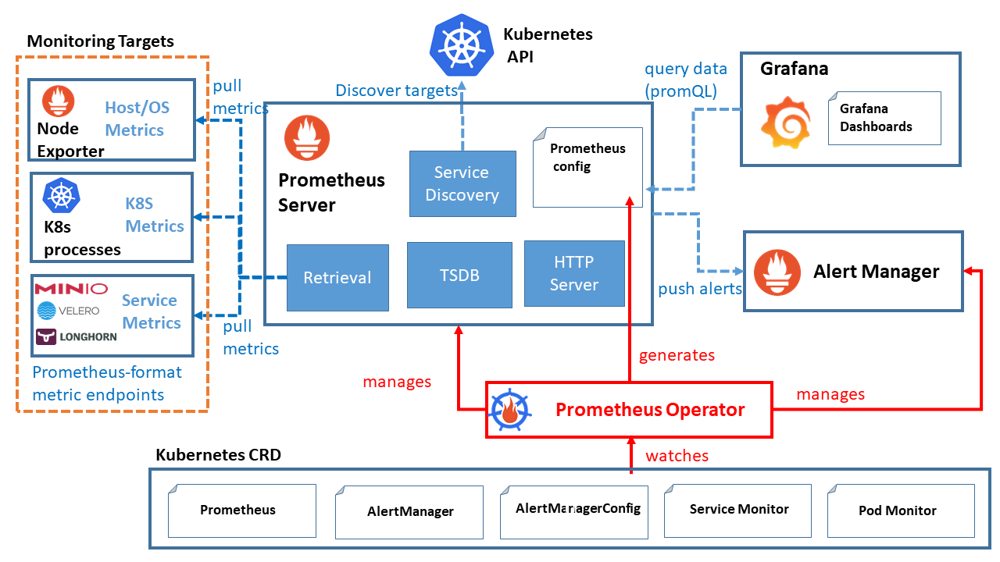

[← 返回 Prometheus 目录]({{ '/subjects/Prometheus/' | relative_url }})



# 30 Kubernetes YAML 部署

Kubernetes 中可用原生 YAML、Helm Chart 或 Prometheus Operator 部署 Prometheus。本章用原生 YAML 解释服务发现、RBAC、配置、持久化与访问入口的关系，下一章再介绍 Helm。原笔记的 Istio 附带清单是特定版本的 Helm 渲染结果，而另一个示例包含不正确的缩进、已过时的 Kubernetes 说明和 `emptyDir` 数据卷；它们不能混合复制成一个可运行的配置。



## 30.1 部署边界

示例在 `monitoring` 命名空间运行一个 Prometheus 副本，抓取自身和明确标注 `prometheus.io/scrape: "true"` 的 Pod。单副本便于学习，但不是高可用。生产环境还需按集群版本选择镜像、规划存储/备份、告警、访问控制和必要时的远程写入。节点、API Server、cAdvisor 指标有各自的 TLS、RBAC 与端点要求，基础链路跑通后再分别增加。

## 30.2 命名空间及发现权限

保存为 `01-rbac.yaml`。跨命名空间发现 Pod 需要 ClusterRole；若只监控一个命名空间，可改为 Role/RoleBinding。

```yaml
apiVersion: v1
kind: Namespace
metadata:
  name: monitoring
---
apiVersion: v1
kind: ServiceAccount
metadata:
  name: prometheus
  namespace: monitoring
---
apiVersion: rbac.authorization.k8s.io/v1
kind: ClusterRole
metadata:
  name: prometheus-discovery
rules:
  - apiGroups: [""]
    resources: ["pods"]
    verbs: ["get", "list", "watch"]
---
apiVersion: rbac.authorization.k8s.io/v1
kind: ClusterRoleBinding
metadata:
  name: prometheus-discovery
roleRef:
  apiGroup: rbac.authorization.k8s.io
  kind: ClusterRole
  name: prometheus-discovery
subjects:
  - kind: ServiceAccount
    name: prometheus
    namespace: monitoring
```

## 30.3 抓取配置

保存为 `02-config.yaml`。先发现 Pod，再只保留显式开启抓取的目标；Pod annotation 决定指标路径与端口。应用须实际在相应端口提供 `/metrics`。

```yaml
apiVersion: v1
kind: ConfigMap
metadata:
  name: prometheus-config
  namespace: monitoring
data:
  prometheus.yml: |
    global:
      scrape_interval: 15s
      evaluation_interval: 15s
    scrape_configs:
      - job_name: prometheus
        static_configs:
          - targets: ["localhost:9090"]
      - job_name: kubernetes-pods
        kubernetes_sd_configs:
          - role: pod
        relabel_configs:
          - source_labels: [__meta_kubernetes_pod_annotation_prometheus_io_scrape]
            action: keep
            regex: "true"
          - source_labels: [__meta_kubernetes_pod_annotation_prometheus_io_path]
            action: replace
            target_label: __metrics_path__
            regex: (.+)
          - source_labels: [__address__, __meta_kubernetes_pod_annotation_prometheus_io_port]
            action: replace
            target_label: __address__
            regex: ([^:]+)(?::\d+)?;(\d+)
            replacement: $1:$2
          - source_labels: [__meta_kubernetes_namespace]
            target_label: namespace
          - source_labels: [__meta_kubernetes_pod_name]
            target_label: pod
```

应用 Pod 的 metadata 可加：

```yaml
annotations:
  prometheus.io/scrape: "true"
  prometheus.io/path: "/metrics"
  prometheus.io/port: "8080"
```

原示例中的 `kube_node_status_condition` 等规则依赖 **kube-state-metrics**，容器和卷指标又依赖 kubelet/cAdvisor；部署 Prometheus 本身不会凭空产生这些指标。应先部署对应 exporter、确认指标名与标签，再添加规则。规则也不会自行发送通知，仍需配置 Alertmanager。

## 30.4 持久化、Deployment 和 Service

保存为 `03-server.yaml`。PVC 使用集群默认 StorageClass；没有默认类时须选择适用的 `storageClassName`。单副本使用 `Recreate`，避免新旧 Pod 争用一个 ReadWriteOnce 卷。

```yaml
apiVersion: v1
kind: PersistentVolumeClaim
metadata:
  name: prometheus-data
  namespace: monitoring
spec:
  accessModes: ["ReadWriteOnce"]
  resources:
    requests:
      storage: 20Gi
---
apiVersion: apps/v1
kind: Deployment
metadata:
  name: prometheus
  namespace: monitoring
spec:
  replicas: 1
  strategy:
    type: Recreate
  selector:
    matchLabels:
      app: prometheus
  template:
    metadata:
      labels:
        app: prometheus
    spec:
      serviceAccountName: prometheus
      securityContext:
        fsGroup: 65534
      containers:
        - name: prometheus
          image: prom/prometheus:v2.48.0
          args:
            - --config.file=/etc/prometheus/prometheus.yml
            - --storage.tsdb.path=/prometheus
            - --storage.tsdb.retention.time=15d
          ports:
            - name: web
              containerPort: 9090
          readinessProbe:
            httpGet:
              path: /-/ready
              port: web
            periodSeconds: 5
          livenessProbe:
            httpGet:
              path: /-/healthy
              port: web
            periodSeconds: 15
          resources:
            requests:
              cpu: 100m
              memory: 512Mi
            limits:
              memory: 2Gi
          volumeMounts:
            - name: config
              mountPath: /etc/prometheus/prometheus.yml
              subPath: prometheus.yml
              readOnly: true
            - name: data
              mountPath: /prometheus
      volumes:
        - name: config
          configMap:
            name: prometheus-config
        - name: data
          persistentVolumeClaim:
            claimName: prometheus-data
---
apiVersion: v1
kind: Service
metadata:
  name: prometheus
  namespace: monitoring
spec:
  type: ClusterIP
  selector:
    app: prometheus
  ports:
    - name: web
      port: 9090
      targetPort: web
```

`fsGroup` 的效果取决于存储驱动；遇到写入权限错误，应检查 PVC 的权限而非改用 `emptyDir` 掩盖问题。这里没有开启 `--web.enable-lifecycle`，而且 `subPath` 配置挂载不会自动更新；修改 ConfigMap 后须重启 Deployment。

## 30.5 校验与访问

```bash
kubectl apply --dry-run=client -f 01-rbac.yaml -f 02-config.yaml -f 03-server.yaml
kubectl apply -f 01-rbac.yaml -f 02-config.yaml -f 03-server.yaml
kubectl -n monitoring rollout status deployment/prometheus
kubectl -n monitoring get pods,pvc,svc
kubectl auth can-i list pods --as=system:serviceaccount:monitoring:prometheus --all-namespaces
kubectl -n monitoring port-forward svc/prometheus 9090:9090
```

打开 `http://127.0.0.1:9090/targets`，先确认自身为 UP，再部署带 annotation 的应用并检查目标。配置更新后执行 `kubectl -n monitoring rollout restart deployment/prometheus`。Pod 未就绪时，按 PVC 绑定、容器日志、ConfigMap 挂载、RBAC 和目标端点的顺序排查。

ClusterIP 不直接暴露公网；开发时使用 port-forward 即可。若需 Ingress，先准备 Ingress Controller，再为管理 UI 配置域名、TLS 和认证。原例把 UI 直接放在 NodePort/Ingress 且未配置认证，不适合原样使用。

## 30.6 扩展采集与高可用

- **API Server**：使用集群服务发现、ServiceAccount token 与集群 CA，核对当前版本的端点角色和权限。
- **节点/cAdvisor**：抓取 kubelet `/metrics` 和 `/metrics/cadvisor` 或 API Server 代理，分别核对证书与 `nodes/proxy` 权限；不要为了绕开证书问题直接关闭校验。
- **Service 与 Pod**：避免同一端点被两条发现任务重复抓取。需要 Service annotation 时，单独建立相应的发现任务。
- **告警**：在 kube-state-metrics 等指标确实存在后添加规则，并验证 Alertmanager 通知链路。
- **多副本**：每个 Prometheus 副本需要独立的 TSDB 数据卷；不能让两个副本共享一个 RWO PVC。长期统一查询可再引入远程存储或聚合方案。

这样先把“发现 → 抓取 → 存储 → 查询”走通，再比较 Helm 和 Operator，比直接复制特定 Istio 版本的渲染清单更容易定位问题。



<nav class="article-end" aria-label="章节导航">
  <a href="{{ '/subjects/Prometheus/29-victoriametrics.html' | relative_url }}">← 上一章：VictoriaMetrics 远程存储</a>
  <a href="{{ '/subjects/Prometheus/' | relative_url }}">返回 Prometheus 目录</a>
  <a href="{{ '/subjects/Prometheus/31-kubernetes-helm.html' | relative_url }}">下一章：Kubernetes Helm 部署 →</a>
</nav>
