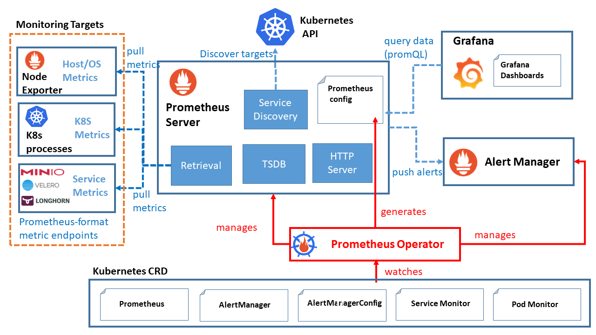

[← 返回 Prometheus 目录]({{ '/subjects/Prometheus/' | relative_url }})



# 30 Kubernetes YAML 部署

# 11 Kubernetes 集成 Prometheus



## 11.1 部署 Prometheus

在Kubernetes中部署 Prometheus 有多种方法

YAML文件
Operator  
Helm  

### 11.1.1 基于 YAML 文件部署 Prometheus

#### 11.1.1.1 范例1：结合 Istio 部署 Prometheus
```bash
[root@master1 ~]#cat /usr/local/istio/samples/addons/prometheus.yaml
```

```yaml
---
# Source: prometheus/templates/serviceaccount.yaml
apiVersion: v1
kind: ServiceAccount
metadata:
  labels:
    app.kubernetes.io/component: server
    app.kubernetes.io/name: prometheus
    app.kubernetes.io/instance: prometheus
    app.kubernetes.io/version: v2.48.0
    helm.sh/chart: prometheus-25.8.0
    app.kubernetes.io/managed-by: Helm
    app.kubernetes.io/part-of: prometheus
  name: prometheus
  namespace: istio-system
  annotations:
    {}
```

```yaml
---
# Source: prometheus/templates/cm.yaml
apiVersion: v1
kind: ConfigMap
metadata:
  labels:
    app.kubernetes.io/component: server
    app.kubernetes.io/name: prometheus
    app.kubernetes.io/instance: prometheus
    app.kubernetes.io/version: v2.48.0
    helm.sh/chart: prometheus-25.8.0
    app.kubernetes.io/managed-by: Helm
    app.kubernetes.io/part-of: prometheus
  name: prometheus
  namespace: istio-system
data:
  allow-snippet-annotations: "false"
  alerting_rules.yml: |
    {}
  alerts: |
    {}
  prometheus.yml: |
    global:
      evaluation_interval: 1m
      scrape_interval: 15s
      scrape_timeout: 10s
    rule_files:
    - /etc/config/recording_rules.yml
    - /etc/config/alerting_rules.yml
    - /etc/config/rules
    - /etc/config/alerts
    scrape_configs:
    - job_name: prometheus
      static_configs:
      - targets:
         - localhost:9090
    - bearer_token_file: /var/run/secrets/kubernetes.io/serviceaccount/token
      job_name: kubernetes-apiservers
      kubernetes_sd_configs:
      - role: endpoints
      relabel_configs:
      - action: keep
        regex: default;kubernetes;https
        source_labels:
         - __meta_kubernetes_namespace
         - __meta_kubernetes_service_name
         - __meta_kubernetes_endpoint_port_name
      scheme: https
      tls_config:
        ca_file: /var/run/secrets/kubernetes.io/serviceaccount/ca.crt
        insecure_skip_verify: true
    - bearer_token_file: /var/run/secrets/kubernetes.io/serviceaccount/token
      job_name: kubernetes-nodes
      kubernetes_sd_configs:
      - role: node
      relabel_configs:
      - action: labelmap
        regex: __meta_kubernetes_node_label_(.+)
      - replacement: kubernetes.default.svc:443
        target_label: __address__
      - regex: (.+)
        replacement: /api/v1/nodes/$1/proxy/metrics
        source_labels:
         - __meta_kubernetes_node_name
        target_label: __metrics_path__
      scheme: https
      tls_config:
        ca_file: /var/run/secrets/kubernetes.io/serviceaccount/ca.crt
        insecure_skip_verify: true
    - bearer_token_file: /var/run/secrets/kubernetes.io/serviceaccount/token
      job_name: kubernetes-nodes-cadvisor
      kubernetes_sd_configs:
      - role: node
      relabel_configs:
      - action: labelmap
        regex: __meta_kubernetes_node_label_(.+)
      - replacement: kubernetes.default.svc:443
        target_label: __address__
      - regex: (.+)
        replacement: /api/v1/nodes/$1/proxy/metrics/cadvisor
        source_labels:
         - __meta_kubernetes_node_name
        target_label: __metrics_path__
      scheme: https
      tls_config:
        ca_file: /var/run/secrets/kubernetes.io/serviceaccount/ca.crt
        insecure_skip_verify: true
    - honor_labels: true
      job_name: kubernetes-service-endpoints
      kubernetes_sd_configs:
      - role: endpoints
      relabel_configs:
      - action: keep
        regex: true
        source_labels:
         - __meta_kubernetes_service_annotation_prometheus_io_scrape
      - action: drop
        regex: true
        source_labels:
         - __meta_kubernetes_service_annotation_prometheus_io_scrape_slow
      - action: replace
        regex: (https?)
        source_labels:
         - __meta_kubernetes_service_annotation_prometheus_io_scheme
        target_label: __scheme__
      - action: replace
        regex: (.+)
        source_labels:
         - __meta_kubernetes_service_annotation_prometheus_io_path
        target_label: __metrics_path__
      - action: replace
        regex: (.+?)(?::\d+)?;(\d+)
        replacement: $1:$2
        source_labels:
         - __address__
         - __meta_kubernetes_service_annotation_prometheus_io_port
        target_label: __address__
      - action: labelmap
        regex: __meta_kubernetes_service_annotation_prometheus_io_param_(.+)
        replacement: __param_$1
      - action: labelmap
        regex: __meta_kubernetes_service_label_(.+)
      - action: replace
        source_labels:
         - __meta_kubernetes_namespace
        target_label: namespace
      - action: replace
        source_labels:
         - __meta_kubernetes_service_name
        target_label: service
      - action: replace
        source_labels:
         - __meta_kubernetes_pod_node_name
        target_label: node
    - honor_labels: true
      job_name: kubernetes-service-endpoints-slow
      kubernetes_sd_configs:
      - role: endpoints
      relabel_configs:
      - action: keep
        regex: true
        source_labels:
         - __meta_kubernetes_service_annotation_prometheus_io_scrape_slow
      - action: replace
        regex: (https?)
        source_labels:
         - __meta_kubernetes_service_annotation_prometheus_io_scheme
        target_label: __scheme__
      - action: replace
        regex: (.+)
        source_labels:
         - __meta_kubernetes_service_annotation_prometheus_io_path
        target_label: __metrics_path__
      - action: replace
        regex: (.+?)(?::\d+)?;(\d+)
        replacement: $1:$2
        source_labels:
         - __address__
         - __meta_kubernetes_service_annotation_prometheus_io_port
        target_label: __address__
      - action: labelmap
        regex: __meta_kubernetes_service_annotation_prometheus_io_param_(.+)
        replacement: __param_$1
      - action: labelmap
        regex: __meta_kubernetes_service_label_(.+)
      - action: replace
        source_labels:
         - __meta_kubernetes_namespace
        target_label: namespace
      - action: replace
        source_labels:
         - __meta_kubernetes_service_name
        target_label: service
      - action: replace
        source_labels:
         - __meta_kubernetes_pod_node_name
        target_label: node
      scrape_interval: 5m
      scrape_timeout: 30s
    - honor_labels: true
      job_name: prometheus-pushgateway
      kubernetes_sd_configs:
      - role: service
      relabel_configs:
      - action: keep
        regex: pushgateway
        source_labels:
         - __meta_kubernetes_service_annotation_prometheus_io_probe
    - honor_labels: true
      job_name: kubernetes-services
      kubernetes_sd_configs:
      - role: service
      metrics_path: /probe
      params:
        module:
         - http_2xx
      relabel_configs:
      - action: keep
        regex: true
        source_labels:
         - __meta_kubernetes_service_annotation_prometheus_io_probe
      - source_labels:
         - __address__
        target_label: __param_target
      - replacement: blackbox
        target_label: __address__
      - source_labels:
         - __param_target
        target_label: instance
      - action: labelmap
        regex: __meta_kubernetes_service_label_(.+)
      - source_labels:
         - __meta_kubernetes_namespace
        target_label: namespace
      - source_labels:
         - __meta_kubernetes_service_name
        target_label: service
    - honor_labels: true
      job_name: kubernetes-pods
      kubernetes_sd_configs:
      - role: pod
      relabel_configs:
      - action: keep
        regex: true
        source_labels:
         - __meta_kubernetes_pod_annotation_prometheus_io_scrape
      - action: drop
        regex: true
        source_labels:
         - __meta_kubernetes_pod_annotation_prometheus_io_scrape_slow
      - action: replace
        regex: (https?)
        source_labels:
         - __meta_kubernetes_pod_annotation_prometheus_io_scheme
        target_label: __scheme__
      - action: replace
        regex: (.+)
        source_labels:
         - __meta_kubernetes_pod_annotation_prometheus_io_path
        target_label: __metrics_path__
      - action: replace
        regex: (\d+);(([A-Fa-f0-9]{1,4}::?){1,7}[A-Fa-f0-9]{1,4})
        replacement: '[$2]:$1'
        source_labels:
         - __meta_kubernetes_pod_annotation_prometheus_io_port
         - __meta_kubernetes_pod_ip
        target_label: __address__
      - action: replace
        regex: (\d+);((([0-9]+?)(\.|$)){4})
        replacement: $2:$1
        source_labels:
         - __meta_kubernetes_pod_annotation_prometheus_io_port
         - __meta_kubernetes_pod_ip
        target_label: __address__
      - action: labelmap
        regex: __meta_kubernetes_pod_annotation_prometheus_io_param_(.+)
        replacement: __param_$1
      - action: labelmap
        regex: __meta_kubernetes_pod_label_(.+)
      - action: replace
        source_labels:
         - __meta_kubernetes_namespace
        target_label: namespace
      - action: replace
        source_labels:
         - __meta_kubernetes_pod_name
        target_label: pod
      - action: drop
        regex: Pending|Succeeded|Failed|Completed
        source_labels:
         - __meta_kubernetes_pod_phase
      - action: replace
        source_labels:
         - __meta_kubernetes_pod_node_name
        target_label: node
    - honor_labels: true
      job_name: kubernetes-pods-slow
      kubernetes_sd_configs:
      - role: pod
      relabel_configs:
      - action: keep
        regex: true
        source_labels:
         - __meta_kubernetes_pod_annotation_prometheus_io_scrape_slow
      - action: replace
        regex: (https?)
        source_labels:
         - __meta_kubernetes_pod_annotation_prometheus_io_scheme
        target_label: __scheme__
      - action: replace
        regex: (.+)
        source_labels:
         - __meta_kubernetes_pod_annotation_prometheus_io_path
        target_label: __metrics_path__
      - action: replace
        regex: (\d+);(([A-Fa-f0-9]{1,4}::?){1,7}[A-Fa-f0-9]{1,4})
        replacement: '[$2]:$1'
        source_labels:
         - __meta_kubernetes_pod_annotation_prometheus_io_port
         - __meta_kubernetes_pod_ip
        target_label: __address__
      - action: replace
        regex: (\d+);((([0-9]+?)(\.|$)){4})
        replacement: $2:$1
        source_labels:
         - __meta_kubernetes_pod_annotation_prometheus_io_port
         - __meta_kubernetes_pod_ip
        target_label: __address__
      - action: labelmap
        regex: __meta_kubernetes_pod_annotation_prometheus_io_param_(.+)
        replacement: __param_$1
      - action: labelmap
        regex: __meta_kubernetes_pod_label_(.+)
      - action: replace
        source_labels:
         - __meta_kubernetes_namespace
        target_label: namespace
      - action: replace
        source_labels:
         - __meta_kubernetes_pod_name
        target_label: pod
      - action: drop
        regex: Pending|Succeeded|Failed|Completed
        source_labels:
         - __meta_kubernetes_pod_phase
      - action: replace
        source_labels:
         - __meta_kubernetes_pod_node_name
        target_label: node
      scrape_interval: 5m
      scrape_timeout: 30s
  recording_rules.yml: |
    {}
  rules: |
    {}
```

```yaml
---
# Source: prometheus/templates/clusterrole.yaml
apiVersion: rbac.authorization.k8s.io/v1
kind: ClusterRole
metadata:
  labels:
    app.kubernetes.io/component: server
    app.kubernetes.io/name: prometheus
    app.kubernetes.io/instance: prometheus
    app.kubernetes.io/version: v2.48.0
    helm.sh/chart: prometheus-25.8.0
    app.kubernetes.io/managed-by: Helm
    app.kubernetes.io/part-of: prometheus
  name: prometheus
rules:
  - apiGroups:
      - ""
    resources:
      - nodes
      - nodes/proxy
      - nodes/metrics
      - services
      - endpoints
      - pods
      - ingresses
      - configmaps
    verbs:
      - get
      - list
      - watch
  - apiGroups:
      - "extensions"
      - "networking.k8s.io"
    resources:
      - ingresses/status
      - ingresses
    verbs:
      - get
      - list
      - watch
  - apiGroups:
      - "discovery.k8s.io"
    resources:
      - endpointslices
    verbs:
      - get
      - list
      - watch
  - nonResourceURLs:
      - "/metrics"
    verbs:
      - get
```

```yaml
---
# Source: prometheus/templates/clusterrolebinding.yaml
apiVersion: rbac.authorization.k8s.io/v1
kind: ClusterRoleBinding
metadata:
  labels:
    app.kubernetes.io/component: server
    app.kubernetes.io/name: prometheus
    app.kubernetes.io/instance: prometheus
    app.kubernetes.io/version: v2.48.0
    helm.sh/chart: prometheus-25.8.0
    app.kubernetes.io/managed-by: Helm
    app.kubernetes.io/part-of: prometheus
  name: prometheus
subjects:
  - kind: ServiceAccount
    name: prometheus
    namespace: istio-system
roleRef:
  apiGroup: rbac.authorization.k8s.io
  kind: ClusterRole
  name: prometheus
```

```yaml
---
# Source: prometheus/templates/service.yaml
apiVersion: v1
kind: Service
metadata:
  labels:
    app.kubernetes.io/component: server
    app.kubernetes.io/name: prometheus
    app.kubernetes.io/instance: prometheus
    app.kubernetes.io/version: v2.48.0
    helm.sh/chart: prometheus-25.8.0
    app.kubernetes.io/managed-by: Helm
    app.kubernetes.io/part-of: prometheus
  name: prometheus
  namespace: istio-system
spec:
  ports:
    - name: http
      port: 9090
      protocol: TCP
      targetPort: 9090
  selector:
    app.kubernetes.io/component: server
    app.kubernetes.io/name: prometheus
    app.kubernetes.io/instance: prometheus
  sessionAffinity: None
  type: "ClusterIP"
```

```yaml
---
# Source: prometheus/templates/deploy.yaml
apiVersion: apps/v1
kind: Deployment
metadata:
  labels:
    app.kubernetes.io/component: server
    app.kubernetes.io/name: prometheus
    app.kubernetes.io/instance: prometheus
    app.kubernetes.io/version: v2.48.0
    helm.sh/chart: prometheus-25.8.0
    app.kubernetes.io/managed-by: Helm
    app.kubernetes.io/part-of: prometheus
  name: prometheus
  namespace: istio-system
spec:
  selector:
    matchLabels:
      app.kubernetes.io/component: server
      app.kubernetes.io/name: prometheus
      app.kubernetes.io/instance: prometheus
  replicas: 1
  revisionHistoryLimit: 10
  strategy:
    type: Recreate
    rollingUpdate: null
  template:
    metadata:
      labels:
        app.kubernetes.io/component: server
        app.kubernetes.io/name: prometheus
        app.kubernetes.io/instance: prometheus
        app.kubernetes.io/version: v2.48.0
        helm.sh/chart: prometheus-25.8.0
        app.kubernetes.io/managed-by: Helm
        app.kubernetes.io/part-of: prometheus
        sidecar.istio.io/inject: "false"
    spec:
      enableServiceLinks: true
      serviceAccountName: prometheus
      containers:
         - name: prometheus-server-configmap-reload
          image: "ghcr.io/prometheus-operator/prometheus-config-reloader:v0.67.0"
          imagePullPolicy: "IfNotPresent"
          args:
             - --watched-dir=/etc/config
             - --reload-url=http://127.0.0.1:9090/-/reload
          volumeMounts:
             - name: config-volume
              mountPath: /etc/config
              readOnly: true
         - name: prometheus-server
          image: "prom/prometheus:v2.48.0"
          imagePullPolicy: "IfNotPresent"
          args:
             - --storage.tsdb.retention.time=15d
             - --config.file=/etc/config/prometheus.yml
             - --storage.tsdb.path=/data
             - --web.console.libraries=/etc/prometheus/console_libraries
             - --web.console.templates=/etc/prometheus/consoles
             - --web.enable-lifecycle
          ports:
             - containerPort: 9090
          readinessProbe:
            httpGet:
              path: /-/ready
              port: 9090
              scheme: HTTP
            initialDelaySeconds: 0
            periodSeconds: 5
            timeoutSeconds: 4
            failureThreshold: 3
            successThreshold: 1
          livenessProbe:
            httpGet:
              path: /-/healthy
              port: 9090
              scheme: HTTP
            initialDelaySeconds: 30
            periodSeconds: 15
            timeoutSeconds: 10
            failureThreshold: 3
            successThreshold: 1
          volumeMounts:
             - name: config-volume
              mountPath: /etc/config
             - name: storage-volume
              mountPath: /data
              subPath: ""
      dnsPolicy: ClusterFirst
      terminationGracePeriodSeconds: 300
      volumes:
         - name: config-volume
          configMap:
            name: prometheus
         - name: storage-volume
          emptyDir:
            {}
```

#### 11.1.1.2 范例2

配置文件
```yaml
#https://github.com/prometheus/prometheus/blob/main/documentation/examples/prometheus-kubernetes.yml
#prometheus-cfg.yaml
```

```yaml
---
kind: ConfigMap
apiVersion: v1
metadata:
  labels:
    app: prometheus
  name: prometheus-config
  namespace: prom
data:
  prometheus.yml: |
    # A scrape configuration for running Prometheus on a Kubernetes cluster.
    # This uses separate scrape configs for cluster components (i.e. API server,
node)
    # and services to allow each to use different authentication configs.
    #
    # Kubernetes labels will be added as Prometheus labels on metrics via the
    # `labelmap` relabeling action.
    #
    # If you are using Kubernetes 1.7.2 or earlier, please take note of the comments
    # for the kubernetes-cadvisor job; you will need to edit or remove this job.
    # Scrape config for API servers.
    #
    # Kubernetes exposes API servers as endpoints to the default/kubernetes
    # service so this uses `endpoints` role and uses relabelling to only keep
    # the endpoints associated with the default/kubernetes service using the
    # default named port `https`. This works for single API server deployments as
    # well as HA API server deployments.
    global:
      scrape_interval: 15s
      scrape_timeout: 10s
      evaluation_interval: 1m
    rule_files:
      - /etc/prometheus/prometheus.rules
    alerting:
      alertmanagers:
      - scheme: http
        static_configs:
         - targets:
           - "alertmanager:9093"
    scrape_configs:
    - job_name: 'kubernetes-apiservers'
      kubernetes_sd_configs:
      - role: endpoints
      # Default to scraping over https. If required, just disable this or change to
      # `http`.
      scheme: https
      # This TLS & bearer token file config is used to connect to the actual scrape
      # endpoints for cluster components. This is separate to discovery auth
      # configuration because discovery & scraping are two separate concerns in
      # Prometheus. The discovery auth config is automatic if Prometheus runs inside
      # the cluster. Otherwise, more config options have to be provided within the
      # <kubernetes_sd_config>.
      tls_config:
        ca_file: /var/run/secrets/kubernetes.io/serviceaccount/ca.crt
         # If your node certificates are self-signed or use a different CA to the
         # master CA, then disable certificate verification below. Note that
         # certificate verification is an integral part of a secure infrastructure
         # so this should only be disabled in a controlled environment. You can
         # disable certificate verification by uncommenting the line below.
         #
         # insecure_skip_verify: true
      bearer_token_file: /var/run/secrets/kubernetes.io/serviceaccount/token
      # Keep only the default/kubernetes service endpoints for the https port. This
      # will add targets for each API server which Kubernetes adds an endpoint to
      # the default/kubernetes service.
      relabel_configs:
      - source_labels: [__meta_kubernetes_namespace, __meta_kubernetes_service_name,
__meta_kubernetes_endpoint_port_name]
        action: keep
        regex: default;kubernetes;https
    # Scrape config for nodes (kubelet).
    #
    # Rather than connecting directly to the node, the scrape is proxied though the
    # Kubernetes apiserver.  This means it will work if Prometheus is running out of
    # cluster, or can't connect to nodes for some other reason (e.g. because of
    # firewalling).
    - job_name: 'kubernetes-nodes'
      # Default to scraping over https. If required, just disable this or change to
      # `http`.
      scheme: https
      # This TLS & bearer token file config is used to connect to the actual scrape
      # endpoints for cluster components. This is separate to discovery auth
      # configuration because discovery & scraping are two separate concerns in
      # Prometheus. The discovery auth config is automatic if Prometheus runs inside
      # the cluster. Otherwise, more config options have to be provided within the
      # <kubernetes_sd_config>.
      tls_config:
        ca_file: /var/run/secrets/kubernetes.io/serviceaccount/ca.crt
      bearer_token_file: /var/run/secrets/kubernetes.io/serviceaccount/token
      kubernetes_sd_configs:
      - role: node
      relabel_configs:
      - action: labelmap
        regex: __meta_kubernetes_node_label_(.+)
      - target_label: __address__
        replacement: kubernetes.default.svc:443
      - source_labels: [__meta_kubernetes_node_name]
        regex: (.+)
        target_label: __metrics_path__
        replacement: /api/v1/nodes/${1}/proxy/metrics
    # Scrape config for Kubelet cAdvisor.
    #
    # This is required for Kubernetes 1.7.3 and later, where cAdvisor metrics
    # (those whose names begin with 'container_') have been removed from the
    # Kubelet metrics endpoint.  This job scrapes the cAdvisor endpoint to
    # retrieve those metrics.
    #
    # In Kubernetes 1.7.0-1.7.2, these metrics are only exposed on the cAdvisor
    # HTTP endpoint; use "replacement: /api/v1/nodes/${1}:4194/proxy/metrics"
    # in that case (and ensure cAdvisor's HTTP server hasn't been disabled with
    # the --cadvisor-port=0 Kubelet flag).
    #
    # This job is not necessary and should be removed in Kubernetes 1.6 and
    # earlier versions, or it will cause the metrics to be scraped twice.
    - job_name: 'kubernetes-cadvisor'
      # Default to scraping over https. If required, just disable this or change to
      # `http`.
      scheme: https
      # This TLS & bearer token file config is used to connect to the actual scrape
      # endpoints for cluster components. This is separate to discovery auth
      # configuration because discovery & scraping are two separate concerns in
      # Prometheus. The discovery auth config is automatic if Prometheus runs inside
      # the cluster. Otherwise, more config options have to be provided within the
      # <kubernetes_sd_config>.
      tls_config:
        ca_file: /var/run/secrets/kubernetes.io/serviceaccount/ca.crt
      bearer_token_file: /var/run/secrets/kubernetes.io/serviceaccount/token
      kubernetes_sd_configs:
      - role: node
      relabel_configs:
      - action: labelmap
        regex: __meta_kubernetes_node_label_(.+)
      - target_label: __address__
        replacement: kubernetes.default.svc:443
      - source_labels: [__meta_kubernetes_node_name]
        regex: (.+)
        target_label: __metrics_path__
        replacement: /api/v1/nodes/${1}/proxy/metrics/cadvisor
    # Scrape config for service endpoints.
    #
    # The relabeling allows the actual service scrape endpoint to be configured
    # via the following annotations:
    #
    # * `prometheus.io/scrape`: Only scrape services that have a value of `true`
    # * `prometheus.io/scheme`: If the metrics endpoint is secured then you will need
    # to set this to `https` & most likely set the `tls_config` of the scrape config.
    # * `prometheus.io/path`: If the metrics path is not `/metrics` override this.
    # * `prometheus.io/port`: If the metrics are exposed on a different port to the
    # service then set this appropriately.
    - job_name: 'kubernetes-service-endpoints'
      kubernetes_sd_configs:
      - role: endpoints
      relabel_configs:
      - source_labels: [__meta_kubernetes_service_annotation_prometheus_io_scrape]
        action: keep
        regex: true
      - source_labels: [__meta_kubernetes_service_annotation_prometheus_io_scheme]
        action: replace
        target_label: __scheme__
        regex: (https?)
      - source_labels: [__meta_kubernetes_service_annotation_prometheus_io_path]
        action: replace
        target_label: __metrics_path__
        regex: (.+)
      - source_labels: [__address__,
__meta_kubernetes_service_annotation_prometheus_io_port]
        action: replace
        target_label: __address__
        regex: ([^:]+)(?::\d+)?;(\d+)
        replacement: $1:$2
      - action: labelmap
        regex: __meta_kubernetes_service_label_(.+)
      - source_labels: [__meta_kubernetes_namespace]
        action: replace
        target_label: kubernetes_namespace
      - source_labels: [__meta_kubernetes_service_name]
        action: replace
        target_label: kubernetes_name
    # Example scrape config for pods
    #
    # The relabeling allows the actual pod scrape endpoint to be configured via the
    # following annotations:
    #
    # * `prometheus.io/scrape`: Only scrape pods that have a value of `true`
    # * `prometheus.io/path`: If the metrics path is not `/metrics` override this.
    # * `prometheus.io/port`: Scrape the pod on the indicated port instead of the
    # pod's declared ports (default is a port-free target if none are declared).
    - job_name: 'kubernetes-pods'
      # if you want to use metrics on jobs, set the below field to
      # true to prevent Prometheus from setting the `job` label
      # automatically.
      honor_labels: false
      kubernetes_sd_configs:
      - role: pod
      # skip verification so you can do HTTPS to pods
      tls_config:
        insecure_skip_verify: true
      # make sure your labels are in order
      relabel_configs:
      # these labels tell Prometheus to automatically attach source
      # pod and namespace information to each collected sample, so
      # that they'll be exposed in the custom metrics API automatically.
      - source_labels: [__meta_kubernetes_namespace]
        action: replace
        target_label: namespace
      - source_labels: [__meta_kubernetes_pod_name]
        action: replace
        target_label: pod
      # these labels tell Prometheus to look for
      # prometheus.io/{scrape,path,port} annotations to configure
      # how to scrape
      - source_labels: [__meta_kubernetes_pod_annotation_prometheus_io_scrape]
        action: keep
        regex: true
      - source_labels: [__meta_kubernetes_pod_annotation_prometheus_io_path]
        action: replace
        target_label: __metrics_path__
        regex: (.+)
      - source_labels: [__address__,
__meta_kubernetes_pod_annotation_prometheus_io_port]
        action: replace
        regex: ([^:]+)(?::\d+)?;(\d+)
        replacement: $1:$2
        target_label: __address__
      - source_labels: [__meta_kubernetes_pod_annotation_prometheus_io_scheme]
        action: replace
        target_label: __scheme__
        regex: (.+)
    #- job_name: 'Kubernetes'
    #  static_configs:
    #  - targets: ['kube-state-metrics:8080']
```

规则文件
```yaml
#prometheus-rules.yaml
```

```yaml
---
apiVersion: v1
kind: ConfigMap
metadata:
  name: prometheus-rules
  namespace: prom
data:
  prometheus.rules: |
    groups:
    - name: kube-state-metrics
      rules:
      - alert: KubernetesNodeReady
        expr: kube_node_status_condition{condition="Ready",status="true"} == 0
         for: 10m
        labels:
          severity: critical
        annotations:
          summary: Kubernetes Node ready (instance {{ $labels.instance }})
          description: "Node {{ $labels.node }} has been unready for a long time\n
VALUE = {{ $value }}\n  LABELS = {{ $labels }}"
      - alert: KubernetesMemoryPressure
        expr: kube_node_status_condition{condition="MemoryPressure",status="true"} ==
1
         for: 2m
        labels:
          severity: critical
        annotations:
          summary: Kubernetes memory pressure (instance {{ $labels.instance }})
          description: "{{ $labels.node }} has MemoryPressure condition\n  VALUE = {{
$value }}\n  LABELS = {{ $labels }}"
      - alert: KubernetesDiskPressure
        expr: kube_node_status_condition{condition="DiskPressure",status="true"} == 1
         for: 2m
        labels:
          severity: critical
        annotations:
          summary: Kubernetes disk pressure (instance {{ $labels.instance }})
          description: "{{ $labels.node }} has DiskPressure condition\n  VALUE = {{
$value }}\n  LABELS = {{ $labels }}"
      - alert: KubernetesNetworkUnavailable
        expr:
kube_node_status_condition{condition="NetworkUnavailable",status="true"} == 1
         for: 2m
        labels:
          severity: critical
        annotations:
          summary: Kubernetes network unavailable (instance {{ $labels.instance }})
          description: "{{ $labels.node }} has NetworkUnavailable condition\n  VALUE
= {{ $value }}\n  LABELS = {{ $labels }}"
      - alert: KubernetesOutOfCapacity
        expr: sum by (node) ((kube_pod_status_phase{phase="Running"} == 1) + on(uid)
group_left(node) (0 * kube_pod_info{pod_template_hash=""})) / sum by (node)
(kube_node_status_allocatable{resource="pods"}) * 100 > 90
         for: 2m
        labels:
          severity: warning
        annotations:
          summary: Kubernetes out of capacity (instance {{ $labels.instance }})
          description: "{{ $labels.node }} is out of capacity\n  VALUE = {{ $value
}}\n  LABELS = {{ $labels }}"
      - alert: KubernetesContainerOomKiller
        expr: (kube_pod_container_status_restarts_total -
kube_pod_container_status_restarts_total offset 10m >= 1) and ignoring (reason)
min_over_time(kube_pod_container_status_last_terminated_reason{reason="OOMKilled"}
[10m]) == 1
         for: 0m
        labels:
          severity: warning
        annotations:
          summary: Kubernetes container oom killer (instance {{ $labels.instance }})
          description: "Container {{ $labels.container }} in pod {{ $labels.namespace
}}/{{ $labels.pod }} has been OOMKilled {{ $value }} times in the last 10 minutes.\n
VALUE = {{ $value }}\n  LABELS = {{ $labels }}"
      - alert: KubernetesPersistentvolumeclaimPending
        expr: kube_persistentvolumeclaim_status_phase{phase="Pending"} == 1
         for: 2m
        labels:
          severity: warning
        annotations:
          summary: Kubernetes PersistentVolumeClaim pending (instance {{
$labels.instance }})
          description: "PersistentVolumeClaim {{ $labels.namespace }}/{{
$labels.persistentvolumeclaim }} is pending\n  VALUE = {{ $value }}\n  LABELS = {{
$labels }}"
      - alert: KubernetesVolumeOutOfDiskSpace
        expr: kubelet_volume_stats_available_bytes /
kubelet_volume_stats_capacity_bytes * 100 < 10
         for: 2m
        labels:
          severity: warning
        annotations:
          summary: Kubernetes Volume out of disk space (instance {{ $labels.instance
}})
          description: "Volume is almost full (< 10% left)\n  VALUE = {{ $value }}\n
LABELS = {{ $labels }}"
      - alert: KubernetesPersistentvolumeError
        expr: kube_persistentvolume_status_phase{phase=~"Failed|Pending", job="kube-
state-metrics"} > 0
         for: 0m
        labels:
          severity: critical
        annotations:
          summary: Kubernetes PersistentVolume error (instance {{ $labels.instance
}})
          description: "Persistent volume is in bad state\n  VALUE = {{ $value }}\n
LABELS = {{ $labels }}"
      - alert: KubernetesPodNotHealthy
        expr: min_over_time(sum by (namespace, pod)
(kube_pod_status_phase{phase=~"Pending|Unknown|Failed"})[15m:1m]) > 0
         for: 0m
        labels:
          severity: critical
        annotations:
          summary: Kubernetes Pod not healthy (instance {{ $labels.instance }})
          description: "Pod has been in a non-ready state for longer than 15
minutes.\n  VALUE = {{ $value }}\n  LABELS = {{ $labels }}"
      - alert: KubernetesPodCrashLooping
        expr: increase(kube_pod_container_status_restarts_total[1m]) > 3
         for: 2m
        labels:
          severity: warning
        annotations:
          summary: Kubernetes pod crash looping (instance {{ $labels.instance }})
          description: "Pod {{ $labels.pod }} is crash looping\n  VALUE = {{ $value
}}\n  LABELS = {{ $labels }}"
      - alert: KubernetesApiServerErrors
        expr: sum(rate(apiserver_request_total{job="apiserver",code=~"^(?:5..)$"}
[1m])) / sum(rate(apiserver_request_total{job="apiserver"}[1m])) * 100 > 3
         for: 2m
        labels:
          severity: critical
        annotations:
          summary: Kubernetes API server errors (instance {{ $labels.instance }})
          description: "Kubernetes API server is experiencing high error rate\n
VALUE = {{ $value }}\n  LABELS = {{ $labels }}"
      - alert: KubernetesApiClientErrors
        expr: (sum(rate(rest_client_requests_total{code=~"(4|5).."}[1m])) by
(instance, job) / sum(rate(rest_client_requests_total[1m])) by (instance, job)) * 100
> 1
         for: 2m
        labels:
          severity: critical
        annotations:
          summary: Kubernetes API client errors (instance {{ $labels.instance }})
          description: "Kubernetes API client is experiencing high error rate\n
VALUE = {{ $value }}\n  LABELS = {{ $labels }}"
      - alert: KubernetesClientCertificateExpiresNextWeek
        expr: apiserver_client_certificate_expiration_seconds_count{job="apiserver"}
> 0 and histogram_quantile(0.01, sum by (job, le)
(rate(apiserver_client_certificate_expiration_seconds_bucket{job="apiserver"}[5m])))
< 7*24*60*60
         for: 0m
        labels:
          severity: warning
        annotations:
          summary: Kubernetes client certificate expires next week (instance {{
$labels.instance }})
          description: "A client certificate used to authenticate to the apiserver is
expiring next week.\n  VALUE = {{ $value }}\n  LABELS = {{ $labels }}"
      - alert: KubernetesClientCertificateExpiresSoon
        expr: apiserver_client_certificate_expiration_seconds_count{job="apiserver"}
> 0 and histogram_quantile(0.01, sum by (job, le)
(rate(apiserver_client_certificate_expiration_seconds_bucket{job="apiserver"}[5m])))
< 24*60*60
         for: 0m
        labels:
          severity: critical
        annotations:
          summary: Kubernetes client certificate expires soon (instance {{
$labels.instance }})
          description: "A client certificate used to authenticate to the apiserver is
expiring in less than 24.0 hours.\n  VALUE = {{ $value }}\n  LABELS = {{ $labels }}"
```

deployment
```yaml
#prometheus-deploy.yaml
---
apiVersion: apps/v1
kind: Deployment
metadata:
  name: prometheus-server
  namespace: prom
  labels:
    app: prometheus
spec:
  replicas: 1
  selector:
    matchLabels:
      app: prometheus
      component: server
    #matchExpressions:
    #- {key: app, operator: In, values: [prometheus]}
    #- {key: component, operator: In, values: [server]}
  template:
    metadata:
      labels:
        app: prometheus
        component: server
      annotations:
        prometheus.io/scrape: 'true'
        prometheus.io/port: '9090'
    spec:
      serviceAccountName: prometheus
      containers:
      - name: prometheus
        image: prom/prometheus:v2.47.2
        imagePullPolicy: Always
        command:
           - prometheus
           - --config.file=/etc/prometheus/prometheus.yml
           - --storage.tsdb.path=/prometheus
           - --storage.tsdb.retention=720h
        ports:
         - containerPort: 9090
          protocol: TCP
        resources:
          limits:
            memory: 2Gi
        volumeMounts:
         - mountPath: /etc/prometheus/prometheus.yml
          name: prometheus-config
          subPath: prometheus.yml
         - mountPath: /etc/prometheus/prometheus.rules
          name: prometheus-rules
          subPath: prometheus.rules
         - mountPath: /prometheus/
          name: prometheus-storage-volume
      volumes:
         - name: prometheus-config
          configMap:
            name: prometheus-config
            items:
               - key: prometheus.yml
                path: prometheus.yml
                mode: 0644
         - name: prometheus-rules
          configMap:
            name: prometheus-rules
            items:
               - key: prometheus.rules
                path: prometheus.rules
                mode: 0644
         - name: prometheus-storage-volume
          emptyDir: {}
```

rbac授权
```yaml
#prometheus-rbac.yaml
---
apiVersion: rbac.authorization.k8s.io/v1
kind: ClusterRole
metadata:
  name: prometheus
rules:
- apiGroups: [""]
  resources:
  - nodes
  - nodes/proxy
  - services
  - endpoints
  - pods
  verbs: ["get", "list", "watch"]
- apiGroups:
  - extensions
  resources:
  - ingresses
  verbs: ["get", "list", "watch"]
- nonResourceURLs: ["/metrics"]
  verbs: ["get"]
---
apiVersion: v1
kind: ServiceAccount
metadata:
  name: prometheus
  namespace: prom
---
apiVersion: rbac.authorization.k8s.io/v1
kind: ClusterRoleBinding
metadata:
  name: prometheus
roleRef:
  apiGroup: rbac.authorization.k8s.io
  kind: ClusterRole
  name: prometheus
subjects:
- kind: ServiceAccount
  name: prometheus
  namespace: prom
```

service文件
```yaml
#prometheus-svc.yaml
---
apiVersion: v1
kind: Service
metadata:
  name: prometheus
  namespace: prom
  annotations:
    prometheus.io/scrape: 'true'
    prometheus.io/port: '9090'
  labels:
    app: prometheus
spec:
  type: NodePort
  ports:
    - port: 9090
      targetPort: 9090
      nodePort: 30090
      protocol: TCP
  selector:
    app: prometheus
    component: server
```

ingress 文件
```yaml
#prometheus-ingress.yaml
apiVersion: networking.k8s.io/v1
kind: Ingress
metadata:
  name: prometheus
  namespace: prom
  labels:
    app: prometheus
spec:
  ingressClassName: 'nginx'
  rules:
  - host: prom.magedu.com
    http:
      paths:
      - path: /
        pathType: Prefix
        backend:
           service:
            name: prometheus
            port:
              number: 9090
  - host: prometheus.magedu.com
    http:
      paths:
      - path: /
        pathType: Prefix
        backend:
           service:
            name: prometheus
            port:
              number: 9090
```



<nav class="article-end" aria-label="章节导航">
  <a href="{{ '/subjects/Prometheus/29-victoriametrics.html' | relative_url }}">← 上一章：VictoriaMetrics 远程存储</a>
  <a href="{{ '/subjects/Prometheus/' | relative_url }}">返回 Prometheus 目录</a>
  <a href="{{ '/subjects/Prometheus/31-kubernetes-helm.html' | relative_url }}">下一章：Kubernetes Helm 部署 →</a>
</nav>
