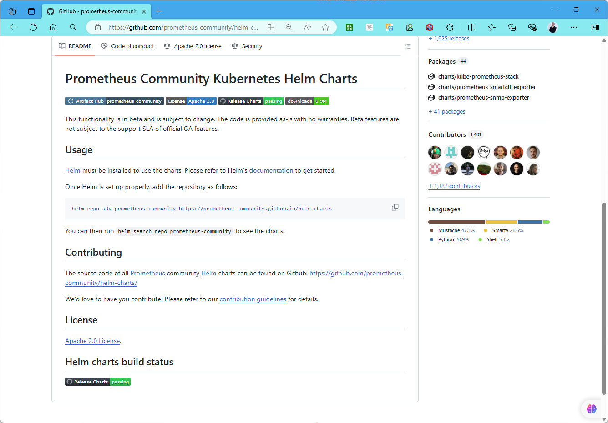
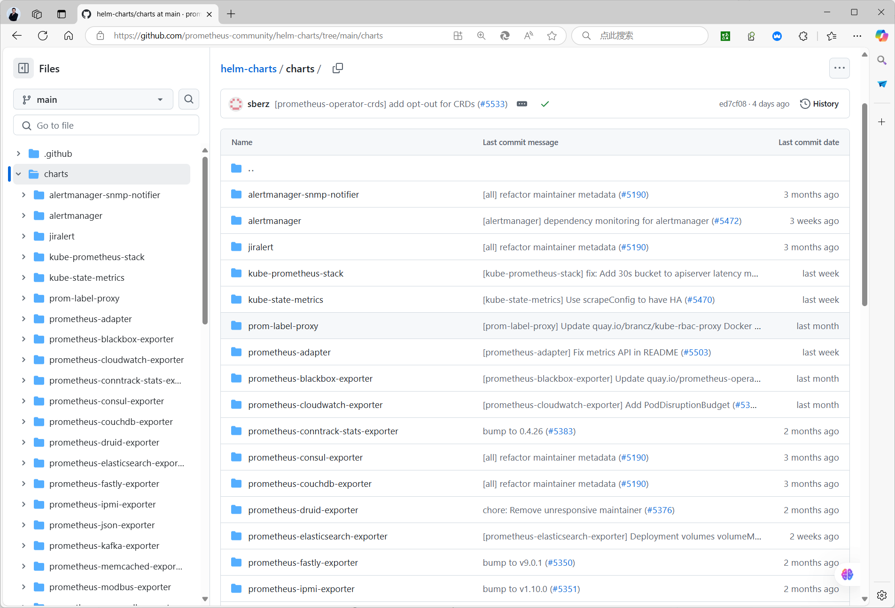

[← 返回 Prometheus 目录]({{ '/subjects/Prometheus/' | relative_url }})



# 31 Kubernetes Helm 部署

## 11.1.2 基于 Helm 部署 Prometheus
https://prometheus-community.github.io/helm-charts/
https://github.com/prometheus-community/helm-charts





范例：基于Helm安装 Prometheus
```yaml
#注意：需要提前准备名称为sc-nfs的StorageClass
#1.添加仓库
helm repo add prometheus-community https://prometheus-community.github.io/helm-charts
#2.部署Prometheus生态组件
cat prom-values.yaml
server:
  ## Prometheus server container name
  ##
  name: server
  global:
    ## How frequently to scrape targets by default
    ##
    scrape_interval: 1m
    ## How long until a scrape request times out
    ##
    scrape_timeout: 10s
    ## How frequently to evaluate rules
    ##
    evaluation_interval: 1m
  ##
https://prometheus.io/docs/prometheus/latest/configuration/configuration/#remote_write
  ##
  remoteWrite: []
  ##
https://prometheus.io/docs/prometheus/latest/configuration/configuration/#remote_read
  ##
  remoteRead: []
  ingress:
    ## If true, Prometheus server Ingress will be created
    ##
    enabled: true
    # For Kubernetes >= 1.18 you should specify the ingress-controller via the field
ingressClassName
    # See https://kubernetes.io/blog/2020/04/02/improvements-to-the-ingress-api-in-kubernetes-1.18/#specifying-the-class-of-an-ingress
    # ingressClassName: nginx #新版建议使用
    ## Prometheus server Ingress annotations
    ##
    annotations: ##旧版使用
      #kubernetes.io/ingress.class: cilium
      kubernetes.io/ingress.class: nginx
   #   kubernetes.io/tls-acme: 'true'
    ## Prometheus server Ingress hostnames with optional path
    ## Must be provided if Ingress is enabled
    ##
    hosts:
      - prometheus.bowen.org
    #   - domain.com/prometheus
    path: /
    # pathType is only for k8s >= 1.18
    pathType: Prefix
  persistentVolume:
    ## If true, Prometheus server will create/use a Persistent Volume Claim
    ## If false, use emptyDir
    ##
    enabled: true
    ## Prometheus server data Persistent Volume access modes
    ## Must match those of existing PV or dynamic provisioner
    ## Ref: http://kubernetes.io/docs/user-guide/persistent-volumes/
    ##
    accessModes:
      - ReadWriteOnce
    ## Prometheus server data Persistent Volume labels
    ##
    labels: {}
    ## Prometheus server data Persistent Volume existing claim name
    ## Requires server.persistentVolume.enabled: true
    ## If defined, PVC must be created manually before volume will be bound
    existingClaim: ""
    ## Prometheus server data Persistent Volume mount root path
    ##
    mountPath: /data
    ## Prometheus server data Persistent Volume size
    ##
    size: 8Gi
    storageClass: "sc-nfs"
    ## Prometheus server data Persistent Volume Binding Mode
    ## If defined, volumeBindingMode: <volumeBindingMode>
    ## If undefined (the default) or set to null, no volumeBindingMode spec is
    ##   set, choosing the default mode.
    ##
    # volumeBindingMode: ""
  ## Use a StatefulSet if replicaCount needs to be greater than 1 (see below)
  ##
  replicaCount: 1
  service:
    ## If false, no Service will be created for the Prometheus server
    ##
    enabled: true
    externalIPs: []
    servicePort: 9090
    type: ClusterIP
## alertmanager sub-chart configurable values
## Please see https://github.com/prometheus-community/helm-charts/tree/main/charts/alertmanager
##
alertmanager:
  ## If false, alertmanager will not be installed
  ##
  enabled: true
  persistence:
    size: 2Gi
    storageClass: "sc-nfs"
    accessModes:
      - ReadWriteOnce
#安装
helm install prometheus prometheus-community/prometheus --namespace monitoring --
values prom-values.yaml --create-namespace
#3.使用helm部署prometheus-adapter组件（可选）
cat prom-adapter-values.yaml
# Url to access prometheus
prometheus:
  # Value is templated
  url: http://prometheus-server.monitoring.svc
  port: 9090
  path: ""
replicas: 1
rules:
  default: true
  # Enabling this option will cause custom metrics to be served at
/apis/custom.metrics.k8s.io/v1beta1.
  custom: []
    # - seriesQuery: '{__name__=~"^some_metric_count$"}'
    #   resources:
    #     template: <<.Resource>>
    #   name:
    #     matches: ""
    #     as: "my_custom_metric"
    #   metricsQuery: sum(<<.Series>>{<<.LabelMatchers>>}) by (<<.GroupBy>>)
  # Mounts a configMap with pre-generated rules for use. Overrides the
  # default, custom, external and resource entries
  existing:
  # Enabling this option will cause external metrics to be served at
/apis/external.metrics.k8s.io/v1beta1.
  external:
    # 基于应用上特定的http_requests_total指标生成http_requests_per_second指标的示例
    - seriesQuery:
'http_requests_total{kubernetes_namespace!="",kubernetes_pod_name!=""}'
      resources:
        overrides:
          kubernetes_namespace: {resource: "namespace"}
          kubernetes_pod_name: {resource: "pod"}
      name:
        matches: "^(.*)_total"
        as: "${1}_per_second"
      metricsQuery: rate(<<.Series>>{<<.LabelMatchers>>}[1m])
    # 有时，对于有些Java程序来说，基于内存资源用量进行自动扩缩容并不总是有效，因而可考虑根据JVM的平
均使用量作为衡量指标；
    # 下面就是用于生成相关自定义指标的规则示例；
    - seriesQuery: '{__name__=~"jvm_memory_bytes_(used|max)",area="heap"}'
      seriesFilters:
      - is: ^jvm_memory_bytes_(used|max)$
      resources:
        overrides:
          namespace:
            resource: namespace
           service:
            resource : service
          pod:
            resource : pod
      name:
        matches: ^jvm_memory_bytes_(used|max)$
        as: "jvm_used_percent_housing"
      metricsQuery: ((sum((jvm_memory_used_bytes{area="heap",
<<.LabelMatchers>>}))by(<<.GroupBy>>)*100/sum((jvm_memory_max_bytes{area="heap",
<<.LabelMatchers>>}))by(<<.GroupBy>>)))/1000
  # Enabling this option will cause resource metrics to be served at
/apis/metrics.k8s.io/v1beta1
  resource:
    cpu:
      containerQuery: |
        sum by (<<.GroupBy>>) (
          rate(container_cpu_usage_seconds_total{container!="",<<.LabelMatchers>>}
[3m])
        )
      nodeQuery: |
        sum  by (<<.GroupBy>>) (
          rate(node_cpu_seconds_total{mode!="idle",mode!="iowait",mode!="steal",
<<.LabelMatchers>>}[3m])
        )
      resources:
        overrides:
           node:
            resource: node
          namespace:
            resource: namespace
          pod:
            resource: pod
      containerLabel: container
    memory:
      containerQuery: |
        sum by (<<.GroupBy>>) (
          avg_over_time(container_memory_working_set_bytes{container!="",
<<.LabelMatchers>>}[3m])
        )
      nodeQuery: |
        sum by (<<.GroupBy>>) (
          avg_over_time(node_memory_MemTotal_bytes{<<.LabelMatchers>>}[3m])
           -
          avg_over_time(node_memory_MemAvailable_bytes{<<.LabelMatchers>>}[3m])
        )
      resources:
        overrides:
           node:
            resource: node
          namespace:
            resource: namespace
          pod:
            resource: pod
      containerLabel: container
    window: 3m
helm install prometheus-adapter prometheus-community/prometheus-adapter --values
prom-adapter-values.yaml --namespace monitoring
```



<nav class="article-end" aria-label="章节导航">
  <a href="{{ '/subjects/Prometheus/30-kubernetes-yaml-deployment.html' | relative_url }}">← 上一章：Kubernetes YAML 部署</a>
  <a href="{{ '/subjects/Prometheus/' | relative_url }}">返回 Prometheus 目录</a>
  <a href="{{ '/subjects/Prometheus/32-kubernetes-operator.html' | relative_url }}">下一章：Kubernetes Operator 部署 →</a>
</nav>
