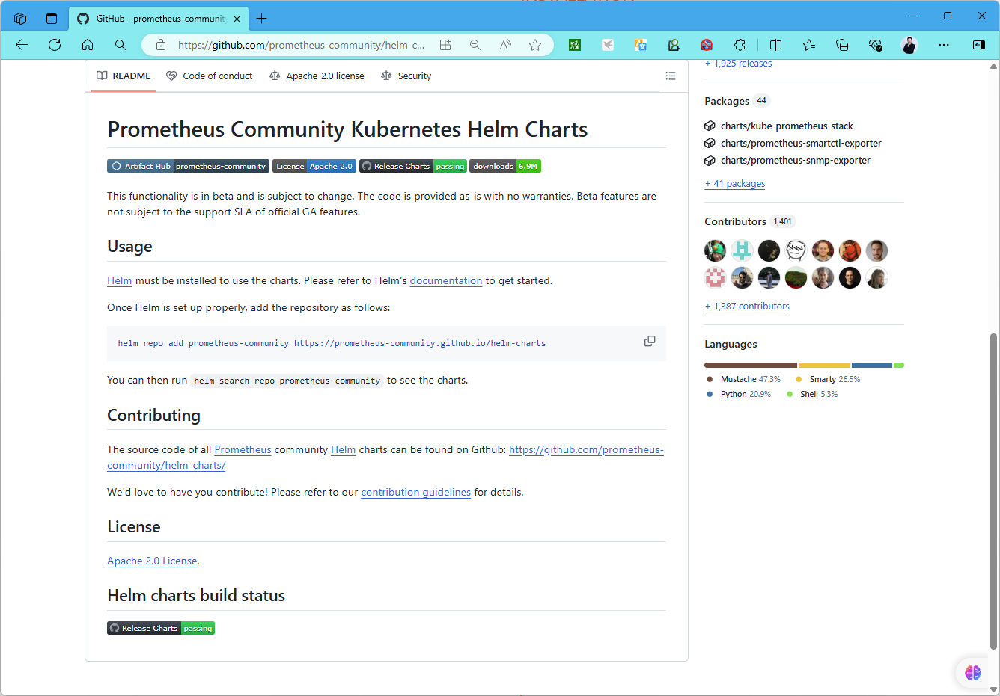
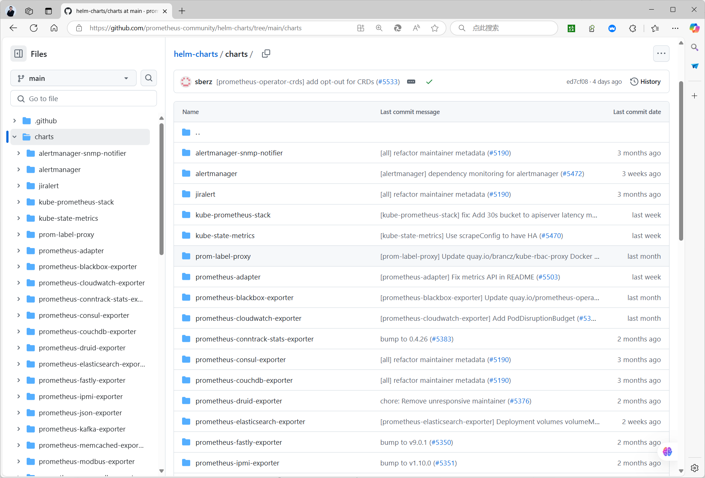

[← 返回 Prometheus 目录]({{ '/subjects/Prometheus/' | relative_url }})



# 31 Kubernetes Helm 部署

## 11.1.2 基于 Helm 部署 Prometheus
https://prometheus-community.github.io/helm-charts/
https://github.com/prometheus-community/helm-charts





### 选择 Chart 与准备存储

本文使用 `prometheus-community/prometheus` Chart 部署 Prometheus Server 与 Alertmanager，而不是功能更全的 `kube-prometheus-stack` Chart；两者的 values 结构不同，不要混用。先确认集群已有可用的 Ingress Controller 和名为 `sc-nfs` 的 StorageClass；若只是本地验证，可先关闭 Ingress，并按实际 StorageClass 修改持久卷设置。

添加并更新仓库：

```bash
helm repo add prometheus-community https://prometheus-community.github.io/helm-charts
helm repo update
helm show values prometheus-community/prometheus > upstream-values.yaml
```

下面只覆盖本例需要的值，避免把整份默认 values 粘进教程。保存为 `prom-values.yaml`：

```yaml
server:
  global:
    scrape_interval: 1m
    scrape_timeout: 10s
    evaluation_interval: 1m
  replicaCount: 1
  persistentVolume:
    enabled: true
    storageClass: sc-nfs
    accessModes:
      - ReadWriteOnce
    size: 8Gi
  ingress:
    enabled: true
    ingressClassName: nginx
    hosts:
      - prometheus.example.org
    path: /
    pathType: Prefix

alertmanager:
  enabled: true
  persistence:
    enabled: true
    storageClass: sc-nfs
    accessModes:
      - ReadWriteOnce
    size: 2Gi
```

`prometheus.example.org` 是示例域名，必须换成自己的 DNS 名称；若要公开访问，应同时配置认证和 TLS。NFS 是否适合作为 TSDB 存储取决于其一致性与性能，生产环境通常应优先评估满足 Prometheus 要求的持久存储。

先用 `helm template` 渲染清单检查配置，再安装并查看 Pod 与 PVC 状态：

```bash
helm template prometheus prometheus-community/prometheus \
  --namespace monitoring -f prom-values.yaml > prometheus-rendered.yaml
helm upgrade --install prometheus prometheus-community/prometheus \
  --namespace monitoring --create-namespace -f prom-values.yaml
kubectl -n monitoring get pods,pvc,ingress
```

### 可选：安装 Prometheus Adapter

Prometheus Adapter 将 Prometheus 中的指标暴露给 Kubernetes 自定义指标 API，常用于 HPA。它并不是部署 Prometheus 或 Grafana 的必要组件。先确认 `prometheus-server.monitoring.svc` 是前一步实际创建的 Service 名称，再保存如下最小配置为 `prom-adapter-values.yaml`：

```yaml
prometheus:
  url: http://prometheus-server.monitoring.svc
  port: 80
rules:
  default: true
```

Service 端口要以 `kubectl -n monitoring get svc` 的实际结果为准，不要把 Prometheus 容器端口 `9090` 直接当成 Service 端口。验证默认规则可用后，再参照当前 Chart 文档增加自定义指标映射；原始资料中断裂的 `seriesQuery`、PromQL 和 YAML 缩进不构成可执行配置。

```bash
helm show values prometheus-community/prometheus-adapter > adapter-upstream-values.yaml
helm template prometheus-adapter prometheus-community/prometheus-adapter \
  --namespace monitoring -f prom-adapter-values.yaml > adapter-rendered.yaml
helm upgrade --install prometheus-adapter prometheus-community/prometheus-adapter \
  --namespace monitoring -f prom-adapter-values.yaml
kubectl get apiservice v1beta1.custom.metrics.k8s.io
```

如果 APIService 不可用，依次检查 Adapter Pod 日志、Prometheus Service 地址、网络连通性及规则是否能查询到对应指标。Chart 字段会随版本变化，升级前应对照 `helm show values` 和发行说明。



<nav class="article-end" aria-label="章节导航">
  <a href="{{ '/subjects/Prometheus/30-kubernetes-yaml-deployment.html' | relative_url }}">← 上一章：Kubernetes YAML 部署</a>
  <a href="{{ '/subjects/Prometheus/' | relative_url }}">返回 Prometheus 目录</a>
  <a href="{{ '/subjects/Prometheus/32-kubernetes-operator.html' | relative_url }}">下一章：Kubernetes Operator 部署 →</a>
</nav>
