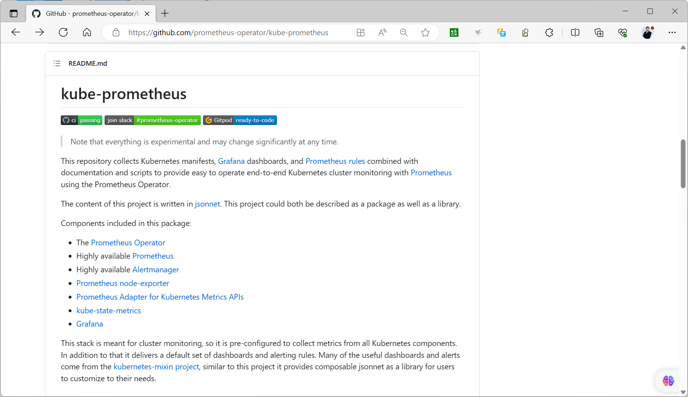
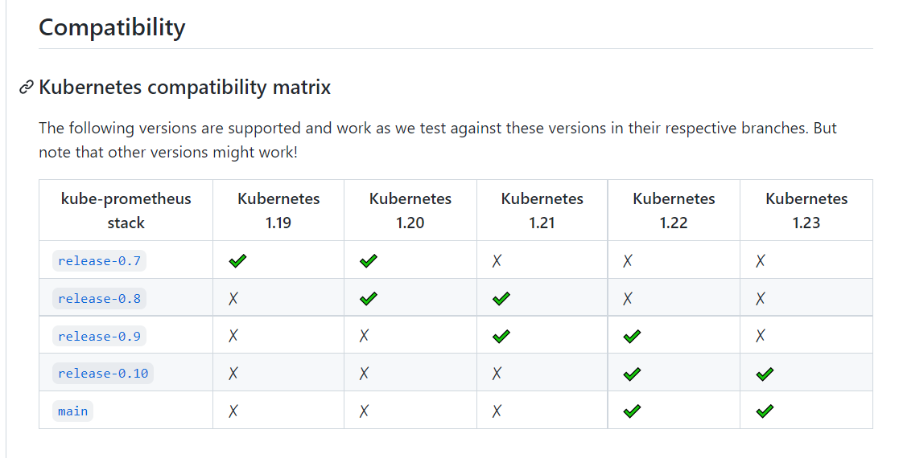

[← 返回 Prometheus 目录]({{ '/subjects/Prometheus/' | relative_url }})



# 32 Kubernetes Operator 部署

## 11.1.3 用 Operator 管理 Prometheus

Prometheus Operator 是监听 Kubernetes 自定义资源并持续协调实际工作负载的控制器；[kube-prometheus](https://github.com/prometheus-operator/kube-prometheus) 是包含 Operator、Prometheus、Alertmanager、Grafana、Exporters、规则和看板等组件的一套预制清单。两者相关，但不等同于“安装一个 Prometheus Pod”。本章使用 kube-prometheus 清单示范部署顺序，再通过 ServiceMonitor 和 Probe 理解声明式采集。

Operator 引入的常见资源包括：`Prometheus` 与 `Alertmanager`（实例）、`ServiceMonitor` 与 `PodMonitor`（采集目标）、`Probe`（黑盒探测）、`PrometheusRule`（记录和告警规则）、`AlertmanagerConfig`（通知配置片段）。具体 CRD 随版本变化，应以所选 release 的清单为准。



### 11.1.3.1 固定版本并检查前提

Kubernetes 版本、kube-prometheus release、镜像版本和 CRD 必须兼容。原资料同时混用 `v0.9.0`、`v0.15.0` 的下载链接，还对旧镜像做跨版本替换，难以保证清单一致。选择**一个**经过兼容性核对的 release，再使用该 release 的整套 `manifests`；以下命令以固定的 `v0.15.0` 说明操作方式，执行前仍应核对项目 README 中的兼容矩阵：

```bash
git clone --depth 1 --branch v0.15.0 https://github.com/prometheus-operator/kube-prometheus.git
cd kube-prometheus
kubectl version
kubectl get nodes
```

如果环境不能直接拉取某些镜像，应准备与清单**同版本、同架构**的镜像源并逐项核对 digest；不要用一个跨多行的 `sed` 把 Operator、Prometheus、Alertmanager 的镜像版本随意替换。镜像拉取失败应先查看 Pod Events 和镜像仓库可达性。

### 11.1.3.2 先安装 CRD 与 Operator，再安装整套组件

kube-prometheus 的 `manifests/setup` 通常包含命名空间、CRD 与 Operator 等基础资源，普通 `manifests` 中的 `Prometheus`、`ServiceMonitor` 等对象依赖这些 CRD。不要把两个目录无序合并后一次提交。

```bash
kubectl apply --server-side -f manifests/setup
kubectl wait --for=condition=Established --all crd --timeout=120s
kubectl apply -f manifests/
kubectl get pods -n monitoring
kubectl get prometheus,alertmanager,servicemonitor -n monitoring
```

如果所用 release 的命名空间或 setup 目录不同，按其 README 调整。原记录中的部分 Alertmanager Pod 仅 `1/2 Ready`、StatefulSet `1/3 Ready`，不能据此宣称部署成功。应等关键 Pod 全部 Ready，并逐个检查异常组件：

```bash
kubectl -n monitoring get pods
kubectl -n monitoring describe pod <异常-Pod>
kubectl -n monitoring logs <异常-Pod> --all-containers --tail=100
```

CRD 过大或 API 服务暂时未就绪时，先看具体错误和 CRD 状态，再决定是否重试；不要把任意错误都归因于“Too long”。也不要为了访问 UI 直接删除默认 NetworkPolicy，它可能正用于隔离监控组件。



### 11.1.3.3 先用端口转发验证组件

在没有 Ingress 或负载均衡器的环境中，可以先通过 `kubectl port-forward` 从管理主机验证 UI，不必把服务改为 NodePort 或 LoadBalancer：

```bash
kubectl -n monitoring port-forward svc/prometheus-k8s 9090:9090
kubectl -n monitoring port-forward svc/alertmanager-main 9093:9093
kubectl -n monitoring port-forward svc/grafana 3000:3000
```

三条命令应分别在独立终端运行。确认 Prometheus Targets、Alertmanager 状态和 Grafana 数据源后，再决定是否需要对外暴露。原资料给 `LoadBalancer` 服务硬写 NodePort，在没有云负载均衡器的集群中也不能保证外部可达。

如使用 Ingress，先确认集群已有 Ingress Controller、域名解析、TLS 和访问认证。下面仅示范 Prometheus 一个入口；Grafana 与 Alertmanager 若需要外部入口，应分别评估权限与认证：

```yaml
apiVersion: networking.k8s.io/v1
kind: Ingress
metadata:
  name: prometheus-ui
  namespace: monitoring
spec:
  ingressClassName: nginx
  tls:
    - hosts: [prometheus.example.org]
      secretName: prometheus-ui-tls
  rules:
    - host: prometheus.example.org
      http:
        paths:
          - path: /
            pathType: Prefix
            backend:
              service:
                name: prometheus-k8s
                port:
                  number: 9090
```

这只是入口清单，`prometheus-ui-tls` Secret 和认证策略需要事先准备；Ingress 本身并不提供身份认证。

### 11.1.3.4 用 ServiceMonitor 增加应用指标

ServiceMonitor 选择的是 **Service**，并通过 Service 的**命名端口**定位指标端点；Pod 上仅添加 `prometheus.io/scrape` 注解，不保证被 Operator 管理的 Prometheus 自动发现。下例假定应用和 ServiceMonitor 均在 `monitoring` 命名空间。应用需要真的在 `8080/metrics` 输出 Prometheus 格式指标：

```yaml
apiVersion: v1
kind: Service
metadata:
  name: metrics-app
  namespace: monitoring
  labels:
    app: metrics-app
spec:
  selector:
    app: metrics-app
  ports:
    - name: metrics
      port: 8080
      targetPort: metrics
---
apiVersion: monitoring.coreos.com/v1
kind: ServiceMonitor
metadata:
  name: metrics-app
  namespace: monitoring
  labels:
    app: metrics-app
spec:
  selector:
    matchLabels:
      app: metrics-app
  endpoints:
    - port: metrics
      path: /metrics
      interval: 15s
```

对应 Pod 容器端口也应命名为 `metrics`，且 Pod 标签为 `app: metrics-app`。这里的 ServiceMonitor `metadata.labels` **仍需与 Prometheus CR 的 `serviceMonitorSelector` 匹配**；同时检查 `serviceMonitorNamespaceSelector` 是否允许该命名空间。原示例硬加 `release: prometheus`，但 kube-prometheus 清单未必按这个标签选择，结果可能创建了 ServiceMonitor 却没有采集目标。

```bash
kubectl -n monitoring get prometheus -o yaml
kubectl -n monitoring get servicemonitor metrics-app -o yaml
kubectl -n monitoring get svc metrics-app
```

应用 Deployment 及其指标接口必须另行部署。验证时依次看 Prometheus CR 选择器、ServiceMonitor、Service endpoints、Targets 页面，而不是只看 YAML 是否 `apply` 成功。

### 11.1.3.5 用 Probe 做黑盒探测

`Probe` 描述要探测的外部目标，真正执行 HTTP/TCP/ICMP 请求的是 Blackbox Exporter。Prober 的 URL 必须指向当前部署中可达的 Blackbox Exporter 服务和端口；模块名要在 Blackbox 配置中存在。与 ServiceMonitor 一样，`Probe` 还需匹配 Prometheus CR 的 `probeSelector` 和命名空间选择器。

```yaml
apiVersion: monitoring.coreos.com/v1
kind: Probe
metadata:
  name: example-web
  namespace: monitoring
spec:
  jobName: example-web
  module: http_2xx
  prober:
    url: blackbox-exporter.monitoring.svc:9115
    path: /probe
  targets:
    staticConfig:
      static:
        - https://example.org
```

先验证 Blackbox 服务本身可访问，再检查 Prometheus Targets 中是否出现 Probe 任务和 `probe_success`。原资料使用另一个端口 `19115`，那是特定清单中可能存在的代理端口；应以当前 `kubectl -n monitoring get svc blackbox-exporter` 的实际端口为准。


<nav class="article-end" aria-label="章节导航">
  <a href="{{ '/subjects/Prometheus/31-kubernetes-helm.html' | relative_url }}">← 上一章：Kubernetes Helm 部署</a>
  <a href="{{ '/subjects/Prometheus/' | relative_url }}">返回 Prometheus 目录</a>
  <a href="{{ '/subjects/Prometheus/33-kubernetes-monitoring-operations.html' | relative_url }}">下一章：Kubernetes 监控应用与组件 →</a>
</nav>
