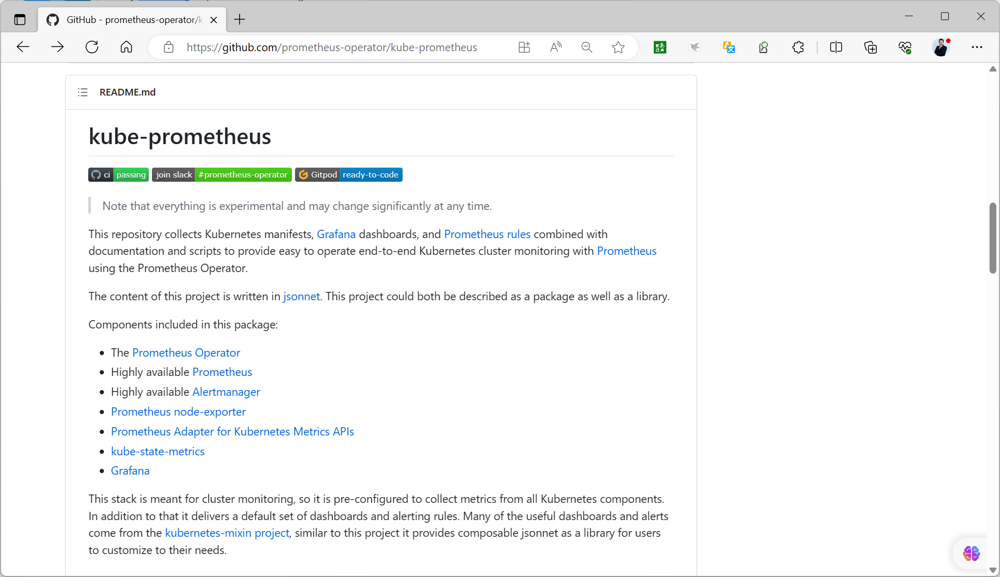
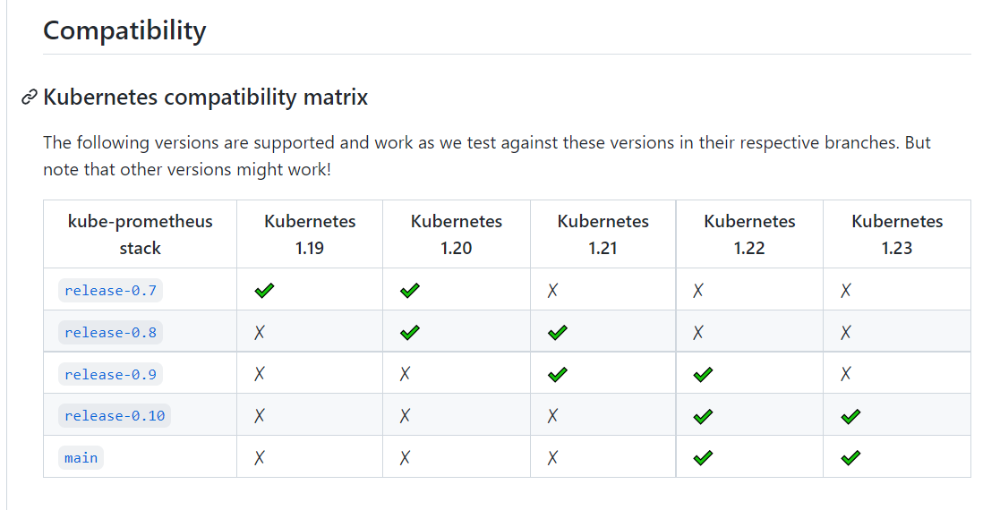
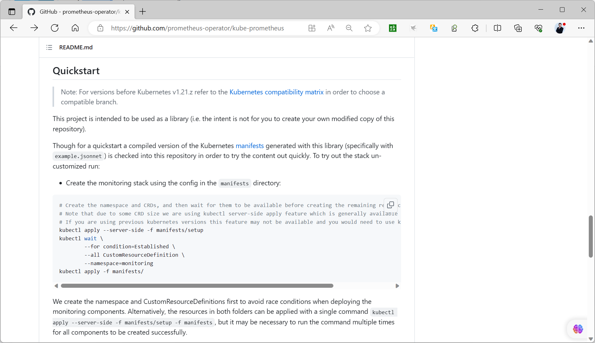

[← 返回 Prometheus 目录]({{ '/subjects/Prometheus/' | relative_url }})



# 32 Kubernetes Operator 部署

## 11.1.3 基于 Operator 部署 Prometheus

注意:镜像下载需要科学上网

#### 11.1.3.1 Operator 部署 Prometheus 说明

部署Prometheus及其相关的各组件是一项复杂的任务，而 Prometheus Operator项目能够在Kubernetes环境上简化和自动化该过程。

Operator建立在Kubernetes的两个关键原则之上：自定义资源 (CR)，它通过自定义资源定义 (CRD) 和自定义的Controller实现。

Kube-Prometheus Opertor的主要目的，是用于简化和自动化管理在Kubernetes集群上运行的Prometheus监控套件。本质上，它是一个自定义控制器，用于监视通过以下CRD引入的资源类型下的对象。

Prometheus：编排运行Prometheus Server实例
Alertmanager：编排运行Alertmanager实例  
ServiceMonitor：定义要监视Kubernetes Service资源对象  
PodMonitor：定义要监视的Pod资源对象  
Probe：定义要监控的Ingess或静态Target，黑盒监控模式  
PrometheusRule：为Prometheus Server定义告警规划或记录规则  
AlertmanagerConfig：以声明方式为Alertmanager提供配置段  
PrometheusAgent：编排运行Prometheus Agent  
scrapeconfigs：为Prometheus Server提供scrape_config相关的配置段  
thanosrulers：  

github 参考链接
https://github.com/prometheus-operator/kube-prometheus
https://github.com/prometheus-operator/kube-prometheus/tree/main/manifests







#### 11.1.3.2 获取代码
```bash
#方法1
cd /usr/local
VERSION=0.15
wget https://github.com/prometheus-operator/kube-
prometheus/archive/refs/tags/v${VERSION}.0.tar.gz
wget https://github.com/prometheus-operator/kube-prometheus/archive/refs/tags/v0.9.0.tar.gz
tar xf v0.9.0.tar.gz
cd /usr/local/kube-prometheus-0.9.0/manifests/
du -sh  /usr/local/kube-prometheus-0.9.0
4.0M
#方法2
git clone -b v0.9.0 https://github.com/prometheus-operator/kube-prometheus.git
cd kube-prometheus
19M
```

#### 11.1.3.3 修改配置
```yaml
#创建命名空间
kubectl create ns monitoring
#修改prometheus的service
vim /usr/local/kube-prometheus-0.9.0/manifests/prometheus-service.yaml
...
spec:
  ports:
  - name: web
    port: 9090
    targetPort: web
    nodePort: 30090 #加下面两行
  #type: NodePort
  type: LoadBalancer
  ...
#修改grafana的service
vim /usr/local/kube-prometheus-0.9.0/manifests/grafana-service.yaml
...
spec:
  ports:
  - name: http
    port: 3000
    targetPort: http
    nodePort: 30030 #加下面两行
  #type: NodePort
  type: LoadBalancer
  ...
#修改alertmanager的service
vim /usr/local/kube-prometheus-0.9.0/manifests/alertmanager-service.yaml
...
spec:
  ports:
  - name: web
    port: 9093
    targetPort: web
    nodePort: 30093 #加下面两行
  #type: NodePort
  type: LoadBalancer
  ...
#默认有些镜像无法下载,修改依赖镜像,将相关镜像都改为私有仓库里面的镜像
cd /usr/local/kube-prometheus-0.9.0/manifests/
#如果可以科学上网，无需修改下面内容
sed -i -e 's#quay.io/brancz/kube-rbac-proxy:v0.11.0#harbor.bowen.org:80/helm/kube-
rbac-proxy:v0.11.0#' -e 's#quay.io/prometheus/node-
exporter:v1.2.2#harbor.bowen.org:80/helm/node-exporter:v1.2.2#' -e
's#k8s.gcr.io/prometheus-adapter/prometheus-
adapter:v0.9.0#harbor.bowen.org:80/helm/prometheus-adapter:v0.9.1#' -e
's#quay.io/prometheus/prometheus:v2.29.1#harbor.bowen.org:80/helm/prometheus:2.30.2-
debian-10-r3#' -e
's#quay.io/prometheus/alertmanager:v0.22.2#harbor.bowen.org:80/helm/alertmanager:0.23.
0-debian-10-r41#' -e 's#quay.io/prometheus/blackbox-
exporter:v0.19.0#harbor.bowen.org:80/helm/blackbox-exporter:v0.19.0#' -e
's#jimmidyson/configmap-reload:v0.5.0#harbor.bowen.org:80/helm/configmap-
reload:v0.5.0#' -e "s#k8s.gcr.io/kube-state-metrics/kube-state-
metrics:v2.1.1#harbor.bowen.org:80/helm/kube-state-metrics:v2.2.0#" -e
's#grafana/grafana:8.1.1#harbor.bowen.org:80/helm/grafana:8.1.1#' -e
's#quay.io/prometheus-operator/prometheus-
operator:v0.49.0#harbor.bowen.org:80/helm/prometheus-operator:0.51.2-debian-10-r1#' -e
's#quay.io/prometheus-operator/prometheus-config-
reloader:v0.49.0#harbor.bowen.org:80/helm/prometheus-config-reloader:v0.49.0#' *.yaml
setup/*.yaml
[root@prometheus manifests]#grep  image: *.yaml setup/*.yaml
alertmanager-alertmanager.yaml:  image: harbor.bowen.org:80/helm/alertmanager:0.23.0-
debian-10-r41
blackbox-exporter-deployment.yaml:        image: harbor.bowen.org:80/helm/blackbox-
exporter:v0.19.0
blackbox-exporter-deployment.yaml:        image: harbor.bowen.org:80/helm/configmap-
reload:v0.5.0
blackbox-exporter-deployment.yaml:        image: harbor.bowen.org:80/helm/kube-rbac-
proxy:v0.11.0
grafana-deployment.yaml:        image: harbor.bowen.org:80/helm/grafana:8.1.1
kube-state-metrics-deployment.yaml:        image: harbor.bowen.org:80/helm/kube-state-
metrics:v2.2.0
kube-state-metrics-deployment.yaml:        image: harbor.bowen.org:80/helm/kube-rbac-
proxy:v0.11.0
kube-state-metrics-deployment.yaml:        image: harbor.bowen.org:80/helm/kube-rbac-
proxy:v0.11.0
node-exporter-daemonset.yaml:        image: harbor.bowen.org:80/helm/node-
exporter:v1.2.2
node-exporter-daemonset.yaml:        image: harbor.bowen.org:80/helm/kube-rbac-
proxy:v0.11.0
prometheus-adapter-deployment.yaml:        image: harbor.bowen.org:80/helm/prometheus-
adapter:v0.9.1
prometheus-prometheus.yaml:  image: harbor.bowen.org:80/helm/prometheus:2.30.2-debian-
10-r3
setup/prometheus-operator-deployment.yaml:        image:
harbor.bowen.org:80/helm/prometheus-operator:0.51.2-debian-10-r1
setup/prometheus-operator-deployment.yaml:        image:
harbor.bowen.org:80/helm/kube-rbac-proxy:v0.11.0
```

#### 11.1.3.4 启动
```bash
#启动项目
cd /usr/local/kube-prometheus-0.9.0
kubectl apply -f manifests/setup/
#如果提示Too long出错,使用下面解决
kubectl create -f manifests/setup/
kubectl apply -f manifests/
#注意:新版中需要删除相应的networkPolicy才能访问，如果是使用calico的网络插件，需要删除下面的
networkPolicy
kubectl delete -f manifests/prometheus-networkPolicy.yaml
kubectl delete -f manifests/grafana-networkPolicy.yaml
#检查效果
[root@prometheus ~]#kubectl get pods -n monitoring
NAME                                  READY   STATUS    RESTARTS         AGE
alertmanager-main-0                   1/2     Running   2 (2m59s ago)    11m
alertmanager-main-1                   2/2     Running   0                11m
alertmanager-main-2                   1/2     Running   2 (61s ago)      11m
blackbox-exporter-84dd4585c7-8g6rx    3/3     Running   3 (67s ago)      11m
grafana-cd5769bb6-zgmzx               1/1     Running   1 (67s ago)      11m
kube-state-metrics-5f4467bcb6-jck6v   3/3     Running   3 (61s ago)      11m
node-exporter-54q5x                   2/2     Running   0                11m
node-exporter-hrxts                   2/2     Running   13 (61s ago)     11m
node-exporter-kmtgk                   2/2     Running   0                11m
node-exporter-lccvb                   2/2     Running   14 (3m5s ago)    11m
node-exporter-rdtsc                   2/2     Running   13 (2m32s ago)   11m
node-exporter-ss2m5                   2/2     Running   0                11m
prometheus-adapter-67c6947497-55csz   1/1     Running   1 (3m4s ago)     11m
prometheus-adapter-67c6947497-lvk5v   1/1     Running   0                11m
prometheus-k8s-0                      2/2     Running   2 (3m ago)       11m
prometheus-k8s-1                      2/2     Running   0                11m
prometheus-operator-9f859c859-jr7gq   2/2     Running   2 (61s ago)      12m
[root@prometheus ~]#kubectl get svc -n monitoring
NAME                    TYPE        CLUSTER-IP       EXTERNAL-IP   PORT(S)
           AGE
alertmanager-main       NodePort    10.105.67.238    <none>        9093:30093/TCP
          12m
alertmanager-operated   ClusterIP   None             <none>
 9093/TCP,9094/TCP,9094/UDP   12m
blackbox-exporter       ClusterIP   10.109.208.248   <none>        9115/TCP,19115/TCP
          12m
grafana                 NodePort    10.99.20.248     <none>        3000:30030/TCP
          12m
kube-state-metrics      ClusterIP   None             <none>        8443/TCP,9443/TCP
           12m
node-exporter           ClusterIP   None             <none>        9100/TCP
          12m
prometheus-adapter      ClusterIP   10.98.36.176     <none>        443/TCP
           12m
prometheus-k8s          NodePort    10.98.248.0      <none>        9090:30090/TCP
          12m
prometheus-operated     ClusterIP   None             <none>        9090/TCP
          12m
prometheus-operator     NodePort    10.111.4.57      <none>        8443:30443/TCP
          12m
[root@prometheus ~]#kubectl get ep -n monitoring
NAME                    ENDPOINTS
AGE
alertmanager-main       10.244.3.7:9093
12m
alertmanager-operated   10.244.3.7:9094,10.244.3.7:9094,10.244.3.7:9093
12m
blackbox-exporter       10.244.4.2:9115,10.244.4.2:19115
12m
grafana                 10.244.4.4:3000
12m
kube-state-metrics      10.244.5.2:8443,10.244.5.2:9443
12m
node-exporter           10.0.0.101:9100,10.0.0.102:9100,10.0.0.103:9100 + 3 more...
12m
prometheus-adapter      10.244.3.8:6443,10.244.4.6:6443
12m
prometheus-k8s          10.244.3.9:9090,10.244.5.3:9090
12m
prometheus-operated     10.244.3.9:9090,10.244.5.3:9090
12m
prometheus-operator     10.244.5.6:8443
12m
[root@prometheus ~]#kubectl -n monitoring get all
NAME                                      READY   STATUS    RESTARTS         AGE
pod/alertmanager-main-0                   1/2     Running   3 (41s ago)      13m
pod/alertmanager-main-1                   2/2     Running   0                13m
pod/alertmanager-main-2                   1/2     Running   3 (39s ago)      13m
pod/blackbox-exporter-84dd4585c7-8g6rx    3/3     Running   3 (2m48s ago)    13m
pod/grafana-cd5769bb6-zgmzx               1/1     Running   1 (2m48s ago)    13m
pod/kube-state-metrics-5f4467bcb6-jck6v   3/3     Running   3 (2m42s ago)    13m
pod/node-exporter-54q5x                   2/2     Running   0                13m
pod/node-exporter-hrxts                   2/2     Running   13 (2m42s ago)   13m
pod/node-exporter-kmtgk                   2/2     Running   0                13m
pod/node-exporter-lccvb                   2/2     Running   14 (4m46s ago)   13m
pod/node-exporter-rdtsc                   2/2     Running   13 (4m13s ago)   13m
pod/node-exporter-ss2m5                   2/2     Running   0                13m
pod/prometheus-adapter-67c6947497-55csz   1/1     Running   1 (4m45s ago)    13m
pod/prometheus-adapter-67c6947497-lvk5v   1/1     Running   0                13m
pod/prometheus-k8s-0                      2/2     Running   2 (4m41s ago)    13m
pod/prometheus-k8s-1                      2/2     Running   0                13m
pod/prometheus-operator-9f859c859-jr7gq   2/2     Running   2 (2m42s ago)    13m
NAME                            TYPE        CLUSTER-IP       EXTERNAL-IP   PORT(S)
                   AGE
service/alertmanager-main       NodePort    10.105.67.238    <none>
 9093:30093/TCP               13m
service/alertmanager-operated   ClusterIP   None             <none>
 9093/TCP,9094/TCP,9094/UDP   13m
service/blackbox-exporter       ClusterIP   10.109.208.248   <none>
 9115/TCP,19115/TCP           13m
service/grafana                 NodePort    10.99.20.248     <none>
 3000:30030/TCP               13m
service/kube-state-metrics      ClusterIP   None             <none>
 8443/TCP,9443/TCP            13m
service/node-exporter           ClusterIP   None             <none>        9100/TCP
                  13m
service/prometheus-adapter      ClusterIP   10.98.36.176     <none>        443/TCP
                   13m
service/prometheus-k8s          NodePort    10.98.248.0      <none>
 9090:30090/TCP               13m
service/prometheus-operated     ClusterIP   None             <none>        9090/TCP
                  13m
service/prometheus-operator     NodePort    10.111.4.57      <none>
 8443:30443/TCP               13m
NAME                           DESIRED   CURRENT   READY   UP-TO-DATE   AVAILABLE
NODE SELECTOR            AGE
daemonset.apps/node-exporter   6  6  6  6  6
kubernetes.io/os=linux   13m
NAME                                  READY   UP-TO-DATE   AVAILABLE   AGE
deployment.apps/blackbox-exporter     1/1     1  1           13m
deployment.apps/grafana               1/1     1  1           13m
deployment.apps/kube-state-metrics    1/1     1  1           13m
deployment.apps/prometheus-adapter    2/2     2  2           13m
deployment.apps/prometheus-operator   1/1     1  1           13m
NAME                                            DESIRED   CURRENT   READY   AGE
replicaset.apps/blackbox-exporter-84dd4585c7    1  1  1       13m
replicaset.apps/grafana-cd5769bb6               1  1  1       13m
replicaset.apps/kube-state-metrics-5f4467bcb6   1  1  1       13m
replicaset.apps/prometheus-adapter-67c6947497   2  2  2       13m
replicaset.apps/prometheus-operator-9f859c859   1  1  1       13m
NAME                                 READY   AGE
statefulset.apps/alertmanager-main   1/3     13m
statefulset.apps/prometheus-k8s      2/2     13m
```

#### 11.1.3.5 创建 Ingress

默认SVC是clusterIP模式，无法外部访问，可以创建Ingress实现外部访问
```yaml
[root@master1 ~]#cat kube-prometheus-ingress.yaml
apiVersion: networking.k8s.io/v1
kind: Ingress
metadata:
  name: prometheus
  namespace: monitoring
  labels:
    app: prometheus
spec:
  ingressClassName: 'nginx'
  rules:
  - host: prometheus.bowen.org
    http:
      paths:
      - path: /
        pathType: Prefix
        backend:
           service:
            name: prometheus-k8s
            port:
              number: 9090
  - host: grafana.bowen.org
    http:
      paths:
      - path: /
        pathType: Prefix
        backend:
           service:
            name: grafana
            port:
              number: 3000
  - host: alertmanager.bowen.org
    http:
      paths:
      - path: /
        pathType: Prefix
        backend:
           service:
            name: alertmanager-main
            port:
              number: 9093
  - host: blackbox.bowen.org
    http:
      paths:
      - path: /
        pathType: Prefix
        backend:
           service:
            name: blackbox-exporter
            port:
              number: 19115 #9115对应https
```

#### 11.1.3.6 测试使用
```yaml
#准备黑盒监控信息
[root@master1 ~]#cat probe-example.yaml
apiVersion: monitoring.coreos.com/v1
kind: Probe
metadata:
  name: web-probe-demo
  namespace: monitoring
spec:
  jobName: http-get
  interval: 60s
  module: http_2xx
  prober:
    url: blackbox-exporter.monitoring.svc:19115
    scheme: http
    path: /probe
  targets:
    staticConfig:
      static:
      - http://www.bowen.com
      - https://www.google.com
#准备Service的监控信息
[root@master1 ~]#cat servicemonitor-example.yaml
apiVersion: apps/v1
kind: Deployment
metadata:
    name: metrics-app
spec:
  replicas: 2
  selector:
    matchLabels:
      app: metrics-app
      controller: metrics-app
  template:
    metadata:
      labels:
        app: metrics-app
        controller: metrics-app
      annotations:
        prometheus.io/scrape: "true"  #允许prometheus 抓取指标，默认不允许
        prometheus.io/port: "80"  #允许prometheus 抓取指标的端口
        prometheus.io/path: "/metrics"  #允许prometheus 抓取指标的URL，此为默认值
    spec:
      containers:
      - image: registry.cn-beijing.aliyuncs.com/bowen/metrics-app:v0.1
        name: metrics-app
        ports:
         - name: web
          containerPort: 80
        resources:
          requests:
            memory: "256Mi"
            cpu: "500m"
          limits:
            memory: "256Mi"
            cpu: "500m"
---
apiVersion: v1
kind: Service
metadata:
  name: metrics-app
  labels:
    app: metrics-app
spec:
  type: ClusterIP
  ports:
  - name: web
    port: 80
    targetPort: 80
  selector:
    app: metrics-app
    controller: metrics-app
---
apiVersion: monitoring.coreos.com/v1
kind: ServiceMonitor
metadata:
  name: metrics-app-servicemonitor
  labels:
    app: metrics-app
    release: prometheus
spec:
  selector:
    matchLabels:
      app: metrics-app
  #namespaceSelector:
  #  matchNames:
  #  - default
  endpoints:
  - port: web
    interval: 15s
#应用配置
kubectl apply -f yaml/probe-example.yaml -f yaml/servicemonitor-example.yaml
```



<nav class="article-end" aria-label="章节导航">
  <a href="{{ '/subjects/Prometheus/31-kubernetes-helm.html' | relative_url }}">← 上一章：Kubernetes Helm 部署</a>
  <a href="{{ '/subjects/Prometheus/' | relative_url }}">返回 Prometheus 目录</a>
  <a href="{{ '/subjects/Prometheus/33-kubernetes-monitoring-operations.html' | relative_url }}">下一章：Kubernetes 监控应用与组件 →</a>
</nav>
