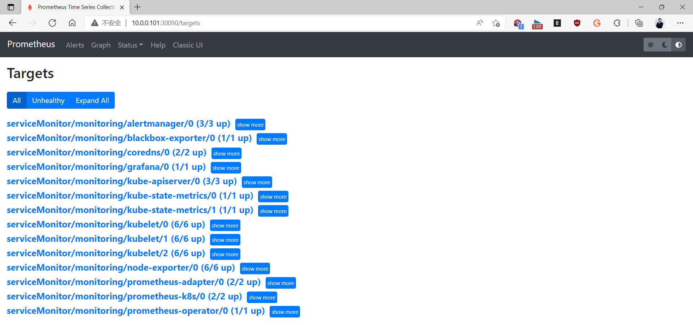
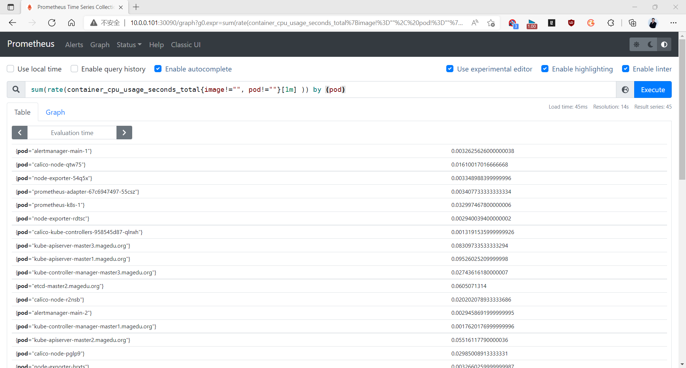
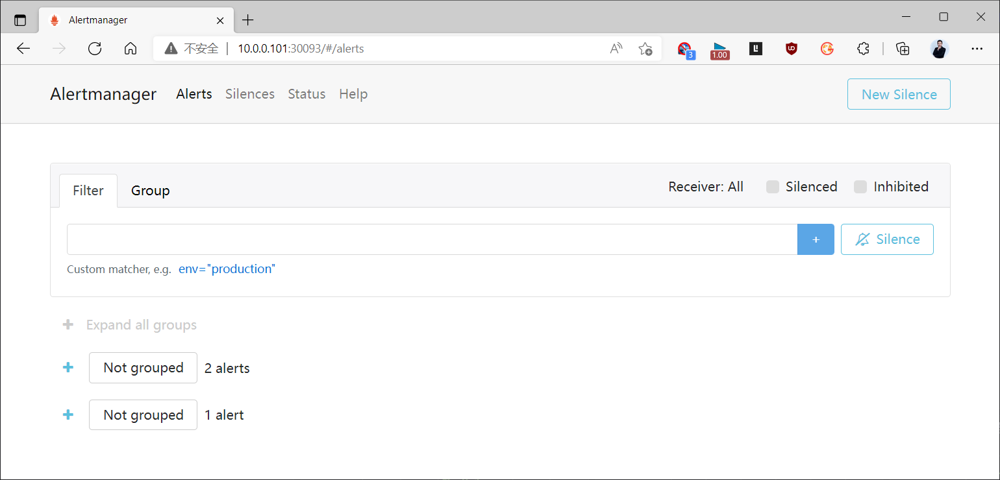
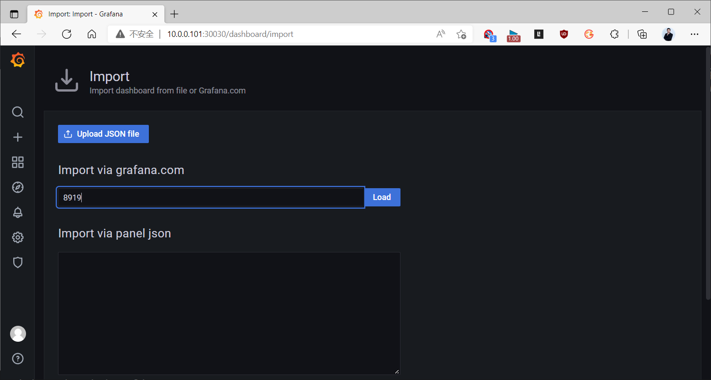
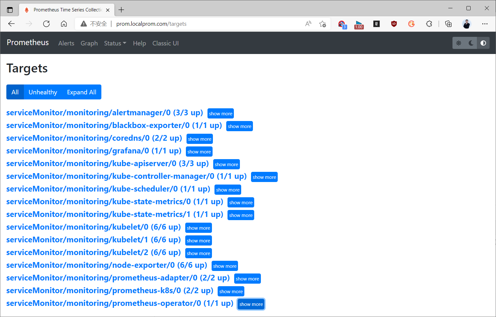
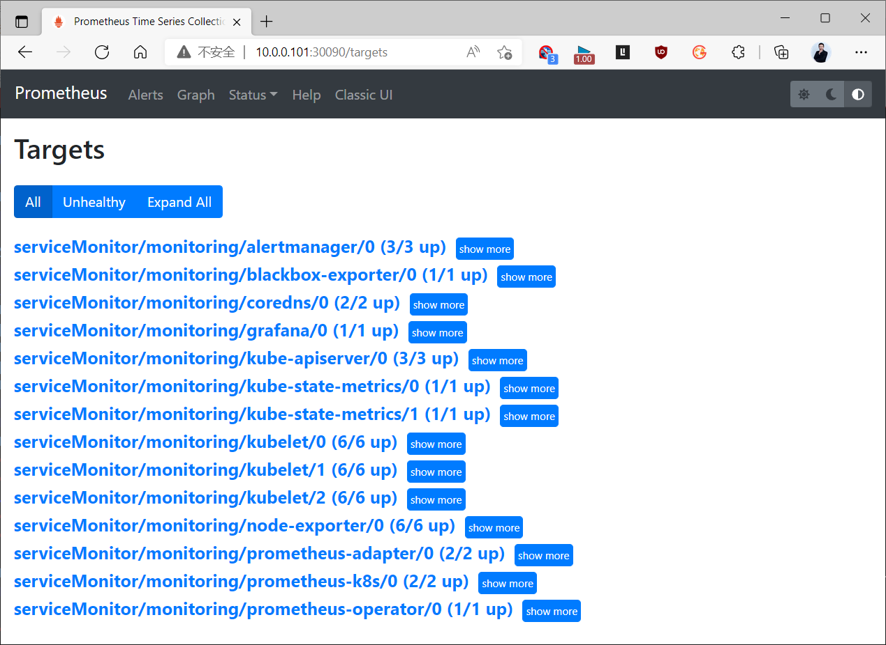
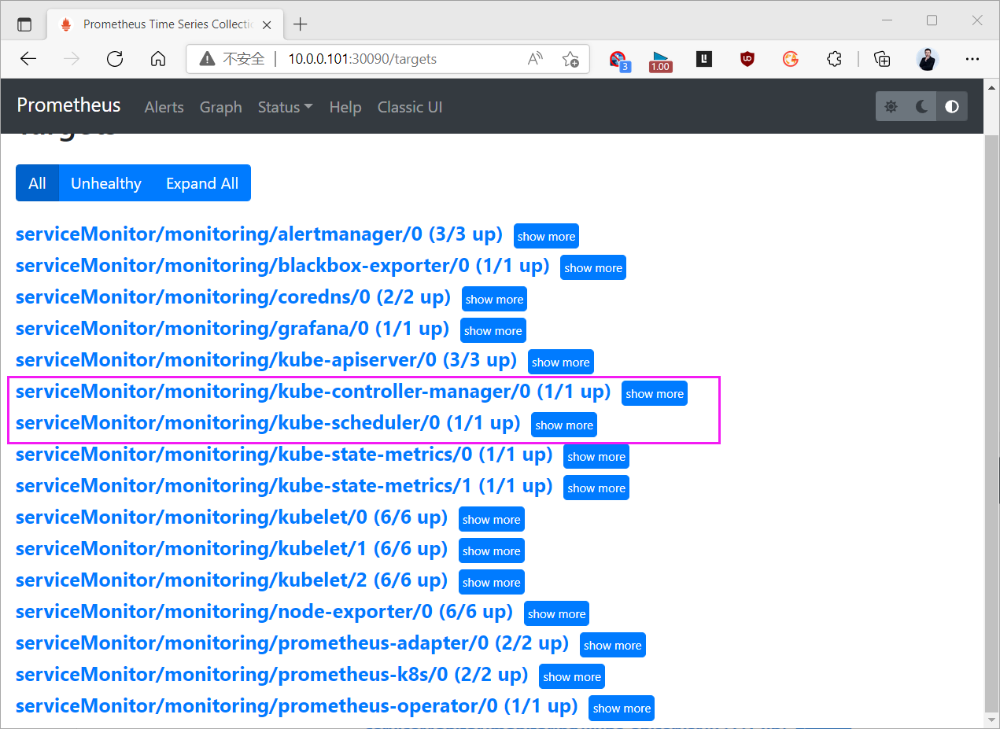
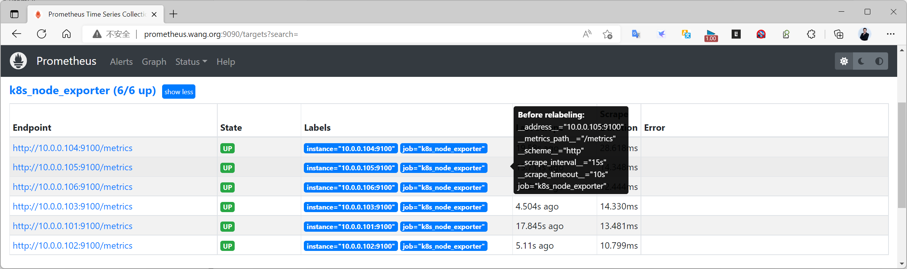

[← 返回 Prometheus 目录]({{ '/subjects/Prometheus/' | relative_url }})



# 33 Kubernetes 监控应用与组件

上一章部署了 kube-prometheus。本章不重复安装，而是按“UI 能访问 → 指标确实存在 → 组件目标健康”的顺序检查结果，再处理 Ingress、控制面组件和 Node Exporter。旧资料中有 Pod 尚未 Ready 就继续访问、重复部署 Node Exporter、以及直接把控制面监听改成 `0.0.0.0` 的步骤；这些操作要先依据当前集群状态判断是否需要。

## 11.2 验证 Prometheus、Alertmanager 与 Grafana

先确认 `monitoring` 命名空间中的关键 Pod 全部 Ready：

```bash
kubectl -n monitoring get pods
kubectl -n monitoring get svc prometheus-k8s alertmanager-main grafana
```

没有对外入口时，先使用端口转发访问：`kubectl -n monitoring port-forward svc/prometheus-k8s 9090:9090`。在 Prometheus 的 Targets 页面检查目标状态，再查询一个实际存在的指标。原资料用下面的 cAdvisor 指标按 Pod 汇总 CPU 使用率：

```promql
sum by (namespace, pod) (
  rate(container_cpu_usage_seconds_total{container!="", pod!=""}[5m])
)
```

它的结果单位是“CPU 核数”，例如 0.5 表示约半个核，而不是 50% 的通用百分比。若没有结果，先查 cAdvisor 目标和实际指标标签；不要直接判断所有 Pod 都没有负载。





Alertmanager 可以通过 `kubectl -n monitoring port-forward svc/alertmanager-main 9093:9093` 访问；Grafana 可通过 `kubectl -n monitoring port-forward svc/grafana 3000:3000` 访问。Grafana 的初始账号、密码与 Secret 取决于安装版本和部署清单，不能假定永远是 `admin/admin`；应查看当前部署的凭据配置，首次登录后更新。导入社区 Dashboard 1860、8919 等时，先选择正确的 Prometheus 数据源，并检查面板查询所需指标是否存在。





## 11.3 需要外部访问时再配置 Ingress

Ingress 需要已经运行的 Ingress Controller；`Ingress` 对象本身不会启动代理。对 Prometheus、Alertmanager 和 Grafana 暴露外部入口前，应准备域名解析、TLS 与身份认证。只想本地检查时继续使用端口转发更简单。下面示例把 Prometheus UI 指向 kube-prometheus 的 Service，Grafana 和 Alertmanager 可按相同方式各自建立入口：

```yaml
apiVersion: networking.k8s.io/v1
kind: Ingress
metadata:
  name: prometheus-ui
  namespace: monitoring
spec:
  ingressClassName: nginx
  tls:
    - hosts: [prometheus.example.org]
      secretName: prometheus-ui-tls
  rules:
    - host: prometheus.example.org
      http:
        paths:
          - path: /
            pathType: Prefix
            backend:
              service:
                name: prometheus-k8s
                port:
                  number: 9090
```

先确认 Ingress Controller 的 Service 和 `prometheus-ui-tls` Secret 存在，再应用并检查 `kubectl -n monitoring describe ingress prometheus-ui`。仅在管理机的 `hosts` 文件中加映射，不能代替 Controller、后端 Service 或 TLS。原资料使用旧版 Controller 清单与大段镜像替换命令，不适合直接用于不同 Kubernetes 版本。



## 11.4 控制面组件的采集

kube-controller-manager 和 kube-scheduler 的安全指标端口通常分别为 `10257`、`10259`，但具体监听地址、证书、认证与部署方式由集群发行版决定。kube-prometheus 的相应 ServiceMonitor 可能已经存在，却因为没有匹配的 Service/EndpointSlice、网络不通或 TLS 认证失败而显示 `DOWN`。不要一看到 `DOWN` 就断定组件进程停止，也不要直接把两者的 `--bind-address` 改为 `0.0.0.0`。

按以下顺序检查：

```bash
kubectl -n kube-system get pods -o wide | grep -E 'controller-manager|scheduler'
kubectl -n monitoring get servicemonitor | grep -E 'controller|scheduler'
kubectl -n kube-system get svc,endpoints,endpointslices | grep -E 'controller|scheduler'
```

随后在对应控制面节点检查安全端口的监听和证书配置，并在 Prometheus Targets 页面读取**具体错误**。如果确实需要从 Prometheus 网络访问这些端口，应设计受限制的网络路径及正确的 TLS/认证方式，再建立与 ServiceMonitor 选择器一致的 Service 和 EndpointSlice。仅写一个 `Endpoints` 指向主机 IP 仍可能因为端口不可达、证书不匹配或标签不匹配而失败。





## 11.5 Node Exporter 的部署与检查

kube-prometheus 通常已经包含 Node Exporter DaemonSet 与 ServiceMonitor。**先检查现有资源，再决定是否需要另部署**：

```bash
kubectl -n monitoring get daemonset node-exporter
kubectl -n monitoring get servicemonitor | grep node
kubectl -n monitoring get pods -l app.kubernetes.io/name=node-exporter -o wide
```

不同 release 的标签可能不一样，可先 `kubectl -n monitoring get daemonset node-exporter -o yaml` 查看模板标签。DaemonSet 的期望副本数应与符合调度条件的节点数一致；出现 `0/1 Ready` 时，检查 Pod Events、宿主机 `9100` 端口冲突和节点容忍设置，不要仅因为 Pod 状态写着 `Running` 就算成功。

若当前安装方式**没有** Node Exporter，可参考官方 Node Exporter 部署方式另建 DaemonSet，并让 Prometheus 用 ServiceMonitor 或 PodMonitor 发现它。宿主机指标采集需要正确挂载 `/proc`、`/sys` 和根文件系统，并给出相应 `--path.*` 参数；不要把旧文中缩进破坏的 YAML 原样应用。若 Exporter 已由 kube-prometheus 安装，再创建第二套会造成端口占用或重复指标。

在 Prometheus 中检查 Node Exporter 目标和表达式 `up{job=~".*node.*"}`。如果安装清单使用不同 `job` 标签，先在 Targets 页面读取真实值，再调整查询。Grafana 的 Node Exporter Dashboard 1860 等只能展示已采集的指标；面板空白时依次检查 DaemonSet、Service/ServiceMonitor、Prometheus Targets 与数据源。




<nav class="article-end" aria-label="章节导航">
  <a href="{{ '/subjects/Prometheus/32-kubernetes-operator.html' | relative_url }}">← 上一章：Kubernetes Operator 部署</a>
  <a href="{{ '/subjects/Prometheus/' | relative_url }}">返回 Prometheus 目录</a>
</nav>
