[← 返回 Prometheus 目录]({{ '/subjects/Prometheus/' | relative_url }})



# 33 Kubernetes 监控应用与组件

## 11.2 在Kubernetes集群使用Prometheus

### 11.2.1 登录 Prometheus

访问prometheus的浏览器地址： 10.0.0.101:30090

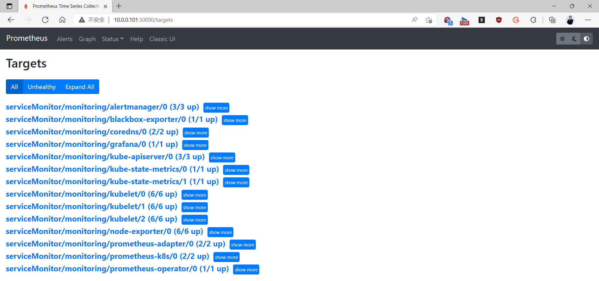
```text
结果显示：这里有大量自动监控到的节点信息
```

### 11.2.2 尝试进行数据的采集

例如查询K8S集群中每个POD的CPU使用情况，可以使用如下查询条件查询：
```text
#提示：metrics的指标名称 container_cpu_usage_seconds_total
sum(rate(container_cpu_usage_seconds_total{image!="", pod!=""}[1m] )) by (pod)
```

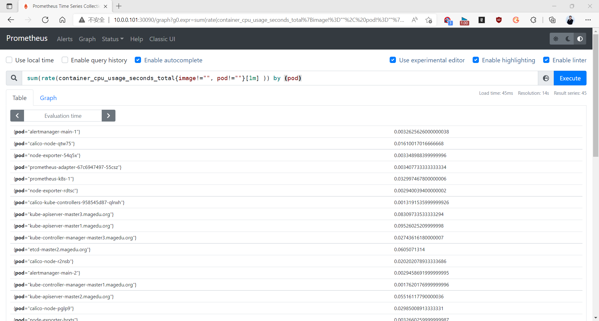

### 11.2.3 访问 Alertmanager

访问alertmanager的浏览器地址： 10.0.0.101:30093

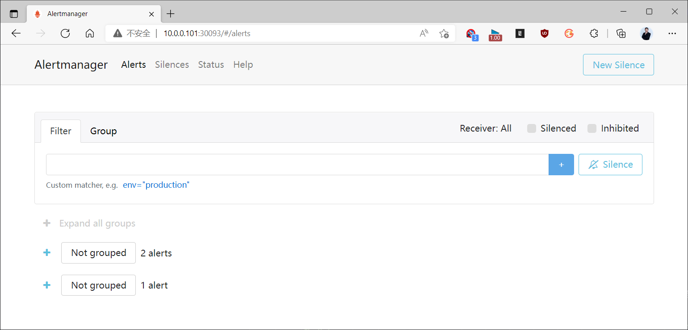

### 11.2.4 Grafana 展示

访问grafana的浏览器地址： 10.0.0.101:30030，首次登录时账号密码默认为：admin/admin

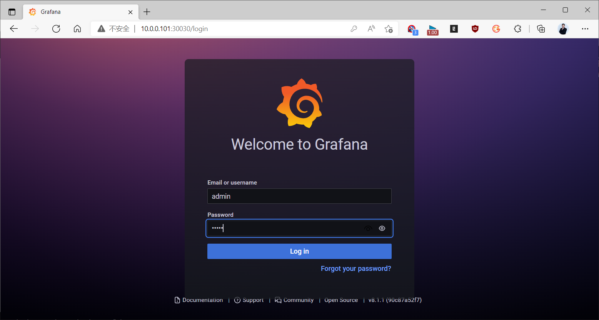

首次登录需要修改密码

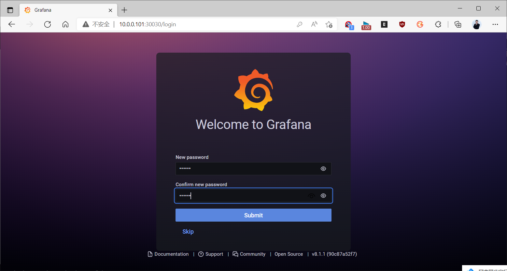

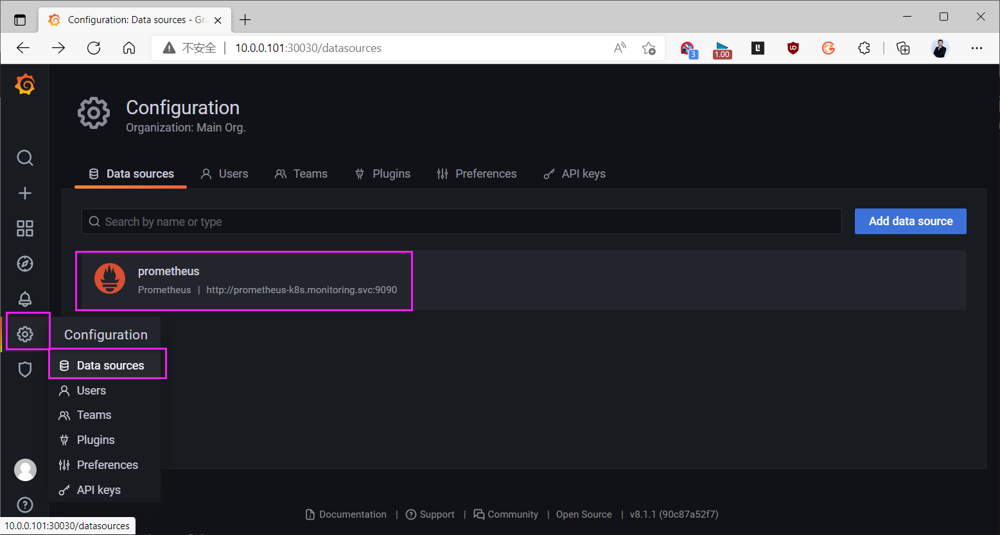
```bash
#结果显示：自动帮我们定制好大量prometheus的数据库连接地址，我们可以直接使用它，具体代码如下：
cat /usr/local/kube-prometheus-0.9.0/manifests/prometheus-adapter-deployment.yaml
...
spec:
  ...
    spec:
      containers:
      - args:
         - --cert-dir=/var/run/serving-cert
         - --config=/etc/adapter/config.yaml
         - --logtostderr=true
         - --metrics-relist-interval=1m
         - --prometheus-url=http://prometheus-k8s.monitoring.svc.cluster.local:9090/
         - --secure-port=6443
        ...
```

点击左侧"+"弹框里面的import",将https://grafana.com/dashboards/8919添加到prometheus里面，效果如下

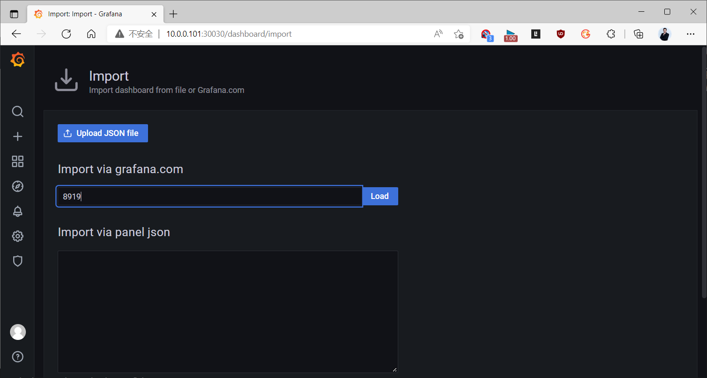

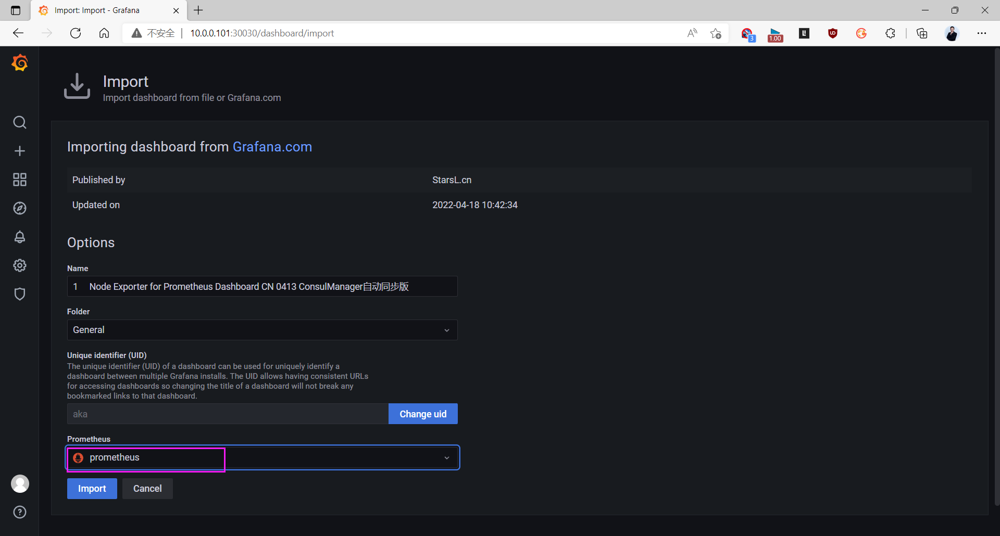

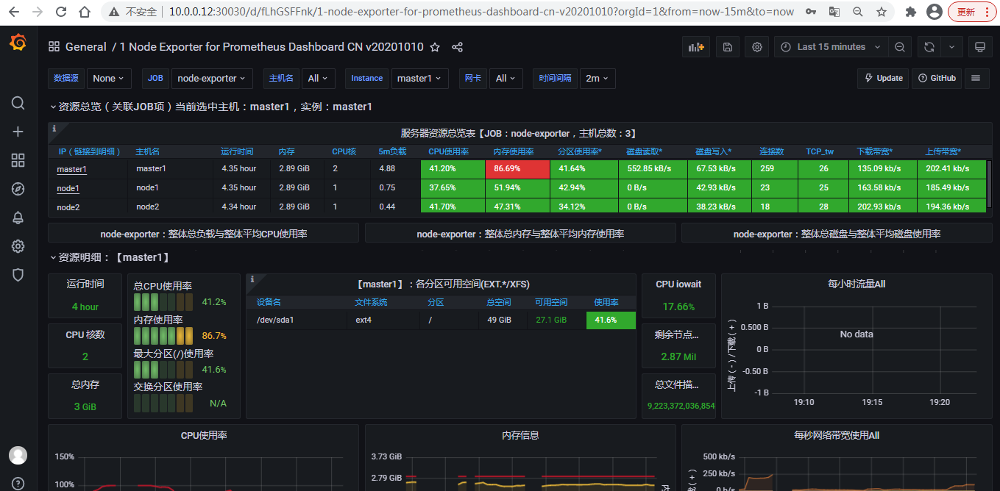

## 11.3 Ingress 定制

### 11.3.1 配置Ingress代理
```yaml
#获取配置文件,可能需要科学上网才能下载
wget  https://raw.githubusercontent.com/kubernetes/ingress-nginx/controller-v1.0.3/deploy/static/provider/baremetal/deploy.yaml
#修改镜像
grep image: deploy.yaml
          image: registry.cn-hangzhou.aliyuncs.com/google_containers/nginx-ingress-
controller:v1.0.3@sha256:4ade87838eb8256b094fbb5272d7dda9b6c7fa8b759e6af5383c1300996a
7452
          image: registry.cn-hangzhou.aliyuncs.com/google_containers/kube-webhook-
certgen:v1.0@sha256:f3b6b39a6062328c095337b4cadcefd1612348fdd5190b1dcbcb9b9e90bd8068
          image: registry.cn-hangzhou.aliyuncs.com/google_containers/kube-webhook-
certgen:v1.0@sha256:f3b6b39a6062328c095337b4cadcefd1612348fdd5190b1dcbcb9b9e90bd8068
#部署ingress controller服务
kubectl apply -f deploy.yaml
#定制ingress代理
cat > ingress-prometheus.yaml << EOF
apiVersion: networking.k8s.io/v1
kind: Ingress
metadata:
  name: ingress-prometheus
  namespace: monitoring
  annotations:
    kubernetes.io/ingress.class: "nginx"
    prometheus.io/http_probe: "true"
spec:
  rules:
  - host: alert.localprom.com
    http:
      paths:
      - path: /
        pathType: Prefix
        backend:
           service:
            name: alertmanager-main
            port:
              number: 9093
  - host: grafana.localprom.com
    http:
      paths:
      - path: /
        pathType: Prefix
        backend:
           service:
            name: grafana
            port:
              number: 3000
  - host: prom.localprom.com
    http:
      paths:
      - path: /
        pathType: Prefix
        backend:
           service:
            name: prometheus-k8s
            port:
              number: 9090
EOF
#应用资源配置文件
kubectl apply -f ingress-prometheus.yaml
#配置ingress的域名映射
# vim /etc/hosts
10.0.0.101 grafana.localprom.com alert.localprom.com prom.localprom.com
#查看效果
kubectl get ingress -n monitoring
NAME                 CLASS    HOSTS
       ADDRESS   PORTS   AGE
ingress-prometheus   <none>
alert.localprom.com,grafana.localprom.com,prom.localprom.com             80      26s
kubectl describe ingress ingress-prometheus -n monitoring
Name:             ingress-prometheus
Namespace:        monitoring
Address:
Default backend:  default-http-backend:80 (<error: endpoints "default-http-backend"
not found>)
Rules:
  Host                   Path  Backends
  ----  ---- --------
  alert.localprom.com
                         /   alertmanager-main:9093
(10.244.3.7:9093,10.244.5.4:9093,10.244.5.5:9093)
  grafana.localprom.com
                         /   grafana:3000 (10.244.4.4:3000)
  prom.localprom.com
                         /   prometheus-k8s:9090 (10.244.3.9:9090,10.244.5.3:9090)
Annotations:             kubernetes.io/ingress.class: nginx
                         prometheus.io/http_probe: true
Events:
  Type    Reason  Age   From                      Message
  ----  ------ ---- ----  -------
  Normal  Sync    32s   nginx-ingress-controller  Scheduled for sync
```

### 11.3.2 访问测试
```text
#浏览器分别访问：如下地址
prom.localprom.com
alert.localprom.com
grafana.localprom.com
```

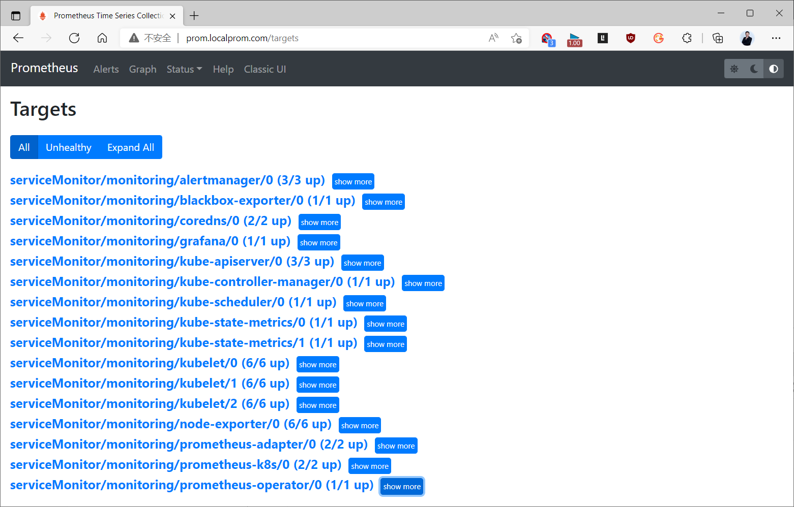

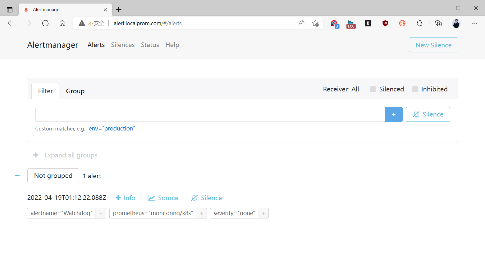

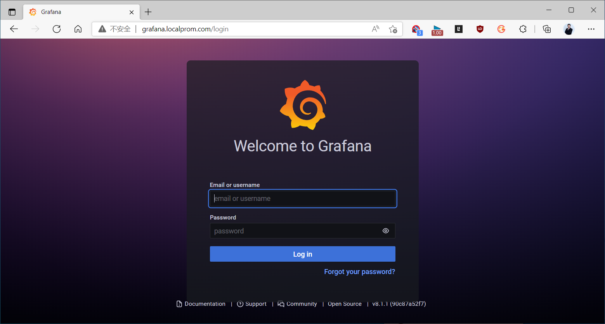

## 11.4 Kubernetes 组件

默认情况下，prometheus没有监控到 controller 和 scheduler的信息

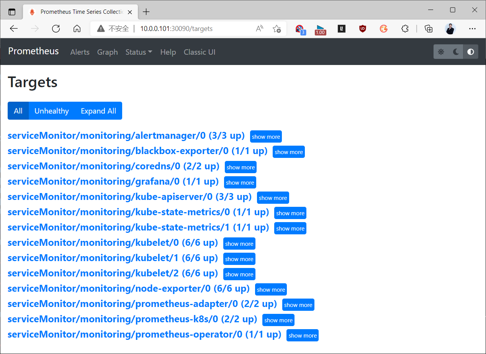

prometheus 要监控k8s的组件，需要关注一下几点：

Kubernetes必须开放controller和scheduler的监听地址,要定制专用的endpoint和svc资源对象
Prometheus是根据 kubernetes-serviceMonitorKubeScheduler.yaml和kubernetes-  
serviceMonitorKubeControllerManager.yaml 文件来进行监控的  

所以，定制的svc关联出来的 labels 必须要与kube-prometheus的值一致

### 11.4.1 开放相关地址
```text
#修改kube-controller-manager的监听地址
vim /etc/kubernetes/manifests/kube-controller-manager.yaml
grep bind /etc/kubernetes/manifests/kube-controller-manager.yaml
    - --bind-address=0.0.0.0
#修改kube-scheduler的监听地址
vim /etc/kubernetes/manifests/kube-scheduler.yaml
grep bind /etc/kubernetes/manifests/kube-scheduler.yaml
    - --bind-address=0.0.0.0
```

### 11.4.2 定制采集 Controller 数据
```yaml
cat > kube-controller-namager-svc-ep.yaml <<EOF
apiVersion: v1
kind: Service
metadata:
  name: kube-controller-manager
  namespace: kube-system
  labels:
    app.kubernetes.io/name: kube-controller-manager
spec:
  type: ClusterIP
  clusterIP: None
  ports:
  - name: http-metrics
    port: 10252
    targetPort: 10252
    protocol: TCP
  - name: https-metrics
    port: 10257
    targetPort: 10257
    protocol: TCP
---
apiVersion: v1
kind: Endpoints
metadata:
  name: kube-controller-manager
  namespace: kube-system
  labels:
    app.kubernetes.io/name: kube-controller-manager
subsets:
- addresses:
  - ip: 10.0.0.101
  ports:
    - name: http-metrics
      port: 10252
      protocol: TCP
    - name: https-metrics
      port: 10257
      protocol: TCP
EOF
#属性解析：这里面的 addresses 应该是master的节点地址
#执行资源定义文件
kubectl apply -f kube-controller-namager-svc-ep.yaml
#查看效果
kubectl get ep -n kube-system
```

### 11.4.3 定制采集 Scheduler 数据
```yaml
cat > kube-scheduler-svc-ep.yaml <<EOF
apiVersion: v1
kind: Service
metadata:
  name: kube-scheduler
  namespace: kube-system
  labels:
    app.kubernetes.io/name: kube-scheduler
spec:
  type: ClusterIP
  clusterIP: None
  ports:
  - name: http-metrics
    port: 10251
    targetPort: 10251
    protocol: TCP
  - name: https-metrics
    port: 10259
    targetPort: 10259
    protocol: TCP
---
apiVersion: v1
kind: Endpoints
metadata:
  name: kube-scheduler
  namespace: kube-system
  labels:
   app.kubernetes.io/name: kube-scheduler
subsets:
- addresses:
  - ip: 10.0.0.101
  ports:
    - name: http-metrics
      port: 10251
      protocol: TCP
    - name: https-metrics
      port: 10259
      protocol: TCP
EOF
#属性解析：这里面的 addresses 应该是master的节点地址
#执行资源定义文件
kubectl apply -f kube-scheduler-svc-ep.yaml
#查看效果
kubectl get ep -n kube-system
```

### 11.4.4 查看效果

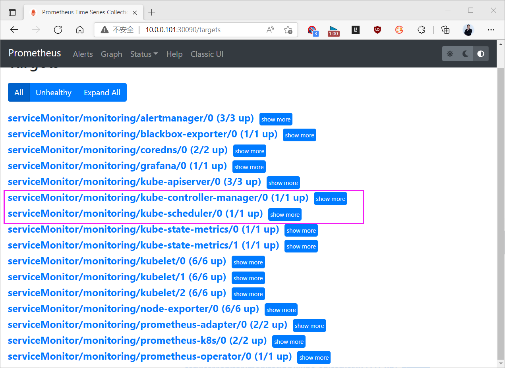

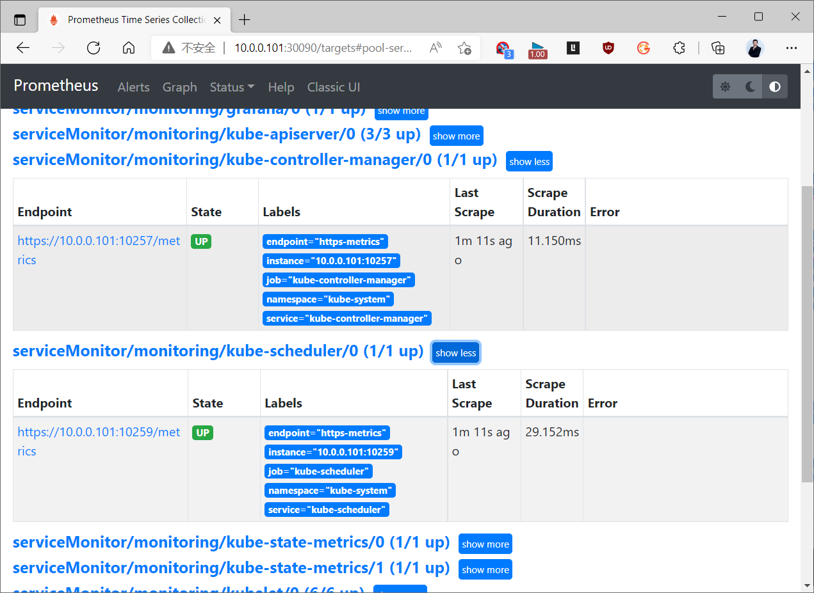

结果显示：新增加了两个服务，如果这两个服务不正常的话，只有一个原因，controller或者scheduler的服务不正常，需要确保这两个服务式正常的。

## 11.5 Node Exporter 部署和监控

### 11.5.1 Node Exporter 部署
```yaml
[root@master1 ~]#cat yaml/node_exporter_daemonset.yaml
apiVersion: apps/v1
kind: DaemonSet
metadata:
  name: node-exporter
  namespace: monitoring
  labels:
    app: node-exporter
spec:
  selector:
    matchLabels:
      app: node-exporter
  template:
    metadata:
      labels:
        app: node-exporter
    spec:
      tolerations:
      - key: node-role.kubernetes.io/control-plane
        operator: Exists
        effect: NoSchedule
      - key: node-role.kubernetes.io/master
        operator: Exists
        effect: NoSchedule
      containers:
      - image: prom/node-exporter:v1.2.2
        imagePullPolicy: IfNotPresent
        name: prometheus-node-exporter
        ports:
         - containerPort: 9100
          hostPort: 9100
          protocol: TCP
          name: metrics
        volumeMounts:
         - mountPath: /host/proc
          name: proc
         - mountPath: /host/sys
          name: sys
         - mountPath: /host
          name: rootfs
        args:
         - --path.procfs=/host/proc
         - --path.sysfs=/host/sys
         - --path.rootfs=/host
      volumes:
         - name: proc
          hostPath:
            path: /proc
         - name: sys
          hostPath:
            path: /sys
         - name: rootfs
          hostPath:
            path: /
      hostNetwork: true
      hostPID: true
---
#以下可选
apiVersion: v1
kind: Service
metadata:
  annotations:
    prometheus.io/scrape: "true"
  labels:
    app: node-exporter
  name: node-exporter
  namespace: monitoring
spec:
  type: NodePort
  ports:
  - name: http
    port: 9100
    nodePort: 30910
    protocol: TCP
  selector:
    app: node-exporter
[root@master1 ~]#kubectl apply -f yaml/node-exporter-daemonset.yaml
[root@master1 ~]#kubectl get pod -n monitoring
NAME                  READY   STATUS              RESTARTS   AGE
cadvisor-9t76q        1/1     Running             0          42m
cadvisor-cskx5        1/1     Running             0          42m
cadvisor-f7kfk        1/1     Running             0          42m
cadvisor-fsfhw        1/1     Running             0          41m
cadvisor-ngqpq        1/1     Running             0          41m
cadvisor-qmd47        1/1     Running             0          41m
node-exporter-2zxz5   1/1     Running             0          27s
node-exporter-47x22   0/1     Running             0          27s
node-exporter-55pc2   1/1     Running             0          27s
node-exporter-94xsn   1/1     Running             0          27s
node-exporter-c7wmd   0/1     Running             0          27s
node-exporter-qvccz   0/1     Running             0          27s
[root@master1 ~]#kubectl get ep -n monitoring
NAME            ENDPOINTS                                                     AGE
node-exporter   10.0.0.101:9100,10.0.0.102:9100,10.0.0.103:9100 + 3 more...   16m
[root@master1 ~]#kubectl get svc -n monitoring
NAME            TYPE       CLUSTER-IP      EXTERNAL-IP   PORT(S)          AGE
node-exporter   NodePort   10.104.205.37   <none>        9100:30910/TCP   16m
```

### 11.5.2 Prometheus 监控 Node Exporter

修改Proemetheus配置
```yaml
[root@ubuntu2004 ~]#vim /usr/local/prometheus/conf/prometheus.yml
.......
  - job_name: "k8s_node_exporter"
    static_configs:
      - targets:
         - "10.0.0.101:9100"
         - "10.0.0.102:9100"
         - "10.0.0.103:9100"
         - "10.0.0.104:9100"
         - "10.0.0.105:9100"
         - "10.0.0.106:9100"
[root@ubuntu2004 ~]#curl -X POST http://localhost:9090/-/reload
```

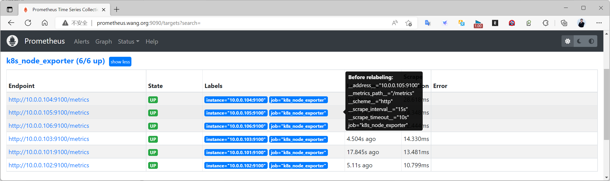

### 11.5.3 Grafana 展示

通过 Grafana 的模板 1860 ，11074等观察结果

#



<nav class="article-end" aria-label="章节导航">
  <a href="{{ '/subjects/Prometheus/32-kubernetes-operator.html' | relative_url }}">← 上一章：Kubernetes Operator 部署</a>
  <a href="{{ '/subjects/Prometheus/' | relative_url }}">返回 Prometheus 目录</a>
</nav>
