[← Back to Redis Database Index]({{ '/subjects/Redis/' | relative_url }})



# 01 Redis Fundamentals
## 1 Redis 部署

### 1.1 Redis 基础

### NoSQL 数据库

### 什么是 NoSQL

数据库主要分为两大类：关系型数据库与 NoSQL 数据库。

关系型数据库，是建立在关系模型基础上的数据库，其借助于集合代数等数学概念和方法来处理数据库中的数据。主流的 MySQL、Oracle、MS SQL Server 和 DB2  都属于这类传统数据库。

NoSQL 数据库，全称为 Not Only SQL，意思就是适用关系型数据库的时候就使用关系型数据库，不适用的时候可以考虑使用更加合适的数据存储。NoSQL 是对不同于传统的关系型数据库的数据库管理系统的统称。

NoSQL用于超大规模数据的存储。（例如谷歌或Facebook每天为他们的用户收集万亿比特的数据）。 这些类型的数据存储不需要固定的模式，无需多余操作就可以横向扩展。

### NoSQL 起源

NoSQL一词最早出现于1998年，是Carlo Strozzi开发的一个轻量、开源、不提供SQL功能的关系数据库。

2009年，Last.fm的Johan Oskarsson发起了一次关于分布式开源数据库的讨论，来自Rackspace的Eric Evans再次提出了NoSQL的概念，这时的NoSQL主要指非关系型、分布式、不提供ACID的数据库设计模式。

2009年在亚特兰大举行的"no:sql(east)"讨论会是一个里程碑，其口号是"select fun, profit from real_world where relational=false;"。因此，对NoSQL最普遍的解释是"非关联型的"，强调Key-Value Stores和文档数据库的优点，而不是单纯的反对RDBMS。

### 为什么使用 NoSQL

Oracle，MySQL 等传统的关系数据库非常成熟并且已大规模商用，为什么还要用 NoSQL 数据库呢？

主要是由于随着互联网发展，数据量越来越大，对性能要求越来越高，传统数据库存在着先天性的缺陷，即单机（单库）性能瓶颈，并且扩展困难。这样既有单机单库瓶颈，却又扩展困难，自然无法满足日益增长的海量数据存储及其性能要求，所以才会出现了各种不同的 NoSQL 产品，NoSQL 根本性的优势在于在云计算时代，简单、易于大规模分布式扩展，并且读写性能非常高

通过第三方平台（如：Google,Facebook等）可以很容易的访问和抓取数据。用户的个人信息，社交网络，地理位置，用户生成的数据和用户操作日志已经成倍的增加。如果要对这些用户数据进行挖掘，那 SQL数据库已经不适合这些应用了, NoSQL 数据库的发展却能很好的处理这些大的数据。

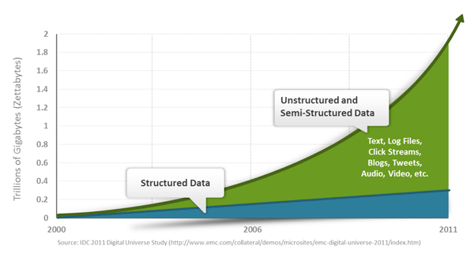

### NoSQL 数据库分类

类型部分代表特点

顾名思义，是按列存储数据的。最大的特点是方便存

列存储 HbaseCassandraHypertable

储结构化和半结构化数据，方便做数据压缩，对针对某一列或者某几列的查询有非常大的IO优势。

文档存储一般用类似json的格式存储，存储的内容是

文档存储 MongoDB CouchDB

文档型的。这样也就有机会对某些字段建立索引，实现关系数据库的某些功能。

key-

Tokyo Cabinet /

可以通过key快速查询到其value。一般来说，存储不

value

TyrantBerkeley

管value的格式，照单全收。（Redis包含了其他功

Memcached，Redis，ETCD

存储

能）

图存储 Neo4JFlockDB 图形关系的最佳存储。使用传统关系数据库来解决的

话性能低下，而且设计使用不方便。

对象存储 db4oVersant 通过类似面向对象语言的语法操作数据库，通过对象

的方式存取数据。

xml

Berkeley DB XMLBaseX 高效的存储XML数据，并支持XML的内部查询语法，

数据

比如XQuery,Xpath。

库

### RDBMS和NOSQL对比

RDBMS

高度组织化结构化数据结构化查询语言（SQL） 数据和关系都存储在单独的表中。 数据操纵语言，数据定义语言严格的一致性基础事务

NoSQL

代表着不仅仅是SQL, 没有声明性查询语言没有预定义的模式最终一致性，而非ACID属性非结构化和不可预知的数据 CAP定理高性能，高可用性和可伸缩性

### NoSQL的优点/缺点

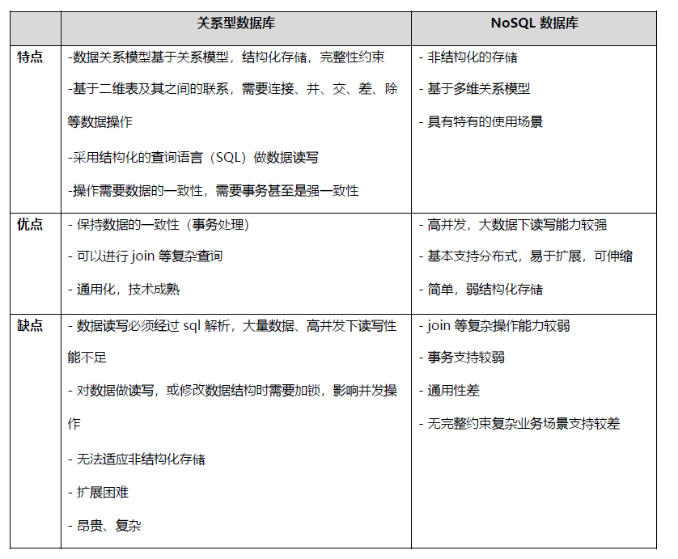

### CAP theorem

在计算机科学中, CAP定理（CAP theorem）, 又被称为布鲁尔定理（Brewer's theorem）, 1998年，加州大学的计算机科学家Eric Brewer提出

它指出对于一个分布式计算系统，不可能同时满足以下三点:

C：Consistency

即一致性， 所有节点在同一时间具有相同的数据视图

换句话说，如果一个节点在写入操作完成后，所有其他节点都能立即读取到最新的数据。

注意，这里的一致性指的是强一致性，也就是数据更新完，访问任何节点看到的数据完全一致，要和弱一致性，最终一致性区分开来。

每次读取的数据都应该是最近写入的数据或者返回一个错误, 而不是过期数据，也就是说，所有节点的数据是一致的。

A：Availability

即可用性，所有的节点都保持高可用性,要求服务在接收到客户端请求后，都能够给出响应

每个非故障节点都能够在有限的时间内返回有效的响应，即系统一直可用。可用性强调系统对用户请求的及时响应

注意，这里的高可用还包括不能出现延迟，比如如果某个节点由于等待数据同步而阻塞请求，那么该节点就不满足高可用性。

也就是说，任何没有发生故障的服务必须在有限的时间内返回合理的结果集。

每次请求都应该得到一个有效的响应，而不是返回一个错误或者失去响应，不过这个响应不需要保证数据是最近写入的,也就是说系统需要一直都是可用正常使用的，不会引起调用者的异常，但是并不保证响应的数据是最新的。

P：Partiton tolerance 分区是指系统中的节点由于网络故障无法相互通信，导致系统被分成多个孤立的子系统

在分布式系统中，不同节点之间通过网络进行通信

分区容忍性是指当分布式系统中出现网络分区（即系统中的一部分节点无法和其他节点进行通信） 时，系统能够容忍这种情况，并且分离的系统也能够正常运行。这意味着，即使系统中某些节点或网络分区出现故障或延迟，整个系统仍然能够继续运作，不会受到单点故障的影响。

由于网络是不可靠的，所有节点之间很可能出现无法通讯的情况，在节点不能通信时，要保证系统可以继续正常服务。

在分布式系统中，机器分布在各个不同的地方，由网络进行连接。由于各地的网络情况不同，网络的延迟甚至是中断是不可避免的。

因此分区容错性通常是分布式系统的必要条件，即如果不能容忍分区，就只能是一个单一系统，而非一个真正可用的分布式系统

遵循CAP原理，一个数据分布式系统不可能同时满足C和A和P这3个条件。所以系统架构师在设计系统时，不要将精力浪费在如何设计能满足三者的完美分布式系统，而是应该进行取舍。由于网络的不可靠的性质，大多数开源的分布式系统都会实现P，也就是分区容忍性，之后在C和A中做抉择。

比如: MySQL的主从服务器之间网络没有问题，主从复制正常，那么数据一致性，可用性是有保障的。 但是如果网络出现了问题，主从复制异常，那么就会有数据不同步的情况。这种情况下有两个选择，第一个方法是保证可用性，允许出现数据不一致的情况，依然在主数据库写，从数据库读。第二个方法是保证一致性，关闭主数据库，禁止写操作，确保主从数据一致，等服务器之间网络恢复了，再开放写操作。

也就是说，在服务器之间的网络出现异常的情况下，一致性和可用性是不可能同时满足的，必须要放弃一个，来保证另一个。这也正是CAP定理所说的，在分布式系统中，P总是存在的。在P发生的前提下， C(一致性)和A（可用性）不能同时满足。这种情况在做架构设计的时候就要考虑到，要评估对业务的影响，进行权衡决定放弃哪一个。在通常的业务场景下，系统不可用是不能接受的，所以要优先保证可用性，暂时放弃一致性。

因此，根据 CAP 原理将 NoSQL 数据库分成了满足 CA 原则、满足 CP 原则和满足 AP 原则三大类：

CA - 单点集群，满足一致性，可用性的系统，通常在可扩展性上不太强大。

放弃分区容忍性，即不进行分区，不考虑由于网络不通或结点挂掉的问题，则可以实现一致性和可用性。那么系统将不是一个标准的分布式系统

比如:单一数据中心数据库,所有节点都位于同一个数据中心，并且节点之间的通信是高可靠的

CP - 满足一致性，分区容忍性的系统，通常性能不是特别高。 放弃可用性，追求强一致性和分区容错性

例如: Zookeeper,ETCD,Consul,MySQL的PXC等集群就是追求的强一致，再比如跨行转账，一次转账请求要等待双方银行系统都完成整个事务才算完成。

AP - 满足可用性，分区容忍性的系统，通常可能对一致性要求低一些。

放弃一致性，追求分区容忍性和可用性。这是很多分布式系统设计时的选择。

例如：MySQL主从复制，默认是异步机制就可以实现AP，但是用户接受所查询的到数据在一定时间内不是最新的.

通常实现AP都会保证最终一致性，而BASE理论就是根据AP来扩展的，一些业务场景 比如：订单退款，今日退款成功，明日账户到账，只要用户可以接受在一定时间内到账即可。

### Redis 简介

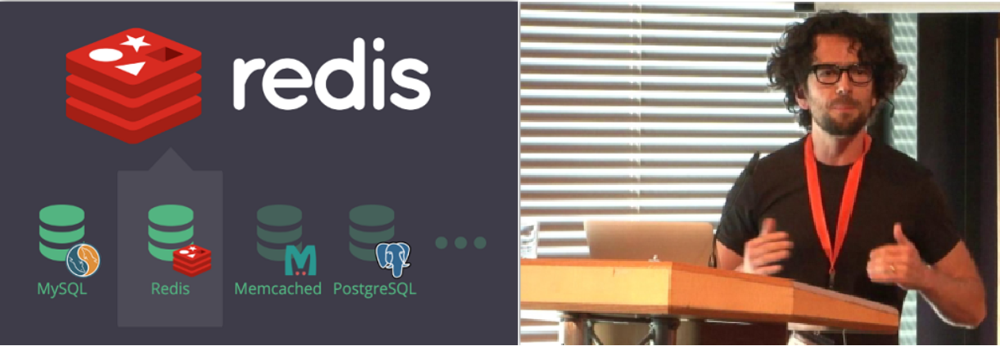

Redis (Remote Dictionary Server 远程字典服务)是一个遵循BSD MIT开源协议的高性能的NoSQL

Redis 基于ANSI C语言语言)编写的key-value数据库,是意大利的Salvatore Sanfilippo在2009年发布

从2010年3月15日起，Redis的开发工作由VMware主持。从2013年5月开始，Redis的开发由Pivotal公司赞助。目前国内外使用的公司众多,比如:阿里,腾讯,百度,京东,新浪微博,GitHub,Twitter 等

Redis的出现，很大程度补偿了memcached这类key/value存储的不足，在部分场合可以对关系数据库起到很好的补充作用。它提供了Java，C/C++，Go, C#，PHP，JavaScript，Perl，Object-C，Python， Ruby，Erlang等客户端

DB-Engine月度排行榜Redis在键值型存储类的数据库长期居于首位,远远高于第二位的memcached

<https://db-engines.com/en/ranking>

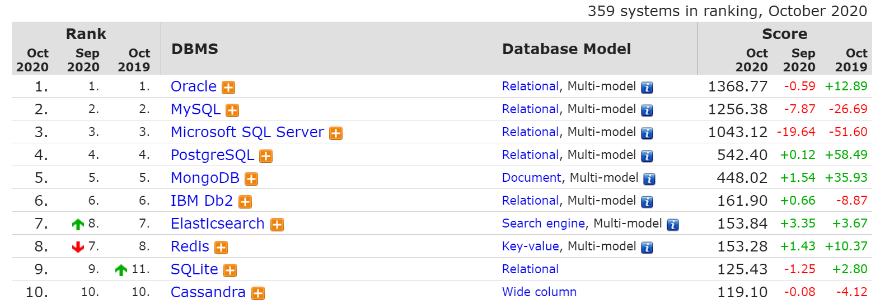

<https://db-engines.com/en/ranking/key-value+store>

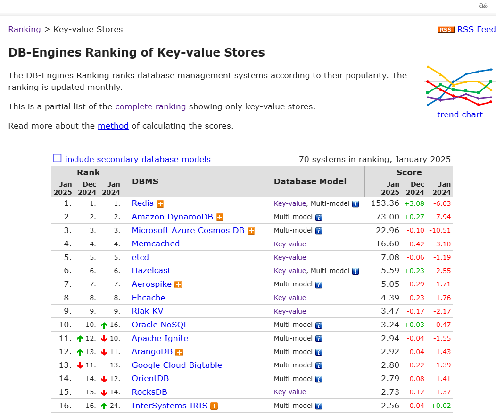

Redis 官网地址：https://redis.io/

### Redis 特性

速度快: 10W QPS,基于内存,C语言实现单线程：引号的”单线程“ 持久化：RDB，AOF 支持多种数据类型支持多种编程语言功能丰富: 支持Lua脚本,发布订阅,事务,pipeline等功能简单: 代码短小精悍(单机核心代码只有23000行左右),单线程开发容易,不依赖外部库,使用简单主从复制支持高可用和分布式

### “单线程”

Redis 6.0版本前一直是单线程方式处理用户的请求

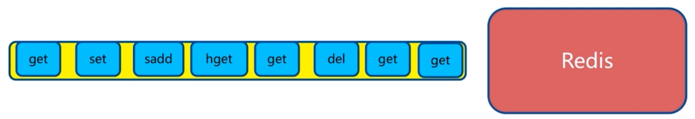

单线程为何如此快?

纯内存非阻塞避免线程切换和竞态消耗基于Epoll实现IO多路复用数据结构简单,基于key/value对

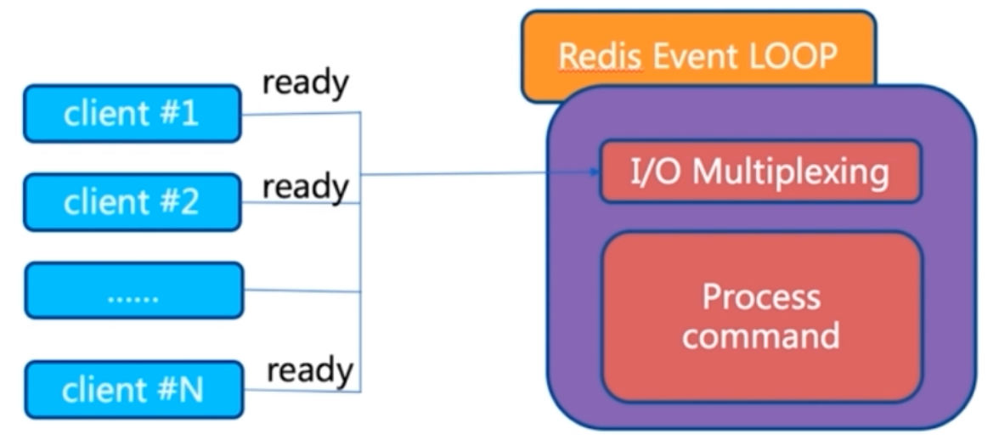

注意事项:

一次只运行一条命令避免执行长(慢)命令:keys *, flushall, flushdb, slow lua script, mutil/exec, operate big value(collection) 其实不是单线程: 早期版本是单进程单线程,3.0 版本后实际还有其它的线程, 实现特定功能,如: fysnc file descriptor,close file descriptor

### Pipeline 流水线

Redis 客户端执行一条命令分6个过程：

发送命令－-〉网络传输－-〉 命令排队－-〉命令执行－-〉网络传输－-〉 返回结果

这个过程称为Round trip time(简称RTT, 往返时间)，mget,mset指令可以一次性的批量对多个数据的执行操作,所以有效节约了RTT

但大部分命令（如hgetall）不支持批量操作，需要消耗N次RTT ，利用 Pipeline 技术可以解决这一问题

未使用pipeline执行N条命令如下图

使用了pipeline执行N条命令如下图

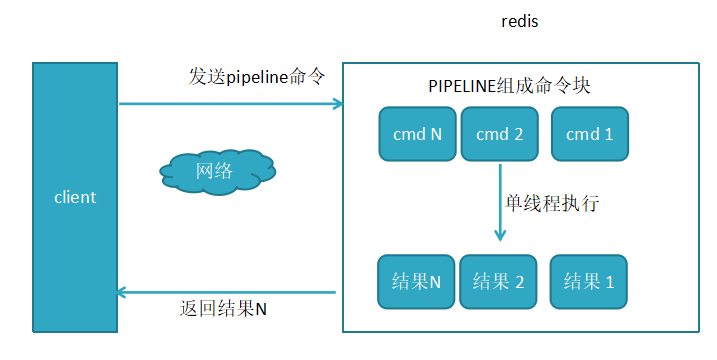

两者性能对比

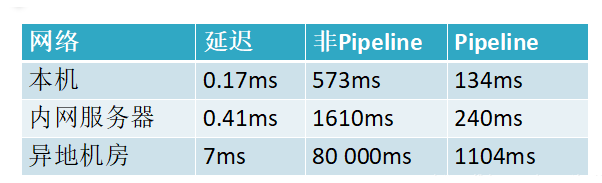

以上对比结果说明在使用Pipeline执行时速度比逐条执行要快，特别是客户端与服务端的网络延迟越大，性能体能越明显。

### Redis 对比 Memcached

比较类别 Redis Memcached

支持的数

哈希、列表、集合、有序集合纯kev-value

据结构

持久化支

有无

持

redis支持集群功能，可以实现主动复制，读写分离。

高可

官方也提供了sentinel集群管理工具，能够实现主从

用支

需要二次开发

服务监控，故障自动转移，这一切，对于客户端都是

持

透明的，无需程序改动，也无需人工介入

存储 value

最大512M 最大1M

容量

内存分配临时申请空间，可能导致碎片预分配内存池的方式管理内

存，能够省去内存分配时间

有自己的VM机制，理论上能够存储比物理内存更多

虚拟

的数据，当数据超量时，会引发swap，把冷数据刷

内存

所有的数据存储在物理内存里

使用

到磁盘上

非阻塞IO复用模型,提供一些非KV存储之外的排序，

网络

聚合功能，在执行这些功能时，复杂的CPU计算，会

非阻塞IO复用模型

模型

阻塞整个IO调度

水平扩展

redis cluster 可以横向扩展暂无

的支持

Memcached支持多线程,CPU

多线程 Redis6.0之前是只支持单线程

利用方面Memcache优于 Redis

懒淘汰机制：每次往缓存放入数据的时候，都会存一个时

过期策略有专门线程，清除缓存数据

间，在读取的时候要和设置的时间做TTL比较来判断是否过期

单机 QPS 约10W 约60W

源代

代码清爽简洁可能是考虑了太多的扩展性，

码可

多系统的兼容性，代码不清爽

读性

复杂数据结构、有持久化、高可用需求、value存储

纯KV，数据量非常大，并发量

适用场景

内容较大

非常大的业务

### Redis 常见应用场景

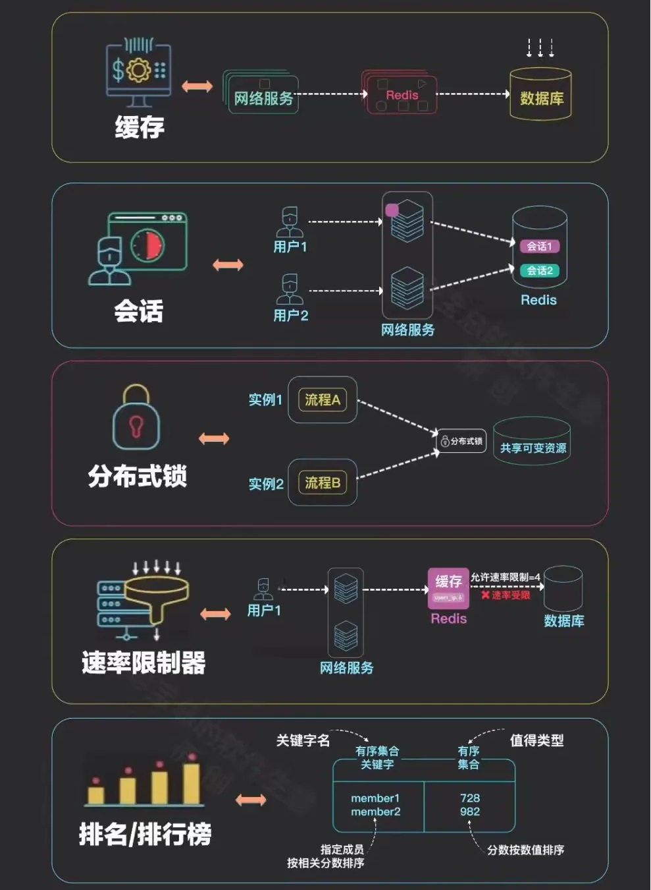

缓存：缓存RDBMS中数据,比如网站的查询结果、商品信息、微博、新闻、消息

Session 共享：实现Web集群中的多服务器间的 session 共享

计数器：商品访问排行榜、浏览数、粉丝数、关注、点赞、评论等和次数相关的数值统计场景

社交：朋友圈、共同好友、可能认识他们等

地理位置: 基于地理信息系统GIS（Geographic Information System)实现摇一摇、附近的人、外卖等功能

消息队列：ELK等日志系统缓存、业务的订阅/发布系统

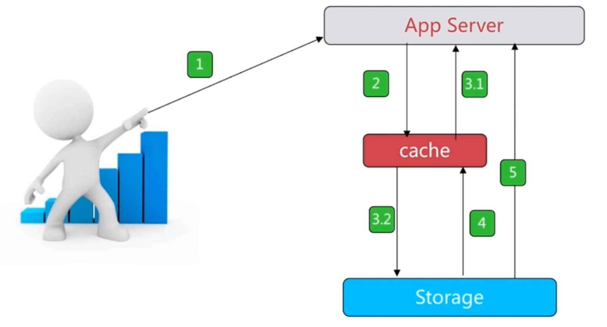

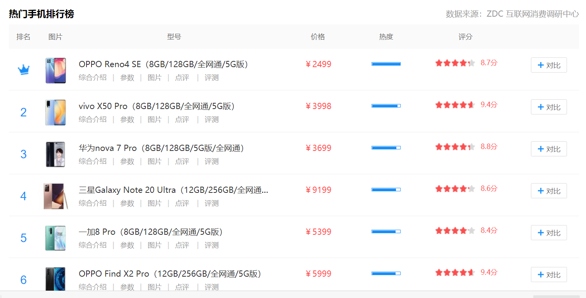

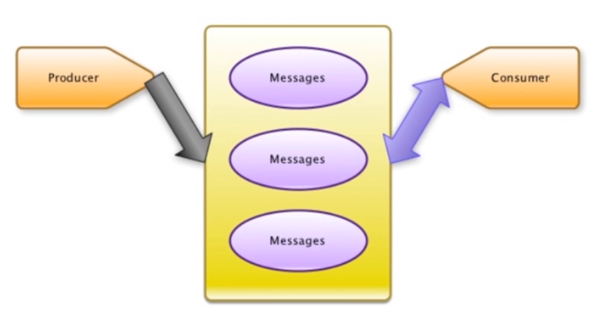

### 缓存的实现流程

数据更新操作流程：

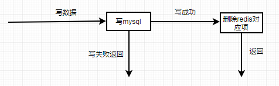

数据读操作流程：

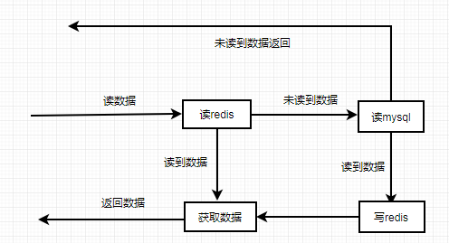

### 缓存穿透,缓存击穿和缓存雪崩

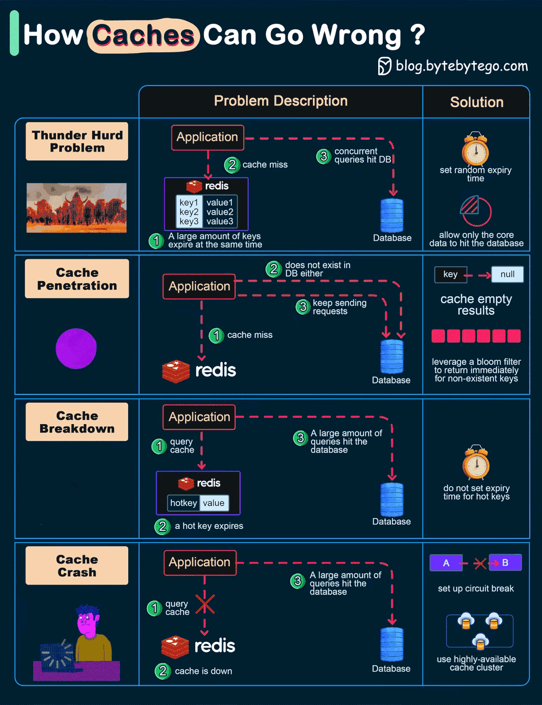

### 缓存穿透 Cache Penetration

缓存穿透是指缓存和数据库中都没有的数据，而用户不断发起请求，比如： 发起为id为 “-1” 的数据或id 为特别大不存在的数据。

这时的用户很可能是攻击者，攻击会导致数据库压力过大。

解决方法：

接口层增加校验，如用户鉴权校验，id做基础校验，id<=0的直接拦截从缓存取不到的数据，在数据库中也没有取到，这时也可以将key-value对写为key-null，缓存有效时间可以设置短点，如30秒（设置太长会导致正常情况也没法使用）。这样可以防止攻击用户反复用同一个id暴力攻击

### 缓存击穿 Cache breakdown

缓存击穿是指缓存中没有但数据库中有的数据，比如：热点数据的缓存时间到期后，这时由于并发用户特别多，同时读缓存没读到数据，又同时去数据库去取数据，引起数据库压力瞬间增大，造成过大压力

解决方法：

设置热点数据永远不过期。

### 缓存雪崩 Thunder Hurd Problem

缓存雪崩是指缓存中数据大批量到过期时间，而查询数据量巨大，引起数据库压力过大甚至down机。和缓存击穿不同的是，缓存击穿指并发查同一条数据，缓存雪崩是不同数据都过期了，很多数据都查不到从而查数据库。

解决方法：

缓存数据的过期时间设置随机，防止同一时间大量数据过期现象发生如果缓存数据库是分布式部署，将热点数据均匀分布在不同搞得缓存数据库中设置热点数据永远不过期

### 缓存宕机 crash

Redis 缓存服务宕机，造成 缓存服务失效

解决方法：Redis高可用集群



<nav class="article-end" aria-label="章节导航">
  <a href="{{ '/subjects/Redis/' | relative_url }}">Back to Redis Database Index</a>
  <a href="{{ '/subjects/Redis/02-installing-redis.html' | relative_url }}">Next: Installing Redis →</a>
</nav>
