[← 返回Redis 数据库目录]({{ '/subjects/Redis/' | relative_url }})



# 01 Redis 基础
## 1 Redis 部署

### 1.1 Redis 基础

### NoSQL 数据库

### 什么是 NoSQL

关系型数据库以表和关系模型组织数据，通常使用 SQL 查询，并提供成熟的事务能力。MySQL、Oracle Database、SQL Server 和 DB2 都属于这一类。

NoSQL 通常解释为“Not Only SQL”，是对键值、文档、宽列、图等不同数据模型的统称，并不是某一种数据库，也不意味着完全不用 SQL。选型的关键是访问模式：当数据结构、查询方式或扩展需求与关系模型不匹配时，可以考虑相应的 NoSQL 产品；涉及复杂关联和强事务时，关系型数据库往往更合适。两类数据库也可以在同一系统中配合使用。

### NoSQL 起源

“NoSQL”一词曾在 1998 年用于命名 Carlo Strozzi 的数据库项目；2009 年围绕分布式数据库的讨论又赋予它更广泛的含义。今天使用这个词时，应结合具体产品理解其数据模型和一致性保证，不能仅凭“NoSQL”推断它不支持事务或一定采用最终一致性。

### 为什么使用 NoSQL

不同业务对存储的要求不同。例如，缓存重视低延迟，日志和事件数据可能需要高写入吞吐，社交关系更适合按图关系遍历。为这些访问方式选择专门的数据模型，有时比强行塞入关系表更直接。

这不是“数据一大就必须放弃 SQL”：关系型数据库同样可以通过索引、分区、读写分离或分布式方案扩展。应先明确数据量、读写比例、查询方式、事务要求和故障容忍度，再决定是否引入 NoSQL，并评估额外的运维与一致性成本。

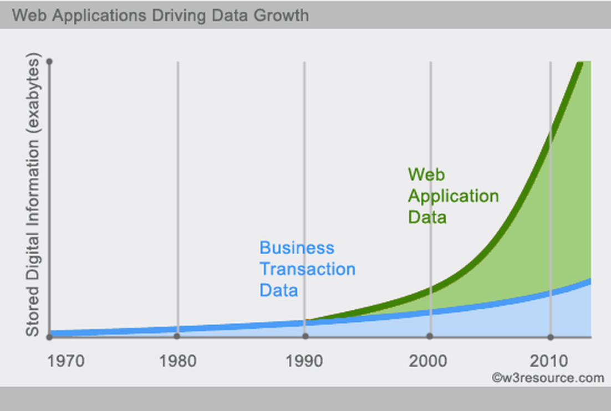

### NoSQL 数据库分类

原资料中的分类表在转为网页时被拆成了许多无意义的短行。按常见的数据模型，可这样理解：

| 类型 | 代表产品 | 适合的访问方式 |
| --- | --- | --- |
| 宽列存储 | HBase、Cassandra | 按分区键访问大量记录；数据按列族或宽行组织，不等同于分析型数据库的列式压缩存储 |
| 文档存储 | MongoDB、CouchDB | 以 JSON 等文档组织数据，并按文档字段查询或建立索引 |
| 键值存储 | Redis、Memcached | 已知键时快速读取或更新值；Redis 还提供集合、列表等服务端数据结构 |
| 图数据库 | Neo4j | 表达实体之间的关系并进行多跳遍历 |

对象数据库、XML 原生数据库也有各自的使用场景，但与本篇后续的 Redis 入门主线关系不大；不要把这些类型理解为互斥或性能排名。

### RDBMS和NOSQL对比

| 关注点 | 关系型数据库（RDBMS） | NoSQL 数据库 |
| --- | --- | --- |
| 数据模型 | 表、列、行与关系，通常有明确的模式 | 取决于产品，可为键值、文档、宽列或图 |
| 查询方式 | 以 SQL 为主，擅长关联查询和聚合 | 产品间差异很大，可能使用命令、查询语言或 API |
| 事务与一致性 | 通常提供成熟的 ACID 事务 | 不能一概而论，应核对具体产品与部署模式 |
| 扩展方式 | 可使用复制、分区或分布式部署 | 有的产品为分片而设计，也有主要面向单机的产品 |

因此，“NoSQL 都没有事务”或“关系型数据库不能横向扩展”都不是可靠的判断。

### NoSQL的优点/缺点

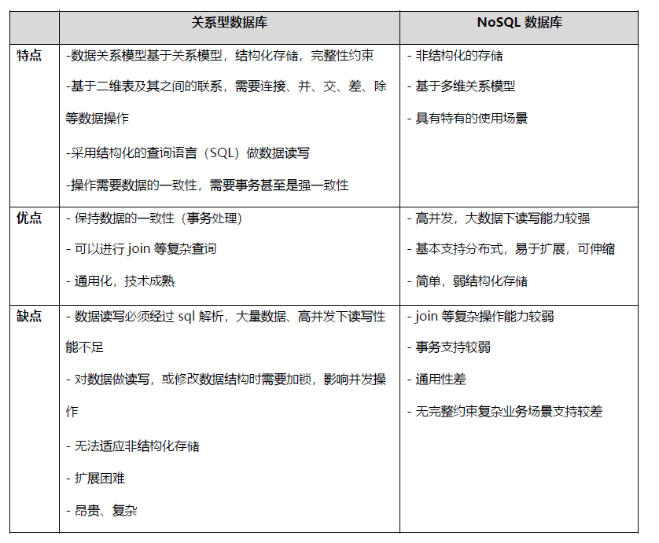

### CAP theorem

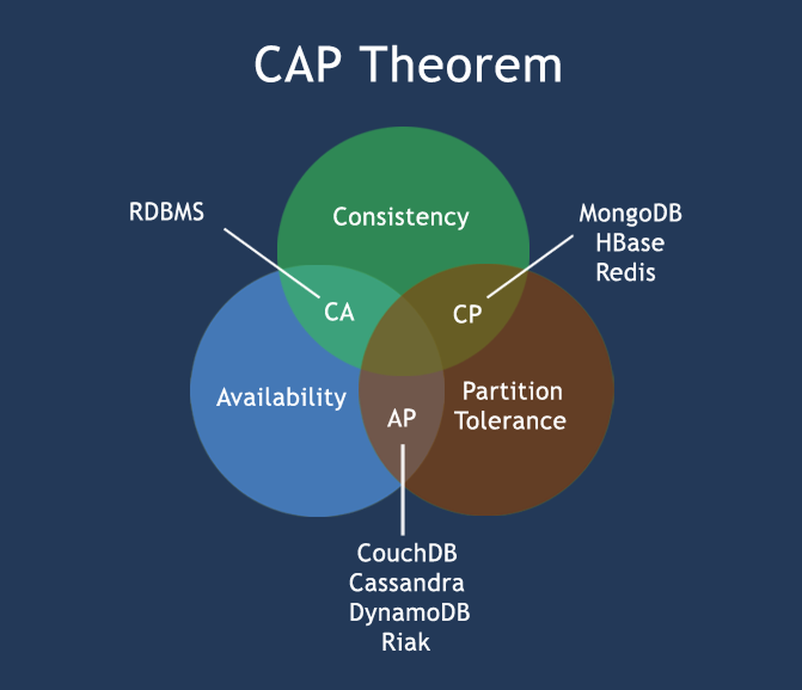

CAP 定理讨论的是**发生网络分区时**分布式系统的取舍，而不是说系统在任何时刻都只能拥有三项中的两项。这里的三个概念分别是：

- **C（一致性）**：一次成功写入之后，后续读取应看到该写入或收到错误，而不是把旧值当作最新值返回。这里讨论的是强一致性，不等于关系型数据库事务中的所有 ACID 性质。
- **A（可用性）**：每个未故障节点收到请求后都能返回响应，即使响应可能不是最新数据；这不等于“响应一定很快”或“永不宕机”。
- **P（分区容忍性）**：节点间通信中断时，系统仍有明确的处理方式。网络分区是故障情形，不是可以简单关闭的产品开关。

假设一组节点失去联系，一侧已经接受了写入，另一侧又收到读取请求：如果后一侧在无法确认新值的情况下继续返回旧值，就保留了可用性却牺牲了上述一致性；如果它暂停响应直到能确认最新值，就保留了一致性，却不满足分区期间的可用性。**取舍发生在这类具体请求上**，不是给整个数据库永久贴上“CP”或“AP”的标签。

这也是评估 Redis 复制、Sentinel 或 Cluster 时需要问的问题：复制是否异步？发生主从切换或网络分区时，客户端可能读到什么、写入可能怎样丢失？仅看到“高可用”三个字，不能推断数据绝不丢失。

### Redis 简介

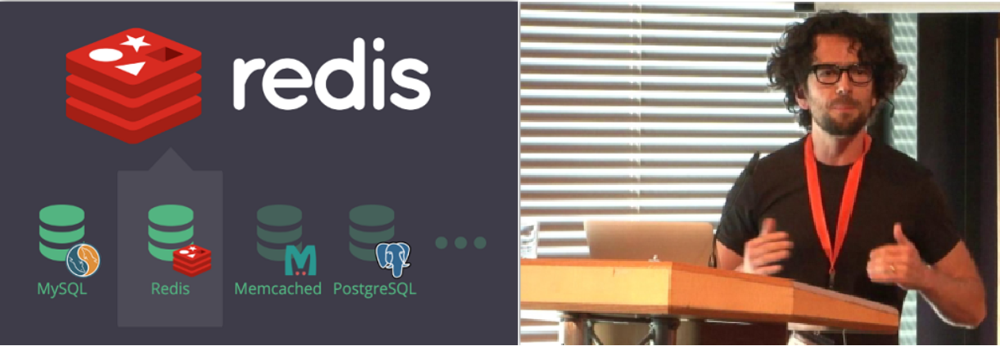

Redis 是以内存为主要工作空间的键值数据系统，由 Salvatore Sanfilippo 创建。除字符串外，它还支持哈希、列表、集合、有序集合等数据结构，并提供过期时间、持久化、复制等能力。应用通常通过对应语言的客户端访问 Redis。

它可以用作缓存，也可支撑计数、排行榜等需要原子数据操作的场景；是否作为主要数据源，要结合持久化配置、故障恢复目标与数据一致性要求决定。以下是 Redis 官网及 DB-Engines 排名页，排名会随时间变化，不宜代替技术选型：

<https://db-engines.com/en/ranking>

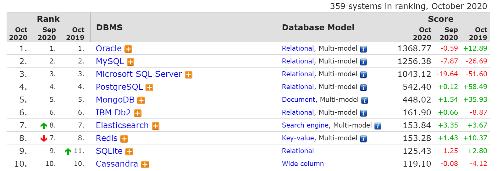

<https://db-engines.com/en/ranking/key-value+store>

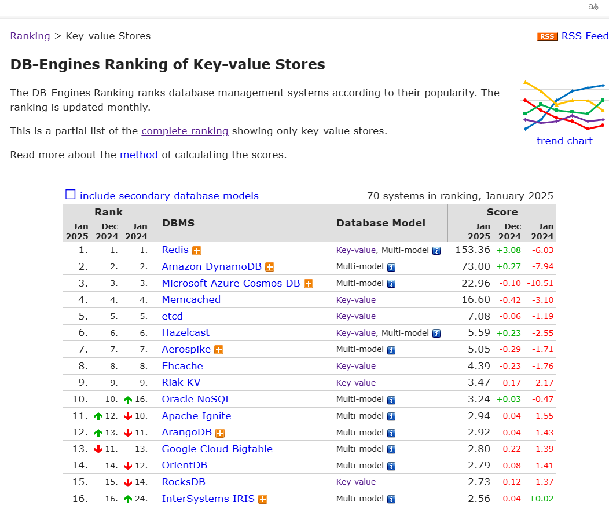

Redis 官网：<https://redis.io/>

### Redis 特性

理解 Redis 时，可以把能力分成四组：

1. **数据与性能**：主要在内存中执行命令，提供多种数据结构及其原子操作。吞吐量受命令复杂度、数据大小、网络和硬件影响，不存在通用的固定 QPS。
2. **数据保护**：RDB 快照和 AOF 日志可用于持久化，但不同配置对应不同的数据丢失窗口和恢复成本。
3. **协作能力**：支持发布／订阅、Lua 脚本、事务命令和 Pipeline；这些机制解决的问题不同，不能互相替代。
4. **部署能力**：可通过复制扩展读取，使用 Sentinel 进行故障转移，或通过 Redis Cluster 对数据分片。高可用不自动等于零数据丢失。

### “单线程”

“Redis 是单线程的”主要指命令执行路径通常由一个主线程顺序处理，而不是说整个进程只有一个线程。Redis 6 起可配置 I/O 线程分担部分网络读写；持久化、异步释放等工作也可能使用其他线程或子进程。

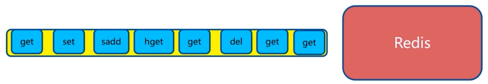

Redis 的许多常见命令之所以延迟较低，是因为数据主要在内存中、网络事件由 I/O 多路复用处理，而且常见数据结构和命令针对相应操作进行了优化。顺序执行命令也减少了命令之间的锁竞争；但它并不保证任何命令都快。

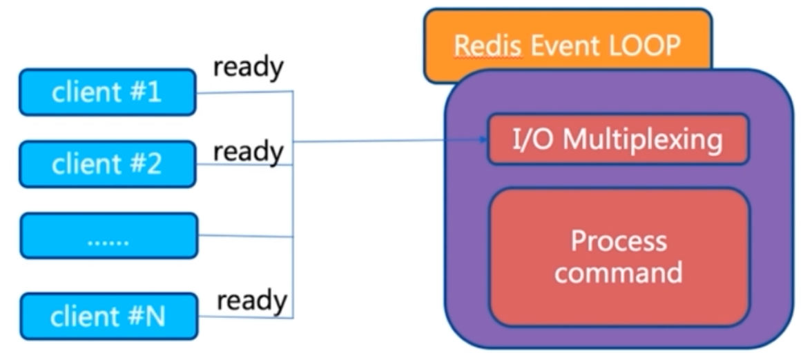

主线程被慢命令占住时，其他命令就要等待。在线上要谨慎使用 `KEYS *`、大范围遍历、复杂 Lua 脚本，以及直接对大键执行耗时操作；需要遍历键时通常优先考虑 `SCAN`。`FLUSHALL` 和 `FLUSHDB` 还会清空数据，执行前必须确认作用范围。

### Pipeline 流水线

客户端发送一条命令，服务端处理后返回结果，期间包含网络往返、排队和执行时间。若客户端必须等到上一条响应才能发送下一条，执行 N 条独立命令就会产生多次往返（RTT）。

`MGET`、`MSET` 能一次操作多个键，但并非所有命令都有对应的批量版本。Pipeline 则让客户端先连续发送多条**彼此独立**的命令，再按发送顺序读取响应，从而减少等待网络往返的时间。它不是事务：中途某条命令失败，不会自动回滚其他命令；若后续命令依赖前一条结果，也不能直接合并为同一批。

逐条等待响应的流程如下图：

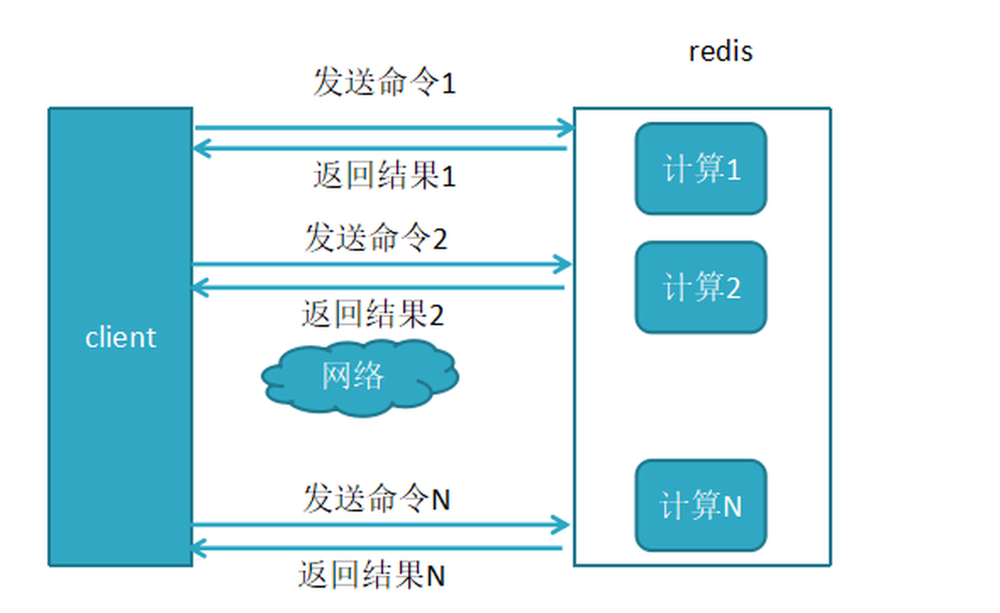

连续发送命令的 Pipeline 流程如下图：

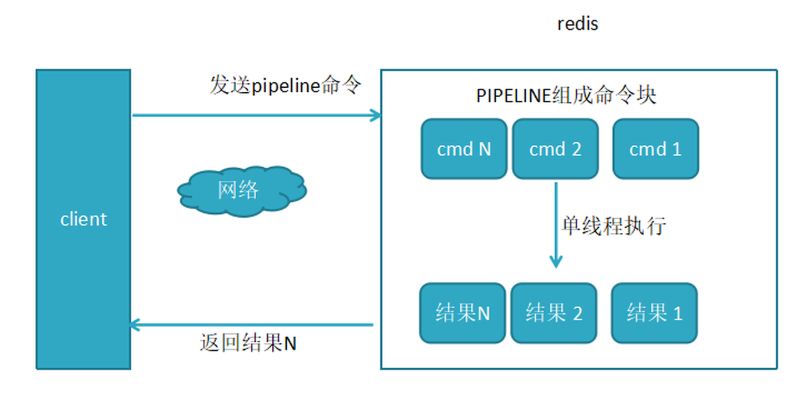

两种方式的耗时对比如下图：

上图比较的是多条命令逐次往返与通过 Pipeline 批量发送的耗时。Pipeline 减少了网络往返次数，因此客户端与 Redis 之间的延迟越高，收益通常越明显；实际效果仍取决于命令本身的开销、批次大小和服务器负载。

### Redis 对比 Memcached

两者都能用作内存缓存，但选择时应看数据结构、持久化与部署要求，而不是只比较一个吞吐量数字。

| 比较维度 | Redis | Memcached |
| --- | --- | --- |
| 数据结构 | 除字符串外，还提供哈希、列表、集合、有序集合等类型，可直接执行相应操作 | 以键和值为核心，复杂结构通常由应用自行序列化 |
| 持久化 | 可按需要使用 RDB 快照或 AOF 日志 | 不提供内建的磁盘持久化 |
| 高可用与扩展 | 可使用复制、Sentinel 故障转移和 Redis Cluster 分片；客户端须适配相应部署方式 | 服务端没有与 Redis Sentinel、Cluster 完全对应的内建方案，通常由客户端分片或外部组件实现 |
| 单个值的大小 | 字符串值上限通常为 512 MiB；还应考虑内存、网络和大键操作成本 | 默认单项大小限制通常为 1 MiB，可通过配置调整，具体以部署版本为准 |
| 内存管理 | 内存分配与碎片情况受分配器、数据结构和负载影响 | 使用 slab 分配器管理对象空间，可能产生 slab 内部浪费 |
| 并发模型 | 命令执行主要由单线程负责；Redis 6 起可用 I/O 线程处理部分网络读写 | 使用多线程处理请求；实际吞吐取决于工作负载与硬件 |
| 过期与淘汰 | 到期键采用惰性删除与定期扫描；达到内存上限时按配置的淘汰策略处理 | 到期项可在访问时发现，也会由后台维护回收；内存不足时按其淘汰机制处理 |
| 适用场景 | 需要丰富数据结构、持久化、复制或服务端数据操作 | 只需简单键值缓存，并希望由应用控制序列化与分片 |

原资料中的“Redis VM 把冷数据换到磁盘”和固定的“单机 QPS”数字不适合作为当前版本的选型依据：旧版 VM 已被移除，吞吐量也会随命令类型、对象大小、并发量、网络及机器配置大幅变化。若要比较性能，应在相同硬件、数据集和访问模式下做基准测试。

### Redis 常见应用场景

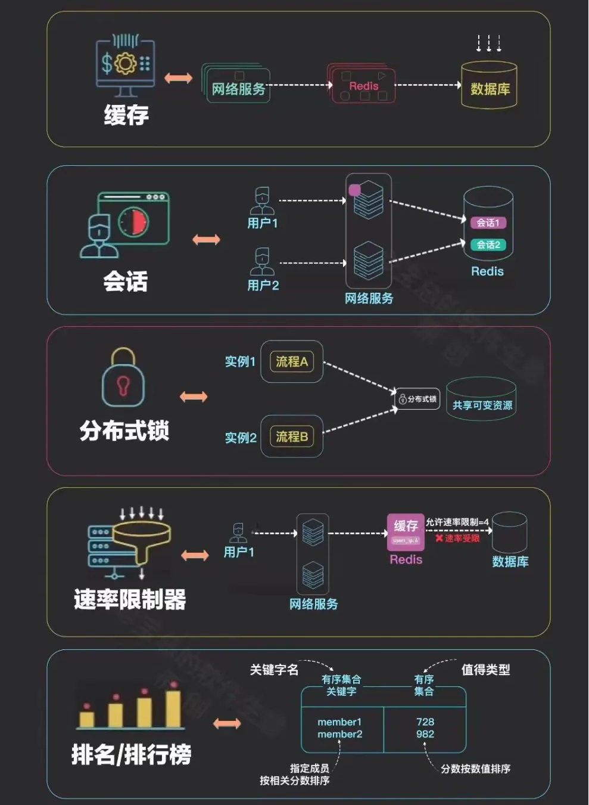

- **缓存**：保存查询结果或商品信息等可重建数据，减少后端数据库的重复读取。需要同时设计过期时间和数据更新策略。
- **会话共享**：让多个 Web 实例读取同一份会话状态；应评估过期、故障切换和敏感数据保护。
- **计数与排行**：用原子增减操作记录浏览量、点赞数，用有序集合维护排行榜。
- **社交关系**：集合操作可用于交集、共同好友等简单关系查询；复杂关系图不一定适合全放在 Redis 中。
- **地理位置**：可按经纬度进行附近位置查询，适用于门店或配送点等场景。
- **消息传递**：发布／订阅适合实时通知，但订阅者离线时不会自动补收；需要可追溯消费时，应根据需求评估 Streams 或专门的消息系统。

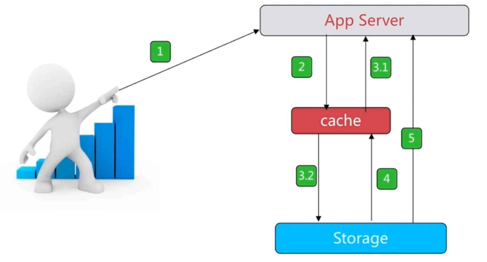

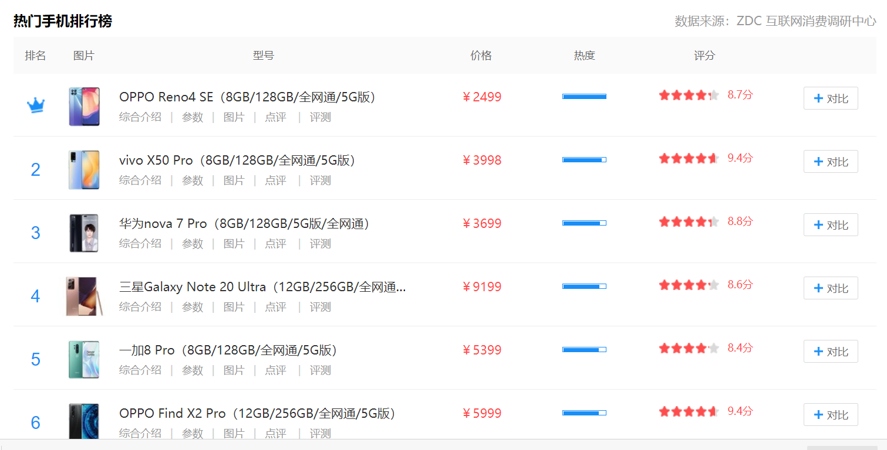

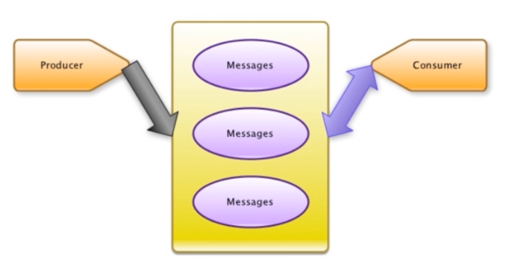

### 缓存的实现流程

更新数据时，先确定数据库与缓存各自的职责。常见的旁路缓存方案是先写数据库，再删除对应缓存键；并发场景下仍要考虑短暂不一致和重试。下图展示原资料中的更新流程，具体项目应据此检查操作顺序。

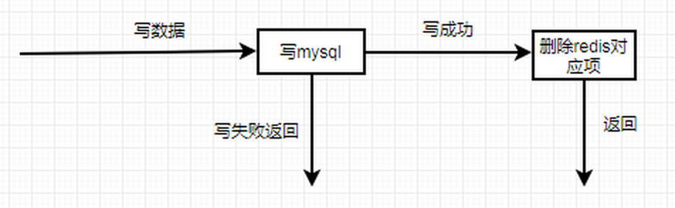

读取时先查缓存：命中则直接返回；未命中再查数据库，并将适合缓存的结果写入缓存，设置合理的有效期。下图展示读取流程。

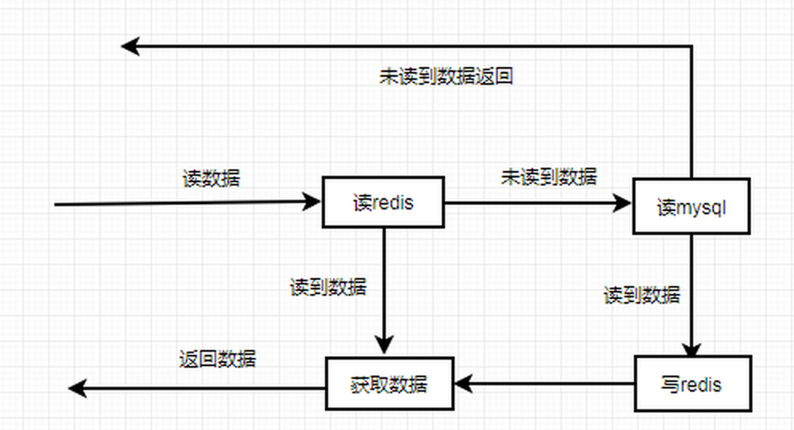

### 缓存穿透、击穿与雪崩

三者都会增加后端压力，但原因不同：穿透是持续查询不存在的数据；击穿是**一个热点键**失效后被大量并发请求同时读取；雪崩是**大量键**在短时间内失效，或缓存服务整体不可用。先辨别原因，再选择处理手段。

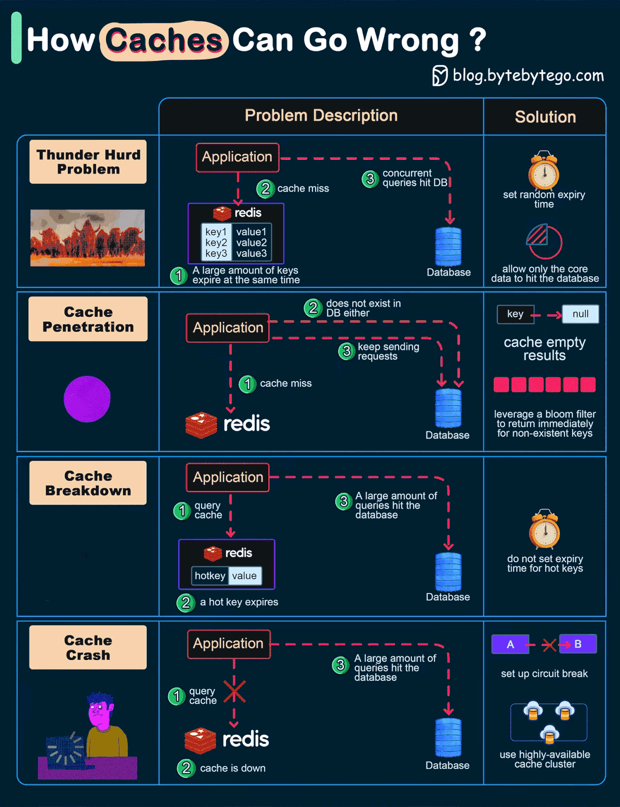

### 缓存穿透 Cache Penetration

例如，请求的商品 ID 根本不存在，缓存与数据库都查不到；若同一类请求持续到来，数据库便会反复承受空查询。这可能是无意的错误请求，也可能是恶意流量。

可以先校验参数格式和访问权限；对确认不存在的键短时间缓存“空结果”，避免重复回源。空值缓存应设置较短的有效期，并区分“未找到”和“查询失败”，否则新建数据可能暂时不可见。布隆过滤器也可用于较稳定的大规模 ID 集，但需处理误判和数据更新。

### 缓存击穿 Cache breakdown

一个访问量很高的键刚好到期时，许多请求同时未命中并回源同一条数据库记录，可能造成瞬时负载峰值。

常见处理方式是为该键的重建加互斥或“单飞”控制，让一个请求回源，其余请求等待或使用短暂的旧值。也可以提前刷新热点数据，或采用逻辑过期并在后台更新。“永不过期”并非通用解法：如果没有更新机制，数据会长期陈旧。

### 缓存雪崩 Cache Avalanche

若大量不同的缓存键同时到期，许多请求会一起回源数据库；缓存集群整体故障也可能造成类似的突发流量。与击穿相比，雪崩影响的是一批键，而非单个热点键。

对同一批写入的缓存，可以在基础 TTL 上加入适度随机偏移，避免同时过期。再结合热点数据预热、回源限流、降级和多副本高可用，限制数据库在缓存失效时承受的峰值。分散过期时间只能缓解集中失效，不能代替故障预案。

### 缓存宕机 crash

缓存服务宕机时，应用不能只假定“切换到数据库就好”：如果所有请求同时回源，数据库也可能被打垮。应结合复制与故障转移、客户端超时、熔断／限流，以及关键数据的降级响应来设计恢复流程，并定期演练。Redis 高可用部署能缩短故障时间，但不能消除所有故障窗口。



<nav class="article-end" aria-label="章节导航">
  <a href="{{ '/subjects/Redis/' | relative_url }}">返回 Redis 专题目录</a>
  <a href="{{ '/subjects/Redis/02-installing-redis.html' | relative_url }}">下一篇：安装 Redis →</a>
</nav>
