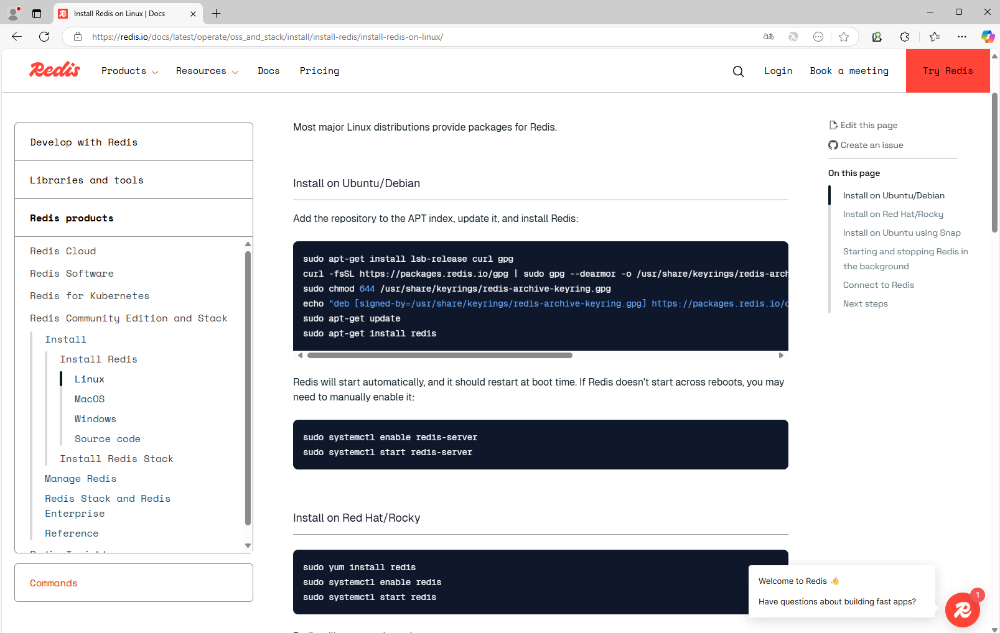
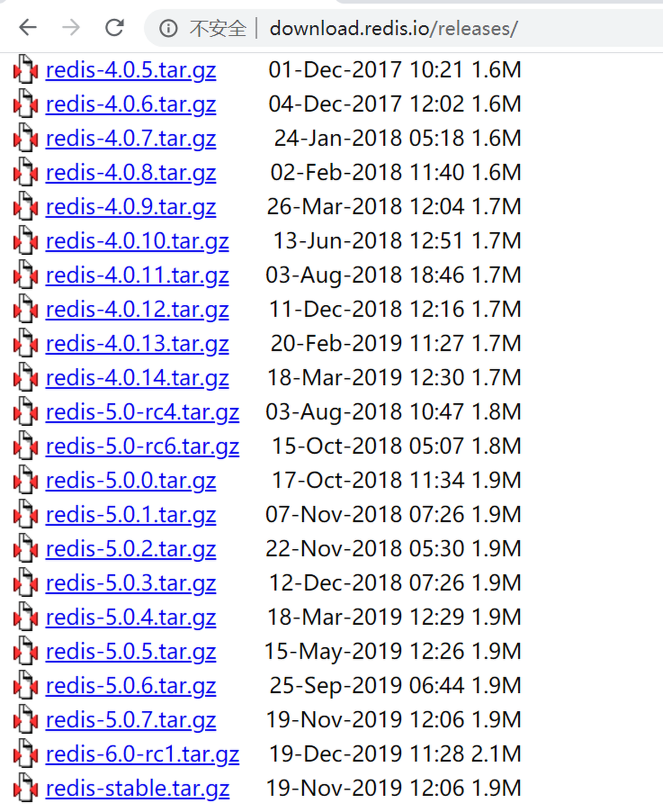
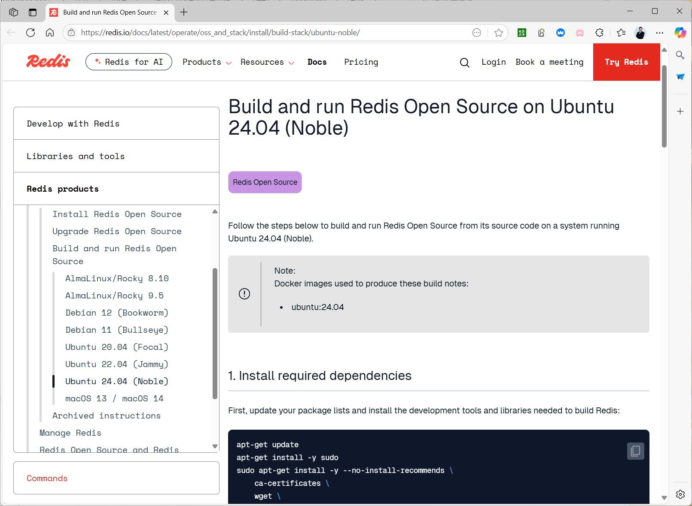
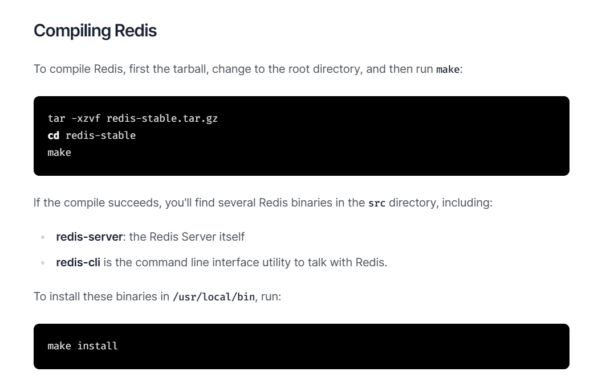
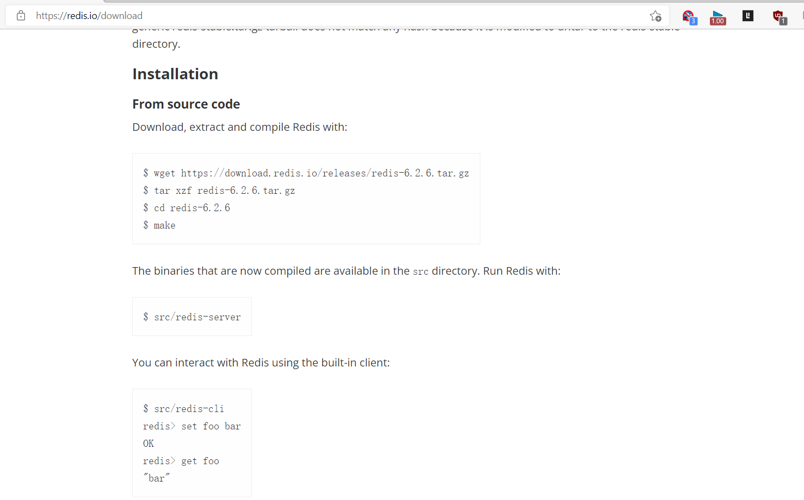
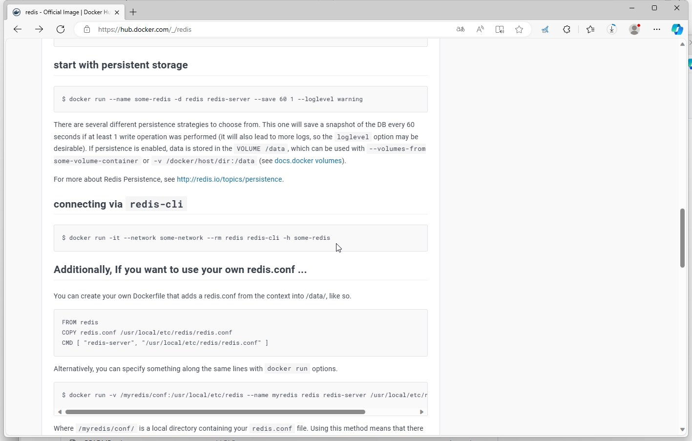

[← 返回 Redis 数据库目录]({{ '/subjects/Redis/' | relative_url }})



# 02 安装 Redis

Redis 可以通过发行版包、官方软件源、源码或容器运行。初学时优先选择包安装：它会同时管理服务用户、systemd 单元和升级路径。源码安装适合需要指定版本或编译选项的环境；容器运行则必须特别留意持久化目录与网络暴露。无论哪一种方式，安装完成后都要核对**实际版本、监听地址、配置文件位置、数据目录和持久化策略**，不能只看到 `PONG` 就认为已经具备生产能力。

参考[官方安装文档](https://redis.io/docs/latest/operate/oss_and_stack/install/install-redis/)；截图和输出来自不同年份、不同系统，版本号仅代表当时的实验环境。

## Ubuntu／Debian：包安装

发行版仓库可能提供较旧的 Redis；需要特定功能时，可按[官方 Linux 软件源说明](https://redis.io/docs/latest/operate/oss_and_stack/install/install-redis/install-redis-on-linux/)加入 Redis 仓库。以下是 Ubuntu 的命令结构，先核对当前系统代号及官方签名说明：

```bash
sudo apt-get update
sudo apt-get install -y lsb-release curl gpg
curl -fsSL https://packages.redis.io/gpg | \
  sudo gpg --dearmor -o /usr/share/keyrings/redis-archive-keyring.gpg
echo "deb [signed-by=/usr/share/keyrings/redis-archive-keyring.gpg] https://packages.redis.io/deb $(lsb_release -cs) main" | \
  sudo tee /etc/apt/sources.list.d/redis.list
sudo apt-get update
apt-cache policy redis
sudo apt-get install -y redis
```

不需要官方源时，可直接使用发行版包，但应接受其版本由发行版维护。原资料中 `rsudo`、`rcurl`、`recho` 是扫描造成的命令污染，不能照抄；跨版本的 `apt list -a` 长输出也不能代替在当前机器上检查候选版本。



安装后查看实际服务名和监听范围：

```bash
redis-server --version
redis-cli --version
systemctl status redis-server.service
ss -ltn '( sport = :6379 )'
redis-cli -h 127.0.0.1 -p 6379 PING
```

服务名在某些发行版上可能是 `redis.service`；以包实际提供的单元为准。默认监听环回地址通常适合单机练习，若需要远程访问，应同时规划认证、TLS 或内网隔离，不能简单改成 `bind 0.0.0.0`。


## RHEL 系：包安装

RHEL／Rocky／CentOS 的软件源和支持周期不同。CentOS 7、8 的旧输出反映的是其历史仓库，不代表当前系统应安装这些过期版本。先在受支持的发行版中查询可用版本，再安装与启动：

```bash
sudo dnf info redis
sudo dnf install -y redis
sudo systemctl enable --now redis.service
redis-cli PING
```

若 `dnf info` 没有满足要求的版本，应选择受维护的软件源、官方包或源码构建，而不是混装不兼容的 RPM。安装完成后同样检查配置、数据路径与监听地址。

## 源码编译：版本与服务分开处理

源码方式分两步：先**编译并安装二进制**，再显式配置运行账户、目录和 systemd。Redis 8 的完整功能构建涉及更多依赖和选项，不能把旧版 `make` 参数机械套用；请按所选版本的[构建说明](https://redis.io/docs/latest/operate/oss_and_stack/install/build-stack/)确定依赖与模块选择。









以下以经典 Redis OSS 7.2.4 的源码包说明编译步骤；实际环境应选受维护且经过测试的版本。

```bash
sudo apt-get install -y build-essential libsystemd-dev
curl -fsSLO https://download.redis.io/releases/redis-7.2.4.tar.gz
tar -xzf redis-7.2.4.tar.gz
cd redis-7.2.4
make -j "$(nproc)" USE_SYSTEMD=yes
make test
sudo make PREFIX=/opt/redis install
/opt/redis/bin/redis-server --version
```

编译选项应在 `make` 与 `make install` 中保持一致。若 `make test` 的测试依赖未就绪，应先补齐并查看失败原因，不能把编译成功等同于测试通过。原资料把 Redis 8 的不同 `BUILD_TLS`、`BUILD_WITH_MODULES`、Rust 工具链开关连续赋成相反的值，没有形成可重复的构建方案；应按所选版本确定一种配置。

### 前台试运行与 systemd

在有权限的本地测试目录可以用 `redis-server /path/to/redis.conf` 前台试运行，观察日志，再通过 `redis-cli PING` 验证。源码安装不会自动提供适用的服务单元；建议创建专用系统账户和数据目录，并在配置中显式指定 `bind`、`port`、`dir`、`daemonize no` 与 `supervised systemd`。持久化策略见第 08 篇，不应依赖默认值。

下面是**单实例服务单元的关键结构**，其中配置文件与目录需要先准备，服务账户必须拥有数据目录写权限：

```ini
[Unit]
Description=Redis 6379
After=network.target

[Service]
Type=notify
User=redis
Group=redis
ExecStart=/opt/redis/bin/redis-server /etc/redis/6379.conf --supervised systemd --daemonize no
Restart=on-failure
LimitNOFILE=65536

[Install]
WantedBy=multi-user.target
```

将单元保存到 `/etc/systemd/system/redis-6379.service` 后执行 `systemctl daemon-reload`、`systemctl enable --now redis-6379`。若二进制未以 `USE_SYSTEMD=yes` 构建，不应强制使用 `Type=notify`；改用与实际构建相符的服务类型。原文中从其他机器复制 service 文件、把 `ExecStart` 拆成两行、给 systemd 服务修改 root 的 `limits.conf`，都容易造成与当前安装不匹配的问题。

## 启动警告如何判断

Redis 启动日志可能出现 backlog、内存 overcommit、THP 或文件描述符提示。这些是按系统当前状态给出的线索，不是“必须消除四个 Warning 才能运行”的固定清单。

| 提示 | 理解与处理 |
| --- | --- |
| `somaxconn` 小于 Redis `tcp-backlog` | 内核监听队列上限较低。先结合连接量检查，再调整 `net.core.somaxconn`。 |
| `vm.overcommit_memory=0` | 后台保存或复制涉及 `fork`，内存承诺策略可能阻碍分配；常见建议是设为 `1`，但这不保证内存永不耗尽，仍须规划 RAM 和 OOM 风险。 |
| Transparent Huge Pages | THP 可能引入延迟；先查看当前启用模式和发行版建议，再通过受管理的系统配置持久化调整，不依赖旧式 `rc.local`。 |
| open files 自动提升 | 这是 Redis 尝试提高文件描述符上限的日志，不一定是错误；systemd 服务应通过 `LimitNOFILE` 调整，而不是修改 root 的登录会话限制。 |

原资料将 `overcommit_memory=2` 解释为“允许超过物理内存和交换空间”，与 Linux 的承诺限制语义不符；也不能说 Redis 新版“只允许 1”。调优前应测量负载，并阅读当前内核与 Redis 文档。

## 容器运行

容器演示可将端口仅映射到宿主机环回地址，并把 `/data` 挂载到持久化目录；持久化格式仍需由配置决定：

```bash
docker run -d --name redis-demo \
  -p 127.0.0.1:6379:6379 \
  -v /srv/redis-demo:/data \
  redis:7.2.4 redis-server --appendonly yes
docker exec redis-demo redis-cli PING
```

正式环境应固定镜像版本并设计认证、网络、数据卷备份与升级。原案例 `-p 6379:6379` 使服务可能暴露在所有宿主机接口，且把明文短密码放入命令行；不应将其作为默认部署方式。仅挂载 `/data` 也不自动保证数据持久化，需确认 RDB／AOF 配置和写盘状态。



## 多实例：每个实例独立配置

一台测试主机可运行 `6379`、`6380`、`6381` 等多个实例；每个实例至少应有独立的监听端口、配置文件、数据目录、日志与服务单元。把同一份配置文件原样挂给三个容器、只改变宿主机端口映射，容器内仍都监听 `6379`，虽可分别访问，但不等于三个实例在配置和持久化上互相隔离。

源码安装时可为 `/etc/redis/6379.conf`、`6380.conf` 分别写 `port`、`dir`、`dbfilename`、AOF 目录和 `pidfile`，再使用 `redis@.service` 模板或独立单元管理。容器方式则给每个容器独立数据卷，并分别映射宿主机端口。验证时使用 `redis-cli -p 6379 PING`、`redis-cli -p 6380 PING` 和各自的 `INFO server`；不要通过 `KEYS *` 检查生产实例。

原一键安装脚本混用了 `CPUS`／`CUPS`、固定弱密码、`bind 0.0.0.0` 和断裂的 systemd 行。逐步安装更能暴露失败点；若需要自动化，应把已验证的安装、配置和验收步骤实现为幂等部署，并明确版本和回滚方式。



<nav class="article-end" aria-label="章节导航">
  <a href="{{ '/subjects/Redis/01-redis-fundamentals.html' | relative_url }}">← 上一篇：Redis 基础</a>
  <a href="{{ '/subjects/Redis/' | relative_url }}">返回 Redis 数据库目录</a>
  <a href="{{ '/subjects/Redis/03-redis-tools-and-client-connections.html' | relative_url }}">下一篇：工具与客户端连接 →</a>
</nav>
