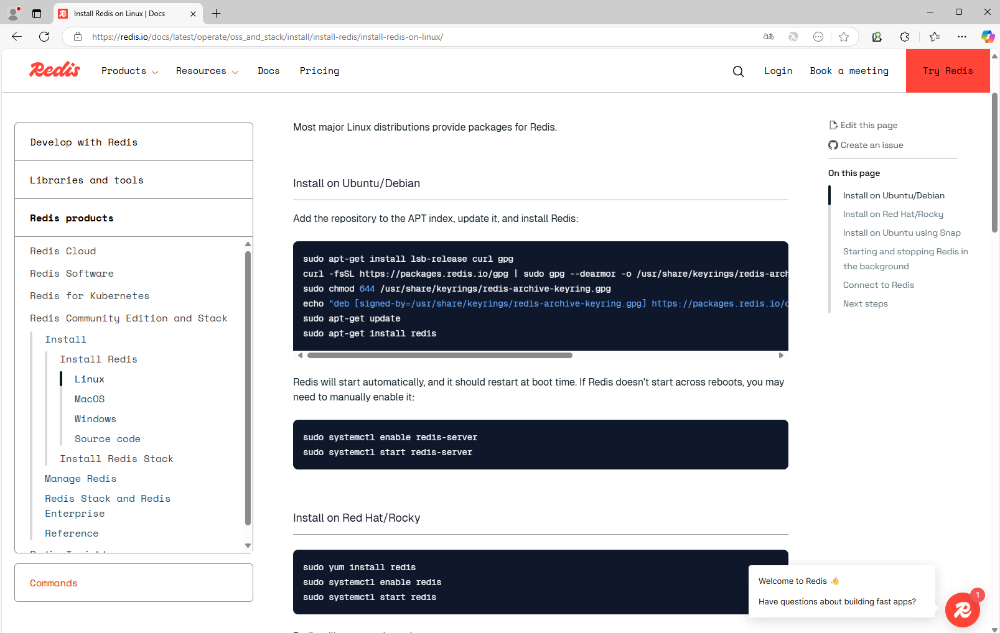
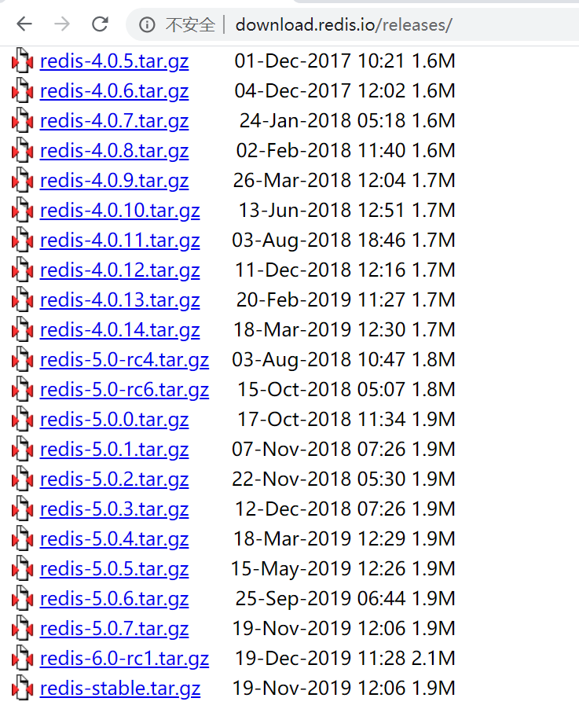
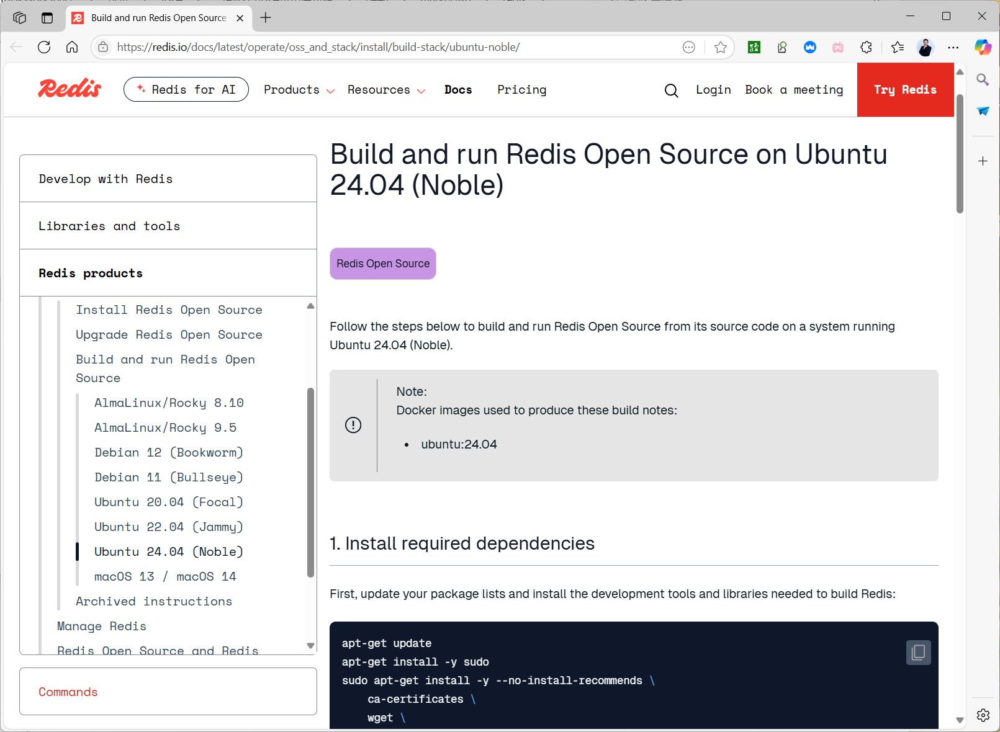
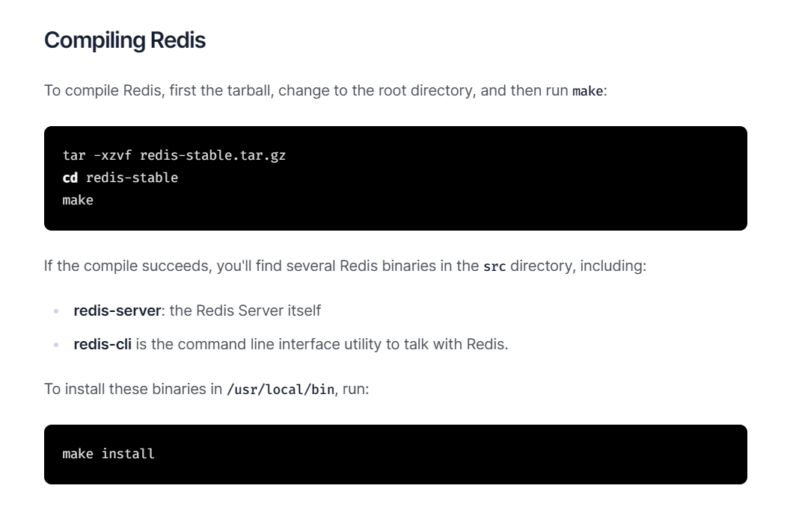
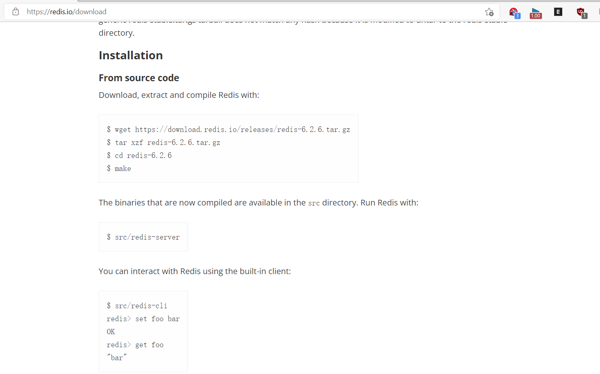

[← 返回Redis 数据库目录]({{ '/subjects/Redis/' | relative_url }})



# 02 Redis 安装
### 1.2 Redis 安装

官方安装方法说明：

<https://redis.io/docs/getting-started/installation/>

安装方法

包安装源码编译容器运行

### 包安装 Redis

基于官方仓库包安装

<https://redis.io/docs/latest/operate/oss_and_stack/install/install-redis/install-redis-on-linux/>



### Ubuntu 安装 Redis

范例：Ubuntu2404基于官方仓库包安装

```bash
[root@ubuntu2404 ~]#rsudo apt-get install lsb-release curl gpg
[root@ubuntu2404 ~]#rcurl -fsSL https://packages.redis.io/gpg | sudo gpg --
dearmor -o /usr/share/keyrings/redis-archive-keyring.gpg
[root@ubuntu2404 ~]#recho "deb [signed-by=/usr/share/keyrings/redis-archive-
keyring.gpg] https://packages.redis.io/deb $(lsb_release -cs) main" | sudo tee
/etc/apt/sources.list.d/redis.list
[root@ubuntu2404 ~]#sudo apt-get update
[root@ubuntu2404 ~]#sudo apt-get install redis
[root@ubuntu2404 ~]#redis-cli -v
redis-cli 8.0.2
[root@ubuntu2404 ~]#redis-server -v
Redis server v=8.0.2 sha=00000000:1 malloc=jemalloc-5.3.0 bits=64
build=b88983f475f20b8
```

范例：Ubuntu22.04基于官方仓库包安装

```bash
[root@ubuntu2204 ~]#curl -fsSL https://packages.redis.io/gpg | sudo gpg --
dearmor -o /usr/share/keyrings/redis-archive-keyring.gpg
[root@ubuntu2204 ~]#echo "deb [signed-by=/usr/share/keyrings/redis-archive-
keyring.gpg] https://packages.redis.io/deb $(lsb_release -cs) main" | sudo tee
/etc/apt/sources.list.d/redis.list
[root@ubuntu2204 ~]#ls /etc/apt/sources.list.d
redis.list
[root@ubuntu2204 ~]#cat /etc/apt/sources.list.d/redis.list
deb [signed-by=/usr/share/keyrings/redis-archive-keyring.gpg]
https://packages.redis.io/deb jammy main
[root@ubuntu2204 ~]#apt update
[root@ubuntu2204 ~]#apt list -a redis
正在列表... 完成
redis/jammy,jammy,6:7.2.4-1rl1~jammy1 all
redis/jammy,jammy 6:7.2.3-1rl1~jammy1 all
redis/jammy,jammy 6:7.2.2-1rl1~jammy1 all
redis/jammy,jammy 6:7.2.1-1rl1~jammy1 all
redis/jammy,jammy 6:7.2.0-1rl1~jammy1 all
redis/jammy,jammy 6:7.0.15-1rl1~jammy1 all
redis/jammy,jammy 6:7.0.14-1rl1~jammy1 all
redis/jammy,jammy 6:7.0.13-1rl1~jammy1 all
redis/jammy,jammy 6:7.0.12-1rl1~jammy1 all
redis/jammy,jammy 6:7.0.11-1rl1~jammy1 all
redis/jammy,jammy 6:7.0.10-1rl1~jammy1 all
redis/jammy,jammy 6:7.0.9-1rl1~jammy1 all
redis/jammy,jammy 6:7.0.8-1rl1~jammy1 all
redis/jammy,jammy 6:7.0.7-1rl1~jammy1 all
redis/jammy,jammy 6:7.0.6-1rl1~jammy1 all
redis/jammy,jammy 6:7.0.5-1rl1~jammy1 all
redis/jammy,jammy 6:7.0.4-1rl1~jammy1 all
redis/jammy,jammy 6:7.0.3-1rl1~jammy1 all
redis/jammy,jammy 6:7.0.2-1rl1~jammy1 all
redis/jammy,jammy 6:7.0.1-1rl1~jammy1 all
redis/jammy,jammy 6:7.0.0-1rl1~jammy1 all
redis/jammy,jammy 6:6.2.14-1rl1~jammy1 all
redis/jammy,jammy 6:6.2.13-1rl1~jammy1 all
redis/jammy,jammy 6:6.2.12-1rl1~jammy1 all
redis/jammy,jammy 6:6.2.11-1rl1~jammy1 all
redis/jammy,jammy 6:6.2.10-1rl1~jammy1 all
redis/jammy,jammy 6:6.2.9-1rl1~jammy1 all
redis/jammy,jammy 6:6.2.8-1rl1~jammy1 all
redis/jammy,jammy 6:6.2.7-1rl1~jammy1 all
redis/jammy,jammy 6:6.0.20-1rl1~jammy1 all
redis/jammy,jammy 6:6.0.19-1rl1~jammy1 all
redis/jammy,jammy 6:6.0.18-1rl1~jammy1 all
redis/jammy,jammy 6:6.0.17-1rl1~jammy1 all
redis/jammy 5:6.0.16-1ubuntu1 all
#安装最新版
[root@ubuntu2204 ~]#apt -y install redis
#指定版本安装，注意：因为依赖关系可能会失败
[root@ubuntu2204 ~]#apt -y install redis=6:7.2.4-1rl1~jammy1
```

范例：内置仓库

```bash
[root@ubuntu2204 ~]#apt list redis
正在列表... 完成
redis/jammy 5:6.0.16-1ubuntu1 all
[root@ubuntu2004 ~]#apt list redis
正在列表... 完成
redis/focal-security,focal-updates 5:5.0.7-2ubuntu0.1 all
N: 还有 1 个版本。请使用 -a 选项来查看它(他们)。
[root@ubuntu2004 ~]#apt -y install redis
[root@ubuntu2004 ~]#pstree -p|grep redis
|-redis-server(1330)-+-{redis-server}(1331)
|                    |-{redis-server}(1332)
|                    `-{redis-server}(1333)
[root@ubuntu2004 ~]#ss -ntll
State            Recv-Q   Send-Q     Local Address:Port    Peer Address:Port
Process
LISTEN           0        128            127.0.0.1:6010         0.0.0.0:*
LISTEN           0        511            127.0.0.1:6379         0.0.0.0:*
LISTEN           0        4096       127.0.0.53%lo:53           0.0.0.0:*
LISTEN           0        128              0.0.0.0:22           0.0.0.0:*
LISTEN           0        128                [::1]:6010            [::]:*
LISTEN           0        511                [::1]:6379            [::]:*
LISTEN           0        128                 [::]:22              [::]:*
```

### CentOS 安装 Redis

```bash
#CentOS 8 由系统源提供
[root@centos8 ~]#dnf info redis
Name         : redis
Version      : 5.0.3
Release      : 1.module_el8.0.0+6+ab019c03
Architecture : x86_64
Size         : 927 k
Source       : redis-5.0.3-1.module_el8.0.0+6+ab019c03.src.rpm
Repository   : AppStream
Summary      : A persistent key-value database
URL          : http://redis.io
License      : BSD and MIT
Description  : Redis is an advanced key-value store. It is often referred to as a
data
: structure server since keys can contain strings, hashes, lists,
sets and
: sorted sets.
:
: You can run atomic operations on these types, like appending to a
string;
: incrementing the value in a hash; pushing to a list; computing
set
: intersection, union and difference; or getting the member with
highest
: ranking in a sorted set.
:
: In order to achieve its outstanding performance, Redis works with
an
: in-memory dataset. Depending on your use case, you can persist it
either
: by dumping the dataset to disk every once in a while, or by
appending
: each command to a log.
:
: Redis also supports trivial-to-setup master-slave replication,
with very
: fast non-blocking first synchronization, auto-reconnection on net
split
: and so forth.
:
: Other features include Transactions, Pub/Sub, Lua scripting, Keys
with a
: limited time-to-live, and configuration settings to make Redis
behave like
: a cache.
:
: You can use Redis from most programming languages also.
#在CentOS7系统上需要安装EPEL源
[root@centos7 ~]#yum info redis
Loaded plugins: fastestmirror
Loading mirror speeds from cached hostfile
* base:
Available Packages
Name        : redis
Arch        : x86_64
Version     : 3.2.12
Release     : 2.el7
Size        : 544 k
Repo        : epel/7/x86_64
Summary     : A persistent key-value database
URL         : http://redis.io
License     : BSD
Description : Redis is an advanced key-value store. It is often referred to as a
data
: structure server since keys can contain strings, hashes, lists,
sets and
: sorted sets.
:
: You can run atomic operations on these types, like appending to a
string;
: incrementing the value in a hash; pushing to a list; computing set
: intersection, union and difference; or getting the member with
highest
: ranking in a sorted set.
:
: In order to achieve its outstanding performance, Redis works with
an
: in-memory dataset. Depending on your use case, you can persist it
either
: by dumping the dataset to disk every once in a while, or by
appending
: each command to a log.
:
: Redis also supports trivial-to-setup master-slave replication, with
very
: fast non-blocking first synchronization, auto-reconnection on net
split
: and so forth.
:
: Other features include Transactions, Pub/Sub, Lua scripting, Keys
with a
: limited time-to-live, and configuration settings to make Redis
behave like
: a cache.
:
: You can use Redis from most programming languages also.
[root@centos8 ~]#dnf -y install redis
[root@centos8 ~]#systemctl enable --now redis
[root@centos8 ~]#ss -tnl
State        Recv-Q        Send-Q        Local Address:Port            Peer
Address:Port
LISTEN       0             128                 0.0.0.0:22
0.0.0.0:*
LISTEN       0             128               127.0.0.1:6379
0.0.0.0:*
LISTEN       0             128                    [::]:22
[::]:*
[root@centos8 ~]#pstree -p|grep redis
|-redis-server(3383)-+-{redis-server}(3384)
|                    |-{redis-server}(3385)
|                    `-{redis-server}(3386)
[root@centos8 ~]#redis-cli
127.0.0.1:6379> ping
PONG
127.0.0.1:6379> info
# Server
redis_version:5.0.3
redis_git_sha1:00000000
redis_git_dirty:0
redis_build_id:8c0bf22bfba82c8f
redis_mode:standalone
os:Linux 4.18.0-147.el8.x86_64 x86_64
```

### 编译安装 Redis

Redis 源码包官方下载链接：

<http://download.redis.io/releases/>



### 编译安装

官方的安装方法：

<https://redis.io/docs/latest/operate/oss_and_stack/install/build-stack/ubuntu-noble/>

<https://redis.io/docs/getting-started/installation/install-redis-from-source/>

8.x 编译说明

<https://redis.io/docs/latest/operate/oss_and_stack/install/build-stack/ubuntu-noble/>



旧版说明





范例：Ubuntu24.04 编译安装redis-8.2.1/8.0.2

```bash
#https://redis.io/docs/latest/operate/oss_and_stack/install/build-stack/ubuntu-
noble/
[root@ubuntu2404 ~]#apt update && apt install -y --no-install-recommends  gcc
make ca-certificates  wget dpkg-dev  g++  libc6-dev  libssl-dev  git cmake
python3 python3-pip python3-venv python3-dev unzip rsync  clang  automake
autoconf libtool pkg-config libsystemd-dev
[root@ubuntu2404 ~]#version=8.2.1
[root@ubuntu2404 ~]#version=8.0.2
[root@ubuntu2404 ~]#cd /usr/local/src
[root@ubuntu2404 src]#wget -O redis-$version.tar.gz
https://github.com/redis/redis/archive/refs/tags/$version.tar.gz
```

```bash
[root@ubuntu2404 src]#tar xvf redis-$version.tar.gz
[root@ubuntu2404 src]#rm redis-$version.tar.gz
```

````bash
[root@ubuntu2404 src]#cd redis-$version
#无需再次连接github下载源码
[root@ubuntu2404 src]#cd redis-$version
[root@ubuntu2404 redis-8.0.2]#export BUILD_TLS=no
[root@ubuntu2404 redis-8.0.2]#export BUILD_WITH_MODULES=no
[root@ubuntu2404 redis-8.0.2]#export INSTALL_RUST_TOOLCHAIN=no
[root@ubuntu2404 redis-8.0.2]#export DISABLE_WERRORS=yes
#需要再次连接github下载源码,可能需要科学上网
[root@ubuntu2404 redis-8.0.2]#export BUILD_TLS=yes
[root@ubuntu2404 redis-8.0.2]#export BUILD_WITH_MODULES=yes
[root@ubuntu2404 redis-8.0.2]#export INSTALL_RUST_TOOLCHAIN=yes
[root@ubuntu2404 redis-8.0.2]#export DISABLE_WERRORS=yes
[root@ubuntu2404 redis-8.0.2]#make -j "$(nproc)" all
#验证
[root@ubuntu2404 redis-8.0.2]#./src/redis-server --version
[root@ubuntu2404 redis-8.0.2]#./src/redis-cli --version
#启动
[root@ubuntu2404 redis-8.0.2]#./src/redis-server redis-full.conf
#安装到默认路径
[root@ubuntu2404 redis-8.0.2]#make install
[root@ubuntu2404 redis-8.0.2]#ls /usr/local/bin
redis-benchmark  redis-check-aof  redis-check-rdb  redis-cli  redis-sentinel
redis-server
[root@ubuntu2404 src]#redis-server
46799:C 18 Jun 2025 08:30:30.499 # WARNING Memory overcommit must be enabled!
Without it, a background save or replication may fail under low memory condition.
Being disabled, it can also cause failures without low memory condition, see
https://github.com/jemalloc/jemalloc/issues/1328. To fix this issue add
'vm.overcommit_memory = 1' to /etc/sysctl.conf and then reboot or run the command
'sysctl vm.overcommit_memory=1' for this to take effect.
46799:C 18 Jun 2025 08:30:30.500 * oO0OoO0OoO0Oo Redis is starting oO0OoO0OoO0Oo
46799:C 18 Jun 2025 08:30:30.501 * Redis version=8.0.2, bits=64,
commit=00000000, modified=1, pid=46799, just started
46799:C 18 Jun 2025 08:30:30.501 # Warning: no config file specified, using the
default config. In order to specify a config file use redis-server
/path/to/redis.conf
46799:M 18 Jun 2025 08:30:30.503 * Increased maximum number of open files to
10032 (it was originally set to 1024).
46799:M 18 Jun 2025 08:30:30.503 * monotonic clock: POSIX clock_gettime
_._
_.-``__ ''-._
_.-``    `.  `_.  ''-._           Redis Open Source
.-`` .-```.  ```\/    _.,_ ''-._      8.0.2 (00000000/1) 64 bit
(    '      ,       .-`  | `,    )     Running in standalone mode
|`-._`-...-` __...-.``-._|'` _.-'|     Port: 6379
|    `-._   `._    /     _.-'    |     PID: 46799
`-._    `-._  `-./  _.-'    _.-'
|`-._`-._    `-.__.-'    _.-'_.-'|
|    `-._`-._        _.-'_.-'    |           https://redis.io
`-._    `-._`-.__.-'_.-'    _.-'
|`-._`-._    `-.__.-'    _.-'_.-'|
|    `-._`-._        _.-'_.-'    |
`-._    `-._`-.__.-'_.-'    _.-'
`-._    `-.__.-'    _.-'
`-._        _.-'
`-.__.-'
46799:M 18 Jun 2025 08:30:30.506 * Server initialized
46799:M 18 Jun 2025 08:30:30.507 * Ready to accept connections tcp
````

范例: 7.X 以前版本编译安装

```bash
#安装依赖包
[root@centos8~]#yum -y install gcc make  jemalloc-devel
#如果支持systemd需要安装下面包
[root@ubuntu2404 ~]#apt update && apt -y install make gcc libjemalloc-dev
libsystemd-dev
[root@ubuntu2204 ~]#apt update && apt -y install make gcc libjemalloc-dev
libsystemd-dev
[root@ubuntu2004 ~]#apt update && apt -y install make gcc libjemalloc-dev
libsystemd-dev
[root@ubuntu1804 ~]#apt update && apt -y install make gcc libjemalloc-dev
libsystemd-dev
[root@centos8 ~]#yum  -y install gcc jemalloc-devel systemd-devel
[root@centos7 ~]#yum  -y install gcc jemalloc-devel systemd-devel
#下载源码
[root@centos8 ~]#wget http://download.redis.io/releases/redis-6.2.4.tar.gz
[root@centos8 ~]#tar xvf redis-6.2.4.tar.gz
#编译安装
[root@centos8 ~]#cd redis-6.2.4/
#如果支持systemd,需要执行下面
[root@centos8 redis-6.2.4]#make -j 2  USE_SYSTEMD=yes  PREFIX=/apps/redis
install
#如果不支持systemd，执行下面
[root@centos8 redis-6.2.4]#make -j 2 PREFIX=/apps/redis install #指定redis安装目录
```

```bash
#配置环境变量
[root@centos8 ~]#echo 'PATH=/apps/redis/bin:$PATH' >> /etc/profile
[root@centos8 ~]#. /etc/profile
#目录结构
[root@centos8 ~]#tree /apps/redis/
/apps/redis/
└── bin
├── redis-benchmark
├── redis-check-aof
├── redis-check-rdb
├── redis-cli
├── redis-sentinel -> redis-server
└── redis-server
1 directory, 6 files
#准备相关目录和配置文件
[root@centos8 ~]#mkdir /apps/redis/{etc,log,data,run} #创建配置文件、日志、数据等目录
#默认配置文件有问题，需要修改
[root@centos8 redis-6.2.4]#cp redis.conf /apps/redis/etc/
```

### 前台启动 Redis

redis-server 是 redis 服务器端的主程序

```bash
[root@centos8 ~]#redis-server  --help
Usage: ./redis-server [/path/to/redis.conf] [options]
./redis-server - (read config from stdin)
./redis-server -v or --version
./redis-server -h or --help
./redis-server --test-memory <megabytes>
Examples:
./redis-server (run the server with default conf)
./redis-server /etc/redis/6379.conf
./redis-server --port 7777
./redis-server --port 7777 --slaveof 127.0.0.1 8888
./redis-server /etc/myredis.conf --loglevel verbose
Sentinel mode:
./redis-server /etc/sentinel.conf --sentinel
```

前台启动 redis

````bash
[root@centos8 ~]#redis-server  /apps/redis/etc/redis.conf
27569:C 16 Feb 2020 21:18:20.412 # oO0OoO0OoO0Oo Redis is starting oO0OoO0OoO0Oo
27569:C 16 Feb 2020 21:18:20.412 # Redis version=5.0.7, bits=64,
commit=00000000, modified=0, pid=27569, just started
27569:C 16 Feb 2020 21:18:20.412 # Configuration loaded
27569:M 16 Feb 2020 21:18:20.413 * Increased maximum number of open files to
10032 (it was originally set to 1024).
_._
_.-``__ ''-._
_.-``    `.  `_.  ''-._           Redis 5.0.7 (00000000/0) 64 bit
.-`` .-```.  ```\/    _.,_ ''-._
(    '      ,       .-`  | `,    )     Running in standalone mode
|`-._`-...-` __...-.``-._|'` _.-'|     Port: 6379
|    `-._   `._    /     _.-'    |     PID: 27569
`-._    `-._  `-./  _.-'    _.-'
|`-._`-._    `-.__.-'    _.-'_.-'|
|    `-._`-._        _.-'_.-'    |           http://redis.io
`-._    `-._`-.__.-'_.-'    _.-'
|`-._`-._    `-.__.-'    _.-'_.-'|
|    `-._`-._        _.-'_.-'    |
`-._    `-._`-.__.-'_.-'    _.-'
`-._    `-.__.-'    _.-'
`-._        _.-'
`-.__.-'
27569:M 16 Feb 2020 21:18:20.414 # WARNING: The TCP backlog setting of 511
cannot be enforced because /proc/sys/net/core/somaxconn is set to the lower value
of 128.
27569:M 16 Feb 2020 21:18:20.414 # Server initialized
27569:M 16 Feb 2020 21:18:20.414 # WARNING overcommit_memory is set to 0!
Background save may fail under low memory condition. To fix this issue add
'vm.overcommit_memory = 1' to /etc/sysctl.conf and then reboot or run the command
'sysctl vm.overcommit_memory=1' for this to take effect.
27569:M 16 Feb 2020 21:18:20.414 # WARNING you have Transparent Huge Pages (THP)
support enabled in your kernel. This will create latency and memory usage issues
with Redis. To fix this issue run the command 'echo never >
/sys/kernel/mm/transparent_hugepage/enabled' as root, and add it to your
/etc/rc.local in order to retain the setting after a reboot. Redis must be
restarted after THP is disabled.
27569:M 16 Feb 2020 21:18:20.414 * Ready to accept connections
[root@centos8 ~]#ss -ntl
State      Recv-Q Send-Q          Local Address:Port            Peer Address:Port
LISTEN     0      100                 127.0.0.1:25
*:*
LISTEN     0      128                 127.0.0.1:6379                       *:*
LISTEN     0      128                         *:22                         *:*
LISTEN     0      100                     [::1]:25                      [::]:*
LISTEN     0      128                      [::]:22                      [::]:*
````

范例: 开启 Redis 多实例

```bash
[root@centos8 ~]#redis-server  --port 6380
[root@centos8 ~]#ss -ntl
State  Recv-Q Send-Q  Local Address:Port    Peer Address:Port
LISTEN 0      511                 *:6379               *:*
LISTEN 0      511                 *:6380               *:*
LISTEN 0      128                 *:22                 *:*
LISTEN 0      100         127.0.0.1:25                 *:*
LISTEN 0      511              [::]:6380            [::]:*
LISTEN 0      128              [::]:22              [::]:*
LISTEN 0      100             [::1]:25              [::]:*
[root@centos8 ~]#ps -ef|grep redis
redis      4407      1  0 10:56 ?        00:00:01 /apps/redis/bin/redis-server
0.0.0.0:6379
root       4451    963  0 11:05 pts/0    00:00:00 redis-server *:6380
root       4484   4455  0 11:09 pts/1    00:00:00 grep --color=auto redis
```

```bash
[root@centos8 ~]#redis-cli  -p 6380
127.0.0.1:6380>
```

### 消除启动时的四个Warning提示信息(可选)

前面直接启动Redis时有三个Waring信息,可以用下面方法消除告警,但非强制消除

1.2.2.3.1 Tcp backlog

```text
WARNING: The TCP backlog setting of 511 cannot be enforced because
/proc/sys/net/core/somaxconn is set to the lower value of 128.
```

Tcp backlog 是指TCP的第三次握手服务器端收到客户端 ack确认号之后到服务器用Accept函数处理请求前的队列长度，即第3次和第4次连接之前，称全连接队列

注意：Ubuntu24.04和22.04默认值满足要求，不再有此告警

```bash
#半连接队列
[root@ubuntu2404 ~]#cat /proc/sys/net/ipv4/tcp_max_syn_backlog
128
[root@ubuntu2204 ~]#cat /proc/sys/net/ipv4/tcp_max_syn_backlog
128
#全连接队列默认值
[root@ubuntu2404 ~]#cat  /proc/sys/net/core/somaxconn
4096
[root@ubuntu2204 ~]#cat  /proc/sys/net/core/somaxconn
4096
[root@ubuntu2004 ~]#cat  /proc/sys/net/core/somaxconn
4096
[root@rocky8 ~]#cat  /proc/sys/net/core/somaxconn
128
#修改配置
#vim /etc/sysctl.conf
net.core.somaxconn = 1024
#sysctl -p
```

1.2.2.3.2 overcommit_memory

```text
WARNING overcommit_memory is set to 0! Background save may fail under low memory
condition. To fix this issue add 'vm.overcommit_memory = 1' to /etc/sysctl.conf
and then reboot or run the command 'sysctl vm.overcommit_memory=1' for this to
take effect.
```

内核参数说明:

```text
内核参数overcommit_memory 实现内存分配策略,可选值有三个：0、1、2
0 表示内核将检查是否有足够的可用内存供应用进程使用；如果有足够的可用内存，内存申请允许；否则内存
申请失败，并把错误返回给应用进程
1 表示内核允许分配所有的物理内存，而不管当前的内存状态如何
2 表示内核允许分配超过所有物理内存和交换空间总和的内存
```

范例:

```bash
#默认值为0
[root@ubuntu2404 ~]#sysctl vm.overcommit_memory
vm.overcommit_memory = 0
[root@ubuntu2204 ~]#sysctl vm.overcommit_memory
vm.overcommit_memory = 0
[root@ubuntu2004 ~]#sysctl vm.overcommit_memory
vm.overcommit_memory = 0
[root@rocky8 ~]#sysctl vm.overcommit_memory
vm.overcommit_memory = 0
#修改
#vim /etc/sysctl.conf
vm.overcommit_memory = 1  #新版只允许1，不支持2
#sysctl -p
```

1.2.2.3.3 transparent hugepage

```text
WARNING you have Transparent Huge Pages (THP) support enabled in your kernel.
This will create latency and memory usage issues with Redis. To fix this issue
run the command 'echo never > /sys/kernel/mm/transparent_hugepage/enabled' as
root, and add it to your /etc/rc.local in order to retain the setting after a
reboot. Redis must be restarted after THP is disabled.
警告：您在内核中启用了透明大页面（THP,不同于一般4k内存页,而为2M）支持。 这将在Redis中造成延迟
和内存使用问题。 要解决此问题，请以root 用户身份运行命令“echo never>
/sys/kernel/mm/transparent_hugepage/enabled”，并将其添加到您的/etc/rc.local中，以便在
重启后保留设置。禁用THP后，必须重新启动Redis。
```

注意：Ubuntu24.04 .22.04 默认值满足要求，不再有此告警

范例:

```bash
#查看默认值
[root@ubuntu2404 ~]#cat /sys/kernel/mm/transparent_hugepage/enabled
always [madvise] never
[root@ubuntu2204 ~]#cat /sys/kernel/mm/transparent_hugepage/enabled
always [madvise] never
[root@ubuntu2004 ~]#cat /sys/kernel/mm/transparent_hugepage/enabled
always [madvise] never
[root@rocky8 ~]#cat /sys/kernel/mm/transparent_hugepage/enabled
[always] madvise never
[root@centos7 ~]#cat /sys/kernel/mm/transparent_hugepage/enabled
[always] madvise never
#ubuntu开机配置
[root@ubuntu2004 ~]#cat /etc/rc.local
#!/bin/bash
echo never > /sys/kernel/mm/transparent_hugepage/enabled
[root@ubuntu2004 ~]#chmod +x /etc/rc.local
#CentOS开机配置
[root@centos8 ~]#echo 'echo never > /sys/kernel/mm/transparent_hugepage/enabled'
>> /etc/rc.d/rc.local
[root@centos8 ~]#cat /etc/rc.d/rc.local
#!/bin/bash
# THIS FILE IS ADDED FOR COMPATIBILITY PURPOSES
#
# It is highly advisable to create own systemd services or udev rules
# to run scripts during boot instead of using this file.
#
# In contrast to previous versions due to parallel execution during boot
# this script will NOT be run after all other services.
#
# Please note that you must run 'chmod +x /etc/rc.d/rc.local' to ensure
# that this script will be executed during boot.
touch /var/lock/subsys/local
echo never > /sys/kernel/mm/transparent_hugepage/enabled
[root@centos8 ~]#chmod +x /etc/rc.d/rc.local
```

1.2.2.3.4 打开文件数的 Warning

```bash
[root@ubuntu2404 ~]#/apps/redis/bin/redis-server /apps/redis/etc/redis.conf
....
12169:M 31 Mar 2025 15:44:36.737 * Increased maximum number of open files to
10032 (it was originally set to 1024).
```

范例：

```bash
[root@ubuntu2404 ~]#vim /etc/security/limits.conf
root soft  nofile 20000
root hard  nofile 20000
[root@ubuntu2404 ~]#reboot
```

1.2.2.3.5 验证是否消除 Warning

重新启动redis 服务不再有前面的三个Waring信息

````bash
[root@centos8 ~]#redis-server  /apps/redis/etc/redis.conf
27646:C 16 Feb 2020 21:26:52.690 # oO0OoO0OoO0Oo Redis is starting oO0OoO0OoO0Oo
27646:C 16 Feb 2020 21:26:52.690 # Redis version=5.0.7, bits=64,
commit=00000000, modified=0, pid=27646, just started
27646:C 16 Feb 2020 21:26:52.690 # Configuration loaded
27646:M 16 Feb 2020 21:26:52.690 * Increased maximum number of open files to
10032 (it was originally set to 1024).
_._
_.-``__ ''-._
_.-``    `.  `_.  ''-._           Redis 5.0.7 (00000000/0) 64 bit
.-`` .-```.  ```\/    _.,_ ''-._
(    '      ,       .-`  | `,    )     Running in standalone mode
|`-._`-...-` __...-.``-._|'` _.-'|     Port: 6379
|    `-._   `._    /     _.-'    |     PID: 27646
`-._    `-._  `-./  _.-'    _.-'
|`-._`-._    `-.__.-'    _.-'_.-'|
|    `-._`-._        _.-'_.-'    |           http://redis.io
`-._    `-._`-.__.-'_.-'    _.-'
|`-._`-._    `-.__.-'    _.-'_.-'|
|    `-._`-._        _.-'_.-'    |
`-._    `-._`-.__.-'_.-'    _.-'
`-._    `-.__.-'    _.-'
`-._        _.-'
`-.__.-'
27646:M 16 Feb 2020 21:26:52.691 # Server initialized
27646:M 16 Feb 2020 21:26:52.692 * DB loaded from disk: 0.000 seconds
27646:M 16 Feb 2020 21:26:52.692 * Ready to accept connections
````

### 创建 Redis 用户和设置数据目录权限及修改默认配置文件

```bash
[root@centos8 ~]#useradd -r -s /sbin/nologin redis
#设置目录权限
[root@centos8 ~]#chown -R redis.redis /apps/redis/
#默认配置文件有问题，需要修改，数据目录默认是根目录，权限不足会导致服务无法启动
[root@centos8 redis-6.2.4]#cp redis.conf /apps/redis/etc/
[root@centos8 ~]#vim /apps/redis/etc/redis.conf
#dir ./
dir /apps/redis/data
#pidfile /var/run/redis_6379.pid
pidfile /apps/redis/run/redis_6379.pid
```

### 创建 Redis 服务 Service 文件

```bash
#可以复制CentOS8利用yum安装Redis生成的redis.service文件，进行修改
[root@centos8 ~]#scp 10.0.0.8:/lib/systemd/system/redis.service
/lib/systemd/system/
#编译安装中有范例配置文件,默认配置文件有问题，需要修改
[root@centos8 redis-stable]#cp utils/systemd-redis_server.service
/lib/systemd/system/redis.service
#只修改此行即可
ExecStart=/usr/local/bin/redis-server /apps/redis/etc/redis.conf --supervised
systemd --daemonize no
#源码编译安装
[root@ubuntu2204 redis-7.2.1]#cp ./utils/systemd-redis_server.service
/lib/systemd/system/redis.service
[root@centos8 ~]#vim  /lib/systemd/system/redis.service
[root@centos8 ~]#cat  /lib/systemd/system/redis.service
[Unit]
Description=Redis persistent key-value database
After=network.target
[Service]
ExecStart=/apps/redis/bin/redis-server /apps/redis/etc/redis.conf --supervised
systemd
ExecStop=/bin/kill -s QUIT $MAINPID        #此行可省略
Type=notify #如果支持systemd可以启用此行
User=redis
Group=redis
RuntimeDirectory=redis
RuntimeDirectoryMode=0755
LimitNOFILE=1000000   #指定此值才支持更大的maxclients值
[Install]
WantedBy=multi-user.target
```

### Redis 通过Service方式启动

```bash
[root@centos8 ~]#systemctl daemon-reload
[root@centos8 ~]#systemctl start redis
[root@centos8 ~]#systemctl status redis
```

● redis.service - Redis persistent key-value database

```text
Loaded: loaded (/usr/lib/systemd/system/redis.service; enabled; vendor preset:
disabled)
Active: active (running) since Sun 2020-02-16 23:08:08 CST; 2s ago
Process: 1667 ExecStop=/bin/kill -s QUIT $MAINPID (code=exited,
status=0/SUCCESS)
Main PID: 1669 (redis-server)
CGroup: /system.slice/redis.service
└─1669 /apps/redis/bin/redis-server 127.0.0.1:6379
Feb 16 23:08:08 centos8.bowenxiaochun.com redis-server[1669]: |`-._`-._
`-.__.-'    _.-'_.-'|
Feb 16 23:08:08 centos8.bowenxiaochun.com redis-server[1669]: |    `-._`-._
_.-'_.-'    |
Feb 16 23:08:08 centos8.bowenxiaochun.com redis-server[1669]: `-._    `-._`-.__.-
'_.-'    _.-'
Feb 16 23:08:08 centos8.bowenxiaochun.com redis-server[1669]: `-._    `-.__.-'
_.-'
Feb 16 23:08:08 centos8.bowenxiaochun.com redis-server[1669]: `-._        _.-'
Feb 16 23:08:08 centos8.bowenxiaochun.com redis-server[1669]: `-.__.-'
Feb 16 23:08:08 centos8.bowenxiaochun.com redis-server[1669]: 1669:M 16 Feb 2020
23:08:08.931 # Server ini...ed
Feb 16 23:08:08 centos8.bowenxiaochun.com redis-server[1669]: 1669:M 16 Feb 2020
23:08:08.931 * DB loaded ...ds
Feb 16 23:08:08 centos8.bowenxiaochun.com redis-server[1669]: 1669:M 16 Feb 2020
23:08:08.931 * Ready to a...ns
Feb 16 23:08:08 centos7.bowenxiaochun.com systemd[1]: Started Redis persistent
key-value database.
Hint: Some lines were ellipsized, use -l to show in full.
[root@centos8 ~]#ss -ntl
State      Recv-Q Send-Q      Local Address:Port               Peer Address:Port
LISTEN     0      100             127.0.0.1:25                            *:*
LISTEN     0      511             127.0.0.1:6379                          *:*
LISTEN     0      128                     *:22                            *:*
LISTEN     0      100                 [::1]:25                         [::]:*
LISTEN     0      128                  [::]:22                         [::]:*
```

### 验证客户端连接 Redis


```bash
[root@centos8 ~]#/apps/redis/bin/redis-cli -h IP/HOSTNAME -p PORT -a PASSWORD
```

范例:

```bash
[root@centos8 ~]#redis-cli
127.0.0.1:6379> ping
PONG
127.0.0.1:6379> info
# Server
redis_version:5.0.7
redis_git_sha1:00000000
redis_git_dirty:0
redis_build_id:673d8c0ee1a8872
redis_mode:standalone
os:Linux 3.10.0-1062.el7.x86_64 x86_64
arch_bits:64
multiplexing_api:epoll
atomicvar_api:atomic-builtin
gcc_version:4.8.5
process_id:1669
run_id:5e0420e92e35ad1d740e9431bc655bfd0044a5d1
tcp_port:6379
uptime_in_seconds:140
uptime_in_days:0
hz:10
configured_hz:10
lru_clock:4807524
executable:/apps/redis/bin/redis-server
config_file:/apps/redis/etc/redis.conf
# Clients
connected_clients:1
client_recent_max_input_buffer:2
client_recent_max_output_buffer:0
blocked_clients:0
# Memory
used_memory:575792
used_memory_human:562.30K
used_memory_rss:3506176
used_memory_rss_human:3.34M
used_memory_peak:575792
used_memory_peak_human:562.30K
used_memory_peak_perc:100.18%
used_memory_overhead:562590
used_memory_startup:512896
used_memory_dataset:13202
used_memory_dataset_perc:20.99%
allocator_allocated:1201392
allocator_active:1531904
allocator_resident:8310784
total_system_memory:1019645952
total_system_memory_human:972.41M
used_memory_lua:37888
used_memory_lua_human:37.00K
used_memory_scripts:0
used_memory_scripts_human:0B
number_of_cached_scripts:0
maxmemory:0
maxmemory_human:0B
maxmemory_policy:noeviction
allocator_frag_ratio:1.28
allocator_frag_bytes:330512
allocator_rss_ratio:5.43
allocator_rss_bytes:6778880
rss_overhead_ratio:0.42
rss_overhead_bytes:-4804608
mem_fragmentation_ratio:6.57
mem_fragmentation_bytes:2972384
mem_not_counted_for_evict:0
mem_replication_backlog:0
mem_clients_slaves:0
mem_clients_normal:49694
mem_aof_buffer:0
mem_allocator:jemalloc-5.1.0
active_defrag_running:0
lazyfree_pending_objects:0
# Persistence
loading:0
rdb_changes_since_last_save:0
rdb_bgsave_in_progress:0
rdb_last_save_time:1581865688
rdb_last_bgsave_status:ok
rdb_last_bgsave_time_sec:-1
rdb_current_bgsave_time_sec:-1
rdb_last_cow_size:0
aof_enabled:0
aof_rewrite_in_progress:0
aof_rewrite_scheduled:0
aof_last_rewrite_time_sec:-1
aof_current_rewrite_time_sec:-1
aof_last_bgrewrite_status:ok
aof_last_write_status:ok
aof_last_cow_size:0
# Stats
total_connections_received:1
total_commands_processed:2
instantaneous_ops_per_sec:0
total_net_input_bytes:45
total_net_output_bytes:11475
instantaneous_input_kbps:0.00
instantaneous_output_kbps:0.00
rejected_connections:0
sync_full:0
sync_partial_ok:0
sync_partial_err:0
expired_keys:0
expired_stale_perc:0.00
expired_time_cap_reached_count:0
evicted_keys:0
keyspace_hits:0
keyspace_misses:0
pubsub_channels:0
pubsub_patterns:0
latest_fork_usec:0
migrate_cached_sockets:0
slave_expires_tracked_keys:0
active_defrag_hits:0
active_defrag_misses:0
active_defrag_key_hits:0
active_defrag_key_misses:0
# Replication
role:master
connected_slaves:0
master_replid:f7228f0b6203183004fae8db00568f9f73422dc4
master_replid2:0000000000000000000000000000000000000000
master_repl_offset:0
second_repl_offset:-1
repl_backlog_active:0
repl_backlog_size:1048576
repl_backlog_first_byte_offset:0
repl_backlog_histlen:0
# CPU
used_cpu_sys:0.132821
used_cpu_user:0.124317
used_cpu_sys_children:0.000000
used_cpu_user_children:0.000000
# Cluster
cluster_enabled:0
# Keyspace
127.0.0.1:6379> exit
[root@centos7 ~]#
```

### 实战案例：一键编译安装Redis脚本

```bash
[root@ubuntu2004 ~]#cat install_redis.sh
#!/bin/bash
#
#FileName：       install_redis.sh
#Description:     The test script
REDIS_VERSION=redis-6.2.5
PASSWORD=123456
INSTALL_DIR=/apps/redis
CPUS=`lscpu |awk '/^CPU\(s\)/{print $2}'`
. /etc/os-release
color () {
RES_COL=60
MOVE_TO_COL="echo -en \\033[${RES_COL}G"
SETCOLOR_SUCCESS="echo -en \\033[1;32m"
SETCOLOR_FAILURE="echo -en \\033[1;31m"
SETCOLOR_WARNING="echo -en \\033[1;33m"
SETCOLOR_NORMAL="echo -en \E[0m"
echo -n "$1" && $MOVE_TO_COL
echo -n "["
if [ $2 = "success" -o $2 = "0" ] ;then
${SETCOLOR_SUCCESS}
echo -n $"  OK  "
elif [ $2 = "failure" -o $2 = "1"  ] ;then
${SETCOLOR_FAILURE}
echo -n $"FAILED"
else
${SETCOLOR_WARNING}
echo -n $"WARNING"
fi
${SETCOLOR_NORMAL}
echo -n "]"
echo
}
```

```text
prepare(){
if [ $ID = "centos" ];then
yum  -y install gcc make jemalloc-devel systemd-devel
else
apt update
apt -y install  gcc make libjemalloc-dev libsystemd-dev
fi
if [ $? -eq 0 ];then
color "安装软件包成功"  0
else
color "安装软件包失败，请检查网络配置" 1
exit
fi
}
install() {
if [ ! -f ${REDIS_VERSION}.tar.gz ];then
wget http://download.redis.io/releases/${REDIS_VERSION}.tar.gz || {
color "Redis 源码下载失败" 1 ; exit; }
fi
tar xf ${REDIS_VERSION}.tar.gz
cd ${REDIS_VERSION}
make -j $CUPS USE_SYSTEMD=yes PREFIX=${INSTALL_DIR} install && color "Redis
编译安装完成" 0 || { color "Redis 编译安装失败" 1 ;exit ; }
ln -s ${INSTALL_DIR}/bin/redis-*  /usr/bin/
mkdir -p ${INSTALL_DIR}/{etc,log,data,run}
cp redis.conf  ${INSTALL_DIR}/etc/
sed -i -e 's/bind 127.0.0.1/bind 0.0.0.0/'  -e "/# requirepass/a requirepass
$PASSWORD"  -e "/^dir .*/c dir ${INSTALL_DIR}/data/"  -e "/logfile .*/c logfile
${INSTALL_DIR}/log/redis-6379.log"  -e  "/^pidfile .*/c  pidfile
${INSTALL_DIR}/run/redis_6379.pid" ${INSTALL_DIR}/etc/redis.conf
```

```text
if id redis &> /dev/null ;then
color "Redis 用户已存在" 1
else
useradd -r -s /sbin/nologin redis
color "Redis 用户创建成功" 0
fi
chown -R redis.redis ${INSTALL_DIR}
cat >> /etc/sysctl.conf <<EOF
net.core.somaxconn = 1024
vm.overcommit_memory = 1
EOF
sysctl -p
if [ $ID = "centos" ];then
echo 'echo never > /sys/kernel/mm/transparent_hugepage/enabled' >>
/etc/rc.d/rc.local
chmod +x /etc/rc.d/rc.local
/etc/rc.d/rc.local
else
echo -e '#!/bin/bash\necho never >
/sys/kernel/mm/transparent_hugepage/enabled' >> /etc/rc.local
chmod +x /etc/rc.local
/etc/rc.local
fi
```

```text
cat > /lib/systemd/system/redis.service <<EOF
[Unit]
Description=Redis persistent key-value database
After=network.target
[Service]
ExecStart=${INSTALL_DIR}/bin/redis-server ${INSTALL_DIR}/etc/redis.conf --
supervised systemd
ExecStop=/bin/kill -s QUIT \$MAINPID
Type=notify
User=redis
Group=redis
RuntimeDirectory=redis
RuntimeDirectoryMode=0755
LimitNOFILE=1000000
[Install]
WantedBy=multi-user.target
EOF
systemctl daemon-reload
systemctl enable --now  redis &> /dev/null
if [ $? -eq 0 ];then
color "Redis 服务启动成功,Redis信息如下:"  0
else
color "Redis 启动失败" 1
exit
fi
sleep 2
redis-cli -a $PASSWORD INFO Server 2> /dev/null
}
prepare
install
```

### Docker 容器方式部署

<https://hub.docker.com/_/redis#dockerfile>

<https://github.com/docker-library/redis/blob/f623bf8a6fef29b1459a29ff9f852c0f88d76b5a/7.2/debian/Dockerfile>


```bash
#指定连接密码
[root@ubuntu2204 ~]#docker run --name redis -p 6379:6379 -d   redis:7.2.4 --
requirepass 123456
#使用自定义的配置启动容器
[root@ubuntu2204 ~]#docker run -d -p 6379:6379 -v
/myredis/conf:/usr/local/etc/redis --name myredis redis redis-server
/usr/local/etc/redis/redis.conf
#实现Redis的持久化保存
[root@ubuntu2204 ~]#docker run --name redis -p 6379:6379 -d  -v
/data/redis:/data redis
[root@ubuntu2204 ~]#docker exec redis redis-cli info server
# Server
redis_version:7.0.7
redis_git_sha1:00000000
redis_git_dirty:0
redis_build_id:73d41e29cd700caa
redis_mode:standalone
os:Linux 5.15.0-52-generic x86_64
arch_bits:64
monotonic_clock:POSIX clock_gettime
multiplexing_api:epoll
atomicvar_api:c11-builtin
gcc_version:10.2.1
process_id:1
process_supervised:no
run_id:fb61da13dd55eb361305a36438803b2883e2909b
tcp_port:6379
server_time_usec:1673849373675378
uptime_in_seconds:267
uptime_in_days:0
hz:10
configured_hz:10
lru_clock:12904989
executable:/data/redis-server
config_file:
io_threads_active:0
[root@ubuntu2204 ~]#docker exec redis redis-cli  set name bowen
[root@ubuntu2204 ~]#docker exec redis redis-cli  set age 18
OK
[root@ubuntu2204 ~]#docker exec redis redis-cli get name
bowen
[root@ubuntu2204 ~]#docker exec redis redis-cli get age
18
[root@ubuntu2204 ~]#docker exec redis redis-cli save
OK
[root@ubuntu2204 ~]#ls /data/redis/ -l
总用量 4
-rw------- 1 lxd 999 111  1月 16 14:07 dump.rdb
#默认Redis容器可以直接远程连接
[root@ubuntu2204 ~]#redis-cli  -h 10.0.0.202
10.0.0.202:6379> keys *
1) "age"
2) "name"
10.0.0.202:6379> exit
```

### Redis 的编译安装实现多实例

测试环境中经常使用多实例,需要指定不同实例的相应的端口,配置文件,日志文件等相关配置

范例: 以编译安装为例实现 redis 多实例

```bash
#生成的文件列表
[root@centos8 ~]#ll  /apps/redis/
total 0
drwxr-xr-x 2 redis redis 134 Oct 15 22:13 bin
drwxr-xr-x 2 redis redis  69 Oct 15 23:25 data
drwxr-xr-x 2 redis redis  75 Oct 15 22:42 etc
drwxr-xr-x 2 redis redis  72 Oct 15 23:25 log
drwxr-xr-x 2 redis redis  72 Oct 15 22:47 run
[root@centos8 ~]#tree /apps/redis/
/apps/redis/
├── bin
│   ├── redis-benchmark
│   ├── redis-check-aof
│   ├── redis-check-rdb
│   ├── redis-cli
│   ├── redis-sentinel -> redis-server
│   └── redis-server
├── data
│   ├── dump_6379.rdb
│   ├── dump_6380.rdb
│   └── dump_6381.rdb
├── etc
│   ├── redis_6379.conf
│   ├── redis_6380.conf
│   └── redis_6381.conf
├── log
│   ├── redis_6379.log
│   ├── redis_6380.log
│   └── redis_6381.log
└── run
├── redis_6379.pid
├── redis_6380.pid
└── redis_6381.pid
5 directories, 18 files
#编辑配置文件
[root@centos8 ~]#vim /apps/redis/etc/redis6379.conf
[root@centos8 ~]#grep 6379  /apps/redis/etc/redis6379.conf
# Accept connections on the specified port, default is 6379 (IANA #815344).
port 6379
# tls-port 6379
pidfile /apps/redis/run/redis_6379.pid
logfile "/apps/redis/log/redis_6379.log"
dbfilename dump_6379.rdb
# cluster-config-file nodes-6379.conf
# cluster-announce-tls-port 6379
[root@centos8 ~]#sed  's/6379/6380/' /apps/redis/etc/redis6379.conf  >
/apps/redis/etc/redis6380.conf
[root@centos8 ~]#sed  's/6379/6381/' /apps/redis/etc/redis6379.conf  >
/apps/redis/etc/redis6381.conf
[root@centos8 ~]#grep '^[^#]' /apps/redis/etc/redis_6379.conf
bind 0.0.0.0
protected-mode yes
port 6379
tcp-backlog 511
timeout 0
tcp-keepalive 300
daemonize yes
supervised no
pidfile /apps/redis/run/redis_6379.pid
loglevel notice
logfile "/apps/redis/log/redis_6379.log"
databases 16
always-show-logo yes
save 900 1
save 300 10
save 60 10000
stop-writes-on-bgsave-error yes
rdbcompression yes
rdbchecksum yes
dbfilename dump_6379.rdb
dir /apps/redis/data/
replica-serve-stale-data yes
replica-read-only yes
repl-diskless-sync no
repl-diskless-sync-delay 5
repl-disable-tcp-nodelay no
replica-priority 100
lazyfree-lazy-eviction no
lazyfree-lazy-expire no
lazyfree-lazy-server-del no
replica-lazy-flush no
appendonly no
appendfilename "appendonly_6379.aof"
appendfsync everysec
no-appendfsync-on-rewrite no
auto-aof-rewrite-percentage 100
auto-aof-rewrite-min-size 64mb
aof-load-truncated yes
aof-use-rdb-preamble yes
lua-time-limit 5000
slowlog-log-slower-than 10000
slowlog-max-len 128
latency-monitor-threshold 0
notify-keyspace-events ""
hash-max-ziplist-entries 512
hash-max-ziplist-value 64
list-max-ziplist-size -2
list-compress-depth 0
set-max-intset-entries 512
zset-max-ziplist-entries 128
zset-max-ziplist-value 64
hll-sparse-max-bytes 3000
stream-node-max-bytes 4096
stream-node-max-entries 100
activerehashing yes
client-output-buffer-limit normal 0 0 0
client-output-buffer-limit replica 256mb 64mb 60
client-output-buffer-limit pubsub 32mb 8mb 60
hz 10
dynamic-hz yes
aof-rewrite-incremental-fsync yes
rdb-save-incremental-fsync yes
```

```bash
[root@centos8 ~]#grep 6380 /apps/redis/etc/redis_6380.conf
# Accept connections on the specified port, default is 6380 (IANA #815344).
port 6380
pidfile /apps/redis/run/redis_6380.pid
logfile "/apps/redis/log/redis_6380.log"
dbfilename dump_6380.rdb
appendfilename "appendonly_6380.aof"
# cluster-config-file nodes-6380.conf
# cluster-announce-port 6380
# cluster-announce-bus-port 6380
[root@centos7 ~]#grep 6381 /apps/redis/etc/redis_6381.conf
# Accept connections on the specified port, default is 6381 (IANA #815344).
port 6381
pidfile /apps/redis/run/redis_6381.pid
logfile "/apps/redis/log/redis_6381.log"
dbfilename dump_6381.rdb
appendfilename "appendonly_6381.aof"
# cluster-config-file nodes-6381.conf
# cluster-announce-port 6381
[root@centos8 ~]#cat /lib/systemd/system/redis6379.service
[Unit]
Description=Redis persistent key-value database
After=network.target
[Service]
ExecStart=/apps/redis/bin/redis-server /apps/redis/etc/redis_6379.conf --
supervised systemd
#ExecStop=/usr/libexec/redis-shutdown
ExecStop=/bin/kill -s QUIT $MAINPID
Type=notify
User=redis
Group=redis
RuntimeDirectory=redis
RuntimeDirectoryMode=0755
[Install]
WantedBy=multi-user.target
```

```bash
[root@centos8 ~]#cat /lib/systemd/system/redis6380.service
[Unit]
Description=Redis persistent key-value database
After=network.target
[Service]
ExecStart=/apps/redis/bin/redis-server /apps/redis/etc/redis_6380.conf --
supervised systemd
#ExecStop=/usr/libexec/redis-shutdown
ExecStop=/bin/kill -s QUIT $MAINPID
Type=notify
User=redis
Group=redis
RuntimeDirectory=redis
RuntimeDirectoryMode=0755
[Install]
WantedBy=multi-user.target
[root@centos8 ~]#cat /lib/systemd/system/redis6381.service
[Unit]
Description=Redis persistent key-value database
After=network.target
[Service]
ExecStart=/apps/redis/bin/redis-server /apps/redis/etc/redis_6381.conf --
supervised systemd
#ExecStop=/usr/libexec/redis-shutdown
ExecStop=/bin/kill -s QUIT $MAINPID
Type=notify
User=redis
Group=redis
RuntimeDirectory=redis
RuntimeDirectoryMode=0755
[Install]
WantedBy=multi-user.target
[root@centos8 ~]#systemctl daemon-reload
[root@centos8 ~]#systemctl enable --now redis6379 redis6380 redis6381
[root@centos8 ~]#ss -ntl
State      Recv-Q Send-Q      Local Address:Port    Peer Address:Port
LISTEN     0      128                     *:22                 *:*
LISTEN     0      100             127.0.0.1:25                 *:*
LISTEN     0      511                     *:6379               *:*
LISTEN     0      511                     *:6380               *:*
LISTEN     0      511                     *:6381               *:*
LISTEN     0      128                  [::]:22              [::]:*
LISTEN     0      100                 [::1]:25              [::]:*
```

### Docker 实现多实例

```text
docker run --name redis7777   -d -p 7777:6379 -v
/opt/redis/redis.conf:/etc/redis/redis.conf --restart always  redis:7.2.4 redis-
server /etc/redis/redis.conf
docker run --name redis8888  -d -p 8888:6379 -v
/opt/redis/redis.conf:/etc/redis/redis.conf  --restart always  redis:7.2.4 redis-
server /etc/redis/redis.conf
docker run --name redis9999  -d -p 9999:6379 -v
/opt/redis/redis.conf:/etc/redis/redis.conf   --restart always  redis:7.2.4
redis-server /etc/redis/redis.conf
```



<nav class="article-end" aria-label="章节导航">
  <a href="{{ '/subjects/Redis/01-redis-fundamentals.html' | relative_url }}">← Previous: Redis Fundamentals</a>
  <a href="{{ '/subjects/Redis/' | relative_url }}">Back to Redis Database Index</a>
  <a href="{{ '/subjects/Redis/03-redis-tools-and-client-connections.html' | relative_url }}">Next: Redis Tools and Client Connections →</a>
</nav>
