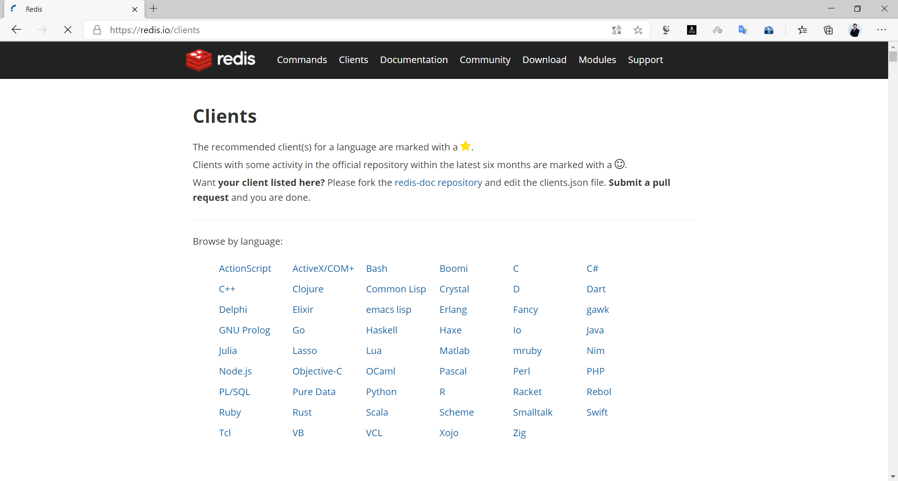
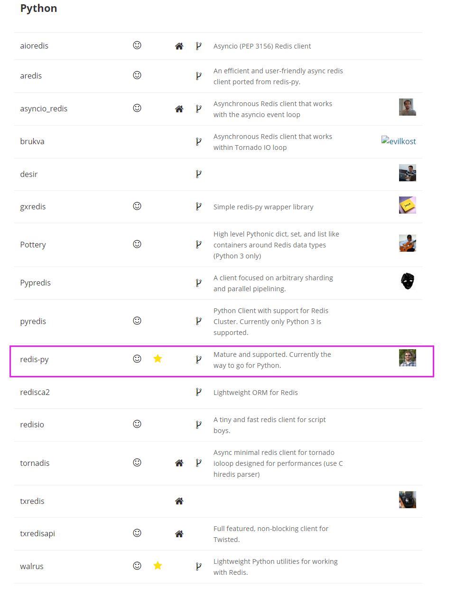
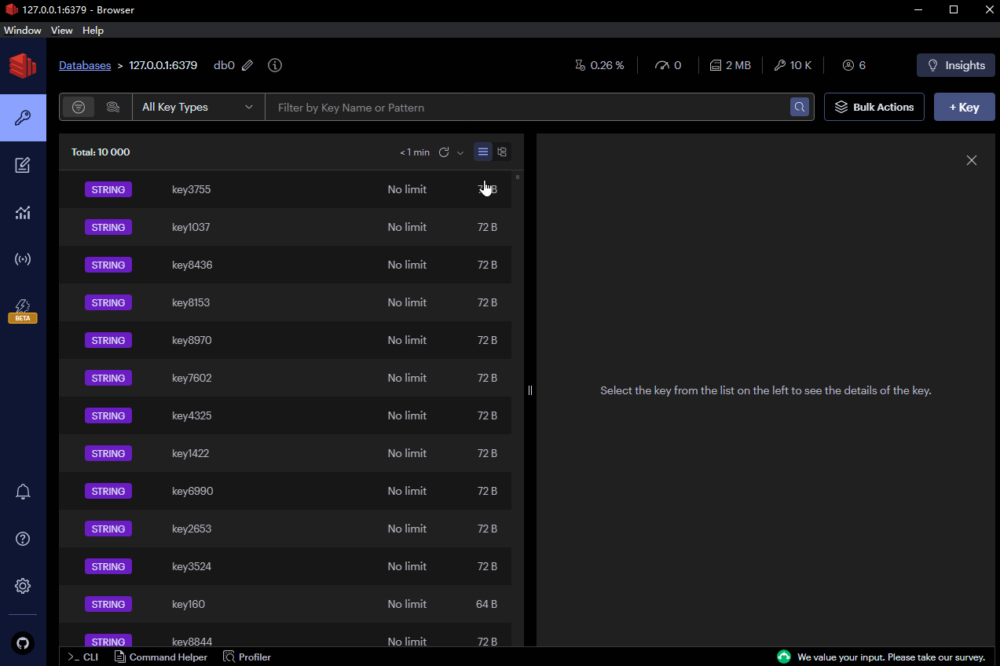
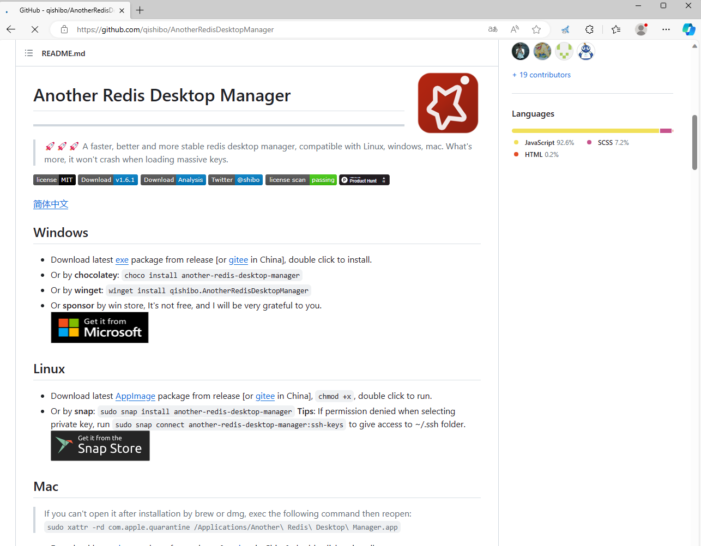
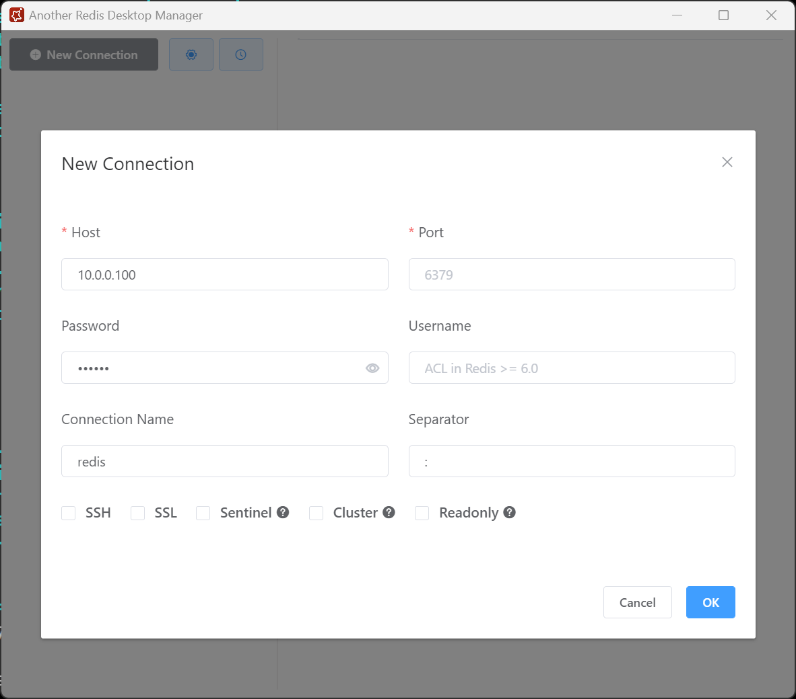
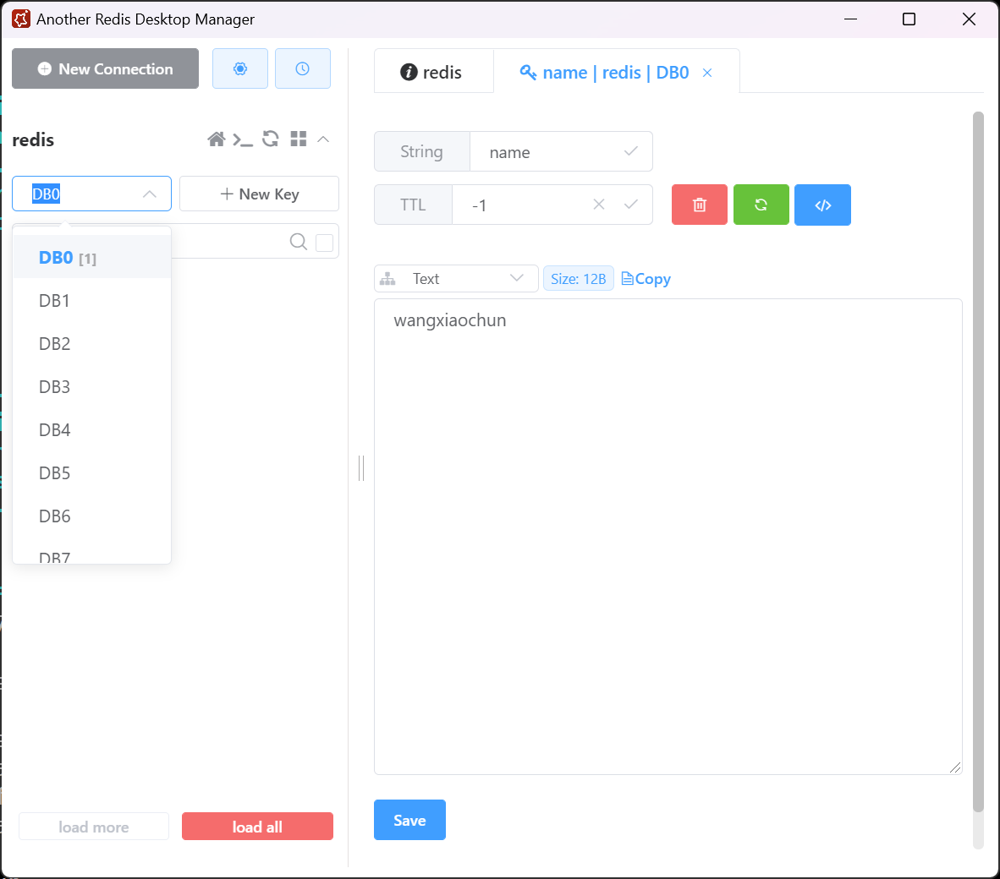
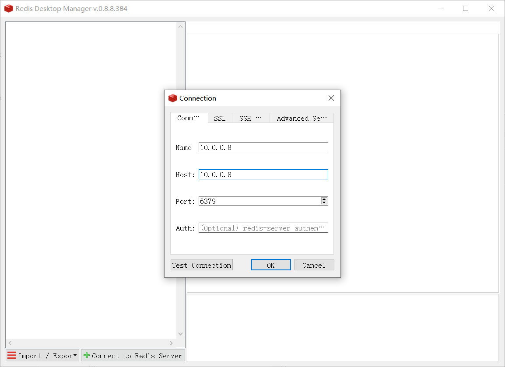
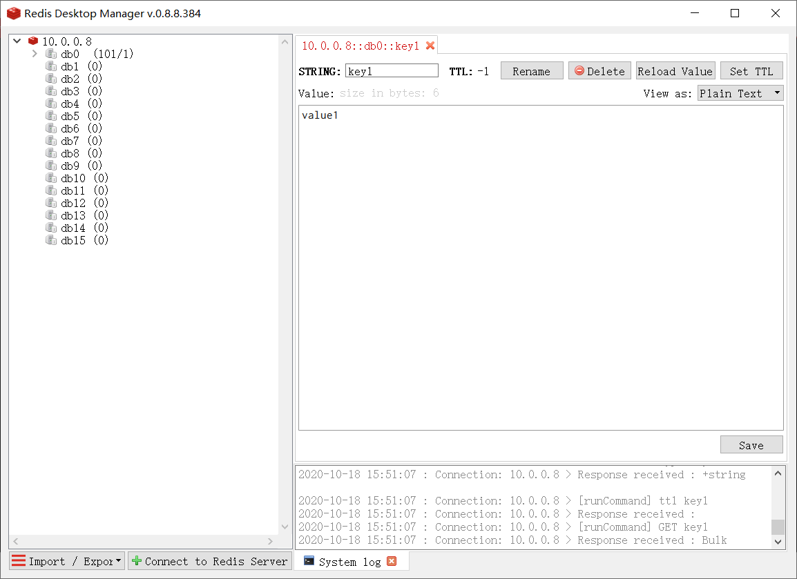

[← 返回Redis 数据库目录]({{ '/subjects/Redis/' | relative_url }})



# 03 Redis 工具和客户端连接
### 1.3 Redis 工具和客户端连接

### 安装的相关程序介绍

```bash
#Redis7.0以上
[root@ubuntu2204 ~]#ll /apps/redis/bin/
total 32772
-rwxr-xr-x 1 root root 4366792 Feb 16 21:12 redis-benchmark #性能测试程序
-rwxr-xr-x 1 root root 8125184 Feb 16 21:12 redis-check-aof -> redis-server #AOF
文件检查程序
-rwxr-xr-x 1 root root 8125184 Feb 16 21:12 redis-check-rdb -> redis-server #RDB
文件检查程序
-rwxr-xr-x 1 root root 4807856 Feb 16 21:12 redis-cli       #客户端程序
lrwxrwxrwx 1 root root      12 Feb 16 21:12 redis-sentinel -> redis-server #哨兵程
序，软连
接到服务器端主程序
-rwxr-xr-x 1 root root 8125184 Feb 16 21:12 redis-server #服务端主程序
#Redis6.0以下
[root@centos8 ~]#ll /apps/redis/bin/
total 32772
-rwxr-xr-x 1 root root 4366792 Feb 16 21:12 redis-benchmark #性能测试程序
-rwxr-xr-x 1 root root 8125184 Feb 16 21:12 redis-check-aof #AOF文件检查程序
-rwxr-xr-x 1 root root 8125184 Feb 16 21:12 redis-check-rdb #RDB文件检查程序
-rwxr-xr-x 1 root root 4807856 Feb 16 21:12 redis-cli       #客户端程序
lrwxrwxrwx 1 root root      12 Feb 16 21:12 redis-sentinel -> redis-server #哨兵程
序，软连
接到服务器端主程序
-rwxr-xr-x 1 root root 8125184 Feb 16 21:12 redis-server #服务端主程序
```

### 客户端程序 redis-cli

```text
#默认为本机无密码连接
redis-cli
#远程客户端连接,注意:Redis没有用户的概念
redis-cli -h <Redis服务器IP> -p <PORT> -a <PASSWORD> --no-auth-warning
```

### 程序连接 Redis

Redis 支持多种开发语言访问

<https://redis.io/clients>




注意：新版redis默认的RDB路径错误，会导致下面脚本执行过程中失败

```bash
[root@ubuntu2204 ~]#vi /apps/redis/etc/redis.conf
#修改下面行的注释
dir /apps/redis/data
[root@ubuntu2204 ~]#systemctl restart redis
```

### Shell 脚本访问 Redis

```bash
[root@centos8 ~]#cat redis_test.sh
#!/bin/bash
NUM=100
PASS=123456
for i in `seq $NUM`;do
redis-cli -h 127.0.0.1 -a "$PASS"  --no-auth-warning  set key${i} value${i}
echo "key${i} value${i} 写入完成"
done
echo "$NUM个key写入完成"
```

### Python 程序连接 Redis

python 提供了多种开发库,都可以支持连接访问 Redis

<https://redis.io/clients>



下面选择使用redis-py 库连接 Redis

github redis-py库 :

<https://github.com/andymccurdy/redis-py>

范例:

```bash
#Ubuntu安装
[root@ubuntu2404 ~]#apt update && apt -y install  python3-redis
[root@ubuntu2204 ~]#apt update && apt -y install  python3-redis
[root@ubuntu2004 ~]#apt update && apt -y install  python3-redis
#CentOS安装
[root@centos8 ~]#yum info  python3-redis
Last metadata expiration check: 1 day, 10:19:31 ago on Thu 15 Oct 2020 11:03:33
PM CST.
Installed Packages
Name         : python3-redis
Version      : 3.3.8
Release      : 1.el8
Architecture : noarch
Size         : 523 k
Source       : python-redis-3.3.8-1.el8.src.rpm
Repository   : @System
From repo    : epel
Summary      : Python 3 interface to the Redis key-value store
URL          : https://github.com/andymccurdy/redis-py
License      : MIT
Description  : This is a Python 3 interface to the Redis key-value store.
[root@centos8 ~]#yum -y install python3 python3-redis
#注意文件名不要为redis,会和redis模块名称冲突
[root@centos8 ~]#cat redis_test.py
#!/usr/bin/python3
import redis
pool =
redis.ConnectionPool(host="127.0.0.1",port=6379,password="123456",decode_respons
es=True)
c = redis.Redis(connection_pool=pool)
for i in range(100):
c.set("k%d" % i,"v%d" % i)
data=c.get("k%d" % i)
print(data)
[root@centos8 ~]# python3 redis_test.py
......
'v94'
'v95'
'v96'
'v97'
'v98'
'v99'
[root@centos8 ~]#redis-cli
127.0.0.1:6379> get k10
"v10"
127.0.0.1:6379>
```

### Golang 程序连接 Redis

```bash
#准备Golang代码，注意：文件名为main.go
[root@ubuntu2204 redis-go]#cat main.go
package main
import (
"context"
"fmt"
"github.com/redis/go-redis/v9"
)
var ctx = context.Background()
func main() {
rdb := redis.NewClient(&redis.Options{
Addr:     "127.0.0.1:6379",
Password: "123456",
DB:       0,
})
_, err := rdb.Ping(ctx).Result()
if err != nil {
fmt.Printf("连接redis出错，错误信息：%v", err)
return
}
for i:=1;i<=10000;i++ {
key := fmt.Sprintf("key%d", i)
value := fmt.Sprintf("value%d", i)
err = rdb.Set(ctx, key, value,0).Err()
if err != nil {
panic(err)
}
keys, err := rdb.Keys(ctx, key).Result()
if err != nil {
panic(err)
}
fmt.Println(keys)
}
}
[root@ubuntu2204 redis-go]#apt update && apt -y install golang
#初始化并定义模块名，即默认生成的程序名
[root@ubuntu2204 redis-go]#go mod init redis-go
#上面命令会生成go.mod文件
[root@ubuntu2204 redis-go]#cat go.mod
module redis-go
go 1.18
#镜像加速
[root@ubuntu2204 redis-go]#go env -w GOPROXY=https://goproxy.cn,direct
#指定项目所依赖相关包及版本
[root@ubuntu2204 redis-go]#go get github.com/redis/go-redis/v9
#上面命令会修改go.mod文件生成依赖信息
[root@ubuntu2204 redis-go]#cat go.mod
module redis-go
go 1.18
require (
github.com/cespare/xxhash/v2 v2.2.0 // indirect
github.com/dgryski/go-rendezvous v0.0.0-20200823014737-9f7001d12a5f //
indirect
github.com/redis/go-redis/v9 v9.0.3 // indirect
)
[root@ubuntu2204 redis-go]#cat go.sum
github.com/cespare/xxhash/v2 v2.2.0
h1:DC2CZ1Ep5Y4k3ZQ899DldepgrayRUGE6BBZ/cd9Cj44=
github.com/cespare/xxhash/v2 v2.2.0/go.mod
h1:VGX0DQ3Q6kWi7AoAeZDth3/j3BFtOZR5XLFGgcrjCOs=
github.com/dgryski/go-rendezvous v0.0.0-20200823014737-9f7001d12a5f
h1:lO4WD4F/rVNCu3HqELle0jiPLLBs70cWOduZpkS1E78=
github.com/dgryski/go-rendezvous v0.0.0-20200823014737-9f7001d12a5f/go.mod
h1:cuUVRXasLTGF7a8hSLbxyZXjz+1KgoB3wDUb6vlszIc=
github.com/redis/go-redis/v9 v9.0.3
h1:+7mmR26M0IvyLxGZUHxu4GiBkJkVDid0Un+j4ScYu4k=
github.com/redis/go-redis/v9 v9.0.3/go.mod
h1:WqMKv5vnQbRuZstUwxQI195wHy+t4PuXDOjzMvcuQHk=
#静态编译并指定生成的文件名myredi
[root@ubuntu2204 redis-go]#CGO_ENABLED=0 go build -o myredis
[root@ubuntu2204 redis-go]#ls
go.mod  go.sum  main.go  myredis
[root@ubuntu2204 redis-go]#ldd myredis
不是动态可执行文件
#或者动态编译文件名为redis-go，如果不指定-o myredis，默认生成的名称为go mod init redis-go
指定的名称
[root@ubuntu2204 redis-go]#go build
[root@ubuntu2204 redis-go]#ls
go.mod  go.sum  main.go  redis-go
[root@ubuntu2204 redis-go]#ldd redis-go
linux-vdso.so.1 (0x00007fff5b15e000)
libc.so.6 => /lib/x86_64-linux-gnu/libc.so.6 (0x00007f4fc1c18000)
/lib64/ld-linux-x86-64.so.2 (0x00007f4fc1e48000)
#运行
[root@ubuntu2204 redis-go]#./redis-go
```

### 图形工具

有一些第三方开发的图形工具也可以连接redis

### RedisInsight

<https://apps.microsoft.com/store/detail/redisinsight/XP8K1GHCB0F1R2>



### Another-Redis-Desktop-Manager

注意：当前 Redis7.2.1 无法连接，Redis7.2.2以后版本可以

<https://github.com/qishibo/AnotherRedisDesktopManager>







### RedisDesktopManager

注意: 当前 Redis-v7.2.1 无法连接，redis-v7.2.3以后版本可以支持连接








<nav class="article-end" aria-label="章节导航">
  <a href="{{ '/subjects/Redis/02-installing-redis.html' | relative_url }}">← Previous: Installing Redis</a>
  <a href="{{ '/subjects/Redis/' | relative_url }}">Back to Redis Database Index</a>
  <a href="{{ '/subjects/Redis/04-common-redis-commands.html' | relative_url }}">Next: Common Redis Commands →</a>
</nav>
