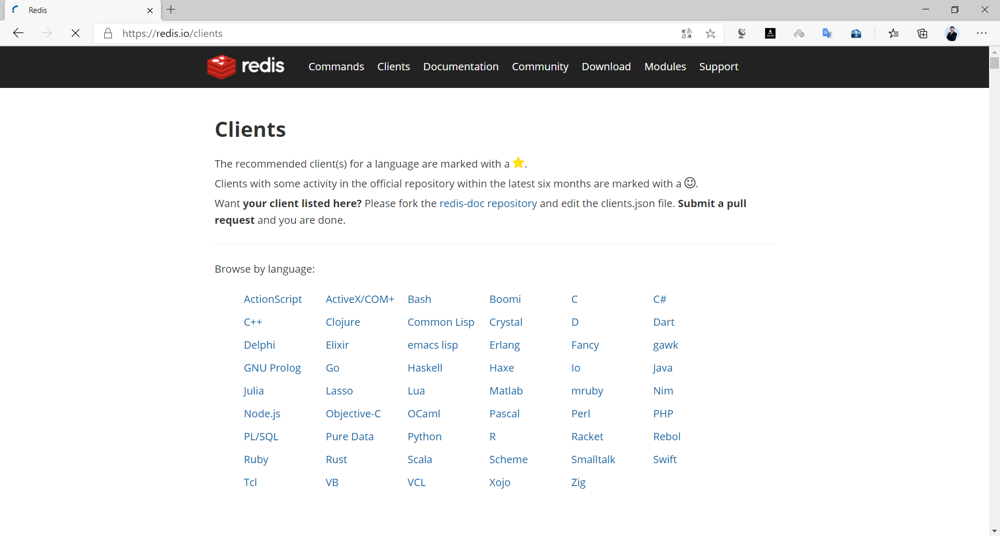
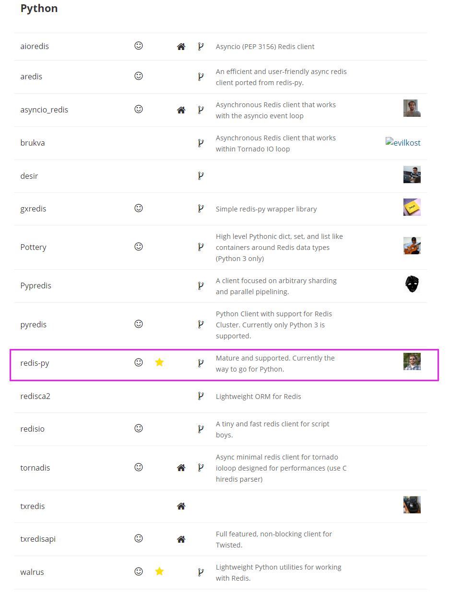
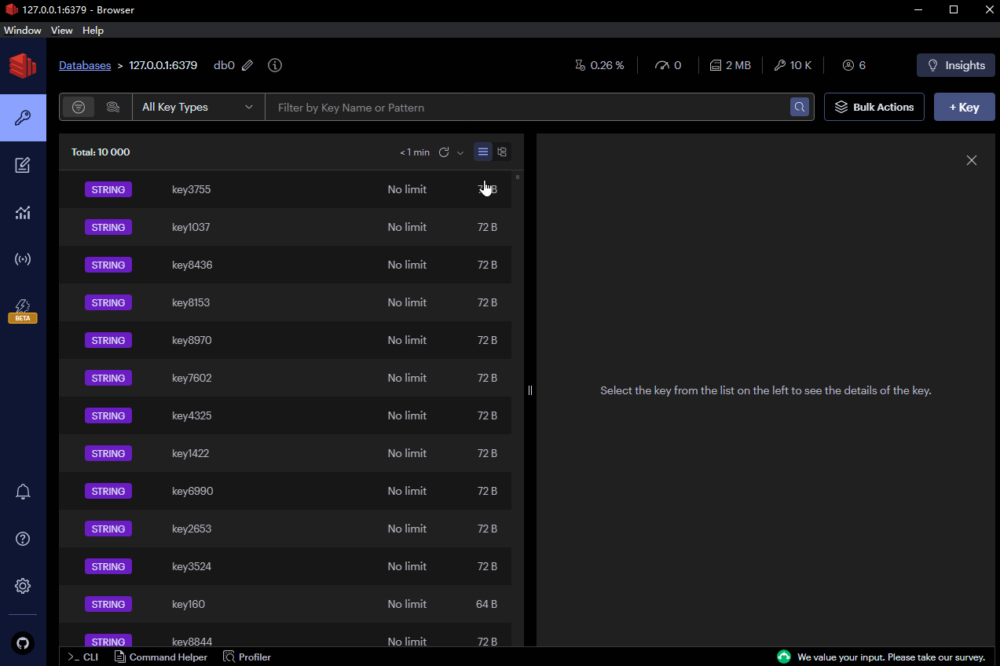
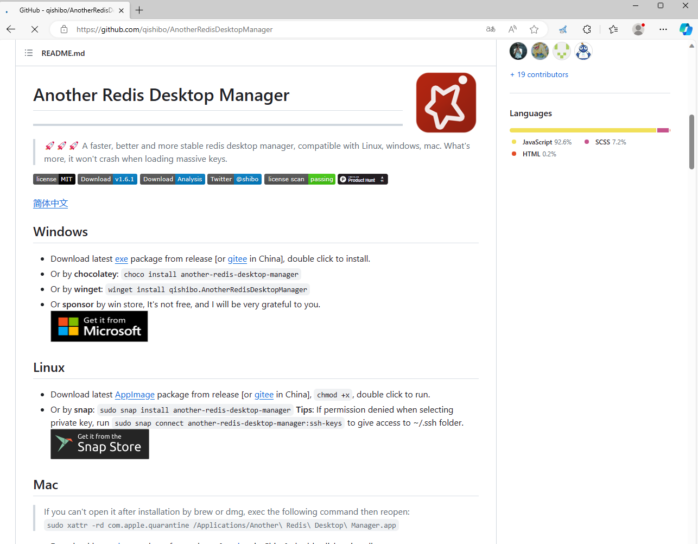
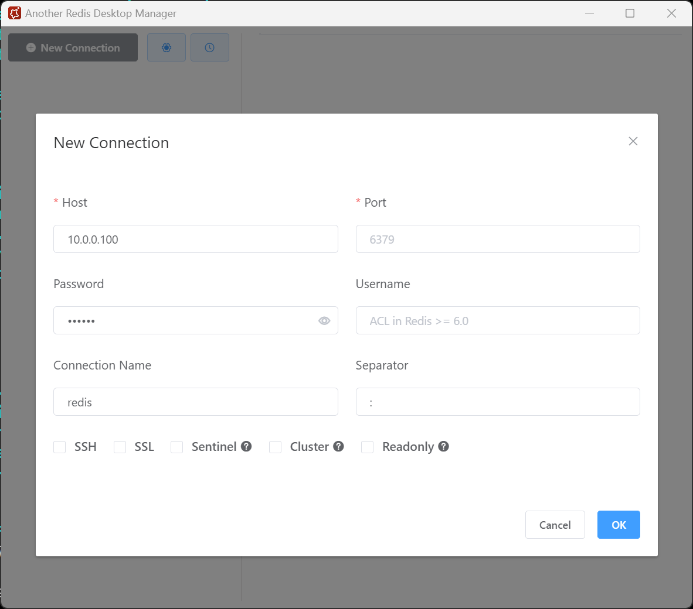
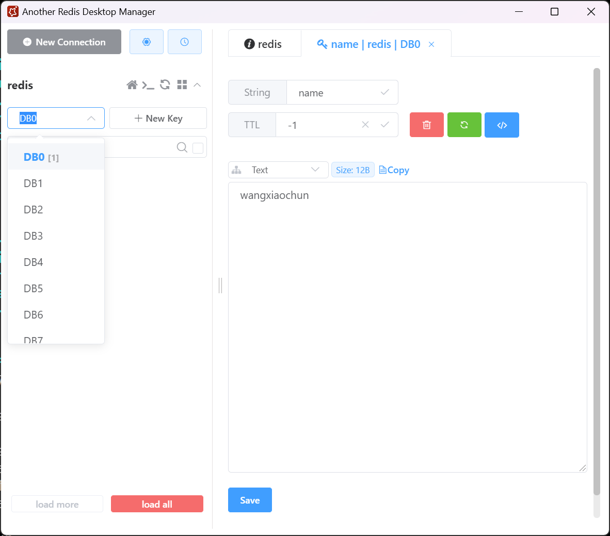
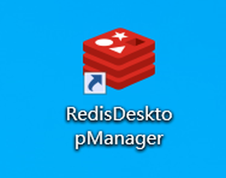
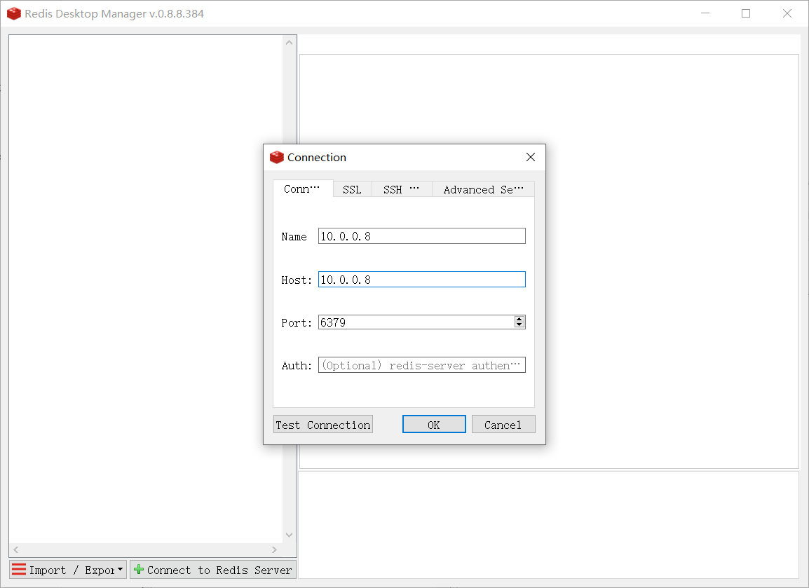
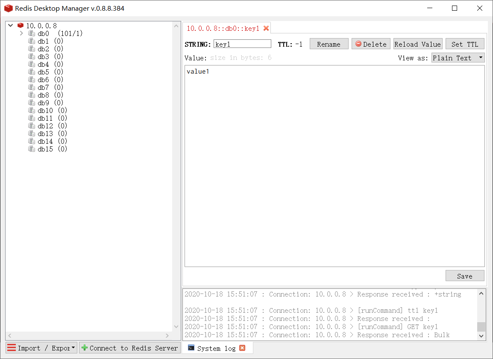

[← 返回 Redis 数据库目录]({{ '/subjects/Redis/' | relative_url }})



# 03 工具与客户端连接

安装 Redis 后，通常会得到 `redis-server`（服务端）、`redis-cli`（交互式客户端）、`redis-benchmark`（基准测试）、`redis-check-rdb`／`redis-check-aof`（持久化文件检查工具）以及 `redis-sentinel`（哨兵模式入口）。某些命令可能是指向同一个二进制的软链接，文件大小和目录布局随打包方式变化，不必依赖原资料的 `ls -l` 长输出。

## 使用 redis-cli

本地默认端口为 `6379`。未配置认证且仅监听环回地址的测试实例可以这样验证：

```bash
redis-cli -h 127.0.0.1 -p 6379 PING
redis-cli -h 127.0.0.1 -p 6379 INFO server
```

返回 `PONG` 说明连接和当前命令可用，不说明持久化、复制或安全配置均正常。Redis 6 起支持 ACL **用户**，因此原文“Redis 没有用户的概念”只适用于更早的认证模型。使用 ACL 时应指定用户名和密码；`-a 密码` 会在进程参数中暴露，交互终端可用 `--askpass`，自动化则采用受保护的密钥注入方式。

```bash
redis-cli -h redis.example.internal -p 6379 --user app-reader --askpass PING
```

若启用 TLS，还需 `--tls` 及信任的 CA 等证书参数。远程访问失败时依次检查监听地址、防火墙／网络、TLS、ACL 权限和服务器日志，不要为了排障直接把服务暴露到所有接口。

## 程序连接的共同原则

各语言客户端都要明确主机、端口、认证、TLS、超时、连接池和异常处理。密码放在环境变量或密钥服务，不写在源码里。若程序能连接但写入后重启丢数据，应检查第 08 篇的 RDB／AOF 配置、数据目录权限与持久化日志；原文将其笼统归因于“新版默认 RDB 路径错误”并不准确。

可从[Redis 客户端列表](https://redis.io/docs/latest/develop/clients/)选择受维护的库。




### Shell：少量命令验证

Shell 适合健康检查或短脚本，不适合大量高频写入。下面示例仅写入三个带过期时间的测试键，避免无限积累；运行前应设置受保护的 `REDISCLI_AUTH` 或在受控终端交互输入。

```bash
for i in 1 2 3; do
  redis-cli -h 127.0.0.1 -p 6379 SET "demo:$i" "value:$i" EX 60
done
redis-cli -h 127.0.0.1 -p 6379 GET demo:1
```

### Python：redis-py

使用虚拟环境安装 `redis` 包，脚本文件**不要命名为 `redis.py`**，否则会遮蔽同名库。

```bash
python3 -m venv .venv
. .venv/bin/activate
python -m pip install redis
```

```python
import os
import redis

client = redis.Redis(
    host=os.getenv("REDIS_HOST", "127.0.0.1"),
    port=int(os.getenv("REDIS_PORT", "6379")),
    username=os.getenv("REDIS_USER") or None,
    password=os.getenv("REDIS_PASSWORD") or None,
    socket_connect_timeout=3,
    socket_timeout=3,
    decode_responses=True,
)

client.ping()
client.set("demo:python", "hello", ex=60)
print(client.get("demo:python"))
client.close()
```

按实际 TLS 配置再设置 `ssl=True`、CA 等参数。连接池可由客户端复用，但不要在每次请求里无限新建客户端。原资料中的 `pool =` 与下一行构造函数被硬换行打断，`for` 循环主体也失去缩进，不能作为 Python 程序执行。



### Go：go-redis/v9

`go-redis/v9` 支持通过 `context` 传递超时与取消。以下只写入并读取一个测试键，不用 `KEYS` 进行全库扫描；原示例每写一个键都调用 `KEYS`，在大实例中代价很高。

```go
package main

import (
    "context"
    "fmt"
    "log"
    "os"
    "time"

    "github.com/redis/go-redis/v9"
)

func main() {
    addr := os.Getenv("REDIS_ADDR")
    if addr == "" {
        addr = "127.0.0.1:6379"
    }
    client := redis.NewClient(&redis.Options{
        Addr: addr, Username: os.Getenv("REDIS_USER"),
        Password: os.Getenv("REDIS_PASSWORD"), DB: 0,
    })
    defer client.Close()

    ctx, cancel := context.WithTimeout(context.Background(), 3*time.Second)
    defer cancel()
    if err := client.Set(ctx, "demo:go", "hello", time.Minute).Err(); err != nil {
        log.Fatal(err)
    }
    value, err := client.Get(ctx, "demo:go").Result()
    if err != nil {
        log.Fatal(err)
    }
    fmt.Println(value)
}
```

在空目录执行 `go mod init redis-demo`、`go get github.com/redis/go-redis/v9`、`go run .`。Go 版本与模块依赖以当前 SDK 的 `go.mod` 要求为准；不需要在教程中逐行复制机器生成的 `go.sum`。

## 图形客户端

RedisInsight 提供浏览键、命令与分析界面；其他社区桌面客户端的维护状态和功能取决于版本。图形工具应通过受控网络和专用 ACL 身份连接，避免在客户端保存根用户凭据。原文把某次连接失败归结为 Redis 7.2.1、7.2.2 或 7.2.3 的固定兼容边界，缺少工具版本、TLS／ACL 和错误日志，不能作为普适结论。















阅读这些截图时，重点是区分连接参数、数据库编号、键名和过期时间；菜单位置随工具版本改变，不影响 Redis 命令本身的语义。



<nav class="article-end" aria-label="章节导航">
  <a href="{{ '/subjects/Redis/02-installing-redis.html' | relative_url }}">← 上一篇：安装 Redis</a>
  <a href="{{ '/subjects/Redis/' | relative_url }}">返回 Redis 数据库目录</a>
  <a href="{{ '/subjects/Redis/04-common-redis-commands.html' | relative_url }}">下一篇：常用命令 →</a>
</nav>
