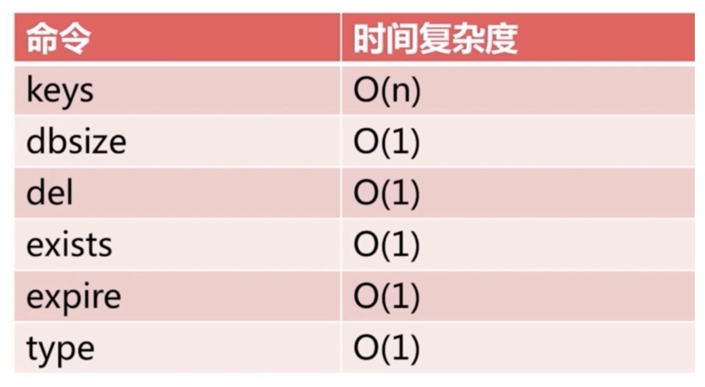
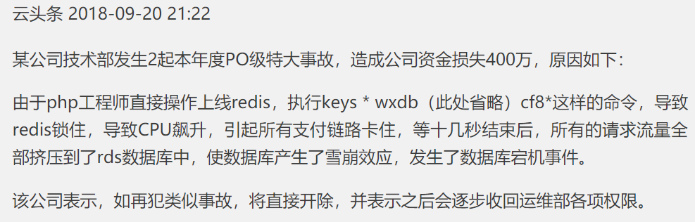

[← 返回Redis 数据库目录]({{ '/subjects/Redis/' | relative_url }})



# 04 Redis 常用命令
## 2 Redis 基础功能

### 2.1 Redis 常用命令

官方文档：

<https://redis.io/commands>

参考链接:

<http://redisdoc.com/>

<http://doc.redisfans.com/>

<https://www.php.cn/manual/view/36359.html>

### INFO

显示当前节点redis运行状态信息

```bash
127.0.0.1:6379> INFO
# Server
redis_version:5.0.3
redis_git_sha1:00000000
redis_git_dirty:0
redis_build_id:8c0bf22bfba82c8f
redis_mode:standalone
os:Linux 4.18.0-147.el8.x86_64 x86_64
arch_bits:64
multiplexing_api:epoll
atomicvar_api:atomic-builtin
gcc_version:8.2.1
process_id:725
run_id:8af0d3fba2b7c5520e0981b125cc49c3ce4d2a2f
tcp_port:6379
uptime_in_seconds:18552
......
#只显示指定部分的内容
[root@ubuntu2004 ~]#redis-cli info server
# Server
redis_version:6.2.6
redis_git_sha1:00000000
redis_git_dirty:0
redis_build_id:7559afb376c61733
```

```bash
[root@ubuntu2004 ~]#redis-cli info Cluster
# Cluster
cluster_enabled:0
```

### SELECT

切换数据库，相当于在MySQL的 USE DBNAME 指令

```bash
[root@centos8 ~]#redis-cli
127.0.0.1:6379> info cluster
# Cluster
cluster_enabled:0
127.0.0.1:6379[15]> SELECT 0
OK
127.0.0.1:6379> SELECT 1
OK
127.0.0.1:6379[1]> SELECT 15
OK
127.0.0.1:6379[15]> SELECT 16
(error) ERR DB index is out of range
127.0.0.1:6379[15]>
```

注意: 在 Redis cluster 模式下不支持多个数据库,会出现下面错误

```bash
[root@centos8 ~]#redis-cli
127.0.0.1:6379> info cluster
# Cluster
cluster_enabled:1
127.0.0.1:6379> select 0
OK
127.0.0.1:6379> select 1
(error) ERR SELECT is not allowed in cluster mode
```

### KEYS

查看当前库下的所有key，此命令慎用！





```text
127.0.0.1:6379[15]> SELECT 0
OK
127.0.0.1:6379> KEYS *
1) "9527"
2) "9526"
3) "course"
4) "list1"
127.0.0.1:6379> SELECT 1
OK
127.0.0.1:6379[1]> KEYS *
(empty list or set)
127.0.0.1:6379[1]>
redis>MSET one 1 two 2 three 3 four 4  # 一次设置 4 个 key
OK
redis> KEYS *o*
1) "four"
2) "two"
3) "one"
redis> KEYS t??
1) "two"
redis> KEYS t[w]*
1) "two"
redis> KEYS *  # 匹配数据库内所有 key
1) "four"
2) "three"
3) "two"
4) "one"
```

### DBSIZE

返回当前库下的所有key 数量

```text
127.0.0.1:6379> DBSIZE
(integer) 4
127.0.0.1:6379> SELECT 1
OK
127.0.0.1:6379[1]> DBSIZE
(integer) 0
```

### FLUSHDB

强制清空当前库中的所有key，此命令慎用！

```text
127.0.0.1:6379[1]> SELECT 0
OK
127.0.0.1:6379> DBSIZE
(integer) 4
127.0.0.1:6379> FLUSHDB
OK
127.0.0.1:6379> DBSIZE
(integer) 0
127.0.0.1:6379>
```

### FLUSHALL

强制清空当前Redis服务器所有数据库中的所有key，即删除所有数据，此命令慎用！

```text
127.0.0.1:6379> FLUSHALL
OK
#生产建议修改配置使用rename-command禁用此命令
vim /etc/redis.conf
rename-command FLUSHALL ""  #flushdb和和AOF功能冲突，需要设置 appendonly no,不区分命令
大小写，但和flushall （v7.2.3不冲突）
```

### SHUTDOWN

```text
可用版本： >= 1.0.0
时间复杂度： O(N)，其中 N 为关机时需要保存的数据库键数量。
SHUTDOWN 命令执行以下操作：
关闭Redis服务,停止所有客户端连接
如果有至少一个保存点在等待，执行 SAVE 命令
如果 AOF 选项被打开，更新 AOF 文件
关闭 redis 服务器(server)
如果持久化被打开的话， SHUTDOWN 命令会保证服务器正常关闭而不丢失任何数据。
另一方面，假如只是单纯地执行 SAVE 命令，然后再执行 QUIT 命令，则没有这一保证 —— 因为在执行
SAVE 之后、执行 QUIT 之前的这段时间中间，其他客户端可能正在和服务器进行通讯，这时如果执行 QUIT
就会造成数据丢失。
#建议禁用此指令
vim /etc/redis.conf
rename-command shutdown ""
```



<nav class="article-end" aria-label="章节导航">
  <a href="{{ '/subjects/Redis/03-redis-tools-and-client-connections.html' | relative_url }}">← Previous: Redis Tools and Client Connections</a>
  <a href="{{ '/subjects/Redis/' | relative_url }}">Back to Redis Database Index</a>
  <a href="{{ '/subjects/Redis/05-redis-configuration-files.html' | relative_url }}">Next: Redis Configuration Files →</a>
</nav>
