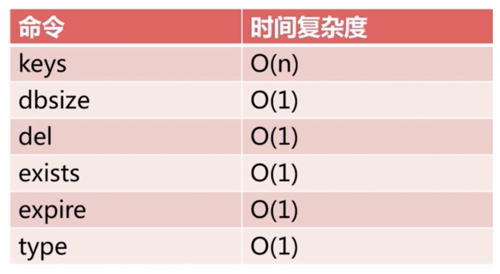
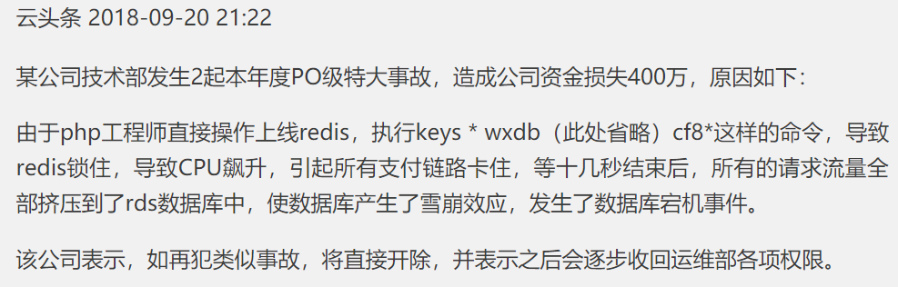

[← 返回 Redis 数据库目录]({{ '/subjects/Redis/' | relative_url }})



# 04 常用管理命令

这一节先认识实例状态、数据库选择、键统计与服务关闭。字符串、哈希、列表等数据类型命令见第 09 篇。不同 Redis 版本的命令选项可能变化，需以[官方命令参考](https://redis.io/commands/)和当前实例的 `COMMAND DOCS` 为准。

## INFO：看实例状态

`INFO` 返回多个分类的运行指标；生产排障时按分类查询更容易阅读：

```text
INFO server
INFO clients
INFO memory
INFO persistence
INFO replication
INFO cluster
```

例如 `INFO server` 可确认 Redis 版本、运行时长和端口；`INFO persistence` 关注 RDB／AOF 的最近状态，`INFO replication` 关注主从角色与连接。原资料复制的数百行旧版本 `INFO` 输出仅是一次采样，不应把其中的内存、端口和角色当成固定结果。

## SELECT：逻辑数据库

单机 Redis 默认有多个逻辑数据库，`SELECT 1` 将当前连接切到 DB 1，`SELECT 0` 切回 DB 0。它们不是 MySQL 那样有独立权限和物理隔离的数据库；多个 DB 仍共享进程资源与持久化文件。DB 数量由配置决定，超出范围会报错。

```text
SELECT 1
DBSIZE
SELECT 0
```

**Redis Cluster 只使用 DB 0**，不支持切换到其他编号；`SELECT 0` 在部分版本中仍可返回成功，但不能据此认为 Cluster 支持多 DB。多租户隔离应使用键命名、ACL 或独立实例来规划。

## KEYS、SCAN 与 DBSIZE

`KEYS pattern` 会在当前数据库遍历所有键，时间复杂度随键数量增长，可能阻塞繁忙实例；适合空实例或很小的测试库，不适合作为生产分页接口。模式 `*`、`?`、字符集合等可以匹配键名，但不会降低全库遍历的代价。





线上排查更适合用 `SCAN` 按游标渐进遍历，例如：

```text
SCAN 0 MATCH user:* COUNT 100
```

返回值包含**下一次游标和本批键**；继续请求直到游标再次为 `0`。`COUNT` 是提示而非严格页大小，遍历期间键变动可能导致重复或遗漏，因此业务逻辑不能把 `SCAN` 当成一致性快照。命令行也可用 `redis-cli --scan --pattern 'user:*'`。`DBSIZE` 只返回当前逻辑数据库的键数量，不列出键，也不统计其他 DB。

## FLUSHDB、FLUSHALL：高影响删除

`FLUSHDB` 清空当前逻辑数据库，`FLUSHALL` 清空实例中的全部逻辑数据库。在 Cluster 中各节点拥有自己的键空间，不能把对单个节点的操作误认为已清理整个集群。两个命令都可能导致不可恢复的数据丢失；执行前应核对实例、DB、备份和业务窗口，并限制普通应用账户的权限。

在 Redis 6+ 中更适合用 ACL 控制高影响命令，而不是只依赖 `rename-command`。重命名或禁用命令会影响客户端、运维工具与持久化重放等行为，需在测试环境验证。原资料关于“FLUSHDB 与 AOF 冲突，必须关闭 AOF”的断言不成立；AOF 是否开启与是否允许清空数据库是两个不同决策。

## SHUTDOWN 与 QUIT

`QUIT` 只断开当前客户端，不停止 Redis；`SHUTDOWN` 停止服务器，并按当前持久化设置尝试完成相应保存或写盘。不能把“执行过 `SAVE` 然后 `QUIT`”当作停止服务或完整备份，因为服务仍可能接收其他写入。由 systemd 管理的实例，日常停机优先使用 `systemctl stop`，观察退出码和持久化日志。是否发生数据丢失取决于持久化模式、写盘策略和故障时点，不能无条件承诺 `SHUTDOWN` 后零丢失。



<nav class="article-end" aria-label="章节导航">
  <a href="{{ '/subjects/Redis/03-redis-tools-and-client-connections.html' | relative_url }}">← 上一篇：工具与客户端连接</a>
  <a href="{{ '/subjects/Redis/' | relative_url }}">返回 Redis 数据库目录</a>
  <a href="{{ '/subjects/Redis/05-redis-configuration-files.html' | relative_url }}">下一篇：配置文件 →</a>
</nav>
