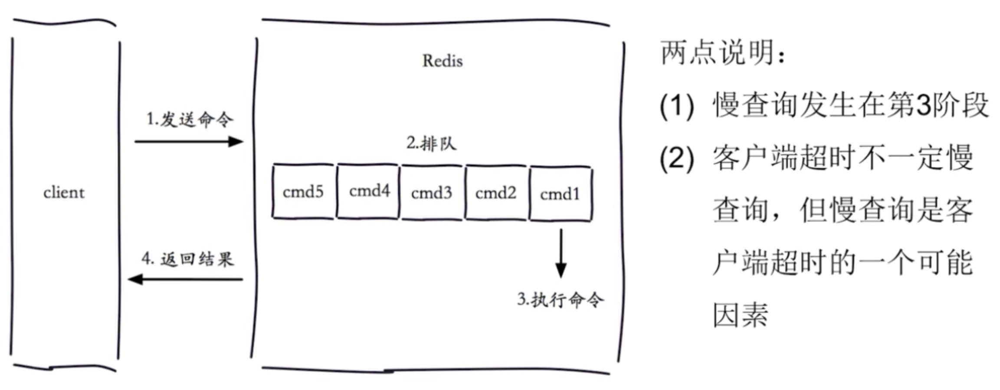

[← 返回 Redis 数据库目录]({{ '/subjects/Redis/' | relative_url }})



# 07 慢查询

Redis 慢日志记录执行时间超过阈值的命令，便于定位会占用服务端处理时间的操作。这里的时间是**命令在 Redis 内部执行的时间**，不包含客户端等待、网络传输和返回结果的耗时；应用感到“慢”，不一定会在慢日志中出现。



## 设置阈值与容量

`slowlog-log-slower-than` 的单位是**微秒**。例如 `10000` 表示 10 ms；`0` 会记录所有命令，负数通常表示关闭记录。`slowlog-max-len` 限制内存中保留的慢日志条数，达到上限时旧记录被挤出，不是持久化到磁盘的日志文件。

先看当前配置，再结合业务延迟目标和负载调整：

```text
CONFIG GET slowlog-log-slower-than
CONFIG GET slowlog-max-len
CONFIG SET slowlog-log-slower-than 10000
CONFIG SET slowlog-max-len 1024
```

原资料将阈值设成 `1` 微秒，几乎所有正常命令都可能进入慢日志，不适合作为一般环境的默认值。在线修改后的持久化方法见第 06 篇。

## 读取一条记录

```text
SLOWLOG LEN
SLOWLOG GET 3
```

一条慢日志通常包含 ID、Unix 时间戳、执行时长（微秒）、命令与参数，以及客户端地址和名称（字段随版本变化）。例如执行时长为 `26000` 意味着 Redis 内部约 26 ms，不意味着客户端请求总共只花了 26 ms。命令参数可能包含业务数据，导出日志前要审阅敏感内容。

记录应结合 `INFO commandstats`、`INFO memory`、CPU、网络、持久化与客户端耗时分析。频繁出现全库 `KEYS`、大集合读取、复杂 Lua 脚本或批量删除时，应先确定调用方、键规模和替代命令，而不是只提高慢日志阈值让记录消失。

`SLOWLOG RESET` 会清空内存中的慢日志；只有在已保存诊断证据、确认需要重新计数时才执行。它不会优化命令，也不会清除普通数据键。



<nav class="article-end" aria-label="章节导航">
  <a href="{{ '/subjects/Redis/06-changing-configuration-dynamically-with-config.html' | relative_url }}">← 上一篇：动态配置</a>
  <a href="{{ '/subjects/Redis/' | relative_url }}">返回 Redis 数据库目录</a>
  <a href="{{ '/subjects/Redis/08-redis-persistence.html' | relative_url }}">下一篇：持久化 →</a>
</nav>
