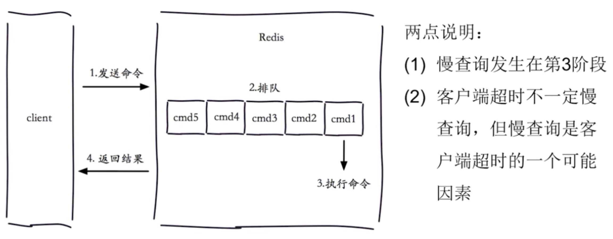

[← Back to Redis Database Index]({{ '/subjects/Redis/' | relative_url }})



# 07 Slow Queries
### 2.4 慢查询



范例: SLOW LOG

```bash
[root@centos8 ~]#vim /etc/redis.conf
slowlog-log-slower-than 1    #单位为us，指定超过1us即为慢的指令，默认值为10000us，10ms
slowlog-max-len 1024         #指定只保存最近的1024条慢记录，默认值为128
127.0.0.1:6379> SLOWLOG LEN  #查看慢日志的记录条数
(integer) 14
127.0.0.1:6379> SLOWLOG GET [n] #查看慢日志的最近n条记录，默认为10
1) 1) (integer) 14
2) (integer) 1544690617       #第2）行表示命令执行的时间戳，距离1970-1-1的秒数，date -d
+@1544690617 可以转换
3) (integer) 4                #第3)行表示每条指令的执行时长
4) 1) "slowlog"
127.0.0.1:6379> SLOWLOG GET 3
1) 1) (integer) 7
2) (integer) 1602901545
3) (integer) 26
4) 1) "SLOWLOG"
2) "get"
5) "127.0.0.1:38258"
6) ""
2) 1) (integer) 6
2) (integer) 1602901540
3) (integer) 22
4) 1) "SLOWLOG"
2) "get"
3) "2"
5) "127.0.0.1:38258"
6) ""
3) 1) (integer) 5
2) (integer) 1602901497
3) (integer) 22
4) 1) "SLOWLOG"
2) "GET"
5) "127.0.0.1:38258"
6) ""
127.0.0.1:6379> SLOWLOG RESET #清空慢日志
OK
```



<nav class="article-end" aria-label="章节导航">
  <a href="{{ '/subjects/Redis/06-changing-configuration-dynamically-with-config.html' | relative_url }}">← Previous: Changing Configuration Dynamically with CONFIG</a>
  <a href="{{ '/subjects/Redis/' | relative_url }}">Back to Redis Database Index</a>
  <a href="{{ '/subjects/Redis/08-redis-persistence.html' | relative_url }}">Next: Redis Persistence →</a>
</nav>
