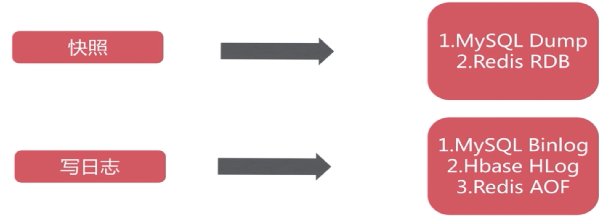
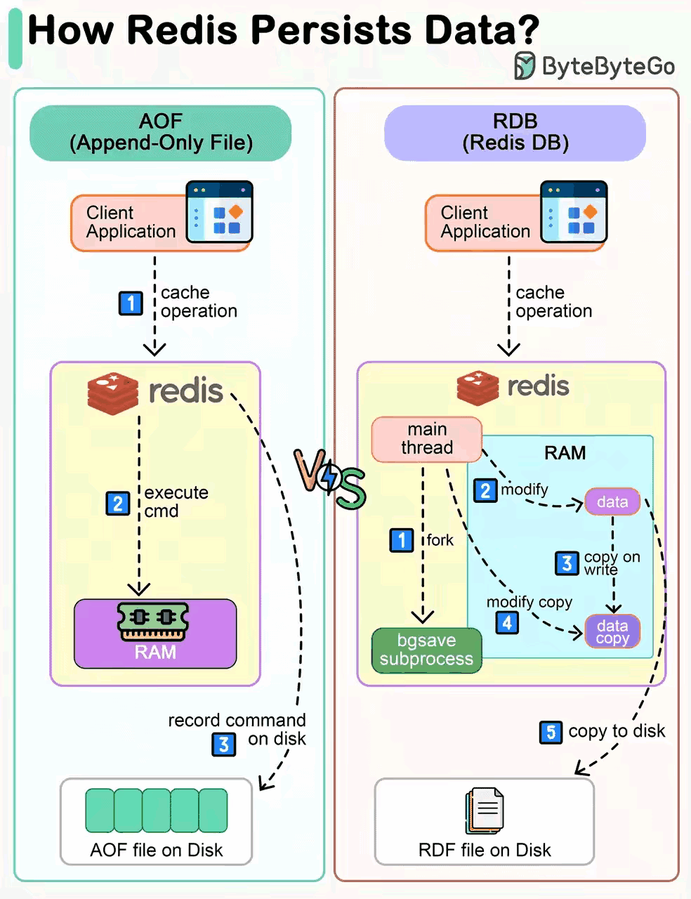
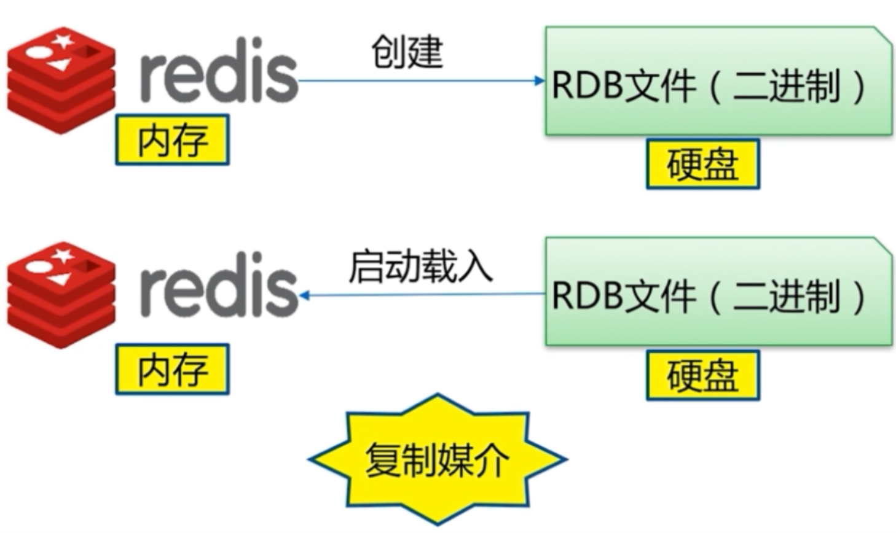
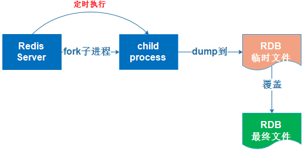
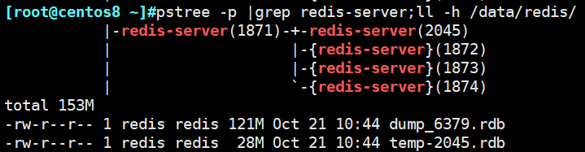
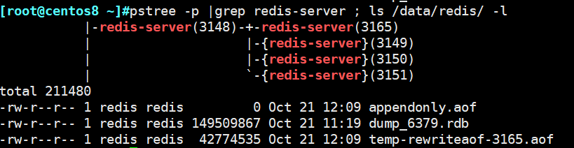
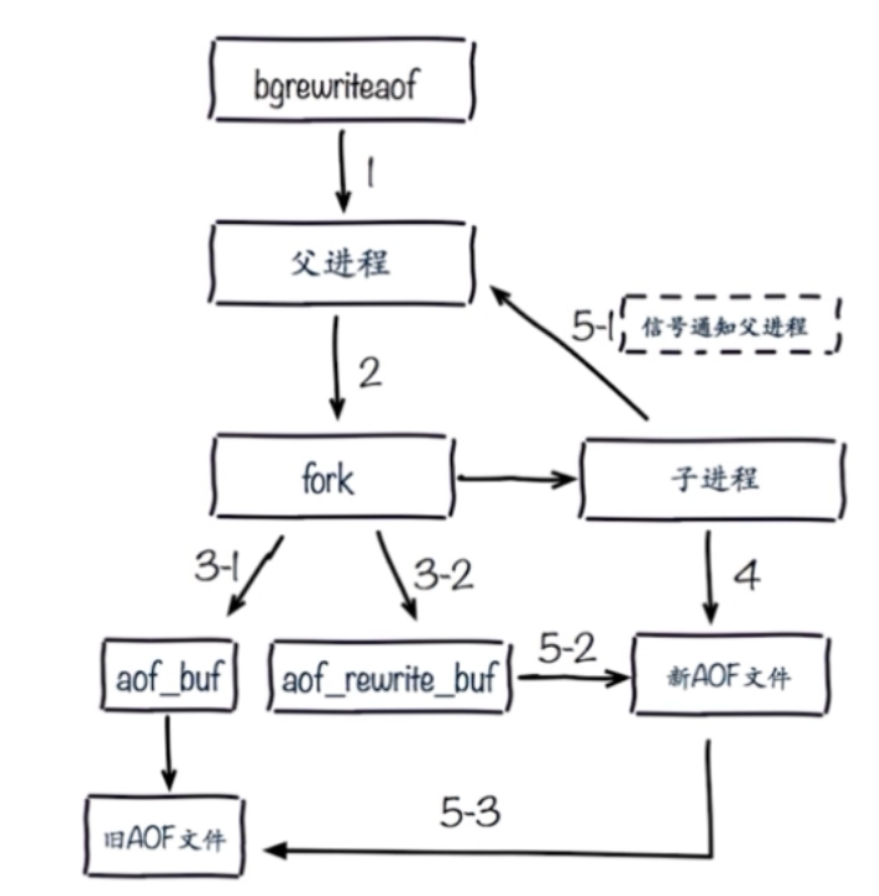
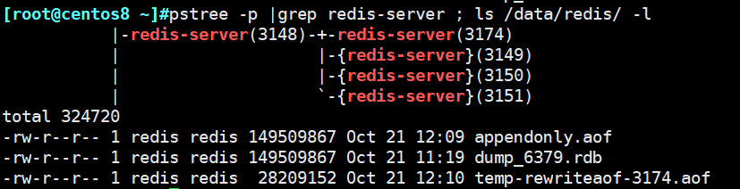

[← Back to Redis Database Index]({{ '/subjects/Redis/' | relative_url }})



# 08 Redis Persistence
### 2.5 Redis 持久化

Redis 是基于内存型的NoSQL, 和MySQL是不同的,使用内存进行数据保存如果想实现数据的持久化,Redis也也可支持将内存数据保存到硬盘文件中

Redis支持两种数据持久化保存方法

RDB:Redis DataBase AOF:AppendOnlyFile





### RDB

### RDB 工作原理



RDB(Redis DataBase)：是基于某个时间点的快照，注意RDB只保留当前最新版本的一个快照

相当于MySQL中的完全备份

RDB 持久化功能所生成的 RDB 文件是一个经过压缩的二进制文件，通过该文件可以还原生成该 RDB 文件时数据库的状态。因为 RDB 文件是保存在磁盘中的，所以即便 Redis 服务进程甚至服务器宕机，只要磁盘中 RDB 文件存在，就能将数据恢复

RDB 支持save和bgsave两种命令实现数据文件的持久化

注意： save 指令使用主进程进行备份，而不生成新的子进程，但是也会生成临时文件temp-<主进程 PID>.rdb文件

范例： save 执行过程会使用主进程进行快照，并生成临时文件temp-<主进程PID>.rdb文件

```bash
#生成临时文件temp-<主进程PID>.rdb文件
[root@centos7 data]#redis-cli -a 123456 save& redis-cli -a 123456 get class ;
pstree -p |grep redis ;ll /apps/redis/data
[1] 28684
|-redis-server(28650)-+-{redis-server}(28651)
|                     |-{redis-server}(28652)
|                     |-{redis-server}(28653)
|                     `-{redis-server}(28654)
|           |                         `-redis-cli(28684)
|           `-sshd(23494)---bash(23496)---redis-cli(28601)
total 251016
-rw-r--r-- 1 redis redis 189855682 Nov 17 15:02 dump.rdb
-rw-r--r-- 1 redis redis  45674498 Nov 17 15:02 temp-28650.rdb
```

RDB bgsave 实现快照的具体过程:



首先从redis 主进程先fork生成一个新的子进程,此子进程负责将Redis内存数据保存为一个临时文件tmp<子进程pid>.rdb

当数据保存完成后,再将此临时文件改名为RDB文件,如果有前一次保存的RDB文件则会被替换，最后关闭此子进程

由于Redis只保留最后一个版本的RDB文件,如果想实现保存多个版本的数据,需要人为实现

范例： bgsave 执行过程会使用主进程进行快照



```bash
[root@ubuntu2404 ~]#redis-cli -a 123456 bgsave; redis-cli -a 123456 set name
bowenxiaochun ; redis-cli -a 123456 info Persistence |grep rdb_bgsave_in_progress;
pstree -p |grep redis ;ll /apps/redis/data
rdb_bgsave_in_progress:1
|-redis-server(1521)-+-redis-server(1558)
|                    |-{redis-server}(1522)
|                    |-{redis-server}(1523)
|                    |-{redis-server}(1524)
|                    |-{redis-server}(1525)
|                    `-{redis-server}(1526)
total 185744
drwxr-xr-x 2 redis redis      4096 Jun 18 10:44 ./
drwxr-xr-x 7 redis redis      4096 Jun 16 16:25 ../
-rw-r--r-- 1 redis redis 189855676 Jun 18 10:43 dump.rdb
-rw-r--r-- 1 redis redis    335872 Jun 18 10:44 temp-1558.rdb
#过一会儿备份完成
[root@ubuntu2404 ~]#redis-cli -a 123456 info Persistence |grep
rdb_bgsave_in_progress; pstree -p |grep redis ;ll /apps/redis/data
Warning: Using a password with '-a' or '-u' option on the command line interface
may not be safe.
rdb_bgsave_in_progress:0
|-redis-server(1521)-+-{redis-server}(1522)
|                    |-{redis-server}(1523)
|                    |-{redis-server}(1524)
|                    |-{redis-server}(1525)
|                    `-{redis-server}(1526)
total 185416
drwxr-xr-x 2 redis redis      4096 Jun 18 10:44 ./
drwxr-xr-x 7 redis redis      4096 Jun 16 16:25 ../
-rw-r--r-- 1 redis redis 189855676 Jun 18 10:44 dump.rdb
```

### RDB 相关配置

```text
#在配置文件中的 save 选项设置多个保存条件，只有任何一个条件满足，服务器都会自动执行 BGSAVE 命
令
#Redis7.0以后支持写在一行，如：save 3600 1 300 100 60 10000，此也为默认值
save 900 1         #900s内修改了1个key即触发保存RDB
save 300 10        #300s内修改了10个key即触发保存RDB
save 60 10000      #60s内修改了10000个key即触发保存RDB
dbfilename dump.rdb
dir ./             #编泽编译安装时默认RDB文件存放在Redis的工作目录,此配置可指定保存的数据目
录
stop-writes-on-bgsave-error yes  #当快照失败是否仍允许写入,yes为出错后禁止写入,建议为no
rdbcompression yes
rdbchecksum yes
```

范例：RDB 相关配置

```bash
[root@ubuntu2004 ~]#grep save /apps/redis/etc/redis.conf
# save <seconds> <changes>
# Redis will save the DB if both the given number of seconds and the given
# save ""
# Unless specified otherwise, by default Redis will save the DB:
# save 3600 1
# save 300 100
# save 60 10000
#以上是默认值
[root@ubuntu2004 ~]#redis-cli config get save
1) "save"
2) "3600 1 300 100 60 10000"
```

```bash
#禁用系统的自动快照
[root@ubuntu2004 ~]#vim /apps/redis/etc/redis.conf
save ""
# save 3600 1
# save 300 100
# save 60 10000
#支持动态修改，注意：需要添加双引号
127.0.0.1:6379> config set save "60 3"
OK
127.0.0.1:6379> config get save
1) "save"
2) "60 3"
```

### 实现 RDB 方法

save: 同步,不推荐使用，使用主进程完成快照，因此会阻塞其它命令执行 bgsave: 异步后台执行,不影响其它命令的执行，会开启独立的子进程，因此不会阻赛其它命令执行配置文件实现自动保存: 在配置文件中制定规则,自动执行bgsave

### RDB 模式的优缺点

2.5.1.4.1 RDB 模式优点

RDB快照只保存某个时间点的数据，恢复的时候直接加载到内存即可，不用做其他处理，这种文件适合用于做灾备处理.可以通过自定义时间点执行redis指令bgsave或者save保存快照，实现多个版本的备份

比如: 可以在最近的24小时内，每小时备份一次RDB文件，并且在每个月的每一天，也备份一个 RDB文件。这样的话，即使遇上问题，也可以随时将数据集还原到指定的不同的版本。

RDB在大数据集时恢复的速度比AOF方式要快

2.5.1.4.2 RDB 模式缺点

不能实时保存数据，可能会丢失自上一次执行RDB备份到当前的内存数据

如果需要尽量避免在服务器故障时丢失数据，那么RDB并不适合。虽然Redis允许设置不同的保存点（save point）来控制保存RDB文件的频率，但是，因为RDB文件需要保存整个数据集的状态， 所以它可能并不是一个非常快速的操作。因此一般会超过5分钟以上才保存一次RDB文件。在这种情况下，一旦发生故障停机，就可能会丢失较长时间的数据。

在数据集比较庞大时，fork()子进程可能会非常耗时，造成服务器在一定时间内停止处理客户端请求,如果数据集非常巨大，并且CPU时间非常紧张的话，那么这种停止时间甚至可能会长达整整一秒或更久。另外子进程完成生成RDB文件的时间也会花更长时间.

误删除，无法恢复

范例:  手动执行备份RDB

```bash
[root@rocky8 ~]#redis-cli
127.0.0.1:6379> debug populate 5000000
OK
(3.96s)
127.0.0.1:6379> dbsize
(integer) 5000000
127.0.0.1:6379> get key:0
"value:0"
127.0.0.1:6379> get key:1
"value:1"
127.0.0.1:6379> get key:2
"value:2"
127.0.0.1:6379> get key:499999
"value:499999"
127.0.0.1:6379> get key:5000000
(nil)
127.0.0.1:6379> bgsave
Background saving started
[root@rocky8 ~]#ll /var/lib/redis/ -h
total 127M
-rw-r--r-- 1 redis redis 127M Jun 13 23:07 dump.rdb
```

范例: 手动备份RDB文件的脚本

```bash
#配置文件
[root@centos7 ~]#vim /apps/redis/etc/redis.conf
save ""
dbfilename dump_6379.rdb
dir "/data/redis"
appendonly no
#脚本
[root@centos8 ~]#cat redis_backup_rdb.sh
#!/bin/bash
#
#FileName:          redis_rdb.sh
#Description:       The test script
BACKUP=/backup/redis-rdb
DIR=/data/redis
FILE=dump_6379.rdb
PASS=123456
color () {
RES_COL=60
MOVE_TO_COL="echo -en \\033[${RES_COL}G"
SETCOLOR_SUCCESS="echo -en \\033[1;32m"
SETCOLOR_FAILURE="echo -en \\033[1;31m"
SETCOLOR_WARNING="echo -en \\033[1;33m"
SETCOLOR_NORMAL="echo -en \E[0m"
echo -n "$1" && $MOVE_TO_COL
echo -n "["
if [ $2 = "success" -o $2 = "0" ] ;then
${SETCOLOR_SUCCESS}
echo -n $"  OK  "
elif [ $2 = "failure" -o $2 = "1"  ] ;then
${SETCOLOR_FAILURE}
echo -n $"FAILED"
else
${SETCOLOR_WARNING}
echo -n $"WARNING"
fi
${SETCOLOR_NORMAL}
echo -n "]"
echo
}
redis-cli -h 127.0.0.1 -a $PASS --no-auth-warning  bgsave
result=`redis-cli -a $PASS --no-auth-warning info Persistence |grep
rdb_bgsave_in_progress| sed -rn 's/.*:([0-9]+).*/\1/p'`
#result=`redis-cli -a $PASS --no-auth-warning info Persistence |awk -F:
'/rdb_bgsave_in_progress/{print $2}'`
until  [ $result -eq 0 ] ;do
sleep 1
result=`redis-cli -a $PASS --no-auth-warning info Persistence |awk -F:
'/rdb_bgsave_in_progress/{print $2}'`
done
DATE=`date +%F_%H-%M-%S`
[ -e $BACKUP ] || { mkdir -p $BACKUP ; chown -R redis.redis $BACKUP; }
scp $DIR/$FILE $BACKUP/dump_6379-${DATE}.rdb
scp $DIR/$FILE backup-server:/backup/
color "Backup redis RDB" 0
#执行
[root@centos8 ~]#bash redis_backup_rdb.sh
Background saving started
Backup redis RDB                                           [  OK  ]
[root@centos8 ~]#ll /backup/redis-rdb/ -h
total 143M
-rw-r--r-- 1 redis redis 143M Oct 21 11:08 dump_6379-2020-10-21_11-08-47.rdb
```

范例: 观察save 和 bgsave的执行过程

```bash
#阻塞
#生成临时文件
[root@centos7 ~]#(redis-cli  -a 123456 save  &) ; echo save is finished; redis-
cli  -a  123456 get class
```

范例: 自动保存

```bash
[root@centos7 ~]#vim /apps/redis/etc/redis.conf
save 60 3
#测试60s内修改3个key,验证是否生成RDB文件
```

### AOF

### AOF 工作原理


AOF 即 AppendOnlyFile，AOF 和 RDB 都采有COW机制

AOF 可以指定不同的保存策略,默认为每秒钟执行一次 fsync,按照操作的顺序地将变更命令追加至指定的 AOF日志文件尾部

在第一次启用AOF功能时，会做一次完全备份，后续将执行增量性备份，相当于完全数据备份+增量变化

如果同时启用RDB和AOF,进行恢复时,默认AOF文件优先级高于RDB文件,即会使用AOF文件进行恢复

在第一次开启AOF功能时,会自动备份所有数据到AOF文件中,后续只会记录数据的更新指令

注意: AOF 模式默认是关闭的,第一次开启AOF后,并重启服务生效后,会因为AOF的优先级高于RDB,而 AOF默认没有数据文件存在,从而导致所有数据丢失

范例: 错误开启AOF功能,会导致数据丢失

```bash
[root@ubuntu1804 ~]#redis-cli
127.0.0.1:6379> dbsize
(integer) 10010011
[root@ubuntu1804 ~]#vim /apps/redis/etc/redis.conf
appendonly yes #修改此行
[root@ubuntu1804 data]#systemctl restart  redis
[root@ubuntu1804 ~]#redis-cli
127.0.0.1:6379> dbsize
(integer) 0
```

范例: 正确启用AOF功能,访止数据丢失

```bash
[root@centos8 ~]#ll /var/lib/redis/
total 314392
-rw-r--r-- 1 redis redis 187779391 Oct 17 14:23 dump.rdb
[root@centos8 ~]#redis-cli
127.0.0.1:6379> config get appendonly
1) "appendonly"
2) "no"
127.0.0.1:6379> config set appendonly  yes  #自动触发AOF重写,会自动备份所有数据到AOF文
件
OK
[root@centos8 ~]#ll /var/lib/redis/
total 314392
-rw-r--r-- 1 redis redis 187779391 Oct 17 14:23 dump.rdb
-rw-r--r-- 1 redis redis  85196805 Oct 17 14:45 temp-rewriteaof-2146.aof
[root@centos8 ~]#ll /var/lib/redis/
total 366760
-rw-r--r-- 1 redis redis 187779391 Oct 17 14:45 appendonly.aof
-rw-r--r-- 1 redis redis 187779391 Oct 17 14:23 dump.rdb
[root@centos8 ~]#vim /etc/redis.conf
appendonly yes #改为yes
#config set appendonly  yes 后可以同时看到下面显示
```



范例： Redis 7.0以上版本的AOF是多个文件，Redis6.0以前版本只有一个文件

```bash
# Redis 7.0以上版本
[root@ubuntu2204 ~]#file /apps/redis/data/appendonlydir/*
/apps/redis/data/appendonlydir/appendonly.aof.1.base.rdb: Redis RDB file, version
0010
/apps/redis/data/appendonlydir/appendonly.aof.1.incr.aof: ASCII text, with CRLF
line terminators
/apps/redis/data/appendonlydir/appendonly.aof.manifest:   ASCII text
#Redis6.0以前版本只有一个文件
[root@ubuntu2204 ~]#file /var/lib/redis/appendonly.aof
/var/lib/redis/appendonly.aof: Redis RDB file, version 0009
```

### AOF 相关配置

```text
appendonly no #是否开启AOF日志记录，默认redis使用的是rdb方式持久化，这种方式在许多应用中已经
足够用了，但是redis如果中途宕机，会导致可能有几分钟的数据丢失(取决于dump数据的间隔时间)，根据
save来策略进行持久化，Append Only File是另一种持久化方式，可以提供更好的持久化特性，Redis会
把每次写入的数据在接收后都写入 appendonly.aof 文件，每次启动时Redis都会先把这个文件的数据读入
内存里，先忽略RDB文件。默认不启用此功能
appendfilename "appendonly.aof"  #6.X 以前版本文件AOF的文件名，存放在dir指令指定的目录中
appenddirname "appendonlydir"    #7.X 以后版本指定目录名称
#aof持久化策略的配置
appendfsync everysec
#no表示由操作系统保证数据同步到磁盘,Linux的默认fsync策略是30秒，最多会丢失30s的数据
#always表示每次写入都执行fsync，以保证数据同步到磁盘,安全性高,性能较差
#everysec表示每秒执行一次fsync，可能会导致丢失这1s数据,此为默认值,也生产建议值
#数据持久化目录
dir /path
#rewrite相关
no-appendfsync-on-rewrite yes
auto-aof-rewrite-percentage 100
auto-aof-rewrite-min-size 64mb
aof-load-truncated yes
```

范例:  动态修改配置自动生成appendonly.aof文件

```text
127.0.0.1:6379> CONFIG set appendonly yes
```

### AOF Rewrite 重写(清理)

将一些重复的,可以合并的,过期的数据重新写入一个新的AOF文件,从而节约AOF备份占用的硬盘空间,也能加速恢复过程

可以手动执行bgrewriteaof 触发AOF,第一次开启AOF功能,或定义自动rewrite 策略

AOF rewrite 过程

父进程生成一个新的子进程负责生成新的AOF文件，同时父进程将新的数据更新同时写入两个缓冲区 aof_buf和aof_rewrite_buf

6.X版本之前新的AOF文件覆盖旧的AOF文件 7.X版本之后版本，新的AOF文件覆盖AOF目录中的RDB文件appendonly.aof.2.base.rdb，并生成一个新空的AOF文件appendonly.aof.2.incr.aof，此文件的编号会加1，同时更新appendonly.aof.manifest 中的内容



AOF rewrite 重写相关配置

```text
#同时在执行bgrewriteaof操作和主进程写aof文件的操作，两者都会操作磁盘，而bgrewriteaof往往会
涉及大量磁盘操作，这样就会造成主进程在写aof文件的时候出现阻塞的情形,以下参数实现控制
no-appendfsync-on-rewrite no #在aof rewrite期间,是否对aof新记录的append暂缓使用文件同步
策略,主要考虑磁盘IO开支和请求阻塞时间。
#默认为no,表示"不暂缓",新的aof记录仍然会被立即同步到磁盘，是最安全的方式，不会丢失数据，但是要
忍受阻塞的问题
#为yes,相当于将appendfsync设置为no，这说明并没有执行磁盘操作，只是写入了缓冲区，因此这样并不
会造成阻塞（因为没有竞争磁盘），但是如果这个时候redis挂掉，就会丢失数据。丢失多少数据呢？Linux
的默认fsync策略是30秒，最多会丢失30s的数据,但由于yes性能较好而且会避免出现阻塞因此比较推荐
#rewrite 即对aof文件进行整理,将空闲空间回收,从而可以减少恢复数据时间
auto-aof-rewrite-percentage 100 #当Aof log增长超过指定百分比例时，重写AOF文件，设置为0表
示不自动重写Aof日志，重写是为了使aof体积保持最小，但是还可以确保保存最完整的数据
auto-aof-rewrite-min-size 64mb #触发aof rewrite的最小文件大小
aof-load-truncated yes #是否加载由于某些原因导致的末尾异常的AOF文件(主进程被kill/断电等)，
建议yes
```

### 手动执行AOF重写 BGREWRITEAOF 命令

```text
BGREWRITEAOF
时间复杂度： O(N)， N 为要追加到 AOF 文件中的数据数量。
执行一个 AOF文件 重写操作。重写会创建一个当前 AOF 文件的体积优化版本。
即使 BGREWRITEAOF 执行失败，也不会有任何数据丢失，因为旧的 AOF 文件在 BGREWRITEAOF 成功之
前不会被修改。
重写操作只会在没有其他持久化工作在后台执行时被触发，也就是说：
如果 Redis 的子进程正在执行快照的保存工作，那么 AOF 重写的操作会被预定(scheduled)，等到保存
工作完成之后再执行 AOF 重写。在这种情况下， BGREWRITEAOF 的返回值仍然是 OK ，但还会加上一条
额外的信息，说明 BGREWRITEAOF 要等到保存操作完成之后才能执行。在 Redis 2.6 或以上的版本，可
以使用 INFO [section] 命令查看 BGREWRITEAOF 是否被预定。
如果已经有别的 AOF 文件重写在执行，那么 BGREWRITEAOF 返回一个错误，并且这个新的
BGREWRITEAOF 请求也不会被预定到下次执行。
从 Redis 2.4 开始， AOF 重写由 Redis 自行触发， BGREWRITEAOF 仅仅用于手动触发重写操作。
```

范例: 手动 bgrewriteaof

```bash
127.0.0.1:6379> BGREWRITEAOF
Background append only file rewriting started
#8.X版本
[root@ubuntu2404 ~]#redis-cli  -a 123456  BGREWRITEAOF  ; pstree -p |grep redis;
ls -l /apps/redis/data/; ls -l /apps/redis/data/appendonlydir/
Warning: Using a password with '-a' or '-u' option on the command line interface
may not be safe.
Background append only file rewriting started
|-redis-server(1969)-+-redis-server(1993)
|                    |-{redis-server}(1970)
|                    |-{redis-server}(1971)
|                    |-{redis-server}(1972)
|                    |-{redis-server}(1973)
|                    `-{redis-server}(1974)
|-sshd(978)-+-sshd(980)---bash(1017)---redis-cli(1483)
total 444
drwxr-xr-x 2 redis redis   4096 Aug 27 11:37 appendonlydir
-rw-r--r-- 1 redis redis     88 Aug 27 11:22 dump.rdb
-rw-r--r-- 1 redis redis 446464 Aug 27 11:37 temp-rewriteaof-1993.aof
total 185416
-rw-r--r-- 1 redis redis 189855722 Aug 27 11:36 appendonly.aof.3.base.rdb
-rw-r--r-- 1 redis redis         0 Aug 27 11:36 appendonly.aof.3.incr.aof
-rw-r--r-- 1 redis redis         0 Aug 27 11:37 appendonly.aof.4.incr.aof
-rw-r--r-- 1 redis redis       164 Aug 27 11:37 appendonly.aof.manifest
```

```bash
#7.X版本
[root@ubuntu2204 etc]#redis-cli  -a 123456  BGREWRITEAOF  ; pstree -p |grep
redis; ls -l /apps/redis/data/ls -l /apps/redis/data/appendonlydir/
├─redis-server(41173)─┬─redis-server(41192)
│                     ├─{redis-server}(41174)
│                     ├─{redis-server}(41175)
│                     ├─{redis-server}(41176)
│                     ├─{redis-server}(41177)
│                     ├─{redis-server}(41183)
│                     └─{redis-server}(41194)
-rw-r--r-- 1 redis redis 189855694  6月 26 16:53 appendonly.aof.2.base.rdb
-rw-r--r-- 1 redis redis       267  6月 26 17:04 appendonly.aof.2.incr.aof
-rw-r--r-- 1 redis redis         0  6月 26 17:10 appendonly.aof.3.incr.aof
-rw-r--r-- 1 redis redis       132  6月 26 17:10 appendonly.aof.manifest
#7.X生成一个临时的AOF文件
[root@ubuntu2204 ~]#ll /apps/redis/data/
总计 83688
drwxr-xr-x 3 redis redis     4096  2月 19 09:41 ./
drwxr-xr-x 7 redis redis     4096  2月  2 11:42 ../
drwxr-xr-x 2 redis redis     4096  2月 19 09:41 appendonlydir/
-rw-r--r-- 1 redis redis       88  2月 19 09:24 dump.rdb
-rw-r--r-- 1 redis redis 85680128  2月 19 09:41 temp-rewriteaof-96239.aof
```

```bash
#执行完成后incr文件清空，合并到RDB文件中
[root@ubuntu2204 etc]#ll /apps/redis/data/appendonlydir/
总计 185420
drwxr-xr-x 2 redis redis      4096  6月 26 17:10 ./
drwxr-xr-x 3 redis redis      4096  6月 26 17:10 ../
-rw-r--r-- 1 redis redis 189855711  6月 26 17:10 appendonly.aof.3.base.rdb
-rw-r--r-- 1 redis redis         0  6月 26 17:10 appendonly.aof.3.incr.aof
-rw-r--r-- 1 redis redis        88  6月 26 17:10 appendonly.aof.manifest
#6.X前同时可以观察到下面显示
```



### AOF 模式优缺点

2.5.2.5.1 AOF 模式优点

数据安全性相对较高，根据所使用的fsync策略(fsync是同步内存中redis所有已经修改的文件到存储设备)，默认是appendfsync everysec，即每秒执行一次 fsync,在这种配置下，Redis 仍然可以保持良好的性能，并且就算发生故障停机，也最多只会丢失一秒钟的数据( fsync会在后台线程执行， 所以主线程可以继续努力地处理命令请求)

由于该机制对日志文件的写入操作采用的是append模式，因此在写入过程中不需要seek, 即使出现宕机现象，也不会破坏日志文件中已经存在的内容。然而如果本次操作只是写入了一半数据就出现了系统崩溃问题，不用担心，在Redis下一次启动之前，可以通过 redis-check-aof 工具来解决数据一致性的问题

Redis可以在 AOF文件体积变得过大时，自动地在后台对AOF进行重写,重写后的新AOF文件包含了恢复当前数据集所需的最小命令集合。整个重写操作是绝对安全的，因为Redis在创建新 AOF文件的过程中，append模式不断的将修改数据追加到现有的 AOF文件里面，即使重写过程中发生停机，现有的 AOF文件也不会丢失。而一旦新AOF文件创建完毕，Redis就会从旧AOF文件切换到新 AOF文件，并开始对新AOF文件进行追加操作。

AOF包含一个格式清晰、易于理解的日志文件用于记录所有的修改操作。事实上，也可以通过该文件完成数据的重建

AOF文件有序地保存了对数据库执行的所有写入操作，这些写入操作以Redis协议的格式保存，因此 AOF文件的内容非常容易被人读懂，对文件进行分析(parse)也很轻松。导出（export)AOF文件也非常简单

AOF支持误操作的恢复

比如:如果不小心执行了FLUSHALL.命令，但只要AOF文件未被重写，那么只要停止服务器，移除 AOF文件末尾的FLUSHAL命令，并重启Redis ,就可以将数据集恢复到FLUSHALL执行之前的状态。

2.5.2.5.2 AOF 模式缺点

即使有些操作是重复的也会全部记录，AOF 的文件大小一般要大于 RDB 格式的文件 AOF 在恢复大数据集时的速度比 RDB 的恢复速度要慢如果 fsync 策略是appendfsync no, AOF保存到磁盘的速度甚至会可能会慢于RDB bug 出现的可能性更多

### RDB和AOF 的选择

如果主要充当缓存功能,或者可以承受较长时间,比如数分钟数据的丢失, 通常生产环境一般只需启用RDB 即可,此也是默认值

如果一点数据都不能丢失,可以选择同时开启RDB和AOF

一般不建议只开启AOF



<nav class="article-end" aria-label="章节导航">
  <a href="{{ '/subjects/Redis/07-slow-queries.html' | relative_url }}">← Previous: Slow Queries</a>
  <a href="{{ '/subjects/Redis/' | relative_url }}">Back to Redis Database Index</a>
  <a href="{{ '/subjects/Redis/09-redis-data-types.html' | relative_url }}">Next: Redis Data Types →</a>
</nav>
