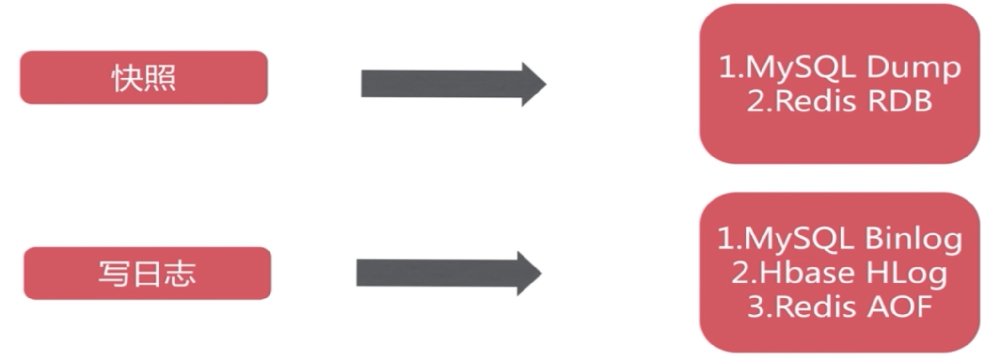
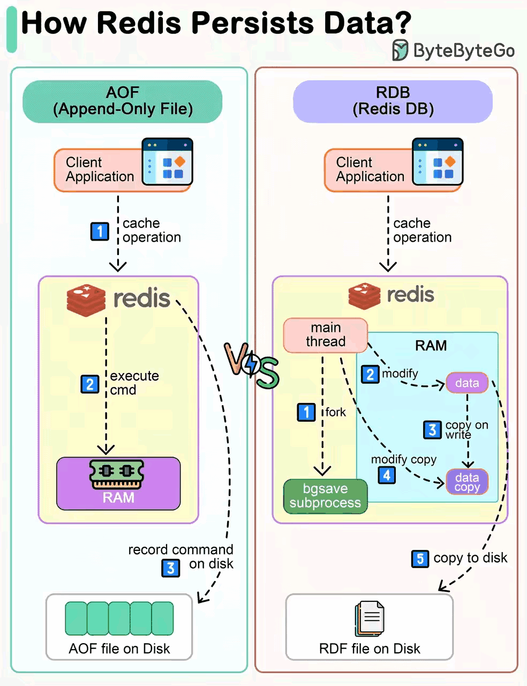
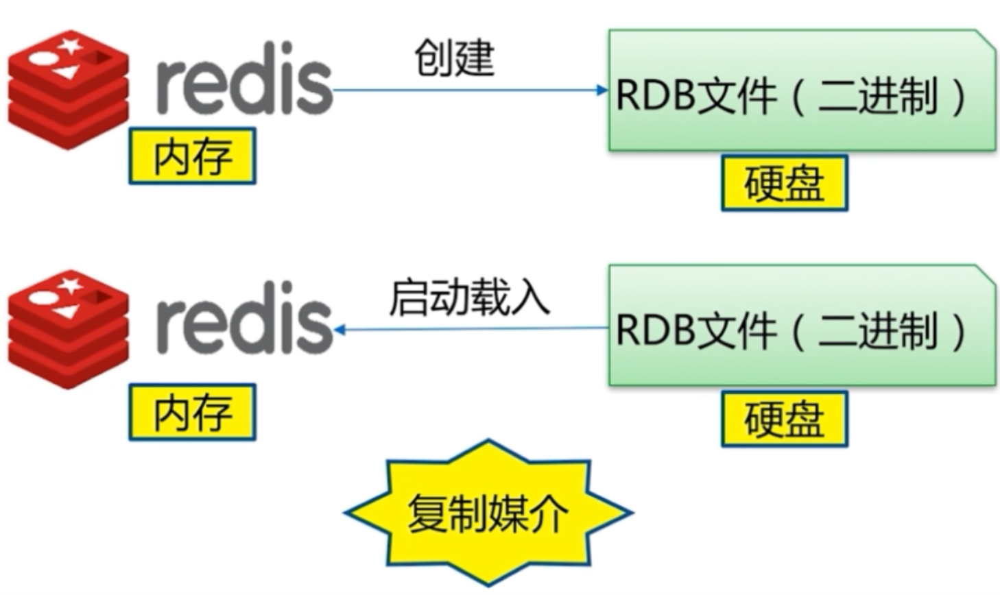
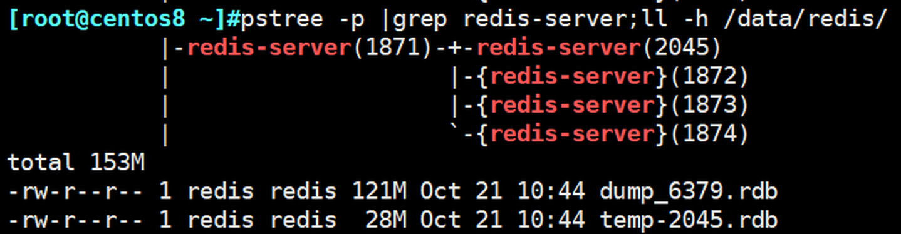
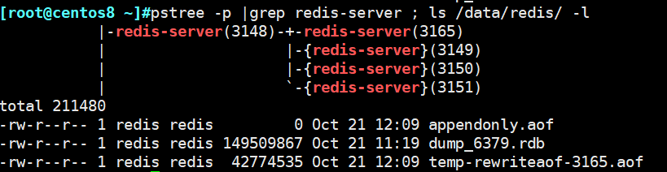
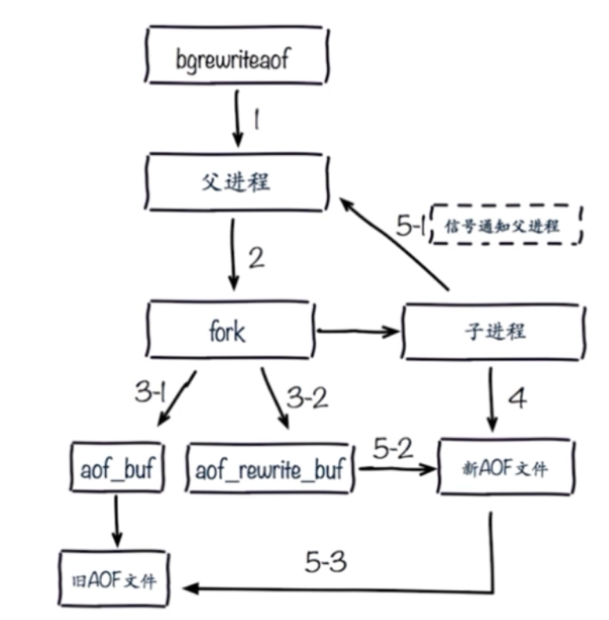
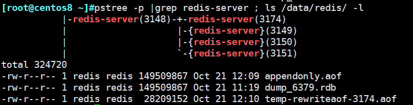

[← 返回 Redis 数据库目录]({{ '/subjects/Redis/' | relative_url }})



# 08 持久化

Redis 主要在内存中处理数据，持久化把某个时点的状态或后续写入记录到磁盘，以便进程重启后恢复。主要方式是 **RDB 快照**和 **AOF 追加日志**，可单独或同时启用。两者都不是异地备份：误删除、磁盘损坏和灾难性故障仍需独立的备份与恢复演练。





## RDB：时间点快照

RDB 将内存中的数据集编码到快照文件。自动保存条件由 `save` 配置控制；例如 `save 300 100` 表示在 300 秒内至少有 100 次写入变化时尝试后台保存。当前版本的默认条件应通过 `CONFIG GET save` 查询，不要从旧配置文件注释推断。



`SAVE` 由主进程同步生成快照，期间会阻塞客户端命令；大数据集通常不适合在线执行。`BGSAVE` 通过 `fork` 创建子进程写临时 RDB 文件，成功后原子替换目标文件。父进程一般继续服务，但 `fork` 本身可能造成短暂停顿，写时复制（COW）还会增加内存需求。




```text
CONFIG GET save
CONFIG GET dir
CONFIG GET dbfilename
BGSAVE
INFO persistence
LASTSAVE
```

`INFO persistence` 中重点看 `rdb_bgsave_in_progress`、`rdb_last_bgsave_status` 和最近成功保存时间。`BGSAVE` 返回“已启动”不代表快照已完成；备份任务应等待成功结果，再复制稳定的快照文件或使用文件系统快照，并在独立位置保存带时间点的版本。原脚本只轮询“当前未在保存”，未确认最后一次保存是否成功，还把密码写在命令行中，不适合作为可靠备份。

RDB 的优势是结构紧凑、适合恢复与异地复制；代价是故障时可能丢失上次成功快照之后的数据。`stop-writes-on-bgsave-error yes` 在保存失败时阻止部分写入，提醒持久化能力已受损；不应为了让错误消失就统一改成 `no`。RDB 文件的完整性可用相应版本的 `redis-check-rdb` 检查，但最终仍需在测试实例中恢复并读取样本键。

## AOF：记录写入变化

AOF 将写命令追加到持久化日志，并通过 `appendfsync` 选择写盘频率。它不是“第一次全量备份加以后每天增量”的备份文件，而是用于重放当前数据集的持久化机制。AOF 重写会根据当前状态生成更紧凑的基础内容；Redis 7 起常见的多文件 AOF 布局包含 base 文件、incremental 文件和 manifest，不能只复制其中一个文件。


| `appendfsync` | 含义与取舍 |
| --- | --- |
| `always` | 尽量在每次写入后同步，延迟和磁盘成本较高；也不是所有故障下零数据丢失的保证。 |
| `everysec` | 通常约每秒同步一次，性能与风险折中；故障窗口受负载、系统和磁盘状况影响，不能严格承诺“最多只丢 1 秒”。 |
| `no` | 由操作系统安排同步，潜在丢失窗口更不确定；不能套用“Linux 固定 30 秒”作为上限。 |

同时启用 RDB 与 AOF 时，Redis 通常优先按 AOF 恢复，因为 AOF 可能包含更新的数据。**已有 RDB 数据的实例开启 AOF，要先在运行中的服务上执行 `CONFIG SET appendonly yes`，等待初始 AOF 生成并验证成功，然后更新受管理的配置源，最后在测试窗口验证重启**。原资料直接编辑配置后重启，出现 `DBSIZE` 从千万级变为零，正是迁移过程没有完成或恢复文件不一致的警示，不能只靠“把开关设成 yes”解决。

```text
CONFIG GET appendonly
CONFIG SET appendonly yes
INFO persistence
```

观察 `aof_rewrite_in_progress`、`aof_last_bgrewrite_status` 和 AOF 文件布局；不要在生成完成前重启，更不要在原数据盘上手工删除 RDB 或 AOF 文件。具体切换过程和文件名随版本变化，升级时需按版本文档执行。



## AOF 重写与校验

重复写入、覆盖和删除会让追加日志增长。`BGREWRITEAOF` 后台生成能恢复当前状态的新内容，再按版本的原子切换机制替换旧布局；`auto-aof-rewrite-percentage` 与 `auto-aof-rewrite-min-size` 可触发自动重写。重写期间仍需注意磁盘空间、COW 内存和写盘延迟。



```text
BGREWRITEAOF
INFO persistence
```

`BGREWRITEAOF` 返回“已启动”或“已排队”后，要继续查看 `aof_rewrite_in_progress` 与最后状态。`no-appendfsync-on-rewrite` 是延迟与耐久性的取舍，不能把 `yes` 当成通用推荐。`aof-load-truncated` 可能允许在日志尾部损坏时加载可解析部分，但也可能丢失尾部写入，应先保留原文件副本并分析。`redis-check-aof` 的修复选项可能截断内容，不应直接在唯一副本上运行。



## 如何选择并验证

纯缓存且可从其他系统重新生成的数据，可以接受较大的恢复点间隔；承担重要状态的实例应按 RPO／RTO、性能和故障模型选择 RDB、AOF 或组合，并准备独立备份。**同时打开 RDB 与 AOF 也不等于绝对零丢失**；复制是异步的，数据和持久化文件仍可能同时受损。

最小验收包括：确认配置实际生效，检查最近一次 RDB／AOF 状态，定期把完整备份集复制到另一故障域，在隔离测试实例中恢复并校验关键数据。不要把编辑 AOF 尾部删除 `FLUSHALL` 当作常规误删恢复方案：新版本多文件 AOF、重写进度和并发写入都会使手工编辑变得危险，应依靠可验证的历史备份或版本化恢复。



<nav class="article-end" aria-label="章节导航">
  <a href="{{ '/subjects/Redis/07-slow-queries.html' | relative_url }}">← 上一篇：慢查询</a>
  <a href="{{ '/subjects/Redis/' | relative_url }}">返回 Redis 数据库目录</a>
  <a href="{{ '/subjects/Redis/09-redis-data-types.html' | relative_url }}">下一篇：数据类型 →</a>
</nav>
