[← 返回Redis 数据库目录]({{ '/subjects/Redis/' | relative_url }})



# 09 Redis 数据类型
### 2.6 Redis 数据类型

参考资料：http://www.redis.cn/topics/data-types.html

相关命令参考: http://redisdoc.com/

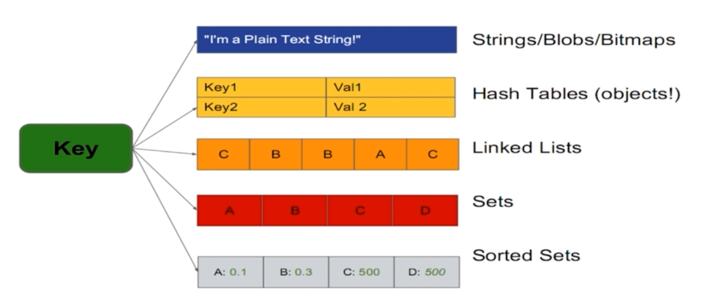

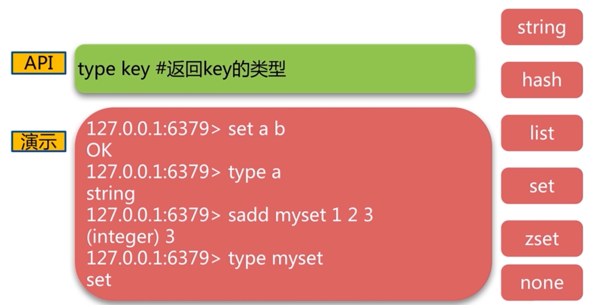

### 字符串 string

字符串是一种最基本的Redis值类型。Redis字符串是二进制安全的，这意味着一个Redis字符串能包含任意类型的数据，例如： 一张JPEG格式的图片或者一个序列化的Ruby对象。一个字符串类型的值最多能存储512M字节的内容。Redis 中所有 key 都是字符串类型的。此数据类型最为常用

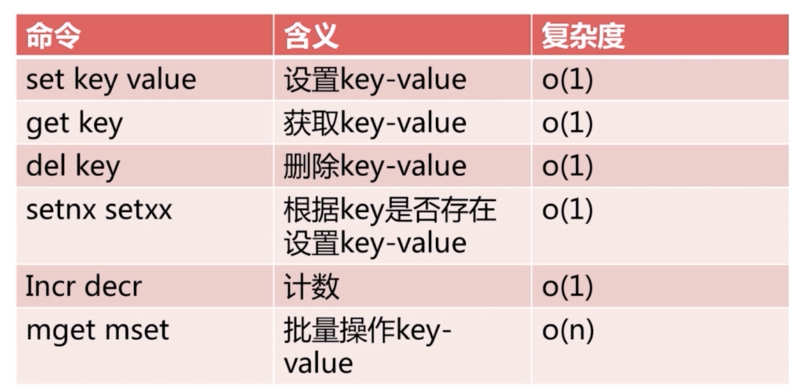

### 创建一个key

set 指令可以创建一个key 并赋值, 使用格式

```text
SET key value [EX seconds] [PX milliseconds] [NX|XX]
时间复杂度： O(1)
将字符串值 value 关联到 key 。
如果 key 已经持有其他值， SET 就覆写旧值， 无视类型。
当 SET 命令对一个带有生存时间（TTL）的键进行设置之后， 该键原有的 TTL 将被清除。
从 Redis 2.6.12 版本开始， SET 命令的行为可以通过一系列参数来修改：
EX seconds ： 将键的过期时间设置为 seconds 秒。 执行 SET key value EX seconds 的效果等
同于执行 SETEX key seconds value 。
PX milliseconds ： 将键的过期时间设置为 milliseconds 毫秒。 执行 SET key value PX
milliseconds 的效果等同于执行 PSETEX key milliseconds value 。
NX ： 只在键不存在时， 才对键进行设置操作。 执行 SET key value NX 的效果等同于执行 SETNX
key value 。
XX ： 只在键已经存在时， 才对键进行设置操作。
```

范例:

```text
#不论key是否存在.都设置
127.0.0.1:6379> set key1 value1
OK
127.0.0.1:6379> get key1
"value1"
127.0.0.1:6379> TYPE key1  #判断类型
string
127.0.0.1:6379> SET title ceo ex 3 #设置自动过期时间3s
OK
127.0.0.1:6379> set NAME bowen
OK
127.0.0.1:6379> get NAME
"bowen"
#Key大小写敏感
127.0.0.1:6379> get name
(nil)
127.0.0.1:6379> set name mage
OK
127.0.0.1:6379> get name
"mage"
127.0.0.1:6379> get NAME
"bowen"
#key不存在,才设置,相当于add
127.0.0.1:6379> get title
"ceo"
127.0.0.1:6379> setnx title coo  #set key value nx
(integer) 0
127.0.0.1:6379> get title
"ceo"
#key存在,才设置,相当于update
127.0.0.1:6379> get title
"ceo"
127.0.0.1:6379> set title coo xx
OK
127.0.0.1:6379> get title
"coo"
127.0.0.1:6379> get age
(nil)
127.0.0.1:6379> set age 20 xx
(nil)
127.0.0.1:6379> get age
(nil)
```

### 查看一个key的值

```text
127.0.0.1:6379> get key1
"value1"
#get可能查看一个key的值
127.0.0.1:6379> get name age
(error) ERR wrong number of arguments for 'get' command
```

### 删除key

```text
127.0.0.1:6379> DEL key1
(integer) 1
127.0.0.1:6379> DEL key1 key2
(integer) 2
```

### 批量设置多个key

```text
127.0.0.1:6379> MSET key1 value1 key2 value2
OK
```

### 批量获取多个key

```text
127.0.0.1:6379> MGET key1 key2
1) "value1"
2) "value2"
127.0.0.1:6379> KEYS n*
1) "n1"
2) "name"
127.0.0.1:6379> KEYS *
1) "k2"
2) "k1"
3) "key1"
4) "key2"
5) "n1"
6) "name"
7) "k3"
8) "title"
```

### 追加key的数据

```text
127.0.0.1:6379> APPEND key1 " append new value"
(integer) 12              #添加数据后,key1总共9个字节
127.0.0.1:6379> get key1
"value1 append new value"
```

### 设置新值并返回旧值

```text
127.0.0.1:6379> set name bowen
OK
#set key newvalue并返回旧的value
127.0.0.1:6379> getset name bowene
"bowen"
127.0.0.1:6379> get name
"bowene"
```

### 返回字符串 key 对应值的字节数

```text
127.0.0.1:6379> SET name bowen
OK
127.0.0.1:6379> STRLEN name
(integer) 4
127.0.0.1:6379> APPEND name " xiaochun"
(integer) 13
127.0.0.1:6379> GET name
"bowen xiaochun"
127.0.0.1:6379> STRLEN name  #返回字节数
(integer) 13
127.0.0.1:6379> set name 马哥教育
OK
127.0.0.1:6379> get name
"\xe9\xa9\xac\xe5\x93\xa5\xe6\x95\x99\xe8\x82\xb2"
127.0.0.1:6379> strlen name
(integer) 12
127.0.0.1:6379>
```

### 判断 key 是否存在

```text
127.0.0.1:6379> SET name bowen ex 10
OK
127.0.0.1:6379> set age 20
OK
127.0.0.1:6379> EXISTS NAME #key的大小写敏感
(integer) 0
127.0.0.1:6379> EXISTS name age #返回值为1,表示存在2个key,0表示不存在
(integer) 2
127.0.0.1:6379> EXISTS name  #过几秒再看
(integer) 0
```

### 获取 key 的过期时长

```text
ttl key #查看key的剩余生存时间,如果key过期后,会自动删除
-1 #返回值表示永不过期，默认创建的key是永不过期，重新对key赋值，也会从有剩余生命周期变成永不过
期
-2 #返回值表示没有此key
num #key的剩余有效期
127.0.0.1:6379> TTL key1
(integer) -1
127.0.0.1:6379> SET name bowen EX 100
OK
127.0.0.1:6379> TTL name
(integer) 96
127.0.0.1:6379> TTL name
(integer) 93
127.0.0.1:6379> SET name mage #重新设置，默认永不过期
OK
127.0.0.1:6379> TTL name
(integer) -1
127.0.0.1:6379> SET name bowen EX 200
OK
127.0.0.1:6379> TTL name
(integer) 198
127.0.0.1:6379> GET name
"bowen"
```

### 重置key的过期时长

```text
127.0.0.1:6379> TTL name
(integer) 148
127.0.0.1:6379> EXPIRE name 1000
(integer) 1
127.0.0.1:6379> TTL name
(integer) 999
127.0.0.1:6379>
```

### 取消key的期限

即永不过期

```text
127.0.0.1:6379> TTL name
(integer) 999
127.0.0.1:6379> PERSIST name
(integer) 1
127.0.0.1:6379> TTL name
(integer) -1
```

### 数字递增

利用INCR命令簇（INCR, DECR, INCRBY,DECRBY)来把字符串当作原子计数器使用。

```text
127.0.0.1:6379> set num 10 #设置初始值
OK
127.0.0.1:6379> INCR num
(integer) 11
127.0.0.1:6379> get num
"11"
```

### 数字递减

```text
127.0.0.1:6379> set num 10
OK
127.0.0.1:6379> DECR num
(integer) 9
127.0.0.1:6379> get num
"9"
```

### 数字增加

将key对应的数字加decrement(可以是负数)。如果key不存在，操作之前，key就会被置为0。如果key的 value类型错误或者是个不能表示成数字的字符串，就返回错误。这个操作最多支持64位有符号的正型数字。

```text
redis> SET mykey 10
OK
redis> INCRBY mykey 5
(integer) 15
127.0.0.1:6379> get mykey
"15"
127.0.0.1:6379> INCRBY mykey -10
(integer) 5
127.0.0.1:6379> get mykey
"5"
127.0.0.1:6379> INCRBY nokey  5
(integer) 5
127.0.0.1:6379> get nokey
"5"
```

### 数字减少

decrby 可以减小数值(也可以增加)

```text
127.0.0.1:6379> SET mykey 10
OK
127.0.0.1:6379> DECRBY mykey 8
(integer) 2
127.0.0.1:6379> get mykey
"2"
127.0.0.1:6379> DECRBY mykey -20
(integer) 22
127.0.0.1:6379> get mykey
"22"
127.0.0.1:6379> DECRBY nokey 3
(integer) -3
127.0.0.1:6379> get nokey
"-3"
```

### 列表 list


Redis列表实际就是简单的字符串数组，按照插入顺序进行排序.

支持双向读写,可以添加一个元素到列表的头部（左边）或者尾部（右边），一个列表最多可以包含 2^32-1=4294967295个元素

每个列表元素用下标来标识,下标 0 表示列表的第一个元素，以 1 表示列表的第二个元素，以此类推。

也可以使用负数下标，以 -1 表示列表的最后一个元素， -2 表示列表的倒数第二个元素，元素值可以重复，常用于存入日志等场景，此数据类型比较常用

列表特点

有序 value可重复左右都可以操作

### 创建列表和数据

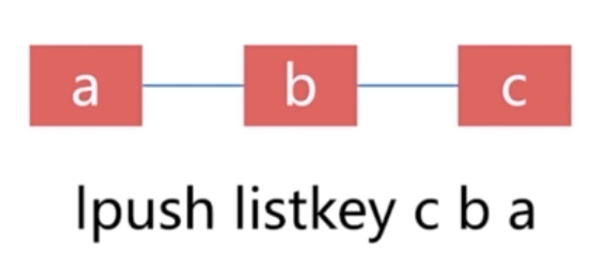


LPUSH和RPUSH都可以插入列表

```text
LPUSH key value [value …]
时间复杂度： O(1)
将一个或多个值 value 插入到列表 key 的表头
如果有多个 value 值，那么各个 value 值按从左到右的顺序依次插入到表头： 比如说，对空列表
mylist 执行命令 LPUSH mylist a b c ，列表的值将是 c b a ，这等同于原子性地执行 LPUSH
mylist a 、 LPUSH mylist b 和 LPUSH mylist c 三个命令。
如果 key 不存在，一个空列表会被创建并执行 LPUSH 操作。
当 key 存在但不是列表类型时，返回一个错误。
RPUSH key value [value …]
时间复杂度： O(1)
将一个或多个值 value 插入到列表 key 的表尾(最右边)。
如果有多个 value 值，那么各个 value 值按从左到右的顺序依次插入到表尾：比如对一个空列表 mylist
执行 RPUSH mylist a b c ，得出的结果列表为 a b c ，等同于执行命令 RPUSH mylist a 、
RPUSH mylist b 、 RPUSH mylist c 。
如果 key 不存在，一个空列表会被创建并执行 RPUSH 操作。
当 key 存在但不是列表类型时，返回一个错误。
```

范例:

```text
#从左边添加数据，已添加的需向右移
127.0.0.1:6379> LPUSH name mage bowen zhang  #根据顺序逐个写入name，最后的zhang会在列表
的最左侧。
(integer) 3
127.0.0.1:6379> TYPE name
list
```

```text
#从右边添加数据
127.0.0.1:6379> RPUSH course linux python go
(integer) 3
127.0.0.1:6379> type course
list
```

### 列表追加新数据

```text
127.0.0.1:6379> LPUSH list1 tom
(integer) 2
#从右边添加数据，已添加的向左移
127.0.0.1:6379> RPUSH list1 jack
(integer) 3
```

### 获取列表长度(元素个数)

```text
127.0.0.1:6379> LLEN list1
(integer) 3
```

### 获取列表指定位置元素数据

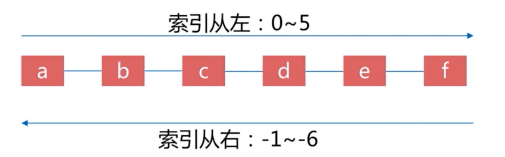

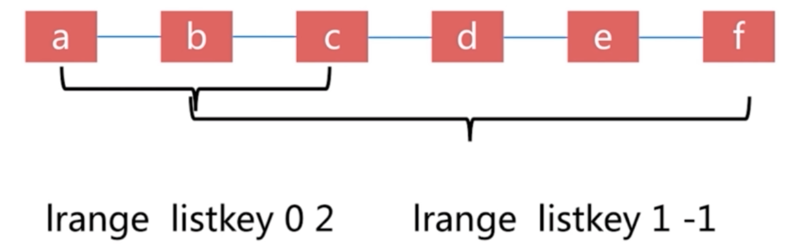

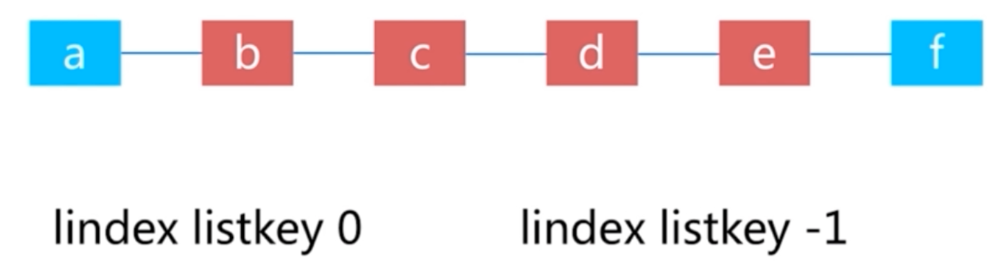

```text
127.0.0.1:6379> LPUSH list1 a b c d
(integer) 4
127.0.0.1:6379> LINDEX list1 0 #获取0编号的元素
"d"
127.0.0.1:6379> LINDEX list1 3 #获取3编号的元素
"a"
127.0.0.1:6379> LINDEX list1 -1 #获取最后一个的元素
"a"
#元素从0开始编号
127.0.0.1:6379> LPUSH list1 a b c d
(integer) 4
127.0.0.1:6379> LRANGE list1 1 2
1) "c"
2) "b"
127.0.0.1:6379> LRANGE list1 0 3  #所有元素
1) "d"
2) "c"
3) "b"
4) "a"
127.0.0.1:6379> LRANGE list1 0 -1  #所有元素
1) "d"
2) "c"
3) "b"
4) "a"
```

```text
127.0.0.1:6379> RPUSH list2 zhang bowen li zhao
(integer) 4
127.0.0.1:6379> LRANGE list2 1 2 #指定范围
1) "bowen"
2) "li"
127.0.0.1:6379> LRANGE list2 2 2 #指定位置
1) "li"
127.0.0.1:6379> LRANGE list2 0 -1  #所有元素
1) "zhang"
2) "bowen"
3) "li"
4) "zhao"
```

### 修改列表指定索引值

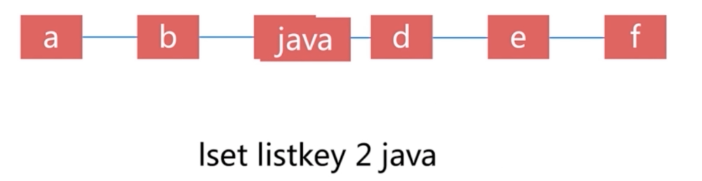

```text
127.0.0.1:6379> RPUSH  listkey a b c d e f
(integer) 6
127.0.0.1:6379> lrange listkey 0 -1
1) "a"
2) "b"
3) "c"
4) "d"
5) "e"
6) "f"
127.0.0.1:6379> lset listkey 2 java
OK
127.0.0.1:6379> lrange listkey 0 -1
1) "a"
2) "b"
3) "java"
4) "d"
5) "e"
6) "f"
127.0.0.1:6379>
```

### 删除列表数据

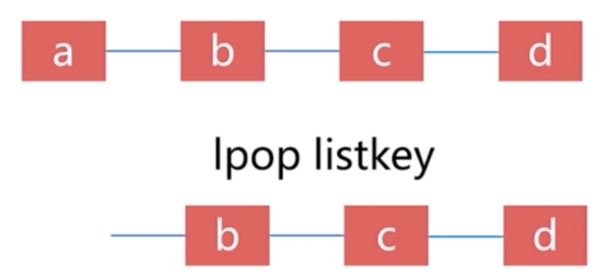

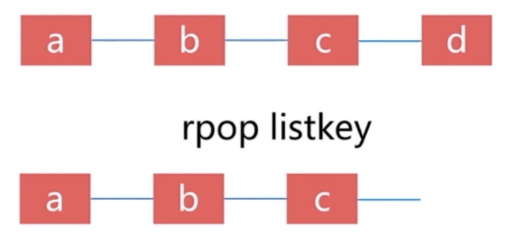

```text
127.0.0.1:6379> LPUSH list1 a b c d
(integer) 4
127.0.0.1:6379> LRANGE list1 0 3
1) "d"
2) "c"
3) "b"
4) "a"
127.0.0.1:6379> LPOP list1 #弹出左边第一个元素，即删除第一个
"d"
127.0.0.1:6379> LLEN list1
(integer) 3
127.0.0.1:6379> LRANGE list1 0 2
1) "c"
2) "b"
3) "a"
127.0.0.1:6379> RPOP list1  #弹出右边第一个元素，即删除最后一个
"a"
127.0.0.1:6379> LLEN list1
(integer) 2
127.0.0.1:6379> LRANGE list1 0 1
1) "c"
2) "b"
```

```text
#LTRIM  对一个列表进行修剪(trim)，让列表只保留指定区间内的元素，不在指定区间之内的元素都将被删
除
127.0.0.1:6379> LLEN list1
(integer) 4
127.0.0.1:6379> LRANGE list1 0 3
1) "d"
2) "c"
3) "b"
4) "a"
127.0.0.1:6379> LTRIM list1 1 2 #只保留1，2号元素
OK
127.0.0.1:6379> LLEN list1
(integer) 2
127.0.0.1:6379> LRANGE list1 0 1
1) "c"
2) "b"
#删除list
127.0.0.1:6379> DEL list1
(integer) 1
127.0.0.1:6379> EXISTS list1
(integer) 0
```

### 集合 set

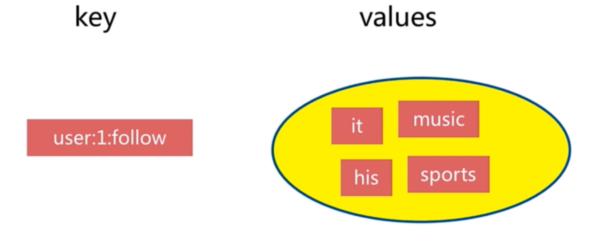

Set 是一个无序的字符串合集

同一个集合中的每个元素是唯一无重复的

支持在两个不同的集合中对数据进行逻辑处理，常用于取交集,并集,统计等场景,例如: 实现共同的朋友

集合特点

无序无重复集合间操作

### 创建集合

```text
127.0.0.1:6379> SADD set1 v1
(integer) 1
127.0.0.1:6379> SADD set2 v2 v4
(integer) 2
127.0.0.1:6379> TYPE set1
set
127.0.0.1:6379> TYPE set2
set
```

### 集合中追加数据

```text
#追加时，只能追加不存在的数据，不能追加已经存在的数值
127.0.0.1:6379> SADD set1 v2 v3 v4
(integer) 3
127.0.0.1:6379> SADD set1 v2 #已存在的value,无法再次添加
(integer) 0
127.0.0.1:6379> TYPE set1
set
127.0.0.1:6379> TYPE set2
set
```

### 获取集合的所有数据

```text
127.0.0.1:6379> SMEMBERS set1
1) "v4"
2) "v1"
3) "v3"
4) "v2"
127.0.0.1:6379> SMEMBERS set2
1) "v4"
2) "v2"
```

### 删除集合中的元素

```text
127.0.0.1:6379> sadd goods mobile  laptop  car
(integer) 3
127.0.0.1:6379> srem goods car
(integer) 1
127.0.0.1:6379> SMEMBERS goods
1) "mobile"
2) "laptop"
127.0.0.1:6379>
```

集合间操作

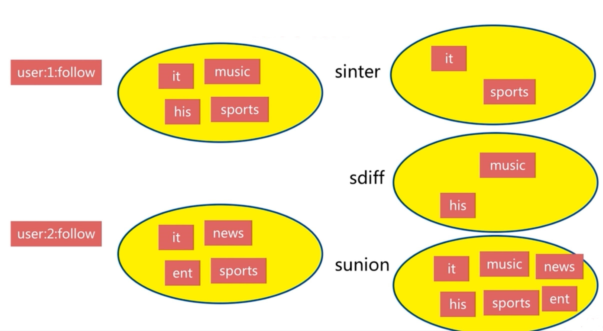

### 取集合的交集

交集：同时属于集合A且属于集合B的元素

可以实现共同的朋友

```text
127.0.0.1:6379> SINTER set1 set2
1) "v4"
2) "v2"
```

### 取集合的并集

并集：属于集合A或者属于集合B的元素

```text
127.0.0.1:6379> SUNION set1 set2
1) "v2"
2) "v4"
3) "v1"
4) "v3"
```

### 取集合的差集

差集：属于集合A但不属于集合B的元素

可以实现我的朋友的朋友

```text
127.0.0.1:6379> SDIFF set1 set2
1) "v1"
2) "v3"
```

### 有序集合 sorted set

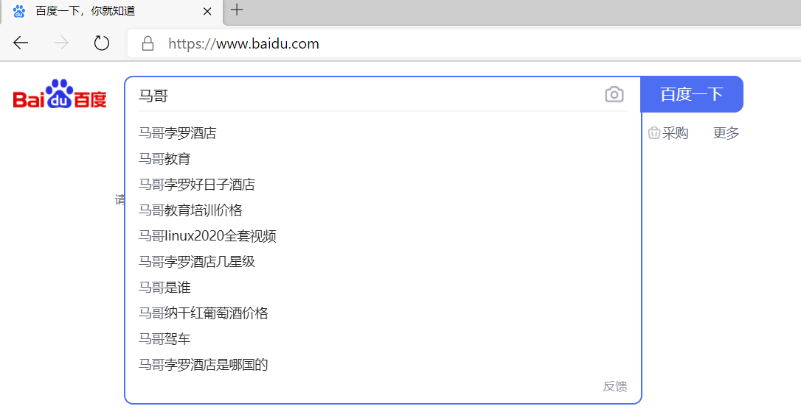

Redis有序集合和Redis集合类似，是不包含相同字符串的合集。

它们的差别是，每个有序集合的成员都关联着一个双精度浮点型的评分

这个评分用于把有序集合中的成员按最低分到最高分排序。

有序集合的成员不能重复,但评分可以重复,一个有序集合中最多的成员数为 2^32 - 1=4294967295个， 经常用于排行榜的场景

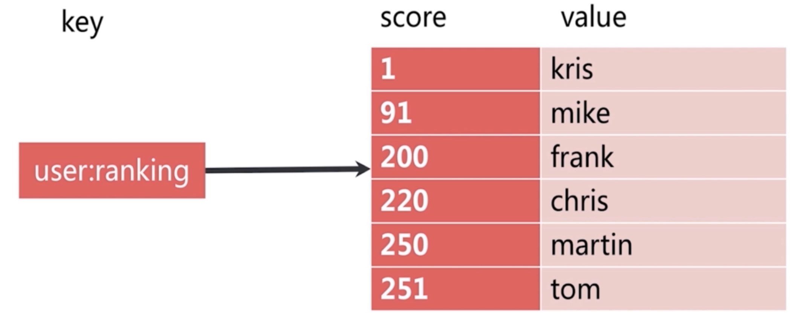

有序集合特点

有序

无重复元素

每个元素是由score和value组成

score 可以重复

value 不可以重复

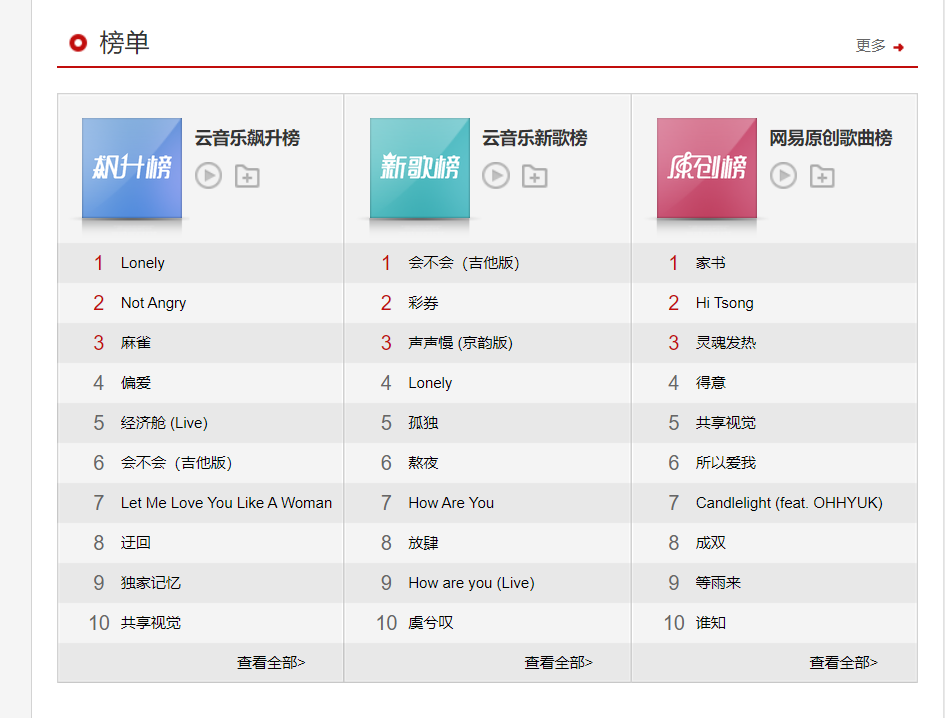

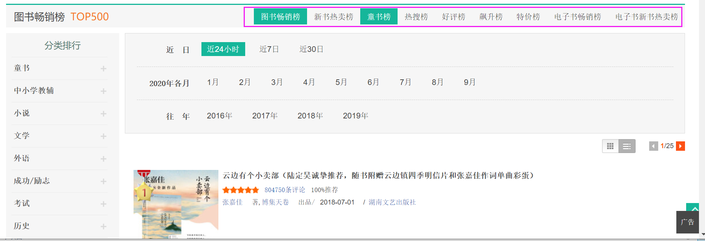

### 创建有序集合

```text
127.0.0.1:6379> ZADD zset1 1 v1  #分数为1
(integer) 1
127.0.0.1:6379> ZADD zset1 2 v2
(integer) 1
127.0.0.1:6379> ZADD zset1 2 v3  #分数可重复，元素值不可以重复
(integer) 1
127.0.0.1:6379> ZADD zset1 3 v4
(integer) 1
127.0.0.1:6379> TYPE zset1
zset
127.0.0.1:6379> TYPE zset2
zset
#一次生成多个数据：
127.0.0.1:6379> ZADD zset2 1 v1 2 v2 3 v3 4 v4 5 v5
(integer) 5
```

### 实现排名

```text
127.0.0.1:6379> ZADD course 90 linux 99 go 60 python 50 cloud
(integer) 4
127.0.0.1:6379> ZRANGE course 0 -1  #正序排序后显示集合内所有的key,按score从小到大显示
1) "cloud"
2) "python"
3) "linux"
4) "go"
127.0.0.1:6379> ZREVRANGE course 0 -1 #倒序排序后显示集合内所有的key,score从大到小显示
1) "go"
2) "linux"
3) "python"
4) "cloud"
127.0.0.1:6379> ZRANGE course 0 -1 WITHSCORES  #正序显示指定集合内所有key和得分情况
1) "cloud"
2) "50"
3) "python"
4) "60"
5) "linux"
6) "90"
7) "go"
8) "99"
127.0.0.1:6379> ZREVRANGE course 0 -1 WITHSCORES  #倒序显示指定集合内所有key和得分情况
1) "go"
2) "99"
3) "linux"
4) "90"
5) "python"
6) "60"
7) "cloud"
8) "50"
127.0.0.1:6379>
```

### 查看集合的成员个数

```text
127.0.0.1:6379> ZCARD course
(integer) 4
127.0.0.1:6379> ZCARD zset1
(integer) 4
127.0.0.1:6379> ZCARD zset2
(integer) 4
```

### 基于索引查找数据

```text
127.0.0.1:6379> ZRANGE course 0 2
1) "cloud"
2) "python"
3) "linux"
127.0.0.1:6379> ZRANGE course 0 10  #超出范围不报错
1) "cloud"
2) "python"
3) "linux"
4) "go"
127.0.0.1:6379> ZRANGE zset1 1 3
1) "v2"
2) "v3"
3) "v4"
127.0.0.1:6379> ZRANGE zset1 0 2
1) "v1"
2) "v2"
3) "v3"
127.0.0.1:6379> ZRANGE zset1 2 2
1) "v3"
```

### 查询指定数据的排名

```text
127.0.0.1:6379> ZADD course 90 linux 99 go 60 python 50 cloud
(integer) 4
127.0.0.1:6379> ZRANK course go
(integer) 3   #第4个
127.0.0.1:6379> ZRANK course python
(integer) 1   #第2个
```

### 获取分数

```text
127.0.0.1:6379> zscore course cloud
"30"
```

### 删除元素

```text
127.0.0.1:6379> ZADD course 90 linux 199 go 60 python 30 cloud
(integer) 4
127.0.0.1:6379> ZRANGE course 0 -1
1) "cloud"
2) "python"
3) "linux"
4) "go"
127.0.0.1:6379> ZREM course python go
(integer) 2
127.0.0.1:6379> ZRANGE course 0 -1
1) "cloud"
2) "linux"
```

### 哈希 hash

hash 即字典, 用于保存字符串字段field和字符串值value之间的映射，即key/value做为数据部分

hash特别适合用于存储对象场景.

一个hash最多可以包含2^32-1 个key/value键值对

哈希特点

无序 K/V 对适用于存放相关的数据

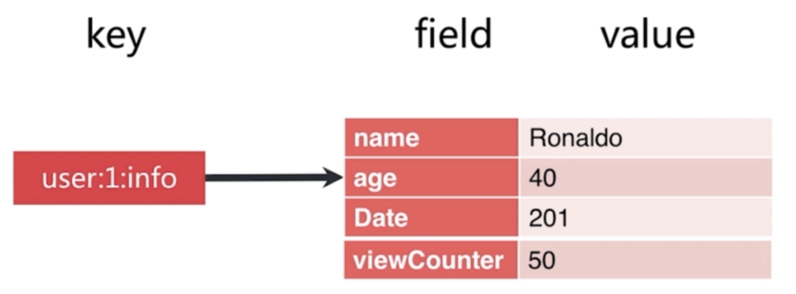

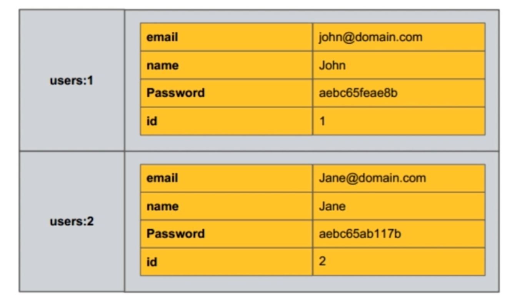

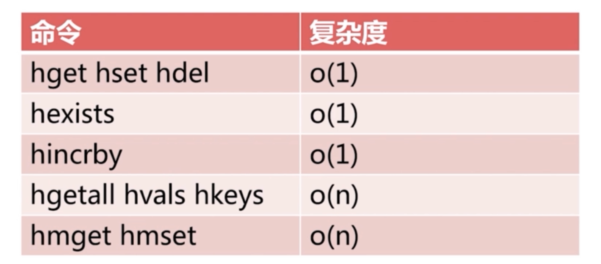

### 创建 hash

格式:

```text
HSET hash field value
时间复杂度： O(1)
将哈希表 hash 中域 field 的值设置为 value 。
如果给定的哈希表并不存在， 那么一个新的哈希表将被创建并执行 HSET 操作。
如果域 field 已经存在于哈希表中， 那么它的旧值将被新值 value 覆盖。
```

范例:

```text
127.0.0.1:6379> HSET 9527 name zhouxingxing age 20
(integer) 2
127.0.0.1:6379> TYPE 9527
hash
#查看所有字段的值
127.0.0.1:6379> hgetall 9527
1) "name"
2) "zhouxingxing"
3) "age"
4) "20"
#增加字段
127.0.0.1:6379> HSET 9527 gender male
(integer) 1
127.0.0.1:6379> hgetall 9527
1) "name"
2) "zhouxingxing"
3) "age"
4) "20"
5) "gender"
6) "male"
```

### 查看hash的指定field的value

```text
127.0.0.1:6379> HGET 9527 name
"zhouxingxing"
127.0.0.1:6379> HGET 9527 age
"20"
127.0.0.1:6379> HMGET 9527 name age  #获取多个值
1) "zhouxingxing"
2) "20"
127.0.0.1:6379>
```

### 删除hash 的指定的 field/value

```text
127.0.0.1:6379> HDEL 9527 age
(integer) 1
127.0.0.1:6379> HGET 9527 age
(nil)
127.0.0.1:6379> hgetall 9527
1) "name"
2) "zhouxingxing"
127.0.0.1:6379> HGET 9527 name
"zhouxingxing"
```

### 批量设置hash key的多个field和value

```text
127.0.0.1:6379> HMSET 9527 name zhouxingxing age 50 city hongkong
OK
127.0.0.1:6379> HGETALL 9527
1) "name"
2) "zhouxingxing"
3) "age"
4) "50"
5) "city"
6) "hongkong"
```

### 查看hash指定field的value

```text
127.0.0.1:6379> HMSET 9527 name zhouxingxing age 50 city hongkong
OK
127.0.0.1:6379> HMGET 9527 name age
1) "zhouxingxing"
2) "50"
127.0.0.1:6379>
```

### 查看hash的所有field

```text
127.0.0.1:6379> HMSET 9527 name zhouxingxing age 50 city hongkong #重新设置
OK
127.0.0.1:6379> HKEYS 9527
1) "name"
2) "age"
3) "city"
```

### 查看hash 所有value

```text
127.0.0.1:6379> HMSET 9527 name zhouxingxing age 50 city hongkong
OK
127.0.0.1:6379> HVALS 9527
1) "zhouxingxing"
2) "50"
3) "hongkong"
```

### 查看指定 hash的所有field及value

```text
127.0.0.1:6379> HGETALL 9527
1) "name"
2) "zhouxingxing"
3) "age"
4) "50"
5) "city"
6) "hongkong"
127.0.0.1:6379>
```

### 删除 hash

```text
127.0.0.1:6379> DEL 9527
(integer) 1
127.0.0.1:6379> HMGET 9527 name city
1) (nil)
2) (nil)
127.0.0.1:6379> EXISTS 9527
(integer) 0
```



<nav class="article-end" aria-label="章节导航">
  <a href="{{ '/subjects/Redis/08-redis-persistence.html' | relative_url }}">← Previous: Redis Persistence</a>
  <a href="{{ '/subjects/Redis/' | relative_url }}">Back to Redis Database Index</a>
  <a href="{{ '/subjects/Redis/10-message-queues.html' | relative_url }}">Next: Message Queues →</a>
</nav>
