[← 返回 Redis 数据库目录]({{ '/subjects/Redis/' | relative_url }})



# 09 基本数据类型

Redis 的键是二进制安全的字符串；键对应的值可以是 String、List、Set、Sorted Set、Hash 等结构。选择类型时，先问需要什么操作：按键取一个值、保持插入顺序、判重、按分数排名，还是为一个对象存放多个字段。命令的时间复杂度和返回值以[官方命令文档](https://redis.io/commands/)为准，不应根据截图里一次实验的键顺序推断普遍结果。

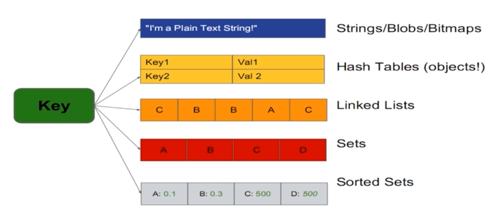

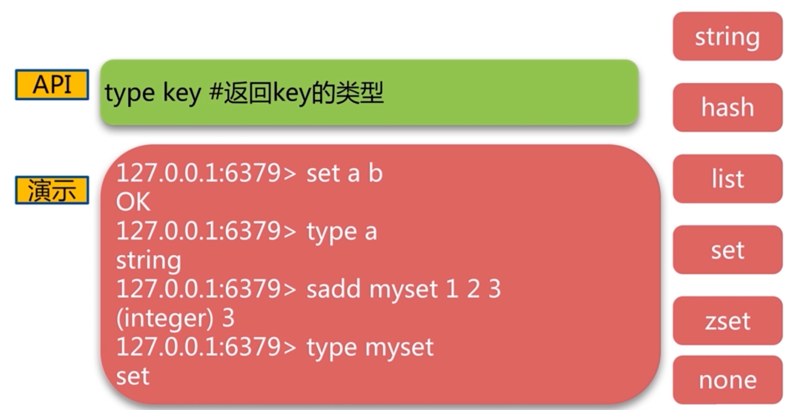

## String：单个值、计数与过期

String 可存文本、数字的字符串表示或二进制内容；具体大小上限与版本及配置有关，不能将旧资料中的 512 MiB 当成所有版本和场景的推荐对象大小。键名大小写敏感，`name` 与 `NAME` 是两个键。

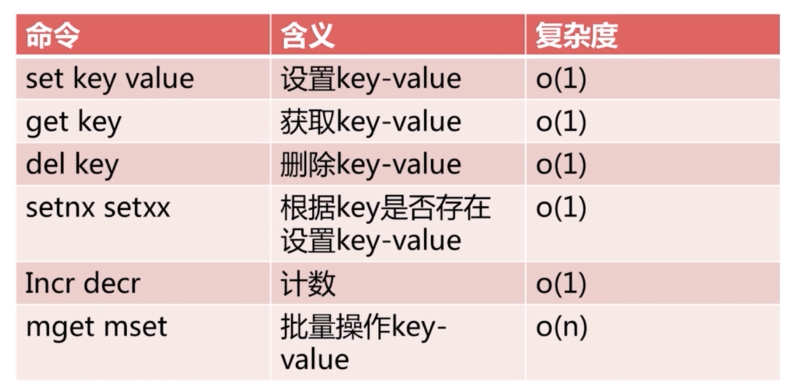

下面按“写入 → 读取 → 条件写入 → 过期 → 计数”的顺序试一组互不干扰的键：

```text
SET demo:name Alice
GET demo:name
SET demo:session token EX 60
TTL demo:session
SET demo:once first NX
SET demo:once second NX
SET demo:name Bob XX
MSET demo:x 1 demo:y 2
MGET demo:x demo:y
INCR demo:x
INCRBY demo:y 5
```

`NX` 只在键不存在时设置，`XX` 只在键已存在时设置。普通 `SET` 覆盖旧值时通常也清除旧 TTL；若需要保留到期时间，检查当前版本的 `KEEPTTL` 选项。`TTL` 返回剩余秒数，`-1` 表示键存在但无过期时间，`-2` 表示键不存在；`EXPIRE` 设置新时长，`PERSIST` 移除过期时间。`EXISTS key1 key2` 返回**存在的键个数**，不是布尔值；原示例在两个键都存在时返回 `2`，却注释成“返回值为 1”。

`APPEND` 返回追加后的**字节数**，`STRLEN` 也是字节数而非 Unicode 字符数；中文 UTF-8 文本的字符数不能直接从 `STRLEN` 推断。`GETSET` 可原子地取旧值并设新值，较新版本还可考虑 `SET key value GET`。`INCR`、`DECR`、`INCRBY`、`DECRBY` 是原子计数操作，值必须能解析为相应整数，溢出会报错；它们不自动解决跨系统事务问题。

## List：两端操作与有序序列

List 保持元素顺序，允许重复值，可从左端或右端推入、弹出。它不是普通的“字符串数组”：Redis 内部编码、访问复杂度和内存开销随版本变化。常见用途是短队列或最近事件列表，但需要持久消费与确认机制时应比较 Stream。

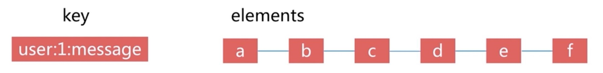

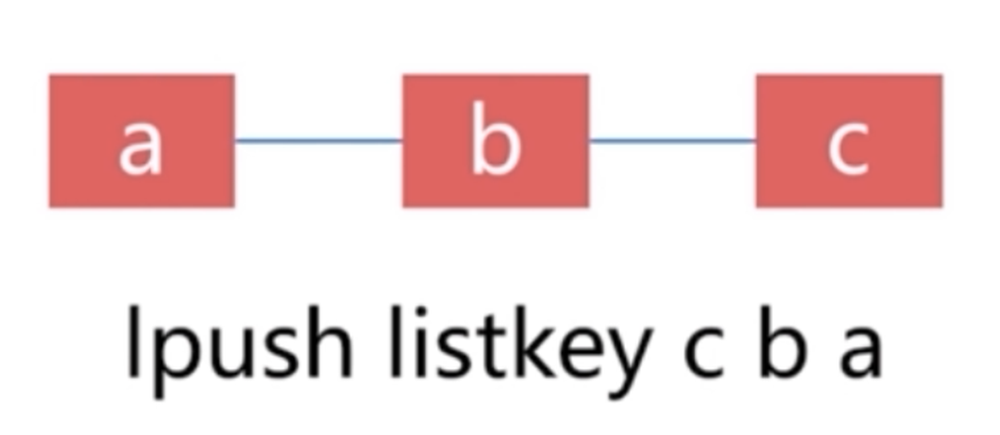

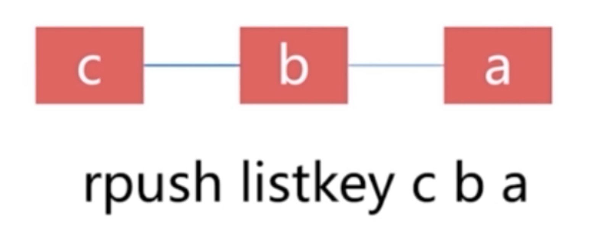

```text
RPUSH demo:list a b c
LPUSH demo:list z
LRANGE demo:list 0 -1
LINDEX demo:list 0
LLEN demo:list
LSET demo:list 1 B
LPOP demo:list
RPOP demo:list
```

`RPUSH a b c` 形成 `a, b, c`；随后 `LPUSH z` 形成 `z, a, b, c`。`LINDEX` 的索引从 0 起，`-1` 指最后一个；`LRANGE` 的终点**包含在范围内**，`0 -1` 会取整个列表，长列表上应分页。`LSET` 修改指定索引，索引不存在会报错；`LTRIM` 只保留指定区间，区间外元素会被删除，操作前应核对范围。

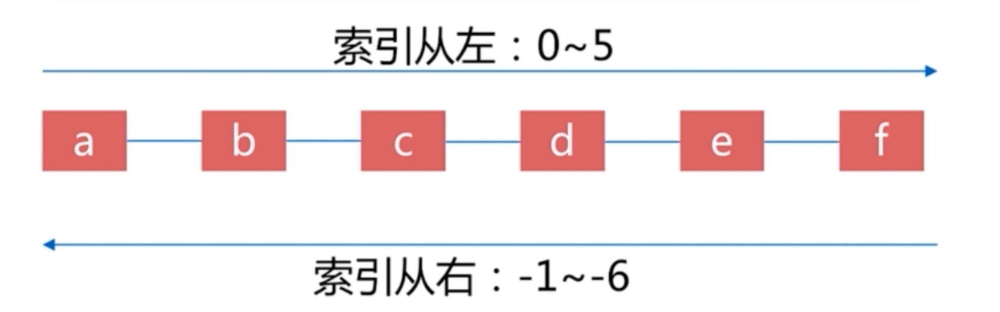

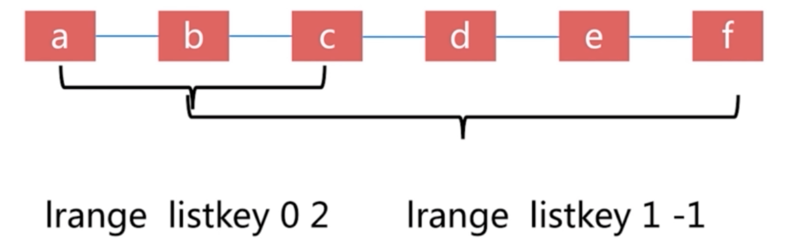

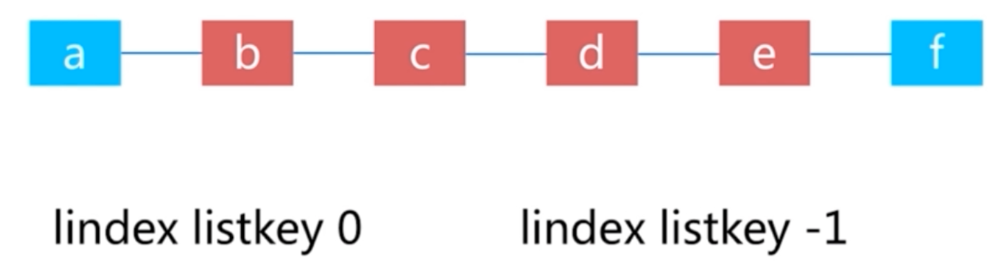

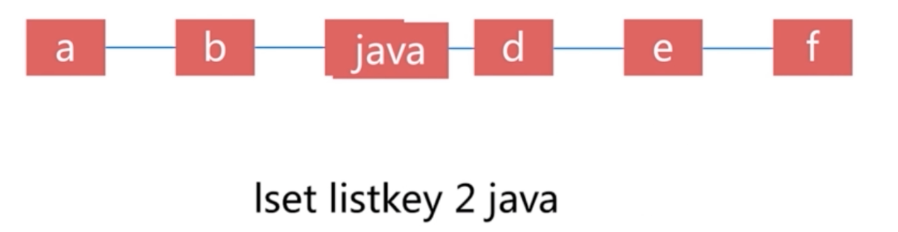

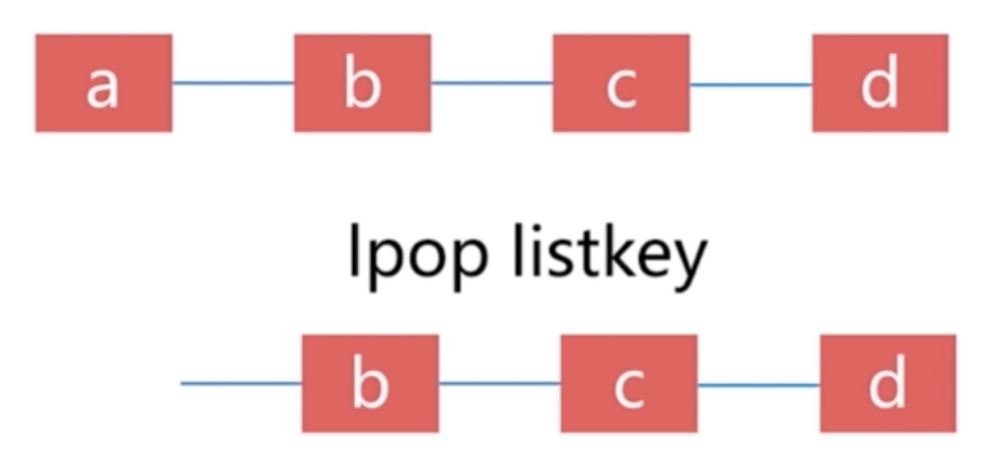

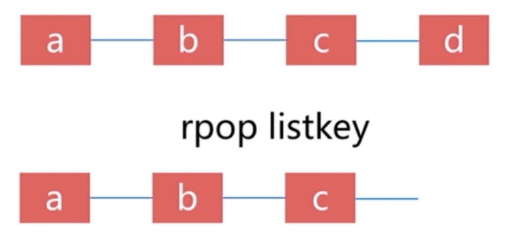

## Set：判重与集合关系

Set 是**无序、不重复**的成员集合，适合标签、去重和成员关系。`SADD` 返回本次新增成员数，重复添加已有成员不会增加集合大小；`SMEMBERS` 的输出顺序不稳定，也可能一次返回大量数据。

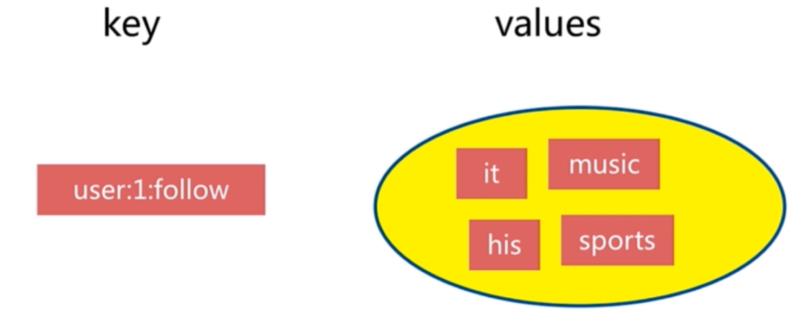

```text
SADD demo:team:a Alice Bob Carol
SADD demo:team:b Bob Carol Dave
SISMEMBER demo:team:a Alice
SCARD demo:team:a
SINTER demo:team:a demo:team:b
SUNION demo:team:a demo:team:b
SDIFF demo:team:a demo:team:b
SREM demo:team:a Alice
```

交集得到两个集合共同拥有的成员，并集得到所有成员，差集 `A B` 得到只在 A 中的成员；差集有方向。原资料把差集解释成“朋友的朋友”，但这一社交关系通常不是简单的 `SDIFF`，仍要定义业务规则。大集合可用 `SSCAN` 渐进遍历，集合间运算也要关注规模与耗时。

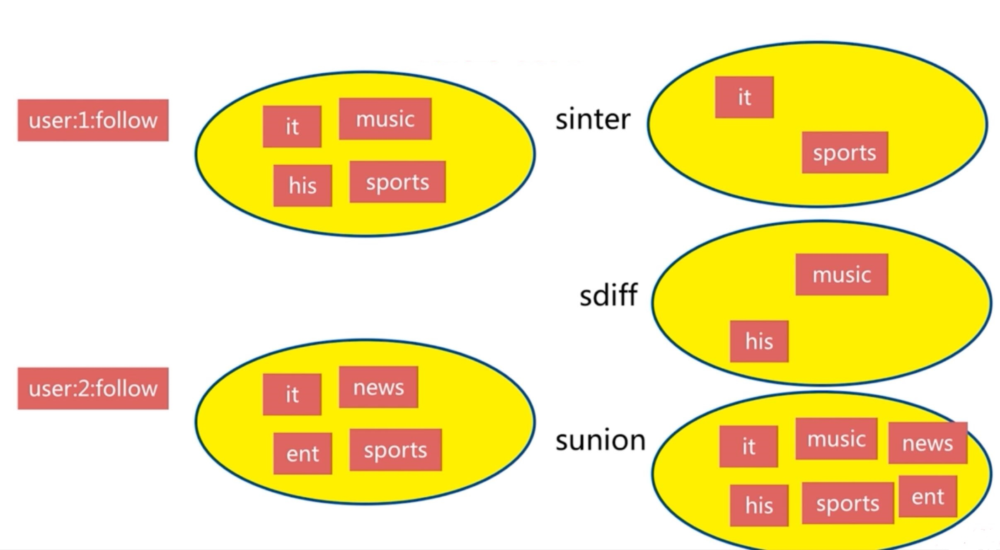

## Sorted Set：分数和排名

Sorted Set（ZSet）中的**成员不可重复、分数可重复**。分数通常用于排名、优先级或时间索引；同分成员有确定的排序规则，不能假设按插入顺序排列。

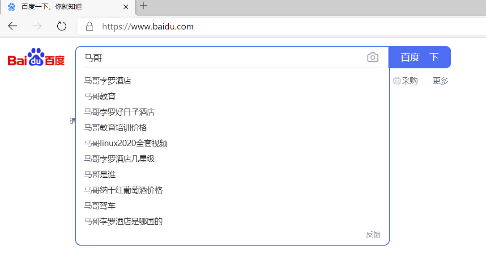

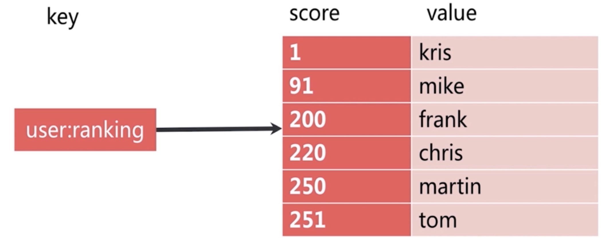

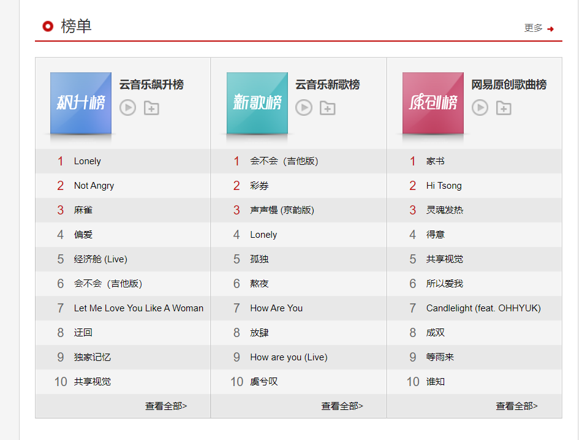

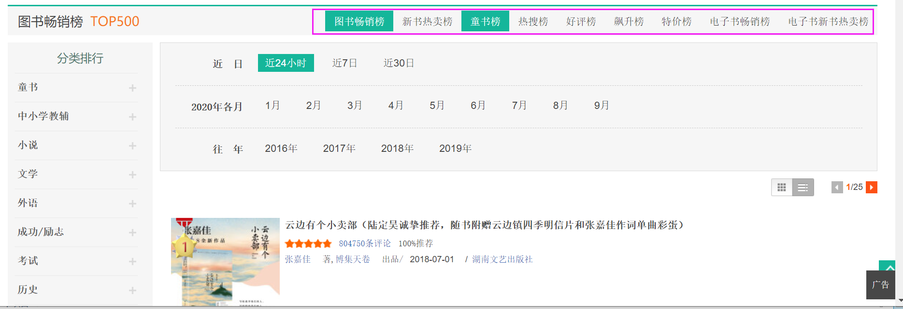

```text
ZADD demo:scores 90 linux 99 go 60 python 50 cloud
ZRANGE demo:scores 0 -1 WITHSCORES
ZRANGE demo:scores 0 -1 REV WITHSCORES
ZRANK demo:scores go
ZREVRANK demo:scores go
ZSCORE demo:scores cloud
ZCARD demo:scores
ZREM demo:scores python
```

默认 `ZRANGE` 从低分到高分，`REV` 反向；旧版本常见 `ZREVRANGE`，新写法以目标版本支持情况为准。`ZRANK` 和 `ZREVRANK` 都从 **0** 开始计数；`ZSCORE cloud` 在上述例子中应是 `50`，原资料另一次输出 `30` 是混用了不同状态的实验结果。`ZADD` 若更新已有成员的分数，成员不会重复新增；长排行榜应限制读取范围。

## Hash：一个键中的多个字段

Hash 将多个 field/value 放在同一个键下，适合小型对象属性。字段和值都是字符串表示；是否把整个业务对象放成一个 Hash，还应考虑字段更新频率、TTL 需求和内存开销。过期时间作用于**整个键**，不是单独字段。

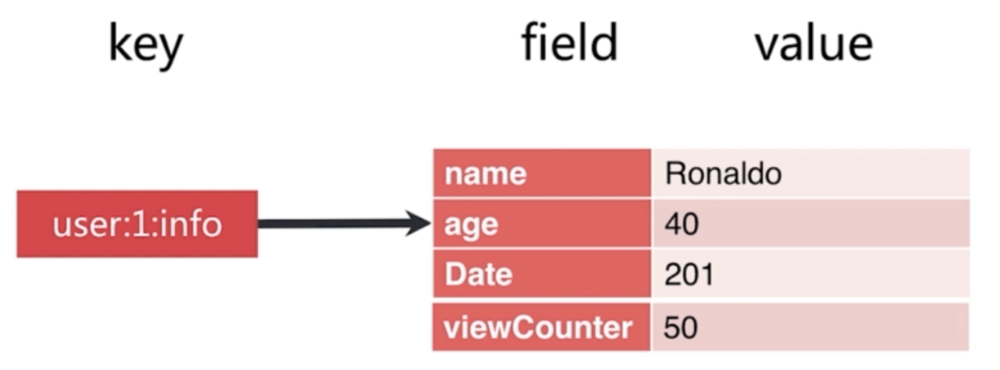

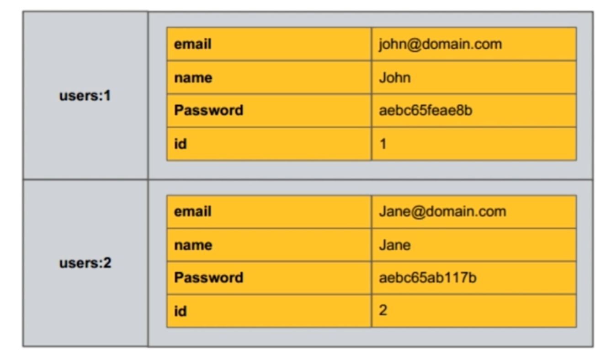

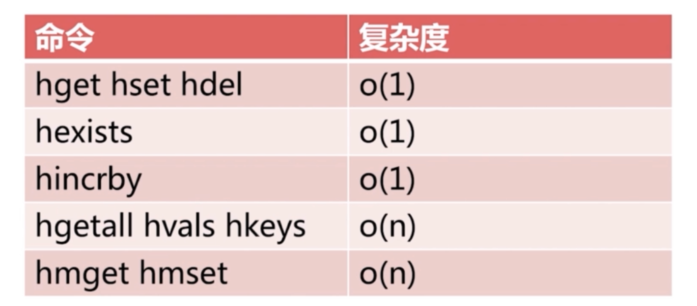

```text
HSET demo:user:1 name Alice age 20 city Beijing
HGET demo:user:1 name
HMGET demo:user:1 name age
HGETALL demo:user:1
HKEYS demo:user:1
HVALS demo:user:1
HDEL demo:user:1 city
```

`HSET` 可以一次写多个字段，返回新增字段数；旧资料使用的 `HMSET` 已不必作为新示例首选。`HGETALL`、`HKEYS` 和 `HVALS` 会返回整个 Hash 的内容，字段很多时应考虑 `HSCAN`；不要把小实验的字段顺序当成可依赖的业务顺序。`DEL demo:user:1` 删除整个 Hash 键，而 `HDEL` 只删字段。

各类型都可以用 `TYPE key` 检查。键不存在时相关命令的返回值并不完全相同；设计应用时应明确区分“空集合”“不存在”“类型错误”和“权限错误”，而不是只看截图里的 `(nil)`。



<nav class="article-end" aria-label="章节导航">
  <a href="{{ '/subjects/Redis/08-redis-persistence.html' | relative_url }}">← 上一篇：持久化</a>
  <a href="{{ '/subjects/Redis/' | relative_url }}">返回 Redis 数据库目录</a>
  <a href="{{ '/subjects/Redis/10-message-queues.html' | relative_url }}">下一篇：消息队列 →</a>
</nav>
