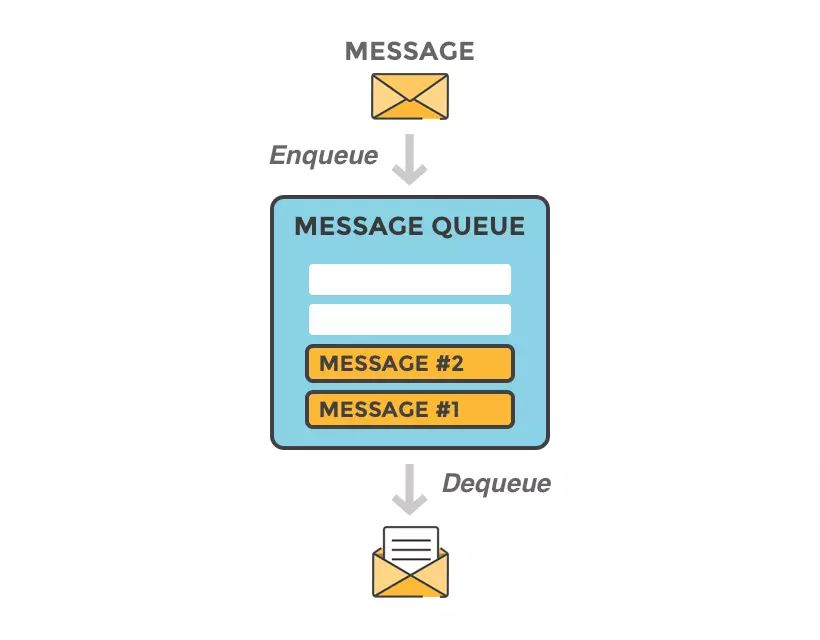
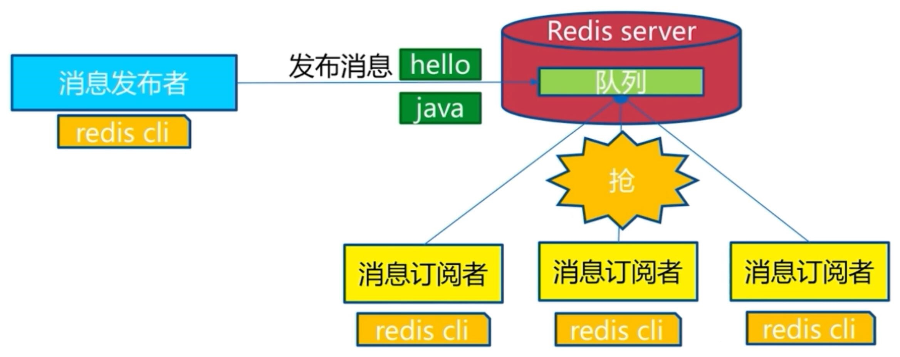
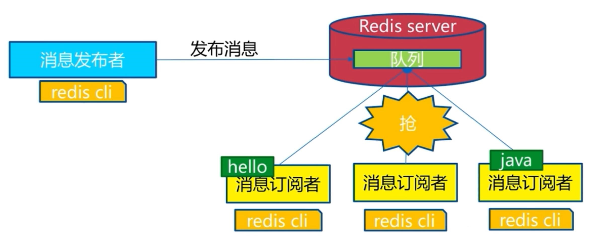
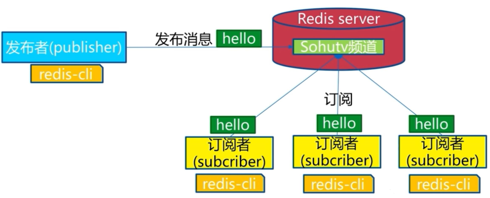

[← Back to Redis Database Index]({{ '/subjects/Redis/' | relative_url }})



# 10 Message Queues
### 2.7 消息队列

消息队列: 把要传输的数据放在队列中,从而实现应用之间的数据交换

常用功能: 可以实现多个应用系统之间的解耦,异步,削峰/限流等常用的消息队列应用: Kafka,RabbitMQ,Redis



消息队列分为两种

生产者/消费者模式: Producer/Consumer 发布者/订阅者模式: Publisher/Subscriber

### 生产者消费者模式

### 模式说明

生产者消费者模式下，多个消费者同时监听一个频道(redis用队列实现)，但是生产者产生的一个消息只能被最先抢到消息的一个消费者消费一次,队列中的消息由可以多个生产者写入，也可以有不同的消费者取出进行消费处理.此模式应用广泛





### 生产者生成消息

```bash
[root@redis ~]# redis-cli
127.0.0.1:6379> AUTH 123456
OK
127.0.0.1:6379> LPUSH channel1 message1 #从管道的左侧写入
(integer) 1
127.0.0.1:6379> LPUSH channel1 message2
(integer) 2
127.0.0.1:6379> LPUSH channel1 message3
(integer) 3
127.0.0.1:6379> LPUSH channel1 message4
(integer) 4
127.0.0.1:6379> LPUSH channel1 message5
(integer) 5
```

### 获取所有消息

```text
127.0.0.1:6379> LRANGE channel1 0 -1
1) "message5"
2) "message4"
3) "message3"
4) "message2"
5) "message1"
```

### 消费者消费消息

```text
127.0.0.1:6379> RPOP channel1 #基于实现消息队列的先进先出原则,从管道的右侧消费
"message1"
127.0.0.1:6379> RPOP channel1
"message2"
127.0.0.1:6379> RPOP channel1
"message3"
127.0.0.1:6379> RPOP channel1
"message4"
127.0.0.1:6379> RPOP channel1
"message5"
127.0.0.1:6379> RPOP channel1
(nil)
```

### 验证队列消息消费完成

```text
127.0.0.1:6379> LRANGE channel1 0 -1
(empty list or set)                  #验证队列中的消息全部消费完成
```

### 发布者订阅模式

### 模式说明

在发布者订阅者Publisher/Subscriber模式下，发布者Publisher将消息发布到指定的频道channel，事先监听此channel的一个或多个订阅者Subscriber都会收到相同的消息。即一个消息可以由多个订阅者获取到. 对于社交应用中的群聊、群发、群公告等场景适用于此模式



### 订阅者订阅频道

```bash
[root@redis ~]# redis-cli
127.0.0.1:6379> AUTH 123456
OK
127.0.0.1:6379> SUBSCRIBE channel01             #订阅者事先订阅指定的频道，之后发布的消
息才能收到
Reading messages... (press Ctrl-C to quit)
1) "subscribe"
2) "channel01"
3) (integer) 1
```

### 发布者发布消息

```text
127.0.0.1:6379> PUBLISH channel01 message1 #发布者发布信息到指定频道
(integer) 2   #订阅者个数
127.0.0.1:6379> PUBLISH channel01 message2
(integer) 2
```

### 各个订阅者都能收到消息

```bash
[root@redis ~]#redis-cli
127.0.0.1:6379> AUTH 123456
OK
127.0.0.1:6379> SUBSCRIBE channel01
Reading messages... (press Ctrl-C to quit)
1) "subscribe"
2) "channel01"
3) (integer) 1
1) "message"
2) "channel01"
3) "message1"
1) "message"
2) "channel01"
3) "message2"
```

### 订阅多个频道

```text
#订阅指定的多个频道
127.0.0.1:6379> SUBSCRIBE channel01 channel02
```

### 订阅所有频道

```text
127.0.0.1:6379> PSUBSCRIBE *  #支持通配符*
```

### 订阅匹配的频道

```text
127.0.0.1:6379> PSUBSCRIBE chann* #匹配订阅多个频道
```

### 取消订阅频道

```text
127.0.0.1:6379> unsubscribe channel01
1) "unsubscribe"
2) "channel01"
3) (integer) 0
```



<nav class="article-end" aria-label="章节导航">
  <a href="{{ '/subjects/Redis/09-redis-data-types.html' | relative_url }}">← Previous: Redis Data Types</a>
  <a href="{{ '/subjects/Redis/' | relative_url }}">Back to Redis Database Index</a>
  <a href="{{ '/subjects/Redis/11-redis-replication.html' | relative_url }}">Next: Redis Replication →</a>
</nav>
