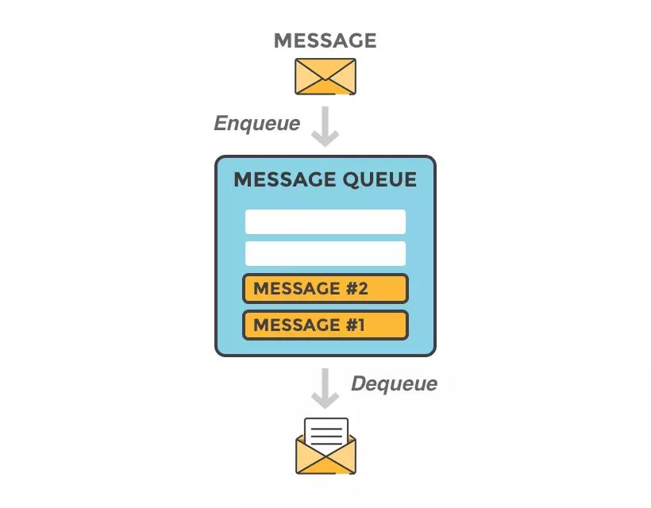
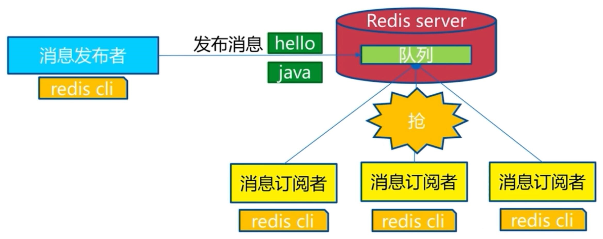
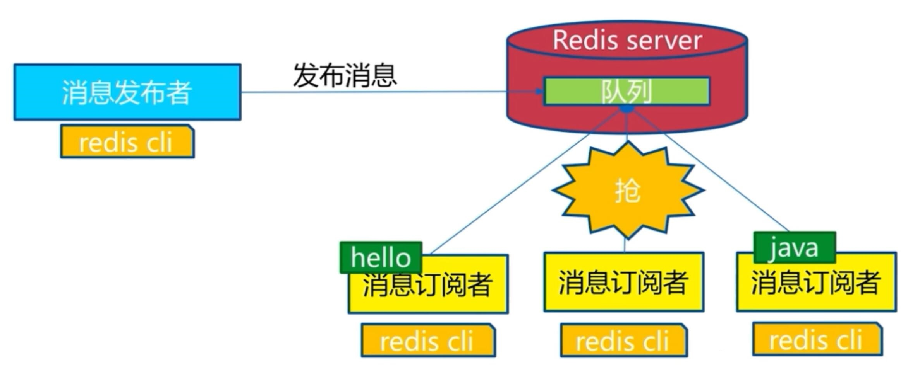
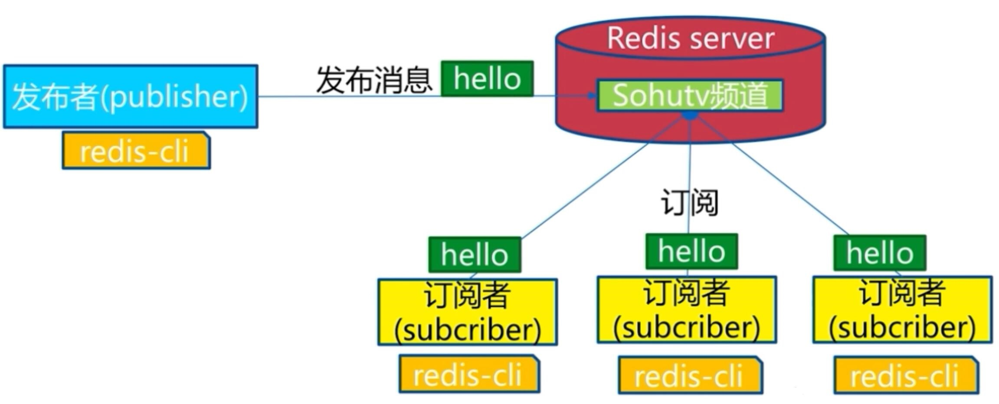

[← 返回 Redis 数据库目录]({{ '/subjects/Redis/' | relative_url }})



# 10 消息传递模式

消息队列把生产者与消费者在时间和处理速度上解耦，也可用于异步任务和削峰。但“使用 Redis”并不自动提供可靠投递：List 队列、Pub/Sub 和 Streams 的保留、消费与确认语义不同。选型前应明确消息丢失容忍度、是否要历史回放、消费者数量与积压容量。



| 方式 | 一个消息送给谁 | 离线后还能读吗 | 确认机制 |
| --- | --- | --- | --- |
| List 队列 | 竞争消费者中的一个 | 未弹出的消息仍在列表中 | 基础 `POP` 没有处理完成确认。 |
| Pub/Sub | 发布时在线的所有订阅者 | 不能回放错过的消息 | 没有持久确认。 |
| Streams 消费组 | 组内一个消费者，可按组保留历史 | 可按保留策略读取 | 通过待处理列表与 `XACK` 管理确认。 |

## List：竞争消费

向左侧写入、从右侧弹出，可形成先进先出的短队列：

```text
LPUSH queue:jobs job-1
LPUSH queue:jobs job-2
LRANGE queue:jobs 0 -1
RPOP queue:jobs
BRPOP queue:jobs 5
```

`RPOP` 每次删除并返回一个元素；多个消费者同时执行时，只有其中一个得到该元素。`BRPOP` 在队列为空时最多等待指定秒数，适合减少轮询。`LRANGE 0 -1` 只用于小型测试队列，生产积压很大时一次列出全部消息会增加负担。





**关键限制**：普通 `RPOP` 在业务处理前就从队列删除消息；消费者取出后崩溃，消息不会自动重试。若业务要求可追踪的确认、重试和历史回放，应优先考虑 Streams 或专门的消息系统，而不只给 List 增加消费者。

## Pub/Sub：在线广播

订阅者先在一个终端执行：

```text
SUBSCRIBE news
```

发布者再在另一终端执行：

```text
PUBLISH news hello
```

发布时在线且订阅 `news` 的客户端各会收到一份消息；`PUBLISH` 返回的是当时接收到消息的订阅客户端数，不代表消息已被业务处理。`SUBSCRIBE news alerts` 可订阅多个频道，`PSUBSCRIBE news:*` 可按模式订阅；`UNSUBSCRIBE` 取消当前订阅。



Pub/Sub 没有离线积压或重放：订阅者断线期间发布的消息会错过。原资料将它直接用于群公告等场景，若业务要求“离线用户稍后仍能看到公告”，就还需要数据库或其他持久存储保存消息；Pub/Sub 只适合实时通知链路。

## Streams：需要确认时的起点

Redis Streams 可追加消息、按 ID 读取，并通过消费组跟踪待确认消息。下面仅展示一个小型学习流程，生产设计还需处理消费者故障、待处理消息接管、积压清理与容量上限。

```text
XADD stream:jobs * task export id 42
XGROUP CREATE stream:jobs workers 0
XREADGROUP GROUP workers consumer-1 COUNT 1 STREAMS stream:jobs >
XACK stream:jobs workers <上一步返回的消息ID>
```

`XREADGROUP` 返回消息并将其加入该消费组的待处理集合，业务处理成功后才 `XACK`。如果处理成功但确认前消费者崩溃，消息可能再次被处理，因此应用仍需考虑幂等性。Streams 的内容也需要通过保留策略、持久化和备份保护，不等于“零丢失”。对超大规模、高吞吐或跨地域日志流，应结合 Kafka、RabbitMQ 等系统的投递保证与运维成本再做选择。



<nav class="article-end" aria-label="章节导航">
  <a href="{{ '/subjects/Redis/09-redis-data-types.html' | relative_url }}">← 上一篇：数据类型</a>
  <a href="{{ '/subjects/Redis/' | relative_url }}">返回 Redis 数据库目录</a>
  <a href="{{ '/subjects/Redis/11-redis-replication.html' | relative_url }}">下一篇：主从复制 →</a>
</nav>
