[← Back to Redis Database Index]({{ '/subjects/Redis/' | relative_url }})



# 11 Redis Replication
## 3 Redis 集群与高可用

Redis单机服务存在数据和服务的单点问题,而且单机性能也存在着上限,可以利用Redis的集群相关技术来解决这些问题.

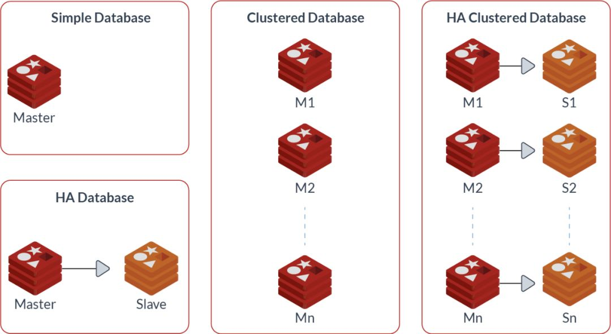

### 3.1 Redis 主从复制

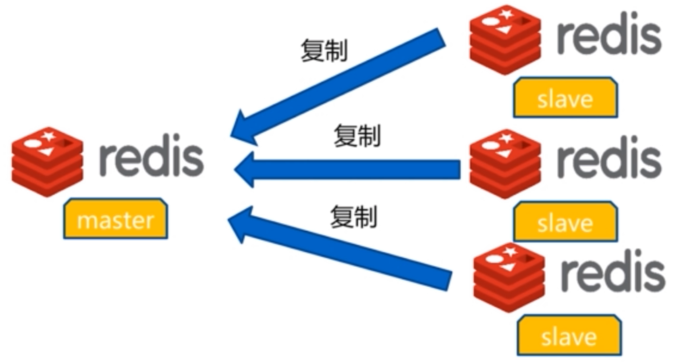

### Redis 主从复制架构

Redis和MySQL的主从模式类似，也支持主从模式（master/slave），可以实现Redis数据的跨主机的远程备份

常见客户端连接主从的架构:

程序APP先连接到高可用性 LB 集群提供的虚拟IP，再由LB调度将用户的请求至后端Redis 服务器来真正提供服务


主从复制特点

一个master可以有多个slave 一个slave只能有一个master 数据流向是从master到slave单向的 master 可读可写 slave 只读

### 主从复制实现

当master出现故障后,可以自动提升一个slave节点变成新的Mster,因此Redis Slave 需要设置和master相同的连接密码

此外当一个Slave提升为新的master时需要通过持久化实现数据的恢复

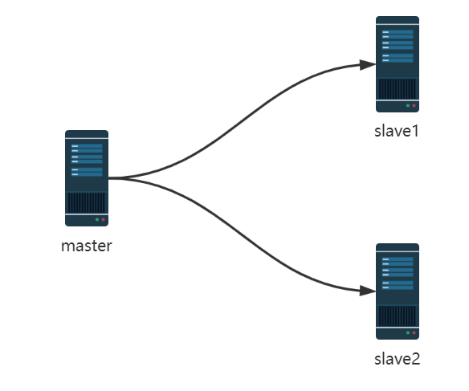

当配置Redis复制功能时，强烈建议打开主服务器的持久化功能。否则主节点Redis服务应该要避免自动启动。

参考案例: 导致主从服务器数据全部丢失

假设节点A为主服务器，并且关闭了持久化。并且节点B和节点C从节点A复制数据节点A崩溃，然后由自动拉起服务重启了节点A.由于节点A的持久化被关闭了，所以重启之后没有任何数据节点B和节点C将从节点A复制数据，但是A的数据是空的，于是就把自身保存的数据副本删除。

在关闭主服务器上的持久化，并同时开启自动拉起进程的情况下，即便使用Sentinel来实现Redis的高可用性，也是非常危险的。因为主服务器可能拉起得非常快，以至于Sentinel在配置的心跳时间间隔内没有检测到主服务器已被重启，然后还是会发生上面描述的情况,导致数据丢失。

无论何时，数据安全都是极其重要的，所以应该禁止主服务器关闭持久化的同时自动启动。

### 主从命令配置

3.1.2.1.1 启用主从同步

Redis Server 默认为 master节点，如果要配置为从节点,需要指定master服务器的IP,端口及连接密码

在从节点执行REPLICAOF MASTER_IP  PORT 指令可以启用主从同步复制功能,早期版本使用 SLAVEOF 指令

```text
127.0.0.1:6379> REPLICAOF MASTER_IP  PORT #新版推荐使用
127.0.0.1:6379> SLAVEOF MasterIP  Port    #旧版使用，将被淘汰
127.0.0.1:6379> CONFIG SET masterauth <masterpass>
```

关于SLAVEOF


```bash
#在mater上设置key1
[root@centos8 ~]#redis-cli
127.0.0.1:6379> AUTH 123456
OK
127.0.0.1:6379> INFO replication
# Replication
role:master
connected_slaves:0
master_replid:a3504cab4d33e9723a7bc988ff8e022f6d9325bf
master_replid2:0000000000000000000000000000000000000000
master_repl_offset:0
second_repl_offset:-1
repl_backlog_active:0
repl_backlog_size:1048576
repl_backlog_first_byte_offset:0
repl_backlog_histlen:0
127.0.0.1:6379> SET key1 v1-master
OK
127.0.0.1:6379> KEYS *
1) "key1"
127.0.0.1:6379> GET key1
"v1-master"
127.0.0.1:6379>
#以下都在slave上执行，登录
[root@centos8 ~]#redis-cli
127.0.0.1:6379> info
NOAUTH Authentication required.
127.0.0.1:6379> AUTH 123456
OK
127.0.0.1:6379> INFO replication  #查看当前角色默认为master
# Replication
role:master
connected_slaves:0
master_replid:a3504cab4d33e9723a7bc988ff8e022f6d9325bf
master_replid2:0000000000000000000000000000000000000000
master_repl_offset:0
second_repl_offset:-1
repl_backlog_active:0
repl_backlog_size:1048576
repl_backlog_first_byte_offset:0
repl_backlog_histlen:0
127.0.0.1:6379> SET key1 v1-slave-18
OK
127.0.0.1:6379> KEYS *
1) "key1"
127.0.0.1:6379> GET key1
"v1-slave-18"
127.0.0.1:6379>
#在第二个slave,也设置相同的key1,但值不同
127.0.0.1:6379> KEYS *
1) "key1"
127.0.0.1:6379> GET key1
"v1-slave-28"
127.0.0.1:6379>
127.0.0.1:6379>  INFO replication
# Replication
role:master
connected_slaves:0
master_replid:a3504cab4d33e9723a7bc988ff8e022f6d9325bf
master_replid2:0000000000000000000000000000000000000000
master_repl_offset:0
second_repl_offset:-1
repl_backlog_active:0
repl_backlog_size:1048576
repl_backlog_first_byte_offset:0
repl_backlog_histlen:0
127.0.0.1:6379>
#在slave上设置master的IP和端口，4.0版之前的指令为slaveof
127.0.0.1:6379> REPLICAOF 10.0.0.8 6379 #仍可使用SLAVEOF MasterIP  Port
OK
#在slave上设置master的密码，才可以同步
127.0.0.1:6379> CONFIG SET masterauth 123456
OK
127.0.0.1:6379> INFO replication
# Replication   #角色变为slave
role:slave
master_host:10.0.0.8   #指向master
master_port:6379
master_link_status:up
master_last_io_seconds_ago:8
master_sync_in_progress:0
slave_repl_offset:42
slave_priority:100
slave_read_only:1
connected_slaves:0
master_replid:b69908f23236fb20b810d198f7f4539f795e0ee5
master_replid2:0000000000000000000000000000000000000000
master_repl_offset:42
second_repl_offset:-1
repl_backlog_active:1
repl_backlog_size:1048576
repl_backlog_first_byte_offset:1
repl_backlog_histlen:42
#查看已经同步成功
127.0.0.1:6379> GET key1
"v1-master"
#在master上可以看到所有slave信息
127.0.0.1:6379> INFO replication
# Replication
role:master
connected_slaves:2
slave0:ip=10.0.0.18,port=6379,state=online,offset=112,lag=1   #slave信息
slave1:ip=10.0.0.28,port=6379,state=online,offset=112,lag=1
master_replid:dc30f86c2d3c9029b6d07831ae3f27f8dbacac62
master_replid2:0000000000000000000000000000000000000000
master_repl_offset:112
second_repl_offset:-1
repl_backlog_active:1
repl_backlog_size:1048576
repl_backlog_first_byte_offset:1
repl_backlog_histlen:112
127.0.0.1:6379>
```

3.1.2.1.2 删除主从同步

在从节点执行 REPLICAOF NO ONE 或 SLAVEOF NO ONE 指令可以取消主从复制

取消复制 会断开和master的连接而不再有主从复制关联, 但不会清除slave上已有的数据

```text
#新版
127.0.0.1:6379> REPLICAOF NO ONE
#旧版
127.0.0.1:6379> SLAVEOF NO ONE
```

### 验证同步

3.1.2.2.1 在 master 上观察日志

```bash
[root@centos8 ~]#tail /var/log/redis/redis.log
24402:M 06 Oct 2020 09:09:16.448 * Replica 10.0.0.18:6379 asks for
synchronization
24402:M 06 Oct 2020 09:09:16.448 * Full resync requested by replica
10.0.0.18:6379
24402:M 06 Oct 2020 09:09:16.448 * Starting BGSAVE for SYNC with target: disk
24402:M 06 Oct 2020 09:09:16.453 * Background saving started by pid 24507
24507:C 06 Oct 2020 09:09:16.454 * DB saved on disk
24507:C 06 Oct 2020 09:09:16.455 * RDB: 2 MB of memory used by copy-on-write
24402:M 06 Oct 2020 09:09:16.489 * Background saving terminated with success
24402:M 06 Oct 2020 09:09:16.490 * Synchronization with replica 10.0.0.18:6379
succeeded
```

3.1.2.2.2 在 slave 节点观察日志

```bash
[root@centos8 ~]#tail -f /var/log/redis/redis.log
24395:S 06 Oct 2020 09:09:16.411 * Connecting to MASTER 10.0.0.8:6379
24395:S 06 Oct 2020 09:09:16.412 * MASTER <-> REPLICA sync started
24395:S 06 Oct 2020 09:09:16.412 * Non blocking connect for SYNC fired the
event.
24395:S 06 Oct 2020 09:09:16.412 * Master replied to PING, replication can
continue...
24395:S 06 Oct 2020 09:09:16.414 * Partial resynchronization not possible (no
cached master)
24395:S 06 Oct 2020 09:09:16.419 * Full resync from master:
20ec2450b850782b6eeaed4a29a61a25b9a7f4da:0
24395:S 06 Oct 2020 09:09:16.456 * MASTER <-> REPLICA sync: receiving 196 bytes
from master
24395:S 06 Oct 2020 09:09:16.456 * MASTER <-> REPLICA sync: Flushing old data
24395:S 06 Oct 2020 09:09:16.456 * MASTER <-> REPLICA sync: Loading DB in memory
24395:S 06 Oct 2020 09:09:16.457 * MASTER <-> REPLICA sync: Finished with
success
```

### 修改 Slave 节点配置文件

范例:

```bash
[root@centos8 ~]#vim /etc/redis.conf
.......
# replicaof <masterip> <masterport>
replicaof 10.0.0.8 6379 #指定master的IP和端口号
......
# masterauth <master-password>
masterauth 123456     #如果密码需要设置
requirepass 123456    #和masterauth保持一致，用于将来从节点提升主后使用
.......
[root@centos8 ~]#systemctl restart redis
```

### Master 和 Slave查看状态

```text
#在master上查看状态
127.0.0.1:6379> info replication
# Replication
role:master
connected_slaves:1
slave0:ip=10.0.0.18,port=6379,state=online,offset=1104403,lag=0
master_replid:b2517cd6cb3ad1508c516a38caed5b9d2d9a3e73
master_replid2:0000000000000000000000000000000000000000
master_repl_offset:1104403
second_repl_offset:-1
repl_backlog_active:1
repl_backlog_size:1048576
repl_backlog_first_byte_offset:55828
repl_backlog_histlen:1048576
127.0.0.1:6379>
#在slave上查看状态
127.0.0.1:6379> get key1   #同步成功后,slave原key信息丢失，获取master复制过来新的值
"v1-master"
127.0.0.1:6379> INFO replication
# Replication
role:slave
master_host:10.0.0.8
master_port:6379
master_link_status:up
master_last_io_seconds_ago:6   #如果主从复制通信正常，每10秒重新从0计数，此值无法修改，如
果无法通信，当计数到60时，master_link_status显示为down
master_sync_in_progress:0      #0表示同步完成，1表示正在同步
slave_repl_offset:1104431
slave_priority:100
slave_read_only:1
connected_slaves:0
master_replid:b2517cd6cb3ad1508c516a38caed5b9d2d9a3e73
master_replid2:0000000000000000000000000000000000000000
master_repl_offset:1104431
second_repl_offset:-1
repl_backlog_active:1
repl_backlog_size:1048576
repl_backlog_first_byte_offset:55856
repl_backlog_histlen:1048576
127.0.0.1:6379>
```

```text
#停止master的redis服务：systemctl stop redis,在slave上可以观察到以下现象
127.0.0.1:6379> INFO replication
# Replication
role:slave
master_host:10.0.0.8
master_port:6379
master_link_status:down  #显示down，表示无法连接master
master_last_io_seconds_ago:-1
master_sync_in_progress:0
slave_repl_offset:1104529
master_link_down_since_seconds:4
slave_priority:100
slave_read_only:1
connected_slaves:0
master_replid:b2517cd6cb3ad1508c516a38caed5b9d2d9a3e73
master_replid2:0000000000000000000000000000000000000000
master_repl_offset:1104529
second_repl_offset:-1
repl_backlog_active:1
repl_backlog_size:1048576
repl_backlog_first_byte_offset:55954
repl_backlog_histlen:1048576
127.0.0.1:6379>
```

### Slave 日志

```bash
[root@centos8 ~]#tail -f /var/log/redis/redis.log
24592:S 20 Feb 2020 12:03:58.792 * Connecting to MASTER 10.0.0.8:6379
24592:S 20 Feb 2020 12:03:58.792 * MASTER <-> REPLICA sync started
24592:S 20 Feb 2020 12:03:58.797 * Non blocking connect for SYNC fired the
event.
24592:S 20 Feb 2020 12:03:58.797 * Master replied to PING, replication can
continue...
24592:S 20 Feb 2020 12:03:58.798 * Partial resynchronization not possible (no
cached master)
24592:S 20 Feb 2020 12:03:58.801 * Full resync from master:
b69908f23236fb20b810d198f7f4539f795e0ee5:2440
24592:S 20 Feb 2020 12:03:58.863 * MASTER <-> REPLICA sync: receiving 213 bytes
from master
24592:S 20 Feb 2020 12:03:58.863 * MASTER <-> REPLICA sync: Flushing old data
24592:S 20 Feb 2020 12:03:58.863 * MASTER <-> REPLICA sync: Loading DB in memory
24592:S 20 Feb 2020 12:03:58.863 * MASTER <-> REPLICA sync: Finished with
success
```

### Master日志

```bash
[root@centos8 ~]#tail /var/log/redis/redis.log
11846:M 20 Feb 2020 12:11:35.171 * DB loaded from disk: 0.000 seconds
11846:M 20 Feb 2020 12:11:35.171 * Ready to accept connections
11846:M 20 Feb 2020 12:11:36.086 * Replica 10.0.0.18:6379 asks for
synchronization
11846:M 20 Feb 2020 12:11:36.086 * Partial resynchronization not accepted:
Replication ID mismatch (Replica asked for
'b69908f23236fb20b810d198f7f4539f795e0ee5', my replication IDs are
'4bff970970c073c1f3d8e8ad20b1c1f126a5f31c' and
'0000000000000000000000000000000000000000')
11846:M 20 Feb 2020 12:11:36.086 * Starting BGSAVE for SYNC with target: disk
11846:M 20 Feb 2020 12:11:36.095 * Background saving started by pid 11850
11850:C 20 Feb 2020 12:11:36.121 * DB saved on disk
11850:C 20 Feb 2020 12:11:36.121 * RDB: 4 MB of memory used by copy-on-write
11846:M 20 Feb 2020 12:11:36.180 * Background saving terminated with success
11846:M 20 Feb 2020 12:11:36.180 * Synchronization with replica 10.0.0.18:6379
succeeded
```

### Slave 只读状态

验证Slave节点为只读状态, 不支持写入

```text
127.0.0.1:6379> set key1 v1-slave
(error) READONLY You can't write against a read only replica.
```

### 主从复制故障恢复

### 主从复制故障恢复过程介绍

3.1.3.1.1 Slave 节点故障和恢复

当 slave 节点故障时，将Redis Client指向另一个 slave 节点即可,并及时修复故障从节点

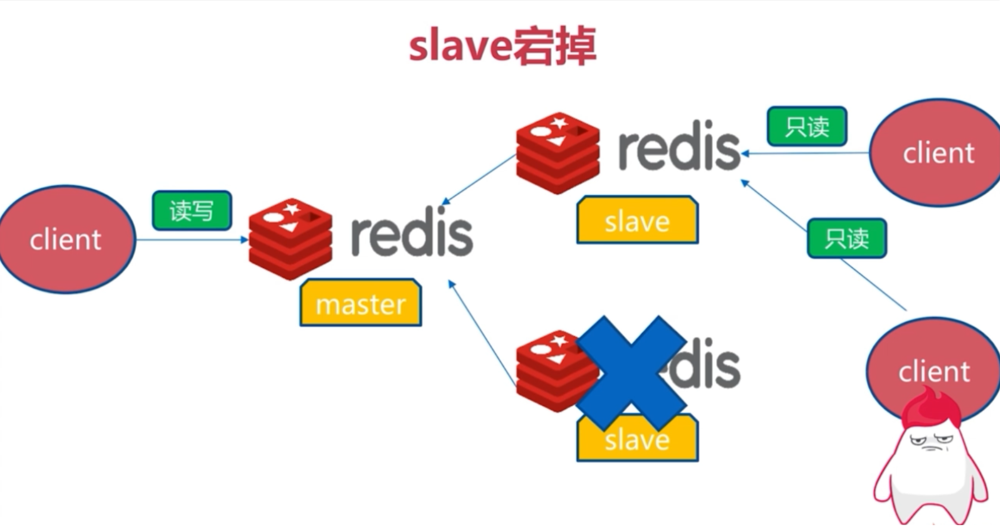

3.1.3.1.2 Master 节点故障和恢复

当 master 节点故障时，需要提升slave为新的master

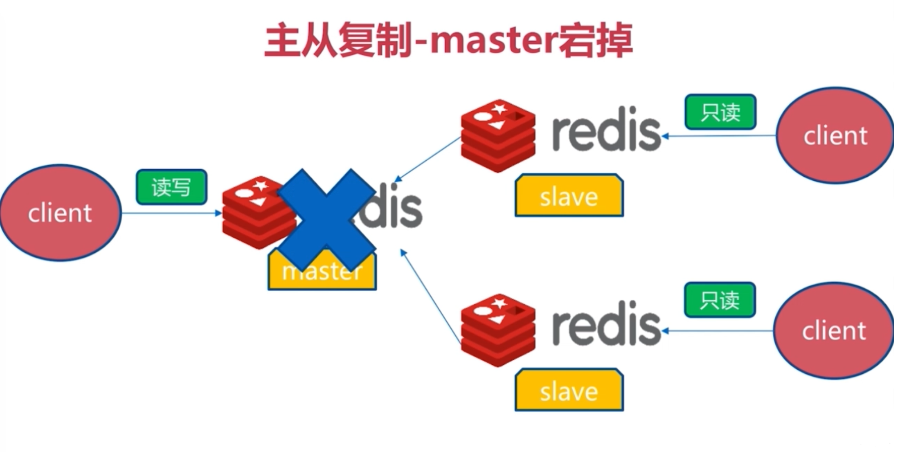

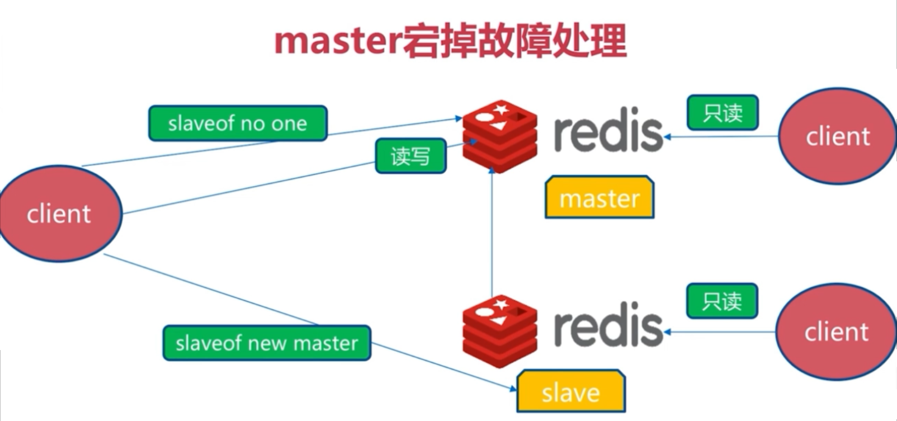

master故障后，当前还只能手动提升一个slave为新master，不能自动切换。 之后将其它的slave节点重新指定新的master为master节点

Master的切换会导致master_replid发生变化，slave之前的master_replid就和当前master不一致从而会引发所有 slave的全量同步。

### 主从复制故障恢复实现

假设当前主节点10.0.0.8故障,提升10.0.0.18为新的master

```text
#查看当前10.0.0.18节点的状态为slave,master指向10.0.0.8
127.0.0.1:6379> INFO replication
# Replication
role:slave
master_host:10.0.0.8
master_port:6379
master_link_status:up
master_last_io_seconds_ago:1
master_sync_in_progress:0
slave_repl_offset:3794
slave_priority:100
slave_read_only:1
connected_slaves:0
master_replid:8e8279e461fdf0f1a3464ef768675149ad4b54a3
master_replid2:0000000000000000000000000000000000000000
master_repl_offset:3794
second_repl_offset:-1
repl_backlog_active:1
repl_backlog_size:1048576
repl_backlog_first_byte_offset:3781
repl_backlog_histlen:14
127.0.0.1:6379>
```

停止slave同步并提升为新的master

```text
#将当前 slave 节点提升为 master 角色
127.0.0.1:6379>  REPLICAOF NO ONE   #旧版使用SLAVEOF no one
OK
(5.04s)
127.0.0.1:6379> info replication
# Replication
role:master
connected_slaves:0
master_replid:94901d6b8ff812ec4a4b3ac6bb33faa11e55c274
master_replid2:0083e5a9c96aa4f2196934e10b910937d82b4e19
master_repl_offset:3514
second_repl_offset:3515
repl_backlog_active:1
repl_backlog_size:1048576
repl_backlog_first_byte_offset:3431
repl_backlog_histlen:84
127.0.0.1:6379>
```

测试能否写入数据：

```text
127.0.0.1:6379> set keytest1 vtest1
OK
```

修改所有slave 指向新的master节点

```bash
#修改10.0.0.28节点指向新的master节点10.0.0.18
127.0.0.1:6379> SLAVEOF 10.0.0.18 6379
OK
127.0.0.1:6379> set key100 v100
(error) READONLY You can't write against a read only replica.
#查看日志
[root@centos8 ~]#tail -f /var/log/redis/redis.log
1762:S 20 Feb 2020 13:28:21.943 # Connection with master lost.
1762:S 20 Feb 2020 13:28:21.943 * Caching the disconnected master state.
1762:S 20 Feb 2020 13:28:21.943 * REPLICAOF 10.0.0.18:6379 enabled (user request
from 'id=5 addr=127.0.0.1:59668 fd=9 name= age=149 idle=0 flags=N db=0 sub=0
psub=0 multi=-1 qbuf=41 qbuf-free=32727 obl=0 oll=0 omem=0 events=r
cmd=slaveof')
1762:S 20 Feb 2020 13:28:21.966 * Connecting to MASTER 10.0.0.18:6379
1762:S 20 Feb 2020 13:28:21.966 * MASTER <-> REPLICA sync started
1762:S 20 Feb 2020 13:28:21.967 * Non blocking connect for SYNC fired the event.
1762:S 20 Feb 2020 13:28:21.968 * Master replied to PING, replication can
continue...
1762:S 20 Feb 2020 13:28:21.968 * Trying a partial resynchronization (request
8e8279e461fdf0f1a3464ef768675149ad4b54a3:3991).
1762:S 20 Feb 2020 13:28:21.969 * Successful partial resynchronization with
master.
1762:S 20 Feb 2020 13:28:21.969 * MASTER <-> REPLICA sync: Master accepted a
Partial Resynchronization.
```

在新master可看到slave

```text
#在新master节点10.0.0.18上查看状态
127.0.0.1:6379> INFO replication
# Replication
role:master
connected_slaves:1
slave0:ip=10.0.0.28,port=6379,state=online,offset=4606,lag=0
master_replid:8e8279e461fdf0f1a3464ef768675149ad4b54a3
master_replid2:0000000000000000000000000000000000000000
master_repl_offset:4606
second_repl_offset:-1
repl_backlog_active:1
repl_backlog_size:1048576
repl_backlog_first_byte_offset:1
repl_backlog_histlen:4606
127.0.0.1:6379>
```

### 实现 Redis 的级联复制

即实现基于Slave节点的Slave

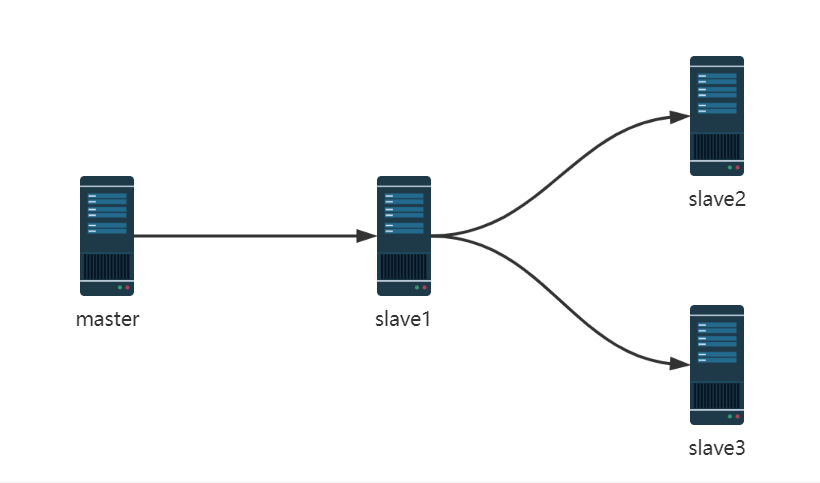

master和slave1节点无需修改,只需要修改slave2及slave3指向slave1做为mater即可

```text
#在slave2和slave3上执行下面指令
127.0.0.1:6379> REPLICAOF 10.0.0.18 6379
OK
127.0.0.1:6379> CONFIG SET masterauth 123456
```

在 master 设置key,观察是否同步

```text
#在master新建key
127.0.0.1:6379> set key2 v2
OK
127.0.0.1:6379> get key2
"v2"
#在slave1和slave2验证key
127.0.0.1:6379> get key2
"v2"
#在slave1和slave2都无法新建key
127.0.0.1:6379> set key3 v3
(error) READONLY You can't write against a read only replica.
```

在中间那个slave1查看状态

```text
127.0.0.1:6379> INFO replication
# Replication
role:slave
master_host:10.0.0.8
master_port:6379
master_link_status:up
master_last_io_seconds_ago:8 #最近一次与master通信已经过去多少秒。
master_sync_in_progress:0  #是否正在与master通信。
slave_repl_offset:4312  #当前同步的偏移量
slave_priority:100   #slave优先级，master故障后值越小越优先同步。
slave_read_only:1
connected_slaves:1
slave0:ip=10.0.0.28,port=6379,state=online,offset=4312,lag=0 #slave的slave节点
master_replid:8e8279e461fdf0f1a3464ef768675149ad4b54a3
master_replid2:0000000000000000000000000000000000000000
master_repl_offset:4312
second_repl_offset:-1
repl_backlog_active:1
repl_backlog_size:1048576
repl_backlog_first_byte_offset:1
repl_backlog_histlen:4312
```

### 主从复制优化

### 主从复制过程

Redis主从复制分为全量同步和增量同步

Redis 的主从同步是非阻塞的，即同步过程不会影响主服务器的正常访问.

注意:主节点重启会导致全量同步,从节点重启只会导致增量同步

```text
从redis 2.8版本以前，并不支持部分同步，当主从服务器之间的连接断掉之后，master服务器和slave服
务器之间都是进行全量数据同步
从redis 2.8开始，开始引入了部分同步，即使主从连接中途断掉，也不需要进行全量同步
```

3.1.5.1.1 全量复制过程 Full resync

```text
4.0之前版本的复制：run_id和复制偏移量来判断进行全量复制还是部分复制
4.0之后版本的复制：根据master_replid和复制偏移量来判断进行全量复制还是部分复制
主从关系建立后master_replid，保存的是当前主节点的master_replid
master_replid2保存的是上一个主节点的master_replid
```

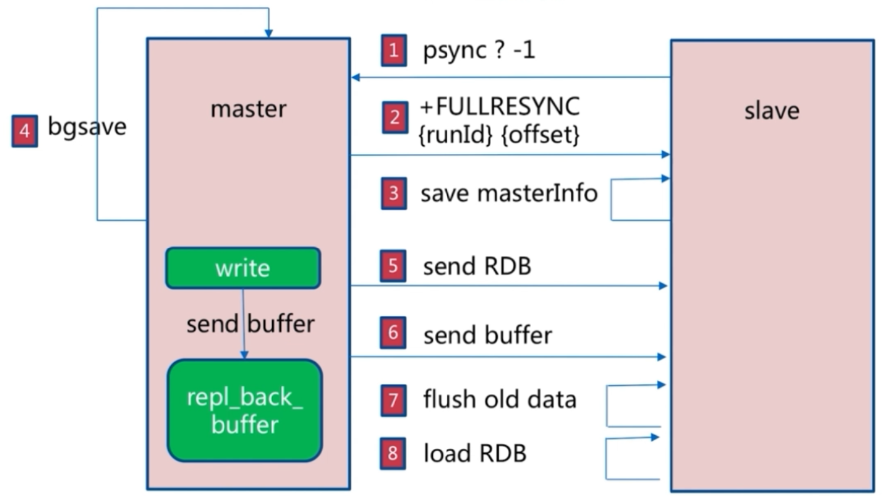

主从节点建立连接,验证身份后,从节点向主节点发送PSYNC(2.8版本之前是SYNC)命令主节点向从节点发送FULLRESYNC命令,包括master_replid(runID)和offset 从节点保存主节点信息主节点执行BGSAVE保存RDB文件,同时记录新的记录到buffer中主节点发送RDB文件给从节点主节点将新收到buffer中的记录发送至从节点从节点删除本机的旧数据从节点加载RDB 从节点同步主节点的buffer信息

全量复制发生在下面情况

从节点首次连接主节点(无master_replid/run_id) 从节点的复制偏移量不在复制积压缓冲区内从节点无法连接主节点超过一定的时间

范例: 查看 master_replid

```bash
#注意：单机时重启服务master_replid会变化
[root@ubuntu2204 ~]#redis-cli -a 123456 info replication
Warning: Using a password with '-a' or '-u' option on the command line interface
may not be safe.
# Replication
role:master
connected_slaves:0
master_failover_state:no-failover
master_replid:2ae72114c992424bad89b58ed6eb1b34bf039e0e
master_replid2:0000000000000000000000000000000000000000
master_repl_offset:0
second_repl_offset:-1
repl_backlog_active:0
repl_backlog_size:1048576
repl_backlog_first_byte_offset:0
repl_backlog_histlen:0
```

范例：查看RUNID

```text
#Redis 重启服务后，RUNID会发生变化
127.0.0.1:6379> info server
# Server
redis_version:7.0.5
redis_git_sha1:00000000
redis_git_dirty:0
redis_build_id:77bd58d092d1d003
redis_mode:standalone
os:Linux 5.4.0-124-generic x86_64
arch_bits:64
monotonic_clock:POSIX clock_gettime
multiplexing_api:epoll
atomicvar_api:c11-builtin
gcc_version:9.4.0
process_id:16407
process_supervised:systemd
run_id:9e954950c255644ef291f6be0c579ae893c16aad
tcp_port:6379
server_time_usec:1667276559043301
uptime_in_seconds:3463
uptime_in_days:0
hz:10
configured_hz:10
lru_clock:6332175
executable:/apps/redis/bin/redis-server
config_file:/apps/redis/etc/redis.conf
io_threads_active:0
```

3.1.5.1.2 增量复制过程 partial resynchronization

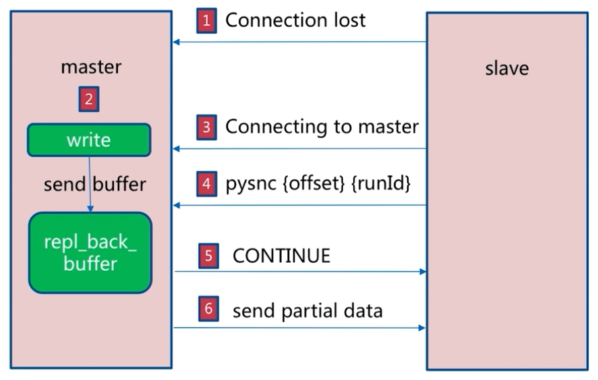

在主从复制首次完成全量同步之后再次需要同步时,从服务器只要发送当前的offset位置(类似于MySQL的 binlog的位置)给主服务器，然后主服务器根据相应的位置将之后的数据(包括写在缓冲区的积压数据)发送给从服务器,再次将其保存到从节点内存即可。

即首次全量复制,之后的复制基本增量复制实现

3.1.5.1.3 主从同步完整过程

主从同步完整过程如下：

slave发起连接master，验证通过后,发送PSYNC命令 master接收到PSYNC命令后，执行BGSAVE命令将全部数据保存至RDB文件中,并将后续发生的写操作记录至buffer中 master向所有slave发送RDB文件 master向所有slave发送后续记录在buffer中写操作 slave收到快照文件后丢弃所有旧数据 slave加载收到的RDB到内存 slave 执行来自master接收到的buffer写操作当slave完成全量复制后,后续master只会先发送slave_repl_offset信息以后slave比较自身和master的差异,只会进行增量复制的数据即可


复制缓冲区(环形队列)配置参数：

```text
#master的写入数据缓冲区，用于记录自上一次同步后到下一次同步过程中间的写入命令，计算公式：repl-
backlog-size = 允许从节点最大中断时长 * 主实例offset每秒写入量，比如:master每秒最大写入
64mb，最大允许60秒，那么就要设置为64mb*60秒=3840MB(3.8G),建议此值是设置的足够大，默认值为1M
repl-backlog-size 1mb
#如果一段时间后没有slave连接到master，则backlog size的内存将会被释放。如果值为0则表示永远不
释放这部份内存。
repl-backlog-ttl   3600
```

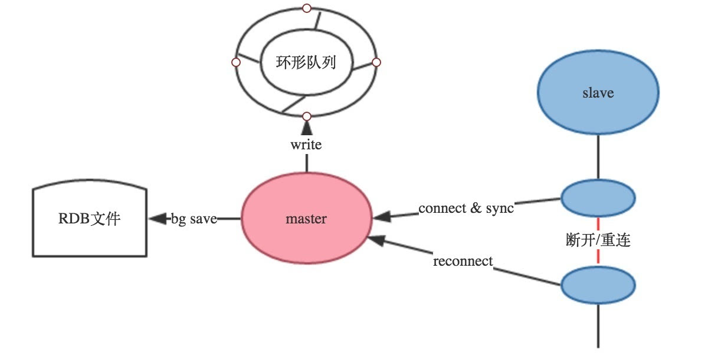

3.1.5.1.4 避免全量复制

第一次全量复制不可避免,后续的全量复制可以利用小主节点(内存小),业务低峰时进行全量节点master_replid或RUN_ID不匹配:主节点重启会导致master_replid或RUN_ID变化,可能会触发全量复制,可以利用config命令动态修改配置，故障转移例如哨兵或集群选举新的主节点也不会全量复制,而从节点重启动,不会导致全量复制,只会增量复制复制积压缓冲区不足: 当主节点生成的新数据大于缓冲区大小,从节点恢复和主节点连接后,会导致全量复制.解决方法将repl-backlog-size 调大

3.1.5.1.5 避免复制风暴

单主节点复制风暴

当主节点重启，多从节点复制

解决方法:更换复制拓扑

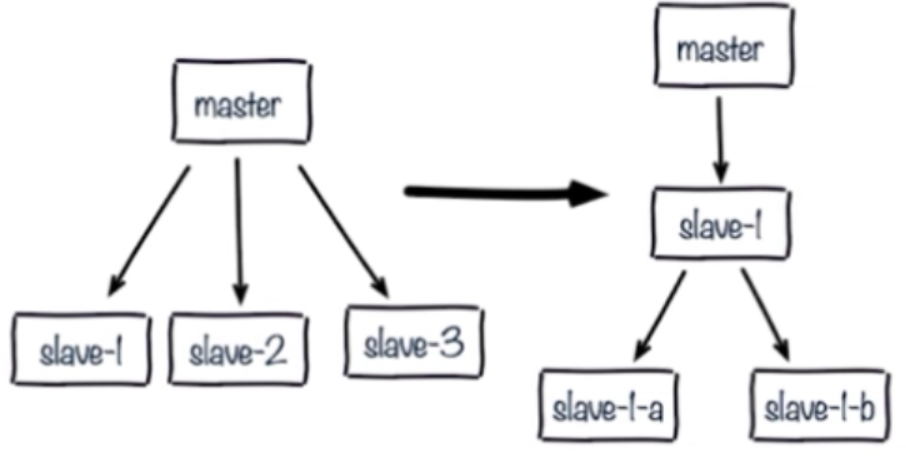

单机器多实例复制风暴

机器宕机后，大量全量复制

解决方法:主节点分散多机器

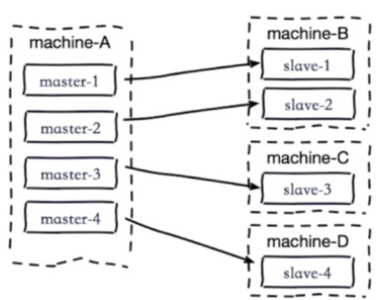

### 主从同步优化配置

Redis在2.8版本之前没有提供增量部分复制的功能，当网络闪断或者slave Redis重启之后会导致主从之间的全量同步，即从2.8版本开始增加了部分复制的功能。

性能相关配置

```text
repl-diskless-sync no # 是否使用无盘方式进行同步RDB文件，默认为no(编译安装默认为yes)，no表
示不使用无盘，需要将RDB文件保存到磁盘后再发送给slave，yes表示使用无盘，即RDB文件不需要保存至本
地磁盘，而且直接通过网络发送给slave
repl-diskless-sync-delay 5 #无盘时复制的服务器等待的延迟时间
repl-ping-slave-period 10 #slave向master发送ping指令的时间间隔，默认为10s
repl-timeout 60 #指定ping连接超时时间,超过此值无法连接,master_link_status显示为down状态,
并记录错误日志
repl-disable-tcp-nodelay no #是否启用TCP_NODELAY
#设置成yes，则redis会合并多个小的TCP包成一个大包再发送,此方式可以节省带宽，但会造成同步延迟时
长的增加，导致master与slave数据短期内不一致
#设置成no，则master会立即同步数据
repl-backlog-size 1mb #master的写入数据缓冲区，用于记录自上一次同步后到下一次同步前期间的写
入命令，计算公式：repl-backlog-size = 允许slave最大中断时长 * master节点offset每秒写入
量，如:master每秒最大写入量为32MB，最长允许中断60秒，就要至少设置为32*60=1920MB,建议此值是设
置的足够大,如果此值太小,会造成全量复制
repl-backlog-ttl 3600 #指定多长时间后如果没有slave连接到master，则backlog的内存数据将会过
期。如果值为0表示永远不过期。
slave-priority 100 #slave参与选举新的master的优先级，此整数值越小则优先级越高。当master故
障时将会按照优先级来选择slave端进行选举新的master，如果值设置为0，则表示该slave节点永远不会被
选为master节点。
replica-priority 100 #新版
```

```text
min-replicas-to-write 1 #指定master的可用slave不能少于个数，如果少于此值,master将无法执
行写操作，提示错误：(error) NOREPLICAS Not enough good replicas to write.,默认为0,生产
建议设为1
min-slaves-max-lag 20 #指定至少有min-replicas-to-write数量的slave延迟时间都大于此秒数
时，master将不能执行写操作,默认为10s
```

### 常见主从复制故障

### 主从硬件和软件配置不一致

主从节点的maxmemory不一致,主节点内存大于从节点内存,主从复制可能丢失数据

rename-command 命令不一致,如在主节点启用flushdb,从节点禁用此命令,结果在master节点执行 flushdb后,导致slave节点不同步

```text
#在从节点定义rename-command flushall "",但是在主节点没有此配置,则当在主节点执行flushall
时,会在从节点提示下面同步错误
10822:S 16 Oct 2020 20:03:45.291 # == CRITICAL == This replica is sending an
error to its master: 'unknown command `flushall`, with args beginning with: '
after processing the command '<unknown>'
#master有一个rename-command flushdb "bowen",而slave没有这个配置,则同步时从节点可以看到以
下同步错误
3181:S 21 Oct 2020 17:34:50.581 # == CRITICAL == This replica is sending an
error to its master: 'unknown command `bowen`, with args beginning with: ' after
processing the command '<unknown>'
```

### Master 节点密码错误

如果slave节点配置的master密码错误，导致验证不通过,自然将无法建立主从同步关系。

```bash
[root@centos8 ~]#tail -f /var/log/redis/redis.log
24930:S 20 Feb 2020 13:53:57.029 * Connecting to MASTER 10.0.0.8:6379
24930:S 20 Feb 2020 13:53:57.030 * MASTER <-> REPLICA sync started
24930:S 20 Feb 2020 13:53:57.030 * Non blocking connect for SYNC fired the
event.
24930:S 20 Feb 2020 13:53:57.030 * Master replied to PING, replication can
continue...
24930:S 20 Feb 2020 13:53:57.031 # Unable to AUTH to MASTER: -ERR invalid
password
```

### Redis 版本不一致

不同的redis 版本之间尤其是大版本间可能会存在兼容性问题，如：Redis 3,4,5,6之间

因此主从复制的所有节点应该使用相同的版本

### 保护（安全）模式下无法远程连接

如果开启了安全模式，并且没有设置bind地址和密码,会导致无法远程连接

```bash
[root@centos8 ~]#vim /etc/redis.conf
#bind 127.0.0.1   #将此行注释
[root@centos8 ~]#systemctl restart redis
[root@centos8 ~]#ss  -ntl
State        Recv-Q        Send-Q        Local Address:Port         Peer
Address:Port
LISTEN       0             128                 0.0.0.0:22
0.0.0.0:*
LISTEN       0             100               127.0.0.1:25
0.0.0.0:*
LISTEN       0             128                 0.0.0.0:6379
0.0.0.0:*
LISTEN       0             128                    [::]:22
[::]:*
LISTEN       0             100                   [::1]:25
[::]:*
LISTEN       0             128                    [::]:6379
[::]:*
[root@centos8 ~]#redis-cli -h 10.0.0.8
10.0.0.8:6379> KEYS *
(error) DENIED Redis is running in protected mode because protected mode is
enabled, no bind address was specified, no authentication password is requested
to clients. In this mode connections are only accepted from the loopback
interface. If you want to connect from external computers to Redis you may adopt
one of the following solutions: 1) Just disable protected mode sending the
command 'CONFIG SET protected-mode no' from the loopback interface by connecting
to Redis from the same host the server is running, however MAKE SURE Redis is not
publicly accessible from internet if you do so. Use CONFIG REWRITE to make this
change permanent. 2) Alternatively you can just disable the protected mode by
editing the Redis configuration file, and setting the protected mode option to
'no', and then restarting the server. 3) If you started the server manually just
for testing, restart it with the '--protected-mode no' option. 4) Setup a bind
address or an authentication password. NOTE: You only need to do one of the
above things in order for the server to start accepting connections from the
outside.
10.0.0.38:6379> exit
#可以本机登录
[root@centos8 ~]#redis-cli
127.0.0.1:6379> KEYS *
(empty list or set)
```



<nav class="article-end" aria-label="章节导航">
  <a href="{{ '/subjects/Redis/10-message-queues.html' | relative_url }}">← Previous: Message Queues</a>
  <a href="{{ '/subjects/Redis/' | relative_url }}">Back to Redis Database Index</a>
  <a href="{{ '/subjects/Redis/12-redis-sentinel.html' | relative_url }}">Next: Redis Sentinel →</a>
</nav>
