[← 返回 Redis 数据库目录]({{ '/subjects/Redis/' | relative_url }})



# 11 主从复制

Redis 复制把主节点的写入传播到一个或多个副本，用于分担读请求和构建故障切换基础。**复制通常是异步的**：主节点确认写入时，副本不一定已经收到。复制不是备份，也不会单独完成自动提升、客户端重定向或旧主节点隔离；这些需要 Sentinel、Cluster 或人工编排。

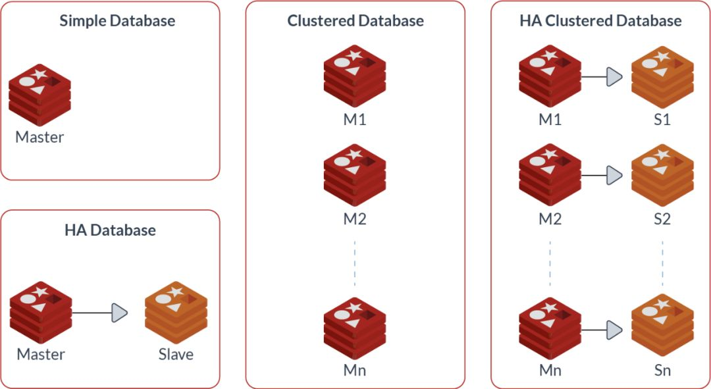

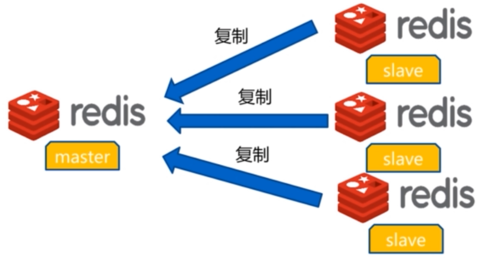

应用写入应路由到主节点；若把普通负载均衡器直接放在主从节点前面随机转发，会把写请求送到只读副本。读副本还可能短暂落后，应按业务一致性要求决定是否从副本读。

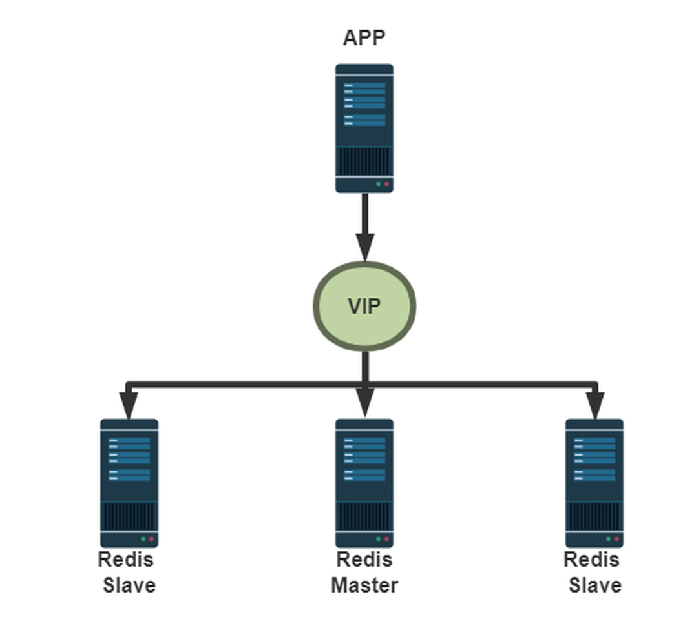

## 建立复制关系

在计划成为副本的实例上，先准备与主节点通信所需的网络和 ACL 凭据，再设置主节点地址。Redis 6+ 可使用专用复制用户的 `masteruser`／`masterauth`；不要把旧示例中的短密码写进命令历史。配置应由受保护的文件或配置管理系统维护，在线命令只适合受控演示。

```conf
replicaof redis-primary.example.internal 6379
masteruser replica-user
masterauth 由密钥管理系统注入的密码
replica-read-only yes
```

也可在运行中的副本上用 `REPLICAOF <host> <port>` 建立关系，但在首次全量同步中，**副本原有数据可能被清空并替换为主节点快照**。不能把带业务数据的独立实例直接改成副本而不备份。`SLAVEOF` 是旧命令名称，本文使用 `REPLICAOF`。


## 验证同步是否真正完成

在主节点和副本分别执行 `INFO replication`：

```text
INFO replication
```

主节点应看到预期 `connected_slaves` 和对应副本处于 `online`；副本应看到 `role:slave`、`master_link_status:up`、`master_sync_in_progress:0`，并观察复制偏移量与滞后变化。字段名中的 `slave` 是 Redis 输出中的兼容字段，并不代表只能使用旧命令。另在主节点写入一个带过期时间的测试键，再在副本读取确认；一次成功只证明当时可读，还需持续监控滞后和断链。

```text
SET demo:replication ok EX 60
GET demo:replication
```

默认只读副本上执行 `SET` 应返回 `READONLY`。若副本断开主节点，`master_link_status` 变为 `down`；是否继续提供旧数据取决于 `replica-serve-stale-data`，因此读副本的应用必须接受或规避陈旧读。

## 主节点故障：先隔离，再提升

普通主从复制**不会自动选主**。人工故障切换前要确认旧主节点已被隔离，避免两个节点同时接受写入造成分叉；再选择复制偏移量较新、健康状态良好的副本。提升命令为：

```text
REPLICAOF NO ONE
INFO replication
```

确认新主节点可写后，将其他副本重新指向它，最后切换客户端写入入口并处理旧主节点回归。某些副本可能部分重同步，另一些可能全量重同步，取决于复制 ID、偏移量和 backlog 是否仍覆盖缺口；不能说“提升必然全量同步”，也不能说“重启副本必然增量”。手动切换过程仍可能丢失旧主节点尚未复制出去的写入。

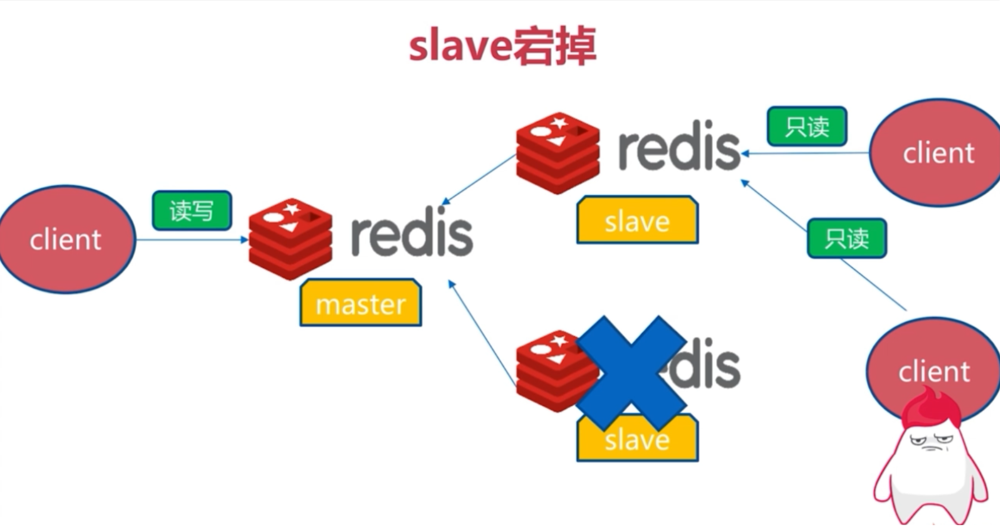

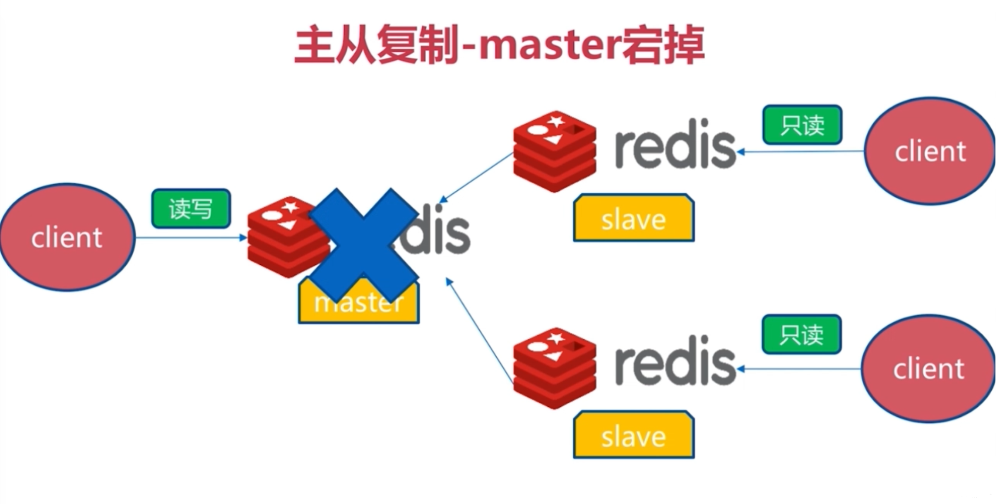

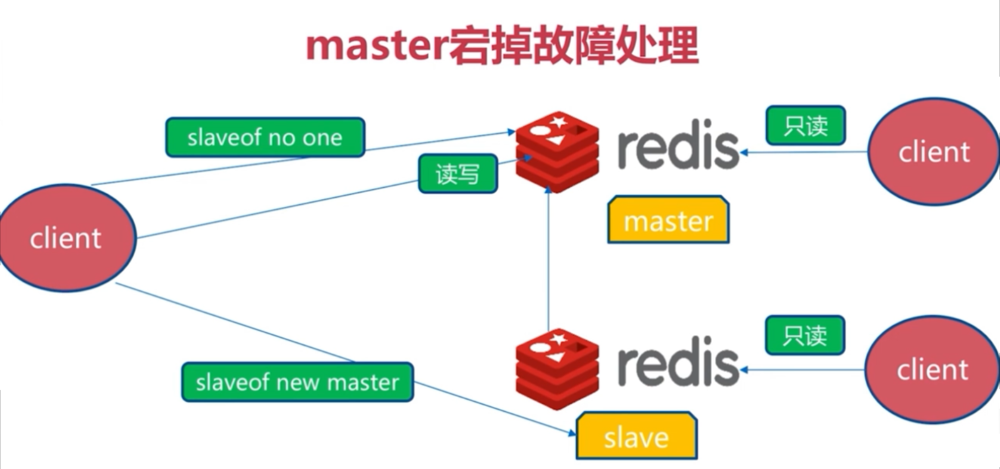

如果要自动检测和提升，下一篇的 Sentinel 负责该流程；它也不能把异步复制变成零数据丢失。

## 级联复制与同步过程

副本也可作为下游副本的复制源，构成 `主 → 副本 A → 副本 B`。这能减轻主节点承受多个全量同步的压力，但会增加链路层数和下游滞后；中间副本故障还会影响其下游。每一级都需要检查复制连接、凭据与只读行为。

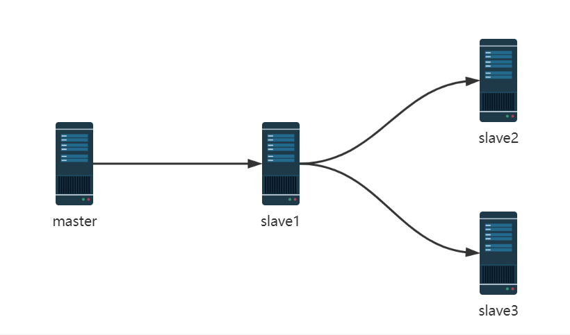

**全量同步**发生在首次建立关系，或无法按历史复制流接续时。主节点生成当前数据集快照（可能采用磁盘或无盘方式），期间将新写入保存在缓冲区，副本加载快照后继续接收后续写入。生成快照涉及 fork、CPU、内存与网络成本，但不能简单说全程“完全不影响主节点”。

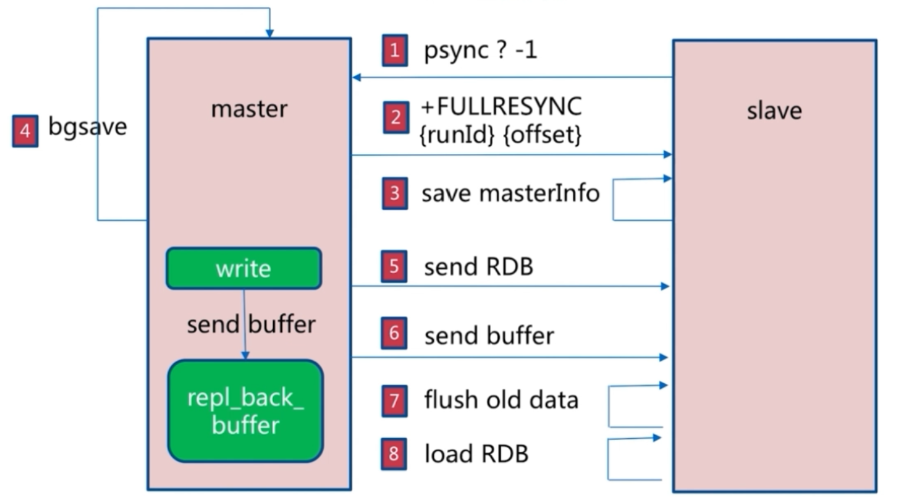

**部分重同步**依靠复制 ID、偏移量和复制积压缓冲区（backlog）：短暂断线后，若缺失的命令仍在 backlog 中，主节点只发送差额；否则回到全量同步。主节点或副本重启后能否部分重同步仍要看实际复制状态、版本与缓冲区，不能只由“重启的是哪一边”判定。

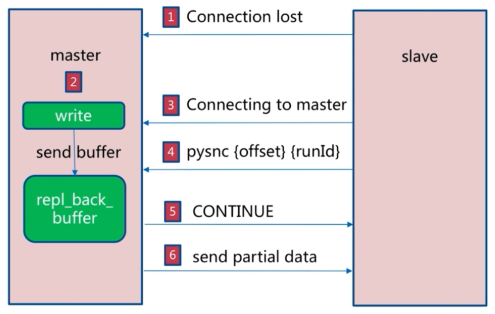

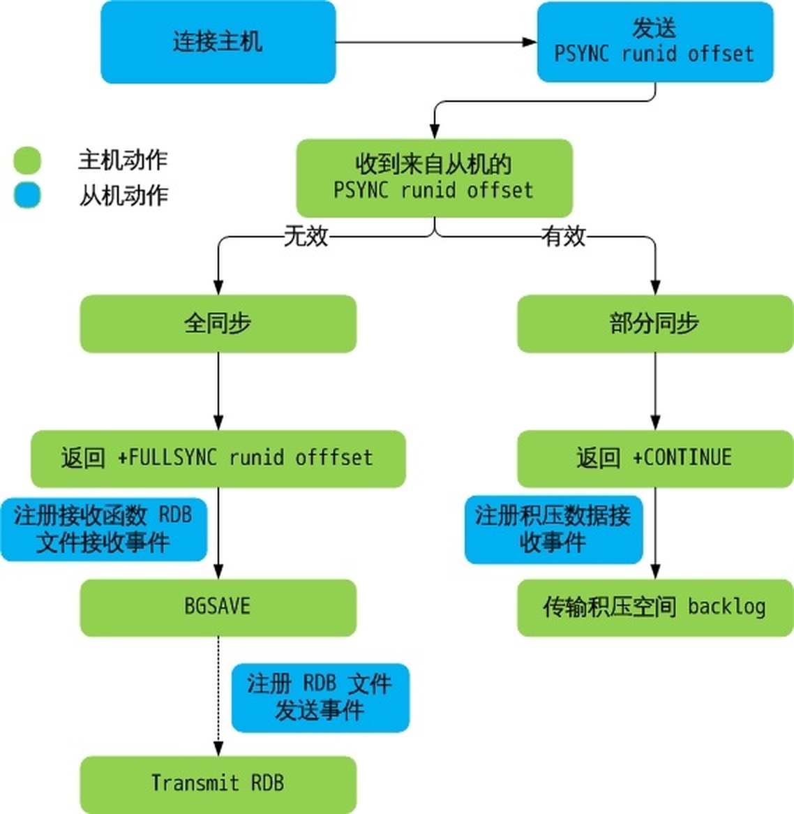

## 容量与故障排查

`repl-backlog-size` 可按写入速率 × 希望容忍的断线时间估算，再留余量。例如主节点峰值每秒产生 10 MiB 复制流、希望覆盖 60 秒断线，至少需要约 600 MiB，并进一步考虑波动及内存成本。这个计算不是保证：实际同步还受复制 ID、网络、负载和版本行为影响。`repl-backlog-ttl` 控制没有副本连接后 backlog 的保留时间。

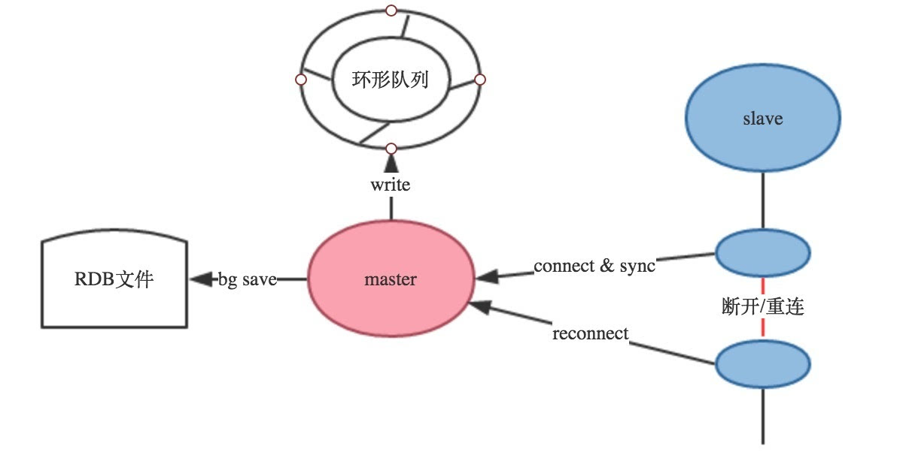

多副本同时全量同步会造成主节点 CPU、内存、磁盘或网络压力；级联复制和将主节点分散到不同主机能降低单点压力，但不能消除资源规划需求。

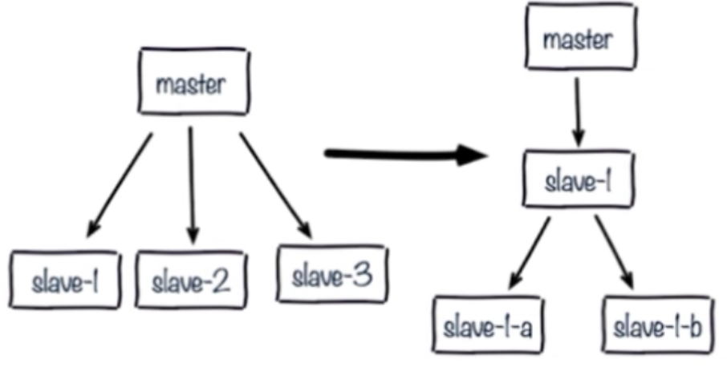


排障先看 `INFO replication`、服务日志和网络，再检查以下差异：复制用户／密码错误；主、副节点版本或模块不兼容；副本内存不足；数据目录与持久化失败；命令重命名或 ACL 配置不一致；监听地址、TLS 或网络策略不匹配。原案例通过注释 `bind` 使 Redis 监听所有接口，却没有同步完成认证和网络保护，这只能暴露服务，不能解决复制设计。

`min-replicas-to-write` 与 `min-replicas-max-lag` 可让主节点在合格副本不足时拒绝写入，减少“孤立主节点继续写”的窗口；但它们根据副本数量和延迟判断，**不等于同步提交或零丢失**。开启前应预估副本故障时业务写入将被拒绝的影响。



<nav class="article-end" aria-label="章节导航">
  <a href="{{ '/subjects/Redis/10-message-queues.html' | relative_url }}">← 上一篇：消息传递模式</a>
  <a href="{{ '/subjects/Redis/' | relative_url }}">返回 Redis 数据库目录</a>
  <a href="{{ '/subjects/Redis/12-redis-sentinel.html' | relative_url }}">下一篇：Sentinel →</a>
</nav>
