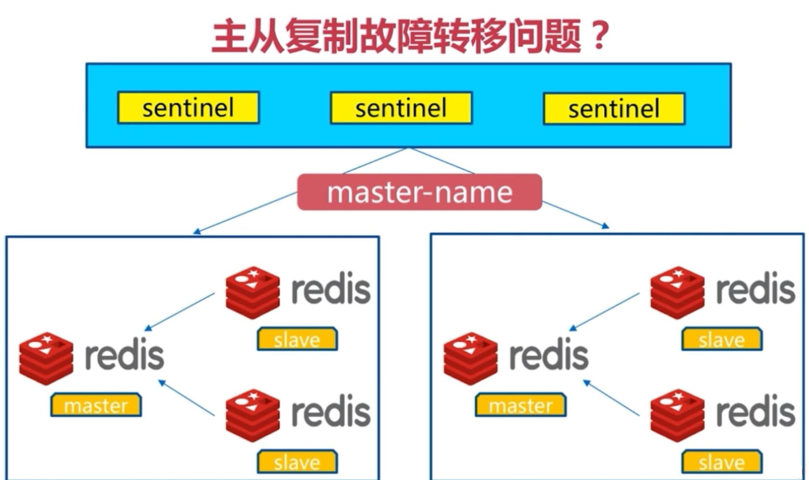
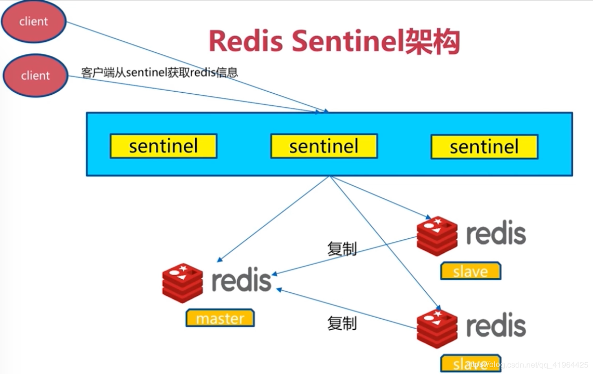
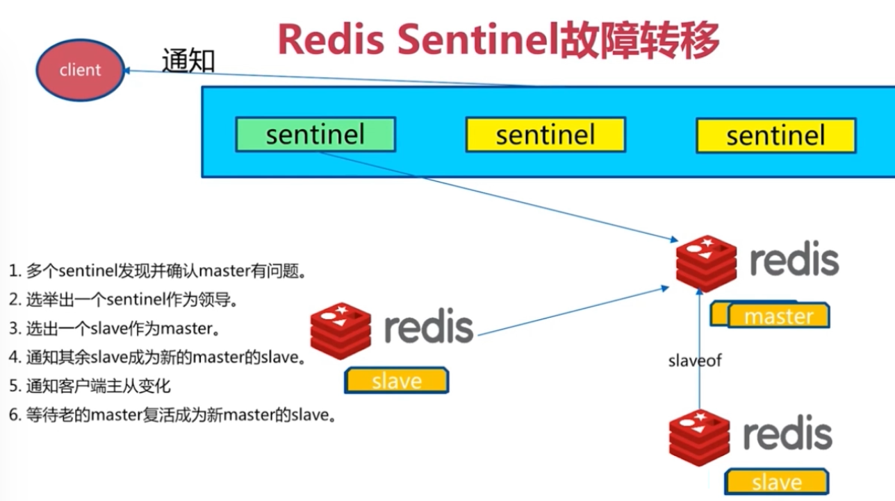
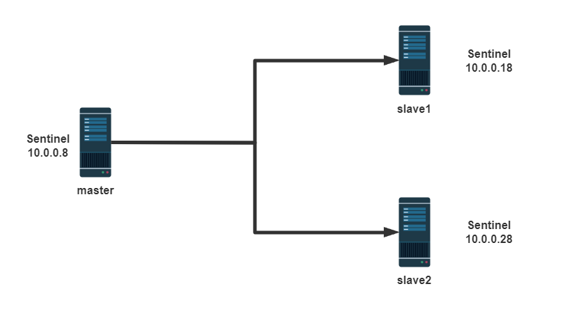
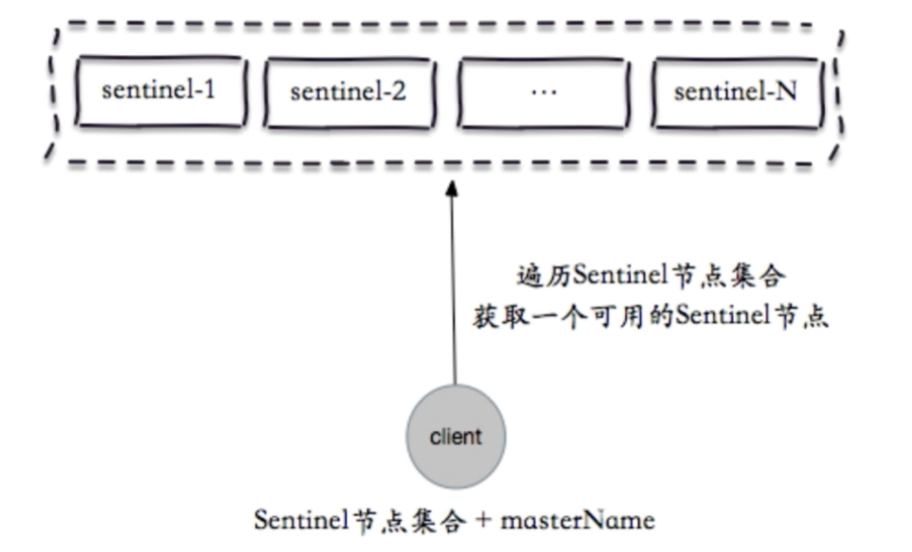
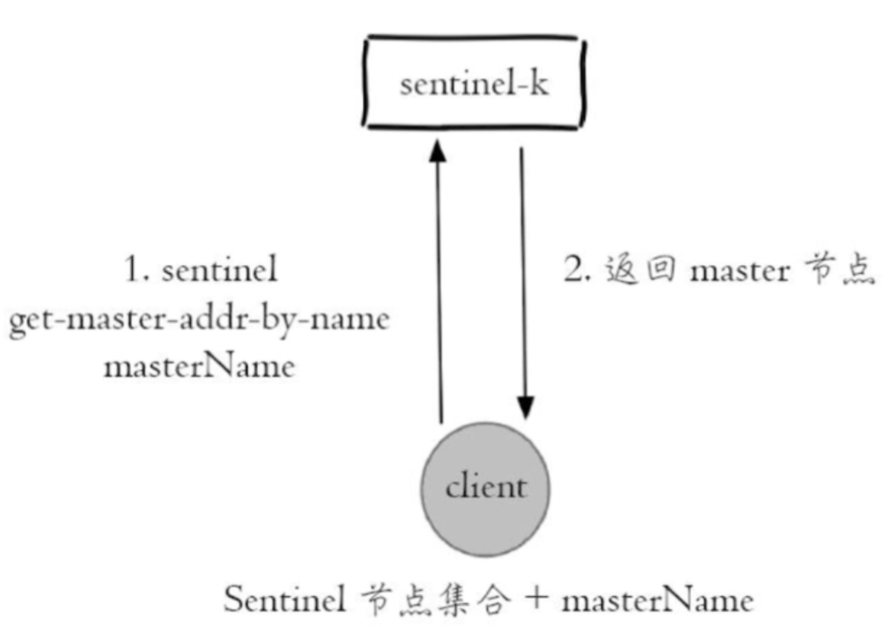
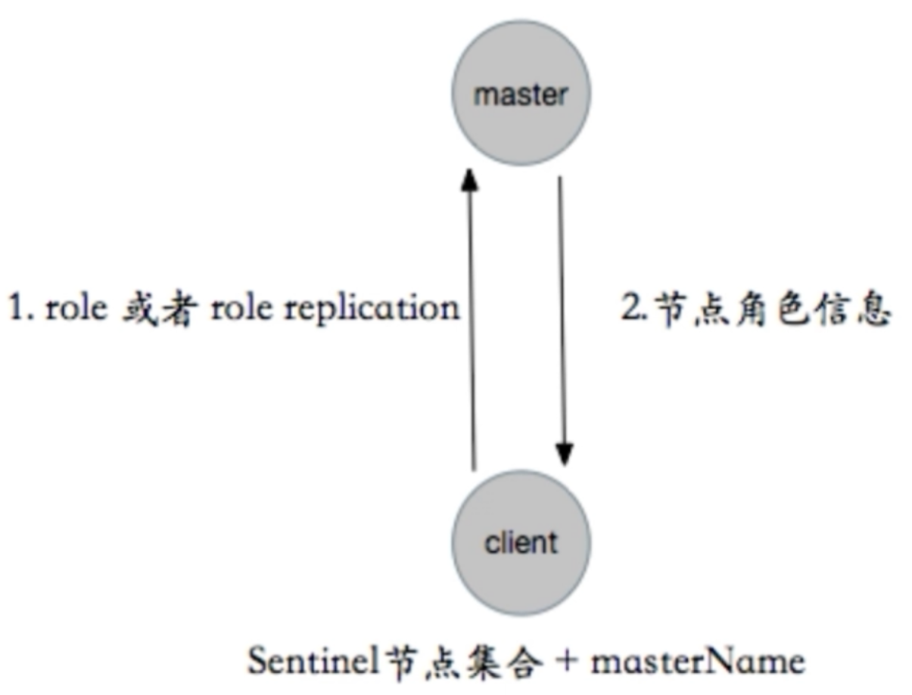
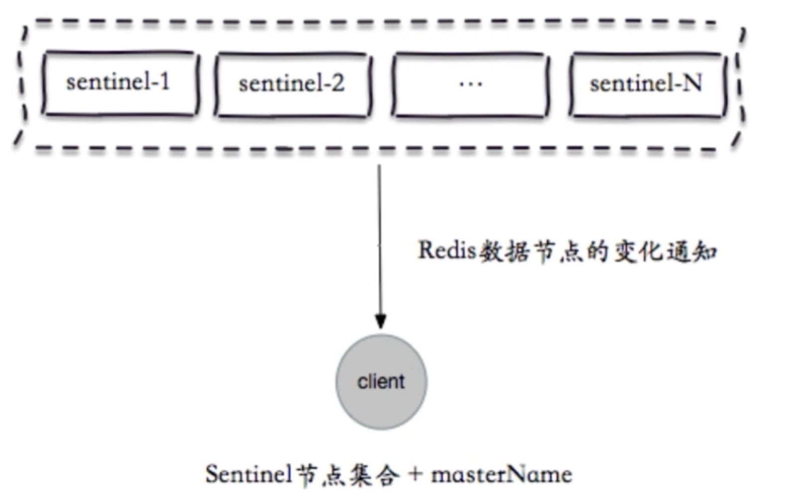

[← 返回 Redis 数据库目录]({{ '/subjects/Redis/' | relative_url }})



# 12 Sentinel 哨兵

第 11 篇的主从复制不会自行选出新主节点。Sentinel 是独立运行的监控与协调进程：发现主节点不可用、在条件满足时提升一个副本、让其他副本跟随新主节点，并向支持 Sentinel 的客户端提供当前主节点地址。Sentinel **不是 Redis 请求代理，也不做数据分片**；单主节点的写入容量瓶颈仍在。


## 故障判断与选举

每个 Sentinel 定期探测 Redis 主从节点和其他 Sentinel。某个 Sentinel 在一段时间内无法获得主节点有效响应，会把它标为主观下线（SDOWN）；达到配置的 `quorum` 个 Sentinel 一致认为主节点下线，才形成客观下线（ODOWN）。**ODOWN 与授权故障转移不是同一件事**：发起故障转移还要选出 Sentinel 领导者，并获得足够的 Sentinel 多数支持。不能只把 `quorum` 简化为“所有 Sentinel 数量的一半以上”。







常见设计是至少三台 Sentinel，分布在不同故障域。三台时可把 `quorum` 设为 2；若仅一台或全在同一宿主机，Sentinel 自身会成为故障点。网络分区或副本滞后仍可能导致已确认但尚未复制的数据在切换后丢失；Sentinel 不提供同步提交或零丢失保证。

## 部署前：先确认主从可用

先按第 11 篇完成一个主节点、两个副本的复制。主节点 `INFO replication` 应看到两个在线副本；每个副本应是只读、`master_link_status:up`。每个 Redis 实例使用持久化与合适的 ACL；Sentinel 访问主从节点的身份可通过 `sentinel auth-user` 与 `sentinel auth-pass` 配置，不要求所有应用账户都共用同一密码。



Sentinel 的 `26379` 端口、Redis 的 `6379` 端口以及节点间网络需要相互可达，但只应暴露给受控网络。原资料通过 `bind 0.0.0.0`、`protected-mode no` 打开所有接口，并在文中写入固定弱密码，不应作为默认方式。

## 每个 Sentinel 的配置

以受管理的私有网络地址 `10.0.0.11` 为当前主节点为例，三台 Sentinel 的**初始**配置可以具有相同的 `monitor` 名称与地址：

```conf
port 26379
daemonize no
sentinel monitor mymaster 10.0.0.11 6379 2
sentinel auth-user mymaster sentinel-user
sentinel auth-pass mymaster 从密钥管理系统取得的密码
sentinel down-after-milliseconds mymaster 10000
sentinel parallel-syncs mymaster 1
sentinel failover-timeout mymaster 180000
```

具体凭据注入、`bind`、ACL、TLS 与数据目录应按环境配置。`down-after-milliseconds` 是对故障探测速度和误判风险的取舍，不能固定认为 3000 ms 最好。Sentinel 会自动重写其配置文件，保存独有的 `myid`、已发现的节点和当前主节点；配置文件必须可由 Sentinel 进程写入。**不要把一台已经启动并生成 `myid` 的配置文件原样复制到其他 Sentinel**，否则身份冲突。先分发未启动的模板，再分别启动。

如果发行版提供 `redis-sentinel.service`，优先检查并使用该单元。源码安装可用 `redis-sentinel /path/to/sentinel.conf` 启动，但服务类型、路径和权限必须与实际构建一致；旧文拆成两行的 `ExecStart` 不能直接放入 systemd。

```bash
systemctl status redis-sentinel.service
redis-cli -p 26379 INFO sentinel
redis-cli -p 26379 SENTINEL masters
redis-cli -p 26379 SENTINEL get-master-addr-by-name mymaster
```

在每台 Sentinel 上确认发现的主节点地址、预期副本数和 Sentinel 数。`SENTINEL get-master-addr-by-name` 返回的是**当前主节点的主机和端口**，客户端随后直接连 Redis；并不是所有读写流量经过 Sentinel。

## 受控故障演练与恢复

在有备份的测试环境中，先记录三个 Sentinel 对主节点的看法和所有副本的复制偏移量，再按服务管理方式停止当前主节点；不要使用 `killall redis-server`，它可能同时杀掉同宿主机的其他 Redis 实例。观察 Sentinel 日志中 `+sdown`、`+odown`、领导者选举、`+promoted-slave`、`+switch-master`，以及客户端重新获取地址后的写入结果。

```bash
redis-cli -p 26379 SENTINEL get-master-addr-by-name mymaster
redis-cli -p 26379 INFO sentinel
redis-cli -h 新主节点地址 INFO replication
```

新主节点应为 `role:master`；其他在线副本应逐步指向它。旧主节点恢复后通常会被重新配置为副本，但要确认它没有继续作为独立主节点接收写入。故障转移期间短暂连接失败、读到旧数据或重试是可能的，应用需要超时、重连和幂等写入策略。

`SENTINEL FAILOVER mymaster` 可在受控维护中请求手动故障转移，但它不是改变 `replica-priority` 后就能保证提升指定副本的“强制选主”按钮。Sentinel 还会考虑副本可用性、复制偏移量和优先级。切换前后都要监测主从角色与对象数据，而不仅是 Sentinel 返回 `OK`。

## 应用如何连接

支持 Sentinel 的客户端配置的是**多个 Sentinel 地址和同一个 master name**。客户端从可用 Sentinel 查询当前主节点，直接与 Redis 建连；切换时重新发现。读副本需要客户端明确选择，且要接受潜在的复制延迟。









以 redis-py 为例，使用环境变量提供 Redis 访问密码；如果 Sentinel 自身也配置了认证，应另为 `sentinel_kwargs` 提供其凭据。

```python
import os
from redis.sentinel import Sentinel

sentinel = Sentinel(
    [("10.0.0.11", 26379), ("10.0.0.12", 26379), ("10.0.0.13", 26379)],
    socket_connect_timeout=1,
    socket_timeout=1,
)
master = sentinel.master_for(
    "mymaster",
    username=os.getenv("REDIS_USER") or None,
    password=os.environ["REDIS_PASSWORD"],
    decode_responses=True,
)
master.set("demo:sentinel", "ok", ex=60)
print(master.get("demo:sentinel"))
```

Java 等语言也应选支持 Sentinel 的客户端连接池，而不是把当前主节点 IP 固定在应用配置中。原文的 Maven `pom.xml` 片段只是断行的主机列表，不是能直接建立 Sentinel 连接的 Java 示例。



<nav class="article-end" aria-label="章节导航">
  <a href="{{ '/subjects/Redis/11-redis-replication.html' | relative_url }}">← 上一篇：主从复制</a>
  <a href="{{ '/subjects/Redis/' | relative_url }}">返回 Redis 数据库目录</a>
  <a href="{{ '/subjects/Redis/13-redis-cluster.html' | relative_url }}">下一篇：Redis Cluster →</a>
</nav>
