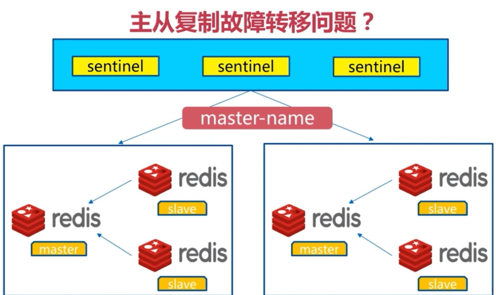
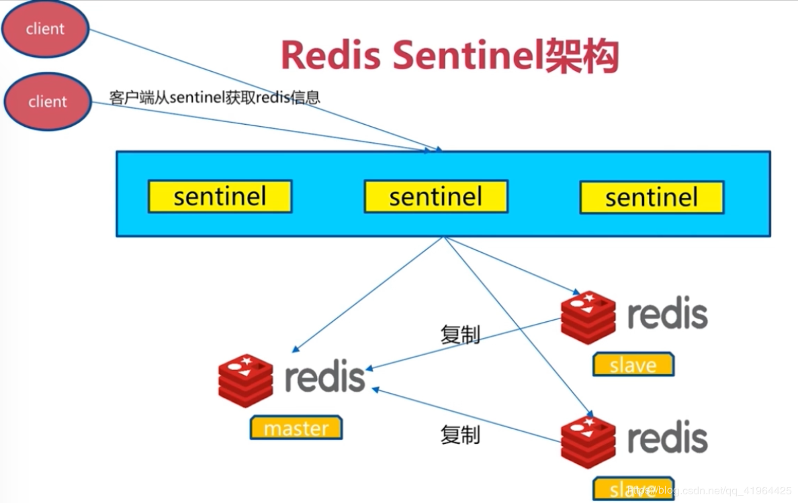
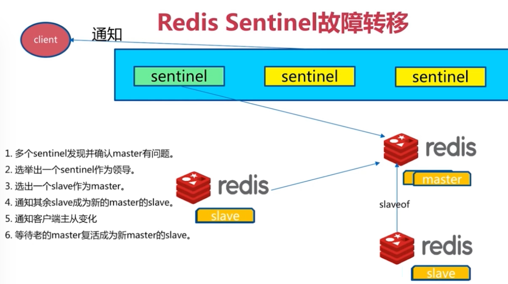
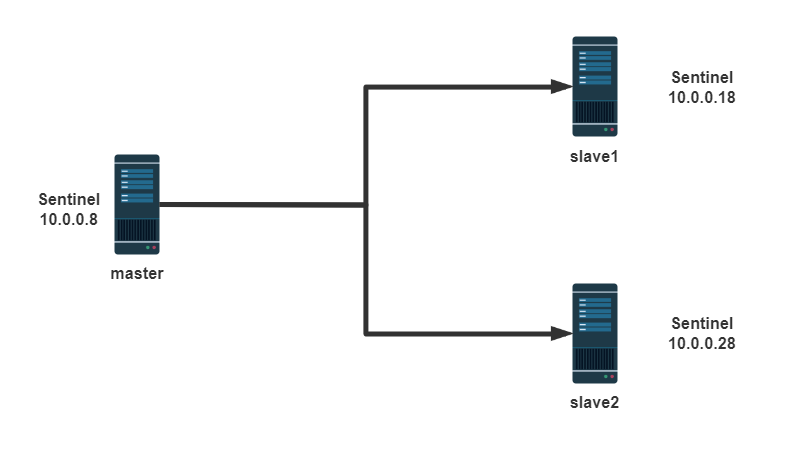
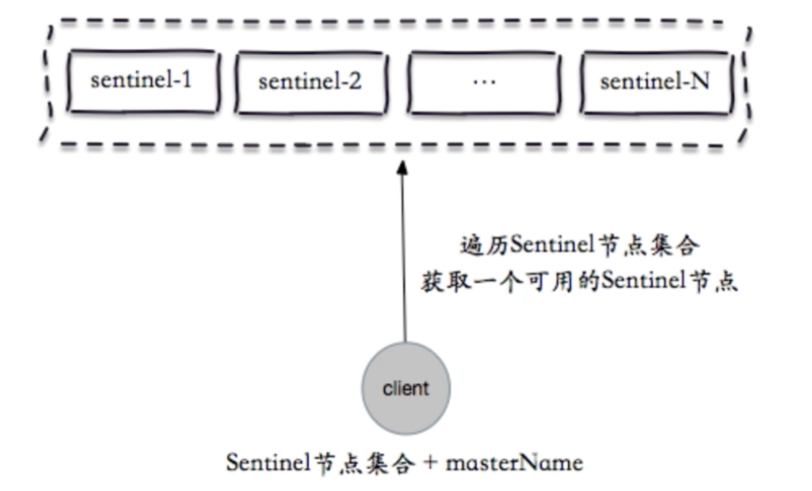
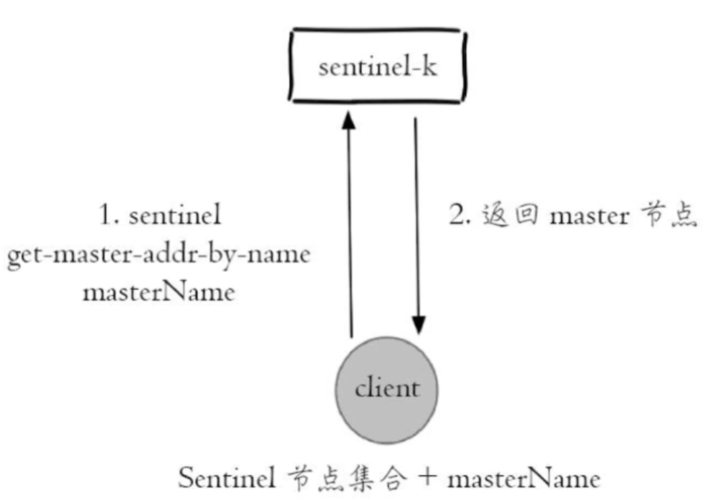
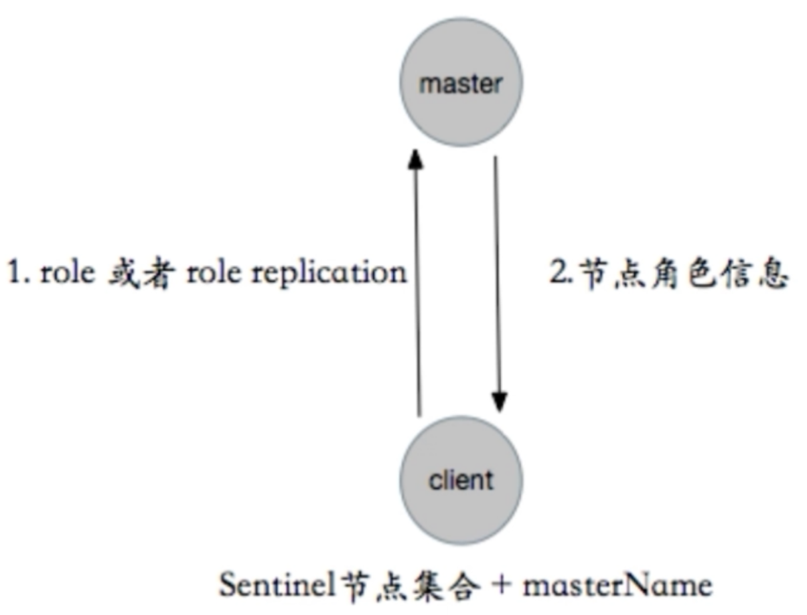
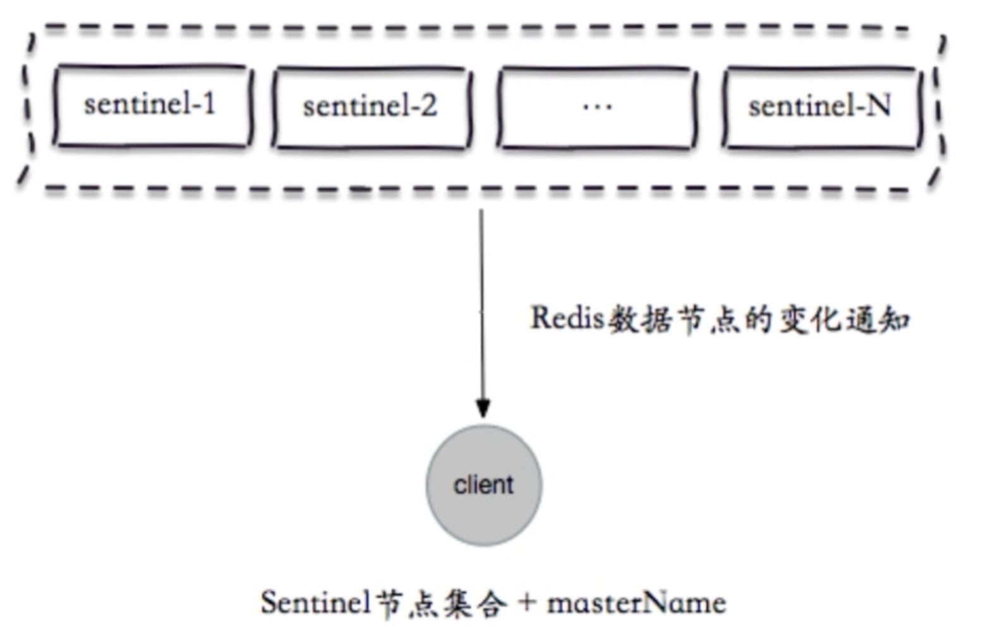

[← 返回Redis 数据库目录]({{ '/subjects/Redis/' | relative_url }})



# 12 Redis 哨兵 Sentinel
### 3.2 Redis 哨兵 Sentinel


### Redis 集群介绍

主从架构和MySQL的主从复制一样,无法实现master和slave角色的自动切换，即当master出现故障时, 不能实现自动的将一个slave 节点提升为新的master节点,即主从复制无法实现自动的故障转移功能,如果想实现转移,则需要手动修改配置,才能将 slave 服务器提升新的master节点.此外只有一个主节点支持写操作,所以业务量很大时会导致Redis服务性能达到瓶颈

需要解决的主从复制以下存在的问题：

master和slave角色的自动切换，且不能影响业务提升Redis服务整体性能，支持更高并发访问

### 哨兵 Sentinel 工作原理

哨兵Sentinel从Redis2.6版本开始引用，Redis 2.8版本之后稳定可用。生产环境如果要使用此功能建议使用Redis的2.8版本以上版本

### Sentinel 架构和故障转移机制



Sentinel 架构



Sentinel 故障转移



专门的Sentinel 服务进程是用于监控redis集群中Master工作的状态，当Master主服务器发生故障的时候，可以实现Master和Slave的角色的自动切换，从而实现系统的高可用性

Sentinel是一个分布式系统,即需要在多个节点上各自同时运行一个sentinel进程，Sentienl 进程通过流言协议(gossip protocols)来接收关于Master是否下线状态，并使用投票协议(Agreement Protocols)来决定是否执行自动故障转移,并选择合适的Slave作为新的Master

每个Sentinel进程会向其它Sentinel、Master、Slave定时发送消息，来确认对方是否存活，如果发现某个节点在指定配置时间内未得到响应，则会认为此节点已离线，即为主观宕机Subjective Down，简称为 SDOWN

如果哨兵集群中的多数Sentinel进程认为Master存在SDOWN，共同利用 is-master-down-by-addr 命令互相通知后，则认为客观宕机Objectively Down， 简称 ODOWN

接下来利用投票算法，从所有slave节点中，选一台合适的slave将之提升为新Master节点，然后自动修改其它slave相关配置，指向新的master节点,最终实现故障转移failover

Redis Sentinel中的Sentinel节点个数应该为大于等于3且最好为奇数

客户端初始化时连接的是Sentinel节点集合，不再是具体的Redis节点，即 Sentinel只是配置中心不是代理。

Redis Sentinel 节点与普通 Redis 没有区别,要实现读写分离依赖于客户端程序

Sentinel 机制类似于MySQL中的MHA功能,只解决master和slave角色的自动故障转移问题，但单个 Master 的性能瓶颈问题并没有解决

Redis 3.0 之前版本中,生产环境一般使用哨兵模式较多,Redis 3.0后推出Redis cluster功能,可以支持更大规模的高并发环境

### Sentinel中的三个定时任务

每10 秒每个sentinel 对master和slave执行info

发现slave节点

确认主从关系

每2秒每个sentinel通过master节点的channel交换信息(pub/sub)

通过sentinel__:hello频道交互

交互对节点的“看法”和自身信息每1秒每个sentinel对其他sentinel和redis执行ping

### 实现哨兵架构

以下案例实现一主两从的基于哨兵的高可用Redis架构



### 哨兵需要先实现主从复制

哨兵的前提是已经实现了Redis的主从复制

注意: 包括master和slave在内的所有节点的 masterauth 和requirepassslave 密码都必须相同

所有主从节点的 redis.conf 中关健配置

范例:  准备主从环境配置

```bash
#在所有主从节点执行
#基于包安装
[root@centos8 ~]#yum -y install redis
[root@ubuntu2004 ~]#apt -y install redis redis-sentinel
#所有节点的masterauth和requirepass必须相同
[root@centos8 ~]#vim /etc/redis.conf
bind 0.0.0.0
masterauth "123456"
requirepass "123456"
#或者非交互执行
[root@centos8 ~]#sed -i -e 's/bind 127.0.0.1/bind 0.0.0.0/' -e 's/^# masterauth
.*/masterauth 123456/' -e 's/^# requirepass .*/requirepass 123456/'
/etc/redis.conf
#在所有从节点执行
[root@centos8 ~]#echo "replicaof 10.0.0.8 6379" >>  /etc/redis.conf
#在所有主从节点执行
[root@centos8 ~]#systemctl enable --now redis
```

master 服务器状态

```bash
[root@redis-master ~]#redis-cli  -a 123456
Warning: Using a password with '-a' or '-u' option on the command line interface
may not
127.0.0.1:6379> INFO replication
# Replication
role:master
connected_slaves:2
slave0:ip=10.0.0.28,port=6379,state=online,offset=112,lag=1
slave1:ip=10.0.0.18,port=6379,state=online,offset=112,lag=0
master_replid:8fdca730a2ae48fb9c8b7e739dcd2efcc76794f3
master_replid2:0000000000000000000000000000000000000000
master_repl_offset:112
second_repl_offset:-1
repl_backlog_active:1
repl_backlog_size:1048576
repl_backlog_first_byte_offset:1
repl_backlog_histlen:112
127.0.0.1:6379>
```

配置 slave1

```bash
[root@redis-slave1 ~]#redis-cli  -a 123456
Warning: Using a password with '-a' or '-u' option on the command line interface
may not be safe.
127.0.0.1:6379> REPLICAOF 10.0.0.8 6379
OK
127.0.0.1:6379> CONFIG SET masterauth "123456"
OK
127.0.0.1:6379> INFO replication
# Replication
role:slave
master_host:10.0.0.8
master_port:6379
master_link_status:up
master_last_io_seconds_ago:4
master_sync_in_progress:0
slave_repl_offset:140
slave_priority:100
slave_read_only:1
connected_slaves:0
master_replid:8fdca730a2ae48fb9c8b7e739dcd2efcc76794f3
master_replid2:0000000000000000000000000000000000000000
master_repl_offset:140
second_repl_offset:-1
repl_backlog_active:1
repl_backlog_size:1048576
repl_backlog_first_byte_offset:99
repl_backlog_histlen:42
```

配置 slave2

```bash
[root@redis-slave2 ~]#redis-cli  -a 123456
Warning: Using a password with '-a' or '-u' option on the command line interface
may not be safe.
127.0.0.1:6379> REPLICAOF 10.0.0.8 6379
OK
127.0.0.1:6379> CONFIG SET masterauth "123456"
OK
127.0.0.1:6379> INFO replication
# Replication
role:slave
master_host:10.0.0.8
master_port:6379
master_link_status:up
master_last_io_seconds_ago:3
master_sync_in_progress:0
slave_repl_offset:182
slave_priority:100
slave_read_only:1
connected_slaves:0
master_replid:8fdca730a2ae48fb9c8b7e739dcd2efcc76794f3
master_replid2:0000000000000000000000000000000000000000
master_repl_offset:182
second_repl_offset:-1
repl_backlog_active:1
repl_backlog_size:1048576
repl_backlog_first_byte_offset:15
repl_backlog_histlen:168
127.0.0.1:6379>
```

### 编辑哨兵配置

sentinel 配置

Sentinel实际上是一个特殊的redis服务器,有些redis指令支持,但很多指令并不支持.默认监听在 26379/tcp端口.

哨兵服务可以和Redis服务器分开部署在不同主机，但为了节约成本一般会部署在一起

所有redis节点使用相同的以下示例的配置文件

```bash
#如果是编译安装，在源码目录有sentinel.conf，复制到安装目录即可，
如:/apps/redis/etc/sentinel.conf
[root@ubuntu2204 ~]#cp redis-7.0.5/sentinel.conf  /apps/redis/etc/sentinel.conf
[root@centos8 ~]#cp redis-6.2.5/sentinel.conf  /apps/redis/etc/sentinel.conf
[root@ubuntu2204 ~]#chown redis.redis /apps/redis/etc/sentinel.conf
#编译安装修改配置文件
[root@ubuntu2204 ~]#vim /apps/redis/etc/sentinel.conf
[root@ubuntu2204 ~]#grep -Ev "#|^$" /apps/redis/etc/sentinel.conf
protected-mode no #包安装时默认为yes,此处要修改为no
port 26379
daemonize no
pidfile "/apps/redis/run/redis-sentinel.pid"
logfile "/apps/redis/log/redis-sentinel.log"
dir "/tmp"
sentinel monitor mymaster 10.0.0.102 6379 2
#mymaster是集群的名称，此行指定当前mymaster集群中master服务器的地址和端口
#2为法定人数限制(quorum)，即有几个sentinel认为master down了就进行故障转移，一般此值是所有
sentinel节点(一般总数是>=3的 奇数,如:3,5,7等)的一半以上的整数值，比如，总数是3，即3/2=1.5，
取整为2,是master的ODOWN客观下线的依据
sentinel auth-pass mymaster 123456
#mymaster集群中master的密码，注意此行要在上面行的下面,注意：要求这组redis主从复制所有节点的密
码是一样的
sentinel down-after-milliseconds mymaster 3000
#判断mymaster集群中所有节点的主观下线(SDOWN)的时间，单位：毫秒，建议3000
acllog-max-len 128
sentinel deny-scripts-reconfig yes
sentinel resolve-hostnames no
sentinel announce-hostnames no
```

```bash
#包安装修改配置文件
[root@centos8 ~]#vim /etc/redis-sentinel.conf
bind 0.0.0.0
port 26379
daemonize yes
pidfile "redis-sentinel.pid"
logfile "sentinel_26379.log"
dir "/tmp"  #工作目录
sentinel monitor mymaster 10.0.0.8 6379 2
#mymaster是集群的名称，此行指定当前mymaster集群中master服务器的地址和端口
#2为法定人数限制(quorum)，即有几个sentinel认为master down了就进行故障转移，一般此值是所有
sentinel节点(一般总数是>=3的 奇数,如:3,5,7等)的一半以上的整数值，比如，总数是3，即3/2=1.5，
取整为2,是master的ODOWN客观下线的依据
sentinel auth-pass mymaster 123456
#mymaster集群中master的密码，注意此行要在上面行的下面,注意：要求这组redis主从复制所有节点的密
码是一样的
sentinel down-after-milliseconds mymaster 30000
#判断mymaster集群中所有节点的主观下线(SDOWN)的时间，单位：毫秒，建议3000
sentinel parallel-syncs mymaster 1
#发生故障转移后，可以同时向新master同步数据的slave的数量，数字越小总同步时间越长，但可以减轻新
master的负载压力
sentinel failover-timeout mymaster 180000
#所有slaves指向新的master所需的超时时间，单位：毫秒
sentinel deny-scripts-reconfig yes #禁止修改脚本
logfile /var/log/redis/sentinel.log
```

三个哨兵服务器的配置都如下

```bash
[root@redis-master ~]#grep -vE "^#|^$" /etc/redis-sentinel.conf
port 26379
daemonize no
pidfile "/var/run/redis-sentinel.pid"
logfile "/var/log/redis/sentinel.log"
dir "/tmp"
sentinel monitor mymaster 10.0.0.8 6379 2           #修改此行
sentinel auth-pass mymaster 123456                  #增加此行
sentinel down-after-milliseconds mymaster 3000      #修改此行
sentinel parallel-syncs mymaster 1
sentinel failover-timeout mymaster 180000
sentinel deny-scripts-reconfig yes
#注意此行自动生成必须唯一,一般不需要修改，如果相同则修改此值需重启redis和sentinel服务
sentinel myid 50547f34ed71fd48c197924969937e738a39975b
.....
# Generated by CONFIG REWRITE
protected-mode no
supervised systemd
sentinel leader-epoch mymaster 0
sentinel known-replica mymaster 10.0.0.28 6379
sentinel known-replica mymaster 10.0.0.18 6379
sentinel current-epoch 0
[root@redis-master ~]#scp /etc/redis-sentinel.conf redis-slave1:/etc/
[root@redis-master ~]#scp /etc/redis-sentinel.conf redis-slave2:/etc/
```

### 启动哨兵服务

将所有哨兵服务器都启动起来

```bash
#确保每个哨兵主机myid不同，如果相同，必须手动修改为不同的值
[root@redis-slave1 ~]#vim /etc/redis-sentinel.conf
sentinel myid 50547f34ed71fd48c197924969937e738a39975c
[root@redis-slave2 ~]#vim /etc/redis-sentinel.conf
sentinel myid 50547f34ed71fd48c197924969937e738a39975d
[root@redis-master ~]#systemctl enable --now redis-sentinel.service
[root@redis-slave1 ~]#systemctl enable --now redis-sentinel.service
[root@redis-slave2 ~]#systemctl enable --now redis-sentinel.service
```

如果是编译安装,在所有哨兵服务器执行下面操作启动哨兵

```bash
[root@redis-master ~]##vim /apps/redis/etc/sentinel.conf
bind 0.0.0.0
port 26379
daemonize yes
pidfile "redis-sentinel.pid"
Logfile "sentinel_26379.log"
dir "/apps/redis/data"
sentinel monitor mymaster 10.0.0.8 6379 2
sentinel auth-pass mymaster 123456
sentinel down-after-milliseconds mymaster 15000
sentinel parallel-syncs mymaster 1
sentinel failover-timeout mymaster 180000
sentinel deny-scripts-reconfig yes
[root@redis-master ~]#/apps/redis/bin/redis-sentinel
/apps/redis/etc/sentinel.conf
#如果是编译安装，可以在所有节点生成新的service文件
[root@redis-master ~]#cat /lib/systemd/system/redis-sentinel.service
[Unit]
Description=Redis Sentinel
After=network.target
[Service]
ExecStart=/apps/redis/bin/redis-sentinel /apps/redis/etc/sentinel.conf --
supervised systemd
ExecStop=/bin/kill -s QUIT $MAINPID
User=redis
Group=redis
RuntimeDirectory=redis
Mode=0755
[Install]
WantedBy=multi-user.target
#注意所有节点的目录权限,否则无法启动服务
[root@redis-master ~]#chown -R redis:redis /apps/redis/
[root@redis-master ~]#systemctl daemon-reload
[root@redis-master ~]#systemctl enable --now redis-sentinel.service
```

### 验证哨兵服务

3.2.3.4.1 查看哨兵服务端口状态

```bash
[root@redis-master ~]#ss -ntl
State   Recv-Q  Send-Q Local Address:Port  Peer Address:Port
LISTEN  0       128          0.0.0.0:22         0.0.0.0:*
LISTEN  0       128          0.0.0.0:26379      0.0.0.0:*
LISTEN  0       128          0.0.0.0:6379       0.0.0.0:*
LISTEN  0       128             [::]:22            [::]:*
LISTEN  0       128             [::]:26379         [::]:*
LISTEN  0       128             [::]:6379          [::]:*
```

3.2.3.4.2 查看哨兵日志

master的哨兵日志

```bash
[root@redis-master ~]#tail -f /var/log/redis/sentinel.log
38028:X 20 Feb 2020 17:13:08.702 # oO0OoO0OoO0Oo Redis is starting oO0OoO0OoO0Oo
38028:X 20 Feb 2020 17:13:08.702 # Redis version=5.0.3, bits=64,
commit=00000000, modified=0, pid=38028, just started
38028:X 20 Feb 2020 17:13:08.702 # Configuration loaded
38028:X 20 Feb 2020 17:13:08.702 * supervised by systemd, will signal readiness
38028:X 20 Feb 2020 17:13:08.703 * Running mode=sentinel, port=26379.
38028:X 20 Feb 2020 17:13:08.703 # WARNING: The TCP backlog setting of 511
cannot be enforced because /proc/sys/net/core/somaxconn is set to the lower value
of 128.
38028:X 20 Feb 2020 17:13:08.704 # Sentinel ID is
50547f34ed71fd48c197924969937e738a39975b
38028:X 20 Feb 2020 17:13:08.704 # +monitor master mymaster 10.0.0.8 6379 quorum
2
38028:X 20 Feb 2020 17:13:08.709 * +slave slave 10.0.0.28:6379 10.0.0.28 6379 @
mymaster 10.0.0.8 6379
38028:X 20 Feb 2020 17:13:08.709 * +slave slave 10.0.0.18:6379 10.0.0.18 6379 @
mymaster 10.0.0.8 6379
```

slave的哨兵日志

```bash
[root@redis-slave1 ~]#tail -f /var/log/redis/sentinel.log
25509:X 20 Feb 2020 17:13:27.435 * Removing the pid file.
25509:X 20 Feb 2020 17:13:27.435 # Sentinel is now ready to exit, bye bye...
25572:X 20 Feb 2020 17:13:27.448 # oO0OoO0OoO0Oo Redis is starting oO0OoO0OoO0Oo
25572:X 20 Feb 2020 17:13:27.448 # Redis version=5.0.3, bits=64,
commit=00000000, modified=0, pid=25572, just started
25572:X 20 Feb 2020 17:13:27.448 # Configuration loaded
25572:X 20 Feb 2020 17:13:27.448 * supervised by systemd, will signal readiness
25572:X 20 Feb 2020 17:13:27.449 * Running mode=sentinel, port=26379.
25572:X 20 Feb 2020 17:13:27.449 # WARNING: The TCP backlog setting of 511
cannot be enforced because /proc/sys/net/core/somaxconn is set to the lower value
of 128.
25572:X 20 Feb 2020 17:13:27.449 # Sentinel ID is
50547f34ed71fd48c197924969937e738a39975b
25572:X 20 Feb 2020 17:13:27.449 # +monitor master mymaster 10.0.0.8 6379 quorum
2
```

3.2.3.4.3 当前sentinel状态

在sentinel状态中尤其是最后一行，涉及到masterIP是多少，有几个slave，有几个sentinels，必须是符合全部服务器数量

```bash
[root@redis-master ~]#redis-cli  -p 26379
127.0.0.1:26379> INFO sentinel
# Sentinel
sentinel_masters:1
sentinel_tilt:0
sentinel_running_scripts:0
sentinel_scripts_queue_length:0
sentinel_simulate_failure_flags:0
master0:name=mymaster,status=ok,address=10.0.0.8:6379,slaves=2,sentinels=3 #两个
slave,三个sentinel服务器,如果sentinels值不符合,检查myid可能冲突
```

### 停止 Master 节点实现故障转移

3.2.3.5.1 停止 Master 节点

```bash
[root@redis-master ~]#killall redis-server
```

查看各节点上哨兵信息：

```bash
[root@redis-master ~]#redis-cli -p 26379
Warning: Using a password with '-a' or '-u' option on the command line interface
may not be safe.
127.0.0.1:26379> INFO sentinel
# Sentinel
sentinel_masters:1
sentinel_tilt:0
sentinel_running_scripts:0
sentinel_scripts_queue_length:0
sentinel_simulate_failure_flags:0
master0:name=mymaster,status=ok,address=10.0.0.18:6379,slaves=2,sentinels=3
```

故障转移时sentinel的信息：

```bash
[root@redis-master ~]#tail -f /var/log/redis/sentinel.log
38028:X 20 Feb 2020 17:42:27.362 # +sdown master mymaster 10.0.0.8 6379
38028:X 20 Feb 2020 17:42:27.418 # +odown master mymaster 10.0.0.8 6379 #quorum
2/2
38028:X 20 Feb 2020 17:42:27.418 # +new-epoch 1
38028:X 20 Feb 2020 17:42:27.418 # +try-failover master mymaster 10.0.0.8 6379
38028:X 20 Feb 2020 17:42:27.419 # +vote-for-leader
50547f34ed71fd48c197924969937e738a39975b 1
38028:X 20 Feb 2020 17:42:27.422 # 50547f34ed71fd48c197924969937e738a39975d
voted for 50547f34ed71fd48c197924969937e738a39975b 1
38028:X 20 Feb 2020 17:42:27.475 # +elected-leader master mymaster 10.0.0.8 6379
38028:X 20 Feb 2020 17:42:27.475 # +failover-state-select-slave master mymaster
10.0.0.8 6379
38028:X 20 Feb 2020 17:42:27.529 # +selected-slave slave 10.0.0.18:6379
10.0.0.18 6379 @ mymaster 10.0.0.8 6379
38028:X 20 Feb 2020 17:42:27.529 * +failover-state-send-slaveof-noone slave
10.0.0.18:6379 10.0.0.18 6379 @ mymaster 10.0.0.8 6379
38028:X 20 Feb 2020 17:42:27.613 * +failover-state-wait-promotion slave
10.0.0.18:6379 10.0.0.18 6379 @ mymaster 10.0.0.8 6379
38028:X 20 Feb 2020 17:42:28.506 # +promoted-slave slave 10.0.0.18:6379
10.0.0.18 6379 @ mymaster 10.0.0.8 6379
38028:X 20 Feb 2020 17:42:28.506 # +failover-state-reconf-slaves master mymaster
10.0.0.8 6379
38028:X 20 Feb 2020 17:42:28.582 * +slave-reconf-sent slave 10.0.0.28:6379
10.0.0.28 6379 @ mymaster 10.0.0.8 6379
38028:X 20 Feb 2020 17:42:28.736 * +slave-reconf-inprog slave 10.0.0.28:6379
10.0.0.28 6379 @ mymaster 10.0.0.8 6379
38028:X 20 Feb 2020 17:42:28.736 * +slave-reconf-done slave 10.0.0.28:6379
10.0.0.28 6379 @ mymaster 10.0.0.8 6379
38028:X 20 Feb 2020 17:42:28.799 # +failover-end master mymaster 10.0.0.8 6379
38028:X 20 Feb 2020 17:42:28.799 # +switch-master mymaster 10.0.0.8 6379
10.0.0.18 6379
38028:X 20 Feb 2020 17:42:28.799 * +slave slave 10.0.0.28:6379 10.0.0.28 6379 @
mymaster 10.0.0.18 6379
38028:X 20 Feb 2020 17:42:28.799 * +slave slave 10.0.0.8:6379 10.0.0.8 6379 @
mymaster 10.0.0.18 6379
38028:X 20 Feb 2020 17:42:31.809 # +sdown slave 10.0.0.8:6379 10.0.0.8 6379 @
mymaster 10.0.0.18 6379
```

3.2.3.5.2 验证故障转移

故障转移后redis.conf中的replicaof行的master IP会被修改

```bash
[root@redis-slave2 ~]#grep ^replicaof /etc/redis.conf
replicaof 10.0.0.18 6379
```

哨兵配置文件的sentinel monitor IP 同样也会被修改

```bash
[root@redis-slave1 ~]#grep "^[a-Z]" /etc/redis-sentinel.conf
port 26379
daemonize no
pidfile "/var/run/redis-sentinel.pid"
logfile "/var/log/redis/sentinel.log"
dir "/tmp"
sentinel myid 50547f34ed71fd48c197924969937e738a39975b
sentinel deny-scripts-reconfig yes
sentinel monitor mymaster 10.0.0.18 6379 2  #自动修改此行
sentinel down-after-milliseconds mymaster 3000
sentinel auth-pass mymaster 123456
sentinel config-epoch mymaster 1
protected-mode no
supervised systemd
sentinel leader-epoch mymaster 1
sentinel known-replica mymaster 10.0.0.8 6379
sentinel known-replica mymaster 10.0.0.28 6379
sentinel known-sentinel mymaster 10.0.0.28 26379
50547f34ed71fd48c197924969937e738a39975d
sentinel current-epoch 1
[root@redis-slave2 ~]#grep "^[a-Z]" /etc/redis-sentinel.conf
port 26379
daemonize no
pidfile "/var/run/redis-sentinel.pid"
logfile "/var/log/redis/sentinel.log"
dir "/tmp"
sentinel myid 50547f34ed71fd48c197924969937e738a39975d
sentinel deny-scripts-reconfig yes
sentinel monitor mymaster 10.0.0.18 6379 2  #自动修改此行
sentinel down-after-milliseconds mymaster 3000
sentinel auth-pass mymaster 123456
sentinel config-epoch mymaster 1
protected-mode no
supervised systemd
sentinel leader-epoch mymaster 1
sentinel known-replica mymaster 10.0.0.28 6379
sentinel known-replica mymaster 10.0.0.8 6379
sentinel known-sentinel mymaster 10.0.0.8 26379
50547f34ed71fd48c197924969937e738a39975b
sentinel current-epoch 1
```

3.2.3.5.3 验证 Redis 各节点状态

新的master 状态

```bash
[root@redis-slave1 ~]#redis-cli  -a 123456
Warning: Using a password with '-a' or '-u' option on the command line interface
may not be safe.
127.0.0.1:6379> INFO replication
# Replication
role:master   #提升为master
connected_slaves:1
slave0:ip=10.0.0.28,port=6379,state=online,offset=56225,lag=1
master_replid:75e3f205082c5a10824fbe6580b6ad4437140b94
master_replid2:b2fb4653bdf498691e5f88519ded65b6c000e25c
master_repl_offset:56490
second_repl_offset:46451
repl_backlog_active:1
repl_backlog_size:1048576
repl_backlog_first_byte_offset:287
repl_backlog_histlen:56204
```

另一个slave指向新的master

```bash
[root@redis-slave2 ~]#redis-cli  -a 123456
Warning: Using a password with '-a' or '-u' option on the command line interface
may not be safe.
127.0.0.1:6379> INFO replication
# Replication
role:slave
master_host:10.0.0.18  #指向新的master
master_port:6379
master_link_status:up
master_last_io_seconds_ago:0
master_sync_in_progress:0
slave_repl_offset:61029
slave_priority:100
slave_read_only:1
connected_slaves:0
master_replid:75e3f205082c5a10824fbe6580b6ad4437140b94
master_replid2:b2fb4653bdf498691e5f88519ded65b6c000e25c
master_repl_offset:61029
second_repl_offset:46451
repl_backlog_active:1
repl_backlog_size:1048576
repl_backlog_first_byte_offset:1
repl_backlog_histlen:61029
```

### 原 Master 重新加入 Redis 集群

```bash
[root@redis-master ~]#cat /etc/redis.conf
#sentinel会自动修改下面行指向新的master
replicaof 10.0.0.18 6379
```

在原 master上观察状态

```bash
[root@redis-master ~]#redis-cli -a 123456
Warning: Using a password with '-a' or '-u' option on the command line interface
may not be safe.
127.0.0.1:6379> INFO replication
# Replication
role:slave
master_host:10.0.0.18
master_port:6379
master_link_status:up
master_last_io_seconds_ago:0
master_sync_in_progress:0
slave_repl_offset:764754
slave_priority:100
slave_read_only:1
connected_slaves:0
master_replid:75e3f205082c5a10824fbe6580b6ad4437140b94
master_replid2:b2fb4653bdf498691e5f88519ded65b6c000e25c
master_repl_offset:764754
second_repl_offset:46451
repl_backlog_active:1
repl_backlog_size:1048576
repl_backlog_first_byte_offset:46451
repl_backlog_histlen:718304
[root@redis-master ~]#redis-cli  -p 26379
127.0.0.1:26379> INFO sentinel
# Sentinel
sentinel_masters:1
sentinel_tilt:0
sentinel_running_scripts:0
sentinel_scripts_queue_length:0
sentinel_simulate_failure_flags:0
master0:name=mymaster,status=ok,address=10.0.0.18:6379,slaves=2,sentinels=3
127.0.0.1:26379>
```

观察新master上状态和日志

```bash
[root@redis-slave1 ~]#redis-cli  -a 123456
Warning: Using a password with '-a' or '-u' option on the command line interface
may not be safe.
127.0.0.1:6379> INFO replication
# Replication
role:master
connected_slaves:2
slave0:ip=10.0.0.28,port=6379,state=online,offset=769027,lag=0
slave1:ip=10.0.0.8,port=6379,state=online,offset=769027,lag=0
master_replid:75e3f205082c5a10824fbe6580b6ad4437140b94
master_replid2:b2fb4653bdf498691e5f88519ded65b6c000e25c
master_repl_offset:769160
second_repl_offset:46451
repl_backlog_active:1
repl_backlog_size:1048576
repl_backlog_first_byte_offset:287
repl_backlog_histlen:768874
127.0.0.1:6379>
[root@redis-slave1 ~]#tail -f /var/log/redis/sentinel.log
25717:X 20 Feb 2020 17:42:33.757 # +sdown slave 10.0.0.8:6379 10.0.0.8 6379 @
mymaster 10.0.0.18 6379
25717:X 20 Feb 2020 18:41:29.566 # -sdown slave 10.0.0.8:6379 10.0.0.8 6379 @
mymaster 10.0.0.18 6379
```

### Sentinel 运维

在Sentinel主机手动触发故障切换

```bash
#redis-cli -p 26379
127.0.0.1:26379> sentinel failover <masterName>
```

范例:  手动故障转移

```bash
[root@centos8 ~]#vim /etc/redis.conf
replica-priority 10 #指定优先级,值越小sentinel会优先将之选为新的master,默为值为100，如果
为0，表示只当从节点
[root@centos8 ~]#systemctl restart redis
#或者动态修改
[root@centos8 ~]#redis-cli -a 123456
Warning: Using a password with '-a' or '-u' option on the command line interface
may not be safe.
127.0.0.1:6379> CONFIG GET replica-priority
1) "replica-priority"
2) "100"
127.0.0.1:6379> CONFIG SET replica-priority 99
OK
127.0.0.1:6379> CONFIG GET replica-priority
1) "replica-priority"
2) "99"
[root@centos8 ~]#redis-cli   -p 26379
127.0.0.1:26379> sentinel failover mymaster  #原主节点自动变成从节点
OK
```

### 应用程序连接 Sentinel

Redis 官方支持多种开发语言的客户端：https://redis.io/clients

### 客户端连接 Sentinel 工作原理

1. 客户端获取 Sentinel 节点集合,选举出一个 Sentinel



2. 由这个sentinel 通过masterName 获取master节点信息,客户端通过sentinel get-master-addr-by-

name master-name这个api来获取对应主节点信息



3. 客户端发送role指令确认master的信息,验证当前获取的“主节点”是真正的主节点，这样的目的是为

了防止故障转移期间主节点的变化



4. 客户端保持和Sentinel节点集合的联系，即订阅Sentinel节点相关频道，时刻获取关于主节点的相

关信息,获取新的master 信息变化,并自动连接新的master



### Java 连接 Sentinel哨兵

Java 客户端连接Redis：https://github.com/xetorthio/jedis/blob/master/pom.xml

```xml
#jedis/pom.xml 配置连接redis
<properties>
<redis-
hosts>localhost:6379,localhost:6380,localhost:6381,localhost:6382,localhost:6383
,localhost:6384,localhost:6385</redis-hosts>
<sentinel-
hosts>localhost:26379,localhost:26380,localhost:26381</sentinel-hosts>
<cluster-
hosts>localhost:7379,localhost:7380,localhost:7381,localhost:7382,localhost:7383
,localhost:7384,localhost:7385</cluster-hosts>
<github.global.server>github</github.global.server>
</properties>
```

java客户端连接单机的redis是通过Jedis来实现的，java代码用的时候只要创建Jedis对象就可以建多个 Jedis连接池来连接redis，应用程序再直接调用连接池即可连接Redis。而Redis为了保障高可用,服务一般都是Sentinel部署方式，当Redis服务中的主服务挂掉之后,会仲裁出另外一台Slaves服务充当 Master。这个时候,我们的应用即使使用了Jedis 连接池,如果Master服务挂了,应用将还是无法连接新的 Master服务，为了解决这个问题, Jedis也提供了相应的Sentinel实现,能够在Redis Sentinel主从切换时候,通知应用,把应用连接到新的Master服务。

Redis Sentinel的使用也是十分简单的,只是在JedisPool中添加了Sentinel和MasterName参数，JRedis Sentinel底层基于Redis订阅实现Redis主从服务的切换通知，当Reids发生主从切换时，Sentinel会发送通知主动通知Jedis进行连接的切换，JedisSentinelPool在每次从连接池中获取链接对象的时候,都要对连接对象进行检测,如果此链接和Sentinel的Master服务连接参数不一致,则会关闭此连接,重新获取新的 Jedis连接对象。

### Python 连接 Sentinel 哨兵

```bash
[root@ubuntu2404 ~]#apt -y install python3-redis
[root@ubuntu2204 ~]#apt -y install python3-redis
[root@centos8 ~]#yum -y install python3 python3-redis
[root@centos8 ~]#cat sentinel_test.py
#!/usr/bin/python3
import redis
from redis.sentinel import Sentinel
#连接哨兵服务器(主机名也可以用域名)
sentinel = Sentinel([('10.0.0.8', 26379),
('10.0.0.18', 26379),
('10.0.0.28', 26379)],
socket_timeout=0.5)
redis_auth_pass = '123456'
#mymaster 是配置哨兵模式的redis集群名称，此为默认值,实际名称按照个人部署案例来填写
#获取主服务器地址
master = sentinel.discover_master('mymaster')
print(master)
#获取从服务器地址
slave = sentinel.discover_slaves('mymaster')
print(slave)
#获取主服务器进行写入
master = sentinel.master_for('mymaster', socket_timeout=0.5,
password=redis_auth_pass, db=0)
w_ret = master.set('name', 'bowen')
#输出：True
```

```bash
#获取从服务器进行读取（默认是round-roubin）
slave = sentinel.slave_for('mymaster', socket_timeout=0.5,
password=redis_auth_pass, db=0)
r_ret = slave.get('name')
print(r_ret)
#输出：bowen
[root@centos8 ~]#chmod +x  sentinel_test.py
[root@centos8 ~]#./sentinel_test.py
('10.0.0.8', 6379)
[('10.0.0.18', 6379), ('10.0.0.28', 6379)]
b'bowen'
```



<nav class="article-end" aria-label="章节导航">
  <a href="{{ '/subjects/Redis/11-redis-replication.html' | relative_url }}">← Previous: Redis Replication</a>
  <a href="{{ '/subjects/Redis/' | relative_url }}">Back to Redis Database Index</a>
  <a href="{{ '/subjects/Redis/13-redis-cluster.html' | relative_url }}">Next: Redis Cluster →</a>
</nav>
