[← Back to Redis Database Index]({{ '/subjects/Redis/' | relative_url }})



# 13 Redis Cluster
### 3.3 Redis Cluster


### Redis Cluster 介绍

使用哨兵 Sentinel 只能解决Redis高可用问题，实现Redis的自动故障转移,但仍然无法解决Redis Master 单节点的性能瓶颈问题

为了解决单机性能的瓶颈，提高Redis 服务整体性能，可以使用分布式集群的解决方案

早期 Redis 分布式集群部署方案：

客户端分区：由客户端程序自己实现写入分配、高可用管理和故障转移等,对客户端的开发实现较为复杂

代理服务：客户端不直接连接Redis,而先连接到代理服务，由代理服务实现相应读写分配，当前代理服务都是第三方实现.此方案中客户端实现无需特殊开发,实现容易,但是代理服务节点仍存有单点故障和性能瓶颈问题。比如：Twitter开源Twemproxy,豌豆荚开发的 codis

<https://github.com/twitter/twemproxy>

<https://github.com/CodisLabs/codis>

Redis 3.0 版本之后推出无中心架构的 Redis Cluster ，支持多个master节点并行写入和故障的自动转移动能.

### Redis Cluster 架构

### Redis Cluster 架构

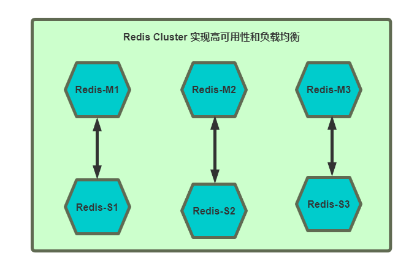

Redis cluster 需要至少 3个master节点才能实现,slave节点数量不限

Master节点必须要超过半数以上可用,否则集群将不可用,即数据访问和选举将无法实现

因此Master节点的数据一般为奇数

当然一般每个master都至少对应的有一个slave节点

如果有三个主节点采用哈希槽 hash slot 的方式来分配16384个槽位 slot

此三个节点分别承担的slot 区间可以是如以下方式分配

```text
节点M1 0－5460
节点M2 5461－10922
节点M3 10923－16383
```

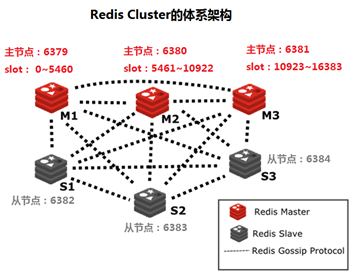

### Redis cluster 的工作原理

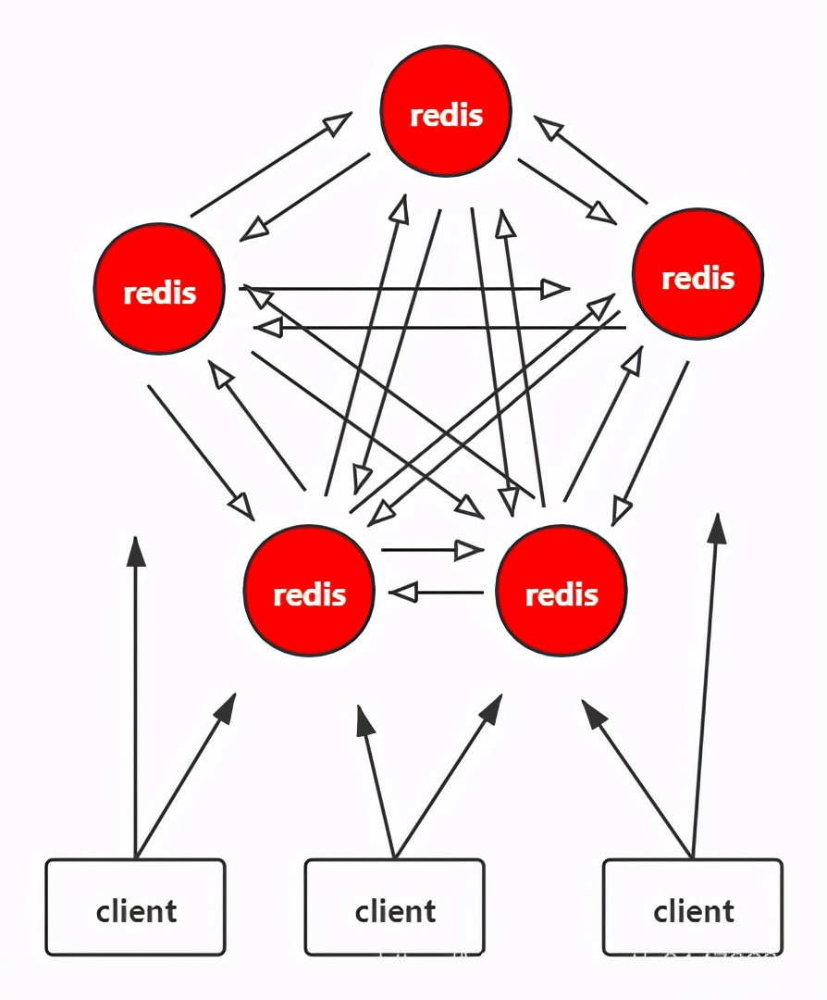

3.3.2.2.1 数据分区

如果是单机存储的话，直接将数据存放在单机redis就行了。但是如果是集群存储，就需要考虑到数据分区了。

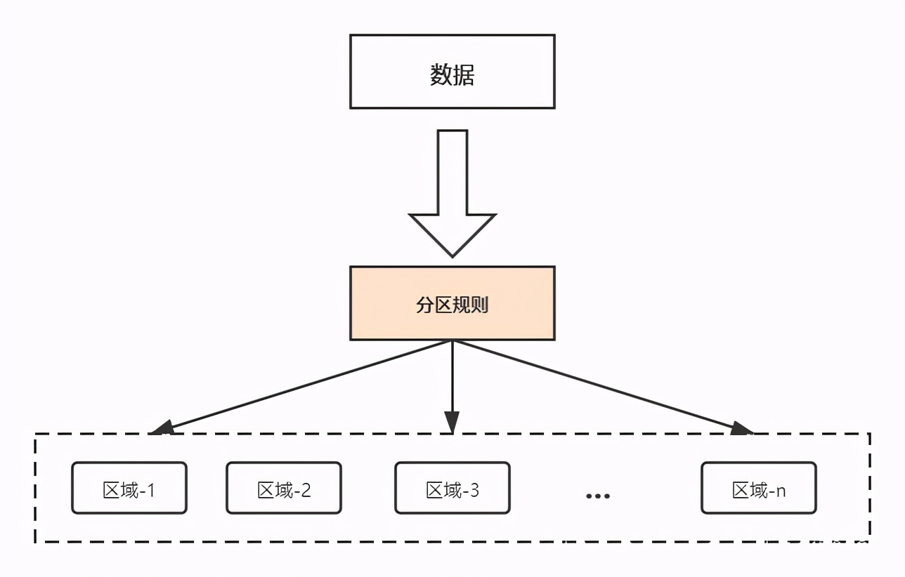

数据分区通常采取顺序分布和hash分布。

分布方式顺序分布哈希分布

数据分散度分布倾斜分布散列

顺序访问支持不支持

顺序分布保障了数据的有序性，但是离散性低，可能导致某个分区的数据热度高，其他分区数据的热度低，分区访问不均衡。

哈希分布也分为多种分布方式，比如区域哈希分区，一致性哈希分区等。而redis cluster采用的是虚拟槽分区的方式。

虚拟槽分区

redis cluster设置有0~16383的槽，每个槽映射一个数据子集，通过hash函数，将数据存放在不同的槽位中，每个集群的节点保存一部分的槽。

每个key存储时，先经过算法函数CRC16(key)得到一个整数，然后整数与16384取余，得到槽的数值， 然后找到对应的节点，将数据存放入对应的槽中。

CRC16 算法

```text
CRC16（Cyclic Redundancy Check 16）是一种错误检测码，而不是严格意义上的哈希算法。CRC16主要
用于检测数据传输或存储过程中的错误，它通过在数据块上执行一系列数学运算来生成一个检验值（校验
码），以便在接收端验证数据的完整性。
确定性是哈希函数和校验码算法的一个重要特性，确保相同的输入始终产生相同的输出，这样可以在需要时进
行可靠的数据验证。与哈希函数类似，CRC算法也有这个属性，但它们在设计和应用上有一些关键的区别。
```

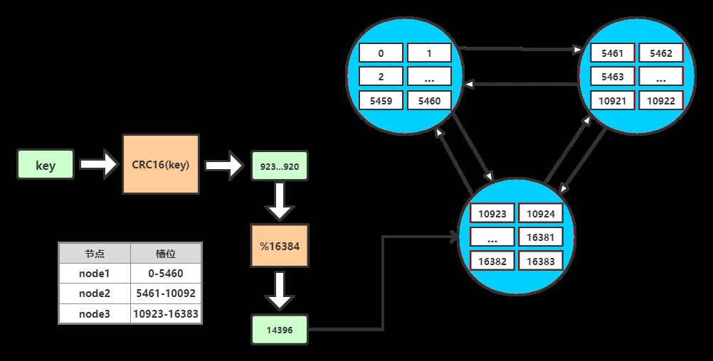

集群通信

但是寻找槽的过程并不是一次就命中的，比如上图key将要存放在14396槽中，但是并不是一下就锁定了 node3节点，可能先去询问node1，然后才访问node3。

而集群中节点之间的通信，保证了最多两次就能命中对应槽所在的节点。因为在每个节点中，都保存了其他节点的信息，知道哪个槽由哪个节点负责。这样即使第一次访问没有命中槽，但是会通知客户端， 该槽在哪个节点，这样访问对应节点就能精准命中。

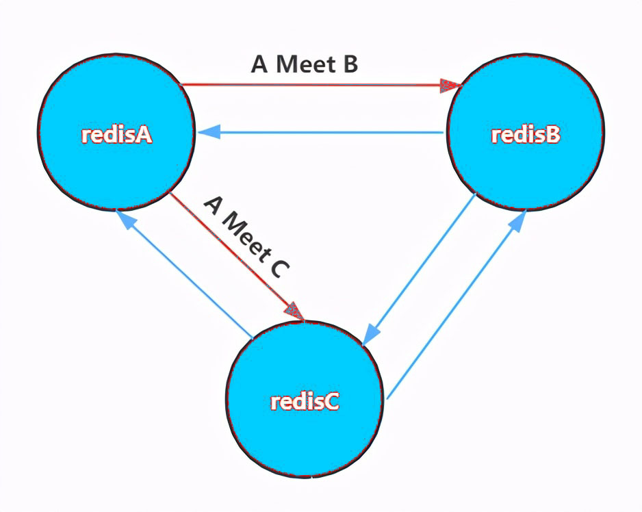

1. 节点A对节点B发送一个meet操作，B返回后表示A和B之间能够进行沟通。

2. 节点A对节点C发送meet操作，C返回后，A和C之间也能进行沟通。

3. 然后B根据对A的了解，就能找到C，B和C之间也建立了联系。

4. 直到所有节点都能建立联系。

这样每个节点都能互相知道对方负责哪些槽。

3.3.2.2.2 集群伸缩

集群并不是建立之后，节点数就固定不变的，也会有新的节点加入集群或者集群中的节点下线，这就是集群的扩容和缩容。但是由于集群节点和槽息息相关，所以集群的伸缩也对应了槽和数据的迁移

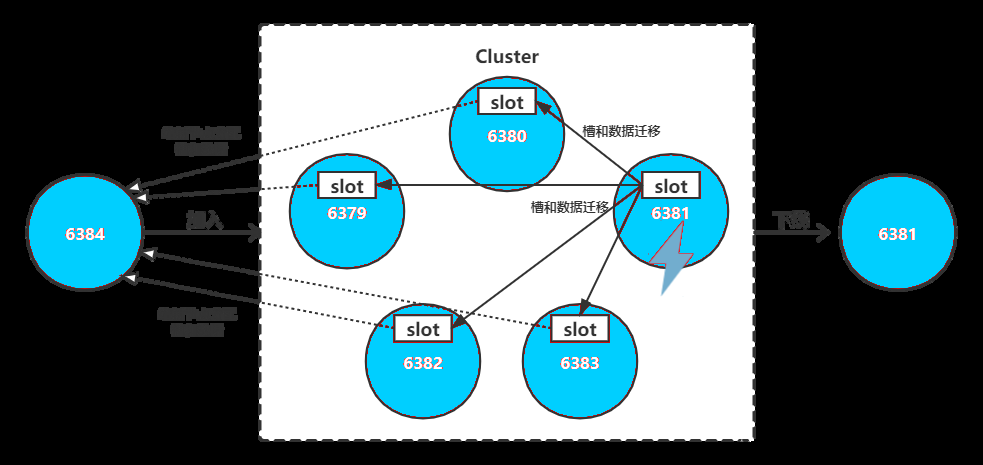

集群扩容

当有新的节点准备好加入集群时，这个新的节点还是孤立节点，加入有两种方式。一个是通过集群节点执行命令来和孤立节点握手，另一个则是使用脚本来添加节点。

1. cluster_node_ip:port: cluster meet ip port new_node_ip:port

2. redis-trib.rb add-node new_node_ip:port cluster_node_ip:port

通常这个新的节点有两种身份，要么作为主节点，要么作为从节点：

主节点：分摊槽和数据从节点：作故障转移备份

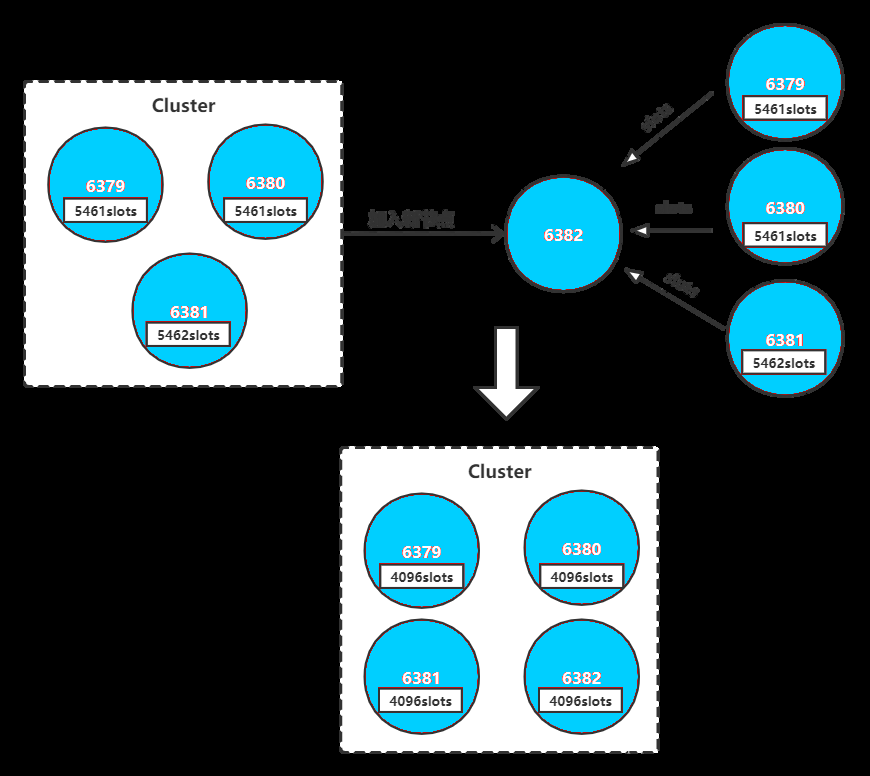

其中槽的迁移有以下步骤：

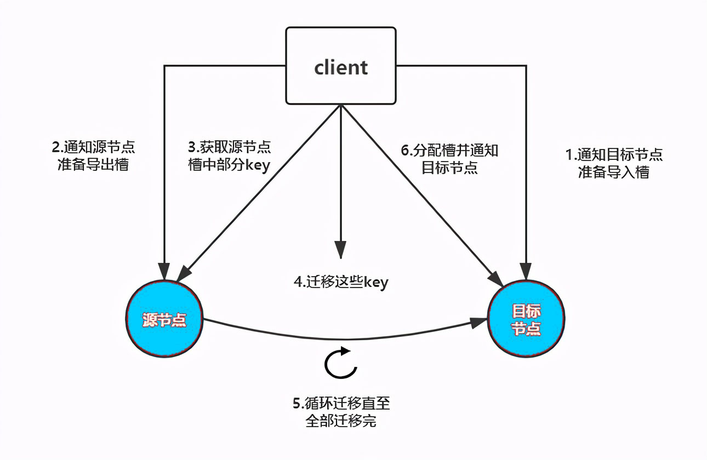

集群缩容

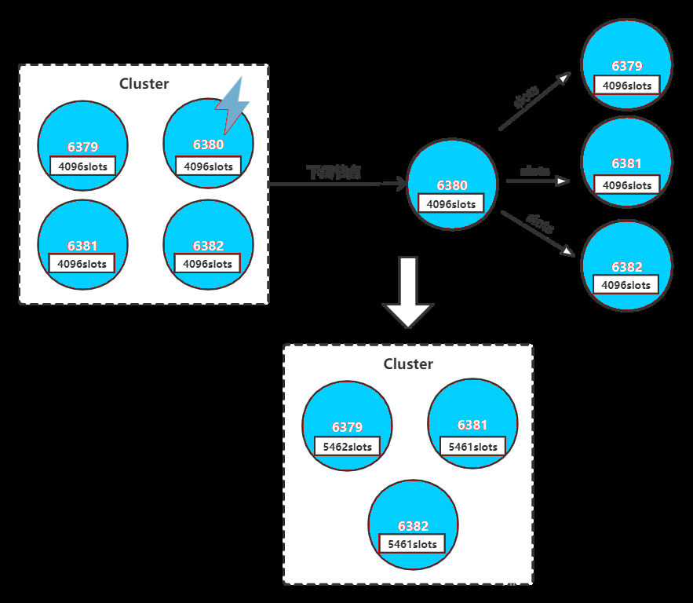

下线节点的流程如下：

1. 判断该节点是否持有槽，如果未持有槽就跳转到下一步，持有槽则先迁移槽到其他节点

2. 通知其他节点（cluster forget）忘记该下线节点

3. 关闭下线节点的服务

需要注意的是如果先下线主节点，再下线从节点，会进行故障转移，所以要先下线从节点。

3.3.2.2.3 故障转移

除了手动下线节点外，也会面对突发故障。下面提到的主要是主节点的故障，因为从节点的故障并不影响主节点工作，对应的主节点只会记住自己哪个从节点下线了，并将信息发送给其他节点。故障的从节点重连后，继续官复原职，复制主节点的数据。

只有主节点才需要进行故障转移。在之前学习主从复制时，我们需要使用redis sentinel来实现故障转移。而redis cluster则不需要redis sentinel，其自身就具备了故障转移功能。

根据前面我们了解到，节点之间是会进行通信的，节点之间通过ping/pong交互消息，所以借此就能发现故障。集群节点发现故障同样是有主观下线和客观下线的

主观下线

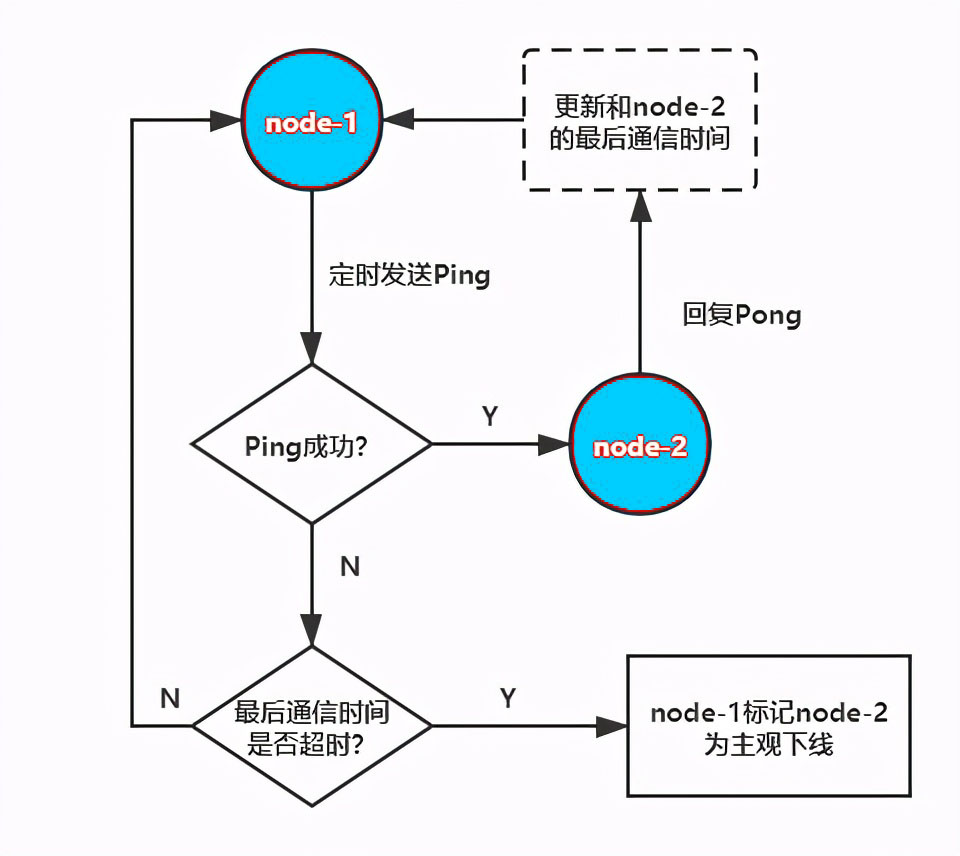

对于每个节点有一个故障列表，故障列表维护了当前节点接收到的其他所有节点的信息。当半数以上的持有槽的主节点都标记某个节点主观下线，就会尝试客观下线。

客观下线

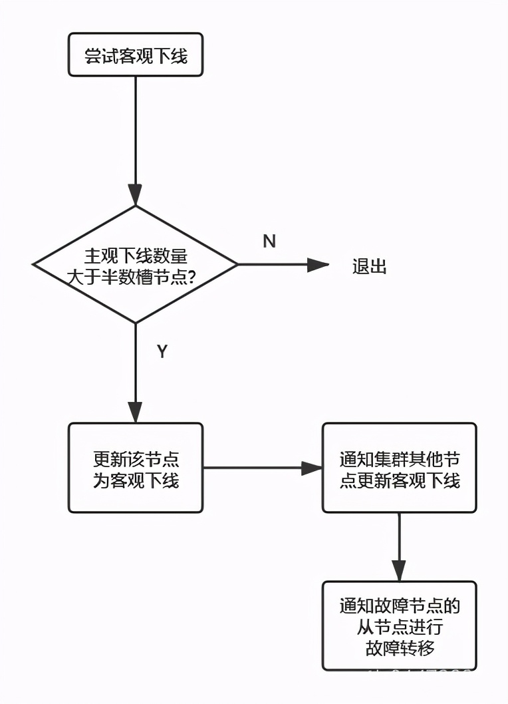

故障转移

集群同样具备了自动转移故障的功能，和哨兵有些类似，在进行客观下线之后，就开始准备让故障节点的从节点“上任”了。

首先是进行资格检查，只有具备资格的从节点才能参加选举：

故障节点的所有从节点检查和故障主节点之间的断线时间超过cluster-node-timeout * cluster-slave-validati-factor(默认10)则取消选举资格

然后是准备选举顺序，不同偏移量的节点，参与选举的顺位不同。offset最大的slave节点，选举顺位最高，最优先选举。而offset较低的slave节点，要延迟选举。

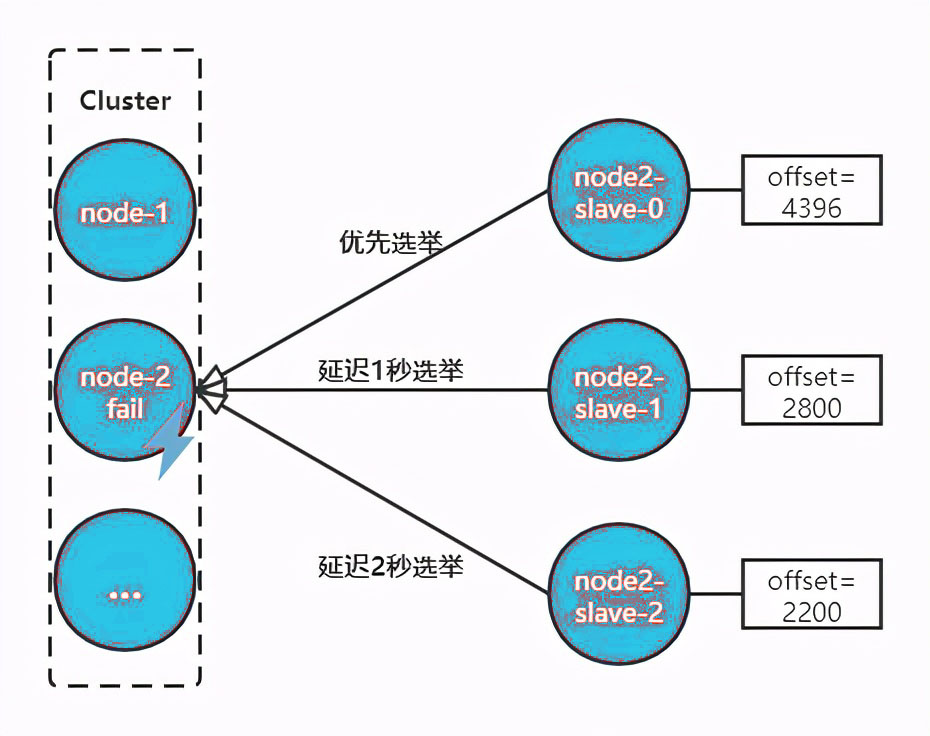

当有从节点参加选举后，主节点收到信息就开始投票。偏移量最大的节点，优先参与选举就更大可能获得最多的票数，称为主节点。

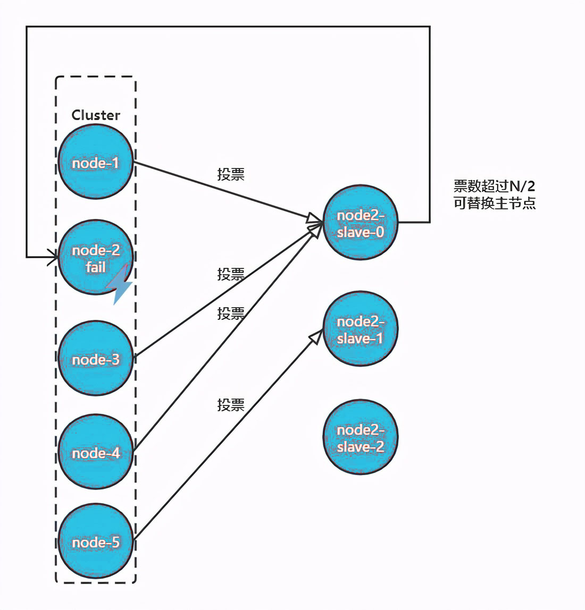

当从节点走马上任变成主节点之后，就要开始进行替换主节点：

1. 让该slave节点执行slaveof no one变为master节点

2. 将故障节点负责的槽分配给该节点

3. 向集群中其他节点广播Pong消息，表明已完成故障转移

4. 故障节点重启后，会成为new_master的slave节点

### Redis Cluster 部署架构说明

注意: 建立Redis Cluster 的节点需要清空数据，另外网络中不要有Redis哨兵的主从，否则也可能会干扰集群的创建及扩缩容

测试环境：3台服务器，每台服务器启动6379和6380两个redis 服务实例，适用于测试环境


生产环境：6台服务器，分别是三组master/slave，适用于生产环境

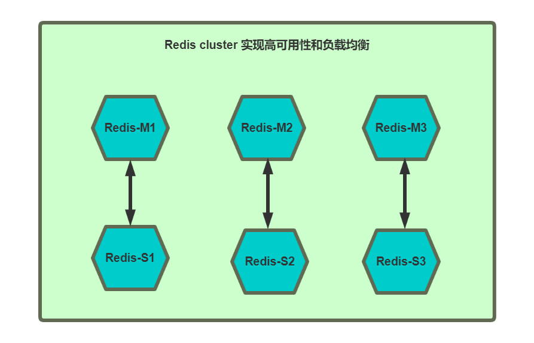

```text
#集群节点
10.0.0.8
10.0.0.18
10.0.0.28
10.0.0.38
10.0.0.48
10.0.0.58
#预留服务器扩展使用
10.0.0.68
10.0.0.78
```

说明：Redis 5.X 和之前版本相比有较大变化，以下分别介绍两个版本5.X和4.X的配置

### 部署方式介绍

redis cluster 有多种部署方法

原生命令安装

理解Redis Cluster架构

生产环境不使用

官方工具安装

高效、准确

生产环境可以使用

自主研发

可以实现可视化的自动化部署

### 实战案例：基于 Redis 5 以上版本的 Redis Cluster 部署

官方文档：https://redis.io/topics/cluster-tutorial

redis cluster 相关命令

范例: 查看 --cluster 选项帮助

```bash
[root@centos8 ~]#redis-cli --cluster help
Cluster Manager Commands:
create         host1:port1 ... hostN:portN
--cluster-replicas <arg>
check          host:port
--cluster-search-multiple-owners
info           host:port
fix            host:port
--cluster-search-multiple-owners
reshard        host:port
--cluster-from <arg>
--cluster-to <arg>
--cluster-slots <arg>
--cluster-yes
--cluster-timeout <arg>
--cluster-pipeline <arg>
--cluster-replace
rebalance      host:port
--cluster-weight <node1=w1...nodeN=wN>
--cluster-use-empty-masters
--cluster-timeout <arg>
--cluster-simulate
--cluster-pipeline <arg>
--cluster-threshold <arg>
--cluster-replace
add-node       new_host:new_port existing_host:existing_port
--cluster-slave
--cluster-master-id <arg>
del-node       host:port node_id
call           host:port command arg arg .. arg
set-timeout    host:port milliseconds
import         host:port
--cluster-from <arg>
--cluster-copy
--cluster-replace
help
For check, fix, reshard, del-node, set-timeout you can specify the host and port
of any working node in the cluster.
```

范例: 查看CLUSTER 指令的帮助

```bash
[root@centos8 ~]#redis-cli  CLUSTER HELP
1) CLUSTER <subcommand> arg arg ... arg. Subcommands are:
2) ADDSLOTS <slot> [slot ...] -- Assign slots to current node.
3) BUMPEPOCH -- Advance the cluster config epoch.
4) COUNT-failure-reports <node-id> -- Return number of failure reports for
<node-id>.
5) COUNTKEYSINSLOT <slot> - Return the number of keys in <slot>.
6) DELSLOTS <slot> [slot ...] -- Delete slots information from current node.
7) FAILOVER [force|takeover] -- Promote current replica node to being a master.
8) FORGET <node-id> -- Remove a node from the cluster.
9) GETKEYSINSLOT <slot> <count> -- Return key names stored by current node in a
slot.
10) FLUSHSLOTS -- Delete current node own slots information.
11) INFO - Return onformation about the cluster.
12) KEYSLOT <key> -- Return the hash slot for <key>.
13) MEET <ip> <port> [bus-port] -- Connect nodes into a working cluster.
14) MYID -- Return the node id.
15) NODES -- Return cluster configuration seen by node. Output format:
16)     <id> <ip:port> <flags> <master> <pings> <pongs> <epoch> <link> <slot>
... <slot>
17) REPLICATE <node-id> -- Configure current node as replica to <node-id>.
18) RESET [hard|soft] -- Reset current node (default: soft).
19) SET-config-epoch <epoch> - Set config epoch of current node.
20) SETSLOT <slot> (importing|migrating|stable|node <node-id>) -- Set slot
state.
21) REPLICAS <node-id> -- Return <node-id> replicas.
22) SLOTS -- Return information about slots range mappings. Each range is made
of:
23)     start, end, master and replicas IP addresses, ports and ids
```

### 创建 Redis Cluster 集群的环境准备


每个Redis 节点采用相同的相同的Redis版本、相同的密码、硬件配置

所有Redis服务器必须没有任何数据

准备六台主机，地址如下：

```text
10.0.0.8
10.0.0.18
10.0.0.28
10.0.0.38
10.0.0.48
10.0.0.58
```

### 启用 Redis Cluster 配置

所有6台主机都执行以下配置

```bash
[root@centos8 ~]#dnf -y install redis
```

每个节点修改redis配置，必须开启cluster功能的参数

```bash
#手动修改配置文件
[root@redis-node1 ~]vim /etc/redis.conf
bind 0.0.0.0
requirepass 123456  #所有节点，包括主从节点都一样
masterauth 123456   #所有节点，包括主从节点都一样，建议配置，否则后期的master和slave
主从复制无法成功，还需再配置
cluster-enabled yes #取消此行注释,必须开启集群，开启后 redis 进程会有cluster标识
cluster-config-file nodes-6379.conf #取消此行注释,此为集群状态数据文件,记录主从关系
及slot范围信息,由redis cluster 集群自动创建和维护,放在 data 目录
cluster-require-full-coverage no   #默认值为yes,设为no可以防止一组主从复制节点不可
用导致整个cluster不可用（显示CLUSTERDOWN The cluster is down）
#或者执行下面命令,批量修改
[root@redis-node1 ~]#sed -i.bak -e 's/bind 127.0.0.1/bind 0.0.0.0/' -e
'/masterauth/a masterauth 123456' -e '/# requirepass/a requirepass 123456' -
e '/# cluster-enabled yes/a cluster-enabled yes' -e '/# cluster-config-file
nodes-6379.conf/a cluster-config-file nodes-6379.conf' -e '/cluster-require-
full-coverage yes/a cluster-require-full-coverage no' /etc/redis.conf
```

```bash
#如果是编译安装可以执行下面操作
[root@redis-node1 ~]#sed -i.bak  -e '/masterauth/a masterauth 123456'  -e
'/# cluster-enabled yes/a cluster-enabled yes' -e '/# cluster-config-file
nodes-6379.conf/a cluster-config-file nodes-6379.conf' -e '/cluster-require-
full-coverage yes/a cluster-require-full-coverage no'
/apps/redis/etc/redis.conf
#或者
[root@redis-node1 ~]#echo -e "masterauth 123456\ncluster-enabled
yes\ncluster-config-file nodes-6379.conf\ncluster-require-full-coverage no"
>> /apps/redis/etc/redis.conf
```

```bash
[root@redis-node1 ~]#cat >>  /apps/redis/etc/redis.conf <<EOF
masterauth 123456
cluster-enabled yes
cluster-config-file nodes-6379.conf
cluster-require-full-coverage no"
EOF
[root@redis-node1 ~]#systemctl enable --now  redis
```

验证当前Redis服务状态：

```bash
#开启了16379的cluster的端口,实际的端口=redis port + 10000
[root@centos8 ~]#ss -ntl
State        Recv-Q        Send-Q  Local Address:Port     Peer Address:Port
LISTEN       0             128           0.0.0.0:22            0.0.0.0:*
LISTEN       0             100         127.0.0.1:25            0.0.0.0:*
LISTEN       0             128           0.0.0.0:16379         0.0.0.0:*
LISTEN       0             128           0.0.0.0:6379          0.0.0.0:*
LISTEN       0             128              [::]:22               [::]:*
LISTEN       0             100             [::1]:25               [::]:*
```

```bash
#注意进程有[cluster]状态
[root@centos8 ~]#ps -ef|grep redis
redis   1939    1  0 10:54 ?    00:00:00 /usr/bin/redis-server 0.0.0.0:6379
[cluster]
root    1955   1335  0 10:57 pts/0    00:00:00 grep --color=auto redis
```

### 创建集群

```bash
#下面命令在集群节点或任意集群外节点执行皆可，命令redis-cli的选项 --cluster-replicas 1 表示
每个master对应一个slave节点,注意：所有节点数据必须清空
[root@redis-node1 ~]#redis-cli -a 123456  --cluster create 10.0.0.101:6379
10.0.0.102:6379    10.0.0.103:6379   10.0.0.104:6379   10.0.0.105:6379
10.0.0.106:6379  --cluster-replicas 1
[root@redis-node1 ~]#redis-cli -a 123456  --cluster create 10.0.0.8:6379
10.0.0.18:6379    10.0.0.28:6379   10.0.0.38:6379   10.0.0.48:6379
10.0.0.58:6379  --cluster-replicas 1
Warning: Using a password with '-a' or '-u' option on the command line interface
may not be safe.
>>> Performing hash slots allocation on 6 nodes...
Master[0] -> Slots 0 - 5460
Master[1] -> Slots 5461 - 10922
Master[2] -> Slots 10923 - 16383
Adding replica 10.0.0.38:6379 to 10.0.0.8:6379
Adding replica 10.0.0.48:6379 to 10.0.0.18:6379
Adding replica 10.0.0.58:6379 to 10.0.0.28:6379
M: cb028b83f9dc463d732f6e76ca6bbcd469d948a7 10.0.0.8:6379   #带M的为master
slots:[0-5460] (5461 slots) master                        #当前master的槽位起始
和结束位
M: 99720241248ff0e4c6fa65c2385e92468b3b5993 10.0.0.18:6379
slots:[5461-10922] (5462 slots) master
M: d34da8666a6f587283a1c2fca5d13691407f9462 10.0.0.28:6379
slots:[10923-16383] (5461 slots) master
S: f9adcfb8f5a037b257af35fa548a26ffbadc852d 10.0.0.38:6379  #带S的slave
replicates cb028b83f9dc463d732f6e76ca6bbcd469d948a7
S: d04e524daec4d8e22bdada7f21a9487c2d3e1057 10.0.0.48:6379
replicates 99720241248ff0e4c6fa65c2385e92468b3b5993
S: 9875b50925b4e4f29598e6072e5937f90df9fc71 10.0.0.58:6379
replicates d34da8666a6f587283a1c2fca5d13691407f9462
Can I set the above configuration? (type 'yes' to accept): yes #输入yes自动创建集群
>>> Nodes configuration updated
>>> Assign a different config epoch to each node
>>> Sending CLUSTER MEET messages to join the cluster
Waiting for the cluster to join
....
>>> Performing Cluster Check (using node 10.0.0.8:6379)
M: cb028b83f9dc463d732f6e76ca6bbcd469d948a7 10.0.0.8:6379
slots:[0-5460] (5461 slots) master   #已经分配的槽位
1 additional replica(s)              #分配了一个slave
S: 9875b50925b4e4f29598e6072e5937f90df9fc71 10.0.0.58:6379
slots: (0 slots) slave               #slave没有分配槽位
replicates d34da8666a6f587283a1c2fca5d13691407f9462  #对应的master的10.0.0.28的
ID
S: f9adcfb8f5a037b257af35fa548a26ffbadc852d 10.0.0.38:6379
slots: (0 slots) slave
replicates cb028b83f9dc463d732f6e76ca6bbcd469d948a7 #对应的master的10.0.0.8的ID
S: d04e524daec4d8e22bdada7f21a9487c2d3e1057 10.0.0.48:6379
slots: (0 slots) slave
replicates 99720241248ff0e4c6fa65c2385e92468b3b5993 #对应的master的10.0.0.18的
ID
M: 99720241248ff0e4c6fa65c2385e92468b3b5993 10.0.0.18:6379
slots:[5461-10922] (5462 slots) master
1 additional replica(s)
M: d34da8666a6f587283a1c2fca5d13691407f9462 10.0.0.28:6379
slots:[10923-16383] (5461 slots) master
1 additional replica(s)
[OK] All nodes agree about slots configuration.  #所有节点槽位分配完成
>>> Check for open slots... #检查打开的槽位
>>> Check slots coverage... #检查插槽覆盖范围
[OK] All 16384 slots covered. #所有槽位(16384个)分配完成
#观察以上结果，可以看到3组master/slave
master:10.0.0.8---slave:10.0.0.38
master:10.0.0.18---slave:10.0.0.48
master:10.0.0.28---slave:10.0.0.58
#如果节点少于3个会出下面提示错误
[root@node1 ~]#redis-cli -a 123456  --cluster create 10.0.0.8:6379
10.0.0.18:6379
Warning: Using a password with '-a' or '-u' option on the command line interface
may not be safe.
*** ERROR: Invalid configuration for cluster creation.
*** Redis Cluster requires at least 3 master nodes.
*** This is not possible with 2 nodes and 0 replicas per node.
*** At least 3 nodes are required.
```

### 验证集群

3.3.3.4.1 查看主从状态

```bash
[root@redis-node1 ~]#redis-cli -a 123456 -c INFO replication
Warning: Using a password with '-a' or '-u' option on the command line interface
may not be safe.
# Replication
role:master
connected_slaves:1
slave0:ip=10.0.0.38,port=6379,state=online,offset=896,lag=1
master_replid:3a388865080d779180ff240cb75766e7e57877da
master_replid2:0000000000000000000000000000000000000000
master_repl_offset:896
second_repl_offset:-1
repl_backlog_active:1
repl_backlog_size:1048576
repl_backlog_first_byte_offset:1
repl_backlog_histlen:896
[root@redis-node2 ~]#redis-cli -a 123456 INFO replication
Warning: Using a password with '-a' or '-u' option on the command line interface
may not be safe.
# Replication
role:master
connected_slaves:1
slave0:ip=10.0.0.48,port=6379,state=online,offset=980,lag=1
master_replid:b9066d3cbf0c5fecc7f4d1d5cb2433999783fa3f
master_replid2:0000000000000000000000000000000000000000
master_repl_offset:980
second_repl_offset:-1
repl_backlog_active:1
repl_backlog_size:1048576
repl_backlog_first_byte_offset:1
repl_backlog_histlen:980
[root@redis-node3 ~]#redis-cli -a 123456 INFO replication
Warning: Using a password with '-a' or '-u' option on the command line interface
may not be safe.
# Replication
role:master
connected_slaves:1
slave0:ip=10.0.0.58,port=6379,state=online,offset=980,lag=0
master_replid:53208e0ed9305d721e2fb4b3180f75c689217902
master_replid2:0000000000000000000000000000000000000000
master_repl_offset:980
second_repl_offset:-1
repl_backlog_active:1
repl_backlog_size:1048576
repl_backlog_first_byte_offset:1
repl_backlog_histlen:980
[root@redis-node4 ~]#redis-cli -a 123456 INFO replication
Warning: Using a password with '-a' or '-u' option on the command line interface
may not be safe.
# Replication
role:slave
master_host:10.0.0.8
master_port:6379
master_link_status:up
master_last_io_seconds_ago:1
master_sync_in_progress:0
slave_repl_offset:1036
slave_priority:100
slave_read_only:1
connected_slaves:0
master_replid:3a388865080d779180ff240cb75766e7e57877da
master_replid2:0000000000000000000000000000000000000000
master_repl_offset:1036
second_repl_offset:-1
repl_backlog_active:1
repl_backlog_size:1048576
repl_backlog_first_byte_offset:1
repl_backlog_histlen:1036
[root@redis-node5 ~]#redis-cli -a 123456 INFO replication
Warning: Using a password with '-a' or '-u' option on the command line interface
may not be safe.
# Replication
role:slave
master_host:10.0.0.18
master_port:6379
master_link_status:up
master_last_io_seconds_ago:2
master_sync_in_progress:0
slave_repl_offset:1064
slave_priority:100
slave_read_only:1
connected_slaves:0
master_replid:b9066d3cbf0c5fecc7f4d1d5cb2433999783fa3f
master_replid2:0000000000000000000000000000000000000000
master_repl_offset:1064
second_repl_offset:-1
repl_backlog_active:1
repl_backlog_size:1048576
repl_backlog_first_byte_offset:1
repl_backlog_histlen:1064
[root@redis-node6 ~]#redis-cli -a 123456 INFO replication
Warning: Using a password with '-a' or '-u' option on the command line interface
may not be safe.
# Replication
role:slave
master_host:10.0.0.28
master_port:6379
master_link_status:up
master_last_io_seconds_ago:7
master_sync_in_progress:0
slave_repl_offset:1078
slave_priority:100
slave_read_only:1
connected_slaves:0
master_replid:53208e0ed9305d721e2fb4b3180f75c689217902
master_replid2:0000000000000000000000000000000000000000
master_repl_offset:1078
second_repl_offset:-1
repl_backlog_active:1
repl_backlog_size:1048576
repl_backlog_first_byte_offset:1
repl_backlog_histlen:1078
```

范例: 查看指定master节点的slave节点信息

```bash
[root@centos8 ~]#redis-cli -a 123456 cluster nodes
4f146b1ac51549469036a272c60ea97f065ef832 10.0.0.28:6379@16379 master - 0
1602571565772 12 connected 10923-16383
779a24884dbe1ceb848a685c669ec5326e6c8944 10.0.0.48:6379@16379 slave
97c5dcc3f33c2fc75c7fdded25d05d2930a312c0 0 1602571565000 11 connected
97c5dcc3f33c2fc75c7fdded25d05d2930a312c0 10.0.0.18:6379@16379 master - 0
1602571564000 11 connected 5462-10922
07231a50043d010426c83f3b0788e6b92e62050f 10.0.0.58:6379@16379 slave
4f146b1ac51549469036a272c60ea97f065ef832 0 1602571565000 12 connected
a177c5cbc2407ebb6230ea7e2a7de914bf8c2dab 10.0.0.8:6379@16379 myself,master - 0
1602571566000 10 connected 0-5461
cb20d58870fe05de8462787cf9947239f4bc5629 10.0.0.38:6379@16379 slave
a177c5cbc2407ebb6230ea7e2a7de914bf8c2dab 0 1602571566780 10 connected
#以下命令查看指定master节点的slave节点信息,其中
#a177c5cbc2407ebb6230ea7e2a7de914bf8c2dab 为master节点的ID
[root@centos8 ~]#redis-cli  -a 123456 cluster slaves
a177c5cbc2407ebb6230ea7e2a7de914bf8c2dab
1) "cb20d58870fe05de8462787cf9947239f4bc5629 10.0.0.38:6379@16379 slave
a177c5cbc2407ebb6230ea7e2a7de914bf8c2dab 0 1602571574844 10 connected"
```

3.3.3.4.2 验证集群状态

```bash
[root@redis-node1 ~]#redis-cli -a 123456 CLUSTER INFO
Warning: Using a password with '-a' or '-u' option on the command line interface
may not be safe.
cluster_state:ok
cluster_slots_assigned:16384
cluster_slots_ok:16384
cluster_slots_pfail:0
cluster_slots_fail:0
cluster_known_nodes:6                 #节点数
cluster_size:3                        #三个集群
cluster_current_epoch:6
cluster_my_epoch:1
cluster_stats_messages_ping_sent:837
cluster_stats_messages_pong_sent:811
cluster_stats_messages_sent:1648
cluster_stats_messages_ping_received:806
cluster_stats_messages_pong_received:837
cluster_stats_messages_meet_received:5
cluster_stats_messages_received:1648
```

```bash
#查看任意节点的集群状态
[root@redis-node1 ~]#redis-cli -a 123456 --cluster info 10.0.0.38:6379
Warning: Using a password with '-a' or '-u' option on the command line interface
may not be safe.
10.0.0.18:6379 (99720241...) -> 0 keys | 5462 slots | 1 slaves.
10.0.0.28:6379 (d34da866...) -> 0 keys | 5461 slots | 1 slaves.
10.0.0.8:6379 (cb028b83...) -> 0 keys | 5461 slots | 1 slaves.
[OK] 0 keys in 3 masters.
0.00 keys per slot on average.
```

3.3.3.4.3 查看对应关系

```bash
[root@redis-node1 ~]#redis-cli -a 123456 CLUSTER NODES
Warning: Using a password with '-a' or '-u' option on the command line interface
may not be safe.
9875b50925b4e4f29598e6072e5937f90df9fc71 10.0.0.58:6379@16379 slave
d34da8666a6f587283a1c2fca5d13691407f9462 0 1582344815790 6 connected
f9adcfb8f5a037b257af35fa548a26ffbadc852d 10.0.0.38:6379@16379 slave
cb028b83f9dc463d732f6e76ca6bbcd469d948a7 0 1582344811000 4 connected
d04e524daec4d8e22bdada7f21a9487c2d3e1057 10.0.0.48:6379@16379 slave
99720241248ff0e4c6fa65c2385e92468b3b5993 0 1582344815000 5 connected
99720241248ff0e4c6fa65c2385e92468b3b5993 10.0.0.18:6379@16379 master - 0
1582344813000 2 connected 5461-10922
d34da8666a6f587283a1c2fca5d13691407f9462 10.0.0.28:6379@16379 master - 0
1582344814780 3 connected 10923-16383
cb028b83f9dc463d732f6e76ca6bbcd469d948a7 10.0.0.8:6379@16379 myself,master - 0
1582344813000 1 connected 0-5460
[root@redis-node1 ~]#redis-cli -a 123456 --cluster check 10.0.0.38:6379
Warning: Using a password with '-a' or '-u' option on the command line interface
may not be safe.
10.0.0.18:6379 (99720241...) -> 0 keys | 5462 slots | 1 slaves.
10.0.0.28:6379 (d34da866...) -> 0 keys | 5461 slots | 1 slaves.
10.0.0.8:6379 (cb028b83...) -> 0 keys | 5461 slots | 1 slaves.
[OK] 0 keys in 3 masters.
0.00 keys per slot on average.
>>> Performing Cluster Check (using node 10.0.0.38:6379)
S: f9adcfb8f5a037b257af35fa548a26ffbadc852d 10.0.0.38:6379
slots: (0 slots) slave
replicates cb028b83f9dc463d732f6e76ca6bbcd469d948a7
S: d04e524daec4d8e22bdada7f21a9487c2d3e1057 10.0.0.48:6379
slots: (0 slots) slave
replicates 99720241248ff0e4c6fa65c2385e92468b3b5993
M: 99720241248ff0e4c6fa65c2385e92468b3b5993 10.0.0.18:6379
slots:[5461-10922] (5462 slots) master
1 additional replica(s)
S: 9875b50925b4e4f29598e6072e5937f90df9fc71 10.0.0.58:6379
slots: (0 slots) slave
replicates d34da8666a6f587283a1c2fca5d13691407f9462
M: d34da8666a6f587283a1c2fca5d13691407f9462 10.0.0.28:6379
slots:[10923-16383] (5461 slots) master
1 additional replica(s)
M: cb028b83f9dc463d732f6e76ca6bbcd469d948a7 10.0.0.8:6379
slots:[0-5460] (5461 slots) master
1 additional replica(s)
[OK] All nodes agree about slots configuration.
>>> Check for open slots...
>>> Check slots coverage...
[OK] All 16384 slots covered.
```

### 测试集群写入数据

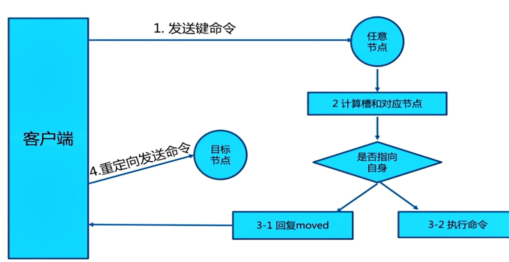

3.3.3.5.1 redis cluster 写入key

```bash
#经过算法计算，当前key的槽位需要写入指定的node
[root@redis-node1 ~]#redis-cli -a 123456 -h 10.0.0.8  SET key1 values1
Warning: Using a password with '-a' or '-u' option on the command line interface
may not be safe.
(error) MOVED 9189 10.0.0.18:6379    #槽位不在当前node所以无法写入
#指定槽位对应node可写入
[root@redis-node1 ~]#redis-cli -a 123456 -h 10.0.0.18  SET key1 values1
Warning: Using a password with '-a' or '-u' option on the command line interface
may not be safe.
OK
[root@redis-node1 ~]#redis-cli -a 123456 -h 10.0.0.18  GET  key1
Warning: Using a password with '-a' or '-u' option on the command line interface
may not be safe.
"values1"
#对应的slave节点可以KEYS *,但GET key1失败,可以到master上执行GET key1
[root@redis-node1 ~]#redis-cli -a 123456 -h 10.0.0.48  KEYS "*"
Warning: Using a password with '-a' or '-u' option on the command line interface
may not be safe.
1) "key1"
[root@redis-node1 ~]#redis-cli -a 123456 -h 10.0.0.48 GET key1
Warning: Using a password with '-a' or '-u' option on the command line interface
may not be safe.
(error) MOVED 9189 10.0.0.18:6379
```

3.3.3.5.2 redis cluster 计算key所属的slot

```bash
[root@centos8 ~]#redis-cli -h 10.0.0.8  -a 123456 --no-auth-warning cluster
nodes
4f146b1ac51549469036a272c60ea97f065ef832 10.0.0.28:6379@16379 master - 0
1602561649000 12 connected 10923-16383
779a24884dbe1ceb848a685c669ec5326e6c8944 10.0.0.48:6379@16379 slave
97c5dcc3f33c2fc75c7fdded25d05d2930a312c0 0 1602561648000 11 connected
97c5dcc3f33c2fc75c7fdded25d05d2930a312c0 10.0.0.18:6379@16379 master - 0
1602561650000 11 connected 5462-10922
07231a50043d010426c83f3b0788e6b92e62050f 10.0.0.58:6379@16379 slave
4f146b1ac51549469036a272c60ea97f065ef832 0 1602561650229 12 connected
a177c5cbc2407ebb6230ea7e2a7de914bf8c2dab 10.0.0.8:6379@16379 myself,master - 0
1602561650000 10 connected 0-5461
cb20d58870fe05de8462787cf9947239f4bc5629 10.0.0.38:6379@16379 slave
a177c5cbc2407ebb6230ea7e2a7de914bf8c2dab 0 1602561651238 10 connected
#计算得到hello对应的slot
[root@centos8 ~]#redis-cli -h 10.0.0.8  -a 123456 --no-auth-warning cluster
keyslot hello
(integer) 866
[root@centos8 ~]#redis-cli -h 10.0.0.8  -a 123456 --no-auth-warning set  hello
bowene
OK
[root@centos8 ~]#redis-cli -h 10.0.0.8  -a 123456 --no-auth-warning cluster
keyslot name
(integer) 5798
[root@centos8 ~]#redis-cli -h 10.0.0.8  -a 123456 --no-auth-warning set  name
bowen
(error) MOVED 5798 10.0.0.18:6379
[root@centos8 ~]#redis-cli -h 10.0.0.18  -a 123456 --no-auth-warning set  name
bowen
OK
[root@centos8 ~]#redis-cli -h 10.0.0.18  -a 123456 --no-auth-warning get name
"bowen"
#使用选项-c 以集群模式连接
[root@centos8 ~]#redis-cli -c  -h 10.0.0.8  -a 123456 --no-auth-warning
10.0.0.8:6379> cluster keyslot linux
(integer) 12299
10.0.0.8:6379> set linux love
-> Redirected to slot [12299] located at 10.0.0.28:6379
OK
10.0.0.28:6379> get linux
"love"
10.0.0.28:6379> exit
[root@centos8 ~]#redis-cli  -h 10.0.0.28  -a 123456 --no-auth-warning  get linux
"love"
```

### Python 程序实现 Redis Cluster 访问

官网:

<https://github.com/Grokzen/redis-py-cluster>

范例:

```bash
#安装模块
#Ubuntu24.04
[root@ubuntu2404 ~]#apt -y install  python3-pip
[root@ubuntu2404 ~]#python3 -m pip config set global.index-url
https://mirrors.aliyun.com/pypi/simple/
[root@ubuntu2404 ~]#pip3 install redis-py-cluster --break-system-packages
```

```bash
#Ubuntu22.04
[root@ubuntu2204 ~]#apt -y install  python3-pip
#加速
[root@ubuntu2204 ~]#python3 -m pip config set global.index-url
https://mirrors.aliyun.com/pypi/simple/
[root@ubuntu2204 ~]#pip3 install redis-py-cluster
```

```bash
#rocky系统
[root@redis-node1 ~]#dnf -y install python3
[root@redis-node1 ~]#pip3 install redis-py-cluster
[root@redis-node1 ~]#vim redis_cluster_test.py
[root@redis-node1 ~]#cat ./redis_cluster_test.py
#!/usr/bin/env python3
from rediscluster  import RedisCluster
startup_nodes = [
{"host":"10.0.0.8", "port":6379},
{"host":"10.0.0.18", "port":6379},
{"host":"10.0.0.28", "port":6379},
{"host":"10.0.0.38", "port":6379},
{"host":"10.0.0.48", "port":6379},
{"host":"10.0.0.58", "port":6379}
]
redis_conn= RedisCluster(startup_nodes=startup_nodes,password='123456',
decode_responses=True)
for i in range(0, 10000):
redis_conn.set('key'+str(i),'value'+str(i))
print('key'+str(i)+':',redis_conn.get('key'+str(i)))
```

```bash
[root@redis-node1 ~]#chmod +x redis_cluster_test.py
[root@redis-node1 ~]#./redis_cluster_test.py
......
key9998: value9998
key9999: value9999
#验证数据
[root@redis-node1 ~]#redis-cli -a 123456 -h 10.0.0.8
Warning: Using a password with '-a' or '-u' option on the command line interface
may not be safe.
10.0.0.8:6379> DBSIZE
(integer) 3331
10.0.0.8:6379> GET key1
(error) MOVED 9189 10.0.0.18:6379
10.0.0.8:6379> GET key2
"value2"
10.0.0.8:6379> GET key3
"value3"
10.0.0.8:6379> KEYS *
......
3329) "key7832"
3330) "key2325"
3331) "key2880"
10.0.0.8:6379>
[root@redis-node1 ~]#redis-cli -a 123456 -h 10.0.0.18 DBSIZE
Warning: Using a password with '-a' or '-u' option on the command line interface
may not be safe.
(integer) 3340
[root@redis-node1 ~]#redis-cli -a 123456 -h 10.0.0.18 GET key1
Warning: Using a password with '-a' or '-u' option on the command line interface
may not be safe.
"value1"
[root@redis-node1 ~]#redis-cli -a 123456 -h 10.0.0.28 DBSIZE
Warning: Using a password with '-a' or '-u' option on the command line interface
may not be safe.
(integer) 3329
[root@redis-node1 ~]#redis-cli -a 123456 -h 10.0.0.18 GET key5
Warning: Using a password with '-a' or '-u' option on the command line interface
may not be safe.
"value5"
[root@redis-node1 ~]#
```

### 模拟故障实现故障转移

```bash
#模拟node2节点出故障,需要相应的数秒故障转移时间
[root@redis-node2 ~]#tail -f /var/log/redis/redis.log
[root@redis-node2 ~]#redis-cli -a 123456
Warning: Using a password with '-a' or '-u' option on the command line interface
may not be safe.
127.0.0.1:6379> shutdown
not connected> exit
[root@redis-node2 ~]#ss -ntl
State        Recv-Q        Send-Q  Local Address:Port  Peer Address:Port
LISTEN       0             128           0.0.0.0:22         0.0.0.0:*
LISTEN       0             100         127.0.0.1:25         0.0.0.0:*
LISTEN       0             128              [::]:22            [::]:*
LISTEN       0             100             [::1]:25            [::]:*
```

```bash
[root@redis-node2 ~]# redis-cli -a 123456 --cluster info 10.0.0.8:6379
Warning: Using a password with '-a' or '-u' option on the command line interface
may not be safe.
Could not connect to Redis at 10.0.0.18:6379: Connection refused
10.0.0.8:6379 (cb028b83...) -> 3331 keys | 5461 slots | 1 slaves.
10.0.0.48:6379 (d04e524d...) -> 3340 keys | 5462 slots | 0 slaves. #10.0.0.48为新
的master
10.0.0.28:6379 (d34da866...) -> 3329 keys | 5461 slots | 1 slaves.
[OK] 10000 keys in 3 masters.
0.61 keys per slot on average.
[root@redis-node2 ~]# redis-cli -a 123456 --cluster check 10.0.0.8:6379
Warning: Using a password with '-a' or '-u' option on the command line interface
may not be safe.
Could not connect to Redis at 10.0.0.18:6379: Connection refused
10.0.0.8:6379 (cb028b83...) -> 3331 keys | 5461 slots | 1 slaves.
10.0.0.48:6379 (d04e524d...) -> 3340 keys | 5462 slots | 0 slaves.
10.0.0.28:6379 (d34da866...) -> 3329 keys | 5461 slots | 1 slaves.
[OK] 10000 keys in 3 masters.
0.61 keys per slot on average.
>>> Performing Cluster Check (using node 10.0.0.8:6379)
M: cb028b83f9dc463d732f6e76ca6bbcd469d948a7 10.0.0.8:6379
slots:[0-5460] (5461 slots) master
1 additional replica(s)
S: 9875b50925b4e4f29598e6072e5937f90df9fc71 10.0.0.58:6379
slots: (0 slots) slave
replicates d34da8666a6f587283a1c2fca5d13691407f9462
S: f9adcfb8f5a037b257af35fa548a26ffbadc852d 10.0.0.38:6379
slots: (0 slots) slave
replicates cb028b83f9dc463d732f6e76ca6bbcd469d948a7
M: d04e524daec4d8e22bdada7f21a9487c2d3e1057 10.0.0.48:6379
slots:[5461-10922] (5462 slots) master
M: d34da8666a6f587283a1c2fca5d13691407f9462 10.0.0.28:6379
slots:[10923-16383] (5461 slots) master
1 additional replica(s)
[OK] All nodes agree about slots configuration.
>>> Check for open slots...
>>> Check slots coverage...
[OK] All 16384 slots covered.
[root@redis-node2 ~]#redis-cli  -a 123456 -h 10.0.0.48
Warning: Using a password with '-a' or '-u' option on the command line interface
may not be safe.
10.0.0.48:6379> INFO replication
# Replication
role:master
connected_slaves:0
master_replid:0000698bc2c6452d8bfba68246350662ae41d8fd
master_replid2:b9066d3cbf0c5fecc7f4d1d5cb2433999783fa3f
master_repl_offset:2912424
second_repl_offset:2912425
repl_backlog_active:1
repl_backlog_size:1048576
repl_backlog_first_byte_offset:1863849
repl_backlog_histlen:1048576
10.0.0.48:6379>
#恢复故障节点node2自动成为slave节点
[root@redis-node2 ~]#systemctl start redis
#查看自动生成的配置文件，可以查看node2自动成为slave节点
[root@redis-node2 ~]#cat /var/lib/redis/nodes-6379.conf
99720241248ff0e4c6fa65c2385e92468b3b5993 10.0.0.18:6379@16379 myself,slave
d04e524daec4d8e22bdada7f21a9487c2d3e1057 0 1582352081847 2 connected
f9adcfb8f5a037b257af35fa548a26ffbadc852d 10.0.0.38:6379@16379 slave
cb028b83f9dc463d732f6e76ca6bbcd469d948a7 1582352081868 1582352081847 4 connected
cb028b83f9dc463d732f6e76ca6bbcd469d948a7 10.0.0.8:6379@16379 master -
1582352081868 1582352081847 1 connected 0-5460
9875b50925b4e4f29598e6072e5937f90df9fc71 10.0.0.58:6379@16379 slave
d34da8666a6f587283a1c2fca5d13691407f9462 1582352081869 1582352081847 3 connected
d04e524daec4d8e22bdada7f21a9487c2d3e1057 10.0.0.48:6379@16379 master -
1582352081869 1582352081847 7 connected 5461-10922
d34da8666a6f587283a1c2fca5d13691407f9462 10.0.0.28:6379@16379 master -
1582352081869 1582352081847 3 connected 10923-16383
vars currentEpoch 7 lastVoteEpoch 0
```

```bash
[root@redis-node2 ~]#redis-cli  -a 123456 -h 10.0.0.48
Warning: Using a password with '-a' or '-u' option on the command line interface
may not be safe.
10.0.0.48:6379> INFO replication
# Replication
role:master
connected_slaves:1
slave0:ip=10.0.0.18,port=6379,state=online,offset=2912564,lag=1
master_replid:0000698bc2c6452d8bfba68246350662ae41d8fd
master_replid2:b9066d3cbf0c5fecc7f4d1d5cb2433999783fa3f
master_repl_offset:2912564
second_repl_offset:2912425
repl_backlog_active:1
repl_backlog_size:1048576
repl_backlog_first_byte_offset:1863989
repl_backlog_histlen:1048576
10.0.0.48:6379>
```

### 实战案例：基于 Redis 4 的 Redis Cluster 部署

### 准备 Redis Cluster 基本环境配置

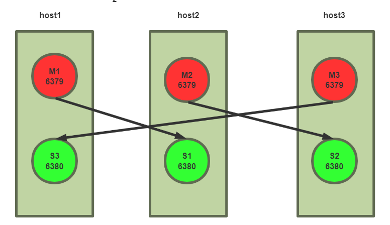

准备三台 CentOS 7 主机，已编译安装好Redis，各启动两个Redis实例，分别使用6379和6380端口，从而模拟实现6台Redis实例

```text
10.0.0.7:6379|6380
10.0.0.17:6379|6380
10.0.0.27:6379|6380
```

准备6个实例：在三个主机上重复下面的操作

范例: 3个节点6个实例

```bash
#在三台主机上都编译安装redis
[root@redis-node1 ~]#yum  -y install gcc jemalloc-devel
[root@redis-node1 ~]#cd /usr/local/src
[root@redis-node1 src]#wget http://download.redis.io/releases/redis-
4.0.14.tar.gz
[root@redis-node1 src]#tar xf redis-4.0.14.tar.gz
[root@redis-node1 src]#cd redis-4.0.14
[root@redis-node1 redis-4.0.14]#make PREFIX=/apps/redis install
#准备相关文件和目录
[root@redis-node1 redis-4.0.14]#ln -s /apps/redis/bin/redis-*  /usr/bin/
[root@redis-node1 redis-4.0.14]#mkdir -p /apps/redis/{etc,log,data,run}
[root@redis-node1 redis-4.0.14]#cp redis.conf  /apps/redis/etc/
#准备用户
[root@redis-node1 ~]#useradd -r -s /sbin/nologin redis
#配置权限和相关优化配置
[root@redis-node1 ~]#chown -R redis.redis /apps/redis
[root@redis-node1 ~]#cat >> /etc/sysctl.conf <<EOF
net.core.somaxconn = 1024
vm.overcommit_memory = 1
EOF
[root@redis-node1 ~]#sysctl -p
[root@redis-node1 ~]#echo 'echo never >
/sys/kernel/mm/transparent_hugepage/enabled' >> /etc/rc.d/rc.local
[root@redis-node1 ~]#chmod +x /etc/rc.d/rc.local
[root@redis-node1 ~]#/etc/rc.d/rc.local
#准备service文件
[root@redis-node1 ~]#cat > /usr/lib/systemd/system/redis.service <<EOF
[Unit]
Description=Redis persistent key-value database
After=network.target
[Service]
ExecStart=/apps/redis/bin/redis-server /apps/redis/etc/redis.conf --supervised
systemd
ExecStop=/bin/kill -s QUIT \$MAINPID
Type=notify
User=redis
Group=redis
RuntimeDirectory=redis
RuntimeDirectoryMode=0755
[Install]
WantedBy=multi-user.target
EOF
[root@redis-node1 ~]#systemctl daemon-reload
[root@redis-node1 ~]#systemctl enable --now redis
#准备6379的实例配置文件
[root@redis-node1 ~]#systemctl stop redis
[root@redis-node1 ~]#cd /apps/redis/etc/
[root@redis-node1 etc]#sed -i -e 's/bind 127.0.0.1/bind 0.0.0.0/' -e '/^#
masterauth/a masterauth 123456' -e '/# requirepass/a requirepass 123456' -e '/#
cluster-enabled yes/a cluster-enabled yes' -e '/# cluster-config-file nodes-
6379.conf/a cluster-config-file nodes-6379.conf' -e 's/^dir .*/dir
\/apps\/redis\/data/'  -e '/appendonly no/c appendonly yes' -e '/logfile ""/c
logfile "/apps/redis/log/redis-6379.log"'  -e  '/^pidfile .*/c  pidfile
/apps/redis/run/redis_6379.pid' /apps/redis/etc/redis.conf
#准备6380端口的实例的配置文件
[root@redis-node1 etc]#cp -p redis.conf redis6380.conf
[root@redis-node1 etc]#sed  -i  -e 's/6379/6380/'  -e 's/dbfilename
dump\.rdb/dbfilename dump6380.rdb/'  -e 's/appendfilename
"appendonly\.aof"/appendfilename "appendonly6380.aof"/'
/apps/redis/etc/redis6380.conf
```

```bash
#准备服务文件
[root@redis-node1 ~]#cp /lib/systemd/system/redis.service
/lib/systemd/system/redis6380.service
[root@redis-node1 ~]#sed -i 's/redis.conf/redis6380.conf/'
/lib/systemd/system/redis6380.service
```

```bash
#启动服务，查看到端口都打开
[root@redis-node1 ~]#systemctl daemon-reload
[root@redis-node1 ~]#systemctl enable --now redis redis6380
[root@redis-node1 ~]#ss -ntl
State       Recv-Q Send-Q   Local Address:Port     Peer Address:Port
LISTEN      0      100          127.0.0.1:25                  *:*
LISTEN      0      128                  *:16379               *:*
LISTEN      0      128                  *:16380               *:*
LISTEN      0      128                  *:6379                *:*
LISTEN      0      128                  *:6380                *:*
LISTEN      0      128                  *:22                  *:*
LISTEN      0      100              [::1]:25               [::]:*
LISTEN      0      128               [::]:22               [::]:*
```

```bash
[root@redis-node1 ~]#ps -ef|grep redis
redis 71539   1  0 22:13 ?   00:00:00 /apps/redis/bin/redis-server 0.0.0.0:6379
[cluster]
redis 71543   1  0 22:13 ?   00:00:00 /apps/redis/bin/redis-server 0.0.0.0:6380
[cluster]
root  71553  31781  0 22:15 pts/0 00:00:00 grep --color=auto redis
[root@redis-node1 ~]#tree /apps/redis/
/apps/redis
├── bin
│   ├── redis-benchmark
│   ├── redis-check-aof
│   ├── redis-check-rdb
│   ├── redis-cli
│   ├── redis-sentinel -> redis-server
│   └── redis-server
├── data
│   ├── appendonly6380.aof
│   ├── appendonly.aof
│   ├── nodes-6379.conf
│   └── nodes-6380.conf
├── etc
│   ├── redis6380.conf
│   └── redis.conf
├── log
│   ├── redis-6379.log
│   └── redis-6380.log
└── run
├── redis_6379.pid
└── redis_6380.pid
5 directories, 16 files
```

### 准备 redis-trib.rb 工具

Redis 3和 4版本需要使用到Redis官方推出的管理redis集群的专用工具redis-trib.rb，redis-trib.rb基于 ruby开发，所以需要安装ruby的redis 环境模块,但是如果使用CentOS 7系统yum中的ruby版本太低,不支持Redis-trib.rb工具

```bash
[root@redis-node1 ~]#find / -name redis-trib.rb
/usr/local/src/redis-4.0.14/src/redis-trib.rb
[root@redis-node1 ~]#cp /usr/local/src/redis-4.0.14/src/redis-trib.rb  /usr/bin/
[root@redis-node1 ~]#redis-trib.rb #缺少ruby环境无法运行rb脚本
/usr/bin/env: ruby: No such file or directory
#CentOS7 系统自带的ruby版本过低,无法运行上面ruby脚本,需要安装2.3以上版本,安装rubygems依赖
ruby自动安装
[root@redis-node1 ~]#yum install rubygems -y
[root@redis-node1 ~]#gem install redis  #gem相当于python里pip和linux的yum
Fetching: redis-4.1.3.gem (100%)
ERROR:  Error installing redis:
redis requires Ruby version >= 2.3.0.
```

解决ruby版本问题：

编译安装高版本的ruby

```bash
[root@redis-node1 ~]#yum -y install gcc openssl-devel zlib-devel
[root@redis-node1 ~]#wget https://cache.ruby-lang.org/pub/ruby/2.5/ruby-
2.5.5.tar.gz
[root@redis-node1 ~]#tar xf ruby-2.5.5.tar.gz
[root@redis-node1 ~]#cd ruby-2.5.5
[root@redis-node1 ruby-2.5.5]#./configure
[root@redis-node1 ruby-2.5.5]#make -j 2 && make install
[root@redis-node1 ruby-2.5.5]#which  ruby
/usr/local/bin/ruby
[root@redis-node1 ruby-2.5.5]# ruby -v
ruby 2.5.5p157 (2019-03-15 revision 67260) [x86_64-linux]
[root@redis-node1 ruby-2.5.5]#exit   #注意需要重新登录
```

安装ruby中redis模块

编译安装高版本的ruby后,运行redis-trib.rb 时仍然还会出错

```bash
[root@redis-node1 ~]#redis-trib.rb
Traceback (most recent call last):
2: from /usr/bin/redis-trib.rb:25:in `<main>'
1: from /usr/local/lib/ruby/2.5.0/rubygems/core_ext/kernel_require.rb:59:in
`require'
/usr/local/lib/ruby/2.5.0/rubygems/core_ext/kernel_require.rb:59:in `require':
cannot load such file -- redis (LoadError)
```

解决上述错误：

```bash
[root@redis-node1 ~]#gem install redis -v 4.1.3  #注意需要重新登录再执行,否则无法识别到
新ruby版本
Fetching: redis-4.1.3.gem (100%)
Successfully installed redis-4.1.3
Parsing documentation for redis-4.1.3
Installing ri documentation for redis-4.1.3
Done installing documentation for redis after 1 seconds
1 gem installed
#gem uninstall redis 可以卸载已安装好redis模块
```

如果无法在线安装，可以下载redis模块安装包离线安装

```bash
#https://rubygems.org/gems/redis #先下载redis模块安装包
[root@redis-node1 ~]#gem install -l redis-4.1.3.gem #离线安装redis模块
```

### redis-trib.rb 命令用法

```bash
[root@redis-node1 ~]#redis-trib.rb
Usage: redis-trib <command> <options> <arguments ...>
create      host1:port1 ... hostN:portN #创建集群
--replicas <arg> #指定每个master的副本数量,即对应slave数量,一般为1
check       host:port #检查集群信息
info        host:port #查看集群主机信息
fix         host:port #修复集群
--timeout <arg>
reshard     host:port #在线热迁移集群指定主机的slots数据
--from <arg>
--to <arg>
--slots <arg>
--yes
--timeout <arg>
--pipeline <arg>
rebalance   host:port #平衡集群中各主机的slot数量
--weight <arg>
--auto-weights
--use-empty-masters
--timeout <arg>
--simulate
--pipeline <arg>
--threshold <arg>
add-node    new_host:new_port existing_host:existing_port #添加主机到集群
--slave
--master-id <arg>
del-node    host:port node_id #删除主机
set-timeout host:port milliseconds #设置节点的超时时间
call        host:port command arg arg .. arg #在集群上的所有节点上执行命令
import      host:port #导入外部redis服务器的数据到当前集群
--from <arg>
--copy
--replace
help        (show this help)
```

### 修改密码 Redis 登录密码

```bash
#修改redis-trib.rb连接redis的密码
[root@redis ~]#vim /usr/local/lib/ruby/gems/2.5.0/gems/redis-
4.1.3/lib/redis/client.rb
```

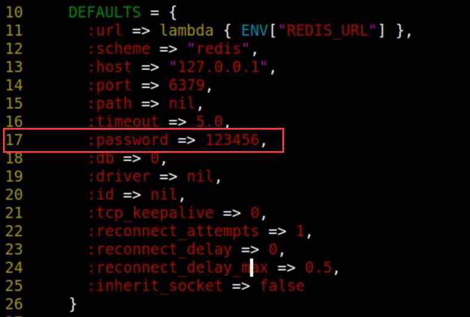

### 创建 Redis Cluster 集群

```bash
#确保三台主机6个实例都启动状态
[root@redis-node1 ~]#systemctl is-active  redis redis6380
active
active
[root@redis-node2 ~]#systemctl is-active  redis redis6380
active
active
[root@redis-node3 ~]#systemctl is-active  redis redis6380
active
active
#在第一个主机上执行下面操作
#--replicas 1 表示每个 master 分配一个 slave 节点,前三个节点自动划分为master,后面都为
slave节点
[root@redis-node1 ~]#redis-trib.rb create --replicas 1 10.0.0.7:6379
10.0.0.17:6379 10.0.0.27:6379 10.0.0.7:6380 10.0.0.17:6380  10.0.0.27:6380
>>> Creating cluster
>>> Performing hash slots allocation on 6 nodes...
Using 3 masters:
10.0.0.7:6379
10.0.0.17:6379
10.0.0.27:6379
Adding replica 10.0.0.17:6380 to 10.0.0.7:6379
Adding replica 10.0.0.27:6380 to 10.0.0.17:6379
Adding replica 10.0.0.7:6380 to 10.0.0.27:6379
M: 739cb4c9895592131de418b8bc65990f81b75f3a 10.0.0.7:6379
slots:0-5460 (5461 slots) master
S: 0e0beba04cc98da02ebdb5225a11b84aa8062e10 10.0.0.7:6380
replicates a01fd3d81922d6752f7c960f1a75b6e8f28d911b
M: dddabb4e19235ec02ae96ab2ce67e295ce0274d7 10.0.0.17:6379
slots:5461-10922 (5462 slots) master
S: 34708909088ba562decbc1525a9606e088bdddf1 10.0.0.17:6380
replicates 739cb4c9895592131de418b8bc65990f81b75f3a
M: a01fd3d81922d6752f7c960f1a75b6e8f28d911b 10.0.0.27:6379
slots:10923-16383 (5461 slots) master
S: aefc6203958859024b8383b2fdb87b9e09411ccd 10.0.0.27:6380
replicates dddabb4e19235ec02ae96ab2ce67e295ce0274d7
Can I set the above configuration? (type 'yes' to accept): yes  #输入yes
>>> Nodes configuration updated
>>> Assign a different config epoch to each node
>>> Sending CLUSTER MEET messages to join the cluster
Waiting for the cluster to join....
>>> Performing Cluster Check (using node 10.0.0.7:6379)
M: 739cb4c9895592131de418b8bc65990f81b75f3a 10.0.0.7:6379
slots:0-5460 (5461 slots) master
1 additional replica(s)
S: 0e0beba04cc98da02ebdb5225a11b84aa8062e10 10.0.0.7:6380
slots: (0 slots) slave
replicates a01fd3d81922d6752f7c960f1a75b6e8f28d911b
S: 34708909088ba562decbc1525a9606e088bdddf1 10.0.0.17:6380
slots: (0 slots) slave
replicates 739cb4c9895592131de418b8bc65990f81b75f3a
S: aefc6203958859024b8383b2fdb87b9e09411ccd 10.0.0.27:6380
slots: (0 slots) slave
replicates dddabb4e19235ec02ae96ab2ce67e295ce0274d7
M: a01fd3d81922d6752f7c960f1a75b6e8f28d911b 10.0.0.27:6379
slots:10923-16383 (5461 slots) master
1 additional replica(s)
M: dddabb4e19235ec02ae96ab2ce67e295ce0274d7 10.0.0.17:6379
slots:5461-10922 (5462 slots) master
1 additional replica(s)
[OK] All nodes agree about slots configuration.
>>> Check for open slots...
>>> Check slots coverage...
[OK] All 16384 slots covered.
```

如果有之前的操作导致Redis集群创建报错，则执行清空数据和集群命令：

```text
127.0.0.1:6379> FLUSHALL
OK
127.0.0.1:6379> cluster reset
OK
```

### 查看 Redis Cluster 集群状态

自动生成配置文件记录master/slave对应关系

```bash
[root@redis-node1 ~]#cat /apps/redis/data/nodes-6379.conf
0e0beba04cc98da02ebdb5225a11b84aa8062e10 10.0.0.7:6380@16380 slave
a01fd3d81922d6752f7c960f1a75b6e8f28d911b 0 1582383256000 5 connected
34708909088ba562decbc1525a9606e088bdddf1 10.0.0.17:6380@16380 slave
739cb4c9895592131de418b8bc65990f81b75f3a 0 1582383256216 4 connected
aefc6203958859024b8383b2fdb87b9e09411ccd 10.0.0.27:6380@16380 slave
dddabb4e19235ec02ae96ab2ce67e295ce0274d7 0 1582383257000 6 connected
739cb4c9895592131de418b8bc65990f81b75f3a 10.0.0.7:6379@16379 myself,master - 0
1582383256000 1 connected 0-5460
a01fd3d81922d6752f7c960f1a75b6e8f28d911b 10.0.0.27:6379@16379 master - 0
1582383258230 5 connected 10923-16383
dddabb4e19235ec02ae96ab2ce67e295ce0274d7 10.0.0.17:6379@16379 master - 0
1582383257223 3 connected 5461-10922
vars currentEpoch 6 lastVoteEpoch 0
[root@redis-node1 ~]#
```

查看状态

```bash
[root@redis-node1 ~]#redis-trib.rb info 10.0.0.7:6379
10.0.0.7:6379 (739cb4c9...) -> 0 keys | 5461 slots | 1 slaves.
10.0.0.27:6379 (a01fd3d8...) -> 0 keys | 5461 slots | 1 slaves.
10.0.0.17:6379 (dddabb4e...) -> 0 keys | 5462 slots | 1 slaves.
[OK] 0 keys in 3 masters.
0.00 keys per slot on average.
[root@redis-node1 ~]#redis-trib.rb check 10.0.0.7:6379
>>> Performing Cluster Check (using node 10.0.0.7:6379)
M: 739cb4c9895592131de418b8bc65990f81b75f3a 10.0.0.7:6379
slots:0-5460 (5461 slots) master
1 additional replica(s)
S: 0e0beba04cc98da02ebdb5225a11b84aa8062e10 10.0.0.7:6380
slots: (0 slots) slave
replicates a01fd3d81922d6752f7c960f1a75b6e8f28d911b
S: 34708909088ba562decbc1525a9606e088bdddf1 10.0.0.17:6380
slots: (0 slots) slave
replicates 739cb4c9895592131de418b8bc65990f81b75f3a
S: aefc6203958859024b8383b2fdb87b9e09411ccd 10.0.0.27:6380
slots: (0 slots) slave
replicates dddabb4e19235ec02ae96ab2ce67e295ce0274d7
M: a01fd3d81922d6752f7c960f1a75b6e8f28d911b 10.0.0.27:6379
slots:10923-16383 (5461 slots) master
1 additional replica(s)
M: dddabb4e19235ec02ae96ab2ce67e295ce0274d7 10.0.0.17:6379
slots:5461-10922 (5462 slots) master
1 additional replica(s)
[OK] All nodes agree about slots configuration.
>>> Check for open slots...
>>> Check slots coverage...
[OK] All 16384 slots covered.
```

```bash
[root@redis-node1 ~]#redis-cli  -a 123456
Warning: Using a password with '-a' option on the command line interface may not
be safe.
127.0.0.1:6379> CLUSTER INFO
cluster_state:ok
cluster_slots_assigned:16384
cluster_slots_ok:16384
cluster_slots_pfail:0
cluster_slots_fail:0
cluster_known_nodes:6
cluster_size:3
cluster_current_epoch:6
cluster_my_epoch:1
cluster_stats_messages_ping_sent:252
cluster_stats_messages_pong_sent:277
cluster_stats_messages_sent:529
cluster_stats_messages_ping_received:272
cluster_stats_messages_pong_received:252
cluster_stats_messages_meet_received:5
cluster_stats_messages_received:529
127.0.0.1:6379>
[root@redis-node1 ~]#redis-cli  -a 123456 -p 6379 CLUSTER NODES
Warning: Using a password with '-a' option on the command line interface may not
be safe.
29a83275db60f1c8f9f6d39b66cbc6c3d5cf20f1 10.0.0.7:6379@16379 myself,master - 0
1601985995000 1 connected 0-5460
3e607de412a8a240e8214c2d7a663cf1523412eb 10.0.0.17:6380@16380 slave
29a83275db60f1c8f9f6d39b66cbc6c3d5cf20f1 0 1601985997092 4 connected
17d0b29d2f50ea9c89d4e6e0cf3ee3ee4f7c4179 10.0.0.7:6380@16380 slave
90b206131d89b0812c626677343df9a11ff1d211 0 1601985995075 5 connected
90b206131d89b0812c626677343df9a11ff1d211 10.0.0.27:6379@16379 master - 0
1601985996084 5 connected 10923-16383
fb34c3a704aefb1e1ef2317b20598d6e1e51c010 10.0.0.17:6379@16379 master - 0
1601985995000 3 connected 5461-10922
c9ea6113a1992695fb86f5368fe6320349b0f8a6 10.0.0.27:6380@16380 slave
fb34c3a704aefb1e1ef2317b20598d6e1e51c010 0 1601985996000 6 connected
```

```bash
[root@redis-node1 ~]#redis-cli  -a 123456 -p 6379 INFO replication
Warning: Using a password with '-a' option on the command line interface may not
be safe.
# Replication
role:master
connected_slaves:1
slave0:ip=10.0.0.17,port=6380,state=online,offset=196,lag=0
master_replid:4ee36f9374c796ca4c65a0f0cb2c39304bb2e9c9
master_replid2:0000000000000000000000000000000000000000
master_repl_offset:196
second_repl_offset:-1
repl_backlog_active:1
repl_backlog_size:1048576
repl_backlog_first_byte_offset:1
repl_backlog_histlen:196
[root@redis-node1 ~]#redis-cli  -a 123456 -p 6380 INFO replication
Warning: Using a password with '-a' option on the command line interface may not
be safe.
# Replication
role:slave
master_host:10.0.0.27
master_port:6379
master_link_status:up
master_last_io_seconds_ago:2
master_sync_in_progress:0
slave_repl_offset:224
slave_priority:100
slave_read_only:1
connected_slaves:0
master_replid:dba41cb31c14de7569e597a3d8debc1f0f114c1e
master_replid2:0000000000000000000000000000000000000000
master_repl_offset:224
second_repl_offset:-1
repl_backlog_active:1
repl_backlog_size:1048576
repl_backlog_first_byte_offset:1
repl_backlog_histlen:224
```

### Python 实现 Redis Cluster 集群访问

```bash
[root@redis-node1 ~]#yum -y install python3
[root@redis-node1 ~]#pip3 install redis-py-cluster
[root@redis-node1 ~]#vim redis_cluster_test.py
[root@redis-node1 ~]#cat ./redis_cluster_test.py
#!/usr/bin/env python3
from rediscluster  import RedisCluster
startup_nodes = [
{"host":"10.0.0.7", "port":6379},
{"host":"10.0.0.7", "port":6380},
{"host":"10.0.0.17", "port":6379},
{"host":"10.0.0.17", "port":6380},
{"host":"10.0.0.27", "port":6379},
{"host":"10.0.0.27", "port":6380}
]
redis_conn= RedisCluster(startup_nodes=startup_nodes,password='123456',
decode_responses=True)
for i in range(0, 10000):
redis_conn.set('key'+str(i),'value'+str(i))
print('key'+str(i)+':',redis_conn.get('key'+str(i)))
```

```bash
[root@redis-node1 ~]#chmod +x redis_cluster_test.py
[root@redis-node1 ~]#./redis_cluster_test.py
......
key9998: value9998
key9999: value9999
```

验证脚本写入的状态

```bash
[root@redis-node1 ~]#redis-cli -a 123456 -h 10.0.0.7 DBSIZE
Warning: Using a password with '-a' option on the command line interface may not
be safe.
(integer) 3331
[root@redis-node1 ~]#redis-cli -a 123456 -h 10.0.0.17 DBSIZE
Warning: Using a password with '-a' option on the command line interface may not
be safe.
(integer) 3340
[root@redis-node1 ~]#redis-cli -a 123456 -h 10.0.0.27 DBSIZE
Warning: Using a password with '-a' option on the command line interface may not
be safe.
(integer) 3329
[root@redis-node1 ~]#redis-cli -a 123456  GET key1
Warning: Using a password with '-a' option on the command line interface may not
be safe.
(error) MOVED 9189 10.0.0.17:6379
[root@redis-node1 ~]#redis-cli -a 123456  GET key2
Warning: Using a password with '-a' option on the command line interface may not
be safe.
"value2"
[root@redis-node1 ~]#redis-cli -a 123456 -h 10.0.0.17  GET key1
Warning: Using a password with '-a' option on the command line interface may not
be safe.
"value1"
[root@redis-node1 ~]#redis-trib.rb info 10.0.0.7:6379
10.0.0.7:6379 (739cb4c9...) -> 3331 keys | 5461 slots | 1 slaves.
10.0.0.27:6379 (a01fd3d8...) -> 3329 keys | 5461 slots | 1 slaves.
10.0.0.17:6379 (dddabb4e...) -> 3340 keys | 5462 slots | 1 slaves.
[OK] 10000 keys in 3 masters.
0.61 keys per slot on average.
[root@redis-node1 ~]#
```

### 模拟故障实现自动的故障转移

```bash
[root@redis-node1 ~]#systemctl stop redis
#不会立即提升,需要稍等一会儿再观察下面结果
[root@redis-node1 ~]#redis-trib.rb check 10.0.0.27:6379
>>> Performing Cluster Check (using node 10.0.0.27:6379)
M: a01fd3d81922d6752f7c960f1a75b6e8f28d911b 10.0.0.27:6379
slots:10923-16383 (5461 slots) master
1 additional replica(s)
S: aefc6203958859024b8383b2fdb87b9e09411ccd 10.0.0.27:6380
slots: (0 slots) slave
replicates dddabb4e19235ec02ae96ab2ce67e295ce0274d7
S: 0e0beba04cc98da02ebdb5225a11b84aa8062e10 10.0.0.7:6380
slots: (0 slots) slave
replicates a01fd3d81922d6752f7c960f1a75b6e8f28d911b
M: 34708909088ba562decbc1525a9606e088bdddf1 10.0.0.17:6380
slots:0-5460 (5461 slots) master
0 additional replica(s)
M: dddabb4e19235ec02ae96ab2ce67e295ce0274d7 10.0.0.17:6379
slots:5461-10922 (5462 slots) master
1 additional replica(s)
[OK] All nodes agree about slots configuration.
>>> Check for open slots...
>>> Check slots coverage...
[OK] All 16384 slots covered.
[root@redis-node1 ~]#tail /var/log/messages
Feb 22 23:23:13 centos7 redis-server: 71887:M 22 Feb 23:23:13.656 * Saving the
final RDB snapshot before exiting.
Feb 22 23:23:13 centos7 systemd: Stopped Redis persistent key-value database.
Feb 22 23:23:13 centos7 redis-server: 71887:M 22 Feb 23:23:13.660 * DB saved on
disk
Feb 22 23:23:13 centos7 redis-server: 71887:M 22 Feb 23:23:13.660 * Removing the
pid file.
Feb 22 23:23:13 centos7 redis-server: 71887:M 22 Feb 23:23:13.660 # Redis is now
ready to exit, bye bye...
Feb 22 23:23:13 centos7 systemd: Unit redis.service entered failed state.
Feb 22 23:23:13 centos7 systemd: redis.service failed.
Feb 22 23:23:30 centos7 redis-server: 72046:S 22 Feb 23:23:30.077 * FAIL message
received from dddabb4e19235ec02ae96ab2ce67e295ce0274d7 about
739cb4c9895592131de418b8bc65990f81b75f3a
Feb 22 23:23:30 centos7 redis-server: 72046:S 22 Feb 23:23:30.077 # Cluster
state changed: fail
Feb 22 23:23:30 centos7 redis-server: 72046:S 22 Feb 23:23:30.701 # Cluster
state changed: ok
[root@redis-node1 ~]#redis-trib.rb info 10.0.0.27:6379
10.0.0.27:6379 (a01fd3d8...) -> 3329 keys | 5461 slots | 1 slaves.
10.0.0.17:6380 (34708909...) -> 3331 keys | 5461 slots | 0 slaves.
10.0.0.17:6379 (dddabb4e...) -> 3340 keys | 5462 slots | 1 slaves.
[OK] 10000 keys in 3 masters.
0.61 keys per slot on average.
```

将故障的master恢复后，该节点自动加入集群成为新的slave

```bash
[root@redis-node1 ~]#systemctl start redis
[root@redis-node1 ~]#redis-trib.rb check 10.0.0.27:6379
>>> Performing Cluster Check (using node 10.0.0.27:6379)
M: a01fd3d81922d6752f7c960f1a75b6e8f28d911b 10.0.0.27:6379
slots:10923-16383 (5461 slots) master
1 additional replica(s)
S: aefc6203958859024b8383b2fdb87b9e09411ccd 10.0.0.27:6380
slots: (0 slots) slave
replicates dddabb4e19235ec02ae96ab2ce67e295ce0274d7
S: 739cb4c9895592131de418b8bc65990f81b75f3a 10.0.0.7:6379
slots: (0 slots) slave
replicates 34708909088ba562decbc1525a9606e088bdddf1
S: 0e0beba04cc98da02ebdb5225a11b84aa8062e10 10.0.0.7:6380
slots: (0 slots) slave
replicates a01fd3d81922d6752f7c960f1a75b6e8f28d911b
M: 34708909088ba562decbc1525a9606e088bdddf1 10.0.0.17:6380
slots:0-5460 (5461 slots) master
1 additional replica(s)
M: dddabb4e19235ec02ae96ab2ce67e295ce0274d7 10.0.0.17:6379
slots:5461-10922 (5462 slots) master
1 additional replica(s)
[OK] All nodes agree about slots configuration.
>>> Check for open slots...
>>> Check slots coverage...
[OK] All 16384 slots covered.
```

### Redis cluster 管理

### 集群扩容

扩容适用场景：

当前客户量激增，现有的Redis cluster架构已经无法满足越来越高的并发访问请求，为解决此问题,新购置两台服务器，要求将其动态添加到现有集群，但不能影响业务的正常访问。

新版支持集群中有旧数据的情况进行扩容

注意: 生产环境一般建议master节点为奇数个,比如:3,5,7,以防止脑裂现象


3.3.5.1.1 添加节点准备

增加Redis 新节点，需要与之前的Redis node版本和配置一致，然后分别再启动两台Redis node，应为一主一从。

```bash
#配置node7节点
[root@redis-node7 ~]#dnf -y  install redis
[root@redis-node7 ~]#sed -i.bak -e 's/bind 127.0.0.1/bind 0.0.0.0/' -e
'/masterauth/a masterauth 123456' -e '/# requirepass/a requirepass 123456' -e '/#
cluster-enabled yes/a cluster-enabled yes' -e '/# cluster-config-file nodes-
6379.conf/a cluster-config-file nodes-6379.conf' -e '/cluster-require-full-
coverage yes/c cluster-require-full-coverage no' /etc/redis.conf
#编译安装执行下面操作
[root@redis-node7 ~]#sed -i.bak  -e '/masterauth/a masterauth 123456'  -e '/#
cluster-enabled yes/a cluster-enabled yes' -e '/# cluster-config-file nodes-
6379.conf/a cluster-config-file nodes-6379.conf' -e '/cluster-require-full-
coverage yes/c cluster-require-full-coverage no'
/apps/redis/etc/redis.conf;systemctl restart redis
[root@redis-node7 ~]#systemctl enable --now redis
#配置node8节点
[root@redis-node8 ~]#dnf -y  install redis
[root@redis-node8 ~]#sed -i.bak -e 's/bind 127.0.0.1/bind 0.0.0.0/' -e
'/masterauth/a masterauth 123456' -e '/# requirepass/a requirepass 123456' -e '/#
cluster-enabled yes/a cluster-enabled yes' -e '/# cluster-config-file nodes-
6379.conf/a cluster-config-file nodes-6379.conf' -e '/cluster-require-full-
coverage yes/c cluster-require-full-coverage no' /etc/redis.conf
#编译安装执行下面操作
[root@redis-node8 ~]#sed -i.bak  -e '/masterauth/a masterauth 123456'  -e '/#
cluster-enabled yes/a cluster-enabled yes' -e '/# cluster-config-file nodes-
6379.conf/a cluster-config-file nodes-6379.conf' -e '/cluster-require-full-
coverage yes/c cluster-require-full-coverage no'
/apps/redis/etc/redis.conf;systemctl restart redis
[root@redis-node8 ~]#systemctl enable --now  redis
```

3.3.5.1.2 添加新的master节点到集群

使用以下命令添加新节点，要添加的新redis节点IP和端口添加到的已有的集群中任意节点的IP:端口

```xml
add-node new_host:new_port existing_host:existing_port  [--slave --master-id
<arg>]
#说明：
new_host:new_port               #指定新添加的主机的IP和端口
existing_host:existing_port     #指定已有的集群中任意节点的IP和端口
```

Redis 3/4 版本的添加命令：

```bash
#把新的Redis 节点10.0.0.37添加到当前Redis集群当中。
[root@redis-node1 ~]#redis-trib.rb add-node 10.0.0.37:6379 10.0.0.7:6379
[root@redis-node1 ~]#redis-trib.rb info  10.0.0.7:6379
10.0.0.7:6379 (29a83275...) -> 3331 keys | 5461 slots | 1 slaves.
10.0.0.37:6379 (12ca273a...) -> 0 keys | 0 slots | 0 slaves.
10.0.0.27:6379 (90b20613...) -> 3329 keys | 5461 slots | 1 slaves.
10.0.0.17:6379 (fb34c3a7...) -> 3340 keys | 5462 slots | 1 slaves.
[OK] 10000 keys in 4 masters.
0.61 keys per slot on average.
```

Redis 5 以上版本的添加命令：

```bash
#将一台新的主机10.0.0.68加入集群,以下示例中10.0.0.58可以是任意存在的集群节点
[root@redis-node1 ~]#redis-cli -a 123456 --cluster add-node 10.0.0.68:6379  <当前
任意集群节点>:6379
Warning: Using a password with '-a' or '-u' option on the command line interface
may not be safe.
>>> Adding node 10.0.0.68:6379 to cluster 10.0.0.58:6379
>>> Performing Cluster Check (using node 10.0.0.58:6379)
S: 9875b50925b4e4f29598e6072e5937f90df9fc71 10.0.0.58:6379
slots: (0 slots) slave
replicates d34da8666a6f587283a1c2fca5d13691407f9462
M: d04e524daec4d8e22bdada7f21a9487c2d3e1057 10.0.0.48:6379
slots:[5461-10922] (5462 slots) master
1 additional replica(s)
M: d34da8666a6f587283a1c2fca5d13691407f9462 10.0.0.28:6379
slots:[10923-16383] (5461 slots) master
1 additional replica(s)
S: 99720241248ff0e4c6fa65c2385e92468b3b5993 10.0.0.18:6379
slots: (0 slots) slave
replicates d04e524daec4d8e22bdada7f21a9487c2d3e1057
S: f9adcfb8f5a037b257af35fa548a26ffbadc852d 10.0.0.38:6379
slots: (0 slots) slave
replicates cb028b83f9dc463d732f6e76ca6bbcd469d948a7
M: cb028b83f9dc463d732f6e76ca6bbcd469d948a7 10.0.0.8:6379
slots:[0-5460] (5461 slots) master
1 additional replica(s)
[OK] All nodes agree about slots configuration.
>>> Check for open slots...
>>> Check slots coverage...
[OK] All 16384 slots covered.
>>> Send CLUSTER MEET to node 10.0.0.68:6379 to make it join the cluster.
[OK] New node added correctly.
```

```bash
#观察到该节点已经加入成功，但此节点上没有slot位,也无从节点，而且新的节点是master
[root@redis-node1 ~]#redis-cli -a 123456 --cluster info  10.0.0.8:6379
Warning: Using a password with '-a' or '-u' option on the command line interface
may not be safe.
10.0.0.8:6379 (cb028b83...) -> 6672 keys | 5461 slots | 1 slaves.
10.0.0.68:6379 (d6e2eca6...) -> 0 keys | 0 slots | 0 slaves.
10.0.0.48:6379 (d04e524d...) -> 6679 keys | 5462 slots | 1 slaves.
10.0.0.28:6379 (d34da866...) -> 6649 keys | 5461 slots | 1 slaves.
[OK] 20000 keys in 5 masters.
1.22 keys per slot on average.
[root@redis-node1 ~]#redis-cli -a 123456 --cluster check  10.0.0.8:6379
Warning: Using a password with '-a' or '-u' option on the command line interface
may not be safe.
10.0.0.8:6379 (cb028b83...) -> 6672 keys | 5461 slots | 1 slaves.
10.0.0.68:6379 (d6e2eca6...) -> 0 keys | 0 slots | 0 slaves.
10.0.0.48:6379 (d04e524d...) -> 6679 keys | 5462 slots | 1 slaves.
10.0.0.28:6379 (d34da866...) -> 6649 keys | 5461 slots | 1 slaves.
[OK] 20000 keys in 5 masters.
1.22 keys per slot on average.
>>> Performing Cluster Check (using node 10.0.0.8:6379)
M: cb028b83f9dc463d732f6e76ca6bbcd469d948a7 10.0.0.8:6379
slots:[0-5460] (5461 slots) master
1 additional replica(s)
M: d6e2eca6b338b717923f64866bd31d42e52edc98 10.0.0.68:6379
slots: (0 slots) master
S: 9875b50925b4e4f29598e6072e5937f90df9fc71 10.0.0.58:6379
slots: (0 slots) slave
replicates d34da8666a6f587283a1c2fca5d13691407f9462
S: f9adcfb8f5a037b257af35fa548a26ffbadc852d 10.0.0.38:6379
slots: (0 slots) slave
replicates cb028b83f9dc463d732f6e76ca6bbcd469d948a7
M: d04e524daec4d8e22bdada7f21a9487c2d3e1057 10.0.0.48:6379
slots:[5461-10922] (5462 slots) master
1 additional replica(s)
S: 99720241248ff0e4c6fa65c2385e92468b3b5993 10.0.0.18:6379
slots: (0 slots) slave
replicates d04e524daec4d8e22bdada7f21a9487c2d3e1057
M: d34da8666a6f587283a1c2fca5d13691407f9462 10.0.0.28:6379
slots:[10923-16383] (5461 slots) master
1 additional replica(s)
[OK] All nodes agree about slots configuration.
>>> Check for open slots...
>>> Check slots coverage...
[OK] All 16384 slots covered.
[root@redis-node1 ~]#cat /var/lib/redis/nodes-6379.conf
d6e2eca6b338b717923f64866bd31d42e52edc98 10.0.0.68:6379@16379 master - 0
1582356107260 8 connected
9875b50925b4e4f29598e6072e5937f90df9fc71 10.0.0.58:6379@16379 slave
d34da8666a6f587283a1c2fca5d13691407f9462 0 1582356110286 6 connected
f9adcfb8f5a037b257af35fa548a26ffbadc852d 10.0.0.38:6379@16379 slave
cb028b83f9dc463d732f6e76ca6bbcd469d948a7 0 1582356108268 4 connected
d04e524daec4d8e22bdada7f21a9487c2d3e1057 10.0.0.48:6379@16379 master - 0
1582356105000 7 connected 5461-10922
99720241248ff0e4c6fa65c2385e92468b3b5993 10.0.0.18:6379@16379 slave
d04e524daec4d8e22bdada7f21a9487c2d3e1057 0 1582356108000 7 connected
d34da8666a6f587283a1c2fca5d13691407f9462 10.0.0.28:6379@16379 master - 0
1582356107000 3 connected 10923-16383
cb028b83f9dc463d732f6e76ca6bbcd469d948a7 10.0.0.8:6379@16379 myself,master - 0
1582356106000 1 connected 0-5460
vars currentEpoch 8 lastVoteEpoch 7
#和上面显示结果一样
[root@redis-node1 ~]#redis-cli -a 123456 CLUSTER NODES
Warning: Using a password with '-a' or '-u' option on the command line interface
may not be safe.
d6e2eca6b338b717923f64866bd31d42e52edc98 10.0.0.68:6379@16379 master - 0
1582356313200 8 connected
9875b50925b4e4f29598e6072e5937f90df9fc71 10.0.0.58:6379@16379 slave
d34da8666a6f587283a1c2fca5d13691407f9462 0 1582356311000 6 connected
f9adcfb8f5a037b257af35fa548a26ffbadc852d 10.0.0.38:6379@16379 slave
cb028b83f9dc463d732f6e76ca6bbcd469d948a7 0 1582356314208 4 connected
d04e524daec4d8e22bdada7f21a9487c2d3e1057 10.0.0.48:6379@16379 master - 0
1582356311182 7 connected 5461-10922
99720241248ff0e4c6fa65c2385e92468b3b5993 10.0.0.18:6379@16379 slave
d04e524daec4d8e22bdada7f21a9487c2d3e1057 0 1582356312000 7 connected
d34da8666a6f587283a1c2fca5d13691407f9462 10.0.0.28:6379@16379 master - 0
1582356312190 3 connected 10923-16383
cb028b83f9dc463d732f6e76ca6bbcd469d948a7 10.0.0.8:6379@16379 myself,master - 0
1582356310000 1 connected 0-5460
#查看集群状态
[root@redis-node1 ~]#redis-cli -a 123456 CLUSTER INFO
Warning: Using a password with '-a' or '-u' option on the command line interface
may not be safe.
cluster_state:ok
cluster_slots_assigned:16384
cluster_slots_ok:16384
cluster_slots_pfail:0
cluster_slots_fail:0
cluster_known_nodes:7
cluster_size:3
cluster_current_epoch:8
cluster_my_epoch:1
cluster_stats_messages_ping_sent:17442
cluster_stats_messages_pong_sent:13318
cluster_stats_messages_fail_sent:4
cluster_stats_messages_auth-ack_sent:1
cluster_stats_messages_sent:30765
cluster_stats_messages_ping_received:13311
cluster_stats_messages_pong_received:13367
cluster_stats_messages_meet_received:7
cluster_stats_messages_fail_received:1
cluster_stats_messages_auth-req_received:1
cluster_stats_messages_received:26687
[root@redis-node1 ~]#
```

3.3.5.1.3 在新的master上重新分配槽位

新的node节点加到集群之后,默认是master节点，但是没有slots，需要重新分配,否则没有槽位将无法访问

注意: 旧版本重新分配槽位需要清空数据,所以需要先备份数据,扩展后再恢复数据,新版支持有数据直接扩容

Redis 3/4 版本命令:

```bash
[root@redis-node1 ~]# redis-trib.rb check 10.0.0.67:6379 #当前状态
[root@redis-node1 ~]# redis-trib.rb reshard <任意节点>:6379 #重新分片
[root@redis-node1 ~]# redis-trib.rb fix 10.0.0.67:6379 #如果迁移失败使用此命令修复集群
```

Redis 5以上版本命令：

```bash
[root@redis-node1 ~]#redis-cli -a 123456 --cluster reshard  <当前任意集群节点>:6379
Warning: Using a password with '-a' or '-u' option on the command line interface
may not be safe.
>>> Performing Cluster Check (using node 10.0.0.68:6379)
M: d6e2eca6b338b717923f64866bd31d42e52edc98 10.0.0.68:6379
slots: (0 slots) master
M: d34da8666a6f587283a1c2fca5d13691407f9462 10.0.0.28:6379
slots:[10923-16383] (5461 slots) master
1 additional replica(s)
M: d04e524daec4d8e22bdada7f21a9487c2d3e1057 10.0.0.48:6379
slots:[5461-10922] (5462 slots) master
1 additional replica(s)
M: cb028b83f9dc463d732f6e76ca6bbcd469d948a7 10.0.0.8:6379
slots:[0-5460] (5461 slots) master
1 additional replica(s)
S: 99720241248ff0e4c6fa65c2385e92468b3b5993 10.0.0.18:6379
slots: (0 slots) slave
replicates d04e524daec4d8e22bdada7f21a9487c2d3e1057
M: f67f1c02c742cd48d3f48d8c362f9f1b9aa31549 10.0.0.78:6379
slots: (0 slots) master
S: f9adcfb8f5a037b257af35fa548a26ffbadc852d 10.0.0.38:6379
slots: (0 slots) slave
replicates cb028b83f9dc463d732f6e76ca6bbcd469d948a7
S: 9875b50925b4e4f29598e6072e5937f90df9fc71 10.0.0.58:6379
slots: (0 slots) slave
replicates d34da8666a6f587283a1c2fca5d13691407f9462
[OK] All nodes agree about slots configuration.
>>> Check for open slots...
>>> Check slots coverage...
[OK] All 16384 slots covered.
How many slots do you want to move (from 1 to 16384)?4096 #新分配多少个槽位
=16384/master个数
What is the receiving node ID? d6e2eca6b338b717923f64866bd31d42e52edc98 #新的
master的ID
Please enter all the source node IDs.
Type 'all' to use all the nodes as source nodes for the hash slots.
Type 'done' once you entered all the source nodes IDs.
Source node #1: all #输入all,将哪些源主机的槽位分配给新的节点，all是自动在所有的redis
node选择划分，如果是从redis cluster删除某个主机可以使用此方式将指定主机上的槽位全部移动到别的
redis主机
......
Do you want to proceed with the proposed reshard plan (yes/no)?  yes #确认分配
......
Moving slot 12280 from 10.0.0.28:6379 to 10.0.0.68:6379: .
Moving slot 12281 from 10.0.0.28:6379 to 10.0.0.68:6379: .
Moving slot 12282 from 10.0.0.28:6379 to 10.0.0.68:6379:
Moving slot 12283 from 10.0.0.28:6379 to 10.0.0.68:6379: ..
Moving slot 12284 from 10.0.0.28:6379 to 10.0.0.68:6379:
Moving slot 12285 from 10.0.0.28:6379 to 10.0.0.68:6379: .
Moving slot 12286 from 10.0.0.28:6379 to 10.0.0.68:6379:
Moving slot 12287 from 10.0.0.28:6379 to 10.0.0.68:6379: ..
[root@redis-node1 ~]#
#确定slot分配成功
[root@redis-node1 ~]#redis-cli -a 123456 --cluster check 10.0.0.8:6379
Warning: Using a password with '-a' or '-u' option on the command line interface
may not be safe.
10.0.0.8:6379 (cb028b83...) -> 5019 keys | 4096 slots | 1 slaves.
10.0.0.68:6379 (d6e2eca6...) -> 4948 keys | 4096 slots | 0 slaves.
10.0.0.48:6379 (d04e524d...) -> 5033 keys | 4096 slots | 1 slaves.
10.0.0.28:6379 (d34da866...) -> 5000 keys | 4096 slots | 1 slaves.
[OK] 20000 keys in 5 masters.
1.22 keys per slot on average.
>>> Performing Cluster Check (using node 10.0.0.8:6379)
M: cb028b83f9dc463d732f6e76ca6bbcd469d948a7 10.0.0.8:6379
slots:[1365-5460] (4096 slots) master
1 additional replica(s)
M: d6e2eca6b338b717923f64866bd31d42e52edc98 10.0.0.68:6379
slots:[0-1364],[5461-6826],[10923-12287] (4096 slots) master #可看到4096个slots
S: 9875b50925b4e4f29598e6072e5937f90df9fc71 10.0.0.58:6379
slots: (0 slots) slave
replicates d34da8666a6f587283a1c2fca5d13691407f9462
S: f9adcfb8f5a037b257af35fa548a26ffbadc852d 10.0.0.38:6379
slots: (0 slots) slave
replicates cb028b83f9dc463d732f6e76ca6bbcd469d948a7
M: d04e524daec4d8e22bdada7f21a9487c2d3e1057 10.0.0.48:6379
slots:[6827-10922] (4096 slots) master
1 additional replica(s)
S: 99720241248ff0e4c6fa65c2385e92468b3b5993 10.0.0.18:6379
slots: (0 slots) slave
replicates d04e524daec4d8e22bdada7f21a9487c2d3e1057
M: d34da8666a6f587283a1c2fca5d13691407f9462 10.0.0.28:6379
slots:[12288-16383] (4096 slots) master
1 additional replica(s)
[OK] All nodes agree about slots configuration.
>>> Check for open slots...
>>> Check slots coverage...
[OK] All 16384 slots covered.
```

3.3.5.1.4 为新的master指定新的slave节点

当前Redis集群中新的master节点存单点问题,还需要给其添加一个对应slave节点，实现高可用功能

有两种方式：

方法1：在新加节点到集群时，直接将之设置为slave

Redis 3/4 添加命令：

```text
redis-trib.rb   add-node  --slave  --master-id
750cab050bc81f2655ed53900fd43d2e64423333 10.0.0.77:6379 <任意集群节点>:6379
```

Redis 5 以上版本添加命令：

```text
redis-cli -a 123456 --cluster add-node 10.0.0.78:6379 <任意集群节点>:6379 --
cluster-slave  --cluster-master-id d6e2eca6b338b717923f64866bd31d42e52edc98
```

范例:

```bash
#查看当前状态
[root@redis-node1 ~]#redis-cli -a 123456 --cluster check 10.0.0.8:6379
Warning: Using a password with '-a' or '-u' option on the command line interface
may not be safe.
10.0.0.8:6379 (cb028b83...) -> 5019 keys | 4096 slots | 1 slaves.
10.0.0.68:6379 (d6e2eca6...) -> 4948 keys | 4096 slots | 0 slaves.
10.0.0.48:6379 (d04e524d...) -> 5033 keys | 4096 slots | 1 slaves.
10.0.0.28:6379 (d34da866...) -> 5000 keys | 4096 slots | 1 slaves.
[OK] 20000 keys in 4 masters.
1.22 keys per slot on average.
>>> Performing Cluster Check (using node 10.0.0.8:6379)
M: cb028b83f9dc463d732f6e76ca6bbcd469d948a7 10.0.0.8:6379
slots:[1365-5460] (4096 slots) master
1 additional replica(s)
M: d6e2eca6b338b717923f64866bd31d42e52edc98 10.0.0.68:6379
slots:[0-1364],[5461-6826],[10923-12287] (4096 slots) master
S: 9875b50925b4e4f29598e6072e5937f90df9fc71 10.0.0.58:6379
slots: (0 slots) slave
replicates d34da8666a6f587283a1c2fca5d13691407f9462
S: f9adcfb8f5a037b257af35fa548a26ffbadc852d 10.0.0.38:6379
slots: (0 slots) slave
replicates cb028b83f9dc463d732f6e76ca6bbcd469d948a7
M: d04e524daec4d8e22bdada7f21a9487c2d3e1057 10.0.0.48:6379
slots:[6827-10922] (4096 slots) master
1 additional replica(s)
S: 99720241248ff0e4c6fa65c2385e92468b3b5993 10.0.0.18:6379
slots: (0 slots) slave
replicates d04e524daec4d8e22bdada7f21a9487c2d3e1057
M: d34da8666a6f587283a1c2fca5d13691407f9462 10.0.0.28:6379
slots:[12288-16383] (4096 slots) master
1 additional replica(s)
[OK] All nodes agree about slots configuration.
>>> Check for open slots...
>>> Check slots coverage...
[OK] All 16384 slots covered.
#直接加为slave节点
[root@redis-node1 ~]#redis-cli -a 123456 --cluster add-node 10.0.0.78:6379
10.0.0.8:6379 --cluster-slave  --cluster-master-id
d6e2eca6b338b717923f64866bd31d42e52edc98
```

```bash
#验证是否成功
[root@redis-node1 ~]#redis-cli -a 123456 --cluster check 10.0.0.8:6379
Warning: Using a password with '-a' or '-u' option on the command line interface
may not be safe.
10.0.0.8:6379 (cb028b83...) -> 5019 keys | 4096 slots | 1 slaves.
10.0.0.68:6379 (d6e2eca6...) -> 4948 keys | 4096 slots | 1 slaves.
10.0.0.48:6379 (d04e524d...) -> 5033 keys | 4096 slots | 1 slaves.
10.0.0.28:6379 (d34da866...) -> 5000 keys | 4096 slots | 1 slaves.
[OK] 20000 keys in 4 masters.
1.22 keys per slot on average.
>>> Performing Cluster Check (using node 10.0.0.8:6379)
M: cb028b83f9dc463d732f6e76ca6bbcd469d948a7 10.0.0.8:6379
slots:[1365-5460] (4096 slots) master
1 additional replica(s)
M: d6e2eca6b338b717923f64866bd31d42e52edc98 10.0.0.68:6379
slots:[0-1364],[5461-6826],[10923-12287] (4096 slots) master
1 additional replica(s)
S: 36840d7eea5835ba540d9b64ec018aa3f8de6747 10.0.0.78:6379
slots: (0 slots) slave
replicates d6e2eca6b338b717923f64866bd31d42e52edc98
S: 9875b50925b4e4f29598e6072e5937f90df9fc71 10.0.0.58:6379
slots: (0 slots) slave
replicates d34da8666a6f587283a1c2fca5d13691407f9462
S: f9adcfb8f5a037b257af35fa548a26ffbadc852d 10.0.0.38:6379
slots: (0 slots) slave
replicates cb028b83f9dc463d732f6e76ca6bbcd469d948a7
M: d04e524daec4d8e22bdada7f21a9487c2d3e1057 10.0.0.48:6379
slots:[6827-10922] (4096 slots) master
1 additional replica(s)
S: 99720241248ff0e4c6fa65c2385e92468b3b5993 10.0.0.18:6379
slots: (0 slots) slave
replicates d04e524daec4d8e22bdada7f21a9487c2d3e1057
M: d34da8666a6f587283a1c2fca5d13691407f9462 10.0.0.28:6379
slots:[12288-16383] (4096 slots) master
1 additional replica(s)
[OK] All nodes agree about slots configuration.
>>> Check for open slots...
>>> Check slots coverage...
[OK] All 16384 slots covered.
[root@centos8 ~]#redis-cli  -a 123456 -h 10.0.0.8 --no-auth-warning cluster info
cluster_state:ok
cluster_slots_assigned:16384
cluster_slots_ok:16384
cluster_slots_pfail:0
cluster_slots_fail:0
cluster_known_nodes:8   #8个节点
cluster_size:4          #4组主从
cluster_current_epoch:11
cluster_my_epoch:10
cluster_stats_messages_ping_sent:1810
cluster_stats_messages_pong_sent:1423
cluster_stats_messages_auth-req_sent:5
cluster_stats_messages_update_sent:14
cluster_stats_messages_sent:3252
cluster_stats_messages_ping_received:1417
cluster_stats_messages_pong_received:1368
cluster_stats_messages_meet_received:2
cluster_stats_messages_fail_received:2
cluster_stats_messages_auth-ack_received:2
cluster_stats_messages_update_received:4
cluster_stats_messages_received:2795
```

方法2：先将新节点加入集群，再修改为slave

为新的master添加slave节点

Redis 3/4 版本命令：

```bash
[root@redis-node1 ~]#redis-trib.rb add-node 10.0.0.78:6379 10.0.0.8:6379
```

Redis 5 以上版本命令：

```bash
#把10.0.0.78:6379添加到集群中：
[root@redis-node1 ~]#redis-cli -a 123456 --cluster add-node 10.0.0.78:6379
10.0.0.8:6379
```

更改新节点更改状态为slave：

需要手动将其指定为某个master的slave，否则其默认角色为master。

```bash
[root@redis-node1 ~]#redis-cli -h 10.0.0.78 -p 6379 -a 123456 #登录到新添加节点
10.0.0.78:6380> CLUSTER NODES #查看当前集群节点，找到目标master 的ID
10.0.0.78:6380> CLUSTER REPLICATE 886338acd50c3015be68a760502b239f4509881c #将其设
置slave，命令格式为cluster replicate MASTERID
10.0.0.78:6380> CLUSTER NODES #再次查看集群节点状态，验证节点是否已经更改为指定master 的
slave
```

### 集群缩容

支持集群中有旧数据的情况进行缩容

缩容适用场景：

随着业务萎缩用户量下降明显,和领导商量决定将现有Redis集群的8台主机中下线两台主机挪做它用,缩容后性能仍能满足当前业务需求

删除节点过程：

扩容时是先添加node到集群，然后再分配槽位，而缩容时的操作相反，是先将被要删除的node上的槽位迁移到集群中的其他node上，然后 才能再将其从集群中删除，如果一个node上的槽位没有被完全迁移空，删除该node时也会提示有数据出错导致无法删除。


3.3.5.2.1 迁移要删除的master节点上面的槽位到其它master

注意: 被迁移Redis master源服务器必须保证没有数据，否则迁移报错并会被强制中断。

Redis 3/4 版本命令

```bash
[root@redis-node1 ~]# redis-trib.rb reshard 10.0.0.8:6379
[root@redis-node1 ~]# redis-trib.rb fix 10.0.0.8:6379 #如果迁移失败使用此命令修复集群
```

Redis 5版本以上命令

```bash
#查看当前状态
[root@redis-node1 ~]#redis-cli -a 123456 --cluster check 10.0.0.8:6379
Warning: Using a password with '-a' or '-u' option on the command line interface
may not be safe.
10.0.0.8:6379 (cb028b83...) -> 5019 keys | 4096 slots | 1 slaves.
10.0.0.68:6379 (d6e2eca6...) -> 4948 keys | 4096 slots | 1 slaves.
10.0.0.48:6379 (d04e524d...) -> 5033 keys | 4096 slots | 1 slaves.
10.0.0.28:6379 (d34da866...) -> 5000 keys | 4096 slots | 1 slaves.
[OK] 20000 keys in 4 masters.
1.22 keys per slot on average.
>>> Performing Cluster Check (using node 10.0.0.8:6379)
M: cb028b83f9dc463d732f6e76ca6bbcd469d948a7 10.0.0.8:6379
slots:[1365-5460] (4096 slots) master
1 additional replica(s)
M: d6e2eca6b338b717923f64866bd31d42e52edc98 10.0.0.68:6379
slots:[0-1364],[5461-6826],[10923-12287] (4096 slots) master
1 additional replica(s)
S: 36840d7eea5835ba540d9b64ec018aa3f8de6747 10.0.0.78:6379
slots: (0 slots) slave
replicates d6e2eca6b338b717923f64866bd31d42e52edc98
S: 9875b50925b4e4f29598e6072e5937f90df9fc71 10.0.0.58:6379
slots: (0 slots) slave
replicates d34da8666a6f587283a1c2fca5d13691407f9462
S: f9adcfb8f5a037b257af35fa548a26ffbadc852d 10.0.0.38:6379
slots: (0 slots) slave
replicates cb028b83f9dc463d732f6e76ca6bbcd469d948a7
M: d04e524daec4d8e22bdada7f21a9487c2d3e1057 10.0.0.48:6379
slots:[6827-10922] (4096 slots) master
1 additional replica(s)
S: 99720241248ff0e4c6fa65c2385e92468b3b5993 10.0.0.18:6379
slots: (0 slots) slave
replicates d04e524daec4d8e22bdada7f21a9487c2d3e1057
M: d34da8666a6f587283a1c2fca5d13691407f9462 10.0.0.28:6379
slots:[12288-16383] (4096 slots) master
1 additional replica(s)
[OK] All nodes agree about slots configuration.
>>> Check for open slots...
>>> Check slots coverage...
[OK] All 16384 slots covered.
#连接到任意集群节点，#最后1365个slot从10.0.0.8移动到第一个master节点10.0.0.28上
[root@redis-node1 ~]#redis-cli -a 123456 --cluster reshard 10.0.0.18:6379
Warning: Using a password with '-a' or '-u' option on the command line interface
may not be safe.
>>> Performing Cluster Check (using node 10.0.0.18:6379)
S: 99720241248ff0e4c6fa65c2385e92468b3b5993 10.0.0.18:6379
slots: (0 slots) slave
replicates d04e524daec4d8e22bdada7f21a9487c2d3e1057
S: f9adcfb8f5a037b257af35fa548a26ffbadc852d 10.0.0.38:6379
slots: (0 slots) slave
replicates cb028b83f9dc463d732f6e76ca6bbcd469d948a7
S: 36840d7eea5835ba540d9b64ec018aa3f8de6747 10.0.0.78:6379
slots: (0 slots) slave
replicates d6e2eca6b338b717923f64866bd31d42e52edc98
M: cb028b83f9dc463d732f6e76ca6bbcd469d948a7 10.0.0.8:6379
slots:[1365-5460] (4096 slots) master
1 additional replica(s)
M: d6e2eca6b338b717923f64866bd31d42e52edc98 10.0.0.68:6379
slots:[0-1364],[5461-6826],[10923-12287] (4096 slots) master
1 additional replica(s)
S: 9875b50925b4e4f29598e6072e5937f90df9fc71 10.0.0.58:6379
slots: (0 slots) slave
replicates d34da8666a6f587283a1c2fca5d13691407f9462
M: d04e524daec4d8e22bdada7f21a9487c2d3e1057 10.0.0.48:6379
slots:[6827-10922] (4096 slots) master
1 additional replica(s)
M: d34da8666a6f587283a1c2fca5d13691407f9462 10.0.0.28:6379
slots:[12288-16383] (4096 slots) master
1 additional replica(s)
[OK] All nodes agree about slots configuration.
>>> Check for open slots...
>>> Check slots coverage...
[OK] All 16384 slots covered.
How many slots do you want to move (from 1 to 16384)? 1365 #共4096/3分别给其它三个
master节点
What is the receiving node ID? d34da8666a6f587283a1c2fca5d13691407f9462 #master
10.0.0.28
Please enter all the source node IDs.
Type 'all' to use all the nodes as source nodes for the hash slots.
Type 'done' once you entered all the source nodes IDs.
Source node #1: cb028b83f9dc463d732f6e76ca6bbcd469d948a7 #输入要删除节点10.0.0.8的
ID
Source node #2: done
Ready to move 1356 slots.
Source nodes:
M: cb028b83f9dc463d732f6e76ca6bbcd469d948a7 10.0.0.8:6379
slots:[1365-5460] (4096 slots) master
1 additional replica(s)
Destination node:
M: d34da8666a6f587283a1c2fca5d13691407f9462 10.0.0.28:6379
slots:[12288-16383] (4096 slots) master
1 additional replica(s)
Resharding plan:
Moving slot 1365 from cb028b83f9dc463d732f6e76ca6bbcd469d948a7
......
Moving slot 2719 from cb028b83f9dc463d732f6e76ca6bbcd469d948a7
Moving slot 2720 from cb028b83f9dc463d732f6e76ca6bbcd469d948a7
Do you want to proceed with the proposed reshard plan (yes/no)? yes #确定
......
Moving slot 2718 from 10.0.0.8:6379 to 10.0.0.28:6379: ..
Moving slot 2719 from 10.0.0.8:6379 to 10.0.0.28:6379: .
Moving slot 2720 from 10.0.0.8:6379 to 10.0.0.28:6379: ..
#非交互式方式
#再将1365个slot从10.0.0.8移动到第二个master节点10.0.0.48上
[root@redis-node1 ~]#redis-cli -a 123456 --cluster reshard 10.0.0.18:6379 --
cluster-slots 1365 --cluster-from cb028b83f9dc463d732f6e76ca6bbcd469d948a7 --
cluster-to d04e524daec4d8e22bdada7f21a9487c2d3e1057 --cluster-yes
#最后的slot从10.0.0.8移动到第三个master节点10.0.0.68上
[root@redis-node1 ~]#redis-cli -a 123456 --cluster reshard 10.0.0.18:6379 --
cluster-slots 1375 --cluster-from cb028b83f9dc463d732f6e76ca6bbcd469d948a7 --
cluster-to d6e2eca6b338b717923f64866bd31d42e52edc98 --cluster-yes
#确认10.0.0.8的所有slot都移走了，上面的slave也自动删除，成为其它master的slave
[root@redis-node1 ~]#redis-cli -a 123456 --cluster check 10.0.0.8:6379
Warning: Using a password with '-a' or '-u' option on the command line interface
may not be safe.
10.0.0.8:6379 (cb028b83...) -> 0 keys | 0 slots | 0 slaves.
10.0.0.68:6379 (d6e2eca6...) -> 6631 keys | 5471 slots | 2 slaves.
10.0.0.48:6379 (d04e524d...) -> 6694 keys | 5461 slots | 1 slaves.
10.0.0.28:6379 (d34da866...) -> 6675 keys | 5452 slots | 1 slaves.
[OK] 20000 keys in 4 masters.
1.22 keys per slot on average.
>>> Performing Cluster Check (using node 10.0.0.8:6379)
M: cb028b83f9dc463d732f6e76ca6bbcd469d948a7 10.0.0.8:6379
slots: (0 slots) master
M: d6e2eca6b338b717923f64866bd31d42e52edc98 10.0.0.68:6379
slots:[0-1364],[4086-6826],[10923-12287] (5471 slots) master
2 additional replica(s)
S: 36840d7eea5835ba540d9b64ec018aa3f8de6747 10.0.0.78:6379
slots: (0 slots) slave
replicates d6e2eca6b338b717923f64866bd31d42e52edc98
S: 9875b50925b4e4f29598e6072e5937f90df9fc71 10.0.0.58:6379
slots: (0 slots) slave
replicates d34da8666a6f587283a1c2fca5d13691407f9462
S: f9adcfb8f5a037b257af35fa548a26ffbadc852d 10.0.0.38:6379
slots: (0 slots) slave
replicates d6e2eca6b338b717923f64866bd31d42e52edc98
M: d04e524daec4d8e22bdada7f21a9487c2d3e1057 10.0.0.48:6379
slots:[2721-4085],[6827-10922] (5461 slots) master
1 additional replica(s)
S: 99720241248ff0e4c6fa65c2385e92468b3b5993 10.0.0.18:6379
slots: (0 slots) slave
replicates d04e524daec4d8e22bdada7f21a9487c2d3e1057
M: d34da8666a6f587283a1c2fca5d13691407f9462 10.0.0.28:6379
slots:[1365-2720],[12288-16383] (5452 slots) master
1 additional replica(s)
[OK] All nodes agree about slots configuration.
>>> Check for open slots...
>>> Check slots coverage...
[OK] All 16384 slots covered.
#原有的10.0.0.38自动成为10.0.0.68的slave
[root@redis-node1 ~]#redis-cli -a 123456  -h 10.0.0.68 INFO replication
Warning: Using a password with '-a' or '-u' option on the command line interface
may not be safe.
# Replication
role:master
connected_slaves:2
slave0:ip=10.0.0.78,port=6379,state=online,offset=129390,lag=0
slave1:ip=10.0.0.38,port=6379,state=online,offset=129390,lag=0
master_replid:43e3e107a0acb1fd5a97240fc4b2bd8fc85b113f
master_replid2:0000000000000000000000000000000000000000
master_repl_offset:129404
second_repl_offset:-1
repl_backlog_active:1
repl_backlog_size:1048576
repl_backlog_first_byte_offset:1
repl_backlog_histlen:129404
[root@centos8 ~]#redis-cli -a 123456  -h 10.0.0.8 --no-auth-warning cluster info
cluster_state:ok
cluster_slots_assigned:16384
cluster_slots_ok:16384
cluster_slots_pfail:0
cluster_slots_fail:0
cluster_known_nodes:8  #集群中8个节点
cluster_size:3         #少了一个主从的slot
cluster_current_epoch:16
cluster_my_epoch:13
cluster_stats_messages_ping_sent:3165
cluster_stats_messages_pong_sent:2489
cluster_stats_messages_fail_sent:6
cluster_stats_messages_auth-req_sent:5
cluster_stats_messages_auth-ack_sent:1
cluster_stats_messages_update_sent:27
cluster_stats_messages_sent:5693
cluster_stats_messages_ping_received:2483
cluster_stats_messages_pong_received:2400
cluster_stats_messages_meet_received:2
cluster_stats_messages_fail_received:2
cluster_stats_messages_auth-req_received:1
cluster_stats_messages_auth-ack_received:2
cluster_stats_messages_update_received:4
cluster_stats_messages_received:4894
```

3.3.5.2.2 从集群中删除服务器

上面步骤完成后,槽位已经迁移走，但是节点仍然还属于集群成员，因此还需从集群删除该节点

注意: 删除服务器前,必须清除主机上面的槽位,否则会删除主机失败

Redis 3/4命令：

```bash
[root@s~]#redis-trib.rb del-node <任意集群节点的IP>:6379
dfffc371085859f2858730e1f350e9167e287073
#dfffc371085859f2858730e1f350e9167e287073 是删除节点的ID
>>> Removing node dfffc371085859f2858730e1f350e9167e287073 from cluster
192.168.7.102:6379
>>> Sending CLUSTER FORGET messages to the cluster...
>>> SHUTDOWN the node.
```

Redis 5以上版本命令：

```xml
[root@redis-node1 ~]#redis-cli -a 123456 --cluster del-node <任意集群节点的IP>:6379
<删除节点的ID>
#cb028b83f9dc463d732f6e76ca6bbcd469d948a7是删除节点的ID
Warning: Using a password with '-a' or '-u' option on the command line interface
may not be safe.
>>> Removing node cb028b83f9dc463d732f6e76ca6bbcd469d948a7 from cluster
10.0.0.8:6379
>>> Sending CLUSTER FORGET messages to the cluster...
>>> SHUTDOWN the node.
#删除节点后,redis进程自动关闭
#删除节点信息
[root@redis-node1 ~]#rm -f /var/lib/redis/nodes-6379.conf
```

3.3.6.2.3 删除多余的slave节点验证结果

```bash
#验证删除成功
[root@redis-node1 ~]#ss -ntl
State        Recv-Q        Send-Q   Local Address:Port      Peer Address:Port
LISTEN       0             128            0.0.0.0:22             0.0.0.0:*
LISTEN       0             128               [::]:22                [::]:*
[root@redis-node1 ~]#redis-cli -a 123456 --cluster check 10.0.0.18:6379
Warning: Using a password with '-a' or '-u' option on the command line interface
may not be safe.
10.0.0.68:6379 (d6e2eca6...) -> 6631 keys | 5471 slots | 2 slaves.
10.0.0.48:6379 (d04e524d...) -> 6694 keys | 5461 slots | 1 slaves.
10.0.0.28:6379 (d34da866...) -> 6675 keys | 5452 slots | 1 slaves.
[OK] 20000 keys in 3 masters.
1.22 keys per slot on average.
>>> Performing Cluster Check (using node 10.0.0.18:6379)
S: 99720241248ff0e4c6fa65c2385e92468b3b5993 10.0.0.18:6379
slots: (0 slots) slave
replicates d04e524daec4d8e22bdada7f21a9487c2d3e1057
S: f9adcfb8f5a037b257af35fa548a26ffbadc852d 10.0.0.38:6379
slots: (0 slots) slave
replicates d6e2eca6b338b717923f64866bd31d42e52edc98
S: 36840d7eea5835ba540d9b64ec018aa3f8de6747 10.0.0.78:6379
slots: (0 slots) slave
replicates d6e2eca6b338b717923f64866bd31d42e52edc98
M: d6e2eca6b338b717923f64866bd31d42e52edc98 10.0.0.68:6379
slots:[0-1364],[4086-6826],[10923-12287] (5471 slots) master
2 additional replica(s)
S: 9875b50925b4e4f29598e6072e5937f90df9fc71 10.0.0.58:6379
slots: (0 slots) slave
replicates d34da8666a6f587283a1c2fca5d13691407f9462
M: d04e524daec4d8e22bdada7f21a9487c2d3e1057 10.0.0.48:6379
slots:[2721-4085],[6827-10922] (5461 slots) master
1 additional replica(s)
M: d34da8666a6f587283a1c2fca5d13691407f9462 10.0.0.28:6379
slots:[1365-2720],[12288-16383] (5452 slots) master
1 additional replica(s)
[OK] All nodes agree about slots configuration.
>>> Check for open slots...
>>> Check slots coverage...
[OK] All 16384 slots covered.
#删除多余的slave从节点
[root@redis-node1 ~]#redis-cli -a 123456 --cluster del-node 10.0.0.18:6379
f9adcfb8f5a037b257af35fa548a26ffbadc852d
Warning: Using a password with '-a' or '-u' option on the command line interface
may not be safe.
>>> Removing node f9adcfb8f5a037b257af35fa548a26ffbadc852d from cluster
10.0.0.18:6379
>>> Sending CLUSTER FORGET messages to the cluster...
>>> SHUTDOWN the node.
#删除集群文件
[root@redis-node4 ~]#rm -f /var/lib/redis/nodes-6379.conf
```

```bash
[root@redis-node1 ~]#redis-cli -a 123456 --cluster check 10.0.0.18:6379
Warning: Using a password with '-a' or '-u' option on the command line interface
may not be safe.
10.0.0.68:6379 (d6e2eca6...) -> 6631 keys | 5471 slots | 1 slaves.
10.0.0.48:6379 (d04e524d...) -> 6694 keys | 5461 slots | 1 slaves.
10.0.0.28:6379 (d34da866...) -> 6675 keys | 5452 slots | 1 slaves.
[OK] 20000 keys in 3 masters.
1.22 keys per slot on average.
>>> Performing Cluster Check (using node 10.0.0.18:6379)
S: 99720241248ff0e4c6fa65c2385e92468b3b5993 10.0.0.18:6379
slots: (0 slots) slave
replicates d04e524daec4d8e22bdada7f21a9487c2d3e1057
S: 36840d7eea5835ba540d9b64ec018aa3f8de6747 10.0.0.78:6379
slots: (0 slots) slave
replicates d6e2eca6b338b717923f64866bd31d42e52edc98
M: d6e2eca6b338b717923f64866bd31d42e52edc98 10.0.0.68:6379
slots:[0-1364],[4086-6826],[10923-12287] (5471 slots) master
1 additional replica(s)
S: 9875b50925b4e4f29598e6072e5937f90df9fc71 10.0.0.58:6379
slots: (0 slots) slave
replicates d34da8666a6f587283a1c2fca5d13691407f9462
M: d04e524daec4d8e22bdada7f21a9487c2d3e1057 10.0.0.48:6379
slots:[2721-4085],[6827-10922] (5461 slots) master
1 additional replica(s)
M: d34da8666a6f587283a1c2fca5d13691407f9462 10.0.0.28:6379
slots:[1365-2720],[12288-16383] (5452 slots) master
1 additional replica(s)
[OK] All nodes agree about slots configuration.
>>> Check for open slots...
>>> Check slots coverage...
[OK] All 16384 slots covered.
[root@redis-node1 ~]#redis-cli -a 123456 --cluster info  10.0.0.18:6379
Warning: Using a password with '-a' or '-u' option on the command line interface
may not be safe.
10.0.0.68:6379 (d6e2eca6...) -> 6631 keys | 5471 slots | 1 slaves.
10.0.0.48:6379 (d04e524d...) -> 6694 keys | 5461 slots | 1 slaves.
10.0.0.28:6379 (d34da866...) -> 6675 keys | 5452 slots | 1 slaves.
[OK] 20000 keys in 3 masters.
1.22 keys per slot on average.
#查看集群信息
[root@redis-node1 ~]#redis-cli -a 123456 -h 10.0.0.18 CLUSTER INFO
Warning: Using a password with '-a' or '-u' option on the command line interface
may not be safe.
cluster_state:ok
cluster_slots_assigned:16384
cluster_slots_ok:16384
cluster_slots_pfail:0
cluster_slots_fail:0
cluster_known_nodes:6  #只有6个节点
cluster_size:3
cluster_current_epoch:11
cluster_my_epoch:10
cluster_stats_messages_ping_sent:12147
cluster_stats_messages_pong_sent:12274
cluster_stats_messages_update_sent:14
cluster_stats_messages_sent:24435
cluster_stats_messages_ping_received:12271
cluster_stats_messages_pong_received:12147
cluster_stats_messages_meet_received:3
cluster_stats_messages_update_received:28
cluster_stats_messages_received:24449
```

### 导入现有Redis数据至集群

官方提供了迁移单个Redis节点数据到集群的工具,有些公司开发了离线迁移工具

官方工具: redis-cli --cluster import 第三方在线迁移工具: 模拟slave 节点实现,  比如: 唯品会 redis-migrate-tool  , 豌豆荚 redis-port

导入适用场景： 业务数据初始是放在单一节点的主机上,随着业务量上升,建立了redis 集群,需要将之前旧数据导入到新建的Redis cluster中.

注意: 导入数据需要redis cluster不能与被导入的数据有重复的key名称，否则导入不成功或中断。

3.3.5.3.1 基础环境准备

因为导入时不能指定验证密码,所以导入数据之前需要关闭所有Redis 节点(括集群的的节点和集群外的节点)的密码。

```bash
#1.新版在所有节点(源节点和集群节点)需要关闭protected-mode
#动态修改
[root@ubuntu2204 ~]#redis-cli -a 123456 config set protected-mode no
#或者
[root@ubuntu2204 ~]#sed -i '/^protected-mode/c protected-mode no'
/apps/redis/etc/redis.conf;systemctl restart redis
#2.在所有节点(源节点和集群节点)关闭各Redis密码认证
[root@ubuntu2204 ~]#redis-cli -p 6379 -a 123456  --no-auth-warning  CONFIG SET
requirepass ""
OK
#注意:上面顺序不能相反
```

3.3.5.3.2 执行数据导入

将源Redis 节点的数据直接导入之 Redis cluster,此方式慎用!

Redis 3/4命令：

```bash
[root@redis ~]# redis-trib.rb import --from <外部Redis node-IP:PORT> --replace <集
群服务器IP:PORT>
```

Redis 5以上版本命令：

```xml
[root@redis ~]#redis-cli --cluster import <集群任意节点服务器IP:PORT> --cluster-from
<外部Redis node-IP:PORT> --cluster-copy --cluster-replace
#只使用cluster-copy，则要导入集群中的key不能存在
#如果集群中已有同样的key，如果需要替换，可以cluster-copy和cluster-replace联用，这样集群中的
key就会被替换为外部数据
```

范例：将非集群节点的数据导入redis cluster

```bash
#在非集群节点10.0.0.78生成数据
[root@centos8 ~]#hostname -I
10.0.0.78
[root@centos8 ~]#cat redis_test.sh
#!/bin/bash
#
#FileName:          redis.sh
#Description:       The test script
NUM=10
PASS=123456
for i in `seq $NUM`;do
redis-cli -h 127.0.0.1 -a "$PASS"  --no-auth-warning  set testkey${i}
testvalue${i}
echo "testkey${i} testvalue${i} 写入完成"
done
echo "$NUM个key写入到Redis完成"
[root@centos8 ~]#bash redis_test.sh
OK
testkey1 testvalue1 写入完成
OK
testkey2 testvalue2 写入完成
OK
testkey3 testvalue3 写入完成
OK
testkey4 testvalue4 写入完成
OK
testkey5 testvalue5 写入完成
OK
testkey6 testvalue6 写入完成
OK
testkey7 testvalue7 写入完成
OK
testkey8 testvalue8 写入完成
OK
testkey9 testvalue9 写入完成
OK
testkey10 testvalue10 写入完成
10个key写入到Redis完成
#取消需要导入的主机的密码
[root@centos8 ~]#redis-cli -h 10.0.0.78 -p 6379 -a 123456  --no-auth-warning
CONFIG SET requirepass ""
#取消所有集群服务器的密码
[root@centos8 ~]#redis-cli -h 10.0.0.8 -p 6379 -a 123456  --no-auth-warning
CONFIG SET requirepass ""
[root@centos8 ~]#redis-cli -h 10.0.0.18 -p 6379 -a 123456  --no-auth-warning
CONFIG SET requirepass ""
[root@centos8 ~]#redis-cli -h 10.0.0.28 -p 6379 -a 123456  --no-auth-warning
CONFIG SET requirepass ""
[root@centos8 ~]#redis-cli -h 10.0.0.38 -p 6379 -a 123456  --no-auth-warning
CONFIG SET requirepass ""
[root@centos8 ~]#redis-cli -h 10.0.0.48 -p 6379 -a 123456  --no-auth-warning
CONFIG SET requirepass ""
[root@centos8 ~]#redis-cli -h 10.0.0.58 -p 6379 -a 123456  --no-auth-warning
CONFIG SET requirepass ""
#导入数据至集群
#注意: Redis6.2.4版本在cluster集群的任意节点或非集群节点执行下面操作导入大量数据时都会出
现"Segmentation fault"的错误
#Redis6.2.4版本的集群导入大量数据时,如果是在非集群的外部节点Redis5执行下面操作却可以成功
#在CentOS8上的Redis5版本集群则没有此问题
[root@centos8 ~]#redis-cli --cluster import 10.0.0.8:6379 --cluster-from
10.0.0.78:6379 --cluster-copy --cluster-replace
>>> Importing data from 10.0.0.78:6379 to cluster 10.0.0.8:6379
>>> Performing Cluster Check (using node 10.0.0.8:6379)
M: a177c5cbc2407ebb6230ea7e2a7de914bf8c2dab 10.0.0.8:6379
slots:[0-5461] (5462 slots) master
1 additional replica(s)
M: 4f146b1ac51549469036a272c60ea97f065ef832 10.0.0.28:6379
slots:[10923-16383] (5461 slots) master
1 additional replica(s)
S: 779a24884dbe1ceb848a685c669ec5326e6c8944 10.0.0.48:6379
slots: (0 slots) slave
replicates 97c5dcc3f33c2fc75c7fdded25d05d2930a312c0
M: 97c5dcc3f33c2fc75c7fdded25d05d2930a312c0 10.0.0.18:6379
slots:[5462-10922] (5461 slots) master
1 additional replica(s)
S: 07231a50043d010426c83f3b0788e6b92e62050f 10.0.0.58:6379
slots: (0 slots) slave
replicates 4f146b1ac51549469036a272c60ea97f065ef832
S: cb20d58870fe05de8462787cf9947239f4bc5629 10.0.0.38:6379
slots: (0 slots) slave
replicates a177c5cbc2407ebb6230ea7e2a7de914bf8c2dab
[OK] All nodes agree about slots configuration.
>>> Check for open slots...
>>> Check slots coverage...
[OK] All 16384 slots covered.
*** Importing 10 keys from DB 0
Migrating testkey4 to 10.0.0.18:6379: OK
Migrating testkey8 to 10.0.0.18:6379: OK
Migrating testkey6 to 10.0.0.28:6379: OK
Migrating testkey1 to 10.0.0.8:6379: OK
Migrating testkey5 to 10.0.0.8:6379: OK
Migrating testkey10 to 10.0.0.28:6379: OK
Migrating testkey7 to 10.0.0.18:6379: OK
Migrating testkey9 to 10.0.0.8:6379: OK
Migrating testkey2 to 10.0.0.28:6379: OK
Migrating testkey3 to 10.0.0.18:6379: OK
```

```bash
#验证数据
[root@centos8 ~]#redis-cli -h 10.0.0.8 keys '*'
1) "testkey5"
2) "testkey1"
3) "testkey9"
[root@centos8 ~]#redis-cli -h 10.0.0.18 keys '*'
1) "testkey8"
2) "testkey4"
3) "testkey3"
4) "testkey7"
[root@centos8 ~]#redis-cli -h 10.0.0.28 keys '*'
1) "testkey6"
2) "testkey10"
3) "testkey2"
```

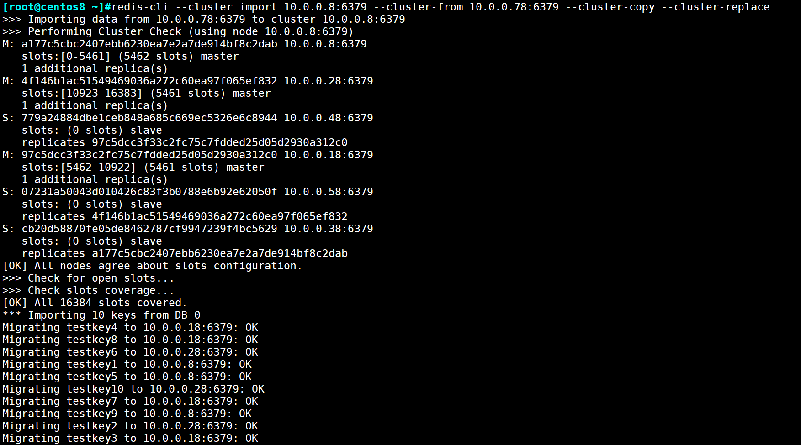

3.3.5.3.3 还原安全配置

```bash
#动态修改
#在所有节点(源节点和集群节点)还原Redis密码认证
[root@redis ~]# redis-cli  -p 6379  --no-auth-warning  CONFIG SET requirepass
"123456"
#还原配置protected-mode
[root@ubuntu2204 ~]#redis-cli -a 123456 config set protected-mode yes
```

### 集群偏斜

redis cluster 多个节点运行一段时间后,可能会出现倾斜现象,某个节点数据偏多,内存消耗更大,或者接受用户请求访问更多

发生倾斜的原因可能如下:

节点和槽分配不均不同槽对应键值数量差异较大包含bigkey,建议少用内存相关配置不一致热点数据不均衡 : 一致性不高时,可以使用本缓存和MQ

获取指定key在哪个槽位

```bash
#redis-cli cluster keyslot 【key】
[root@ubuntu2404 ~]#redis-cli -a 123456 cluster keyslot name
Warning: Using a password with '-a' or '-u' option on the command line interface
may not be safe.
(integer) 5798
```

获取指定槽位中对应键key值的个数

```bash
#redis-cli cluster countkeysinslot 【slot的值】
```

范例: 获取指定slot对应的key个数

```bash
[root@centos8 ~]#redis-cli -a 123456 cluster countkeysinslot 0
Warning: Using a password with '-a' or '-u' option on the command line interface
may not be safe.
(integer) 2
[root@centos8 ~]#redis-cli -a 123456 cluster countkeysinslot 1
(integer) 0
[root@centos8 ~]#redis-cli -a 123456 cluster countkeysinslot 2
(integer) 0
[root@centos8 ~]#redis-cli -a 123456 cluster countkeysinslot 3
(integer) 1
#槽位最大16383
[root@slave1 ~]#redis-cli -a 123456 cluster countkeysinslot 16384
Warning: Using a password with '-a' or '-u' option on the command line interface
may not be safe.
(error) ERR Invalid slot
```

执行自动的槽位重新平衡分布,但会影响客户端的访问,此方法慎用

```bash
#redis-cli --cluster rebalance <集群节点IP:PORT>
```

范例: 执行自动的槽位重新平衡分布

```bash
[root@centos8 ~]#redis-cli -a 123456 --cluster rebalance 10.0.0.8:6379
>>> Performing Cluster Check (using node 10.0.0.8:6379)
[OK] All nodes agree about slots configuration.
>>> Check for open slots...
>>> Check slots coverage...
[OK] All 16384 slots covered.
*** No rebalancing needed! All nodes are within the 2.00% threshold.
```

获取bigkey ,建议在slave节点执行

```bash
#redis-cli --bigkeys
```

范例: 查找 bigkey

```bash
[root@centos8 ~]#redis-cli -a 123456 --bigkeys
# Scanning the entire keyspace to find biggest keys as well as
# average sizes per key type.  You can use -i 0.1 to sleep 0.1 sec
# per 100 SCAN commands (not usually needed).
[00.00%] Biggest string found so far 'key8811' with 9 bytes
[26.42%] Biggest string found so far 'testkey1' with 10 bytes
-------- summary -------
Sampled 3335 keys in the keyspace!
Total key length in bytes is 22979 (avg len 6.89)
Biggest string found 'testkey1' has 10 bytes
3335 strings with 29649 bytes (100.00% of keys, avg size 8.89)
0 lists with 0 items (00.00% of keys, avg size 0.00)
0 sets with 0 members (00.00% of keys, avg size 0.00)
0 hashs with 0 fields (00.00% of keys, avg size 0.00)
0 zsets with 0 members (00.00% of keys, avg size 0.00)
0 streams with 0 entries (00.00% of keys, avg size 0.00)
```

### Redis Cluster 的局限性

### 集群的读写分离

在集群模式下的从节点是只读连接的，也就是说集群模式中的从节点是拒绝任何读写请求的。当有命令尝试从slave节点获取数据时，slave节点会重定向命令到负责该数据所在槽的节点。

为什么说是只读连接呢？因为slave可以执行命令：readonly，这样从节点就能读取请求，但是这只是在这次连接中生效。也就是说，当客户端断开连接重启后，再次请求又变成重定向了。

集群模式下的读写分离更加复杂，需要维护不同主节点的从节点和对于槽的关系。

通常是不建议在集群模式下构建读写分离，而是添加节点来解决需求。不过考虑到节点之间信息交流带来的带宽问题，官方建议节点数不超过1000个。

### 单机，主从，哨兵和集群的选择

大多数时客户端性能会”降低” 命令无法跨节点使用︰mget、keys、scan、flush、sinter等客户端维护更复杂︰SDK和应用本身消耗(例如更多的连接池) 不支持多个数据库︰集群模式下只有一个db 0 复制只支持一层∶不支持树形复制结构,不支持级联复制 Key事务和Lua支持有限∶操作的key必须在一个节点,Lua和事务无法跨节点使用

所以集群搭建还要考虑单机redis是否已经不能满足业务的并发量，在redis sentinel同样能够满足高可用，且并发并未饱和的前提下，搭建集群反而是画蛇添足了。

范例: 跨slot的局限性

```bash
[root@centos8 ~]#redis-cli -a 123456 mget key1 key2 key3
Warning: Using a password with '-a' or '-u' option on the command line interface
may not be safe.
(error) CROSSSLOT Keys in request don't hash to the same slot
```



<nav class="article-end" aria-label="章节导航">
  <a href="{{ '/subjects/Redis/12-redis-sentinel.html' | relative_url }}">← Previous: Redis Sentinel</a>
  <a href="{{ '/subjects/Redis/' | relative_url }}">Back to Redis Database Index</a>
  <a href="{{ '/subjects/Redis/14-common-interview-questions.html' | relative_url }}">Next: Common Interview Questions →</a>
</nav>
