[← 返回 Redis 数据库目录]({{ '/subjects/Redis/' | relative_url }})



# 13 Redis 集群

本篇先解释 Redis Cluster 为什么需要槽位和节点间通信，再以三主三从为例完成创建、验证、故障演练及扩缩容。命令中的地址和密码来自原实验环境，实际操作时应替换为自己的节点，并先在测试环境验证。Sentinel 解决单主的自动故障切换；当单主容量或写入吞吐成为瓶颈时，才需要考虑 Cluster 的分片。


## 1 架构与数据分区

### 1.1 主节点、副本与槽位

Cluster 将键空间划分为 **16,384 个哈希槽**，由多个主节点共同负责；每个主节点可配置副本以便故障切换。三主三从是一种常见的起步拓扑，而不是“六台机器自动均匀承担所有读写”：主节点处理各自槽位的写入，副本默认用于复制和故障接管。测试时可在三台机器上各运行两个实例，但生产环境最好把同一主节点及其副本分散到不同故障域。

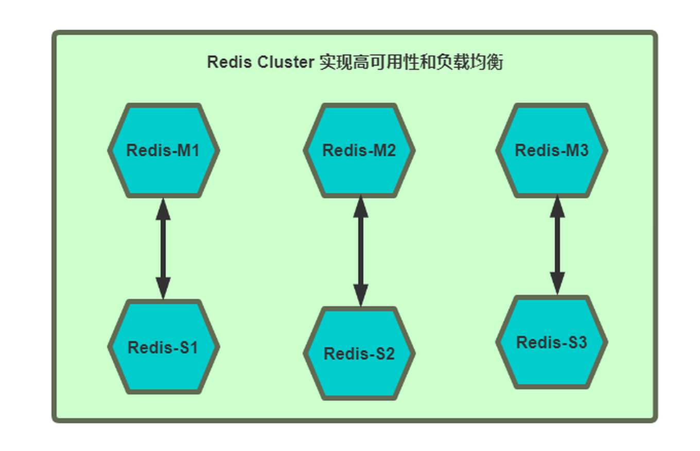


槽位示例：节点 A 负责 0–5460，节点 B 负责 5461–10922，节点 C 负责 10923–16383。区间可通过迁移重新分配；**槽位数接近并不保证内存或负载相等**，因为不同槽里的键大小和访问热度可能相差很大。

键的槽位由 `CRC16(key) mod 16384` 决定。若键名包含合法的 `{tag}`，则只对花括号中的非空标签计算槽位，例如 `order:{42}:items` 和 `order:{42}:status` 落在同一槽。跨键事务或多键命令要求相关键同槽，标签应围绕真实的业务聚合设计，不能让所有键使用同一个标签而制造热点。

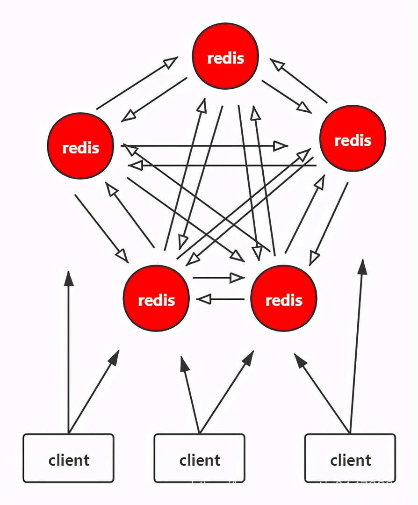

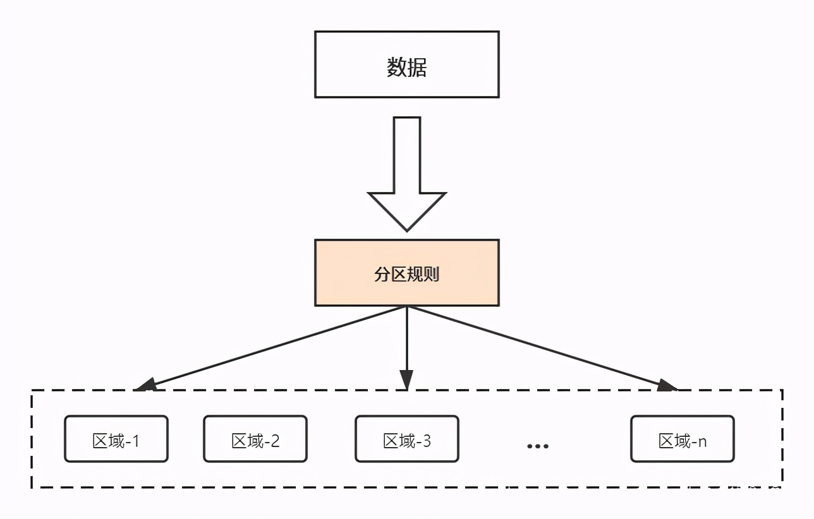

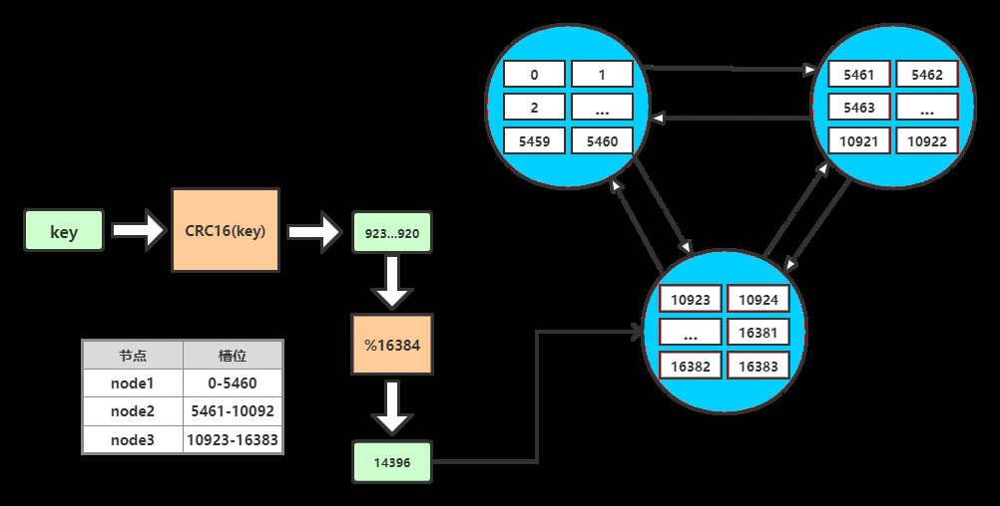

### 1.2 客户端路由与节点通信

客户端可以先连接任意集群节点。若访问的槽位由别的节点负责，服务端返回 `MOVED` 重定向，Cluster 客户端据此更新槽位映射；槽位迁移期间还可能出现 `ASK`，客户端需先向目标节点发送 `ASKING` 再执行本次命令。普通 `redis-cli` 可加 `-c` 自动跟随重定向，但业务程序仍应使用支持 Cluster 的客户端库。

节点通过集群总线交换成员、槽位和故障信息；默认总线端口为数据端口加 10000，例如 6379 对应 16379。创建和扩缩容时需要确保节点之间这两个端口都可达。节点互相认识不等于客户端一定“一次命中”，客户端缓存拓扑后仍可能在故障或迁移时收到重定向。

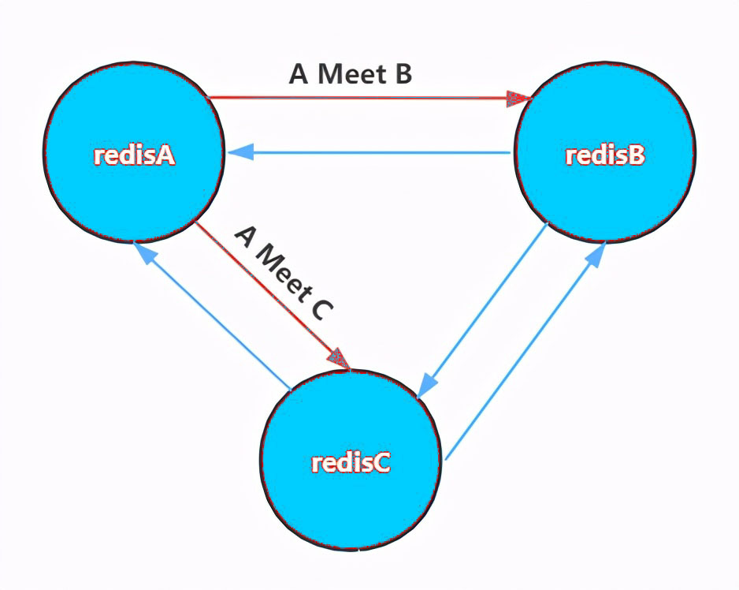

### 1.3 故障转移

节点周期性通信以发现不可达的主节点；当足够多的有投票权主节点报告故障，集群会将其标记为 FAIL。故障主节点的合格副本参与选举，获得多数票的副本晋升为主节点并接管原槽位。副本与旧主断连过久可能失去选举资格，相关阈值由 `cluster-node-timeout` 和 `cluster-replica-validity-factor` 等配置影响。故障切换依赖多数派，不保证异步复制的每一笔写入都已到达副本。

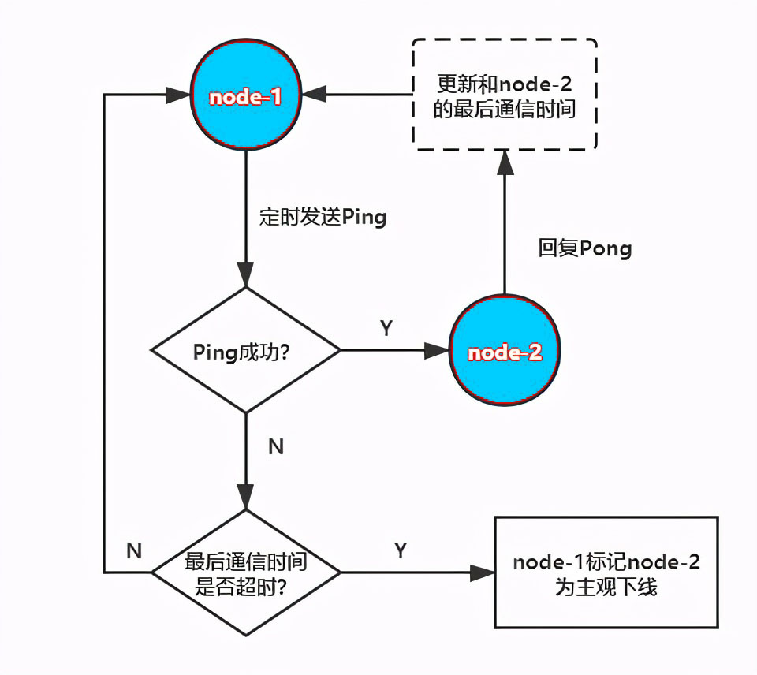


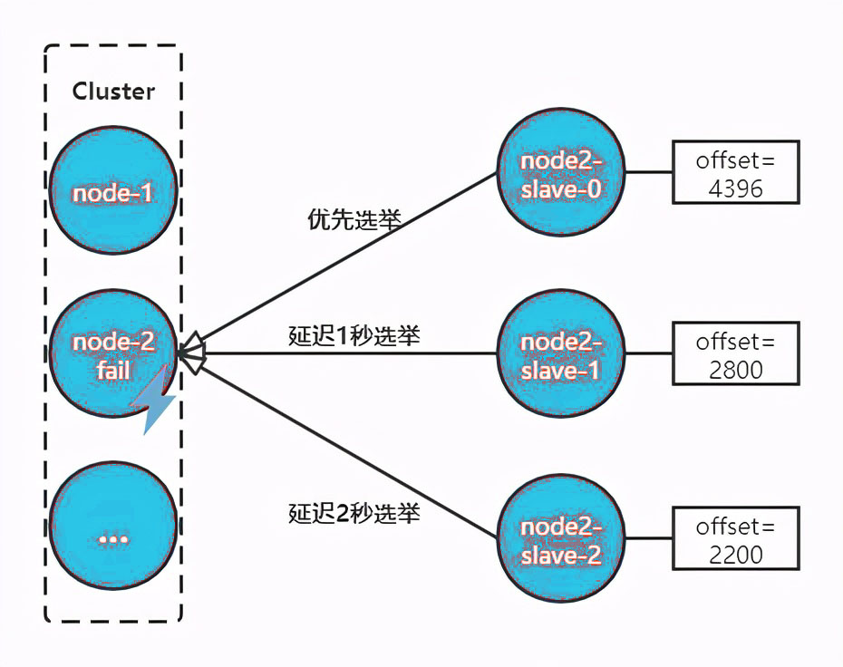

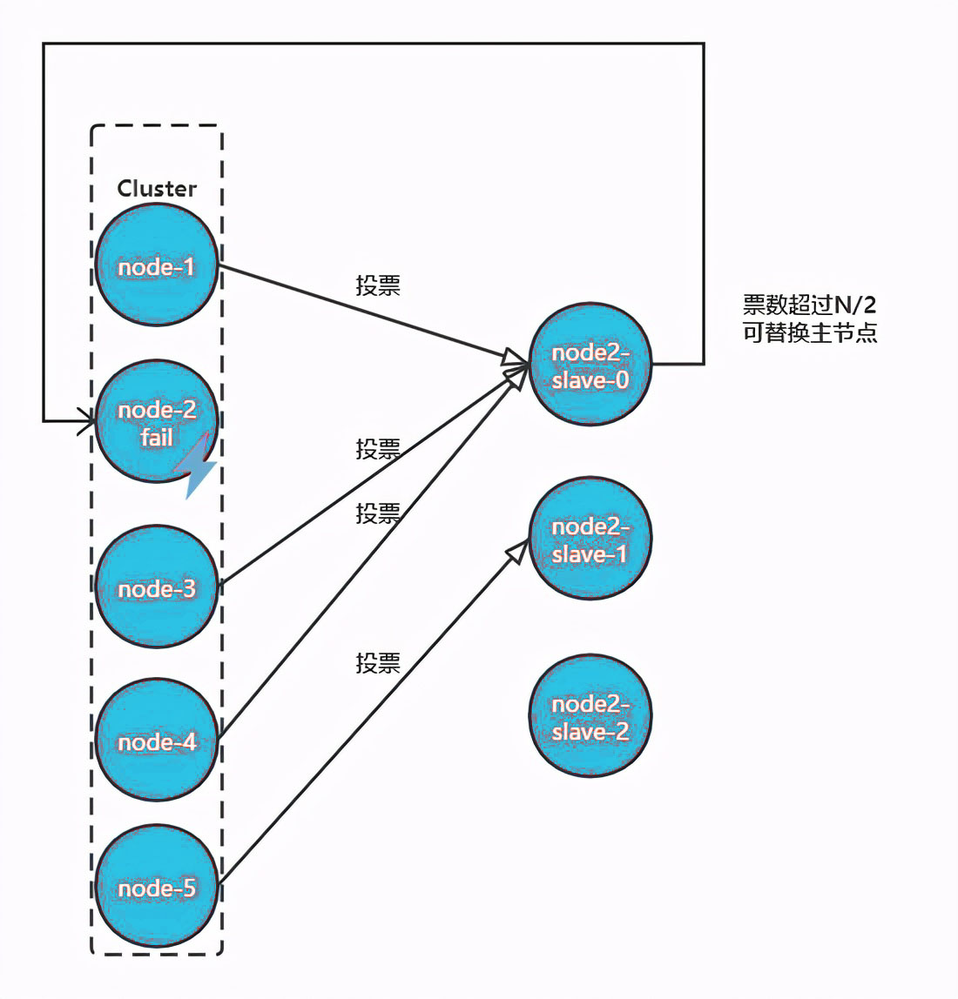

## 2 创建三主三从集群

### 2.1 部署前检查

原实验使用 10.0.0.8、10.0.0.18、10.0.0.28、10.0.0.38、10.0.0.48、10.0.0.58 六台主机，各运行一个 6379 实例。所有实例应使用相容的 Redis 版本，节点时钟、主机名、数据端口和总线端口均需检查。加入新集群的实例必须是空实例：不能带旧数据、旧的 `nodes.conf` 或残留的集群身份。清理前先确认备份，不能对已有业务实例直接执行清空命令。

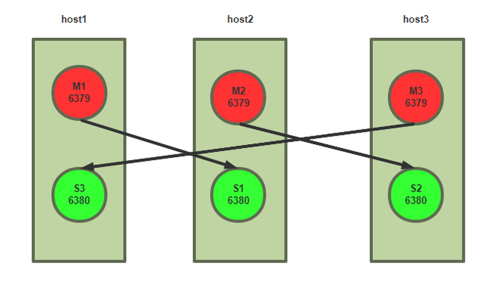

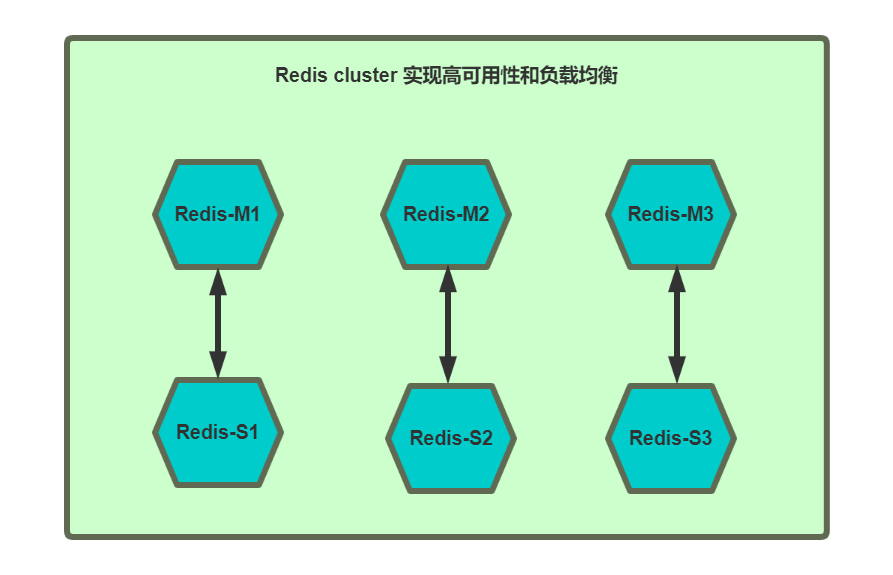

每个实例的配置重点如下。不要照搬原笔记的 `bind 0.0.0.0` 加明文 `requirepass 123456`：应将监听范围限制在集群网络，通过 ACL、网络隔离或 TLS 控制访问，凭据也应放入受保护的配置或秘密管理系统。以下保留最少的集群参数，路径与端口按实例分别设置。

```conf
port 6379
cluster-enabled yes
cluster-config-file nodes-6379.conf
cluster-node-timeout 15000
dir /var/lib/redis
```

`cluster-config-file` 由 Redis 自动维护，不应手工编辑。`cluster-require-full-coverage` 默认开启：任一槽位不可用时集群拒绝服务，以避免业务误把部分键空间可用当作全量可用。只有业务明确接受部分槽位失效后的降级语义，才考虑关闭。启用认证时还要保证节点间复制与通信的凭据配置一致。

Redis 5 及以上版本使用 `redis-cli --cluster` 管理集群；Redis 3/4 时代的 `redis-trib.rb` 已是旧版工具。部署前先在每台机器检查 `redis-cli PING`、6379/16379 端口和日志，再执行创建命令：

```bash
redis-cli --cluster create \
  10.0.0.8:6379 10.0.0.18:6379 10.0.0.28:6379 \
  10.0.0.38:6379 10.0.0.48:6379 10.0.0.58:6379 \
  --cluster-replicas 1
```

工具显示主从配对与槽位方案，核对故障域后再确认。若启用认证，使用受保护的 `REDISCLI_AUTH` 环境变量、ACL 用户等合适方式提供凭据，避免将密码写进可见命令行。创建后不要只看进程在运行，还要验证 16,384 个槽完整覆盖、各主节点都有副本。

```bash
redis-cli --cluster check 10.0.0.8:6379
redis-cli -h 10.0.0.8 -p 6379 CLUSTER INFO
redis-cli -h 10.0.0.8 -p 6379 CLUSTER NODES
redis-cli -h 10.0.0.8 -p 6379 INFO replication
```

期望 `cluster_state:ok`、`cluster_slots_assigned:16384`，并确认主从映射。Redis 4 的旧环境仍可参考原版 `redis-trib.rb create --replicas 1 ...` 的思路，但安装旧 Ruby 依赖或直接复制老版本操作记录，不适合作为当前部署步骤。下面两张原图对应旧版工具和密码配置，阅读时应注意它们描述的是历史环境，不是新版命令的输出。

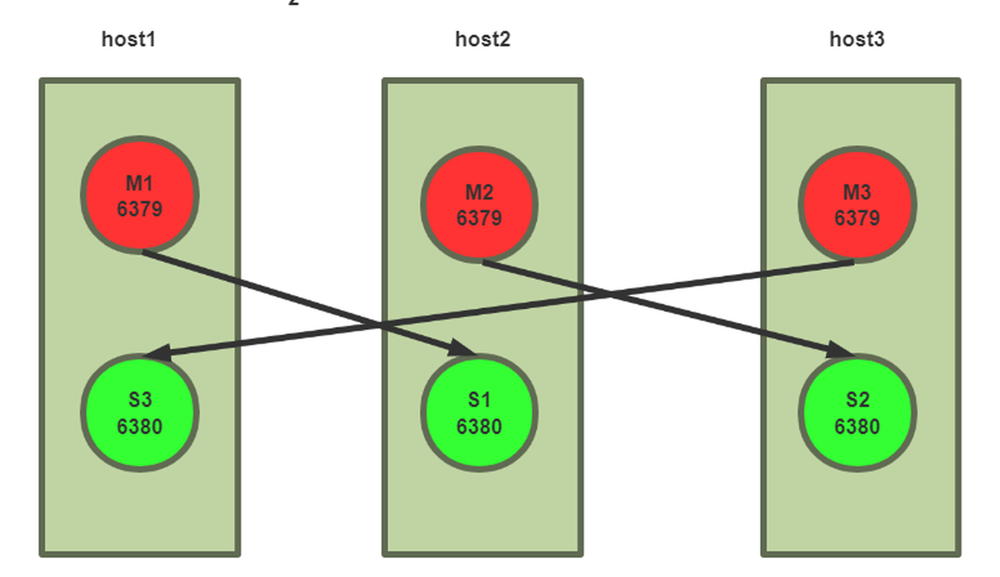


### 2.2 写入、槽位与客户端验证

```bash
redis-cli -c -h 10.0.0.8 -p 6379 SET 'order:{42}:status' paid
redis-cli -c -h 10.0.0.18 -p 6379 GET 'order:{42}:status'
redis-cli -h 10.0.0.8 -p 6379 CLUSTER KEYSLOT 'order:{42}:status'
```

第一次连接的节点未必拥有该槽，`-c` 会跟随重定向。Python 项目可使用支持 Cluster 的 `redis-py`，按安装版本核对 API；现代版本的基本写法如下，程序应管理连接池、超时与拓扑刷新：

```python
from redis.cluster import RedisCluster

client = RedisCluster(host="10.0.0.8", port=6379, password="从安全配置读取")
client.set("order:{42}:status", "paid")
print(client.get("order:{42}:status"))
```

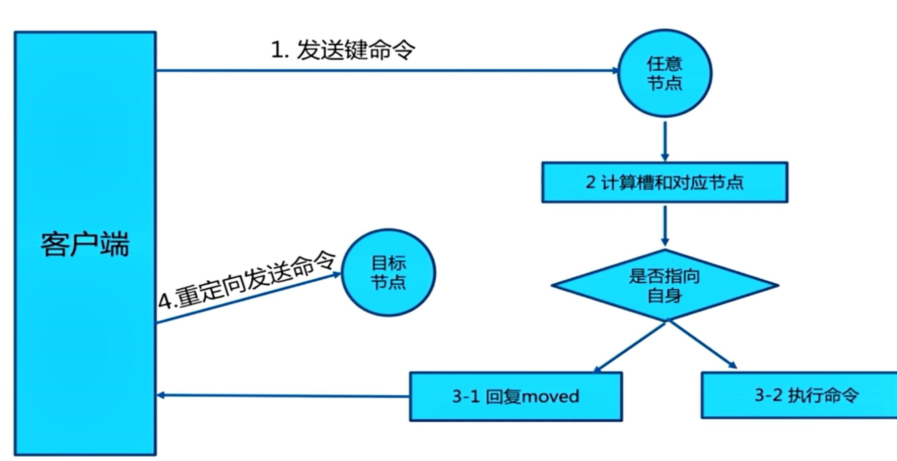

### 2.3 故障演练

先记录 `CLUSTER NODES`、`INFO replication` 和测试键，再在隔离的测试环境停止某个主节点。观察相应副本是否晋升、原槽位是否仍被完整覆盖，以及客户端是否能在重定向后继续读写。重新启动旧主后核对其新角色、复制状态和数据一致性；**不要把一次成功切换当成零数据丢失的证明**。生产环境应将备份恢复与故障切换演练分开验证。

## 3 节点扩容、缩容与数据导入

### 3.1 加入主节点并迁移槽位

新实例准备妥当后，先加入集群，再把部分槽位和其中的键迁过去；只有加入节点而不迁槽，新节点不会分担写入。原实验把 10.0.0.68 作为新主节点：

```bash
redis-cli --cluster add-node 10.0.0.68:6379 10.0.0.8:6379
redis-cli --cluster reshard 10.0.0.8:6379
redis-cli --cluster check 10.0.0.8:6379
```

`reshard` 交互步骤要核对迁移槽位数量、来源主节点 ID 和目标节点 ID。迁移在线上可进行，但会增加节点、网络和客户端负载，宜先备份并在低峰期执行，期间监控延迟、`MOVED`/`ASK` 重定向、`CLUSTER NODES` 的迁移状态以及槽位覆盖。

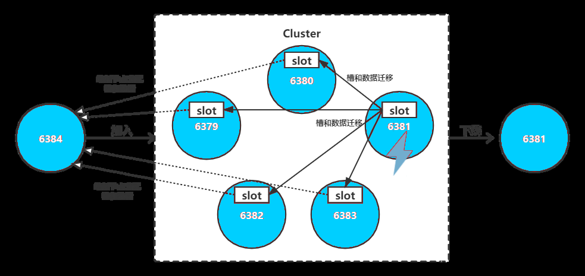

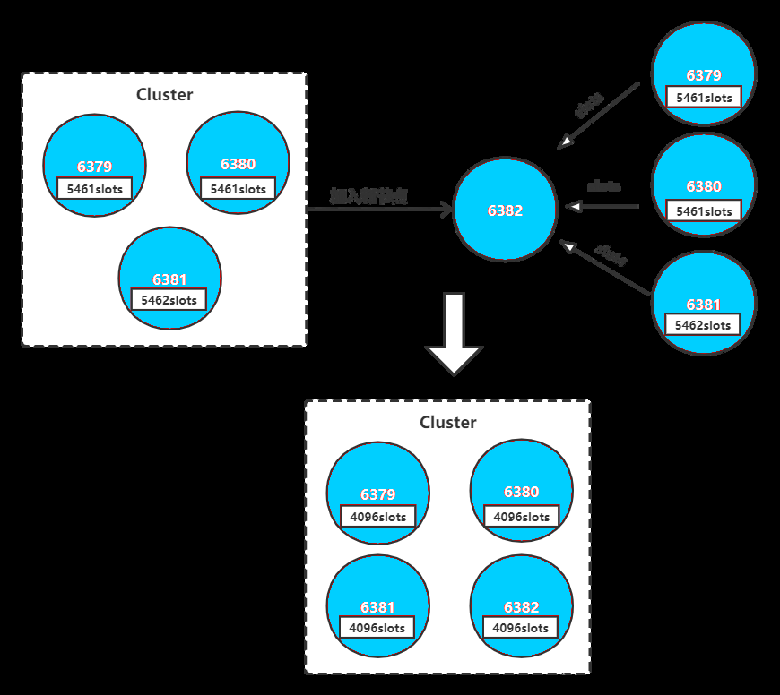

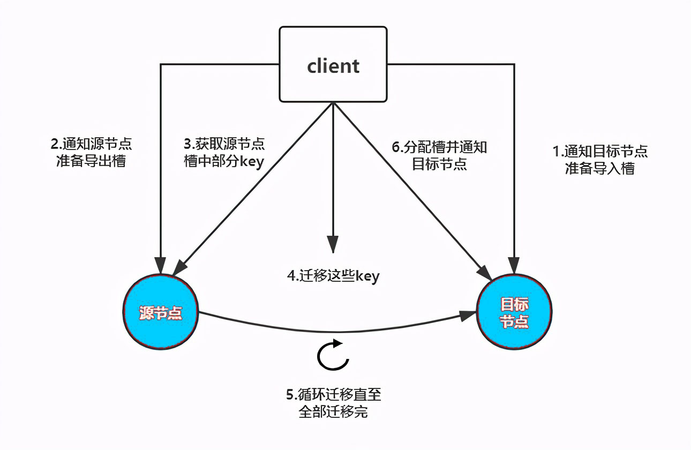

新主节点还需要副本。获取新主的节点 ID 后，将 10.0.0.78 加入为其副本；不要只凭地址顺序猜测主从配对：

```bash
redis-cli --cluster add-node 10.0.0.78:6379 10.0.0.8:6379 \
  --cluster-slave --cluster-master-id <新主节点ID>
redis-cli --cluster check 10.0.0.8:6379
```

### 3.2 安全缩容

先确定要下线的主节点 ID 及其全部槽位，把这些槽位迁移到保留的主节点并检查键迁移结果。只有当该主节点不再负责任何槽位，才能删除它；若有副本，还要明确副本是转移、保留还是一并删除。避免直接停掉带槽位的主节点，否则会触发故障切换或造成槽位缺失。

```bash
redis-cli --cluster reshard 10.0.0.8:6379
redis-cli --cluster check 10.0.0.8:6379
redis-cli --cluster del-node 10.0.0.8:6379 <待删除节点ID>
```

缩容后再次确认 `cluster_state:ok`、全部槽位覆盖、预期主从关系和业务读写。历史版本的 `redis-trib.rb add-node`、`reshard`、`del-node` 对应相同操作目标，但参数和交互与当前工具不同，不应混用。

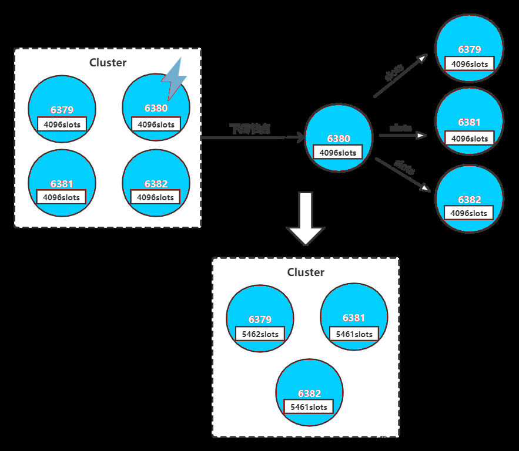

### 3.3 从单实例导入

迁移前确认源数据量、目标集群的内存余量、键冲突处理、停写或增量同步窗口。Redis 5+ 提供 `redis-cli --cluster import`，可从单实例导入键；`--cluster-copy` 保留源键，`--cluster-replace` 允许覆盖目标同名键，使用前必须明确业务语义。

```bash
redis-cli --cluster import 10.0.0.8:6379 \
  --cluster-from 10.0.0.68:6379 \
  --cluster-copy
redis-cli --cluster check 10.0.0.8:6379
```

导入不自动解决持续写入造成的增量差异。切换客户端前，应对比键数量、抽样值和关键业务读写；切换后保留可执行的回滚计划，而不是只依赖工具输出的“成功”字样。

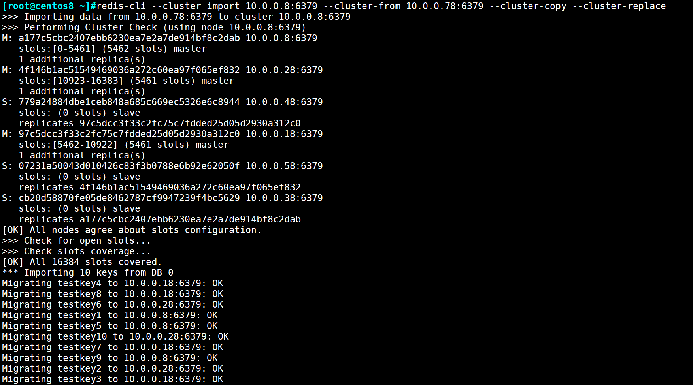

## 4 负载偏斜与选型边界

主节点内存或请求量偏高，可能是槽位数不均、槽内键数量/大小不均、大 key、热 key、客户端路由异常或副本/输出缓冲区占用。先对照 `CLUSTER NODES`、`INFO memory`、`INFO stats` 和业务访问分布，再用 `CLUSTER COUNTKEYSINSLOT`、`redis-cli --bigkeys` 等抽样定位。不要只凭槽位数量决定迁移；热 key 在单槽内，即使均分槽位也不一定能消除热点。

```bash
redis-cli --cluster info 10.0.0.8:6379
redis-cli -h 10.0.0.8 -p 6379 CLUSTER COUNTKEYSINSLOT <槽位号>
redis-cli --cluster rebalance 10.0.0.8:6379 --cluster-simulate
```

确认模拟结果与业务影响后，才考虑真正的重平衡。扫描大键和迁槽都可能增加延迟，宜限速并监控。

Cluster 只有 DB 0；跨槽多键命令、事务及 Lua 脚本受到限制，相关键通常必须同槽。副本默认不直接服务读请求，客户端若需要在副本读取，须显式使用 `READONLY` 并承担复制延迟与路由复杂度。Cluster 还要求客户端维护更多连接和拓扑信息；它不是“开启后必然更快”。如果容量和写入仍能由单主满足，而主要需求是自动故障切换，主从加 Sentinel 通常更简单。选型应依据容量、吞吐、一致性、运维复杂度和故障域，而不是仅凭节点数量。



<nav class="article-end" aria-label="章节导航">
  <a href="{{ '/subjects/Redis/12-redis-sentinel.html' | relative_url }}">← 上一篇：Redis Sentinel</a>
  <a href="{{ '/subjects/Redis/' | relative_url }}">返回 Redis 数据库目录</a>
  <a href="{{ '/subjects/Redis/14-common-interview-questions.html' | relative_url }}">下一篇：常见面试题 →</a>
</nav>
